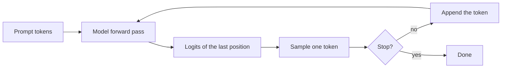
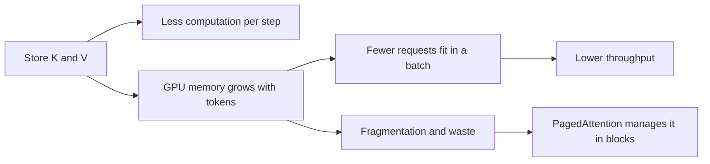

## 1. The question this idea answers

A language model writes text one token at a time. To choose token number $t+1$, the model runs all its layers for token $t$. In every layer, attention compares the newest token with every earlier token. For that comparison, the layer needs the key vector and the value vector of each earlier token.

So where do those earlier keys and values originate at each step? There are only two choices:

1. **Recompute them.** Run the whole sequence through the model again at every step.
2. **Store them.** Compute each key and value once, keep it in GPU memory, and read it at every later step.

Choice 2 is the **KV cache** (key-value cache). Every production LLM server uses it. The vLLM paper defines it in one sentence: "the key and value vectors of existing tokens are often cached for generating future tokens, known as KV cache" (Kwon et al., 2023, §2.2).

An interviewer who hears "KV cache" asks three questions, in this order. This lesson answers all three:

- **Why can we store them?** In a causal model, the keys and values of past tokens never change. Section 6 proves it.
- **What exactly do we store?** Per layer, per KV head and per token: one key vector and one value vector. Section 8 shows it.
- **What does it save, and what does it cost?** It removes almost all repeated computation. It costs GPU memory that grows with every token. Sections 9 and 10 count both.

## 2. Mental model

> [!analogy] A library with one card per book on every floor
> A library has 32 floors. Each new book gets one index card on every floor. A card has a label (the key) and a short summary (the value). A visitor with a question (the query) reads the labels of all cards on a floor. The visitor decides which cards matter and blends their summaries into an answer. That answer is what the visitor carries to the next floor.
>
> When a new book arrives, the old cards stay correct. Each card describes only its own book and the books that arrived before it. So the staff write cards for the new book only. Without the card files, the staff would rewrite every card on every floor each time one book arrives. They would write exactly the same cards again.
>
> **Where it stops working:** the visitor still reads every card on every floor at every step. So the reading work grows with the number of books. The cards also fill the building: in Llama-3.1-8B, each token adds 128 KiB of cards. And a card does not belong to the book alone. The same word at another place in another text gets a different card.

## 3. Terms

| Term | Plain meaning |
|---|---|
| token | One piece of text (a word or a part of a word). The model reads and writes token IDs. |
| autoregressive generation | Writing one token at a time. Each new token becomes part of the input for the next step. |
| hidden state | The vector that represents one token position between two layers. Its length is $d$ (4,096 in Llama-3.1-8B). |
| layer | One transformer block: attention, then an MLP, with norms and residual connections. Llama-3.1-8B has $L = 32$ layers. |
| query, key, value | Three vectors that attention computes from each hidden state. A query is compared with keys. The scores weight the values. |
| projection | A multiplication by a learned weight matrix, for example $k_i = x_i W_K$. |
| causal mask | The rule that position $i$ can attend only to positions $1$ to $i$, never to a later position. |
| KV cache | The stored key vectors and value vectors of all earlier tokens, for every layer and every KV head. |
| KV head | One pair of key and value projections inside a layer. With grouped-query attention (GQA), several query heads share one KV head. |
| head dimension $d_h$ | The length of one key vector or one value vector in one head. It is 128 in Llama-3.1-8B. |
| prefill | The first forward pass over the whole prompt. It fills the KV cache and produces the first new token. |
| decode step | One forward pass that produces one new token for each sequence in the batch. |
| token pass | In these notes: one token position processed once through all layers. |
| FLOP | One floating-point operation: one multiply or one add. |
| RoPE | Rotary position embedding. It rotates each query vector and key vector by an angle that depends on the token position. |
| memory-bound | A computation whose speed is limited by how fast data moves from GPU memory, not by arithmetic. |

All terms are also in the [Glossary](/notes/ai/llm-systems/glossary).

## 4. What attention needs for one new token

### 4.1 The formula for one query

Part 02 derives attention in full ([L3: Scaled dot-product attention](/notes/ai/llm-systems/02-attention-and-the-transformer/l3-scaled-dot-product-attention)). Here we need only one row of it: the output for the newest position $t$.

Each position $i$ has an input row vector $x_i$. It is the hidden state that enters this layer. The layer computes three projections:

$$
q_i = x_i W_Q, \qquad k_i = x_i W_K, \qquad v_i = x_i W_V
$$

The output of position $t$ is a weighted average of the value vectors of positions $1$ to $t$:

$$
a_{tj} = \frac{\exp\left(q_t \cdot k_j / \sqrt{d_h}\right)}{\sum_{m=1}^{t} \exp\left(q_t \cdot k_m / \sqrt{d_h}\right)}, \qquad o_t = \sum_{j=1}^{t} a_{tj} \, v_j
$$

The symbols mean:

- $a_{tj}$ is the attention weight that position $t$ gives to position $j$. The weights of one row add to 1.
- $q_t \cdot k_j$ is a dot product: multiply the two vectors entry by entry, then add.
- $\sqrt{d_h}$ keeps the scores in a range where softmax works well ([part 02 L3](/notes/ai/llm-systems/02-attention-and-the-transformer/l3-scaled-dot-product-attention)).
- The sums stop at $t$. That is the causal mask: position $t$ never sees a later position.

The vLLM paper writes the same equations with column vectors, $q_i = W_q x_i$ (Kwon et al., 2023, §2.1). The math is the same.

### 4.2 Read the formula as a shopping list

| What position $t$ needs | How many | New at this step? |
|---|---|---|
| the query $q_t$ | one vector | Yes, always |
| the keys $k_1, \dots, k_t$ | $t$ vectors | Only $k_t$ is new |
| the values $v_1, \dots, v_t$ | $t$ vectors | Only $v_t$ is new |
| older queries $q_1, \dots, q_{t-1}$ | none | Not needed |

> [!key] The key observation
> The newest output needs the **newest query** and **all keys and values**. If the old keys $k_1 \dots k_{t-1}$ and old values $v_1 \dots v_{t-1}$ stay the same from step to step, we can compute them once and store them. Section 6 proves that they stay the same.

### 4.3 Generation is a loop

The model produces a probability for every token in the vocabulary. A sampler chooses one token. That token joins the sequence, and the loop repeats ([part 02 L4](/notes/ai/llm-systems/02-attention-and-the-transformer/l4-causal-masking-and-generation)).



The simplest loop, with no cache, sends the full sequence into the model at every step. In pseudocode:

```text
tokens = prompt_tokens
repeat:
    logits = model(tokens)            # every token, every layer, again
    next_token = sample(logits[last]) # only the last position is used
    tokens.append(next_token)
```

Only the last row of the logits is used. Every other row is computed and then discarded. The rest of this lesson shows how much of that work is identical to the work of the step before.

## 5. The waste, with the toy numbers

### 5.1 The toy model

These notes use one shared toy example in every attention lesson. It has four tokens, $d = 4$, one layer, one head and $d_h = 2$. Vectors are rows.

```text
x_the  = [1, 0, 1, 0]
x_cat  = [0, 1, 0, 1]
x_sat  = [1, 1, 0, 0]
x_down = [0, 1, 1, 0]

W_Q = [[0,0],[0,1],[1,1],[0,0]]
W_K = [[0,0],[0,1],[1,0],[0,1]]
W_V = [[1,1],[0,1],[1,2],[2,1]]
```

A row vector times a matrix adds the matrix rows that the vector selects. For example, $x_{the} = [1, 0, 1, 0]$ selects rows 1 and 3. So $k_{the} = [0,0] + [1,0] = [1, 0]$.

### 5.2 Step 3: the prompt "the cat sat"

The model processes the three prompt tokens. Each projection is one sum of two matrix rows.

| Token | selects rows | $q = x W_Q$ | $k = x W_K$ | $v = x W_V$ |
|---|---|---|---|---|
| the | 1, 3 | [1, 1] | [1, 0] | [2, 3] |
| cat | 2, 4 | [0, 1] | [0, 2] | [2, 2] |
| sat | 1, 2 | [0, 1] | [0, 1] | [1, 2] |

The causal softmax rows (4 decimals) are $[1, 0, 0]$ for "the", $[0.1956, 0.8044, 0]$ for "cat" and $[0.1400, 0.5760, 0.2840]$ for "sat". The outputs are $o_{the} = [2, 3]$, $o_{cat} = [2, 2.1956]$ and $o_{sat} = [1.7160, 2.1400]$.

### 5.3 Step 4 without a cache: "down" arrives

The naive loop sends all four tokens again. It computes four keys and four values:

| Token | $k$ at step 3 | $k$ at step 4 | $v$ at step 3 | $v$ at step 4 |
|---|---|---|---|---|
| the | [1, 0] | [1, 0] | [2, 3] | [2, 3] |
| cat | [0, 2] | [0, 2] | [2, 2] | [2, 2] |
| sat | [0, 1] | [0, 1] | [1, 2] | [1, 2] |
| down | (none) | [1, 1] | (none) | [1, 3] |

The first three rows are identical. They must be identical: $k_{cat} = x_{cat} W_K$, and neither $x_{cat}$ nor $W_K$ changed. The naive step also recomputes the three old queries and the three old output rows. Those outputs are identical too, because the causal mask hides "down" from them.

So at step 4 the naive loop does 12 row projections (4 tokens times 3 matrices). Only 3 of them produce new numbers: $q_4$, $k_4$ and $v_4$.

### 5.4 Step 4 with a cache

The cache holds $K = [[1,0],[0,2],[0,1]]$ and $V = [[2,3],[2,2],[1,2]]$ from step 3. The decode step projects only "down" and appends one row to each matrix.

> [!example] Worked example: the decode step for "down" with a cache
> 1. Project the new token: $q_4 = x_{down} W_Q = [0,1] + [1,1] = [1, 2]$. $k_4 = [0,1] + [1,0] = [1, 1]$. $v_4 = [0,1] + [1,2] = [1, 3]$.
> 2. Append: $K = [[1,0],[0,2],[0,1],[1,1]]$ and $V = [[2,3],[2,2],[1,2],[1,3]]$.
> 3. Raw scores $q_4 \cdot k_j$: $1 \cdot 1 + 2 \cdot 0 = 1$, then $0 + 4 = 4$, then $0 + 2 = 2$, then $1 + 2 = 3$. So $[1, 4, 2, 3]$.
> 4. Scale by $1/\sqrt{2}$: $[0.7071, 2.8284, 1.4142, 2.1213]$.
> 5. Subtract the maximum 2.8284: $[-2.1213, 0, -1.4142, -0.7071]$. Exponentiate: $[0.1199, 1, 0.2431, 0.4931]$. The sum is 1.8561.
> 6. Divide by the sum: weights $[0.0646, 0.5388, 0.1310, 0.2657]$.
> 7. Weighted sum of the value rows: $0.0646 \cdot [2,3] + 0.5388 \cdot [2,2] + 0.1310 \cdot [1,2] + 0.2657 \cdot [1,3]$ $= [0.1292, 0.1938] + [1.0776, 1.0776] + [0.1310, 0.2620] + [0.2657, 0.7970]$.
> 8. Result: $o_4 = [1.6034, 2.3302]$. The rounded parts above add to $[1.6035, 2.3304]$. The exact sums, before rounding, are $[1.6034, 2.3302]$.
>
> The naive step gives exactly the same $o_4$. The cache changed the work, not the answer.


```video
{"src": "/notes/media/llm-systems/manim/m10-recompute-vs-cache.mp4", "caption": "The same decode step for down, first with full recomputation and then with a KV cache."}
```

## 6. Proof: past keys and values never change

The toy has one layer. A real model has 32 or more. In layer 2, the key of "cat" is computed from the hidden state of "cat" after layer 1. That hidden state depends on attention in layer 1, which mixes tokens. Could it change when "down" arrives? The answer is no, and here is the proof.

### 6.1 Notation

- $h_i^{(\ell)}$ is the hidden state of position $i$ after layer $\ell$. The layers are $\ell = 1, \dots, L$.
- $h_i^{(0)}$ is the input of layer 1: the embedding row of token $i$.
- $k_i^{(\ell)}$ and $v_i^{(\ell)}$ are the key and value of position $i$ in layer $\ell$. They are projections of $h_i^{(\ell-1)}$.

### 6.2 The claim and the proof

**Claim.** For every layer $\ell$ and every position $i$, the hidden state $h_i^{(\ell)}$ depends only on the tokens at positions $1$ to $i$.

**Proof by induction over the layers.**

1. **Base case ($\ell = 0$).** $h_i^{(0)}$ is the embedding row of token $i$. It depends on token $i$ only. Llama models add no position vector here, because RoPE acts inside attention.
2. **Induction step.** Assume the claim holds for layer $\ell - 1$. Layer $\ell$ computes the new state of position $i$ in four parts:
   1. **Norm.** RMSNorm divides each hidden state by its own root mean square and multiplies it by learned weights. It uses only $h_i^{(\ell-1)}$.
   2. **Projections.** $q_i$, $k_i$ and $v_i$ use only the normed $h_i^{(\ell-1)}$. RoPE rotates $q_i$ and $k_i$ by an angle that depends only on the position number $i$.
   3. **Attention.** The output of position $i$ uses $q_i$ and the keys and values of positions $j \le i$. The causal mask forbids $j > i$. By the assumption, all of these depend only on tokens $1$ to $i$.
   4. **Residual and MLP.** The residual adds the old state of position $i$. The MLP acts on each position alone.

   So $h_i^{(\ell)}$ depends only on tokens $1$ to $i$.
3. **Conclusion.** When token $t+1$ arrives, no state $h_i^{(\ell)}$ with $i \le t$ changes, in any layer. So no key $k_i^{(\ell)}$ and no value $v_i^{(\ell)}$ with $i \le t$ changes. We can store them. $\blacksquare$

The vLLM paper states the other side of the same fact: "Note that the KV cache of one token depends on all its previous tokens" (Kwon et al., 2023, §2.2). A cache entry depends on the past. It never depends on the future.

> [!key] The two conditions that make the cache possible
> 1. **Causality.** Position $i$ never reads a later position.
> 2. **Per-position operations.** Everything except attention (norms, projections, RoPE, MLP, residual) acts on one position at a time.
>
> Together they make every hidden state, and so every key and value, final at the moment it is computed.

### 6.3 Check the proof with numbers

The next program builds a random two-layer causal transformer with RMSNorm, attention, an output projection, a ReLU MLP and residual connections. It runs the model on 3 tokens and on 4 tokens. Then it compares the hidden states of the first 3 positions after each layer. It repeats the test without the causal mask.

```python
import numpy as np

rng = np.random.default_rng(0)
d, d_h, n_layers = 8, 4, 2
layers = [{name: rng.normal(size=shape) / np.sqrt(shape[0])
           for name, shape in [("W_Q", (d, d_h)), ("W_K", (d, d_h)),
                               ("W_V", (d, d_h)), ("W_O", (d_h, d)),
                               ("W_1", (d, 4 * d)), ("W_2", (4 * d, d))]}
          for _ in range(n_layers)]


def rmsnorm(H):                        # acts on each row (token) alone
    return H / np.sqrt((H ** 2).mean(axis=1, keepdims=True) + 1e-6)


def attention(H, p, causal):
    Q, K, V = H @ p["W_Q"], H @ p["W_K"], H @ p["W_V"]
    S = Q @ K.T / np.sqrt(d_h)
    if causal:                         # hide the future: j > i
        S = np.where(np.triu(np.ones_like(S), k=1) == 1, -np.inf, S)
    P = np.exp(S - S.max(axis=1, keepdims=True))
    P = P / P.sum(axis=1, keepdims=True)
    return (P @ V) @ p["W_O"]


def forward(X, causal=True):
    H, states = X, []
    for p in layers:
        H = H + attention(rmsnorm(H), p, causal)               # mixes tokens
        H = H + np.maximum(rmsnorm(H) @ p["W_1"], 0) @ p["W_2"]  # per token
        states.append(H)
    return states


X = rng.normal(size=(4, d))            # 4 tokens
for causal in (True, False):
    short, long = forward(X[:3], causal), forward(X, causal)
    diffs = [np.abs(s - l[:3]).max() for s, l in zip(short, long)]
    print("causal" if causal else "bidirectional", np.round(diffs, 6))
```

Output:

```text
causal [0. 0.]
bidirectional [3.320292 2.740021]
```

What the important lines do:

- `rmsnorm` divides each row by its own root mean square. No row reads another row. This is a per-position operation.
- `np.triu(..., k=1)` marks every entry above the diagonal, where $j > i$. Setting those scores to $-\infty$ makes their softmax weight exactly 0.
- `H = H + attention(...)` is the only line where tokens mix. With the mask, row $i$ mixes only rows $j \le i$.
- `l[:3]` takes the first 3 rows of the 4-token run. The causal model gives a difference of exactly 0 in both layers. So the keys and values that layer 2 computes from those rows are also unchanged.
- Without the mask, the old rows change by more than 2.7 in both layers. A bidirectional model (an encoder such as BERT) cannot reuse old keys and values when the input grows.

### 6.4 When the proof does not hold

| Situation | What happens to the cache |
|---|---|
| Bidirectional attention (encoders) | Every hidden state changes when a token arrives. A growing input cannot use a KV cache. |
| Positions that are renumbered | StreamingLLM keeps a few first tokens plus a recent window and numbers the positions inside the cache. It states: "we cache the Keys of tokens prior to introducing the rotary transformation" and then applies the position transformation "at each decoding phase" (Xiao et al., 2023, §3.2). |
| Sliding-window attention | Old keys and values still never change. An old token only stops being visible, so the engine can delete it ([L6](/notes/ai/llm-systems/03-kv-cache/l6-shrinking-the-kv-cache)). |
| Different kernels or batch shapes | The prefill kernel computed the cached values. A full recomputation can use other kernels, and floating-point sums in another order can differ in the last bits. Interpretation of these notes: this is a numerical effect, not a logical one ([part 04 L5](/notes/ai/llm-systems/04-inference/l5-sampling-and-structured-output)). |

## 7. Why queries are not cached

A query has one job: position $i$ uses $q_i$ to compute its own output $o_i$. After that, no later step reads $q_i$. At step $t$, only $q_t$ is needed, and it is new anyway.

The same holds for the attention weights $a_{ij}$ and the outputs $o_i$ of past positions. The next layer consumed $o_i$ at the time it was produced. No later step needs it again.

| Vector of a past position $i$ | Read by a later step? | Cached? |
|---|---|---|
| query $q_i$ | No | No |
| key $k_i$ (every layer) | Yes, by every later query | Yes |
| value $v_i$ (every layer) | Yes, by every later query | Yes |
| weights $a_{ij}$ | No | No |
| output $o_i$ and hidden state $h_i$ | No | No |

### 7.1 Could we cache the hidden state instead?

An engine could store $h_i^{(\ell-1)}$ and recompute $k_i$ and $v_i$ from it at every step. Compare the sizes per token and per layer:

- Hidden state: $d$ numbers. For Llama-3.1-8B, 4,096.
- Key plus value: $2 \times H_{kv} \times d_h$ numbers. For Llama-3.1-8B, $2 \times 8 \times 128 = 2{,}048$.

With GQA, the key and value are half the size of the hidden state, and they need no recomputation. So K and V are the better thing to store. For an older model without GQA, such as Llama-2-7B, key plus value is $2 \times 32 \times 128 = 8{,}192$ numbers. That is twice the hidden state. Storing the hidden state would halve the memory, but every step would multiply every past hidden state by $W_K$ and $W_V$ again.

Interpretation of these notes: multi-head latent attention (MLA) in DeepSeek models follows a related idea. It stores a small latent vector per token and layer and rebuilds keys and values from it ([L5](/notes/ai/llm-systems/03-kv-cache/l5-mha-mqa-gqa-and-mla)).

## 8. What exactly is in the cache

### 8.1 One entry per layer, per KV head, per token

For each layer, each KV head and each token, the cache holds:

- one key vector of $d_h$ numbers, and
- one value vector of $d_h$ numbers.

Each layer needs its own entries. Each layer has its own $W_K$ and $W_V$, and its own input $h^{(\ell-1)}$.

For Llama-3.1-8B, one token adds:

$$
\underbrace{32}_{\text{layers}} \times \underbrace{8}_{\text{KV heads}} \times \underbrace{2}_{\text{K and V}} \times \underbrace{128}_{d_h} = 65{,}536 \text{ numbers}
$$

In BF16 (2 bytes per number) that is 131,072 bytes = 128 KiB per token. [L3](/notes/ai/llm-systems/03-kv-cache/l3-the-kv-cache-size-formula) derives the general formula.


### 8.2 The tensor shape

Hugging Face Transformers stores the cache per layer. Its documentation states: "The key and value caches are tensors with the shape `[batch_size, num_heads, seq_len, head_dim]`." Here `num_heads` is the number of KV heads. For Llama-3.1-8B and one sequence of $T$ tokens, each layer holds a key tensor $[1, 8, T, 128]$ and a value tensor of the same shape. A decode step adds one position on the `seq_len` axis. [L4](/notes/ai/llm-systems/03-kv-cache/l4-implementing-a-kv-cache) implements this.

### 8.3 Keys are stored after RoPE

RoPE rotates each query and key by an angle that depends on its position ([part 02 L6](/notes/ai/llm-systems/02-attention-and-the-transformer/l6-the-transformer-block)). The Llama attention code in Hugging Face Transformers applies RoPE first and writes to the cache after. The excerpt below is part of the method `LlamaAttention.forward`, so it does not run alone:

```python
query_states = self.q_proj(hidden_states).view(hidden_shape).transpose(1, 2)
key_states = self.k_proj(hidden_states).view(hidden_shape).transpose(1, 2)
value_states = self.v_proj(hidden_states).view(hidden_shape).transpose(1, 2)
cos, sin = position_embeddings
query_states, key_states = apply_rotary_pos_emb(query_states, key_states, cos, sin)
if past_key_values is not None:
    key_states, value_states = past_key_values.update(key_states, value_states, self.layer_idx)
```

What the lines do:

- `k_proj(...)` is the projection $x W_K$. `.view(hidden_shape)` splits the 1,024 numbers into 8 heads of 128. `.transpose(1, 2)` moves the head axis before the token axis: $[B, T, 8, 128] \to [B, 8, T, 128]$.
- `apply_rotary_pos_emb` rotates the queries and keys of the new tokens by the angles of their own positions.
- `past_key_values.update(...)` appends the new rotated keys and the new values to this layer's cache. It returns the full keys and values, old plus new, for attention.

Why after RoPE? A key at position $m$ is rotated by the angle of $m$. That position never changes, so the rotation is final, and the engine rotates each key once. The query at position $n$ is rotated at its own step. Their dot product then depends on $n - m$, which is the purpose of RoPE. Values get no rotation.

> [!trap] A cache entry is not a property of a token
> The vLLM paper says it directly: "the KV cache of the same token appearing at different positions in a sequence will be different" (Kwon et al., 2023, §2.2). The key of "cat" depends on its position (RoPE) and, from layer 2 on, on every earlier token. So two requests can share cache entries only when they share an identical prefix. That is the basis of prefix caching ([part 04 L9](/notes/ai/llm-systems/04-inference/l9-prefix-caching-and-kv-reuse)).

## 9. What the cache saves

### 9.1 Count token passes

Generate a sequence that grows from 1 to $T$ tokens.

- **Without a cache**, step $t$ runs all $t$ tokens through all layers. Total: $1 + 2 + \dots + T = \frac{T(T+1)}{2}$ token passes.
- **With a cache**, step $t$ runs one token. Total: $T$ token passes.

| $T$ | Without cache | With cache | Ratio $\frac{T+1}{2}$ |
|---|---|---|---|
| 10 | 55 | 10 | 5.5 |
| 100 | 5,050 | 100 | 50.5 |
| 1,000 | 500,500 | 1,000 | 500.5 |
| 8,192 | 33,558,528 | 8,192 | 4,096.5 |

> [!trap] The waste is the whole forward pass, not only the K and V projections
> To get the key of "cat" in layer 20, a cacheless engine needs the hidden state of "cat" after layer 19. That needs attention and the MLP of "cat" in layers 1 to 19. So without a cache, every past token runs through the full model again, at every step.

### 9.2 Count FLOPs per step

Two rules give almost all the arithmetic of a decoder.

1. **Weight multiplications.** One token through a weight matrix with $n$ weights costs $2n$ FLOPs. That is one multiply and one add per weight ([part 01 L2](/notes/ai/llm-systems/01-math-and-hardware/l2-matrices-and-matrix-multiplication)). Llama-3.1-8B has 6,979,584,000 weights inside its 32 blocks and 525,336,576 in its output head. The input embedding is a table lookup with no multiplications.
2. **Attention arithmetic.** A query at position $t$ computes $t$ dot products of length $d_h$ for the scores. Then it adds $t$ weighted value vectors of length $d_h$. That is $2 t d_h + 2 t d_h = 4 t d_h$ FLOPs per query head. With $H = 32$ query heads and $H d_h = d = 4{,}096$, it is $4 t d$ per layer and $4 L d t$ for the model.

So, with $N_{blk} = 6.98 \times 10^9$ block weights and $N_{head} = 0.525 \times 10^9$ head weights:

$$
F_{\text{with}}(t) = 2 N_{blk} + 2 N_{head} + 4 L d \, t
$$

$$
F_{\text{without}}(t) = 2 N_{blk} \, t + 4 L d \, \frac{t(t+1)}{2} + 2 N_{head}
$$

The first line is one token through the blocks, the head, and one row of attention over $t$ cached positions. The second line is $t$ tokens through the blocks, a full causal attention over $t$ positions, and the head for the last position only.

> [!example] Worked example: Llama-3.1-8B, a 1,000-token prompt and 1,000 new tokens
> With a cache: one prefill of 1,000 tokens, then 999 decode steps at contexts 1,001 to 1,999. Total about $3.00 \times 10^{13}$ FLOPs.
>
> Without a cache: 1,000 full forward passes over 1,000 to 1,999 tokens. Total about $2.15 \times 10^{16}$ FLOPs.
>
> Ratio: about **718 times** more arithmetic without the cache. (Computed in these notes with the two formulas above.)

### 9.3 Time is not FLOPs

A GPU step takes about the longer of two times: the arithmetic time and the memory time ([part 04 L3](/notes/ai/llm-systems/04-inference/l3-compute-bound-vs-memory-bound)).

$$
t_{\text{step}} \approx \max\left(\frac{\text{FLOPs}}{\text{peak FLOP/s}}, \frac{\text{bytes moved}}{\text{memory bandwidth}}\right)
$$

An H100 SXM has about 989 TFLOP/s of dense BF16 arithmetic and about 3.35 TB/s of memory bandwidth. NVIDIA lists 1,979 teraFLOPS for BF16 "with sparsity". The sparse figure assumes 2:4 structured sparsity, which doubles the rate, so the dense rate is about half ([part 01 L5](/notes/ai/llm-systems/01-math-and-hardware/l5-gpus-memory-and-bandwidth)).

Every step must read all the weights once: about 16.06 GB in BF16 for Llama-3.1-8B. That alone takes about $16.06 / 3.35 \approx 4.8$ ms. A cached decode step at batch 1 has only about $1.6 \times 10^{10}$ FLOPs, which take about 0.016 ms. So the cached step is memory-bound: the GPU waits for the weights.

The table gives ideal step times from the formula above for one sequence (batch 1). These are bounds that real engines do not quite reach.

| Context $t$ (tokens) | Step without cache | Step with cache |
|---|---|---|
| 256 | 4.79 ms | 4.80 ms |
| 1,024 | 14.73 ms | 4.83 ms |
| 2,048 | 30.02 ms | 4.87 ms |
| 4,096 | 62.26 ms | 4.95 ms |

```plot
{
  "title": "Ideal time per step for Llama-3.1-8B on one H100 at batch 1: no cache (red) vs KV cache (blue)",
  "xAxis": {"label": "tokens in the sequence", "domain": [0, 4200]},
  "yAxis": {"label": "milliseconds per step", "domain": [0, 70]},
  "disableZoom": true,
  "data": [
    {"points": [[1, 4.79], [256, 4.79], [512, 7.3], [1024, 14.73], [1536, 22.31], [2048, 30.02], [3072, 45.86], [4096, 62.26]], "fnType": "points", "graphType": "polyline", "color": "#C81D25", "skipTip": true},
    {"points": [[1, 4.79], [256, 4.79], [512, 7.3], [1024, 14.73], [1536, 22.31], [2048, 30.02], [3072, 45.86], [4096, 62.26]], "fnType": "points", "graphType": "scatter", "color": "#C81D25", "skipTip": true},
    {"points": [[1, 4.79], [256, 4.8], [512, 4.81], [1024, 4.83], [1536, 4.85], [2048, 4.87], [3072, 4.91], [4096, 4.95]], "fnType": "points", "graphType": "polyline", "color": "#1E6091", "skipTip": true},
    {"points": [[1, 4.79], [256, 4.8], [512, 4.81], [1024, 4.83], [1536, 4.85], [2048, 4.87], [3072, 4.91], [4096, 4.95]], "fnType": "points", "graphType": "scatter", "color": "#1E6091", "skipTip": true}
  ]
}
```

Below about 340 tokens, the two lines touch. A recomputed step of a few hundred tokens still fits in the 4.8 ms that the GPU spends reading the weights. The reason is the H100 ridge point: $989 / 3.35 \approx 295$ FLOPs per byte. Each token in a step adds about 1 FLOP per byte of BF16 weights (2 FLOPs per weight, 2 bytes per weight). So a step with fewer than about 295 tokens is memory-bound. For this model the exact crossing is near 340 tokens, because the 1.05 GB embedding table is counted in the bytes but does no multiplications.

> [!example] Worked example: whole generations, ideal times on one H100
> The task is the same as before: a 1,000-token prompt and 1,000 new tokens per sequence. The times are sums of the ideal step times.
>
> | Batch | With cache | Without cache | Output tokens/s with | Output tokens/s without |
> |---|---|---|---|---|
> | 1 | 4.86 s | 21.8 s | 206 | 46 |
> | 8 | 5.37 s | 174.3 s | 1,489 | 46 |
> | 32 | 7.13 s | 697.1 s | 4,491 | 46 |
>
> Without a cache, the GPU is compute-bound and stays near 46 tokens per second for any batch. With a cache, larger batches share each read of the weights, so throughput grows.

Interpretation of these notes: at batch 1 and short contexts, the cache saves little time, because the GPU waits for memory anyway. A server runs large batches. There the cache is the difference between thousands of tokens per second and a few dozen.

### 9.4 What the cache does not save

The cache removes recomputation. It does not remove attention.

- At step $t$, the new query still reads all $t$ cached keys and values in every layer. The work per step is $O(t)$, and a whole generation costs $O(T^2)$ attention work.
- The bytes per step grow. At 2,000 tokens, one sequence's cache is $2{,}000 \times 131{,}072 = 262{,}144{,}000$ bytes, about 0.26 GB. At 131,072 tokens it is about 17.2 GB, more than the 16.06 GB of weights.

[L2](/notes/ai/llm-systems/03-kv-cache/l2-prefill-and-decode) turns these bytes into time.

## 10. The price: GPU memory

The cache trades memory for computation. Its size grows with every token of every running request:

- Llama-3.1-8B: 128 KiB per token. That is 1 GiB per 8,192 tokens and 16 GiB per 131,072 tokens.
- The BF16 weights of the same model are about 14.96 GiB. So one request at the full 128K context holds a cache larger than the whole model.

The memory is also dynamic. In the words of the vLLM paper, the cache "dynamically grows and shrinks over time as the model generates new tokens", and "the KV cache memory can significantly limit the batch size and consequently the throughput of the LLM" (Kwon et al., 2023, §1). Figure 1 of the paper shows a 13B model on an NVIDIA A100. The parameters take 26 GB (65%), and the KV cache takes more than 30% of memory.



Ways to pay less for the cache, each in its own lesson:

| Approach | What it changes | Lesson |
|---|---|---|
| Fewer KV heads (GQA, MQA) or a latent (MLA) | fewer numbers per token | [L5](/notes/ai/llm-systems/03-kv-cache/l5-mha-mqa-gqa-and-mla) |
| FP8 or INT4 cache, sliding windows, eviction | fewer bytes or fewer tokens | [L6](/notes/ai/llm-systems/03-kv-cache/l6-shrinking-the-kv-cache) |
| Paged blocks instead of one large reservation | less wasted memory | [paper page 04](/notes/papers/llm-serving/2023-pagedattention/04-pagedattention-the-algorithm) |
| Shared prefixes | one copy for many requests | [part 04 L9](/notes/ai/llm-systems/04-inference/l9-prefix-caching-and-kv-reuse) |
| Recompute a preempted request later | memory now, computation later | [paper page 07](/notes/papers/llm-serving/2023-pagedattention/07-scheduling-and-preemption) |

## 11. Code: a decode loop with and without a cache

This program runs the toy model step by step in both ways and asserts that the outputs are equal.

```python
import numpy as np

X = np.array([[1, 0, 1, 0],   # the
              [0, 1, 0, 1],   # cat
              [1, 1, 0, 0],   # sat
              [0, 1, 1, 0]],  # down
             dtype=float)
W_Q = np.array([[0, 0], [0, 1], [1, 1], [0, 0]], dtype=float)
W_K = np.array([[0, 0], [0, 1], [1, 0], [0, 1]], dtype=float)
W_V = np.array([[1, 1], [0, 1], [1, 2], [2, 1]], dtype=float)


def attend(q, K, V):
    s = K @ q / np.sqrt(K.shape[1])   # one score per visible token
    w = np.exp(s - s.max())           # subtract the max for stability
    w = w / w.sum()                   # softmax: weights sum to 1
    return w @ V                      # weighted sum of the value rows


def step_no_cache(X_seen):
    K = X_seen @ W_K                  # keys of ALL tokens, again
    V = X_seen @ W_V                  # values of ALL tokens, again
    q = X_seen[-1] @ W_Q              # only the newest query is used
    return attend(q, K, V)


cache = {"K": np.zeros((0, 2)), "V": np.zeros((0, 2))}


def step_with_cache(x_new):
    cache["K"] = np.vstack([cache["K"], x_new @ W_K])  # append 1 key row
    cache["V"] = np.vstack([cache["V"], x_new @ W_V])  # append 1 value row
    q = x_new @ W_Q
    return attend(q, cache["K"], cache["V"])


for t in range(4):
    a = step_no_cache(X[: t + 1])
    b = step_with_cache(X[t])
    assert np.allclose(a, b)
    print(t + 1, np.round(b, 4))
print("K cache:", cache["K"].tolist())
print("V cache:", cache["V"].tolist())
```

Output:

```text
1 [2. 3.]
2 [2.     2.1956]
3 [1.716 2.14 ]
4 [1.6034 2.3302]
K cache: [[1.0, 0.0], [0.0, 2.0], [0.0, 1.0], [1.0, 1.0]]
V cache: [[2.0, 3.0], [2.0, 2.0], [1.0, 2.0], [1.0, 3.0]]
```

What the important lines do:

- `attend(q, K, V)` is the formula of section 4.1 for one query. `K @ q` gives one score per visible token. The mask is not needed here, because `K` holds only the visible tokens.
- `step_no_cache` multiplies all seen tokens by `W_K` and `W_V` at every step. At step 4 it repeats 6 row projections that step 3 already did.
- `cache = {"K": np.zeros((0, 2)), ...}` starts with zero rows of width $d_h = 2$.
- The two `np.vstack` lines are the KV cache in its simplest form: append one key row and one value row per step. A real engine does this once per layer and per KV head.
- `assert np.allclose(a, b)` checks that the cache changes no output. The printed rows match the outputs of section 5: $[2, 3]$, $[2, 2.1956]$, $[1.716, 2.14]$ and $[1.6034, 2.3302]$.
- `np.vstack` copies the whole cache at every step. That is fine for a toy. Real engines preallocate memory or use blocks ([L4](/notes/ai/llm-systems/03-kv-cache/l4-implementing-a-kv-cache)).

### Exercises

Write your code in the lab folder `C:\Users\ASohi\Downloads\AI\agent-harness-lab`, in the notebook folder `llm-systems/`.

1. **Count the passes.** Write `count_passes(T, use_cache)` that returns the number of token passes for a generation that grows from 1 to $T$ tokens. Acceptance test: `count_passes(1000, False) == 500500` and `count_passes(1000, True) == 1000`.
   - Hint 1: without a cache, step $t$ processes $t$ tokens.
   - Hint 2: use `sum(range(1, T + 1))` or the closed form $T(T+1)/2$.
2. **Break the cache on purpose.** Use the two-layer program of section 6.3 with `causal=False`. Build a cache of the keys of layer 2 from the 3-token run. Compare it with the keys of the 4-token run. Acceptance test: the largest difference is greater than 0.1, so a cache would give wrong answers in a bidirectional model.
   - Hint 1: the keys of layer 2 are `rmsnorm(states[0]) @ layers[1]["W_K"]`.
   - Hint 2: compare rows 0 to 2 only.
3. **A fifth token.** Add $x_5 = [1, 0, 0, 1]$ to the toy. Compute $q_5$, $k_5$ and $v_5$ by hand, then the output with the cache. Acceptance test: your hand result equals `step_no_cache` on all five rows.
   - Hint 1: $x_5$ selects rows 1 and 4 of each weight matrix.
   - Hint 2: look closely at $q_5$. What does softmax do when every score is equal?

## 12. Common mistakes

1. **"The KV cache stores the attention scores."** It stores keys and values. Scores depend on the newest query, so they are new at every step.
2. **"The cache stores the queries too."** A query is used only by its own position. Only $q_t$ is needed at step $t$, and it is new.
3. **"The cache only saves the K and V projections."** Without the cache, the hidden states of past tokens must be recomputed through every lower layer. The cache saves whole forward passes of the past tokens.
4. **"With a cache, attention costs O(1) per step."** The new query still reads every cached key and value: $O(t)$ work and $O(t)$ bytes per step.
5. **"There is one cache for the model."** There is one key tensor and one value tensor per layer, with one slice per KV head.
6. **"The same token always has the same cache entry, so users can share entries by token."** An entry depends on the position (RoPE) and on all earlier tokens. Only identical prefixes can share entries.
7. **"The cache is an approximation."** It is exact. The output equals full recomputation, apart from floating-point rounding in different kernels.
8. **"The cache always makes generation faster."** At batch 1 with a short context, the step is memory-bound either way, so the time hardly changes. The large gain appears with long contexts and large batches.
9. **"Keys are cached before RoPE."** Standard Llama code caches keys after RoPE, because the position of a key never changes. Schemes that renumber positions, such as StreamingLLM, are the exception.

## 13. One-minute explanation

A decoder model generates one token at a time. At each step, attention compares the newest query with the keys of all earlier tokens and averages their values. Because of the causal mask and the per-position norms and MLPs, a hidden state depends only on its own position and earlier ones. So when a new token arrives, the keys and values of all earlier tokens, in every layer, stay exactly the same. The KV cache stores them once per layer and per KV head, and each decode step appends only the new key and value. Queries are not cached, because only the newest query is ever used again. Without the cache, every step reruns the full model over the whole sequence. In a Llama-3.1-8B example with 1,000 prompt and 1,000 new tokens, that is about 718 times more FLOPs. The price is memory: 128 KiB per token for Llama-3.1-8B in BF16, so a 128K-token request holds 16 GiB, more than the weights. Attention still reads the whole cache at every step, so decode becomes a memory problem, and PagedAttention manages that memory.

## 14. Check questions

```check
{
  "question": "Why is it correct to store the keys and values of earlier tokens and reuse them at later steps?",
  "hint": "Ask what a past hidden state depends on in a causal model.",
  "answer": "In a causal model, the hidden state of position $i$ in every layer depends only on tokens $1$ to $i$. The causal mask stops attention from reading later positions, and the norms, projections, RoPE and MLP act on one position at a time. So a new token cannot change any earlier hidden state. The keys and values are projections of those hidden states, so they do not change either. Computing them again would give the same numbers."
}
```

```check
{
  "question": "Why does the KV cache hold keys and values but no queries?",
  "hint": "Which positions read the query $q_i$?",
  "answer": "Only position $i$ itself reads $q_i$, to compute its own output $o_i$. That happened at the step that produced position $i$. At step $t$, the only query in use is $q_t$, the query of the new token, and it is new anyway. Keys and values are different: every later query reads every earlier key and value. So only keys and values have later readers."
}
```

```check
{
  "question": "In the toy example, the cache holds K = [[1,0],[0,2],[0,1]] and V = [[2,3],[2,2],[1,2]] after the prompt \"the cat sat\". What does the decode step for \"down\" compute, and what does the cache hold after it?",
  "hint": "$x_{down} = [0, 1, 1, 0]$ selects rows 2 and 3 of each weight matrix.",
  "answer": "It computes only the new projections: $q_4 = [0,1] + [1,1] = [1, 2]$, $k_4 = [0,1] + [1,0] = [1, 1]$ and $v_4 = [0,1] + [1,2] = [1, 3]$. It appends $k_4$ and $v_4$, so the cache holds $K = [[1,0],[0,2],[0,1],[1,1]]$ and $V = [[2,3],[2,2],[1,2],[1,3]]$. The raw scores are $[1, 4, 2, 3]$, the weights are $[0.0646, 0.5388, 0.1310, 0.2657]$ and the output is $o_4 = [1.6034, 2.3302]$. The three old rows did not change."
}
```

```check
{
  "question": "Interview follow-up: \"Your toy has one layer. Prove that the cache is exact in a 32-layer model.\"",
  "hint": "Use induction over the layers. What does each part of a layer read?",
  "answer": "Claim: $h_i^{(\\ell)}$, the hidden state of position $i$ after layer $\\ell$, depends only on tokens $1$ to $i$.\n\n1. Base: $h_i^{(0)}$ is the embedding row of token $i$. It depends on token $i$ only.\n2. Step: assume the claim for layer $\\ell-1$. In layer $\\ell$, the norm, the projections, RoPE (an angle of position $i$ only), the residual and the MLP all act on position $i$ alone. Attention for position $i$ reads $q_i$ and the keys and values of positions $j \\le i$ only, because of the causal mask. All of them depend only on tokens $1$ to $i$. So $h_i^{(\\ell)}$ does too.\n3. So a new token $t+1$ changes no $h_i^{(\\ell)}$ with $i \\le t$, in any layer, and so no $k_i^{(\\ell)} = \\mathrm{norm}(h_i^{(\\ell-1)}) W_K^{(\\ell)}$ (rotated by RoPE) and no $v_i^{(\\ell)}$.\n\nThe proof needs exactly two conditions: causality and per-position operations. A bidirectional encoder breaks the first condition, and then a cache gives wrong answers."
}
```

```check
{
  "question": "Interview follow-up: \"How does the total compute of generating T tokens scale, with and without the cache?\" Give the formulas.",
  "hint": "Separate the weight multiplications (2 FLOPs per weight per token) from the attention term ($4 L d t$ per token at position $t$).",
  "answer": "Let $N$ be the weights used in multiplications, $L$ the layers and $d = H d_h$.\n\n**With a cache**, step $t$ costs about $2N + 4 L d\\,t$. Summed over $T$ steps: $2NT + 2 L d\\,T^2$. The weight part is linear in $T$, and the attention part is quadratic.\n\n**Without a cache**, step $t$ is a full forward pass over $t$ tokens: about $2N t + 2 L d\\,t^2$. Summed: about $N T^2 + \\frac{2}{3} L d\\,T^3$. The weight part is quadratic, and the attention part is cubic.\n\nTake Llama-3.1-8B with a 1,000-token prompt and 1,000 new tokens. These notes compute about $3.0 \\times 10^{13}$ FLOPs with the cache and $2.15 \\times 10^{16}$ without: about 718 times more."
}
```

```check
{
  "question": "Interview follow-up: \"Is the KV cache always a win?\"",
  "hint": "Think about FLOPs, time, memory and the model type separately.",
  "answer": "- **FLOPs:** always fewer, often hundreds of times fewer.\n- **Time at batch 1 with a short context:** almost no gain. A decode step is memory-bound: it waits about 4.8 ms for the 16 GB of Llama-3.1-8B weights on an H100. A recomputation of a few hundred tokens fits inside that wait. The lines separate above about 340 tokens for this model.\n- **Time at large batch or long context:** a large gain. In the ideal model of these notes, the uncached server stays near 46 tokens/s, and the cached one reaches about 4,500 tokens/s at batch 32.\n- **Memory:** a cost. 128 KiB per token for Llama-3.1-8B. It limits the batch size, and a 128K-token request holds 16 GiB.\n- **Model type:** a bidirectional encoder cannot use it for a growing input, because old states change.\n\nEngines also trade the other way on purpose: vLLM can free a preempted request's cache and recompute it later as a prefill."
}
```

```check
{
  "question": "Interview follow-up: \"Do you cache the keys before or after RoPE? Why?\"",
  "hint": "Does the position of a stored key ever change?",
  "answer": "After RoPE, in standard implementations. The Llama code in Hugging Face Transformers calls `apply_rotary_pos_emb` on the new queries and keys and then `past_key_values.update(...)`. A key at position $m$ is rotated by the angle of $m$, and $m$ never changes, so the rotation is final and is done once. The query at position $n$ is rotated at its own step, and $q_n \\cdot k_m$ then depends on $n - m$.\n\nException: methods that renumber positions inside the cache. StreamingLLM keeps the first tokens plus a recent window and uses positions within the cache. It caches keys \"prior to introducing the rotary transformation\" and rotates them at each decoding phase. Values never get a rotation."
}
```

```check
{
  "question": "Interview follow-up: \"Why not cache the hidden states and recompute K and V from them?\" Compare the sizes for Llama-3.1-8B and Llama-2-7B.",
  "hint": "Per token and per layer: $d$ numbers for the hidden state, $2 H_{kv} d_h$ numbers for K plus V.",
  "answer": "| Model | Hidden state $d$ | K plus V $2 H_{kv} d_h$ |\n|---|---|---|\n| Llama-3.1-8B (GQA, 8 KV heads) | 4,096 | $2 \\times 8 \\times 128 = 2{,}048$ |\n| Llama-2-7B (32 KV heads) | 4,096 | $2 \\times 32 \\times 128 = 8{,}192$ |\n\nFor Llama-3.1-8B, K and V are already half the size of the hidden state. They also need no work, so caching them is better in every way. For Llama-2-7B, the hidden state is half the size. But every decode step would multiply all past hidden states by $W_K$ and $W_V$ again, in every layer. That is a memory-for-compute trade. MLA in DeepSeek models makes a related trade on purpose. It caches a latent vector of 512 numbers plus a 64-number RoPE key per layer. Then it rebuilds keys and values from the latent."
}
```

```check
{
  "question": "Exercise 1: show a reference solution.",
  "answer": "```python\ndef count_passes(T, use_cache):\n    if use_cache:\n        return T                      # one new token per step\n    return T * (T + 1) // 2           # step t processes t tokens\n\n\nassert count_passes(1000, False) == 500500\nassert count_passes(1000, True) == 1000\nprint(count_passes(8192, False), count_passes(8192, True))\n```\n\nOutput: `33558528 8192`. The ratio is $(T+1)/2 = 4{,}096.5$ for $T = 8{,}192$."
}
```

```check
{
  "question": "Exercise 2: show a reference solution.",
  "answer": "```python\nimport numpy as np\n\nrng = np.random.default_rng(0)\nd, d_h, n_layers = 8, 4, 2\nlayers = [{name: rng.normal(size=shape) / np.sqrt(shape[0])\n           for name, shape in [(\"W_Q\", (d, d_h)), (\"W_K\", (d, d_h)),\n                               (\"W_V\", (d, d_h)), (\"W_O\", (d_h, d)),\n                               (\"W_1\", (d, 4 * d)), (\"W_2\", (4 * d, d))]}\n          for _ in range(n_layers)]\n\n\ndef rmsnorm(H):\n    return H / np.sqrt((H ** 2).mean(axis=1, keepdims=True) + 1e-6)\n\n\ndef attention(H, p, causal):\n    Q, K, V = H @ p[\"W_Q\"], H @ p[\"W_K\"], H @ p[\"W_V\"]\n    S = Q @ K.T / np.sqrt(d_h)\n    if causal:\n        S = np.where(np.triu(np.ones_like(S), k=1) == 1, -np.inf, S)\n    P = np.exp(S - S.max(axis=1, keepdims=True))\n    P = P / P.sum(axis=1, keepdims=True)\n    return (P @ V) @ p[\"W_O\"]\n\n\ndef forward(X, causal=True):\n    H, states = X, []\n    for p in layers:\n        H = H + attention(rmsnorm(H), p, causal)\n        H = H + np.maximum(rmsnorm(H) @ p[\"W_1\"], 0) @ p[\"W_2\"]\n        states.append(H)\n    return states\n\n\nX = rng.normal(size=(4, d))\nfor causal in (True, False):\n    s3, s4 = forward(X[:3], causal), forward(X, causal)\n    k_cached = rmsnorm(s3[0]) @ layers[1][\"W_K\"]       # layer-2 keys, 3 tokens\n    k_fresh = rmsnorm(s4[0])[:3] @ layers[1][\"W_K\"]    # same rows, 4 tokens\n    print(\"causal\" if causal else \"bidirectional\",\n          round(float(np.abs(k_cached - k_fresh).max()), 4))\n```\n\nOutput:\n\n```text\ncausal 0.0\nbidirectional 2.8151\n```\n\nIn the causal model, the cached layer-2 keys are exact. In the bidirectional model, they are wrong by up to 2.8151, so a cache would corrupt every later step."
}
```

```check
{
  "question": "Exercise 3: show a reference solution.",
  "answer": "By hand: $x_5 = [1, 0, 0, 1]$ selects rows 1 and 4.\n\n- $q_5 = [0,0] + [0,0] = [0, 0]$\n- $k_5 = [0,0] + [0,1] = [0, 1]$\n- $v_5 = [1,1] + [2,1] = [3, 2]$\n\nThe query is the zero vector, so all five scores are 0, and softmax gives equal weights of $1/5 = 0.2$. The output is the mean of the five value rows: $([2,3] + [2,2] + [1,2] + [1,3] + [3,2]) / 5 = [9, 12] / 5 = [1.8, 2.4]$.\n\n```python\nimport numpy as np\n\nX = np.array([[1, 0, 1, 0], [0, 1, 0, 1], [1, 1, 0, 0],\n              [0, 1, 1, 0], [1, 0, 0, 1]], dtype=float)   # 5th token added\nW_Q = np.array([[0, 0], [0, 1], [1, 1], [0, 0]], dtype=float)\nW_K = np.array([[0, 0], [0, 1], [1, 0], [0, 1]], dtype=float)\nW_V = np.array([[1, 1], [0, 1], [1, 2], [2, 1]], dtype=float)\n\n\ndef attend(q, K, V):\n    s = K @ q / np.sqrt(K.shape[1])\n    w = np.exp(s - s.max())\n    return (w / w.sum()) @ V\n\n\nK = np.zeros((0, 2))\nV = np.zeros((0, 2))\nfor t in range(5):\n    K = np.vstack([K, X[t] @ W_K])\n    V = np.vstack([V, X[t] @ W_V])\n    with_cache = attend(X[t] @ W_Q, K, V)\n    no_cache = attend(X[t] @ W_Q, X[: t + 1] @ W_K, X[: t + 1] @ W_V)\n    assert np.allclose(with_cache, no_cache)\nprint(\"q5\", X[4] @ W_Q, \"k5\", X[4] @ W_K, \"v5\", X[4] @ W_V)\nprint(\"o5\", np.round(with_cache, 4))\n```\n\nOutput:\n\n```text\nq5 [0. 0.] k5 [0. 1.] v5 [3. 2.]\no5 [1.8 2.4]\n```"
}
```

## 15. Links

- Previous: [part 02 L7: The cost of attention and FlashAttention](/notes/ai/llm-systems/02-attention-and-the-transformer/l7-attention-cost-and-flashattention)
- Next: [L2: Prefill and decode](/notes/ai/llm-systems/03-kv-cache/l2-prefill-and-decode)
- The decode step for "down" without a cache: [part 02 L4: Causal masking and generation](/notes/ai/llm-systems/02-attention-and-the-transformer/l4-causal-masking-and-generation)
- RoPE and the full block: [part 02 L6: The transformer block](/notes/ai/llm-systems/02-attention-and-the-transformer/l6-the-transformer-block)
- The size formula: [L3: The KV cache size formula](/notes/ai/llm-systems/03-kv-cache/l3-the-kv-cache-size-formula)
- Code: [L4: Implementing a KV cache](/notes/ai/llm-systems/03-kv-cache/l4-implementing-a-kv-cache)
- The paper: [PagedAttention on one page](/notes/papers/llm-serving/2023-pagedattention/00-paper-on-one-page) and [03: Where does KV cache memory go?](/notes/papers/llm-serving/2023-pagedattention/03-the-question)
- An earlier, shorter lesson: [context engineering L4: Attention and the cost of length](/notes/ai/context-engineering/01-foundations/l4-attention-and-the-cost-of-length)
- Interview drill: [Drill: from attention to PagedAttention](/notes/ai/llm-systems/08-interview-drills/l1-chain-attention-to-pagedattention)

### Sources

- Kwon et al., "Efficient Memory Management for Large Language Model Serving with PagedAttention", SOSP 2023, §1, §2.1 and §2.2: https://arxiv.org/abs/2309.06180 (checked on 2026-10-15)
- Hugging Face Transformers, "How caching works" (main branch documentation): https://huggingface.co/docs/transformers/en/cache_explanation (checked on 2026-10-15)
- Hugging Face Transformers, `LlamaAttention.forward` in `modeling_llama.py`: https://github.com/huggingface/transformers/blob/main/src/transformers/models/llama/modeling_llama.py (checked on 2026-10-15)
- Xiao et al., "Efficient Streaming Language Models with Attention Sinks" (StreamingLLM), §3.2: https://arxiv.org/abs/2309.17453 (checked on 2026-10-15)
- Llama Team, "The Llama 3 Herd of Models", Table 3 (layers, model dimension, heads, KV heads): https://arxiv.org/abs/2407.21783 (checked on 2026-10-15)
- Hugging Face model API for `meta-llama/Llama-3.1-8B` (8,030,261,248 BF16 parameters): https://huggingface.co/api/models/meta-llama/Llama-3.1-8B (checked on 2026-10-15)
- NVIDIA H100 product page (3.35 TB/s, 1,979 teraFLOPS BF16 with sparsity): https://www.nvidia.com/en-us/data-center/h100/ (checked on 2026-10-15)
