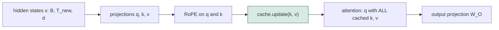

## 1. The question this idea answers

Lessons L1 to L3 explained why the KV cache exists, how prefill and decode use it, and how many bytes it needs. An interviewer who hears "KV cache" asks the next question at once: "How do you implement it?"

That question has several layers:

1. What data structure holds the cache, and what is its exact shape?
2. Where in the attention code does the new key and value go into the cache?
3. How does the code know the position of the new token, and which keys the new query may see?
4. How do you run a batch of prompts with different lengths?
5. What does a real library (Hugging Face `transformers`) do, and what does a real server (vLLM) do differently?

This lesson answers all five with code. Every complete code block on this page runs, and every assertion in it passes.

## 2. Mental model

> [!analogy] A transcript for each floor of a building
> Imagine a building with $L$ floors. Each floor is one layer of the model. On each floor, a clerk keeps two notebooks: a notebook of keys (K) and a notebook of values (V). Each time a new word arrives, the clerk on every floor writes one new line in both notebooks. The clerk never edits an old line. To answer a question (the query), the clerk compares it with every line of the K notebook. Then the clerk mixes the matching lines of the V notebook.
>
> A **dynamic cache** is a clerk who copies the whole notebook into a new, longer notebook for every new line. A **static cache** is a clerk who buys a notebook with numbered pages in advance and writes on the next free page.
>
> **Where it stops working:** a real cache line is not one number but a vector of $d_h$ numbers for each KV head. A real model also processes many sequences at the same time, so the "notebook" is a 4-dimensional tensor in GPU memory. And unlike a notebook, the empty pages of a static cache still use memory.

## 3. Terms

| Term | Plain meaning |
|---|---|
| KV cache | The stored keys and values of all earlier tokens, for every layer. Decode reads it instead of recomputing it. |
| cache layer | The part of the cache for one transformer layer: one K tensor and one V tensor. |
| KV head | One head of keys and values. With grouped-query attention (GQA), several query heads share one KV head. |
| slot | One position along the time axis of a cache tensor. One slot holds the key (or value) vectors of one token. |
| append | Write the K and V vectors of new tokens into the next free slots. |
| dynamic cache | A cache that grows by concatenation. Each step makes a new, longer tensor. |
| static cache | A cache that reserves space for a maximum length once and writes new tokens at a slot index. |
| write index | The number of slots already written in a static cache. The next token goes to this slot. |
| position id | The position of a token in its own sequence (0, 1, 2, ...). RoPE uses it to rotate queries and keys. |
| RoPE | Rotary position embedding. It rotates each pair of numbers in a query or key by an angle that grows with the position. |
| attention mask (padding mask) | A list of 1s and 0s per sequence. A 0 marks a pad slot that no query may see. |
| causal mask | The rule that a query may see only keys at its own slot or earlier slots. |
| padding | Filler tokens that make sequences of different lengths fit into one rectangular tensor. |
| left padding | Pad slots go before the prompt, so all prompts end at the same slot. |
| right padding | Pad slots go after the prompt, so prompts end at different slots. |
| `past_key_values` | The argument and output field that carries the cache object in Hugging Face `transformers`. |
| `use_cache` | The Hugging Face flag that enables or disables the cache. |
| block table | In a paged cache, the list of physical memory blocks that hold the tokens of one request, in order. |
| slot mapping | In vLLM, the physical slot number for each new token: block number times block size plus the offset in the block. |

All terms are also in the [Glossary](/notes/ai/llm-systems/glossary).

## 4. What the cache stores, and its shape

### 4.1 One K tensor and one V tensor per layer

Recall the cache from [L1](/notes/ai/llm-systems/03-kv-cache/l1-why-the-kv-cache-exists). For each layer, for each KV head, for each token, the cache holds one key vector and one value vector. Each vector has $d_h$ numbers. The usual layout puts this into two tensors per layer:

$$
K^{(\ell)}, V^{(\ell)} \in \mathbb{R}^{B \times H_{kv} \times T \times d_h}, \qquad \ell = 1, \dots, L
$$

The symbols mean:

- $\ell$ is the layer number, and $L$ is the number of layers.
- $B$ is the batch size: the number of sequences processed together.
- $H_{kv}$ is the number of KV heads. With multi-head attention (MHA), $H_{kv} = H$. With GQA, $H_{kv} < H$.
- $T$ is the number of tokens in the cache so far: the time axis.
- $d_h$ is the head dimension: the length of one key or value vector.

So a model with $L$ layers keeps $2L$ tensors. A cache library is mostly a list of $L$ pairs.


> [!example] Worked example: the shapes for the toy model and for Llama-3.1-8B
> **Toy model** (the four-token example of this guide): one layer, $B = 1$, $H_{kv} = 1$, $d_h = 2$. After the prompt "the cat sat", $K$ has shape $[1, 1, 3, 2]$. After "down", it has shape $[1, 1, 4, 2]$.
>
> **Llama-3.1-8B**: $L = 32$, $H_{kv} = 8$, $d_h = 128$, BF16 (2 bytes per number).
>
> - Each cache tensor of one layer: $[B, 8, T, 128]$.
> - One token, one layer, K and V together: $2 \times 8 \times 128 \times 2 = 4{,}096$ bytes $= 4$ KiB.
> - One token, all 32 layers: $32 \times 4{,}096 = 131{,}072$ bytes $= 128$ KiB.
> - $T = 8{,}192$ tokens, $B = 1$: $131{,}072 \times 8{,}192 = 1{,}073{,}741{,}824$ bytes $= 1$ GiB.
>
> These numbers match the size formula of [L3](/notes/ai/llm-systems/03-kv-cache/l3-the-kv-cache-size-formula).

### 4.2 Why the axes are in this order

The order $[B, H_{kv}, T, d_h]$ is not an accident. It serves the two operations that touch the cache.

1. **Attention is a batched matrix multiply over $B$ and heads.** The new query has shape $[B, H, 1, d_h]$. The scores are $Q K^\top$ with shape $[B, H, 1, T]$. PyTorch and NumPy multiply the last two axes and treat all earlier axes as batch axes. So the head axis must come before the time axis.
2. **The append happens on the time axis.** New tokens extend axis 2 (also written `dim=-2`). The head dimension $d_h$ stays last, so the $d_h$ numbers of one key sit next to each other in memory. A kernel reads them in one contiguous piece.

Other layouts exist. vLLM stores keys in blocks of tokens, and the official DeepSeek-V3 code stores time before heads (`[batch, seq, heads, dim]`). The math is the same. Only the index order and the memory layout change. See [Part 01 L3](/notes/ai/llm-systems/01-math-and-hardware/l3-tensors-shapes-and-batches) for strides and contiguous memory.

### 4.3 Where the cache sits inside the attention code

The cache update happens at one exact place in each attention layer: after the projections, after RoPE, and before the attention computation. With GQA, it also happens before the KV heads are expanded to match the query heads. So the cache stores $H_{kv}$ heads, not $H$ heads.



Hugging Face `transformers` 5.20.0 does exactly this in `LlamaAttention.forward` (source, checked on 2026-10-15):

```python
query_states = self.q_proj(hidden_states).view(hidden_shape).transpose(1, 2)
key_states = self.k_proj(hidden_states).view(hidden_shape).transpose(1, 2)
value_states = self.v_proj(hidden_states).view(hidden_shape).transpose(1, 2)

cos, sin = position_embeddings
query_states, key_states = apply_rotary_pos_emb(query_states, key_states, cos, sin)

if past_key_values is not None:
    key_states, value_states = past_key_values.update(key_states, value_states, self.layer_idx)
```

Three facts are visible in these lines:

1. `.transpose(1, 2)` changes `[B, T, heads, d_h]` into `[B, heads, T, d_h]`, the cache layout.
2. RoPE is applied before `update`. So the cache stores rotated keys (section 9).
3. `update` returns ALL keys and values of the layer, old and new. The attention call that follows uses these, not only the new ones.

## 5. The append in two lines: the toy example

The whole idea of the cache fits into two lines of NumPy. This is the decode step for "down" in the toy example.

```python
import numpy as np

X = np.array([[1, 0, 1, 0], [0, 1, 0, 1], [1, 1, 0, 0], [0, 1, 1, 0]], dtype=float)
W_Q = np.array([[0, 0], [0, 1], [1, 1], [0, 0]], dtype=float)
W_K = np.array([[0, 0], [0, 1], [1, 0], [0, 1]], dtype=float)
W_V = np.array([[1, 1], [0, 1], [1, 2], [2, 1]], dtype=float)

# Prefill: "the cat sat" -> fill the cache
K_cache = X[:3] @ W_K          # shape (3, 2)
V_cache = X[:3] @ W_V          # shape (3, 2)

# Decode: "down" arrives
x_new = X[3:4]                 # shape (1, 4)
q, k, v = x_new @ W_Q, x_new @ W_K, x_new @ W_V
K_cache = np.concatenate([K_cache, k], axis=0)   # append: now (4, 2)
V_cache = np.concatenate([V_cache, v], axis=0)   # append: now (4, 2)

scores = q @ K_cache.T / np.sqrt(2)              # shape (1, 4)
w = np.exp(scores - scores.max())
w = w / w.sum()
o = w @ V_cache                                  # shape (1, 2)
print(np.round(o, 4))                            # [[1.6034 2.3302]]
```

The two `np.concatenate` lines are the cache. Everything else is ordinary attention for one query.

> [!example] Worked example: the decode step for "down", with the cache
> **Before the step**, the cache holds the prefill results:
>
> $K_{cache} = [[1, 0], [0, 2], [0, 1]]$ and $V_{cache} = [[2, 3], [2, 2], [1, 2]]$.
>
> **Step 1. Project only the new token.** $x_{down} = [0, 1, 1, 0]$.
>
> - $q_4 = x_{down} W_Q = [0 + 0 + 1 + 0,\ 0 + 1 + 1 + 0] = [1, 2]$
> - $k_4 = x_{down} W_K = [0 + 0 + 1 + 0,\ 0 + 1 + 0 + 0] = [1, 1]$
> - $v_4 = x_{down} W_V = [0 + 0 + 1 + 0,\ 0 + 1 + 2 + 0] = [1, 3]$
>
> **Step 2. Append.** $K_{cache} = [[1, 0], [0, 2], [0, 1], [1, 1]]$ and $V_{cache} = [[2, 3], [2, 2], [1, 2], [1, 3]]$.
>
> **Step 3. Scores.** $q_4 K_{cache}^\top = [1 \cdot 1 + 2 \cdot 0,\ 0 + 4,\ 0 + 2,\ 1 + 2] = [1, 4, 2, 3]$. Divide by $\sqrt{2}$: $[0.7071, 2.8284, 1.4142, 2.1213]$.
>
> **Step 4. Softmax.** The weights are $[0.0646, 0.5388, 0.1310, 0.2657]$. They add to 1.0001 because of rounding to 4 decimals.
>
> **Step 5. Mix the values.** $o_4 = 0.0646 \cdot [2, 3] + 0.5388 \cdot [2, 2] + 0.1310 \cdot [1, 2] + 0.2657 \cdot [1, 3] = [1.6034, 2.3302]$, computed with the unrounded weights. The rounded weights give $[1.6035, 2.3305]$.
>
> The cached rows of "the", "cat" and "sat" were read, never recomputed. NumPy gives the same numbers.

```video
{"src": "/notes/media/llm-systems/manim/m13-the-cache-append-in-code.mp4", "caption": "The decode step for \"down\": project one token, append k4 and v4, and attend over all four cached rows."}
```

> [!key] The cache is an append-only list per layer
> Each decode step computes $q$, $k$ and $v$ for the new token only. It appends $k$ and $v$ to the cache of its layer. Then the single query attends over the whole cache. Old entries are never changed.

## 6. A complete NumPy reference: generate with and without the cache

A two-line append is easy to show. An interviewer may ask a harder question: "How do you prove that your cache gives exactly the same output as no cache?" The answer is a test. Build a small model, generate tokens both ways, and assert that the tokens and logits are equal.

### 6.1 The code

The model below has 2 layers, 4 query heads, 2 KV heads (GQA), RoPE, residual connections, RMSNorm and a small MLP. The weights are random. That is enough, because the test checks equality, not quality.

```python
import numpy as np

rng = np.random.default_rng(0)
VOCAB, D, H, H_KV, D_H, N_LAYERS = 32, 16, 4, 2, 4, 2
G = H // H_KV                                   # query heads per KV head


def init(shape):
    return rng.normal(0.0, 0.5, shape)


emb = init((VOCAB, D))
lm_head = init((D, VOCAB))
layers = [dict(W_Q=init((D, H * D_H)), W_K=init((D, H_KV * D_H)),
               W_V=init((D, H_KV * D_H)), W_O=init((H * D_H, D)),
               W_1=init((D, 4 * D)), W_2=init((4 * D, D)))
          for _ in range(N_LAYERS)]
projected_tokens = 0                            # counts K/V projections (one per token per layer)


def rms_norm(x):
    return x / np.sqrt((x * x).mean(-1, keepdims=True) + 1e-6)


def rope(x, pos):
    """Rotate pairs (0,1), (2,3), ... of x [B, heads, T, D_H] by pos * freq."""
    half = D_H // 2
    freq = 10000.0 ** (-np.arange(half) / half)             # [half]
    ang = pos[:, None, :, None] * freq                      # [B, 1, T, half]
    x1, x2 = x[..., 0::2], x[..., 1::2]
    out = np.empty_like(x)
    out[..., 0::2] = x1 * np.cos(ang) - x2 * np.sin(ang)
    out[..., 1::2] = x1 * np.sin(ang) + x2 * np.cos(ang)
    return out


def softmax(s):
    s = s - s.max(-1, keepdims=True)
    e = np.exp(s)
    return e / e.sum(-1, keepdims=True)


def attention(x, p, pos, cache):
    global projected_tokens
    B, T, _ = x.shape
    q = (x @ p["W_Q"]).reshape(B, T, H, D_H).transpose(0, 2, 1, 3)      # [B, H, T, D_H]
    k = (x @ p["W_K"]).reshape(B, T, H_KV, D_H).transpose(0, 2, 1, 3)   # [B, H_KV, T, D_H]
    v = (x @ p["W_V"]).reshape(B, T, H_KV, D_H).transpose(0, 2, 1, 3)
    projected_tokens += B * T
    q, k = rope(q, pos), rope(k, pos)               # keys get their rotation once, here
    if cache is not None:
        if cache["K"] is not None:
            k = np.concatenate([cache["K"], k], axis=2)   # append on the time axis
            v = np.concatenate([cache["V"], v], axis=2)
        cache["K"], cache["V"] = k, v                     # store [B, H_KV, T_all, D_H]
    T_all = k.shape[2]
    k, v = np.repeat(k, G, axis=1), np.repeat(v, G, axis=1)          # [B, H, T_all, D_H]
    scores = q @ k.transpose(0, 1, 3, 2) / np.sqrt(D_H)              # [B, H, T, T_all]
    q_idx = np.arange(T_all - T, T_all)                              # where the new rows sit
    future = np.arange(T_all)[None, :] > q_idx[:, None]              # [T, T_all]
    out = softmax(np.where(future, -np.inf, scores)) @ v             # [B, H, T, D_H]
    return out.transpose(0, 2, 1, 3).reshape(B, T, H * D_H) @ p["W_O"]


def forward(tokens, pos, caches):
    x = emb[tokens]                                                  # [B, T, D]
    for p, cache in zip(layers, caches):
        x = x + attention(rms_norm(x), p, pos, cache)
        x = x + np.maximum(rms_norm(x) @ p["W_1"], 0.0) @ p["W_2"]
    return rms_norm(x) @ lm_head                                     # [B, T, VOCAB]


def generate_without_cache(prompt, n_new):
    tokens = list(prompt)
    for _ in range(n_new):
        t = np.array([tokens])
        logits = forward(t, np.arange(len(tokens))[None, :], [None] * N_LAYERS)
        tokens.append(int(logits[0, -1].argmax()))
    return tokens, logits[0, -1]


def generate_with_cache(prompt, n_new):
    caches = [{"K": None, "V": None} for _ in range(N_LAYERS)]
    tokens = list(prompt)
    logits = forward(np.array([tokens]), np.arange(len(tokens))[None, :], caches)  # prefill
    for step in range(n_new):
        tokens.append(int(logits[0, -1].argmax()))
        if step == n_new - 1:
            break
        pos = np.array([[len(tokens) - 1]])          # the new token's position
        logits = forward(np.array([[tokens[-1]]]), pos, caches)                    # decode
    return tokens, logits[0, -1], caches


prompt, n_new = [3, 14, 15, 9, 2], 8
projected_tokens = 0
a, last_a = generate_without_cache(prompt, n_new)
no_cache_work = projected_tokens
projected_tokens = 0
b, last_b, caches = generate_with_cache(prompt, n_new)
cache_work = projected_tokens
assert a == b
assert np.allclose(last_a, last_b)
print("tokens:", b)
print("cache K shape per layer:", caches[0]["K"].shape)
print("token-projections per layer, no cache vs cache:",
      no_cache_work // N_LAYERS, cache_work // N_LAYERS)
print("max logit difference:", float(np.abs(last_a - last_b).max()))
```

Output (measured in these notes):

```text
tokens: [3, 14, 15, 9, 2, 21, 12, 28, 12, 12, 12, 12, 28]
cache K shape per layer: (1, 2, 12, 4)
token-projections per layer, no cache vs cache: 68 12
max logit difference: 3.219646771412954e-15
```

### 6.2 Line by line

The important lines, in the order they run:

1. `k = (x @ p["W_K"]).reshape(B, T, H_KV, D_H).transpose(0, 2, 1, 3)`. The projection makes $H_{kv} \cdot d_h = 8$ numbers per token. `reshape` splits them into 2 heads of 4. `transpose` moves the head axis before the time axis. The result has the cache layout $[B, H_{kv}, T, d_h]$.
2. `q, k = rope(q, pos), rope(k, pos)`. Each key is rotated with its own position before it goes into the cache. `pos` holds the true positions of the new tokens, so a decode step must pass `len(tokens) - 1`, not 0.
3. `k = np.concatenate([cache["K"], k], axis=2)`. This is the append. Axis 2 is the time axis.
4. `cache["K"], cache["V"] = k, v`. The layer stores the longer tensors for the next step. Each layer has its own dictionary, because each layer has its own keys.
5. `k, v = np.repeat(k, G, axis=1), ...`. GQA expansion: each KV head serves $G = 2$ query heads. The cache stays small, because this copy is made after the store. [L5](/notes/ai/llm-systems/03-kv-cache/l5-mha-mqa-gqa-and-mla) shows a version without the copy.
6. `q_idx = np.arange(T_all - T, T_all)`. The new queries sit at the last $T$ slots of the key axis. During prefill $T = T_{all}$, so this is $0, \dots, T-1$. During decode $T = 1$, so it is the single last slot.
7. `future = np.arange(T_all)[None, :] > q_idx[:, None]`. The causal mask, expressed in slots. A query at slot $i$ may see key slots $j \le i$. During decode, nothing in the cache is in the future, so the mask hides nothing.
8. In `generate_with_cache`, the loop stops before one more `forward`. The last sampled token is in `tokens` but not yet in the cache. It enters the cache only when the next step processes it. So after 13 tokens, the cache holds 12 slots: shape `(1, 2, 12, 4)`.

### 6.3 What the test proves

`assert a == b` proves that greedy generation gives the same 8 new tokens. `np.allclose(last_a, last_b)` proves that the final logits agree to about $3 \times 10^{-15}$, which is floating-point rounding.

The counter shows the saving. Without the cache, the model projects 5, 6, ..., 12 tokens per layer in the 8 forward passes: $5 + 6 + \dots + 12 = 68$ token-projections. With the cache, it projects the 5 prompt tokens once and then 1 token in each of the 7 decode steps: $5 + 7 = 12$.

> [!example] Worked example: projection work for a long answer
> Prompt $P = 1{,}000$ tokens, answer $N = 1{,}000$ tokens.
>
> - Without the cache, step $i$ (for $i = 0, \dots, 999$) projects $P + i$ tokens: $\sum_{i=0}^{999} (1000 + i) = 1{,}000{,}000 + 499{,}500 = 1{,}499{,}500$ token-projections per layer.
> - With the cache: $P + N - 1 = 1{,}999$ token-projections per layer.
>
> The ratio is about 750. The attention itself still reads every cached key in each step. The cache removes the repeated projections and the repeated attention rows for old tokens, not the reading.

## 7. Dynamic cache vs static cache

Section 6 used concatenation. That is one of two designs. Production code chooses between them on purpose.


### 7.1 Dynamic: concatenate on every step

```python
class DynamicKVCache:
    """Grows by concatenation. Holds K and V of shape [B, H_kv, T, d_h]."""
    def __init__(self):
        self.k = self.v = None

    def length(self):
        return 0 if self.k is None else self.k.shape[2]

    def update(self, k, v):
        if self.k is None:
            self.k, self.v = k, v
        else:
            self.k = torch.cat([self.k, k], dim=2)      # allocates a new tensor, copies all
            self.v = torch.cat([self.v, v], dim=2)
        return self.k, self.v
```

`torch.cat` cannot grow a tensor in place. It allocates a new tensor with $T + 1$ slots, copies the $T$ old slots, writes the new slot, and the old tensor is freed. This design has three properties:

1. **Memory follows the real length.** A short answer uses little memory.
2. **The shape changes every step.** A compiled graph (`torch.compile`) or a CUDA graph records fixed shapes. A new shape forces a new graph or prevents graph capture.
3. **Each step copies the whole cache.** The copy reads $T$ slots and writes $T + 1$ slots.

### 7.2 Static: preallocate once, write at a slot

```python
class StaticKVCache:
    """Preallocated. Writes at a position index. Shape [B, H_kv, T_max, d_h]."""
    def __init__(self, batch, n_kv_heads, max_len, head_dim, dtype=torch.float32):
        self.k = torch.zeros(batch, n_kv_heads, max_len, head_dim, dtype=dtype)
        self.v = torch.zeros_like(self.k)
        self.n = 0                                      # slots written so far

    def length(self):
        return self.n

    def update(self, k, v):
        t_new = k.shape[2]
        if self.n + t_new > self.k.shape[2]:
            raise RuntimeError("KV cache is full")
        idx = torch.arange(self.n, self.n + t_new)
        self.k.index_copy_(2, idx, k)                   # in place: no new allocation
        self.v.index_copy_(2, idx, v)
        self.n += t_new
        return self.k, self.v                           # the mask must hide slots >= n
```

The important lines:

- `torch.zeros(batch, n_kv_heads, max_len, head_dim)` reserves the full size once. The address of the tensor never changes.
- `self.k.index_copy_(2, idx, k)` writes the new keys into slots `idx` along axis 2. The trailing underscore means "in place". Only the new slots are written.
- `return self.k, self.v` returns the WHOLE buffer, including the empty slots. The attention code must hide every slot at or after `self.n`. Section 8 does that with a causal mask over slots.

Hugging Face `StaticLayer.update` in `transformers` 5.20.0 uses the same `index_copy_` call along axis 2. It keeps the write index in a tensor named `cumulative_length` (source, checked on 2026-10-15).

### 7.3 The cost of concatenation, in numbers

> [!example] Worked example: the copy cost of `torch.cat` for Llama-3.1-8B
> Batch 1, $T = 8{,}192$ cached tokens, H100 SXM with about 3.35 TB/s of memory bandwidth.
>
> 1. Cache size: $128 \text{ KiB} \times 8{,}192 = 1$ GiB $= 1{,}073{,}741{,}824$ bytes.
> 2. Attention must read the whole cache once per step: $1.0737 \times 10^9 / 3.35 \times 10^{12} \approx 0.32$ ms.
> 3. `torch.cat` reads 1 GiB and writes about 1 GiB more: about $2 \times 0.32 \approx 0.64$ ms.
> 4. The weights must be read once per step too: $8.03 \times 10^9 \times 2$ bytes $\approx 16.06$ GB, so about $4.79$ ms.
>
> Without the copy, the step needs about $4.79 + 0.32 = 5.11$ ms. The copy adds about $0.64$ ms, which is about 12.5 % more. At batch 32 the cache is 32 GiB: the attention read takes about 10.3 ms and the copy about 20.5 ms.
>
> These are ideal bandwidth estimates computed in these notes, not measurements. They show the trend: the copy costs twice the cache read, and it grows with $T$ and $B$.

### 7.4 Which one to choose

| Property | Dynamic cache | Static cache |
|---|---|---|
| Memory | Only what is used, plus a short double copy during `cat` | $T_{max}$ slots reserved from the start |
| Work per step | Copies the whole cache | Writes one slot |
| Shapes | Change every step | Fixed |
| `torch.compile`, CUDA graphs | Hard | Designed for it |
| Attention over empty slots | Never | Yes, unless the kernel stops at the write index |
| Good for | Notebooks, short runs, varied lengths | Low-latency serving of one model at a fixed maximum length |

The reserved slots of a static cache are the same waste that the PagedAttention paper measured in older servers. See [paper page 03](/notes/papers/llm-serving/2023-pagedattention/03-the-question). For Llama-3.1-8B, a static cache for 8,192 tokens reserves 1 GiB. A 100-token answer uses only $100 \times 128$ KiB $= 12.5$ MiB of it.

The Hugging Face documentation states this trade-off for its `StaticCache`: a fixed size "means that while generating, a lot of tokens will actually be masked as they should not take part in the attention" (checked on 2026-10-15).

## 8. A minimal PyTorch attention module with a cache argument

### 8.1 The code

This module accepts either cache class from section 7. It supports GQA, RoPE, decode steps, prefill in chunks, and padded batches.

```python
import torch
import torch.nn as nn
import torch.nn.functional as F


def rope(x, pos, base=10000.0):
    """x: [B, heads, T, d_h], pos: [B, T]. Rotate pairs (0,1), (2,3), ..."""
    half = x.shape[-1] // 2
    freq = base ** (-torch.arange(half, dtype=x.dtype) / half)      # [half]
    ang = pos[:, None, :, None].to(x.dtype) * freq                  # [B, 1, T, half]
    cos, sin = ang.cos(), ang.sin()
    x1, x2 = x[..., 0::2], x[..., 1::2]
    return torch.stack([x1 * cos - x2 * sin, x1 * sin + x2 * cos], dim=-1).flatten(-2)


class Attention(nn.Module):
    def __init__(self, d_model, n_heads, n_kv_heads):
        super().__init__()
        self.h, self.h_kv, self.d_h = n_heads, n_kv_heads, d_model // n_heads
        self.q_proj = nn.Linear(d_model, n_heads * self.d_h, bias=False)
        self.k_proj = nn.Linear(d_model, n_kv_heads * self.d_h, bias=False)
        self.v_proj = nn.Linear(d_model, n_kv_heads * self.d_h, bias=False)
        self.o_proj = nn.Linear(n_heads * self.d_h, d_model, bias=False)

    def forward(self, x, pos, cache=None, key_mask=None):
        """x: [B, T, d]. pos: [B, T] token positions. key_mask: [B, slots], True = real token."""
        B, T, _ = x.shape
        q = self.q_proj(x).view(B, T, self.h, self.d_h).transpose(1, 2)      # [B, H, T, d_h]
        k = self.k_proj(x).view(B, T, self.h_kv, self.d_h).transpose(1, 2)   # [B, H_kv, T, d_h]
        v = self.v_proj(x).view(B, T, self.h_kv, self.d_h).transpose(1, 2)
        q, k = rope(q, pos), rope(k, pos)                 # rotate first, then cache
        start = 0 if cache is None else cache.length()    # slot of the first new token
        if cache is not None:
            k, v = cache.update(k, v)                     # all cached + new keys and values
        slots = torch.arange(k.shape[2])
        q_slots = torch.arange(start, start + T)
        allowed = slots[None, :] <= q_slots[:, None]      # causal, by slot: [T, slots]
        allowed = allowed[None, None]                     # [1, 1, T, slots]
        if key_mask is not None:
            allowed = allowed & key_mask[:, None, None, : k.shape[2]]
            allowed = allowed | (slots[None, :] == q_slots[:, None])  # a pad row sees itself
        out = F.scaled_dot_product_attention(q, k, v, attn_mask=allowed, enable_gqa=True)
        return self.o_proj(out.transpose(1, 2).reshape(B, T, -1))


torch.manual_seed(0)
attn = Attention(d_model=32, n_heads=4, n_kv_heads=2).eval()
x = torch.randn(1, 6, 32)                             # 6 tokens of one sequence
pos = torch.arange(6)[None, :]
with torch.no_grad():
    full = attn(x, pos)                               # no cache: all 6 rows at once
    for cache in (DynamicKVCache(), StaticKVCache(1, 2, 16, 8)):
        rows = [attn(x[:, :4], pos[:, :4], cache)]    # prefill 4 tokens
        for t in (4, 5):                              # decode 2 tokens
            rows.append(attn(x[:, t:t + 1], pos[:, t:t + 1], cache))
        got = torch.cat(rows, dim=1)
        print(type(cache).__name__, tuple(cache.k.shape),
              torch.allclose(got, full, atol=1e-6))
```

Output (measured with PyTorch 2.14, with the two cache classes of section 7 in the same file):

```text
DynamicKVCache (1, 2, 6, 8) True
StaticKVCache (1, 2, 16, 8) True
```

### 8.2 Line by line

1. `start = 0 if cache is None else cache.length()`. Read the write index BEFORE the update. It is the slot number of the first new token.
2. `k, v = cache.update(k, v)`. After this line, `k` holds every key of the layer. For the dynamic cache, it has exactly `start + T` slots. For the static cache, it has 16 slots, and slots `start + T` to 15 are zeros.
3. `allowed = slots[None, :] <= q_slots[:, None]`. A query at slot $i$ may see key slots $0, \dots, i$. This one line does three jobs. During prefill it is the usual causal mask. During decode it allows every written slot. With a static cache it also hides the empty slots, because they all lie after the newest query.
4. `allowed & key_mask[...]`. A padding mask removes the pad slots of each sequence (section 11).
5. `allowed | (slots == q_slots)`. A pad query has no real key to see. A softmax over an empty row gives NaN (not a number), and NaN would spread through the next layer. So each query may at least see its own slot. The output of a pad row is garbage, but nothing reads it.
6. `F.scaled_dot_product_attention(..., attn_mask=allowed, enable_gqa=True)`. In PyTorch, a boolean mask marks with `True` the scores that take part in attention. `enable_gqa=True` lets 4 query heads use 2 KV heads without an explicit copy.
7. The test runs the same 6 tokens three ways: no cache, dynamic cache, static cache. All three outputs agree to `atol=1e-6`.

> [!trap] The static cache returns empty slots
> A static cache returns its full buffer. If your mask hides only pad tokens and forgets the causal-by-slot rule, the query attends to slots full of zeros. A zero key gives a score of 0, not $-\infty$. So the softmax gives those slots real weight, and the output is silently wrong.

## 9. Keys are stored after RoPE

### 9.1 Why this is correct

RoPE (rotary position embedding, explained in [Part 02 L6](/notes/ai/llm-systems/02-attention-and-the-transformer/l6-the-transformer-block)) rotates each pair of numbers in a query or key. The angle is the position times a fixed frequency. Write $R_m$ for the rotation at position $m$. The score between a query at position $m$ and a key at position $n$ is:

$$
(R_m q)^\top (R_n k) = q^\top R_m^\top R_n k = q^\top R_{n-m}\, k
$$

The last step holds because rotations compose: $R_m^\top = R_{-m}$ and $R_{-m} R_n = R_{n-m}$. So the score depends only on the distance $n - m$.

For the cache, the important fact is simpler. The rotated key $R_n k$ depends only on the key's own position $n$. It does not depend on the position $m$ of any later query. So the code can rotate each key once, when it enters the cache, and never touch it again. Each new query is rotated with its own position at its own step.

Values are never rotated. RoPE acts on queries and keys only, because only their dot product needs position information.

### 9.2 A worked example

> [!example] Worked example: RoPE with the toy numbers
> Suppose the toy model used RoPE with one frequency: 1 radian per position. The tokens have positions "the" = 0, "cat" = 1, "sat" = 2, "down" = 3.
>
> 1. The key of "cat" is $k_2 = [0, 2]$. It enters the cache at position 1, rotated by 1 radian: $R_1 k_2 = [0 \cdot \cos 1 - 2 \sin 1,\ 0 \cdot \sin 1 + 2 \cos 1] = [-1.6829, 1.0806]$. This vector stays in the cache.
> 2. The query of "down" is $q_4 = [1, 2]$ at position 3: $R_3 q_4 = [\cos 3 - 2 \sin 3,\ \sin 3 + 2 \cos 3] = [-1.2722, -1.8389]$.
> 3. The score: $(-1.2722)(-1.6829) + (-1.8389)(1.0806) = 2.1410 - 1.9871 = 0.1539$, which rounds to 0.154.
> 4. Check the distance rule: put the query at position 2 and the key at position 0. The score is again 0.154, because the distance is still 2.
> 5. A common bug: the decode step passes position 0 for the new token instead of 3. Then the score with "cat" becomes 0.4783. The code runs without an error, and the output is wrong.

### 9.3 Two exceptions

1. **StreamingLLM caches keys before RoPE.** It evicts middle tokens and renumbers the positions inside the cache. So it must rotate the keys again at each step. The paper states: "For encoding like RoPE, we cache the Keys of tokens prior to introducing the rotary transformation." See [L6](/notes/ai/llm-systems/03-kv-cache/l6-shrinking-the-kv-cache).
2. **Multi-head latent attention (MLA)** caches a compressed vector without RoPE, plus one small extra key that carries RoPE. See [L5](/notes/ai/llm-systems/03-kv-cache/l5-mha-mqa-gqa-and-mla).

## 10. Positions and masks

### 10.1 The position of a new token

Without padding, the rule is one line: the position of the first new token equals the number of tokens already in the cache.

$$
\text{pos}_{new} = T_{cached}, \quad T_{cached} + 1, \quad \dots, \quad T_{cached} + T_{new} - 1
$$

Hugging Face `LlamaModel.forward` in `transformers` 5.20.0 applies exactly this rule when the caller passes no `position_ids`:

```python
if position_ids is None:
    past_seen_tokens = past_key_values.get_seq_length() if past_key_values is not None else 0
    position_ids = torch.arange(inputs_embeds.shape[1], device=inputs_embeds.device) + past_seen_tokens
    position_ids = position_ids.unsqueeze(0)
```

With padding, the slot number and the position differ. Then the caller must compute the positions per sequence (section 11).

### 10.2 The mask when a cache exists

The attention scores of a step have shape $[B, H, T_{new}, T_{cached} + T_{new}]$. The mask has the same last two axes. Query row $i$ (for $i = 0, \dots, T_{new} - 1$) sits at slot $T_{cached} + i$. It may see key slot $j$ when:

$$
j \le T_{cached} + i \quad \text{and} \quad \text{key\_mask}[b, j] = 1
$$

Three cases follow from this one rule:

| Case | $T_{cached}$ | $T_{new}$ | Mask shape | What the causal part hides |
|---|---|---|---|---|
| Prefill | 0 | prompt length $P$ | $[P, P]$ | The upper triangle |
| Decode | $T$ | 1 | $[1, T + 1]$ | Nothing |
| Chunked prefill (second chunk) | $c$ | chunk length $c_2$ | $[c_2, c + c_2]$ | A triangle in the last $c_2$ columns only |

The Hugging Face cache guide states the same shape rule for the 2D padding mask: it "should have the shape `(batch_size, past_kv_length + new_tokens_length)`" (checked on 2026-10-15). In a manual loop, you append a column of ones to the attention mask at every decode step.

## 11. Batches with different lengths

A GPU processes a batch as one rectangular tensor. Real prompts have different lengths. So the short prompts get pad slots. Where the pad slots go changes the code.


### 11.1 Left padding

With left padding, every prompt ends at the same slot. The cache gets the same number of slots for every row. So each decode step writes all new tokens at the same slot index. The code reads the next-token logits at column $-1$ for every row.

Two details make it correct:

1. **Positions skip the pads.** The real tokens of each row must start at position 0. The common formula is `position_ids = attention_mask.cumsum(-1) - 1`. For the batch in the figure, the mask `[[1,1,1],[0,1,1]]` gives positions `[[0,1,2],[-1,0,1]]`. The pad position $-1$ is replaced by a harmless value. `transformers` 5.20.0 replaces it with 0 in `_prepare_position_ids_for_generation`.
2. **The mask hides the pad slots forever.** Each decode step appends a column of ones to the mask. The pad column stays 0.

The test below runs a left-padded batch through the module of section 8. It compares every real row with a run of that sequence alone, without padding.

```python
import torch
torch.manual_seed(0)
attn = Attention(d_model=32, n_heads=4, n_kv_heads=2).eval()
a = torch.randn(3, 32)            # sequence A: 3 tokens
b = torch.randn(2, 32)            # sequence B: 2 tokens
a_new, b_new = torch.randn(1, 32), torch.randn(1, 32)   # one decode token each

# Left padding: B gets one pad slot in front.
x = torch.stack([a, torch.cat([torch.zeros(1, 32), b])])           # [2, 3, 32]
mask = torch.tensor([[True, True, True], [False, True, True]])      # [2, 3]
pos = (mask.long().cumsum(-1) - 1).clamp(min=0)                     # [[0,1,2],[0,0,1]]

with torch.no_grad():
    cache = DynamicKVCache()
    out = attn(x, pos, cache, key_mask=mask)                        # prefill
    mask = torch.cat([mask, torch.ones(2, 1, dtype=torch.bool)], 1) # new column for new token
    new_pos = pos[:, -1:] + 1                                       # [[3],[2]]
    step = attn(torch.stack([a_new, b_new]), new_pos, cache, key_mask=mask)
    print("cache K shape:", tuple(cache.k.shape))

    # Reference: each sequence alone, no padding.
    for name, seq, new, row, real in (("A", a, a_new, 0, slice(0, 3)), ("B", b, b_new, 1, slice(1, 3))):
        c = DynamicKVCache()
        n = seq.shape[0]
        ref_pre = attn(seq[None], torch.arange(n)[None], c)
        ref_new = attn(new[None], torch.tensor([[n]]), c)
        print(name, torch.allclose(out[row, real], ref_pre[0], atol=1e-6),
              torch.allclose(step[row], ref_new[0], atol=1e-6))
```

Output (measured):

```text
cache K shape: (2, 2, 4, 8)
A True True
B True True
```

The cache of the batch has 4 slots for both rows. Row B wastes slot 0 on a pad. The new tokens get different positions (3 and 2) but the same slot (3).

### 11.2 Right padding, and why `generate()` refuses it

With right padding, row B ends at slot 1 and slot 2 is a pad. Two things go wrong for a generation loop:

1. After prefill, column $-1$ of row B is the pad slot. Its logits do not predict the next token of B.
2. The new token of B goes to slot 3, after a hole at slot 2. The mask can hide the hole. But every row now needs its own "last real slot" index.

Right padding is not wrong in math. It needs per-row bookkeeping that most generation loops do not do. The Hugging Face `generate()` method detects it and prints this warning (text from `transformers` 5.20.0):

```text
A decoder-only architecture is being used, but right-padding was detected! For correct generation results, please set `padding_side='left'` when initializing the tokenizer.
```

> [!example] Worked example: right padding in Hugging Face, measured
> A tiny random Llama model has 2 layers, 8 query heads and 2 KV heads. It generates 5 tokens greedily for two prompts: A = `[5, 17, 42]` and B = `[9, 33]`.
>
> - B alone gives `[82, 78, 46, 46, 46]`.
> - B in a left-padded batch (`[0, 9, 33]`, mask `[0, 1, 1]`) gives `[82, 78, 46, 46, 46]`. Same tokens.
> - B in a right-padded batch (`[9, 33, 0]`, mask `[1, 1, 0]`) gives `[53, 53, 15, 37, 73]`. Wrong tokens, because the model took the first token from the logits of the pad slot.
>
> Row A has no pad, so it gives the same tokens in all three runs.

### 11.3 The cost of padding, and how servers avoid it

Pad slots use cache memory and attention work, and they hold nothing useful. In a batch with one 4,000-token prompt and fifteen 100-token prompts, the left-padded cache has $16 \times 4{,}000 = 64{,}000$ slots. Only $4{,}000 + 15 \times 100 = 5{,}500$ of them hold real tokens: about 8.6 %.

Serving engines such as vLLM do not pad. They pack the new tokens of all requests into one flat list and keep one block table per request. The next section shows how.

## 12. The Hugging Face `transformers` API

The facts in this section are for `transformers` 5.20.0, the newest release on PyPI on 2026-10-15. The cache API changed a lot across versions, so always check the version in front of you.

### 12.1 The two arguments

- `use_cache` (a boolean). `True` makes the model return a cache. `model.generate(..., use_cache=False)` disables the cache. This is useful only to measure the speed difference or to debug.
- `past_key_values` (a `Cache` object). You pass it in, and the model updates it in place. The model also returns it as `outputs.past_key_values`. If `use_cache=True` and you pass no cache, `LlamaModel.forward` creates a `DynamicCache(config=self.config)` itself.

### 12.2 The cache classes

A `Cache` in version 5.20.0 is "mostly a list of `CacheLayerMixin` objects, one per model layer" (source docstring). You reach the tensors of layer `i` with `cache.layers[i].keys` and `cache.layers[i].values`.

| Class | What it does | How to select it |
|---|---|---|
| `DynamicCache` | The default. Each layer is a `DynamicLayer` that grows with `torch.cat` on `dim=-2`. | `DynamicCache(config=model.config)`, or `cache_implementation="dynamic"` |
| `StaticCache` | Each layer is a `StaticLayer`: `torch.zeros` of `[batch, heads, max_cache_len, head_dim]`, written with `index_copy_`. Built for `torch.compile`. | `StaticCache(config=model.config, max_cache_len=N)`, or `cache_implementation="static"` |
| Offloaded caches | Keep the layers on the CPU. Only the current layer sits on the GPU, and the next layer is prefetched. | `offloading=True`, or `cache_implementation="offloaded"` or `"offloaded_static"` |
| `QuantizedCache` | Stores old keys and values in 2 or 4 bits (backend `quanto`) or in 1, 2, 3, 4 or 8 bits (backend `hqq`). Up to the newest 128 tokens (`residual_length`) stay in the original precision. | `cache_implementation="quantized"` with a `cache_config` dict |
| `EncoderDecoderCache` | Holds a self-attention cache and a cross-attention cache for encoder-decoder models. | Created by encoder-decoder models |

Layer types inside a cache include `DynamicLayer`, `DynamicSlidingWindowLayer`, `StaticLayer`, `StaticSlidingWindowLayer` and `QuantizedLayer`. A `DynamicCache` built with a `config` reads the layer types of the model. So a sliding-window model gets sliding-window layers automatically, and those layers stop growing at the window size. [L6](/notes/ai/llm-systems/03-kv-cache/l6-shrinking-the-kv-cache) explains sliding windows and quantized caches.

`cache_implementation` accepts `"static"`, `"offloaded_static"`, `"dynamic"`, `"offloaded"` and `"quantized"`. It also accepts `"paged"` for continuous batching. The values `"sliding_window"`, `"hybrid"`, `"hybrid_chunked"`, `"offloaded_hybrid"` and `"offloaded_hybrid_chunked"` remain only for backward compatibility. These names are from `generation/configuration_utils.py` of version 5.20.0.

### 12.3 A manual generation loop

This loop is the documented pattern, applied to a tiny random model so that it runs without a download:

```python
import torch
from transformers import LlamaConfig, LlamaForCausalLM, DynamicCache, StaticCache

torch.manual_seed(0)
config = LlamaConfig(vocab_size=100, hidden_size=64, intermediate_size=128,
                     num_hidden_layers=2, num_attention_heads=8,
                     num_key_value_heads=2, head_dim=8)
model = LlamaForCausalLM(config).eval()            # random weights, no download

input_ids = torch.tensor([[5, 17, 42, 7]])
attention_mask = torch.ones_like(input_ids)
cache = DynamicCache(config=model.config)
generated = input_ids

with torch.no_grad():
    for step in range(3):
        out = model(input_ids=input_ids, attention_mask=attention_mask,
                    past_key_values=cache, use_cache=True)
        next_id = out.logits[:, -1:].argmax(-1)                 # greedy, shape [1, 1]
        generated = torch.cat([generated, next_id], dim=-1)
        print(step, tuple(cache.layers[0].keys.shape), cache.get_seq_length())
        input_ids = next_id                                     # only the new token
        attention_mask = torch.cat([attention_mask, torch.ones(1, 1, dtype=torch.long)], -1)

    ref = model.generate(torch.tensor([[5, 17, 42, 7]]), max_new_tokens=3,
                         do_sample=False, use_cache=False)
    print(generated.tolist(), torch.equal(generated, ref))
    static = StaticCache(config=model.config, max_cache_len=16)
    model(input_ids=torch.tensor([[5, 17, 42, 7]]), past_key_values=static, use_cache=True)
    print(type(static.layers[0]).__name__, tuple(static.layers[0].keys.shape))
```

Output (measured with `transformers` 5.20.0 and PyTorch 2.14):

```text
0 (1, 2, 4, 8) 4
1 (1, 2, 5, 8) 5
2 (1, 2, 6, 8) 6
[[5, 17, 42, 7, 38, 66, 55]] True
StaticLayer (1, 2, 16, 8)
```

Read the shapes. The model has 8 query heads but the cache has 2 heads: it stores KV heads. The time axis grows 4, 5, 6. The static cache has 16 slots from the first call. Generation with the cache gives the same tokens as `use_cache=False`.

### 12.4 What changed across versions

Interviewers like "what changed recently". These are the changes that matter for the cache, with their sources:

1. **The tuple format is gone.** Old code passed `past_key_values` as a tuple with one `(key, value)` pair per layer. In version 5.20.0 a tuple fails: the model calls `get_seq_length()` on it, and these notes measured `AttributeError: 'tuple' object has no attribute 'get_seq_length'`. The methods `from_legacy_cache` and `to_legacy_cache` do not exist in `cache_utils.py` of 5.20.0.
2. **Caches are lists of layer objects.** Each layer is a `DynamicLayer`, `StaticLayer` or another layer class. This lets one cache mix full-attention and sliding-window layers.
3. **The default cache depends on the model.** The v5 migration guide states: "If `generate` doesn't receive any KV Cache argument, the default cache class used is now defined by the model (as opposed to always being `DynamicCache`)".
4. **`SlidingWindowCache` is removed.** In 5.20.0 the name is a deprecated alias of `StaticCache`, with the comment "SlidingWindowCache was removed in transformers v5".
5. **`crop` takes a negative number.** The cache guide says: "Pass the number of tokens to remove as a negative integer", for example `past_key_values.crop(-3)`. Speculative decoding uses `crop` to remove rejected draft tokens (see [Part 04 L6](/notes/ai/llm-systems/04-inference/l6-speculative-decoding)).

## 13. How vLLM differs: a paged cache

### 13.1 One pool for many requests

Hugging Face keeps one rectangular tensor per layer for the whole batch. A server with hundreds of requests of different lengths cannot afford that. Padding wastes slots, and a static cache reserves the maximum length for every request.

vLLM uses PagedAttention (Kwon et al., SOSP 2023). The design, in four sentences:

1. Each layer has one large pool of fixed-size **blocks**. Each block holds the keys and values of a fixed number of tokens. The default block size in vLLM 0.31.0 is 16 tokens (`CacheConfig.DEFAULT_BLOCK_SIZE`).
2. Each request has a **block table**: the list of physical block numbers that hold its tokens, in order. The blocks do not need to be next to each other in memory.
3. For each new token, the engine computes a **slot mapping**. In vLLM 0.31.0, `vllm/v1/worker/block_table.py` computes `slot_ids = block_numbers * block_size + slot_offsets`.
4. A kernel writes each new key and value to its slot. In vLLM 0.31.0 the FlashAttention backend calls `reshape_and_cache_flash(key, value, key_cache, value_cache, slot_mapping, ...)`. The attention kernel then reads the blocks of each request through its block table.

The paper pages explain the algorithm and the manager in depth: [04 PagedAttention: the algorithm](/notes/papers/llm-serving/2023-pagedattention/04-pagedattention-the-algorithm) and [05 The KV cache manager and block tables](/notes/papers/llm-serving/2023-pagedattention/05-the-kv-cache-manager).

### 13.2 A slot mapping, worked

> [!example] Worked example: where "the cat sat down" goes in a paged cache
> Block size 2. The block manager gives this request physical blocks 7 and 3, in that order. So the block table is `[7, 3]`.
>
> For each token, the engine computes four numbers:
>
> 1. logical block = position // 2
> 2. offset = position % 2
> 3. physical block = block table [logical block]
> 4. slot = physical block $\times$ 2 + offset
>
>
> | Token | Position | Logical block | Offset | Physical block | Slot |
> |---|---|---|---|---|---|
> | the | 0 | 0 | 0 | 7 | 14 |
> | cat | 1 | 0 | 1 | 7 | 15 |
> | sat | 2 | 1 | 0 | 3 | 6 |
> | down | 3 | 1 | 1 | 3 | 7 |
>
> The keys of "sat" and "down" sit at slots 6 and 7, before the keys of "the" and "cat" at slots 14 and 15. The order in memory does not matter. The kernel follows the block table, so the attention result is the same as with one contiguous tensor.

### 13.3 Three designs side by side

| Question | Hugging Face `DynamicCache` | Hugging Face `StaticCache` | vLLM paged cache |
|---|---|---|---|
| Unit of storage | One tensor per layer for the batch | One preallocated tensor per layer | Many fixed-size blocks in one pool per layer |
| Different prompt lengths | Padding | Padding | No padding: one block table per request |
| Memory waste | Pad slots | Pad slots and empty reserved slots | At most one partly filled block per request |
| How a token is written | `torch.cat` | `index_copy_` at the write index | Scatter to `slot_mapping` |
| Sharing a prefix between requests | Copy the cache (`copy.deepcopy` in the guide) | Copy the cache | Share blocks with reference counts |

Sharing is the topic of [paper page 06](/notes/papers/llm-serving/2023-pagedattention/06-decoding-scenarios-and-sharing) and [Part 04 L9](/notes/ai/llm-systems/04-inference/l9-prefix-caching-and-kv-reuse). Continuous batching, which needs this design, is in [Part 04 L4](/notes/ai/llm-systems/04-inference/l4-batching-and-scheduling).

## 14. Practice

### Exercises

Write your code in `C:\Users\ASohi\Downloads\AI\agent-harness-lab`, notebook folder `llm-systems/`.

1. **A dynamic cache for the toy model.** Write a NumPy class `KVCache` with a method `append(k, v)` that returns all keys and values so far. Use it to run the prefill of "the cat sat" and the decode step of "down".
   - Acceptance test: the cache has shape `(4, 2)`, and $o_4$ equals `[1.6034, 2.3302]` to 4 decimals.
   - Hint 1: store `None` at the start and handle the first call separately.
   - Hint 2: the time axis is axis 0 here, because the toy cache has no batch or head axis.
2. **A static cache with a write index.** Write a NumPy `StaticKVCache(max_len, d_h)` with a method `write(k, v)`. Write an attention function that hides the empty slots.
   - Acceptance test: for 10 random decode steps, the output equals a dynamic cache within `np.allclose`. A write beyond `max_len` raises an error.
   - Hint 1: set the scores of slots `n` and later to $-\infty$ before the softmax.
   - Hint 2: zero keys are not harmless. A zero key gives a score of 0, not $-\infty$.
3. **A left-padded batch.** Use the `Attention` module of section 8. Run three sequences of lengths 5, 3 and 1 as one left-padded batch, then 3 decode steps.
   - Acceptance test: every real row of the prefill and every decode output equals the run of that sequence alone, within `atol=1e-5`.
   - Hint 1: `mask[r] = arange(T) >= T - length[r]`.
   - Hint 2: after prefill, the next position of each row is its last position plus 1, and the mask gains a column of `True`.
4. **Roll back the cache.** Write `crop(cache, n)` that removes the last `n` tokens from a `DynamicKVCache` or a `StaticKVCache`.
   - Acceptance test: prefill 4 tokens, decode 2, crop 2, decode the same 2 again. The two decode outputs are equal, and the cache length is 6 at the end.
   - Hint 1: for the static cache, you only need to move the write index.
   - Hint 2: for the dynamic cache, slice the time axis: `[:, :, :-n]`.
5. **A traffic model.** Write `step_traffic(n_layers, n_kv_heads, head_dim, bytes_per_elem, T, B)` that returns the bytes of one decode step: the attention read, the static write, and the dynamic copy.
   - Acceptance test: for Llama-3.1-8B in BF16, $T = 8{,}192$ and $B = 1$, the attention read is exactly 1 GiB.
   - Hint 1: compute the bytes per token first.
   - Hint 2: `torch.cat` reads $T$ slots and writes $T + 1$ slots.

## 15. Common mistakes

1. **"The cache stores queries too."** No. Only the newest query is needed at each step, and it is never reused. The cache stores keys and values only.
2. **"The cache has one entry per query head."** No. With GQA, the cache stores $H_{kv}$ heads. The expansion to $H$ heads happens after the update, or inside the kernel. Storing $H$ heads would remove the whole saving of GQA.
3. **"The new token's position is always 0 in a decode step, because the input has length 1."** No. The position is the number of tokens already in the sequence. A wrong position gives wrong RoPE rotations and silently wrong outputs.
4. **"A static cache is free to read because the empty slots are zeros."** No. Zero keys give a score of 0, and $e^0 = 1$ gets real weight in the softmax. The mask must hide every slot after the write index.
5. **"Keys must be rotated again at every step, because RoPE depends on distance."** No. The rotated key depends only on its own position. The relative distance appears in the dot product automatically. Only methods that renumber positions, such as StreamingLLM, cache keys before RoPE.
6. **"Right padding is fine for generation."** Not with a loop that reads column $-1$. After prefill, the last column of a short row is a pad, so its logits do not predict the next token. Use left padding, or track a last index per row.
7. **"`torch.cat` appends in place."** No. It allocates a new tensor and copies the whole cache. The copy costs about twice a full cache read on every step.
8. **"In Hugging Face, `past_key_values` is a tuple of tuples."** Not any more. In `transformers` 5.20.0 it must be a `Cache` object such as `DynamicCache`. A tuple raises an error.

## 16. One-minute explanation

The KV cache is, per layer, one key tensor and one value tensor with the shape batch, KV heads, tokens, head dimension. Inside each attention layer, the code projects the new tokens and applies RoPE to the queries and keys. Then it calls the cache update with the new keys and values. The update appends them on the time axis and returns all keys and values of the layer. The new query attends over all of them. Keys are stored after RoPE, because a rotated key depends only on its own position. Concatenation grows the cache with no wasted memory, but it copies the whole cache on every step. A static buffer writes at an index and keeps fixed shapes for compiled graphs, but it reserves the maximum length. The position of a new token is the number of tokens already cached. The mask hides future slots, empty slots and pad slots, and batched generation uses left padding so that all rows end at the same slot. In Hugging Face this is `past_key_values` with a `DynamicCache` or `StaticCache` object. vLLM instead writes each token to a slot in a pool of fixed-size blocks through a per-request block table, so it needs no padding.

## 17. Check questions

```check
{"question": "What is the shape of the K cache tensor of one layer, and why is the head axis placed before the time axis?", "hint": "Think about the batched matrix multiply of attention and about where the append happens.", "answer": "The shape is $[B, H_{kv}, T, d_h]$: batch, KV heads, tokens, head dimension. The same shape holds for V.\n\n1. Attention multiplies the last two axes and treats the first two as batch axes. The query is $[B, H, 1, d_h]$ and $K^\\top$ is $[B, H, d_h, T]$, so the scores are $[B, H, 1, T]$. The head axis must come before the time axis for this to work without a transpose.\n2. The append happens on axis 2 (`dim=-2`), the time axis.\n3. $d_h$ stays last, so the numbers of one key vector are contiguous in memory, and a kernel reads them in one piece."}
```

```check
{"question": "A model has 8 query heads and 2 KV heads. Your cache tensor for one layer has shape [1, 8, 100, 64]. What went wrong, and what does it cost?", "hint": "Where in the code does the expansion from 2 heads to 8 heads happen?", "answer": "The cache stores the expanded heads. The code called `repeat_kv` (or `np.repeat`) BEFORE the cache update. The correct shape is `[1, 2, 100, 64]`.\n\nThe cost: the cache is $8 / 2 = 4$ times larger than needed, so the whole memory saving of GQA is lost. Each decode step also reads 4 times more cache bytes, so decode becomes slower. The fix: update the cache with the $H_{kv}$ heads, then expand (or let the kernel handle GQA, for example with `enable_gqa=True`)."}
```

```check
{"question": "Interview follow-up: write the two lines that append to a dynamic cache in PyTorch, and say what each step costs in memory traffic for a cache of T tokens.", "hint": "torch.cat cannot grow a tensor in place.", "answer": "```python\nself.k = torch.cat([self.k, k_new], dim=2)\nself.v = torch.cat([self.v, v_new], dim=2)\n```\n\nEach `torch.cat` allocates a new tensor with $T + 1$ slots, reads the $T$ old slots, and writes $T + 1$ slots. So one step moves about $2T$ slots of K and $2T$ slots of V, about twice the bytes that attention reads anyway.\n\nFor Llama-3.1-8B at $T = 8{,}192$ and batch 1, the cache is 1 GiB. The copy moves about 2 GiB, about 0.64 ms at 3.35 TB/s, on top of about 0.32 ms for the attention read and about 4.79 ms for the weights. A static cache avoids the copy: `self.k.index_copy_(2, idx, k_new)` writes only the new slot."}
```

```check
{"question": "Interview follow-up: why may the cache store keys AFTER RoPE? Prove that the attention score still depends only on the distance between tokens.", "hint": "Write the rotation at position m as a matrix R_m. What is the transpose of a rotation?", "answer": "Let $R_m$ be the RoPE rotation at position $m$. The query at position $m$ is $R_m q$, the key at position $n$ is $R_n k$. The score is\n\n$$\n(R_m q)^\\top (R_n k) = q^\\top R_m^\\top R_n k = q^\\top R_{-m} R_n k = q^\\top R_{n-m} k\n$$\n\nbecause the transpose of a rotation is the rotation by the opposite angle, and rotations add their angles. So the score depends only on $n - m$.\n\nThe rotated key $R_n k$ depends only on its own position $n$, never on a later query. So the code rotates each key once, when it enters the cache, and stores the result. Only the new query is rotated at each step, with its own position.\n\nExceptions: StreamingLLM caches keys before RoPE, because it renumbers positions inside the cache. MLA caches a latent vector without RoPE plus a small decoupled key with RoPE."}
```

```check
{"question": "Interview follow-up: you serve Llama-3.1-8B in BF16 with a left-padded batch of 16 prompts. The longest prompt has 4,000 tokens, the other 15 have 100 tokens, and every request generates 500 tokens. How large is the cache at the end, and what fraction holds real tokens?", "hint": "With left padding, every row has the same number of slots.", "answer": "Every row has $4{,}000 + 500 = 4{,}500$ slots.\n\n- Total slots: $16 \\times 4{,}500 = 72{,}000$. Bytes: $72{,}000 \\times 131{,}072 = 9{,}437{,}184{,}000$ bytes $\\approx 8.79$ GiB.\n- Real tokens: $4{,}500 + 15 \\times (100 + 500) = 13{,}500$, about $1.65$ GiB.\n- Fraction real: $13{,}500 / 72{,}000 = 18.75\\,\\%$. About 81 % of the cache is padding.\n\nThis is the reason a server packs requests without padding and gives each request its own block table (vLLM, PagedAttention)."}
```

```check
{"question": "Interview follow-up: your static cache gives different outputs than your dynamic cache. Name three likely bugs.", "hint": "Think about the empty slots, the write index and the positions.", "answer": "1. **The mask does not hide the empty slots.** The static buffer returns all $T_{max}$ slots. Zero keys give scores of 0, not $-\\infty$, so they get weight. Fix: allow only slots $j \\le$ the slot of each query.\n2. **The write index is read after the update.** The first new token's slot must be read BEFORE `update`, otherwise the causal mask is shifted by $T_{new}$.\n3. **Wrong positions for RoPE.** The decode step passes position 0, or the slot number instead of the position in a padded batch.\n\nOther candidates: the write index is not increased, the cache was not reset between prompts, or two requests share one buffer row."}
```

```check
{"question": "Interview follow-up: in chunked prefill, the second chunk of 3 tokens arrives while 4 tokens are already cached. Write the causal mask of this step.", "hint": "Query row i sits at slot 4 + i. It may see key slots j with j <= 4 + i.", "answer": "The scores have shape $[3, 4 + 3] = [3, 7]$. Row $i$ (for $i = 0, 1, 2$) may see slots $j \\le 4 + i$:\n\n```text\nslot:   0 1 2 3 4 5 6\nrow 0:  1 1 1 1 1 0 0\nrow 1:  1 1 1 1 1 1 0\nrow 2:  1 1 1 1 1 1 1\n```\n\nThe first 4 columns (the cache) are all visible. The last 3 columns form an ordinary lower triangle. A padding mask, if any, is combined with this by AND."}
```

```check
{"question": "Interview follow-up: how does vLLM write the key of a new token, and why does it need no padding?", "hint": "Block table, slot mapping, block size.", "answer": "Each request has a block table that lists its physical blocks in order. For a token at position $p$ with block size $b$: logical block $= p \\,//\\, b$, offset $= p \\bmod b$, physical block = block\\_table[logical block], and slot $=$ physical block $\\times b +$ offset. vLLM 0.31.0 computes `slot_ids = block_numbers * block_size + slot_offsets` and then writes K and V with `reshape_and_cache_flash(key, value, key_cache, value_cache, slot_mapping, ...)`.\n\nNo padding is needed, because the new tokens of all requests are packed into one flat list. Each token carries its own slot, and the attention kernel reads each request's keys through that request's block table. The waste is at most one partly filled block per request."}
```

```check
{"question": "What changed in the Hugging Face cache API between the old tuple format and transformers 5.20.0?", "hint": "Think about the type of past_key_values and the structure of a cache.", "answer": "1. `past_key_values` must be a `Cache` object (for example `DynamicCache` or `StaticCache`). The old tuple of `(key, value)` pairs per layer fails in 5.20.0 with an `AttributeError`, and `from_legacy_cache` no longer exists.\n2. A cache is a list of layer objects (`DynamicLayer`, `StaticLayer`, `DynamicSlidingWindowLayer`, ...). Tensors are at `cache.layers[i].keys` and `.values`.\n3. Without a cache argument, `generate` now uses the default cache class of the model, not always `DynamicCache`.\n4. `SlidingWindowCache` was removed in v5. The name is a deprecated alias of `StaticCache`.\n5. `crop` takes a negative number of tokens to remove, for example `crop(-3)`."}
```

```check
{"question": "Exercise 1: show a reference solution", "answer": "```python\nimport numpy as np\n\n\nclass KVCache:\n    def __init__(self):\n        self.K = None\n        self.V = None\n\n    def append(self, k, v):\n        \"\"\"k, v: [t_new, d_h]. Returns all keys and values so far.\"\"\"\n        if self.K is None:\n            self.K, self.V = k.copy(), v.copy()\n        else:\n            self.K = np.concatenate([self.K, k], axis=0)\n            self.V = np.concatenate([self.V, v], axis=0)\n        return self.K, self.V\n\n\ndef attend(q, K, V):\n    s = q @ K.T / np.sqrt(K.shape[1])\n    w = np.exp(s - s.max(-1, keepdims=True))\n    return (w / w.sum(-1, keepdims=True)) @ V\n\n\nX = np.array([[1, 0, 1, 0], [0, 1, 0, 1], [1, 1, 0, 0], [0, 1, 1, 0]], float)\nW_Q = np.array([[0, 0], [0, 1], [1, 1], [0, 0]], float)\nW_K = np.array([[0, 0], [0, 1], [1, 0], [0, 1]], float)\nW_V = np.array([[1, 1], [0, 1], [1, 2], [2, 1]], float)\n\ncache = KVCache()\ncache.append(X[:3] @ W_K, X[:3] @ W_V)            # prefill \"the cat sat\"\nK, V = cache.append(X[3:] @ W_K, X[3:] @ W_V)     # decode \"down\"\no4 = attend(X[3:] @ W_Q, K, V)\nassert K.shape == (4, 2)\nassert np.allclose(o4, [[1.6034, 2.3302]], atol=1e-4)\nprint(np.round(o4, 4))\n```"}
```

```check
{"question": "Exercise 2: show a reference solution", "answer": "```python\nimport numpy as np\n\n\nclass StaticKVCache:\n    def __init__(self, max_len, d_h):\n        self.K = np.zeros((max_len, d_h))\n        self.V = np.zeros((max_len, d_h))\n        self.n = 0\n\n    def write(self, k, v):\n        t = k.shape[0]\n        if self.n + t > self.K.shape[0]:\n            raise RuntimeError(\"KV cache is full\")\n        self.K[self.n:self.n + t] = k\n        self.V[self.n:self.n + t] = v\n        self.n += t\n\n\ndef attend_static(q, cache):\n    \"\"\"q: [1, d_h], the newest token. Mask hides the slots >= n.\"\"\"\n    s = q @ cache.K.T / np.sqrt(cache.K.shape[1])        # [1, max_len]\n    s[:, cache.n:] = -np.inf                             # empty slots\n    w = np.exp(s - s.max())\n    return (w / w.sum()) @ cache.V\n\n\ndef attend_dynamic(q, K, V):\n    s = q @ K.T / np.sqrt(K.shape[1])\n    w = np.exp(s - s.max())\n    return (w / w.sum()) @ V\n\n\nrng = np.random.default_rng(1)\nd_h, steps = 4, 10\nstatic = StaticKVCache(max_len=16, d_h=d_h)\nK = np.zeros((0, d_h))\nV = np.zeros((0, d_h))\nfor _ in range(steps):\n    q, k, v = rng.normal(size=(3, 1, d_h))\n    static.write(k, v)\n    K, V = np.concatenate([K, k]), np.concatenate([V, v])\n    assert np.allclose(attend_static(q, static), attend_dynamic(q, K, V))\n\nfull = StaticKVCache(max_len=2, d_h=d_h)\nfull.write(np.ones((2, d_h)), np.ones((2, d_h)))\ntry:\n    full.write(np.ones((1, d_h)), np.ones((1, d_h)))\nexcept RuntimeError as e:\n    print(\"raised:\", e)\nprint(\"static == dynamic for\", steps, \"steps\")\n```"}
```

```check
{"question": "Exercise 3: show a reference solution", "answer": "Put the classes `Attention`, `DynamicKVCache` and `StaticKVCache` (sections 7 and 8) and the function `rope` in a file `kv_module.py`.\n\n```python\nimport torch\nfrom kv_module import Attention, DynamicKVCache   # the classes of sections 7 and 8\n\ntorch.manual_seed(0)\nattn = Attention(d_model=32, n_heads=4, n_kv_heads=2).eval()\nlengths = [5, 3, 1]\nseqs = [torch.randn(n, 32) for n in lengths]\nnews = [torch.randn(3, 32) for _ in lengths]           # 3 decode tokens per sequence\nT = max(lengths)\n\n# Build the left-padded batch, the mask and the positions.\nx = torch.stack([torch.cat([torch.zeros(T - n, 32), s]) for n, s in zip(lengths, seqs)])\nmask = torch.stack([torch.arange(T) >= T - n for n in lengths])          # [3, T]\npos = (mask.long().cumsum(-1) - 1).clamp(min=0)\n\nwith torch.no_grad():\n    cache = DynamicKVCache()\n    pre = attn(x, pos, cache, key_mask=mask)\n    steps = []\n    for i in range(3):\n        mask = torch.cat([mask, torch.ones(3, 1, dtype=torch.bool)], dim=1)\n        pos = pos[:, -1:] + 1\n        steps.append(attn(torch.stack([nw[i:i + 1] for nw in news]), pos, cache, key_mask=mask))\n\n    for r, (n, s, nw) in enumerate(zip(lengths, seqs, news)):\n        c = DynamicKVCache()\n        ref = [attn(s[None], torch.arange(n)[None], c)]\n        for i in range(3):\n            ref.append(attn(nw[None, i:i + 1], torch.tensor([[n + i]]), c))\n        assert torch.allclose(pre[r, T - n:], ref[0][0], atol=1e-5)\n        for i in range(3):\n            assert torch.allclose(steps[i][r], ref[i + 1][0], atol=1e-5)\nprint(\"all rows match their single runs; cache:\", tuple(cache.k.shape))\n```"}
```

```check
{"question": "Exercise 4: show a reference solution", "answer": "Uses `kv_module.py` from Exercise 3.\n\n```python\nimport torch\nfrom kv_module import Attention, DynamicKVCache, StaticKVCache   # sections 7 and 8\n\n\ndef crop(cache, n):\n    \"\"\"Remove the last n tokens from a cache.\"\"\"\n    if isinstance(cache, StaticKVCache):\n        cache.n -= n                      # the mask hides the old slots\n    else:\n        cache.k = cache.k[:, :, :-n]\n        cache.v = cache.v[:, :, :-n]\n\n\ntorch.manual_seed(0)\nattn = Attention(d_model=32, n_heads=4, n_kv_heads=2).eval()\nx = torch.randn(1, 6, 32)\npos = torch.arange(6)[None]\nwith torch.no_grad():\n    for cache in (DynamicKVCache(), StaticKVCache(1, 2, 16, 8)):\n        attn(x[:, :4], pos[:, :4], cache)                 # prefill 4\n        first = attn(x[:, 4:6], pos[:, 4:6], cache)       # 2 more tokens\n        crop(cache, 2)\n        assert cache.length() == 4\n        again = attn(x[:, 4:6], pos[:, 4:6], cache)       # same 2 tokens again\n        assert torch.allclose(first, again, atol=1e-6) and cache.length() == 6\n        print(type(cache).__name__, \"crop works\")\n```"}
```

```check
{"question": "Exercise 5: show a reference solution", "answer": "```python\ndef step_traffic(n_layers, n_kv_heads, head_dim, bytes_per_elem, T, B):\n    \"\"\"Bytes of KV traffic for one decode step with T cached tokens per sequence.\"\"\"\n    per_token = 2 * n_layers * n_kv_heads * head_dim * bytes_per_elem\n    attention_read = per_token * T * B                 # attention reads every cached K and V\n    static_write = per_token * B                       # write one new slot per sequence\n    dynamic_copy = per_token * (2 * T + 1) * B          # torch.cat reads T slots, writes T + 1\n    return attention_read, static_write, dynamic_copy\n\n\nGiB = 2 ** 30\nread, sw, dc = step_traffic(32, 8, 128, 2, T=8192, B=1)\nassert read == 1 * GiB\nprint(read / GiB, sw / 2 ** 10, round(dc / GiB, 4))\n```\n\nOutput: `1.0 128.0 2.0001`. The attention read is 1 GiB, the static write is 128 KiB, and the dynamic copy is about 2 GiB."}
```

## 18. Links

- Previous lesson: [L3: The KV cache size formula](/notes/ai/llm-systems/03-kv-cache/l3-the-kv-cache-size-formula)
- Next lesson: [L5: MHA, MQA, GQA and MLA](/notes/ai/llm-systems/03-kv-cache/l5-mha-mqa-gqa-and-mla)
- Why the cache exists: [L1](/notes/ai/llm-systems/03-kv-cache/l1-why-the-kv-cache-exists). Prefill and decode: [L2](/notes/ai/llm-systems/03-kv-cache/l2-prefill-and-decode).
- Shapes, strides and concatenation: [Part 01 L3](/notes/ai/llm-systems/01-math-and-hardware/l3-tensors-shapes-and-batches)
- The causal mask and the decode step: [Part 02 L4](/notes/ai/llm-systems/02-attention-and-the-transformer/l4-causal-masking-and-generation)
- RoPE in depth: [Part 02 L6](/notes/ai/llm-systems/02-attention-and-the-transformer/l6-the-transformer-block)
- How attention kernels read a paged cache: [Part 02 L7](/notes/ai/llm-systems/02-attention-and-the-transformer/l7-attention-cost-and-flashattention)
- Batching and scheduling: [Part 04 L4](/notes/ai/llm-systems/04-inference/l4-batching-and-scheduling). Prefix caching: [Part 04 L9](/notes/ai/llm-systems/04-inference/l9-prefix-caching-and-kv-reuse).
- The paper: [04 The algorithm](/notes/papers/llm-serving/2023-pagedattention/04-pagedattention-the-algorithm), [05 The KV cache manager](/notes/papers/llm-serving/2023-pagedattention/05-the-kv-cache-manager), [06 Sharing](/notes/papers/llm-serving/2023-pagedattention/06-decoding-scenarios-and-sharing)
- An older, shorter lesson on the same idea: [Attention, the KV cache and the cost of length](/notes/ai/context-engineering/01-foundations/l4-attention-and-the-cost-of-length)
- Interview drill: [From attention to PagedAttention](/notes/ai/llm-systems/08-interview-drills/l1-chain-attention-to-pagedattention)

### Sources

- Hugging Face, "How caching works" (`cache_explanation`) and "Cache strategies" (`kv_cache`), `transformers` documentation: https://huggingface.co/docs/transformers/main/en/cache_explanation and https://huggingface.co/docs/transformers/main/en/kv_cache. Text read from the v5.20.0 sources: https://github.com/huggingface/transformers/blob/v5.20.0/docs/source/en/kv_cache.md (checked on 2026-10-15)
- `transformers` 5.20.0 source: `src/transformers/cache_utils.py`, `src/transformers/models/llama/modeling_llama.py`, `src/transformers/generation/utils.py`, `src/transformers/generation/configuration_utils.py`: https://github.com/huggingface/transformers/tree/v5.20.0 (checked on 2026-10-15)
- `transformers` v5 migration guide: https://github.com/huggingface/transformers/blob/v5.20.0/MIGRATION_GUIDE_V5.md (checked on 2026-10-15)
- PyTorch `scaled_dot_product_attention`: https://docs.pytorch.org/docs/stable/generated/torch.nn.functional.scaled_dot_product_attention.html (checked on 2026-10-15)
- vLLM 0.31.0 source: `vllm/config/cache.py`, `vllm/v1/worker/block_table.py`, `vllm/v1/attention/backends/flash_attn.py`: https://github.com/vllm-project/vllm/tree/v0.31.0 (checked on 2026-10-15)
- Kwon et al., "Efficient Memory Management for Large Language Model Serving with PagedAttention", SOSP 2023: https://arxiv.org/abs/2309.06180
- Xiao et al., "Efficient Streaming Language Models with Attention Sinks", ICLR 2024: https://arxiv.org/abs/2309.17453
- DeepSeek-V3 reference inference code (`inference/model.py`): https://github.com/deepseek-ai/DeepSeek-V3 (checked on 2026-10-15)
- Llama 3 model sizes: Grattafiori et al., "The Llama 3 Herd of Models", 2024: https://arxiv.org/abs/2407.21783
- NVIDIA H100 specifications: https://www.nvidia.com/en-us/data-center/h100/ (checked on 2026-10-15)
