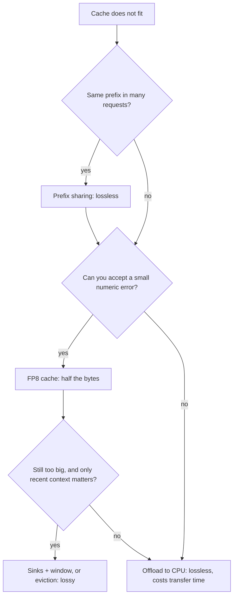

## 1. The question this idea answers

[L5](/notes/ai/llm-systems/03-kv-cache/l5-mha-mqa-gqa-and-mla) made the cache smaller by changing the architecture. That is decided before training. A serving engineer usually gets a finished model and still runs short of memory: long documents, long agent loops, large batches.

So the question becomes: "With this model, how can I store fewer bytes per token, fewer tokens, or keep the bytes somewhere cheaper?" Each answer attacks one factor of the size formula of [L3](/notes/ai/llm-systems/03-kv-cache/l3-the-kv-cache-size-formula):

$$
\text{bytes} = 2 \times L \times H_{kv} \times d_h \times T \times B \times s
$$

| Factor | Method |
|---|---|
| $s$, bytes per number | Quantization: FP8, INT4, INT2 |
| $T$, tokens kept | Sliding window, attention sinks, eviction (H2O, SnapKV) |
| $L$, layers with their own cache | Cross-layer sharing |
| Where the bytes live | Offloading to CPU memory or disk |
| Copies of the same bytes | Prefix sharing |

An interviewer asks "how would you fit a longer context?" and then digs: "Is it lossless? What does it break? Which engine supports it?" This lesson answers those three questions for each method.

## 2. Mental model

> [!analogy] A notebook that is too thick
> Your notebook (the cache) is too thick to carry. You can **write smaller** (quantization). You can **keep only the last pages** (sliding window). You can keep **the first pages and the last pages**, because you always glance at the first page (attention sinks). You can **tear out the pages you never read** (eviction). Two classes can **share one notebook** (cross-layer sharing). You can **store old pages in a cupboard** and fetch them when needed (offloading). Two students who copied the same first chapter can **share those pages** (prefix sharing).
>
> **Where it stops working:** a torn-out page is gone. If a later question needs it, the answer is wrong, and nothing warns you. Only some methods are lossless: offloading, prefix sharing, and a sliding window in a model that was trained with that window.

## 3. Terms

| Term | Plain meaning |
|---|---|
| lossless | The output is exactly the same as with the full cache. |
| lossy | The output can change, because information was rounded or removed. |
| quantization | Storing numbers with fewer bits, plus a scale to recover their size. |
| scale | The number that maps stored small numbers back to real values: real value $\approx$ stored value $\times$ scale. |
| zero-point | An offset used by asymmetric quantization, so that the stored range can start at the minimum value. |
| per-channel quantization | One scale (and zero-point) for each channel, computed over many tokens. |
| per-token quantization | One scale (and zero-point) for each token, computed over its channels. |
| FP8 E4M3, E5M2 | 8-bit floating-point formats: 4 exponent bits and 3 mantissa bits, or 5 and 2. |
| sliding-window attention (SWA) | Each token attends only to the last $W$ tokens. |
| ring buffer | A fixed array where token $p$ goes to slot $p \bmod W$, so the newest token overwrites the oldest. |
| local layer, global layer | A layer with a sliding window, and a layer with full attention. |
| attention sink | An early token that receives a large share of attention, whatever its content. |
| StreamingLLM | A method that keeps a few sink tokens plus a window of recent tokens. |
| eviction | Removing tokens from the cache during generation. |
| heavy hitter | A token with a large accumulated attention score (the term of the H2O paper). |
| observation window | In SnapKV, the last tokens of the prompt, whose attention selects the tokens to keep. |
| cross-layer attention (CLA) | An architecture where adjacent layers share one set of keys and values. |
| offloading | Moving cache data from GPU memory to CPU memory or disk, and back when needed. |
| prefix sharing | Several requests use the same cached blocks for an identical prefix. |

All terms are also in the [Glossary](/notes/ai/llm-systems/glossary).

## 4. The map

| Method | What it saves | Lossless? | Needs training? | Support (examples, checked on 2026-10-15) |
|---|---|---|---|---|
| FP8 KV cache | Half of BF16 | No, small error | No (calibration helps) | vLLM, SGLang, TensorRT-LLM |
| 4-bit or 2-bit KV cache (KIVI-like) | 4 to 8 times vs BF16, before scale overhead | No | No | Hugging Face `QuantizedCache`, research code |
| Sliding window | Cache bounded by $W$ per layer | Yes, if the model was trained with the window | Yes, part of the architecture | Hugging Face, vLLM hybrid manager |
| Attention sinks (StreamingLLM) | Cache bounded by sinks + window | No: middle tokens are lost | No | Research code, and learned sinks in some models |
| Eviction (H2O, SnapKV) | A fixed budget of tokens | No | No | Research code |
| Cross-layer sharing (CLA) | 2 times or more | Yes, for the trained model | Yes, from scratch | Model-specific |
| Offloading | GPU memory, at the cost of transfer time | Yes | No | Hugging Face offloaded caches, vLLM `--kv-offloading-size`, LMCache |
| Prefix sharing | Copies of identical prefixes | Yes | No | vLLM, SGLang, provider prompt caching |

The rest of the lesson takes these rows one by one.

## 5. Quantize the cache

### 5.1 FP8 with a scale

FP8 stores each number in 1 byte instead of the 2 bytes of BF16. That halves the cache. For Llama-3.1-8B, the cache per token falls from 128 KiB to 64 KiB. Formats and their bits are in [Part 01 L4](/notes/ai/llm-systems/01-math-and-hardware/l4-numbers-in-memory).

FP8 E4M3 can hold values up to 448 only. So the code divides by a scale before the conversion, and multiplies by it after:

$$
x_{fp8} = \mathrm{fp8}\!\left(\frac{x}{s}\right), \qquad \hat{x} = x_{fp8} \times s, \qquad s = \frac{\max \lvert x \rvert}{448}
$$

```python
import torch

torch.manual_seed(0)
k = torch.randn(8, 128) * 2.0                     # 8 cached keys of one head, d_h = 128
k[:, 5] *= 20                                     # one outlier channel, as keys often have

E4M3_MAX = torch.finfo(torch.float8_e4m3fn).max   # 448.0
scale = k.abs().max() / E4M3_MAX                  # one scale for the whole tensor
k_fp8 = (k / scale).to(torch.float8_e4m3fn)       # 1 byte per number
k_back = k_fp8.to(torch.float32) * scale          # dequantize inside the attention kernel

rel_err = ((k_back - k).norm() / k.norm()).item()
print("max values:", E4M3_MAX, torch.finfo(torch.float8_e5m2).max)
print("bytes BF16 vs FP8:", k.to(torch.bfloat16).nbytes, k_fp8.nbytes)
print("relative error:", round(rel_err, 4))
q = torch.randn(128)
print("score error:", round(((q @ k_back.T) - (q @ k.T)).abs().max().item(), 4),
      "of max score", round((q @ k.T).abs().max().item(), 2))
```

Output (measured with PyTorch 2.14):

```text
max values: 448.0 57344.0
bytes BF16 vs FP8: 2048 1024
relative error: 0.0253
score error: 2.8504 of max score 120.16
```

The important lines:

1. `scale = k.abs().max() / E4M3_MAX` is a per-tensor scale: one number for the whole tensor. The largest value maps to 448, the edge of the E4M3 range.
2. `.to(torch.float8_e4m3fn)` rounds each number to the nearest FP8 value. This rounding is the loss.
3. `k_back = ... * scale` is what the attention kernel does when it reads the cache.
4. The error is about 2.5 % of the vector size. In a real deployment, the effect on quality must be measured on the task.

The vLLM documentation (version 0.31.0, checked on 2026-10-15) states three facts that matter in an interview:

1. vLLM supports a per-tensor scale and a per-attention-head scale for the FP8 cache. The per-head scheme works "only with the Flash Attention backend" and needs calibration with `llm-compressor`.
2. Without calibration, "All quantization scales are set to `1.0`". Calibration with a dataset is the recommended path.
3. The flag is `--kv-cache-dtype` (`kv_cache_dtype` in Python), with values that include `auto` (the model's own type), `fp8`, `fp8_e4m3` and `fp8_e5m2`. The flag `--kv-cache-dtype-skip-layers` keeps some layers, for example sliding-window layers, in the model's native type. The source file `vllm/config/cache.py` of 0.31.0 also lists `nvfp4` and several other values.

Other engines, checked on 2026-10-15:

- **SGLang**: `--kv-cache-dtype` accepts `fp8_e5m2`, `fp8_e4m3`, `nvfp4` and `fp4_mx_block16`. Its documentation warns that speed can be "extremely slow if dequantization is not fused with the attention kernel". It states that NVFP4 uses 0.5 bytes of data plus 1/16 byte of scale per number, about 3.56 times fewer than BF16.
- **TensorRT-LLM**: `KvCacheConfig(dtype='fp8')` enables an FP8 cache, and `KvCacheConfig(dtype='nvfp4')` an NVFP4 cache after offline quantization.

> [!example] Worked example: what FP8 buys for Llama-3.1-8B
> Suppose 40 GiB of an H100 is free for the cache.
>
> - BF16: $40 \times 2^{30} / 131{,}072 = 327{,}680$ tokens.
> - FP8: $40 \times 2^{30} / 65{,}536 = 655{,}360$ tokens.
> - NVFP4 (0.5625 bytes per number): about $3.56$ times the BF16 count, about 1.17 million tokens.
>
> Twice the tokens means twice the batch at the same length, or twice the length at the same batch. Decode also reads half the bytes per step, so a memory-bound step becomes faster, if the kernel dequantizes on the fly.

### 5.2 Fewer bits: KIVI and the per-channel rule

With 2 or 4 bits, the choice of scale groups decides the quality. Liu et al., "KIVI: A Tuning-Free Asymmetric 2bit Quantization for KV Cache" (ICML 2024), state the rule: "the key cache should be quantized per-channel" and "the value cache should be quantized per-token".

The reasons, from the paper:

1. **Keys** have "a few fixed channels whose magnitudes are very large". A per-token scale must cover the outlier channel, so all the small channels of that token round to the same level. A per-channel scale isolates the outlier.
2. **Values** feed the attention output, which the paper calls "essentially a value cache mixer". Per-token groups keep the error of each token inside that token.

The asymmetric scheme uses a minimum (the zero-point) and a step size:

$$
z = \min x, \qquad \Delta = \frac{\max x - \min x}{2^b - 1}, \qquad x_q = \mathrm{round}\!\left(\frac{x - z}{\Delta}\right), \qquad \hat{x} = x_q \Delta + z
$$

```python
import numpy as np


def quantize(x, bits, axis):
    """Asymmetric quantization with a zero-point. axis=0: one (min, scale) per channel
    (column), computed over tokens. axis=1: one (min, scale) per token (row)."""
    lo = x.min(axis=axis, keepdims=True)
    hi = x.max(axis=axis, keepdims=True)
    scale = (hi - lo) / (2 ** bits - 1)
    q = np.round((x - lo) / scale)                 # integers 0 .. 2^bits - 1
    return q, scale, lo


def dequantize(q, scale, lo):
    return q * scale + lo


rng = np.random.default_rng(0)
K = rng.normal(size=(32, 16))          # 32 tokens, 16 channels of one key head
K[:, 3] = K[:, 3] * 10 + 15            # an outlier channel: large and shifted
normal = [c for c in range(16) if c != 3]

for name, axis in (("per-channel", 0), ("per-token", 1)):
    q, s, lo = quantize(K, bits=2, axis=axis)
    K_hat = dequantize(q, s, lo)
    err_all = np.linalg.norm(K_hat - K) / np.linalg.norm(K)
    err_normal = np.linalg.norm(K_hat[:, normal] - K[:, normal]) / np.linalg.norm(K[:, normal])
    print(f"{name:12s} relative error: all channels {err_all:.3f}, the 15 normal channels {err_normal:.3f}")
```

Output (measured):

```text
per-channel  relative error: all channels 0.209, the 15 normal channels 0.392
per-token    relative error: all channels 0.341, the 15 normal channels 1.690
```

With per-token groups, the error on the normal channels is 1.69 times their own size. That is worse than storing zeros. The outlier channel stretches every token's range, and 2 bits leave only 4 levels.

KIVI adds two more design choices. It uses a group size of 32, and it keeps the newest $R = 128$ tokens "in full precision". New tokens arrive one at a time, so they cannot form a per-channel group yet. The paper reports "2.6× less peak memory (including model weight)", "up to 4× larger batch size" and "2.35× ∼ 3.47× throughput" on Llama, Falcon and Mistral models, without fine-tuning.

> [!example] Worked example: the real bits per number of a 2-bit cache
> Assume, for this example only, that each group of 32 numbers stores a 16-bit scale and a 16-bit zero-point. The overhead is $32 / 32 = 1$ bit per number. So a "2-bit" cache costs about $2 + 1 = 3$ bits per number, about $16 / 3 \approx 5.3$ times smaller than BF16. The 128 newest tokens per sequence stay at 16 bits.

Hugging Face `QuantizedCache` (version 5.20.0) is "similar to" KIVI. It keeps a residual cache of 128 tokens by default. Its backends are `quanto` (2 or 4 bits) and `hqq` (1, 2, 3, 4 or 8 bits). Its docstring states one difference: "The quantization is done per-channel with a set `q_group_size` for both Keys and Values, in contrast to what was described in the paper." It also works only for models whose layers all use full attention.

## 6. Sliding-window attention

### 6.1 The window and the receptive field

With sliding-window attention, the token at position $i$ attends only to positions $i - W + 1$ to $i$. The cache of each layer never needs more than $W$ tokens.

Mistral 7B (Jiang et al., 2023) uses $W = 4{,}096$. The paper explains why the model can still use older information: in layer $k$, a hidden state "can access tokens from the input layer at a distance of up to W × k tokens". With 32 layers, "we have a theoretical attention span of approximately 131K tokens." Information moves forward one window per layer.

> [!example] Worked example: Mistral-7B-v0.1 at 32,768 tokens
> Per token: $2 \times 32 \times 8 \times 128 \times 2 = 131{,}072$ bytes (the same as Llama-3.1-8B).
>
> - Full attention: $131{,}072 \times 32{,}768 = 4$ GiB.
> - Window of 4,096: $131{,}072 \times 4{,}096 = 512$ MiB.
>
> Ratio: $32{,}768 / 4{,}096 = 8$. The paper states it the same way: "On a sequence length of 32k tokens, this reduces the cache memory usage by 8x, without impacting the model quality."

A sliding window is lossless only for a model that was trained with it. The model learned to work without older keys. Cutting the cache of a model trained with full attention is eviction, and it is lossy.

### 6.2 The ring buffer

The Mistral paper describes the storage: "The cache has a fixed size of W, and the keys and values for the timestep i are stored in position i mod W of the cache." The newest token overwrites the oldest one.


```python
import numpy as np

rng = np.random.default_rng(0)
W, D_H, N = 4, 2, 10                       # window of 4 tokens, 10 tokens in total
keys, vals, qs = rng.normal(size=(3, N, D_H))


class RingKV:
    """Sliding-window cache: token at position p goes to slot p % W."""
    def __init__(self, window, d_h):
        self.K = np.zeros((window, d_h))
        self.V = np.zeros((window, d_h))
        self.pos = np.full(window, -1)     # -1 marks an empty slot
        self.W = window

    def append(self, k, v, p):
        slot = p % self.W                  # overwrite the oldest token
        self.K[slot], self.V[slot], self.pos[slot] = k, v, p

    def attend(self, q):
        s = np.where(self.pos >= 0, self.K @ q / np.sqrt(len(q)), -np.inf)
        w = np.exp(s - s.max())
        return (w / w.sum()) @ self.V


def window_reference(t):                   # attend to positions t-W+1 .. t directly
    lo = max(0, t - W + 1)
    s = keys[lo:t + 1] @ qs[t] / np.sqrt(D_H)
    w = np.exp(s - s.max())
    return (w / w.sum()) @ vals[lo:t + 1]


ring = RingKV(W, D_H)
for t in range(N):
    ring.append(keys[t], vals[t], t)
    assert np.allclose(ring.attend(qs[t]), window_reference(t))
print("slots hold positions:", ring.pos.tolist())
```

Output (measured): `slots hold positions: [8, 9, 6, 7]`.

Two facts make the ring buffer correct:

1. **Order in memory does not matter.** The softmax and the weighted sum treat the keys as a set. Slot 0 holding token 8 before slot 2 holding token 6 changes nothing.
2. **Positions are already inside the keys.** With RoPE, each key was rotated at its true position before it entered the buffer (see [L4](/notes/ai/llm-systems/03-kv-cache/l4-implementing-a-kv-cache)). So the relative distances stay correct after the overwrite.

Hugging Face `DynamicSlidingWindowLayer` (version 5.20.0) keeps the last `sliding_window - 1` tokens in the cache. The new token itself is the $W$-th. The vLLM design document on the hybrid KV cache manager states that sliding-window layers "reserve slots only for the most recent `sliding_window_size` tokens", while full-attention layers reserve slots for all tokens.

### 6.3 Mixing local and global layers

Some models use sliding windows in some layers only. The full-attention ("global") layers keep long-range access. The windowed ("local") layers keep the cache small.

| Model | Pattern | Window | Source |
|---|---|---|---|
| Gemma 2 | 1 local : 1 global | 4,096 | Gemma 3 report |
| Gemma 3 | 5 local : 1 global, first layer local | 1,024 | Gemma 3 report |
| gpt-oss-120b, gpt-oss-20b | Alternating banded window and dense layers | 128 | gpt-oss model card |

The Gemma 3 report says that it observed "minimal impact on perplexity when changing this ratio", and that the window "can be reduced significantly without impacting perplexity". It supports a 128K context, except the 1B model with 32K.

> [!example] Worked example: the saving of a 5:1 pattern at 128K tokens
> Take an idealized model in which every layer has the same KV size per token, and $T = 131{,}072$.
>
> - All global: every layer stores 131,072 tokens. Relative size 1.
> - 5:1 with a window of 1,024: one layer in six stores 131,072 tokens, five store 1,024. Relative size $\frac{1}{6} + \frac{5}{6} \times \frac{1{,}024}{131{,}072} = 0.1667 + 0.0065 = 0.1732$.
>
> That is about 5.8 times smaller. The global layers now hold almost all of the cache. This is a computation of these notes, not a figure from the report.

> [!example] Worked example: gpt-oss-120b at 131,072 tokens
> The model card gives 36 layers, 8 KV heads and a head dimension of 64, with banded-window and dense layers alternating. Per token per layer in BF16: $2 \times 8 \times 64 \times 2 = 2{,}048$ bytes.
>
> - 18 dense layers: $18 \times 2{,}048 \times 131{,}072 = 4.5$ GiB.
> - 18 window layers of 128 tokens: $18 \times 2{,}048 \times 128 = 4.5$ MiB.
> - Total about 4.504 GiB, against 9 GiB if all 36 layers were dense. Computed in these notes.

## 7. Attention sinks and StreamingLLM

### 7.1 Why a plain window fails on a full-attention model

Suppose you take a model trained with full attention and keep only the last $W$ tokens. Xiao et al., "Efficient Streaming Language Models with Attention Sinks" (ICLR 2024), show that this fails: "Window attention collapses once the input length exceeds the cache size, i.e., the initial tokens are evicted."

The cause is the softmax. The weights of one query must add to 1. The paper explains that the model learns to place surplus attention on the first tokens, because "initial tokens are visible to almost all subsequent tokens". These tokens are **attention sinks**. Remove them, and the surplus moves to other tokens.

> [!example] Worked example: what happens when the sink leaves
> A query has these scores for 8 cached tokens: $[4.0, 0.5, 0.2, 0.8, 0.1, 0.3, 0.6, 0.4]$. Token 0 is the sink.
>
> - With all 8 tokens, the softmax weights are $[0.834, 0.025, 0.019, 0.034, 0.017, 0.021, 0.028, 0.023]$. The sink takes 83.4 % of the weight.
> - Evict token 0. The other 7 weights become $[0.152, 0.112, 0.205, 0.102, 0.124, 0.168, 0.137]$.
>
> Every remaining weight grew about 6.03 times. The output of the head is now a very different mix of values, so the next layers receive inputs they never saw in training.

### 7.2 The sink cache

StreamingLLM keeps two parts: "Attention sinks (four initial tokens) stabilize the attention computation" and a "Rolling KV Cache retains the most recent tokens".


The positions change. The paper assigns positions inside the cache, not in the original text. Its example: for cache tokens $[0, 1, 2, 3, 6, 7, 8]$ while decoding the next token, "the positions assigned are [0, 1, 2, 3, 4, 5, 6, 7], rather than the positions in the original text". The gap from 3 to 6 disappears, so the model never sees a distance larger than the cache.

This has a direct effect on the implementation. A key rotated at position 6 must later act as position 4. So "For encoding like RoPE, we cache the Keys of tokens prior to introducing the rotary transformation. Then, we apply position transformation to the keys in the rolling cache at each decoding phase." This is the main exception to the rule of [L4](/notes/ai/llm-systems/03-kv-cache/l4-implementing-a-kv-cache) that keys are stored after RoPE.

```video
{"src": "/notes/media/llm-systems/manim/m15-sliding-window-and-attention-sinks.mp4", "caption": "A plain window drops the first tokens and the softmax breaks, while four sink tokens plus a recent window keep it stable."}
```

### 7.3 Results and limits

The paper reports these results:

1. Llama-2, MPT, Falcon and Pythia models work "with up to 4 million tokens and more".
2. StreamingLLM is up to 22.2 times faster than a sliding window that recomputes the cache for each token.
3. A model pre-trained with a dedicated "placeholder token as a dedicated attention sink" streams better.

The paper also states the limit clearly: StreamingLLM "does not extend the models' context window or enhance their long-term memory capabilities". A fact in an evicted middle token is gone. StreamingLLM is for endless streams, such as a long chat where only recent turns matter. It is not for answering a question about page 3 of a 500-page document.

### 7.4 Sinks built into the model

Some newer models make the sink a learned part of attention. The gpt-oss model card states: "Each attention head has a learned bias in the denominator of the softmax". With a learned bias $b$ for the head, the weights become

$$
w_j = \frac{e^{s_j}}{e^{b} + \sum_k e^{s_k}}
$$

The weights now add to less than 1. The head can "attend to no tokens", so it does not need a real token to absorb surplus attention.

## 8. Eviction: H2O and SnapKV

Eviction keeps a fixed budget of tokens and chooses which ones to drop. Both methods below are lossy and need no training.

### 8.1 H2O: keep the heavy hitters

Zhang et al., "H2O: Heavy-Hitter Oracle for Efficient Generative Inference of Large Language Models" (NeurIPS 2023), observe that "the accumulated attention scores of all the tokens within attention blocks follow a power-law distribution". A few tokens collect most of the attention. The paper calls them heavy hitters.

The policy:

1. For each cached token, add the attention weight it receives at every step: its accumulated score.
2. Split the budget. The paper "evenly assigns the caching budget to H2 and the most recent KV".
3. When the cache exceeds the budget, evict the token with the lowest accumulated score among the non-recent tokens.

> [!example] Worked example: one eviction decision
> Budget 4 tokens, with the 2 newest tokens always kept. After some steps, the accumulated scores of tokens 0 to 4 are $[0.9, 0.1, 0.3, 0.4, 0.3]$. Tokens 3 and 4 are the 2 newest, so they stay. The candidates are tokens 0, 1 and 2. Token 1 has the lowest score (0.1), so H2O evicts token 1. The cache keeps tokens 0, 2, 3 and 4.

The paper reports, for OPT-6.7B and OPT-30B with 20 % heavy hitters, throughput gains of "up to 29×, 29×, and 3×" over DeepSpeed Zero-Inference, Hugging Face Accelerate and FlexGen. It also reports up to 1.9 times lower latency at the same batch size. It states that H2O "can reduce KV cache memory footprint by 5-10×" on most tasks, but the introduction says "up to 5×". The two numbers of the paper do not agree.

### 8.2 SnapKV: choose once, from the end of the prompt

Li et al., "SnapKV: LLM Knows What You are Looking for Before Generation" (2024), compress the prompt once, before generation starts. They observe that "each attention head in the model consistently focuses on specific prompt attention features", and that this pattern "can be obtained from an 'observation' window located at the end of the prompts".

The algorithm, per head:

1. **Observe.** Take the last tokens of the prompt (the observation window). The paper uses sizes 16, 32 or 64.
2. **Vote.** Add the attention weights that the window's queries give to each earlier position.
3. **Pool.** Smooth the votes with a pooling kernel (sizes 5, 7 or 13 in the experiments), so that neighbors of an important token survive too.
4. **Select.** Keep the top-$k$ positions, and append all tokens of the observation window.

The abstract claims "a 3.6x increase in generation speed and an 8.2x enhancement in memory efficiency" at 16K input tokens, and up to 380K context tokens on one A100-80GB. SnapKV needs no fine-tuning.

### 8.3 What eviction costs

1. **Lost facts.** An evicted token cannot return. In a multi-turn chat or an agent loop, a later question can need a token that looked unimportant earlier. SnapKV chooses with the queries at the end of the first prompt, which cannot know the next question.
2. **The scores are not free.** Interpretation of these notes: H2O needs the attention weights of every step. Fused kernels such as FlashAttention never write the full weight matrix to memory (see [Part 02 L7](/notes/ai/llm-systems/02-attention-and-the-transformer/l7-attention-cost-and-flashattention)). So the engine must compute the scores in another way.
3. **Accumulated scores favor old tokens.** A token that has been in the cache for 30 steps collected 30 weights. A new token collected one. Exercise 3 below shows this: with random data, H2O keeps the first tokens.
4. **Paged caches.** Evicting single tokens leaves holes inside blocks. Interpretation of these notes: this fits poorly with the block design of [paper page 05](/notes/papers/llm-serving/2023-pagedattention/05-the-kv-cache-manager).

## 9. Sharing keys and values across layers

Brandon et al., "Reducing Transformer Key-Value Cache Size with Cross-Layer Attention" (2024), share keys and values between adjacent layers. In their words, "the attention blocks in layers without key/value projections reuse the KV activations of previous layers". CLA2 "shares each KV projection among a pair of adjacent layers".

The paper reports that CLA can "reduce the size of the KV cache by another 2× while maintaining nearly the same accuracy as unmodified MQA". It trained 1B and 3B models "from scratch". So CLA is an architecture choice, like GQA and MLA. The paper does not show a conversion of a finished model.

The effect on the formula: with CLA2, the factor $L$ becomes $L / 2$. Combined with MQA, the cache per token falls from $2 L d_h$ to $L d_h$ numbers.

## 10. Offloading: keep the bytes somewhere cheaper

Offloading does not shrink the cache. It moves cache data out of GPU memory and brings it back when needed. It is lossless, and it costs transfer time.

1. **Hugging Face** (5.20.0): an offloaded cache keeps all layers except one on the CPU. The guide says that it "will asynchronously prefetch the next layer's cache". Enable it with `cache_implementation="offloaded"` or `"offloaded_static"`, or with `DynamicCache(config=model.config, offloading=True)`.
2. **vLLM** (0.31.0): `--kv-offloading-size` sets the size of the CPU buffer in GiB, and `--kv-offloading-backend` chooses `native` or `lmcache`. Offloading is "only activated when kv_offloading_size is set".
3. **LMCache** describes itself as "a KV cache management layer for LLM inference". Its documentation names storage tiers such as CPU RAM, local disk, Redis/Valkey, Mooncake, InfiniStore and S3-compatible object storage. It can reuse cached blocks "at any position in the prompt" and across engine instances.

> [!example] Worked example: reload or recompute?
> A finished conversation of 8,192 tokens on Llama-3.1-8B has a 1 GiB cache. The user returns. The engine can reload the cache from CPU memory, or recompute it with a new prefill.
>
> - **Reload.** The H100 datasheet lists PCIe Gen5 at 128 GB/s. Even at that rate, $2^{30} / (128 \times 10^9) \approx 8.4$ ms.
> - **Recompute.** Prefill needs about $2 \times 8.03 \times 10^9 \times 8{,}192 \approx 1.32 \times 10^{14}$ FLOPs. At about 989 TFLOPS dense BF16, that is at least about 133 ms, ignoring the attention FLOPs.
>
> Under these ideal numbers, the reload is about 16 times faster. Real transfers and kernels are slower than these limits, so measure on your own system. The trend explains why offloading tiers exist.

The paper pages compare swapping and recomputation for preempted requests: [paper page 07](/notes/papers/llm-serving/2023-pagedattention/07-scheduling-and-preemption).

## 11. Prefix sharing

Two requests with the same system prompt produce the same keys and values for that prompt. The positions and the tokens are identical, so the cache is identical. An engine with a paged cache can let both requests use the same blocks, with reference counts. This is lossless, and it saves memory and prefill time.

This guide covers it in depth elsewhere:

- [paper page 06](/notes/papers/llm-serving/2023-pagedattention/06-decoding-scenarios-and-sharing): copy-on-write and shared blocks
- [Part 04 L9](/notes/ai/llm-systems/04-inference/l9-prefix-caching-and-kv-reuse): automatic prefix caching
- [prompt caching](/notes/ai/context-engineering/01-foundations/l7-prompt-caching): the provider view

## 12. Choosing and combining

The methods combine, because they act on different factors.



Interpretation of these notes, as a default order for a production system:

1. Use what the model already offers: GQA, MLA or sliding windows are free at serving time.
2. Enable prefix sharing. It is lossless, and agent loops and chats reuse long prefixes.
3. Try an FP8 cache, with calibrated scales, and measure quality on your own evaluation set.
4. Add CPU offloading for idle conversations that may return.
5. Use eviction or sinks only when losing old context is acceptable, and test the long-context tasks you care about.

## 13. Practice

### Exercises

Write your code in `C:\Users\ASohi\Downloads\AI\agent-harness-lab`, notebook folder `llm-systems/`.

1. **A ring-buffer cache.** Write `RingKV(window, d_h)` with `append(k, v, position)` and `attend(q)`.
   - Acceptance test: for 10 random tokens and $W = 4$, every output equals attention over positions $t - 3$ to $t$, and the slots finally hold positions `[8, 9, 6, 7]`.
   - Hint 1: the slot is `position % window`.
   - Hint 2: mark empty slots and give them a score of $-\infty$.
2. **A StreamingLLM cache.** Write `SinkCache(n_sink, window)` that keeps the first `n_sink` tokens and the last `window` tokens. Store keys before RoPE, and rotate them with positions inside the cache at every step.
   - Acceptance test: the cache never holds more than 8 tokens for `n_sink=4, window=4`. While no token was evicted, the output equals full attention with RoPE. When token 9 arrives, the cache holds `[0, 1, 2, 3, 6, 7, 8, 9]`.
   - Hint 1: when the cache is too long, delete the entry at index `n_sink`.
   - Hint 2: the new token's query gets position `len(cache) - 1`.
3. **H2O eviction.** Write `h2o_decode(Q, K, V, budget, recent)` that evicts the token with the smallest accumulated attention, never one of the `recent` newest tokens.
   - Acceptance test: the cache never exceeds `budget`. With `budget` equal to the sequence length, the outputs equal full attention. Report which tokens survive with budget 12 of 40.
   - Hint 1: keep a dictionary from token index to accumulated weight.
   - Hint 2: the candidates are `keep[:-recent]`.
4. **A memory planner.** Write `kv_bytes(layer_groups, T, B, bytes_per_elem)` where each group is `(n_layers, n_kv_heads, head_dim, window or None)`.
   - Acceptance test: Mistral-7B-v0.1 at 32,768 tokens gives 4 GiB without the window and 512 MiB with $W = 4{,}096$. The same model in FP8 without the window gives 2 GiB.
   - Hint 1: a windowed group stores `min(T, window)` tokens.
   - Hint 2: gpt-oss-120b is two groups of 18 layers.

## 14. Common mistakes

1. **"FP8 KV cache is lossless."** No. Each number is rounded to one of 256 bit patterns. The error is small with good scales, but it exists. Without calibration, vLLM sets the scales to 1.0.
2. **"Quantize keys and values the same way."** Not at low bits. Keys have outlier channels and need per-channel groups. Values work better per token. At 2 bits, the wrong choice can make the error larger than the values.
3. **"A sliding window means the model cannot use older tokens."** Not exactly. In a model trained with a window, information travels one window per layer, so the theoretical span is about $W \times L$. But the direct attention reach is $W$.
4. **"You can add a sliding window to any model."** Only to a model trained with it, if you need the same outputs. On a full-attention model, dropping the first tokens breaks the softmax distribution. Keep sink tokens at least.
5. **"StreamingLLM gives a 4-million-token context."** No. It keeps the model stable over a stream of 4 million tokens, but it forgets the middle. The paper says it does not extend the context window.
6. **"Eviction is safe because attention is sparse."** Sparse at one step does not mean sparse at every future step. A later question can need an evicted token, and nothing warns you.
7. **"Offloading makes the cache smaller."** No. The total bytes are the same. They move to slower memory, and every reload costs transfer time.
8. **"Keys are always cached after RoPE."** Not in StreamingLLM. It renumbers positions inside the cache, so it stores keys before RoPE and rotates them at every step.

## 15. One-minute explanation

There are four levers to shrink the KV cache of a finished model: fewer bits, fewer tokens, fewer copies, and cheaper memory. Fewer bits means quantization. An FP8 cache with a scale halves BF16, and vLLM, SGLang and TensorRT-LLM support it. Two- and four-bit methods such as KIVI need per-channel groups for keys, because keys have outlier channels. Fewer tokens has three forms. A sliding window, like Mistral's 4,096 tokens in a ring buffer, is lossless only when the model was trained with it. On a full-attention model, a plain window collapses because the first tokens act as attention sinks, so StreamingLLM keeps four sinks plus a recent window. Eviction methods like H2O and SnapKV keep a budget of the most-attended tokens, but every dropped token is lost for good. Offloading to CPU or disk keeps every byte and only costs transfer time, and prefix sharing removes duplicate copies for free. In practice I use the model's own GQA or windows, enable prefix sharing, add a calibrated FP8 cache, then offload, and use lossy eviction last.

## 16. Check questions

```check
{"question": "For each method, say which factor of the size formula it changes and whether it is lossless: FP8 cache, sliding window, StreamingLLM, H2O, CLA, offloading, prefix sharing.", "hint": "bytes = 2 x L x H_kv x d_h x T x B x s", "answer": "| Method | Factor | Lossless? |\n|---|---|---|\n| FP8 cache | $s$ (2 bytes to 1) | No, small rounding error |\n| Sliding window | $T$ per layer, at most $W$ | Yes, only for a model trained with the window |\n| StreamingLLM | $T$: sinks + recent window | No, middle tokens are lost |\n| H2O, SnapKV | $T$: a budget of tokens | No |\n| CLA | $L$: layers that own a cache | Yes for the trained model, but needs training from scratch |\n| Offloading | None: the bytes move to CPU or disk | Yes, costs transfer time |\n| Prefix sharing | Number of copies of identical prefixes | Yes |"}
```

```check
{"question": "Why does KIVI quantize keys per channel and values per token?", "hint": "Where are the outliers in keys? What does attention do with values?", "answer": "Keys have a few fixed channels with very large magnitudes. A per-token scale must cover the outlier channel, so the small channels of each token collapse to one level. A per-channel scale gives the outlier channel its own range, and the other channels keep their precision. In the NumPy example of this lesson, 2-bit per-token quantization gave a relative error of 1.69 on the normal channels, against 0.39 per channel.\n\nValues are mixed by the attention weights, and the paper calls the output \"essentially a value cache mixer\". Per-token groups keep the error of each value inside that token, so a token with a small weight contributes a small error."}
```

```check
{"question": "Interview follow-up: a model trained with full attention is served with only the last 4,096 tokens in its cache. Quality collapses after 4,096 tokens. Explain the cause with the softmax, and give a fix.", "hint": "Attention sinks.", "answer": "The softmax weights of every query must add to 1. During training, the model learned to put its surplus attention on the first tokens, because they are visible to every later token. These are attention sinks. When the window drops them, that surplus must go to other tokens. In the example of this lesson, a sink with 83.4 % of the weight leaves, and every other weight grows about 6 times. The next layers receive mixes they never saw in training, and the output degrades.\n\nFix: StreamingLLM keeps the first 4 tokens as sinks plus a rolling window of recent tokens. It assigns positions inside the cache, so the keys are stored before RoPE and rotated at each step. It keeps the model stable on very long streams, but it does not extend the context: the middle is forgotten. A newer alternative is a model trained with a sink, such as a learned bias in the softmax denominator (gpt-oss)."}
```

```check
{"question": "Interview follow-up: compute the KV cache of Mistral-7B-v0.1 for 8 sequences of 32,768 tokens, with and without its sliding window, in BF16 and in FP8.", "hint": "131,072 bytes per token in BF16. Window 4,096.", "answer": "Per token: $2 \\times 32 \\times 8 \\times 128 \\times 2 = 131{,}072$ bytes.\n\n| | BF16 | FP8 |\n|---|---|---|\n| Full cache, $8 \\times 32{,}768$ tokens | $131{,}072 \\times 262{,}144 = 32$ GiB | 16 GiB |\n| Window, $8 \\times 4{,}096$ tokens | $131{,}072 \\times 32{,}768 = 4$ GiB | 2 GiB |\n\nThe window saves a factor of 8 (the paper's own claim for 32K), and FP8 another factor of 2. Together: 16 times smaller than the full BF16 cache."}
```

```check
{"question": "Interview follow-up: why does StreamingLLM cache keys before RoPE, when a normal cache stores them after RoPE?", "hint": "Which positions does StreamingLLM give to the cached tokens?", "answer": "A normal cache stores rotated keys, because a key's rotation depends only on its own position, and that position never changes.\n\nStreamingLLM changes positions. It numbers the tokens inside the cache: for cache tokens [0, 1, 2, 3, 6, 7, 8], the next step uses positions 0 to 7, not the original positions. After every eviction, a token's position inside the cache can change, for example token 6 acts as position 4. A key rotated once at its old position would carry the wrong angle. So the paper caches \"the Keys of tokens prior to introducing the rotary transformation\" and applies the rotation to the cached keys at each decoding step."}
```

```check
{"question": "Interview follow-up: a user returns to an 8,192-token conversation on Llama-3.1-8B after its cache left the GPU. Should the engine reload the cache from CPU memory or recompute it? Estimate both.", "hint": "Cache size 1 GiB. PCIe Gen5 on the H100 datasheet: 128 GB/s. Prefill FLOPs: about 2 x parameters x tokens.", "answer": "- Reload: $2^{30} / (128 \\times 10^9) \\approx 8.4$ ms at the datasheet rate, a lower bound.\n- Recompute: $2 \\times 8.03 \\times 10^9 \\times 8{,}192 \\approx 1.32 \\times 10^{14}$ FLOPs. At about 989 TFLOPS dense BF16: at least about 133 ms, ignoring attention FLOPs.\n\nUnder these ideal numbers, the reload is about 16 times faster, and it is lossless. Recomputation needs no CPU memory and no transfer bandwidth, so it can still win when the link is busy or the prompt is short. This is why vLLM offers `--kv-offloading-size` and tools such as LMCache add CPU and disk tiers."}
```

```check
{"question": "Interview follow-up: compare H2O and SnapKV. When does each one choose what to evict, and what is the main risk?", "hint": "Accumulated scores during decoding vs one selection from the end of the prompt.", "answer": "**H2O** works during decoding. It adds up the attention weight each cached token receives at every step. It splits the budget evenly between heavy hitters and recent tokens, and when the cache is full it evicts the non-recent token with the lowest accumulated score. It needs the attention weights at every step, and accumulated scores favor old tokens.\n\n**SnapKV** works once, after prefill. The queries of an observation window at the end of the prompt vote for earlier positions. The votes are pooled, and each head keeps its top-$k$ positions plus the window.\n\n**Main risk for both:** they are lossy. A dropped token never returns. In a multi-turn chat or an agent loop, a later question can need a token that the policy judged unimportant, and the model answers wrongly without any error."}
```

```check
{"question": "What do the vLLM flags --kv-cache-dtype, --kv-cache-dtype-skip-layers and --kv-offloading-size do (version 0.31.0)?", "hint": "Storage type, exceptions, CPU buffer.", "answer": "- `--kv-cache-dtype`: the storage type of the cache. `auto` uses the model's type. Values include `fp8` (E4M3 on CUDA), `fp8_e4m3`, `fp8_e5m2` and, in 0.31.0, `nvfp4` and others. Without calibrated scales, FP8 scales are 1.0.\n- `--kv-cache-dtype-skip-layers`: keeps chosen layers in the native type, by index or by type such as `sliding_window`.\n- `--kv-offloading-size`: the size in GiB of the CPU buffer for KV offloading. Offloading is active only when it is set. `--kv-offloading-backend` chooses `native` or `lmcache`."}
```

```check
{"question": "Exercise 1: show a reference solution", "answer": "```python\nimport numpy as np\n\nrng = np.random.default_rng(0)\nW, D_H, N = 4, 2, 10\nkeys, vals, qs = rng.normal(size=(3, N, D_H))\n\n\nclass RingKV:\n    \"\"\"Sliding-window cache: token at position p goes to slot p % W.\"\"\"\n    def __init__(self, window, d_h):\n        self.K = np.zeros((window, d_h))\n        self.V = np.zeros((window, d_h))\n        self.pos = np.full(window, -1)\n        self.W = window\n\n    def append(self, k, v, p):\n        slot = p % self.W\n        self.K[slot], self.V[slot], self.pos[slot] = k, v, p\n\n    def attend(self, q):\n        s = np.where(self.pos >= 0, self.K @ q / np.sqrt(len(q)), -np.inf)\n        w = np.exp(s - s.max())\n        return (w / w.sum()) @ self.V\n\n\ndef window_reference(t):\n    lo = max(0, t - W + 1)\n    s = keys[lo:t + 1] @ qs[t] / np.sqrt(D_H)\n    w = np.exp(s - s.max())\n    return (w / w.sum()) @ vals[lo:t + 1]\n\n\nring = RingKV(W, D_H)\nfor t in range(N):\n    ring.append(keys[t], vals[t], t)\n    assert np.allclose(ring.attend(qs[t]), window_reference(t))\nassert ring.pos.tolist() == [8, 9, 6, 7]\nprint(\"ring buffer matches windowed attention; slots:\", ring.pos.tolist())\n```"}
```

```check
{"question": "Exercise 2: show a reference solution", "answer": "```python\nimport numpy as np\n\nD_H = 4\n\n\ndef rope(x, pos):\n    \"\"\"x: [n, D_H], pos: [n]. Two frequencies: 1 and 0.01 radians per position.\"\"\"\n    freq = np.array([1.0, 0.01])\n    a = np.asarray(pos, float)[:, None] * freq            # [n, 2]\n    x1, x2 = x[:, 0::2], x[:, 1::2]\n    out = np.empty_like(x)\n    out[:, 0::2] = x1 * np.cos(a) - x2 * np.sin(a)\n    out[:, 1::2] = x1 * np.sin(a) + x2 * np.cos(a)\n    return out\n\n\nclass SinkCache:\n    \"\"\"StreamingLLM: keep the first n_sink tokens and the last `window` tokens.\n    Keys are stored BEFORE RoPE, and rotated with cache positions at every step.\"\"\"\n    def __init__(self, n_sink, window):\n        self.n_sink, self.window = n_sink, window\n        self.ids, self.K_raw, self.V = [], [], []\n\n    def append(self, token_id, k_raw, v):\n        self.ids.append(token_id)\n        self.K_raw.append(k_raw)\n        self.V.append(v)\n        if len(self.ids) > self.n_sink + self.window:      # evict the oldest non-sink token\n            for lst in (self.ids, self.K_raw, self.V):\n                del lst[self.n_sink]\n\n    def attend(self, q_raw):\n        n = len(self.ids)\n        cache_pos = np.arange(n)                           # positions inside the cache\n        K = rope(np.array(self.K_raw), cache_pos)\n        q = rope(q_raw[None], [n - 1])[0]                  # the new token is the last one\n        s = K @ q / np.sqrt(D_H)\n        w = np.exp(s - s.max())\n        return (w / w.sum()) @ np.array(self.V)\n\n\ndef full_attention(t, Kr, V, Q):\n    K = rope(Kr[: t + 1], np.arange(t + 1))\n    q = rope(Q[t][None], [t])[0]\n    s = K @ q / np.sqrt(D_H)\n    w = np.exp(s - s.max())\n    return (w / w.sum()) @ V[: t + 1]\n\n\nrng = np.random.default_rng(0)\nN = 12\nKr, V, Q = rng.normal(size=(3, N, D_H))\ncache = SinkCache(n_sink=4, window=4)\nfor t in range(N):\n    cache.append(t, Kr[t], V[t])\n    out = cache.attend(Q[t])\n    assert len(cache.ids) <= 8\n    if t < 8:                                              # nothing evicted yet: exact\n        assert np.allclose(out, full_attention(t, Kr, V, Q))\n    if t == 9:\n        assert cache.ids == [0, 1, 2, 3, 6, 7, 8, 9]       # the paper's example, plus token 9\nprint(\"final cache ids:\", cache.ids, \"| positions used: 0 ..\", len(cache.ids) - 1)\n```"}
```

```check
{"question": "Exercise 3: show a reference solution", "answer": "```python\nimport numpy as np\n\n\ndef h2o_decode(Q, K, V, budget, recent):\n    \"\"\"Heavy-hitter eviction. Keep at most `budget` tokens. Never evict the\n    `recent` newest tokens. Evict the token with the smallest accumulated attention.\"\"\"\n    keep, acc, outs = [], {}, []\n    for t in range(len(Q)):\n        keep.append(t)\n        acc[t] = 0.0\n        idx = np.array(keep)\n        s = K[idx] @ Q[t] / np.sqrt(Q.shape[1])\n        w = np.exp(s - s.max())\n        w = w / w.sum()\n        outs.append(w @ V[idx])\n        for i, wi in zip(keep, w):\n            acc[i] += wi                                  # accumulated attention score\n        if len(keep) > budget:\n            victim = min(keep[:-recent], key=lambda i: acc[i])\n            keep.remove(victim)\n            del acc[victim]\n        assert len(keep) <= budget\n        assert all(i in keep for i in range(max(0, t - recent + 1), t + 1))   # recent tokens stay\n    return np.array(outs), keep\n\n\ndef full_decode(Q, K, V):\n    outs = []\n    for t in range(len(Q)):\n        s = K[: t + 1] @ Q[t] / np.sqrt(Q.shape[1])\n        w = np.exp(s - s.max())\n        outs.append((w / w.sum()) @ V[: t + 1])\n    return np.array(outs)\n\n\nrng = np.random.default_rng(0)\nQ, K, V = rng.normal(size=(3, 40, 8))\nfull = full_decode(Q, K, V)\nsame, _ = h2o_decode(Q, K, V, budget=40, recent=4)\nassert np.allclose(same, full)                            # no eviction: exact\nsmall, kept = h2o_decode(Q, K, V, budget=12, recent=6)\nerr = np.linalg.norm(small - full) / np.linalg.norm(full)\nprint(\"kept tokens:\", kept)\nprint(\"relative error with budget 12 of 40:\", round(float(err), 3))\n```\n\nOutput: the kept tokens are `[0, 1, 2, 3, 4, 5, 34, 35, 36, 37, 38, 39]`, and the relative error is about 0.683. Random data has no real heavy hitters, so the error is large, and the oldest tokens survive because they collected weight for the most steps."}
```

```check
{"question": "Exercise 4: show a reference solution", "answer": "```python\ndef kv_bytes(layer_groups, T, B=1, bytes_per_elem=2):\n    \"\"\"layer_groups: list of (n_layers, n_kv_heads, head_dim, window or None).\"\"\"\n    total = 0\n    for n_layers, n_kv, d_h, window in layer_groups:\n        tokens = T if window is None else min(T, window)\n        total += 2 * n_layers * n_kv * d_h * tokens * B * bytes_per_elem\n    return total\n\n\nGiB, MiB = 2 ** 30, 2 ** 20\nmistral_full = kv_bytes([(32, 8, 128, None)], T=32768)\nmistral_swa = kv_bytes([(32, 8, 128, 4096)], T=32768)\nassert mistral_full == 4 * GiB and mistral_swa == 512 * MiB\ngpt_oss = kv_bytes([(18, 8, 64, None), (18, 8, 64, 128)], T=131072)\ngpt_oss_dense = kv_bytes([(36, 8, 64, None)], T=131072)\nfp8 = kv_bytes([(32, 8, 128, None)], T=32768, bytes_per_elem=1)\nassert fp8 == 2 * GiB\nprint(\"Mistral-7B-v0.1 at 32K:\", mistral_full / GiB, \"GiB full,\", mistral_swa / MiB, \"MiB with the window\")\nprint(\"gpt-oss-120b at 128K:\", round(gpt_oss / GiB, 4), \"GiB vs\", gpt_oss_dense / GiB, \"GiB if all dense\")\n```"}
```

## 17. Links

- Previous lesson: [L5: MHA, MQA, GQA and MLA](/notes/ai/llm-systems/03-kv-cache/l5-mha-mqa-gqa-and-mla)
- Next part: [Part 04 L1: The life of a request](/notes/ai/llm-systems/04-inference/l1-the-life-of-a-request)
- The size formula: [L3](/notes/ai/llm-systems/03-kv-cache/l3-the-kv-cache-size-formula). The implementation and RoPE: [L4](/notes/ai/llm-systems/03-kv-cache/l4-implementing-a-kv-cache).
- Number formats: [Part 01 L4](/notes/ai/llm-systems/01-math-and-hardware/l4-numbers-in-memory). Quantization of weights and activations: [Part 04 L7](/notes/ai/llm-systems/04-inference/l7-quantization).
- Prefix caching: [Part 04 L9](/notes/ai/llm-systems/04-inference/l9-prefix-caching-and-kv-reuse). Engines and their flags: [Part 04 L10](/notes/ai/llm-systems/04-inference/l10-serving-engines).
- The paper: [06 Sharing](/notes/papers/llm-serving/2023-pagedattention/06-decoding-scenarios-and-sharing), [07 Scheduling and preemption](/notes/papers/llm-serving/2023-pagedattention/07-scheduling-and-preemption), [10 Limits and later work](/notes/papers/llm-serving/2023-pagedattention/10-limits-and-later-work)
- Position effects in long contexts: [Lost in the middle, background](/notes/papers/long-context/2023-lost-in-the-middle/02-background-attention-and-position)
- Interview drill: [From attention to PagedAttention](/notes/ai/llm-systems/08-interview-drills/l1-chain-attention-to-pagedattention)

### Sources

- vLLM documentation, "Quantized KV Cache", and source `vllm/config/cache.py`, `vllm/engine/arg_utils.py`, version 0.31.0: https://docs.vllm.ai/en/latest/features/quantization/quantized_kvcache/ and https://github.com/vllm-project/vllm/tree/v0.31.0 (checked on 2026-10-15)
- vLLM design document, "Hybrid KV Cache Manager": https://github.com/vllm-project/vllm/blob/v0.31.0/docs/design/hybrid_kv_cache_manager.md (checked on 2026-10-15)
- SGLang documentation, "Quantized KV Cache": https://docs.sglang.io/docs/advanced_features/quantized_kv_cache (checked on 2026-10-15)
- TensorRT-LLM documentation, "Quantization": https://nvidia.github.io/TensorRT-LLM/latest/features/quantization.html (checked on 2026-10-15)
- Hugging Face `transformers` 5.20.0, "Cache strategies" and `cache_utils.py`: https://huggingface.co/docs/transformers/main/en/kv_cache and https://github.com/huggingface/transformers/tree/v5.20.0 (checked on 2026-10-15)
- LMCache documentation: https://docs.lmcache.ai/ (checked on 2026-10-15)
- Liu et al., "KIVI: A Tuning-Free Asymmetric 2bit Quantization for KV Cache", ICML 2024: https://arxiv.org/abs/2402.02750
- Jiang et al., "Mistral 7B", 2023: https://arxiv.org/abs/2310.06825
- Gemma Team, "Gemma 3 Technical Report", 2025: https://arxiv.org/abs/2503.19786
- OpenAI, "gpt-oss-120b & gpt-oss-20b Model Card", 2025: https://arxiv.org/abs/2508.10925
- Xiao et al., "Efficient Streaming Language Models with Attention Sinks", ICLR 2024: https://arxiv.org/abs/2309.17453
- Zhang et al., "H2O: Heavy-Hitter Oracle for Efficient Generative Inference of Large Language Models", NeurIPS 2023: https://arxiv.org/abs/2306.14048
- Li et al., "SnapKV: LLM Knows What You are Looking for Before Generation", 2024: https://arxiv.org/abs/2404.14469
- Brandon et al., "Reducing Transformer Key-Value Cache Size with Cross-Layer Attention", 2024: https://arxiv.org/abs/2405.12981
- PyTorch `torch.finfo` and FP8 types: https://docs.pytorch.org/docs/stable/type_info.html (checked on 2026-10-15)
- NVIDIA H100 specifications: https://www.nvidia.com/en-us/data-center/h100/ (checked on 2026-10-15)
