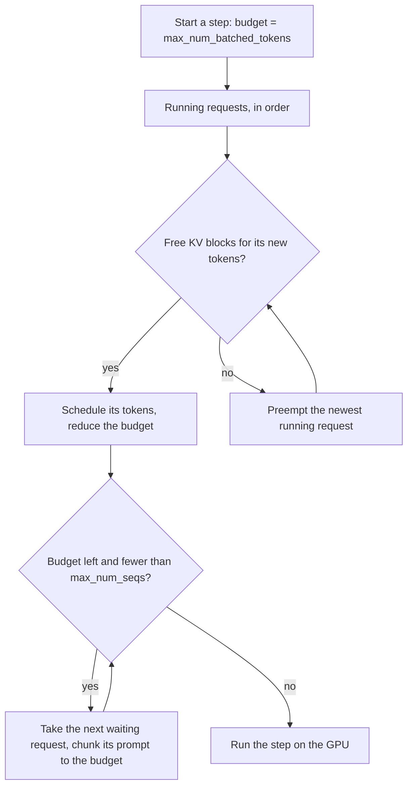

## 1. The question this idea answers

[L3](/notes/ai/llm-systems/04-inference/l3-compute-bound-vs-memory-bound) showed that a decode step costs about the same for 1 sequence as for 64: the GPU reads the weights once either way. So the server must run many requests together. But requests arrive at random moments. Their prompts have different lengths. Each one stops after a number of tokens that nobody knows in advance. A new prompt needs a heavy prefill, while the running requests need light decode steps.

So the server must answer, before every step: which requests run now, and how many tokens of each? This is scheduling.

The interviewer asks: what is continuous batching and why was it a breakthrough? What is chunked prefill? What happens when the KV cache is full? What is prefill-decode disaggregation, and when is it worth the effort? This lesson answers each question with numbers.

## 2. Mental model

> [!analogy] A bus versus a chairlift
> **Static batching** is a bus. It waits until it is full, then drives the whole route. Passengers who leave at the first stop leave empty seats behind, and nobody can board until the bus returns to the station.
>
> **Continuous batching** is a chairlift. A chair passes the station every few seconds. Anyone who reached the top steps off, and anyone in the queue steps on at once. No seat stays empty while people wait.
>
> **Chunked prefill** is a large group at the chairlift. If the whole group boards at once, the lift must slow down for everyone. So the group boards a few people per chair, and the lift keeps its speed.
>
> **Where it stops working:** on a chairlift, a seat costs the same no matter how long the rider stays. In an LLM server, every running request also holds a KV cache that grows with every token. Memory, not seats, often sets the limit. And boarding is not free: a new request needs a prefill that costs many decode steps of compute.

## 3. Terms

| Term | Plain meaning |
|---|---|
| static batching | Form a batch, run it until every request in it has finished, then form the next batch. |
| padding | Filler tokens that make sequences of different lengths fit one rectangular tensor. They cost compute and memory. |
| dynamic batching | Wait a short time to collect requests into a batch before running it. It fixes arrival times, not different lengths. |
| continuous batching | Decide the batch again at every step: finished requests leave and waiting requests join. Also called iteration-level scheduling or in-flight batching. |
| iteration-level scheduling | Orca's name for continuous batching: the scheduler runs "only a single iteration of the model on the batch" at a time. |
| selective batching | Orca's technique: batch the token-wise operations of all requests, but run attention separately for each request. |
| token budget | The maximum number of tokens in one step. In vLLM, `max_num_batched_tokens`. |
| `max_num_seqs` | The maximum number of requests in one step in vLLM. |
| chunked prefill | Split a long prompt into chunks that fit the token budget, and process one chunk per step together with decodes. |
| generation stall | Sarathi-Serve's name for a pause in a request's decoding while a prefill runs in between. |
| stall-free batching | Sarathi-Serve's policy: schedule all decodes first, then fill the rest of the budget with prefill chunks. |
| preemption | Removing a running request to free KV cache memory. It later resumes. |
| recomputation | A way to resume a preempted request: free its KV cache and compute it again later with a prefill. vLLM V1's default. |
| swapping | A way to resume a preempted request: copy its KV cache to CPU memory and copy it back later. |
| FCFS | First come, first served: the default scheduling policy of vLLM. |
| admission control | Rejecting new requests when the server is too full, so that accepted requests still meet their latency targets. |
| prefill-decode disaggregation | Running prefill and decode on different GPUs or machines, and sending the KV cache between them. |
| KV transfer | Moving a request's KV cache from a prefill instance to a decode instance. |

All terms are also in the [Glossary](/notes/ai/llm-systems/glossary).

## 4. Static batching and its three kinds of waste

The simplest server collects $B$ requests and pads their prompts to the same length. It runs prefill and then decode steps until every request has finished. Only then does it take new requests. Orca (OSDI 2022) describes this "request-level" scheduling: "the engine maintains a batch of requests fixed until all requests in the batch finish".

It wastes work in three ways:

1. **Padding.** All prompts in a batch are padded to the longest one.
2. **Early finishers.** A request that finishes early keeps its slot empty until the longest request ends. Orca: "requests that have finished earlier than others in the batch cannot return to the client".
3. **Late arrivals.** Orca: "newly arrived requests have to wait until the current batch completely finishes".

> [!example] Worked example: padding waste
> A static batch holds two prompts of 100 and 1,900 tokens. Both are padded to 1,900.
>
> - Positions computed: $2 \times 1900 = 3800$.
> - Useful positions: $100 + 1900 = 2000$.
> - Waste: $(3800 - 2000) / 3800 = 1800 / 3800 \approx 47\%$.

**Dynamic batching** fixes only the arrival problem. NVIDIA Triton's dynamic batcher, for example, combines requests on the server. When it cannot form a full batch, it waits "as long as no request is delayed longer than the configured max_queue_delay_microseconds value" (Triton docs, checked on 2026-10-15). This works well for models where every request costs the same, such as image classifiers. For LLMs, the different output lengths remain.

## 5. Continuous batching

### 5.1 The idea

> [!key] Schedule at every step, not at every request
> Orca's insight: "schedule the execution of the engine at the granularity of iteration instead of request." After every step, finished requests leave the batch and their slots go at once to waiting requests. A slot is never idle while a request waits.

Orca reports "36.9× throughput improvement at the same level of latency" compared with NVIDIA FasterTransformer, for the 175B model. Its testbed used Azure VMs with 8 A100 40 GB GPUs each, and the 175B model ran on 16 GPUs. TensorRT-LLM calls the same idea in-flight batching: "in-flight batching of requests (also known as continuous batching or iteration-level batching)" (TensorRT-LLM docs, checked on 2026-10-15).

### 5.2 Worked example: 4 requests, 2 slots

Each step produces one token for each running request. A prefill step also produces the first token. The batch has 2 slots.

| Request | Arrives at step | Output tokens |
|---|---|---|
| R1 | 0 | 2 |
| R2 | 0 | 6 |
| R3 | 1 | 3 |
| R4 | 2 | 2 |


> [!example] Worked example: static vs continuous
> **Static batching.**
>
> - Steps 0 to 5: the batch {R1, R2}. R1 finishes after step 1, but its slot stays idle for steps 2 to 5 (4 idle slot-steps).
> - Steps 6 to 8: the batch {R3, R4}. R4 finishes after step 7, so its slot is idle in step 8 (1 idle slot-step).
> - Total: 9 steps. Useful slot-steps: $2 + 6 + 3 + 2 = 13$ of $9 \times 2 = 18$, so 72%.
> - Latency (finish step minus arrival step): R1 2, R2 6, R3 $9 - 1 = 8$, R4 $8 - 2 = 6$. Mean: $22 / 4 = 5.5$ steps.
> - TTFT in steps: R1 1, R2 1, R3 $7 - 1 = 6$, R4 $7 - 2 = 5$. Mean: 3.25 steps.
>
> **Continuous batching.**
>
> - Step 2: R1 has left, so R3 joins at once (it arrived at step 1).
> - Step 5: R3 has left, so R4 joins (it waited since step 2).
> - Total: 7 steps. Useful slot-steps: 13 of 14, so 93%.
> - Latency: R1 2, R2 6, R3 $5 - 1 = 4$, R4 $7 - 2 = 5$. Mean: $17 / 4 = 4.25$ steps.
> - TTFT in steps: R1 1, R2 1, R3 $3 - 1 = 2$, R4 $6 - 2 = 4$. Mean: 2.0 steps.

```python
reqs = [("R1", 0, 2), ("R2", 0, 6), ("R3", 1, 3), ("R4", 2, 2)]   # (name, arrival step, output tokens)

def continuous_batching(reqs, slots):
    waiting = sorted(reqs, key=lambda r: r[1])
    running, done, t = {}, {}, 0
    while waiting or running:
        for r in list(waiting):                     # admit at every step
            if r[1] <= t and len(running) < slots:
                running[r[0]] = r[2]; waiting.remove(r)
        for name in list(running):                  # one token for every running request
            running[name] -= 1
            if running[name] == 0:
                done[name] = t + 1; del running[name]
        t += 1
    return done, t

done, steps = continuous_batching(reqs, slots=2)
print(steps, done)
```

Output:

```text
7 {'R1': 2, 'R3': 5, 'R2': 6, 'R4': 7}
```

- The admission loop runs at **every** step. That single line is the difference from static batching.
- `done[name] = t + 1` records the end of the step that produced the last token.

```video
{
  "src": "/notes/media/llm-systems/manim/m17-static-vs-continuous-batching.mp4",
  "caption": "Four requests on two batch slots: static batching leaves slots idle until the longest request ends, continuous batching refills a slot at the next step."
}
```

### 5.3 What continuous batching needs from the engine

Running requests at different positions in one step is not trivial:

1. **No rectangular batch.** One request is at token 5, another at token 1,700. Orca's **selective batching** flattens the tokens of all requests into one list for the operations that treat tokens independently ("non-Attention matrix multiplication and layer normalization"). It "splits the batch and processes each request individually for the Attention operation". Attention can be split because it "is not associated with any model parameters", so splitting it loses no weight reuse. TensorRT-LLM states the same requirement: in-flight batching needs the input tensors "to be packed (no padding)".
2. **A KV cache per request that grows independently.** Requests join and leave at any step, so their caches start and end at any moment. A contiguous reservation per request wastes memory. This is the problem that [PagedAttention](/notes/papers/llm-serving/2023-pagedattention/05-the-kv-cache-manager) solves with blocks and block tables.
3. **A fast scheduler.** The scheduler runs before every step, often every few milliseconds. Its CPU time adds to every TPOT.

The PagedAttention paper page on [serving before vLLM](/notes/papers/llm-serving/2023-pagedattention/02-background-llm-serving-before-vllm) tells this history in more detail.

## 6. The vLLM V1 scheduler: a token budget per step

### 6.1 The rules

vLLM V1 has no separate prefill and decode phases in its scheduler. A comment in the source says: "Each request just has the num_computed_tokens and num_tokens_with_spec. At each step, the scheduler tries to assign tokens to the requests so that each request's num_computed_tokens can catch up its num_tokens_with_spec." The result of each step is a dictionary such as `{request_id: num_tokens}`.



1. **Running requests first.** Each decoding request needs 1 token (more with speculative decoding). A request in the middle of a chunked prefill needs the rest of its prompt, up to the remaining budget.
2. **KV blocks.** The KV cache manager must give each scheduled token a slot. Blocks hold 16 tokens by default (`DEFAULT_BLOCK_SIZE = 16` in vLLM 0.31.0). Some attention backends choose another size. A request with 1,500 cached tokens holds $\lceil 1500 / 16 \rceil = 94$ blocks. Its 1,505th token needs a 95th block.
3. **Preemption.** If no block is free, the scheduler preempts. With the FCFS policy, it takes `self.running[-1]`, the most recently admitted request. With the priority policy, it takes the request with the largest `(priority, arrival_time)`.
4. **Waiting requests next.** While budget, blocks and the `max_num_seqs` limit allow, waiting requests join. A prompt larger than the remaining budget is chunked.

### 6.2 The defaults

vLLM 0.31.0 sets the defaults from the GPU memory size (`vllm/engine/arg_utils.py`, checked on 2026-10-15):

| GPU memory | `max_num_batched_tokens` for `vllm serve` | `max_num_seqs` for `vllm serve` |
|---|---|---|
| 160 GiB or more (for example B200) | 16,384 | 1,024 |
| 70 GiB or more, except A100 (for example H100, H200) | 8,192 | 1,024 |
| Other GPUs, including the A100 | 2,048 | 256 |

The offline `LLM` class uses larger token budgets (16,384 on the large GPUs). A source comment explains the A100 exception: "Setting large `max_num_batched_tokens` for A100 reduces throughput". Chunked prefill is enabled by default when the model supports it. Without chunked prefill, the vLLM docs warn that "`max_num_batched_tokens` must be greater than `max_model_len`", because every prompt must then fit in one step.

### 6.3 A scheduler in about 40 lines

This simplified scheduler follows the rules of section 6.1. It counts KV blocks and preempts by recomputation.

```python
import math
from collections import deque

BLOCK = 16

class Req:
    def __init__(self, name, prompt, out):
        self.name, self.prompt, self.out = name, prompt, out
        self.computed = 0          # tokens whose KV is in the cache
        self.generated = 0         # output tokens produced so far
        self.blocks = 0            # KV blocks held

    def known(self):               # tokens the model must have processed before the next sample
        return self.prompt + self.generated

def schedule_step(running, waiting, free, budget, max_seqs):
    plan, preempted = {}, []
    i = 0
    while i < len(running) and budget > 0:                   # 1. running requests first
        r = running[i]; i += 1
        n = min(r.known() - r.computed, budget)
        need = math.ceil((r.computed + n) / BLOCK) - r.blocks
        while need > free and running[-1] is not r:          # 2. preempt the newest request
            victim = running.pop()
            free += victim.blocks
            budget += plan.pop(victim.name, 0)
            victim.blocks, victim.computed = 0, 0            # recompute later
            waiting.appendleft(victim); preempted.append(victim.name)
        if need > free:
            continue
        free -= need; r.blocks += need
        plan[r.name] = n; budget -= n
    while waiting and budget > 0 and len(running) < max_seqs:  # 3. admit waiting requests
        r = waiting[0]
        n = min(r.known() - r.computed, budget)                # chunk the prompt if needed
        need = math.ceil((r.computed + n) / BLOCK) - r.blocks
        if need > free:
            break
        waiting.popleft(); running.append(r)
        free -= need; r.blocks += need
        plan[r.name] = n; budget -= n
    return plan, free, preempted
```

- `known() - computed` is the number of tokens this request still needs: the whole prompt at first, then 1 per decode step.
- `need` counts new blocks only. A block of 16 slots fills over 16 decode steps, so most decode steps need no new block.
- The preemption loop frees the newest request's blocks and returns it to the **front** of the waiting queue, like `self.waiting.prepend_request(request)` in vLLM.
- A preempted request keeps its output tokens. Only `computed` returns to 0. When it resumes, its prefill covers the prompt plus the tokens it already generated.

A driver function runs steps until all requests finish (it is in the reference solution of exercise 1). Two traces:

> [!example] Worked example: chunking and preemption in traces
> **Trace 1: chunking.** 40 free blocks, budget 512, `max_num_seqs` 4. Requests A (prompt 300, 3 output tokens), B (prompt 400, 3) and C (prompt 200, 2) wait at step 0.
>
> | Step | Tokens scheduled | Free blocks after | Event |
> |---|---|---|---|
> | 0 | A 300, B 212 | 7 | B's prompt is chunked to the remaining budget: $512 - 300 = 212$. |
> | 1 | A 1 | 7 | B needs $\lceil 400/16 \rceil - 14 = 11$ blocks, only 7 are free. B cannot run, and C does not fit either. |
> | 2 | A 1 | 26 | A finishes and frees 19 blocks. |
> | 3 | B 188, C 200 | 2 | B's last chunk and C's whole prompt. |
> | 4 | B 1, C 1 | 14 | C finishes. |
> | 5 | B 1 | 40 | B finishes. |
>
> **Trace 2: preemption.** 12 free blocks, budget 256. A (prompt 60, 12 tokens), B (prompt 60, 12) and C (prompt 60, 6). Each prompt fits 4 blocks of 16 (64 slots).
>
> | Step | Tokens scheduled | Free blocks after | Event |
> |---|---|---|---|
> | 0 | A 60, B 60, C 60 | 0 | All 12 blocks are in use. |
> | 1 to 4 | A 1, B 1, C 1 | 0 | The caches grow to 64 tokens: the 4 blocks are full. |
> | 5 | A 1, B 1 | 2 | A needs a 5th block. None is free, so C (the newest) is preempted and frees 4 blocks. |
> | 6 to 11 | A 1, B 1 | 2, then 12 | A and B finish at step 11. |
> | 12 | C 65 | 12 | C recomputes its 60 prompt tokens plus its 5 generated tokens, then samples its 6th token. |

## 7. Chunked prefill

### 7.1 The problem: generation stalls

A prefill of a few hundred tokens already saturates the GPU's compute ([L3](/notes/ai/llm-systems/04-inference/l3-compute-bound-vs-memory-bound)). A step that holds a long prompt therefore takes much longer than a decode step. Every running request in that step waits for it. Sarathi-Serve (OSDI 2024) names the effect: "A generation stall occurs when one or more prefills are scheduled in between consecutive decode iterations of a request."

It also describes the two families of schedulers before it. "Traditional request-level batching systems such as FasterTransformer employ decode-prioritizing scheduling", which protects TPOT but wastes throughput. Iteration-level systems "such as vLLM and Orca use prefill-prioritizing schedules that eagerly admit new requests", which raises throughput but causes stalls. Its takeaway: such systems "trade TBT latency for high throughput". (TBT, time between tokens, is the paper's name for ITL.)

### 7.2 The solution

> [!key] Fixed-size steps that always include the decodes
> Chunked prefill splits a long prompt into chunks. Stall-free batching puts every running decode into each step first, then fills the rest of the token budget with prefill chunks. Each step has about the same size, so no decode waits for a huge prefill.

Sarathi-Serve describes the two parts:

- **Chunked prefills:** it "splits a prefill request into equal compute-sized chunks and computes a prompt's prefill phase over multiple iterations".
- **Stall-free batching:** "Stall-free scheduling allows new requests to join a running batch without pausing ongoing decodes." It "ensures that decodes never experience a generation stall."

vLLM V1 works the same way by default. Its docs say: "With chunked prefill enabled, the scheduling policy prioritizes decode requests. It batches all pending decode requests before scheduling any prefill operations." If a prefill does not fit the budget, "it automatically chunks it".


> [!example] Worked example: a 1,500-token prompt joins 20 decoding requests
> Llama-3.1-8B on one H100. 20 requests decode, each with 2,000 cached tokens. Use the idealized step model of [L3](/notes/ai/llm-systems/04-inference/l3-compute-bound-vs-memory-bound): step time = max(memory time, compute time).
>
> - **A pure decode step:** memory $= (16.06 \times 10^9 + 20 \times 2000 \times 131{,}072) / 3.35 \times 10^{12} = 6.36$ ms. Compute is only 0.32 ms. So the step takes 6.36 ms.
> - **Without chunking:** one step holds $1500 + 20 = 1520$ tokens. Compute $= 2 \times 8.03 \times 10^9 \times 1520 / 989.5 \times 10^{12} = 24.67$ ms. Every running request waits 24.67 ms for its next token instead of 6.36 ms: a stall of about 3.9 times the normal gap. The new request's prefill part of TTFT is 24.67 ms.
> - **With a budget of 512:** each step holds the 20 decode tokens plus $512 - 20 = 492$ prompt tokens. Compute $= 2 \times 8.03 \times 10^9 \times 512 / 989.5 \times 10^{12} = 8.31$ ms. The prompt needs 4 steps: $492 + 492 + 492 + 24 = 1500$. The last step takes 6.42 ms (memory-bound). The worst gap for a running request is 8.31 ms. The new request's prefill part of TTFT is $3 \times 8.31 + 6.42 = 31.35$ ms.
>
> Chunking cut the worst inter-token gap from 24.67 ms to 8.31 ms and raised the new request's TTFT from 24.67 ms to 31.35 ms. That is the trade-off.

### 7.3 Choosing the token budget

| Smaller budget (for example 512 to 2,048) | Larger budget (8,192 or more) |
|---|---|
| Smaller steps, so lower and steadier ITL | Bigger steps, so higher ITL spikes |
| More steps per prompt, so higher TTFT | Fewer steps per prompt, so lower TTFT |
| More chunk overhead | Better GPU efficiency for prefill-heavy traffic |

The vLLM docs say: "Smaller values (e.g., 2048) achieve better ITL because there are fewer prefills slowing down decodes." "Higher values achieve better time to first token (TTFT) as you can process more prefill tokens in a batch." And: "For optimal throughput, we recommend setting `max_num_batched_tokens > 8192` especially for smaller models on large GPUs."

Sarathi-Serve chose its budget by profiling. It used "a token budget of 2048 and 512 for all models under the relaxed and strict settings, respectively", except 1,536 for the relaxed LLaMA2-70B setting.

### 7.4 The cost of chunking

Each chunk attends to all earlier chunks of the same prompt. Sarathi-Serve: "the attention operation for every chunk of a prompt needs to access the KV-cache of all prior chunks of the same prompt". This "results in increased memory reads from the GPU HBM even though the computational cost is unchanged". It measured "a moderate overhead of at most ∼25%" with chunk size 512 on Yi-34B, and "almost negligible overhead" with a budget of 2,048.

TensorRT-LLM adds a constraint for its chunked context feature: "Except for the last chunk, the size of each context chunk needs to be an integer multiple of the kv-cache block size."

### 7.5 Results

Sarathi-Serve reports these gains over vLLM. For Mistral-7B on single A100 GPUs: "2.6× higher serving capacity". For Yi-34B: "up to 3.7× higher serving capacity for the Yi-34B model on two A100 GPUs". For Falcon-180B with pipeline parallelism: up to 5.6× in end-to-end serving capacity. These numbers compare against the vLLM of early 2024. vLLM V1 later made chunked prefill its default.

## 8. Preemption

### 8.1 When and how

The KV cache grows by one token per running request per step. When the free blocks reach the limit, the scheduler must free memory. The vLLM docs: "Due to the autoregressive nature of transformer architecture, there are times when KV cache space is insufficient to handle all batched requests." Then "vLLM can preempt requests to free space for others". The log shows a warning such as "Sequence group 0 is preempted by PreemptionMode.RECOMPUTE mode because there is not enough KV cache space."

Two ways to resume a request:

| | Recomputation | Swapping |
|---|---|---|
| What happens to the KV cache | Freed. Computed again later. | Copied to CPU memory, copied back later. |
| Cost | A prefill over the prompt plus the generated tokens | Two copies over the CPU-GPU link, plus CPU memory |
| Good when | Compute is cheap relative to the link, contexts are short to medium | Contexts are very long |
| vLLM V1 | The default: "In vLLM V1, the default preemption mode is `RECOMPUTE` rather than `SWAP`" | Not the default |

The docs say recomputation "has lower overhead in the V1 architecture". The PagedAttention paper compares both modes in its own system ([preemption in the paper](/notes/papers/llm-serving/2023-pagedattention/07-scheduling-and-preemption)).

> [!example] Worked example: the price of one preemption
> A request with a 2,000-token prompt has generated 300 tokens when it is preempted (Llama-3.1-8B, one H100, idealized).
>
> - **Recompute:** a prefill of $2000 + 300 = 2300$ tokens. FLOPs $\approx 2 \times 8.03 \times 10^9 \times 2300 + 2 \times 2300^2 \times 4096 \times 32 = 3.694 \times 10^{13} + 1.39 \times 10^{12} \approx 3.83 \times 10^{13}$. Time $\approx 38.7$ ms of full GPU compute. With prefix caching, blocks of the prompt that are still cached need no recomputation.
> - **Swap:** the KV cache is $2300 \times 131{,}072 \approx 301$ MB. At an assumed 50 GB/s between CPU and GPU, each direction takes about 6.0 ms. It costs no GPU compute, but it uses CPU memory and the link.
> - Either way, the request's user sees a pause: the request waits in the queue until enough blocks are free.

### 8.2 How to see it and how to reduce it

vLLM counts preemptions in the Prometheus metric `vllm:num_preemptions`. The docs list ways to reduce them. Increase `gpu_memory_utilization`. Decrease `max_num_seqs` or `max_num_batched_tokens`. Or increase the tensor or pipeline parallel size to free memory per GPU.

> [!trap] A few preemptions are normal, many are a warning
> Some preemption means that the server packs memory tightly, which is good for throughput. Frequent preemption means repeated prefills of the same tokens: wasted compute and a worse tail latency. If the counter grows fast, the batch is too large for the memory.

## 9. Fairness, priorities and admission control

- **FCFS is the default.** vLLM's `--scheduling-policy` accepts `fcfs` and `priority`. With `priority`, each request carries an integer `priority`: "lower value means earlier handling", and arrival time breaks ties.
- **Not strictly FCFS.** When a request cannot be scheduled (for example its encoder budget is exhausted), the vLLM scheduler continues with the next one. A source comment says: "by doing `continue` instead of `break`, we do not strictly follow the FCFS scheduling policy and allow the lower-priority requests to be scheduled."
- **Starvation.** With strict priorities, a stream of high-priority requests can delay low-priority ones forever. Interpretation of these notes: use priorities for a small class of urgent traffic, not for most requests.
- **Long prompts.** `long_prefill_token_threshold` caps the prefill tokens of one long prompt per step, so that it cannot take the whole budget from other requests. The default 0 disables the cap.
- **Admission control.** vLLM 0.31.0 has `max_num_queued_reqs` (reject with HTTP 503 above a number of in-flight requests) and `max_num_queued_tokens`. The docstring of the second calls it "a TTFT QoS mechanism": set it "to `target_TTFT * prefill_throughput`".

> [!example] Worked example: a token limit for a TTFT target
> Target TTFT: 2 s. The whole deployment prefills about 20,000 tokens per second (an assumed measurement). Then `max_num_queued_tokens` $= 2 \times 20{,}000 = 40{,}000$ prompt tokens. When more than 40,000 prompt tokens wait for prefill, a new request could not reach its first token within 2 s anyway. Rejecting it at once with HTTP 503 lets the client retry another replica.

## 10. Prefill-decode disaggregation

### 10.1 Why separate the phases

Chunked prefill makes prefill and decode share each step politely. Disaggregation separates them completely: one pool of GPUs only runs prefills, another pool only runs decodes. After the prefill, the KV cache moves to a decode instance.

DistServe (OSDI 2024) describes two kinds of interference when the phases share GPUs:

- **Batch interference:** "decoding steps in the batch are delayed by the prefill steps, significantly elongating their TPOT."
- **Scheduling interference:** "Decoding tasks awaiting GPU execution are subject to increased queuing delays due to ongoing prefill tasks."

The two phases also want different settings. Prefill is compute-bound and benefits from parallelism that cuts its latency. Decode is memory-bound and benefits from large batches. Splitwise (ISCA 2024) adds hardware: "Token generation can be run on less compute-capable hardware for better Perf/W and Perf/$ efficiencies."


### 10.2 The cost: moving the KV cache

> [!example] Worked example: KV transfer time
> Llama-3.1-8B, a 2,000-token prompt. KV cache $= 2000 \times 131{,}072 = 262{,}144{,}000$ bytes, about 262 MB.
>
> - Over a 400 Gb/s link (50 GB/s): $262 \times 10^6 / 50 \times 10^9 \approx 5.2$ ms.
> - Over a 25 Gb/s link (3.125 GB/s): about 84 ms. This is more than the 33.5 ms ideal prefill itself.
>
> DistServe's own example: for OPT-66B, a 512-token request has about 1.13 GB of KV cache. That matches the formula: $2 \times 64 \text{ layers} \times 9216 \times 2 \text{ bytes} \times 512 = 1{,}207{,}959{,}552$ bytes $= 1.125$ GiB. At 10 requests per second, that is "11.3GB data per second".

The papers keep this cost small:

- DistServe uses fast links inside a node where possible. It reports that "even for OPT-175B, the KV Cache transmission only accounts for less than 0.1% of the total latency".
- Splitwise sends the cache layer by layer: "At the end of each layer, we trigger an asynchronous transfer of the KV-cache for that layer." The overhead is "minimal (< 7%)" compared with the prompt computation, and "Splitwise only incurs 0.8% of E2E".

### 10.3 Results and status

- **DistServe:** "7.4× more requests or 12.6× tighter SLO, compared to state-of-the-art", "while staying within latency constraints for > 90% of requests". DistServe defines its goodput metric in this setting ([L2](/notes/ai/llm-systems/04-inference/l2-latency-and-throughput-metrics)).
- **Splitwise:** "up to 1.4× higher throughput at 20% lower cost", or "2.35× more throughput under the same power and cost budgets".
- **vLLM:** the docs call disaggregated prefilling "experimental and subject to change". KV moves through connectors such as `NixlConnector`, `LMCacheConnectorV1` and `MooncakeConnector` (checked on 2026-10-15). The docs give two reasons to use it: tuning TTFT and ITL separately, and "controlling tail ITL". They also state: "Disaggregated prefill DOES NOT improve throughput."

> [!trap] Disaggregation is not free throughput
> It removes interference and lets each pool use its own settings. But the split between prefill and decode GPUs is fixed while the traffic mix changes. With few GPUs, one pool is often idle while the other is overloaded. Interpretation of these notes: at small scale, chunked prefill gives most of the latency benefit with less complexity. Disaggregation pays off at large scale with strict TPOT targets and long prompts.

## 11. Summary table

| Method | Batch decided | Fixes | Leaves open |
|---|---|---|---|
| Static batching | once per batch | nothing beyond batching itself | padding, idle slots, late arrivals |
| Dynamic batching | once per batch, after a short wait | late arrivals at batch formation | different output lengths |
| Continuous batching (Orca) | every step | idle slots, late arrivals | prefill stalls decodes, memory per request |
| Paged KV cache (vLLM) | every step | memory fragmentation, so larger batches | preemption when memory runs short |
| Chunked prefill (Sarathi-Serve) | every step, fixed token budget | generation stalls | some TTFT increase, chunk overhead |
| Disaggregation (DistServe, Splitwise) | separately per pool | all prefill-decode interference | KV transfer, pool sizing |

### 11.1 How the ideas arrived

| When | Work | What it added |
|---|---|---|
| 2022 | Orca (OSDI) | Iteration-level scheduling and selective batching |
| 2023 | vLLM and PagedAttention (SOSP) | A paged KV cache, so continuous batching can hold many more requests |
| 2024 | Sarathi-Serve (OSDI) | Chunked prefill and stall-free batching |
| 2024 | DistServe (OSDI), Splitwise (ISCA) | Prefill-decode disaggregation and goodput as the target |
| 2025 | vLLM V1 (announced 2025-01-27) | One scheduler without phases, chunked prefill and prefix caching by default |
| 2026 | vLLM 0.31.0 (released 2026-10-05) | Present in this release: default budgets by GPU memory, async scheduling by default, admission limits `max_num_queued_reqs` and `max_num_queued_tokens`, several KV connectors for disaggregation |

The vLLM paper's [limits and later work](/notes/papers/llm-serving/2023-pagedattention/10-limits-and-later-work) page follows the same story from the memory side.

### Exercises

1. **Run the scheduler.** Write `run(reqs, free_blocks, budget, max_seqs)` around `schedule_step` of section 6.3. After each step, add the scheduled tokens to `computed`, sample a token when `computed` equals `known()`, and free the blocks of finished requests. Acceptance test: trace 2 of section 6.3 finishes at step 12, and C is preempted at step 5.
   - Hint 1: a request samples only when its last prompt chunk is done.
   - Hint 2: free blocks return when a request finishes, not when it is preempted (that happens inside `schedule_step`).
2. **Chunk sizes.** Write `chunks(prompt_len, n_decodes, budget)` that returns the prompt tokens in each step. Acceptance test: `chunks(1500, 20, 512)` returns `[492, 492, 492, 24]`, and `chunks(1500, 20, 2048)` returns `[1500]`.
   - Hint 1: each step gives `budget - n_decodes` tokens to the prompt.
   - Hint 2: the last chunk is the remainder.
3. **Waste of static batching.** Write `static_waste(prompts, outputs)` that returns the fraction of padded prompt positions and the fraction of idle decode slot-steps for one static batch. Acceptance test: prompts `[100, 1900]` and outputs `[10, 50]` give `(0.4737, 0.4)`.
   - Hint 1: the batch decodes until the longest output is done.
   - Hint 2: idle slot-steps are `sum(max(outputs) - o for o in outputs)`.

## 12. Common mistakes

1. **"Continuous batching means that requests are processed one after another."** It means that the batch is rebuilt at every step. Many requests run in every step, and they join and leave between steps.
2. **"Continuous batching and dynamic batching are the same."** Dynamic batching waits briefly to form a batch, then runs it to the end. Continuous batching changes the batch at every step.
3. **"A long prompt is just one more request in the batch."** Without chunking, its prefill makes the whole step long and stalls every decode in it. Chunked prefill exists for this reason.
4. **"Chunked prefill is free."** Each chunk rereads the KV cache of earlier chunks, and TTFT rises because the prompt takes several steps.
5. **"Preemption loses the generated text."** A preempted request keeps its output tokens. With recomputation, its KV cache is computed again from the prompt plus those tokens.
6. **"Disaggregation raises throughput."** The vLLM docs state the opposite: it does not improve throughput. It controls tail ITL and lets TTFT and ITL be tuned separately.
7. **"A bigger `max_num_batched_tokens` is always better."** It improves TTFT and throughput for prefill-heavy traffic, but it makes steps longer and raises ITL.

## 13. One-minute explanation

Decode steps cost about the same for one request as for many, so a server must batch. Static batching runs a fixed batch to the end, which wastes slots on padding, early finishers and requests that arrive late. Continuous batching, introduced by Orca, rebuilds the batch at every step: finished requests leave and waiting requests join at once. Orca reported 36.9 times more throughput than FasterTransformer at the same latency. It needs selective batching, where attention runs per request on flattened tokens, and a KV cache that grows per request, which PagedAttention made efficient. vLLM V1 schedules with a token budget per step: running decodes first, then waiting prompts, chunked to fit. Chunked prefill from Sarathi-Serve prevents generation stalls. In my example, the worst gap fell from 24.67 ms to 8.31 ms, and TTFT rose from 25 ms to 31 ms. When KV blocks run short, vLLM preempts the newest request and later recomputes it. Disaggregation runs prefill and decode on separate GPUs with a KV transfer: it controls tail latency at scale but does not improve throughput.

## 14. Check questions

```check
{
  "question": "What is continuous batching, and which three kinds of waste of static batching does it remove or keep?",
  "hint": "Compare when the batch is decided in each method.",
  "answer": "Continuous batching (iteration-level scheduling, from Orca) rebuilds the batch at every step. After each forward pass, finished requests leave and waiting requests join.\n\n- **Early finishers:** removed. A finished request frees its slot at once instead of idling until the longest request ends.\n- **Late arrivals:** removed. A new request joins at the next step instead of waiting for the whole batch to finish.\n- **Padding:** removed too, because the tokens of all requests are packed into one flat list (selective batching) instead of a padded rectangle.\n\nWhat remains: a new prompt's prefill still shares a step with running decodes and can stall them. Chunked prefill addresses that. Also, every running request holds a growing KV cache. PagedAttention addresses that memory waste."
}
```

```check
{
  "question": "What is Orca's selective batching, and why can attention run per request without losing efficiency?",
  "hint": "Which operations use weights, and which use per-request data?",
  "answer": "Requests in one continuous batch are at different positions, so their tensors do not form a rectangle. Selective batching flattens the tokens of all requests into one list. It batches the operations that treat tokens independently: the linear layers (\"non-Attention matrix multiplication\") and layer normalization. Attention is split: Orca \"splits the batch and processes each request individually for the Attention operation\".\n\nThis loses little efficiency because the benefit of batching is weight reuse: many tokens share one read of the weight matrices. Attention \"is not associated with any model parameters\". Each request's attention reads its own keys and values, which no other request could share anyway. So batching the linear layers keeps almost all of the gain."
}
```

```check
{
  "question": "What is a generation stall? How do chunked prefill and stall-free batching avoid it, and what do they cost?",
  "hint": "Think about a step that contains a 1,500-token prompt and 20 decodes.",
  "answer": "A generation stall happens when a prefill runs between two decode steps of a request (Sarathi-Serve's definition). A long prompt makes its step long, because a prefill of a few hundred tokens already saturates compute. Every decode in that step waits. In this lesson's example, the step with a 1,500-token prompt took 24.67 ms instead of the normal 6.36 ms.\n\nChunked prefill splits the prompt into chunks. Stall-free batching puts all running decodes into each step first, then fills the remaining token budget with one chunk. Every step has about the same size: with a budget of 512, at most 8.31 ms.\n\nCosts:\n\n1. TTFT of the new request rises, because its prompt takes several steps: 31.35 ms instead of 24.67 ms in the example.\n2. Each chunk rereads the KV cache of earlier chunks. Sarathi-Serve measured at most about 25% overhead with chunks of 512 on Yi-34B, and almost none with 2,048."
}
```

```check
{
  "question": "Interview follow-up: a 3,000-token prompt joins 50 decoding requests that each have 2,000 cached tokens (Llama-3.1-8B, one H100, idealized). Compare no chunking with a token budget of 1,024. Give the worst inter-token gap for the running requests, and the prefill part of TTFT for the new one.",
  "hint": "Step time = max(memory time, compute time). Memory: weights plus all KV read. Compute: $2P$ per scheduled token.",
  "answer": "- **Pure decode step:** memory $= (16.06 \\times 10^9 + 50 \\times 2000 \\times 131{,}072) / 3.35 \\times 10^{12} \\approx 8.71$ ms.\n- **No chunking:** one step with $3000 + 50 = 3050$ tokens. Compute $= 2 \\times 8.03 \\times 10^9 \\times 3050 / 989.5 \\times 10^{12} \\approx 49.5$ ms. Worst gap for the running requests: 49.5 ms (more than 5 times the normal 8.71 ms). Prefill part of TTFT: 49.5 ms.\n- **Budget 1,024:** each step gives $1024 - 50 = 974$ tokens to the prompt. Chunks: 974, 974, 974, 78. A full step computes 1,024 tokens: about 16.62 ms. The last step is memory-bound: about 8.82 ms. Worst gap: 16.62 ms. Prefill part of TTFT: $3 \\times 16.62 + 8.82 \\approx 58.7$ ms.\n\nA budget of 512 would cap the gap near 8.3 ms but stretch the prompt over 7 steps. The budget sets the trade-off between ITL and TTFT."
}
```

```check
{
  "question": "Interview follow-up: in vLLM V1, which request is preempted when the KV cache is full? What exactly happens to it? Why is recomputation the default instead of swapping?",
  "hint": "Read `_preempt_request` and the FCFS and priority branches.",
  "answer": "- **Which request:** with the FCFS policy, the scheduler preempts `self.running[-1]`, the most recently admitted running request. With the priority policy, it preempts the request with the largest `(priority, arrival_time)`, that is the lowest priority and, among equals, the latest arrival.\n- **What happens:** its KV blocks are freed and its status becomes `PREEMPTED`. `num_computed_tokens` is set to 0, and it goes to the **front** of the waiting queue. Its output tokens are kept. When it resumes, a prefill recomputes the KV cache of its prompt plus its generated tokens. With prefix caching, cached prompt blocks can be reused.\n- **Why recompute:** the vLLM docs say recomputation \"has lower overhead in the V1 architecture\". Interpretation of these notes: recomputation needs no CPU memory and no transfer over the CPU-GPU link. A prefill is compute-bound, so it uses the GPU efficiently. Swapping can be better for very long contexts, where recomputation costs grow with the square of the length in attention."
}
```

```check
{
  "question": "Interview follow-up: you serve Llama-3.1-70B with 8,000-token prompts and consider prefill-decode disaggregation over a 50 GB/s network. How long does the KV transfer take, how do real systems hide it, and when is disaggregation worth it?",
  "hint": "KV cache per token of Llama-3.1-70B in BF16: 327,680 bytes.",
  "answer": "- **Size:** $8000 \\times 327{,}680 = 2{,}621{,}440{,}000$ bytes, about 2.62 GB.\n- **Time:** $2.62 \\times 10^9 / 50 \\times 10^9 \\approx 52.4$ ms if sent after the prefill.\n- **Hiding it:** Splitwise sends each layer's KV cache as soon as that layer finishes, so most of the transfer overlaps the rest of the prefill. It reports overhead under 7% of the prompt computation and 0.8% of end-to-end latency. DistServe places instances so that transfers use fast links inside a node and reports less than 0.1% of total latency for OPT-175B.\n- **When:** at large scale, with strict TPOT or tail-ITL targets and long prompts, where prefill interference hurts the decodes. The vLLM docs say it helps to tune TTFT and ITL separately and to control tail ITL, but \"Disaggregated prefill DOES NOT improve throughput\". At small scale, fixed pools waste GPUs when the traffic mix shifts, and chunked prefill is simpler."
}
```

```check
{
  "question": "Interview follow-up: vLLM 0.31.0 defaults to a token budget of 8,192 on an H100 but 2,048 on an A100. What does the source say, and what explanation fits the roofline?",
  "hint": "Compare the ridge points: about 295 and about 153 FLOP/byte.",
  "answer": "The source comment says: \"Setting large `max_num_batched_tokens` for A100 reduces throughput, see PR #17885 for more details.\" So the code checks the device name. It uses 2,048 for the API server on the A100, and 8,192 on other GPUs with 70 GiB or more.\n\nInterpretation of these notes: a step becomes compute-bound once it holds a few hundred tokens. The A100 reaches that point earlier (ridge about 153) and has about a third of the H100's dense BF16 compute (312 vs 989.5 TFLOP/s). An 8,192-token step therefore takes about three times longer on an A100. Long steps stall the decodes in them and raise ITL, which can lower the number of requests that finish within their targets. A smaller budget keeps steps short. The PR itself is the source of the measured effect. These notes did not read it."
}
```

```check
{
  "question": "Exercise 1: show a reference solution for `run`.",
  "hint": "Update `computed`, then sample when the prompt and all earlier outputs are processed.",
  "answer": "```python\nfrom collections import deque\n\ndef run(reqs, free_blocks, budget, max_seqs, steps=50):\n    waiting, running, free = deque(reqs), [], free_blocks\n    for step in range(steps):\n        plan, free, pre = schedule_step(running, waiting, free, budget, max_seqs)\n        done = []\n        for r in running:\n            if r.name in plan:\n                r.computed += plan[r.name]\n                if r.computed == r.known():               # last chunk done: sample a token\n                    r.generated += 1\n                    if r.generated == r.out:\n                        done.append(r)\n        for r in done:\n            running.remove(r); free += r.blocks\n        print(f\"step {step}: {plan}  free blocks after step: {free}\"\n              + (f\"  preempted: {pre}\" if pre else \"\") + (f\"  finished: {[r.name for r in done]}\" if done else \"\"))\n        if not running and not waiting:\n            break\n\nrun([Req(\"A\", 60, 12), Req(\"B\", 60, 12), Req(\"C\", 60, 6)], free_blocks=12, budget=256, max_seqs=4)\n```\n\nThe last lines of the output:\n\n```text\nstep 5: {'A': 1, 'B': 1}  free blocks after step: 2  preempted: ['C']\n...\nstep 11: {'A': 1, 'B': 1}  free blocks after step: 12  finished: ['A', 'B']\nstep 12: {'C': 65}  free blocks after step: 12  finished: ['C']\n```\n\nAt step 12, C processes $60 + 5 = 65$ tokens in one prefill. When it finishes, `computed == known()`, so C samples its 6th and last token in the same step."
}
```

```check
{
  "question": "Exercise 2: show a reference solution for `chunks`.",
  "hint": "Each step gives `budget - n_decodes` tokens to the prompt.",
  "answer": "```python\ndef chunks(prompt_len, n_decodes, budget):\n    per_step = budget - n_decodes\n    assert per_step > 0, \"the decodes alone fill the budget\"\n    out, done = [], 0\n    while done < prompt_len:\n        c = min(per_step, prompt_len - done)\n        out.append(c)\n        done += c\n    return out\n\nprint(chunks(1500, 20, 512), chunks(1500, 20, 2048))\n```\n\nOutput: `[492, 492, 492, 24] [1500]`.\n\nThe `assert` matters: if the running decodes already use the whole budget, the prompt never starts. vLLM's `max_num_seqs` keeps the number of decodes below the token budget in normal settings."
}
```

```check
{
  "question": "Exercise 3: show a reference solution for `static_waste`.",
  "hint": "Padding waste uses the longest prompt. Idle slots use the longest output.",
  "answer": "```python\ndef static_waste(prompts, outputs):\n    B = len(prompts)\n    pad = (B * max(prompts) - sum(prompts)) / (B * max(prompts))\n    idle = sum(max(outputs) - o for o in outputs) / (B * max(outputs))\n    return round(pad, 4), round(idle, 4)\n\nprint(static_waste([100, 1900], [10, 50]))\n```\n\nOutput: `(0.4737, 0.4)`.\n\n- Padding: $3800 - 2000 = 1800$ of 3,800 prompt positions, 47.37%.\n- Idle decode slots: the first request is done after 10 steps and idles for 40 of the batch's 50 steps. That is 40 of $2 \\times 50 = 100$ slot-steps, 40%."
}
```

## 15. Links

- Previous lesson: [L3: Compute-bound vs memory-bound](/notes/ai/llm-systems/04-inference/l3-compute-bound-vs-memory-bound)
- Next lesson: [L5: Sampling and structured output](/notes/ai/llm-systems/04-inference/l5-sampling-and-structured-output)
- KV cache: [Prefill and decode](/notes/ai/llm-systems/03-kv-cache/l2-prefill-and-decode), [Implementing a KV cache](/notes/ai/llm-systems/03-kv-cache/l4-implementing-a-kv-cache)
- Paper pages: [Serving before vLLM](/notes/papers/llm-serving/2023-pagedattention/02-background-llm-serving-before-vllm), [The KV cache manager](/notes/papers/llm-serving/2023-pagedattention/05-the-kv-cache-manager), [Scheduling and preemption](/notes/papers/llm-serving/2023-pagedattention/07-scheduling-and-preemption), [Limits and later work](/notes/papers/llm-serving/2023-pagedattention/10-limits-and-later-work)
- Related: [Latency and throughput metrics](/notes/ai/llm-systems/04-inference/l2-latency-and-throughput-metrics), [Prefix caching and KV reuse](/notes/ai/llm-systems/04-inference/l9-prefix-caching-and-kv-reuse), [Serving engines](/notes/ai/llm-systems/04-inference/l10-serving-engines), [Autoscaling and routing](/notes/ai/llm-systems/05-cloud-hosting/l5-autoscaling-and-routing)
- Drill: [Inference and cloud hosting](/notes/ai/llm-systems/08-interview-drills/l2-chain-inference-and-cloud)

### Sources

- Yu et al., "Orca: A Distributed Serving System for Transformer-Based Generative Models", OSDI 2022: https://www.usenix.org/system/files/osdi22-yu.pdf (checked on 2026-10-15)
- Agrawal et al., "Taming Throughput-Latency Tradeoff in LLM Inference with Sarathi-Serve", OSDI 2024: https://arxiv.org/abs/2403.02310 (checked on 2026-10-15)
- Zhong et al., "DistServe: Disaggregating Prefill and Decoding for Goodput-optimized Large Language Model Serving", OSDI 2024: https://arxiv.org/abs/2401.09670 (checked on 2026-10-15)
- Patel et al., "Splitwise: Efficient Generative LLM Inference Using Phase Splitting", ISCA 2024: https://arxiv.org/abs/2311.18677 (checked on 2026-10-15)
- vLLM, "Optimization and Tuning" (preemption, chunked prefill): https://docs.vllm.ai/en/latest/configuration/optimization/ (checked on 2026-10-15)
- vLLM, "Disaggregated Prefilling (experimental)": https://docs.vllm.ai/en/latest/features/disagg_prefill/ (checked on 2026-10-15)
- vLLM 0.31.0 source: `vllm/v1/core/sched/scheduler.py`, `vllm/config/scheduler.py`, `vllm/config/cache.py`, `vllm/engine/arg_utils.py`: https://pypi.org/project/vllm/0.31.0/ (checked on 2026-10-15)
- TensorRT-LLM, "Paged Attention, IFB, and Request Scheduling": https://nvidia.github.io/TensorRT-LLM/1.2.0/features/paged-attention-ifb-scheduler.html (checked on 2026-10-15)
- NVIDIA Triton Inference Server, "Batchers": https://docs.nvidia.com/deeplearning/triton-inference-server/user-guide/docs/batcher.html (checked on 2026-10-15)
