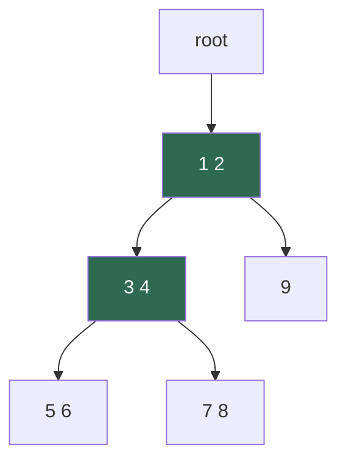

## 1. The question this idea answers

Consider real LLM traffic. A chat assistant sends the same 2,000-token system prompt with every request. An agent sends its tool definitions on every call, plus the whole history so far ([L2: Prompt caching in agent loops](/notes/ai/llm-apis/04-providers-and-caching/l2-prompt-caching-in-agent-loops)). A RAG app may send the same long document to many questions. Prefill computes the keys and values of all those tokens again and again ([L2: Prefill and decode](/notes/ai/llm-systems/03-kv-cache/l2-prefill-and-decode)).

So the question is: **can the server keep the KV cache of a finished request? Can it reuse that cache for a later request that starts with the same tokens?** And then the engineering questions an interviewer will ask:

1. Why is reuse exact, and why only for a **prefix**?
2. How does the server find a match quickly among millions of cached blocks?
3. What is the granularity, and what happens at the edge of a block?
4. Which blocks are kept when memory is full?
5. How do many servers share or route to the cache, and what are the security risks?

The answers below follow the current vLLM design (version 0.31.0, checked on 2026-10-15) and compare it with SGLang and TensorRT-LLM.

## 2. Mental model

> [!analogy] A library of photocopied chapters with a fingerprint chain
> A translator must translate whole books. Many books start with the same chapters. So she keeps a shelf of finished chapter translations. Each chapter on the shelf gets a fingerprint computed from **its own text plus the fingerprint of the chapter before it**. To start a new book, she computes the fingerprints of its chapters in order and checks the shelf. She reuses chapters until the first fingerprint that is missing. Then she translates the rest herself. When the shelf is full, she throws away the chapters nobody has opened for the longest time, starting with the last chapters of each book.
>
> **Where it stops working:** chapters here are fixed blocks of 16 tokens, not natural sections. A half-finished last chapter is never shelved. One changed word in chapter 1 changes every later fingerprint, even if chapter 5 is word-for-word the same. And the "translation" of a chapter (its keys and values) depends on its position in the book. So a chapter is reusable only at the same position, after the same earlier chapters.

## 3. Terms

| Term | Plain meaning |
|---|---|
| prefix | The start of a token sequence, from token 0 up to some position. |
| prefix caching | Keeping the KV cache of earlier requests and reusing it for a later request with the same prefix. vLLM calls its version automatic prefix caching (APC). |
| KV block | A fixed-size piece of the KV cache: the keys and values of 16 tokens (vLLM's default), for all layers. |
| full block | A block whose 16 token slots are all filled. Only full blocks get a hash in vLLM's standard case. |
| block hash | A fingerprint of one block: a hash of (parent block hash, the block's token IDs, extra keys). |
| hash chain | The sequence of block hashes of one request. Each hash includes the one before it, so a hash identifies the whole prefix up to that block. |
| extra keys | Other inputs that change the KV values: a LoRA adapter, an image, a cache salt, prompt embeddings. |
| cache hit | A block hash found in the cache. Its KV values are reused and not recomputed. |
| hit rate | Cached prompt tokens divided by all prompt tokens. |
| reference count | The number of running requests that use a block. A block with reference count 0 can be evicted. |
| free block queue | The list of blocks that no request uses, in eviction order. Cached blocks stay in it with their content until reused. |
| LRU (least recently used) | The eviction rule: take the block that was used the longest time ago. |
| radix tree | A tree whose edges are labeled with runs of tokens. SGLang stores its prefix cache in one. |
| RadixAttention | SGLang's prefix-caching system built on a radix tree, from the SGLang paper. |
| cache salt | A secret string mixed into the first block hash so that only requests with the same salt can share blocks. |
| KV offloading | Moving KV blocks from GPU memory to CPU memory, disk or a remote store, to reuse them later. |
| cache-aware routing | Sending a request to the server replica that most likely holds its prefix in cache. |
| prompt caching (provider) | The API product of model providers that bills reused prefix tokens at a lower price. |

All terms are also in the [Glossary](/notes/ai/llm-systems/glossary).

## 4. Why reuse is exact, and why only a prefix

### 4.1 The causal argument

In a decoder, the key and value of token $i$ in layer $\ell$ depend only on tokens $0$ to $i$. [L1: Why the KV cache exists](/notes/ai/llm-systems/03-kv-cache/l1-why-the-kv-cache-exists) proves this layer by layer. So if two requests have the same tokens $0$ to $n - 1$, they have the same keys and values for those positions, in every layer. That is the whole justification.

Three consequences follow:

1. **It must be a prefix.** The same paragraph at a different position has different keys and values. Rotary position embeddings rotate each key by an angle that depends on its absolute position ([L6: The transformer block](/notes/ai/llm-systems/02-attention-and-the-transformer/l6-the-transformer-block)). And the paragraph attended to different earlier tokens.
2. **Everything that shaped the values must match.** The same model weights, the same LoRA adapter, the same images in the same places.
3. **One changed token changes everything after it.** All later positions attended to the changed token.

> [!key] The rule in one sentence
> A cached block is reusable only by a request with identical tokens from position 0 to the end of that block. The model, the adapter and the other inputs must also be the same.

### 4.2 What reuse saves

> [!example] Worked example: a shared 6,000-token prefix on Llama-3.1-8B
> 1. Prefill arithmetic: about $2 \times 8.03 \times 10^9 \times 6{,}000 \approx 96.4 \times 10^{12}$ FLOPs. At the H100 peak of about 989 TFLOPS that is about 97 ms. Real prefill runs below peak, so the real time is longer.
> 2. KV memory: $6{,}000 \times 128$ KiB $= 750$ MiB per copy ([L3: The KV cache size formula](/notes/ai/llm-systems/03-kv-cache/l3-the-kv-cache-size-formula)).
> 3. With prefix caching, a request with this prefix plus 200 new tokens prefills only the 200 tokens. Its time to first token drops by most of the 97 ms.
> 4. Memory also drops: 50 running requests with this prefix share one 750 MiB copy instead of holding 50 copies (about 36.6 GiB).
>
> All numbers computed in these notes.

So prefix caching saves **compute** (lower time to first token, more prefill capacity) and **memory** (more requests fit in the cache). The PagedAttention paper already shared blocks between the samples of one request and for a shared prompt prefix ([06 Sharing](/notes/papers/llm-serving/2023-pagedattention/06-decoding-scenarios-and-sharing)). Automatic prefix caching extends that sharing across unrelated requests and across time.

## 5. vLLM's design: a hash chain over full blocks

### 5.1 The block hash

vLLM stores the KV cache in blocks of 16 tokens by default (`DEFAULT_BLOCK_SIZE = 16` in the 0.31.0 source). The design doc says that each block is hashed from three components: the parent block's hash, the token IDs in the block, and "extra hashes". In the source, the function `hash_block_tokens` hashes the tuple `(parent_block_hash, curr_block_token_ids_tuple, extra_keys)`. The first block has no parent, so it uses a fixed seed value, `NONE_HASH`.

$$
h_1 = H(\text{seed},\ t_{0..15},\ e_1), \qquad h_k = H(h_{k-1},\ t_{16(k-1)..16k-1},\ e_k)
$$

Because $h_k$ contains $h_{k-1}$, the hash of block $k$ fingerprints **all** tokens from 0 to the end of block $k$. A lookup by one hash checks the whole prefix at once.

The extra keys $e_k$ in vLLM 0.31.0 (source, `generate_block_hash_extra_keys`):

| Extra key | Why it is needed |
|---|---|
| LoRA name and path | A different adapter gives different keys and values. The source includes the path "so that re-pointing a LoRA name at a different adapter does not reuse KV computed with the previous one". |
| Multimodal input hash and offset | Images become placeholder tokens with the same IDs. The hash of the image itself tells two images apart. |
| `cache_salt` (first block only) | Isolation between tenants (section 9). |
| Prompt embeddings hash | When a request sends embeddings instead of token IDs. |

### 5.2 The hash function

The flag `--prefix-caching-hash-algo` chooses the function. The default is `sha256`, and the docs note that SHA-256 became the default as of v0.11. The 0.31.0 choices:

| Value | What it does (source and docs) |
|---|---|
| `sha256` (default) | Pickle serialization, then SHA-256. "the most secure choice to avoid potential hash collisions" |
| `sha256_cbor` | Canonical CBOR serialization, then SHA-256: "a reproducible, cross-language compatible hash" |
| `xxhash` | Pickle with 128-bit xxHash: faster, not cryptographic. Needs the optional `xxhash` package. |
| `xxhash_cbor` | CBOR with xxHash: reproducible, needs `xxhash`. |

Why a cryptographic hash? The cache maps hash → block. If two different prefixes ever had the same hash, a request would read another request's keys and values. The output would be wrong, and in a multi-tenant server it could leak information. The source docstring warns that a non-cryptographic hash "theoretically increases the risk of hash collisions, which can cause undefined behavior or even leak private information in multi-tenant environments".

> [!example] Worked example: how likely is a collision?
> For $n$ random hashes of $b$ bits, the expected number of colliding pairs is about $n^2 / 2^{b+1}$ (the birthday bound).
>
> - A 64-bit hash with $n = 10^9$ blocks: $10^{18} / 2^{65} \approx 0.027$. With $10^{12}$ blocks: about 27,000 collisions.
> - SHA-256 with $n = 10^{12}$: $10^{24} / 2^{257} \approx 4 \times 10^{-54}$.
>
> Computed in these notes. A busy fleet can hash billions of blocks, so a 64-bit hash is not safe. SHA-256 makes a collision practically impossible.

A detail for multi-server setups: for SHA-256, the seed of the first block is derived "deterministically from a fixed default seed, so independent vLLM processes compute identical block hashes for identical content" (0.31.0 source comment). For xxhash the seed stays random per process, because "a predictable seed would let an attacker precompute colliding blocks offline". Identical hashes across servers matter for shared caches and cache-aware routers (section 10).

### 5.3 Only full blocks are hashed

The source states it plainly: "We only hash full blocks". A request with 70 tokens has 4 full blocks (64 tokens) and 6 tokens in a partial block. The partial block has no hash and is never shared.

This creates a **block-alignment effect**. Suppose a 40-token system prompt. Block 3 (tokens 32 to 47) mixes 8 system tokens with 8 user tokens, so it differs between users. Only 2 blocks, 32 tokens, are shared. The last 8 system tokens are recomputed for every request.


```video
{"src": "/notes/media/llm-systems/manim/m21-prefix-cache-hit.mp4", "caption": "Two requests hash their blocks in a chain, the first two hashes match the cache, the third misses, and only the missing blocks are prefilled."}
```

### 5.4 The code, rebuilt

The next program rebuilds the hash chain and the lookup with the same structure as vLLM. It applies SHA-256 to a pickled tuple of (parent, tokens, extra keys). It is a teaching model, not vLLM's code.

```python
import hashlib, pickle

BLOCK = 16
NONE_HASH = hashlib.sha256(pickle.dumps("seed-for-the-first-block")).digest()

def hash_block(parent, tokens, extra=None):
    """Hash of (parent block hash, this block's token IDs, extra keys)."""
    data = pickle.dumps((parent, tuple(tokens), extra), protocol=pickle.HIGHEST_PROTOCOL)
    return hashlib.sha256(data).digest()

def block_hashes(token_ids, extra=None):
    hashes, parent = [], NONE_HASH
    for start in range(0, len(token_ids) - BLOCK + 1, BLOCK):   # full blocks only
        parent = hash_block(parent, token_ids[start:start + BLOCK], extra)
        hashes.append(parent)
    return hashes

def cache_hit_tokens(hashes, cache, prompt_len):
    """Walk from the first block. Stop at the first miss. Keep at least one token to compute."""
    max_hit = prompt_len - 1                       # the last token must run to give logits
    hit = 0
    for h in hashes:
        if h not in cache or hit + BLOCK > max_hit:
            break
        hit += BLOCK
    return hit

system = list(range(1000, 1040))                  # a 40-token system prompt
a = system + list(range(2000, 2030))              # request A: 70 tokens
b = system + list(range(3000, 3025))              # request B: 65 tokens

ha, hb = block_hashes(a), block_hashes(b)
print("A full blocks:", len(ha), [h.hex()[:6] for h in ha])
print("B full blocks:", len(hb), [h.hex()[:6] for h in hb])

cache = set(ha)                                   # A ran first and filled the cache
print("B reuses", cache_hit_tokens(hb, cache, len(b)), "of", len(b), "tokens")
print("A again reuses", cache_hit_tokens(ha, cache, len(a)), "of", len(a), "tokens")
a64 = a[:64]
print("a 64-token prompt that is fully cached reuses", cache_hit_tokens(block_hashes(a64), cache, 64))
print("same tokens, other LoRA:", block_hashes(a, extra=("lora", "sql-adapter"))[0].hex()[:6])
c = [999] + a[1:]                                 # change only the first token
print("first token changed:", [h.hex()[:6] for h in block_hashes(c)])
```

Output (measured in these notes):

```text
A full blocks: 4 ['0cb346', 'dea392', 'b8237b', 'bde4bb']
B full blocks: 4 ['0cb346', 'dea392', 'f9209c', 'cacc98']
B reuses 32 of 65 tokens
A again reuses 64 of 70 tokens
a 64-token prompt that is fully cached reuses 48
same tokens, other LoRA: d94793
first token changed: ['27f8be', '13b257', '53fcbf', '5238bc']
```

Read the output line by line:

1. A and B share the first two hashes (`0cb346`, `dea392`): the 32 tokens of system prompt in full blocks.
2. B reuses 32 of 65 tokens, exactly as section 5.3 predicted.
3. A sent again reuses 64 of 70 tokens: all 4 full blocks. The 6 tokens of the partial block run again.
4. A 64-token prompt whose 4 blocks are **all** cached reuses only 48 tokens. Section 5.5 explains why.
5. The same tokens under another LoRA adapter give a different first hash, so nothing is shared.
6. Changing only token 0 changes all four hashes. That is the chain at work.

### 5.5 The lookup, and why the last token always runs

To find a hit, vLLM walks the request's block hashes from the first. It stops at the first hash that is not in the cache. Every later hash includes the missing one, so it cannot be in the cache either.

One subtle rule: the server must produce logits for the **last** prompt token. Those logits give the first output token ([L1: From text to vectors and back](/notes/ai/llm-systems/02-attention-and-the-transformer/l1-from-text-to-vectors)). Only a forward pass produces logits, and the cache holds no logits. The 0.31.0 source says: "When all tokens hit the cache, we must recompute the last token to obtain logits. Thus, set max_cache_hit_length to prompt_length - 1." It adds: "This can trigger recomputation of an entire block, rather than just the single last token", because the computed length must be block-aligned.

> [!example] Worked example: a fully cached 64-token prompt
> 1. The prompt has 64 tokens: 4 full blocks, all in the cache.
> 2. Maximum hit length: $64 - 1 = 63$ tokens.
> 3. Block-aligned hit at most 63: $\lfloor 63/16 \rfloor \times 16 = 48$ tokens (3 blocks).
> 4. The server prefills tokens 48 to 63: a whole block of 16, to get the logits of token 63.

Two more rules from the source. A request that asks for **prompt logprobs** skips the cache read, because it needs the logits of every prompt token. Pooling models with "all pooling" skip it too.

### 5.6 After the lookup: allocation and caching of new blocks

The design doc describes the steps for a new request:

1. Compute the block hashes and find the longest cache hit.
2. "Touch" the hit blocks: raise their reference count, and remove them from the free queue if their count was 0.
3. Allocate new blocks from the head of the free queue for the rest of the prompt.
4. When a new block becomes full, during prefill or later during decode, compute its hash and register it in the cache map.

So generated tokens become cacheable too. The next turn of a chat reuses the previous prompt and also the previous answer. The condition: the client sends the answer back with the same tokens.

If two running requests compute the same full block at the same time, vLLM V1 keeps both copies. The design doc explains that its block tables are append-only, so a request cannot switch to the other copy. The duplicate is freed when its request finishes.

## 6. Memory management: reference counts, the free queue and LRU

### 6.1 The data structures

From the design doc and the 0.31.0 source (`vllm/v1/core/block_pool.py`):

| Structure | Content |
|---|---|
| block pool | All KV blocks, created once at start-up. Each has a `block_id`, a `ref_cnt` and a `block_hash` (set when the block becomes full, reset on eviction). Block 0 is reserved as a "null block". |
| `cached_block_hash_to_block` | A map from block hash to block, for lookups. |
| free block queue | A doubly linked list of all blocks with reference count 0. It allows removing a block from the middle in $O(1)$ time, which a cache hit needs. |
| request-to-blocks map | Which blocks each running request holds. |

The key idea is **lazy eviction**. A finished request's blocks go to the free queue, but they keep their content and their hash. They are still "in the cache". The allocator removes the old hash from the map only when it takes the block from the head of the queue for a new purpose.

### 6.2 The eviction order

The source documents the order of the free queue:

1. "The least recent used block is at the front (LRU)."
2. "If two blocks have the same last accessed time (allocated by the same sequence), the one with more hash tokens (the tail of a block chain) is at the front."

The second rule is implemented by freeing a request's blocks **in reverse order**: "Free blocks in reverse order so that the tail blocks are freed first." Why evict tails first? A tail block is useful only if all its ancestors are still cached, because the lookup stops at the first miss. If an ancestor were evicted first, its descendants would become unreachable but would still occupy memory. Evicting from the tail keeps the cache prefix-closed (interpretation of these notes).

vLLM 0.31.0 adds one refinement in `free_blocks`. Freed blocks **without** a hash, for example partial blocks, go to the **front** of the queue. The source comment: "LIFO reuse of non-cached blocks for better GPU locality." Blocks **with** a hash go to the tail: "FIFO reuse of cached blocks for LRU eviction behavior." So a block that can never be hit is always reused before any cached block.

### 6.3 A trace

The next program models the pool with 8 blocks. Requests A and B share two system-prompt blocks S1 and S2.

```python
from collections import OrderedDict

class BlockPool:
    """A tiny model of a prefix-caching block pool with LRU eviction."""
    def __init__(self, n):
        self.ref = [0] * n
        self.hash_of = [None] * n                    # block id -> hash (or None)
        self.cached = {}                             # hash -> block id
        self.free = OrderedDict((i, None) for i in range(n))   # head = next to reuse

    def lookup(self, hashes):
        hit = []
        for h in hashes:                             # stop at the first miss
            if h not in self.cached:
                break
            hit.append(self.cached[h])
        for b in hit:                                # "touch": take hits off the free queue
            if self.ref[b] == 0:
                del self.free[b]
            self.ref[b] += 1
        return hit

    def allocate(self, k):
        out = []
        for _ in range(k):
            b, _ = self.free.popitem(last=False)     # pop the head
            if self.hash_of[b] is not None:          # evict its old content
                del self.cached[self.hash_of[b]]
                self.hash_of[b] = None
            self.ref[b] = 1
            out.append(b)
        return out

    def register(self, b, h):                        # a block became full: cache it
        self.hash_of[b] = h
        self.cached.setdefault(h, b)

    def release(self, blocks):                       # free in reverse: tail blocks go first
        for b in reversed(blocks):
            self.ref[b] -= 1
            if self.ref[b] == 0:
                if self.hash_of[b] is None:
                    self.free[b] = None
                    self.free.move_to_end(b, last=False)   # no hash: reuse first
                else:
                    self.free[b] = None                    # hash: LRU order, at the tail

    def show(self, step):
        print(f"{step:34s} free queue {list(self.free)}  cached {sorted(self.cached)}")

pool = BlockPool(8)
pool.show("start")
a = pool.lookup(["S1", "S2", "A3"]) + pool.allocate(4)    # A: S1 S2 A3 full, 1 partial block
for blk, h in zip(a, ["S1", "S2", "A3"]): pool.register(blk, h)
pool.show("A runs: S1 S2 A3 + partial")
b = pool.lookup(["S1", "S2", "B3"]); b += pool.allocate(2)  # B: hits S1 S2
pool.register(b[2], "B3")
pool.show("B hits S1 S2, adds B3 + partial")
pool.release(a); pool.show("A finishes")
pool.release(b); pool.show("B finishes")
c = pool.lookup(["S1", "S2", "C3"]); c += pool.allocate(4)  # C: hits S1 S2
pool.show("C hits S1 S2, takes 4 new blocks")
d = pool.lookup(["D1", "D2"]); d += pool.allocate(2)        # D: unrelated prompt
pool.show("D takes 2 blocks: evicts A3, B3")
```

Output (measured in these notes):

```text
start                              free queue [0, 1, 2, 3, 4, 5, 6, 7]  cached []
A runs: S1 S2 A3 + partial         free queue [4, 5, 6, 7]  cached ['A3', 'S1', 'S2']
B hits S1 S2, adds B3 + partial    free queue [6, 7]  cached ['A3', 'B3', 'S1', 'S2']
A finishes                         free queue [3, 6, 7, 2]  cached ['A3', 'B3', 'S1', 'S2']
B finishes                         free queue [5, 3, 6, 7, 2, 4, 1, 0]  cached ['A3', 'B3', 'S1', 'S2']
C hits S1 S2, takes 4 new blocks   free queue [2, 4]  cached ['A3', 'B3', 'S1', 'S2']
D takes 2 blocks: evicts A3, B3    free queue []  cached ['S1', 'S2']
```

Step by step:

| Step | What happens | Why |
|---|---|---|
| A runs | Blocks 0, 1, 2 hold S1, S2, A3. Block 3 holds A's partial tail. | All new: no hits. |
| B arrives | B touches blocks 0 and 1 (reference count 2). It allocates 4 (B3) and 5 (partial). | The first two hashes match. |
| A finishes | Block 3 (no hash) goes to the **front**. Block 2 (A3) goes to the tail. Blocks 0 and 1 drop to count 1 and stay out of the queue. | B still uses S1 and S2. |
| B finishes | Block 5 (no hash) to the front. Then 4 (B3), 1 (S2), 0 (S1) to the tail, in reverse order. | The prefix blocks S1, S2 are now the last to be evicted. |
| C arrives | C hits S1 and S2: blocks 0 and 1 leave the queue. It takes 5, 3, 6, 7 from the head. | No cached content is lost: those blocks had no hash. |
| D arrives | D takes blocks 2 and 4 from the head and evicts A3 and B3. | The least recently used cached blocks go first. |

> [!key] What to say in an interview
> vLLM keeps finished blocks in the free queue with their hashes, so they remain hittable until the memory is needed. A hit "touches" the block (reference count plus one, out of the queue). Allocation takes the queue head and evicts its old hash. The queue is LRU, tail blocks of a chain go first, and blocks without a hash are reused before any cached block.

## 7. Other engines

### 7.1 SGLang: RadixAttention

The SGLang paper (Zheng et al., NeurIPS 2024, arXiv 2312.07104) stores the prefix cache in a **radix tree**. The paper calls a radix tree "a space-efficient alternative to a classical trie (prefix tree)". Each edge holds a run of tokens. The KV tensors are kept "in a paged layout where the size of each page is equivalent to one token", and the tree itself lives in CPU memory.

- **Matching:** walk down the tree, token by token. A match can end anywhere, not only at a block boundary.
- **Insertion:** when a new sequence diverges in the middle of an edge, the edge is **split** into two nodes.
- **Eviction:** an LRU policy that evicts the least recently used leaf first, so shared ancestors survive until they become leaves. Each node has a reference counter for the running requests that use it, and only nodes with count zero can be evicted.
- **Cache-aware scheduling:** the paper sorts waiting requests in "longest-shared-prefix-first order". Theorem 3.1 shows that visiting the tree in depth-first order gives the optimal hit rate when the cache is large enough.

A minimal radix tree, written for these notes:

```python
class Node:
    def __init__(self, tokens=()):
        self.tokens = tuple(tokens)     # the edge label: a run of token IDs
        self.children = {}              # first token of the child edge -> Node

def match(root, seq):
    """Number of leading tokens of seq already in the tree (any length, not block-aligned)."""
    node, i = root, 0
    while i < len(seq) and seq[i] in node.children:
        child = node.children[seq[i]]
        n = 0
        while n < len(child.tokens) and i + n < len(seq) and child.tokens[n] == seq[i + n]:
            n += 1
        i += n
        if n < len(child.tokens):       # stopped inside an edge
            break
        node = child
    return i

def insert(root, seq):
    node, i = root, 0
    while i < len(seq):
        child = node.children.get(seq[i])
        if child is None:               # new branch
            node.children[seq[i]] = Node(seq[i:])
            return
        n = 0
        while n < len(child.tokens) and i + n < len(seq) and child.tokens[n] == seq[i + n]:
            n += 1
        if n < len(child.tokens):       # split the edge at the divergence point
            mid = Node(child.tokens[:n])
            child.tokens = child.tokens[n:]
            mid.children[child.tokens[0]] = child
            node.children[seq[i]] = mid
            child = mid
        node, i = child, i + n

def show(node, depth=0):
    for child in node.children.values():
        print("  " * depth + "-", list(child.tokens))
        show(child, depth + 1)

root = Node()
insert(root, [1, 2, 3, 4, 5, 6])        # system prompt 1-4, then user turn 5-6
insert(root, [1, 2, 3, 4, 7, 8])        # same system prompt, other user turn
insert(root, [1, 2, 9])                 # shares only 2 tokens
show(root)
print("match [1,2,3,4,7,8,10]:", match(root, [1, 2, 3, 4, 7, 8, 10]))
print("match [1,2,3,9]:", match(root, [1, 2, 3, 9]))
```

Output (measured in these notes):

```text
- [1, 2]
  - [3, 4]
    - [5, 6]
    - [7, 8]
  - [9]
match [1,2,3,4,7,8,10]: 6
match [1,2,3,9]: 3
```

The third insert split the edge `[1, 2, 3, 4]` into `[1, 2]` and `[3, 4]`. The last match returns 3: the tree reuses the token `3` even though the edge `[3, 4]` matches only partly. A 16-token block scheme would reuse 0 tokens here.



Current SGLang (version 0.5.21 on PyPI, source checked on 2026-10-15): the radix cache is on unless `--disable-radix-cache` is given. `--radix-eviction-policy` defaults to `lru` and also offers `lfu`, `slru`, `priority` and `tlru`. The scheduling policy `--schedule-policy` defaults to `fcfs`, and `lpm` (longest prefix match) is one of the choices. The page size is configurable with `--page-size`.

### 7.2 Hash chain versus radix tree

| | vLLM hash chain | SGLang radix tree |
|---|---|---|
| Unit of matching | Full block (16 tokens by default) | Any token count (page size 1 in the paper) |
| Lookup | One hash-map query per block | Walk down the tree, compare tokens |
| Index structure | Flat map: hash → block | Tree in CPU memory |
| Eviction unit | Block, LRU, tail first | Leaf node, LRU (and other policies) |
| Share across servers | Easy: equal content gives equal hash (SHA-256 seed is fixed) | Needs the token sequences, or a router-side tree |
| Waste at block edges | Up to 15 tokens per request recomputed | None at token granularity |

Interpretation of these notes: the two designs converge. vLLM 0.31.0 has a `prefix_match_unit` setting that allows hits inside large blocks for hybrid models. SGLang can use pages larger than one token for kernel efficiency.

### 7.3 TensorRT-LLM

The TensorRT-LLM KV cache docs (version 1.4.0rc0, checked on 2026-10-15) state: "Block reuse across requests is enabled by default". Filled blocks "are stored in a radix search tree as soon as they are filled", and prefix matching uses digest equality with a cryptographic 256-bit hash. **Partial reuse** of a partly matching block is enabled by default. Eviction is "prioritized LRU": every block has a priority from 0 to 100, with a default of 35. Blocks can be offloaded to host memory with `host_cache_size` (default 0).

## 8. Who benefits, and by how much

### 8.1 The winners

1. **Agents and tool loops.** Every call resends the full input of the previous call plus a tool call and a tool result.
2. **Multi-turn chat.** Each turn resends the whole history.
3. **Shared system prompts and few-shot examples** across all users.
4. **Parallel sampling** ($n > 1$) and best-of-$n$ evaluation of one prompt.
5. **RAG with repeated documents**, but only if the document sits at the same position after the same earlier tokens.

> [!example] Worked example: one agent run with 10 model calls
> Assumptions: tools and system prompt of 6,000 tokens, already cached by other users. A 100-token user message. Each call adds a 100-token tool call and a 400-token tool result. Block size 16, with the last-token rule.
>
> - Without prefix caching: the 10 prompts total 83,500 tokens of prefill.
> - With prefix caching: 3,756 tokens of prefill. Each call recomputes only the new tool result and a few tokens at block edges.
> - Hit rate: $1 - 3{,}756/83{,}500 \approx 95.5\%$.
>
> Computed in these notes with the program below.

```python
BLOCK = 16
S, U, CALL, RESULT, N = 6_000, 100, 100, 400, 10   # system+tools, user msg, tool call, tool result, calls

def hit(cached_tokens, prompt_len):
    """Block-aligned hit, capped below the prompt length (the last token always runs)."""
    return min(cached_tokens, prompt_len - 1) // BLOCK * BLOCK

no_cache = with_cache = 0
cached = S                        # other users already cached the shared system+tools prefix
prompt = S + U
for j in range(N):
    h = hit(cached, prompt)
    no_cache += prompt
    with_cache += prompt - h
    cached = prompt + CALL        # this call's prompt and its generated tool call are now cached
    prompt += CALL + RESULT       # next call adds the tool call and the tool result
print("prefill tokens without prefix caching:", no_cache)
print("prefill tokens with prefix caching:   ", with_cache)
print(f"hit rate: {1 - with_cache / no_cache:.1%}")
```

Output: `prefill tokens without prefix caching: 83500`, `prefill tokens with prefix caching: 3756`, `hit rate: 95.5%`.

### 8.2 The losers

1. **A changing value at the top.** A timestamp, a request ID or a user name in the first lines of the system prompt changes block 1. Then nothing matches. Put changing values at the end.
2. **Reordered content.** RAG chunks in a different order, or tools listed in a different order, break the prefix.
3. **Different tokenization of the same text.** A chat template that adds a space or a different date line changes token IDs.
4. **Unique prompts.** Batch jobs over unrelated documents gain nothing, and the hashing costs a little CPU time.
5. **Cache pressure.** When memory is full, LRU evicts prefixes before they are reused. The hit rate falls under load.

### 8.3 Measure it

vLLM exports the counters `vllm:prefix_cache_queries` ("Prefix cache queries, in terms of number of queried tokens") and `vllm:prefix_cache_hits` ("Prefix cache hits, in terms of number of cached tokens"). The hit rate is hits divided by queries. `vllm:kv_cache_usage_perc` shows memory pressure. `POST /reset_prefix_cache` clears the cache, for example before a benchmark (all from the 0.31.0 source, checked on 2026-10-15). For dashboards, see [L8: Production operations](/notes/ai/llm-systems/05-cloud-hosting/l8-production-operations).

## 9. Security: the cache is a side channel

A cache hit makes the first token arrive sooner. An attacker on a shared server can send a guess of another user's prompt and measure the time to first token. A fast answer means "somebody sent this prefix recently". That leaks private text one block at a time (interpretation of these notes, the class of attack that the vLLM parameter describes).

vLLM's defense is the `cache_salt` request parameter. Its description in the 0.31.0 source: "If specified, the prefix cache will be salted with the provided string to prevent an attacker to guess prompts in multi-user environments. The salt should be random, protected from access by 3rd parties, and long enough to be unpredictable (e.g., 43 characters base64-encoded, corresponding to 256 bit)." The salt enters only the first block's hash, but the chain carries it into every later hash. So only requests with the same salt share blocks.

```json
{
  "model": "meta-llama/Llama-3.1-8B-Instruct",
  "messages": [{"role": "user", "content": "Summarize our Q3 board minutes."}],
  "cache_salt": "7mQ2v8rK1xZp0aT4yW9bN3cL6dF5hJ8sG2eU1iO0qRk"
}
```

Use one salt per tenant: users of one company still share their system prompt, but nobody outside the tenant can probe it. Also use SHA-256, not xxhash, when tenants share a server.

## 10. Beyond one GPU: offloading tiers and routing

### 10.1 Offloading tiers

GPU memory is small. A finished conversation's blocks are evicted within minutes on a busy server. **KV offloading** moves evicted or idle blocks to cheaper memory and loads them back on a hit.


> [!example] Worked example: reload or recompute?
> **Llama-3.1-8B, 6,000-token prefix, one H100:**
> - KV bytes: $6{,}000 \times 131{,}072 = 786{,}432{,}000$ bytes (750 MiB).
> - Reload over PCIe Gen5 at about 64 GB/s each way: about 12.3 ms.
> - Recompute at peak FLOPs: about 97 ms.
>
> **Llama-3.1-70B, same prefix, TP = 4:**
> - KV bytes per GPU: $6{,}000 \times 81{,}920$ bytes $\approx 469$ MiB. Each GPU loads its own shard in parallel: about 7.7 ms.
> - Recompute: $2 \times 70.55 \times 10^9 \times 6{,}000 / (4 \times 989 \times 10^{12}) \approx 214$ ms at peak.
>
> Computed in these notes with ideal bandwidth and peak FLOPs. Models with GQA have small KV caches relative to their compute, so reloading beats recomputing by a wide margin, and more so for larger models.

The options (checked on 2026-10-15):

| Engine or tool | Offloading |
|---|---|
| vLLM 0.31.0 | `--kv-offloading-size` (GiB of CPU buffer, the total across TP ranks) with `--kv-offloading-backend` `native` or `lmcache`. Off unless the size is set. |
| LMCache | A KV cache layer for vLLM and SGLang. Its paper (arXiv 2510.09665) describes moving KV caches to CPU memory, disk or remote storage and sharing them across engines and queries. It reports up to 15x throughput with vLLM on multi-round question answering and document analysis. |
| SGLang | HiCache: `--enable-hierarchical-cache`. The host pool defaults to 2.0 times the GPU pool in `cache` mode, and storage backends include `file`, `mooncake`, `hf3fs` and `nixl`. |
| TensorRT-LLM | `host_cache_size` in the KV cache config. |
| NVIDIA Dynamo | KVBM: "Offloads KV cache across GPU → CPU → SSD → remote storage". |

### 10.2 Cache-aware routing

With several replicas behind a load balancer, round-robin routing scatters a conversation over all replicas. Each replica holds only some of its turns, so the hit rate collapses. Fixes, from simple to smart ([L5: Autoscaling and routing](/notes/ai/llm-systems/05-cloud-hosting/l5-autoscaling-and-routing)):

1. **Session affinity:** send all calls of one conversation to the same replica (a sticky key such as the conversation ID).
2. **Prefix hashing:** hash the first few blocks of the prompt and route by consistent hashing, so equal prefixes meet on one replica.
3. **Cache-state routing:** the router knows what each replica holds. vLLM can publish KV cache events (`BlockStored`, `BlockRemoved`, `AllBlocksCleared`) when `enable_kv_cache_events` is set. SGLang Model Gateway's default policy is `cache_aware`, which "Combines cache locality with load balancing", with a default `--cache-threshold` of 0.3. NVIDIA Dynamo "Routes requests based on worker load and KV cache overlap".

> [!trap] Cache affinity fights load balance
> Routing every request with a popular system prompt to one replica overloads it. Good routers send a request to the cache holder only while its load is within a threshold. SGLang's gateway has `--balance-abs-threshold` (default 64) and `--balance-rel-threshold` (default 1.5) for this.

## 11. Provider prompt caching is the same idea as a product

Anthropic, OpenAI and Google bill reused prefix tokens at a fraction of the normal input price, with rules on minimum length, lifetime and breakpoints. [L7: Prompt caching](/notes/ai/context-engineering/01-foundations/l7-prompt-caching) and [L2: Prompt caching in agent loops](/notes/ai/llm-apis/04-providers-and-caching/l2-prompt-caching-in-agent-loops) give the current prices and rules.

The providers do not publish their internals. Interpretation of these notes: the observable rules match prefix KV reuse. The match must be an exact prefix. Minimum sizes look like block or page granularity. Lifetimes of minutes look like eviction from a memory tier. Explicit breakpoints tell the server which prefix to keep. When you self-host, you get the same effect for free with APC, but you must manage memory, routing and isolation yourself.

### 11.1 Exercises

Notebook: `C:\Users\ASohi\Downloads\AI\agent-harness-lab\llm-systems\l9-prefix-caching.ipynb`.

1. **Hit tokens with the last-token rule.** Write `hit_tokens(prompt, cache, block=16)`. It hashes full blocks in a chain and stops at the first miss. It caps the hit at `len(prompt) - 1` and rounds down to a block boundary.
   - Acceptance test: a fully cached 64-token prompt returns 48. A fully cached 65-token prompt returns 64. An empty cache returns 0.
   - Hint 1: compute all hashes first, then count the leading hits.
   - Hint 2: `min(hits * block, len(prompt) - 1) // block * block`.
2. **An LRU block pool.** Extend the pool of section 6.3 with `allocate_request(hashes, n_new)`. It touches hits, allocates new blocks and evicts as needed. Add a counter of evictions.
   - Acceptance test: replay the trace of section 6.3 and get the same free queue after every step. After D, the eviction counter is 2.
   - Hint 1: `OrderedDict.popitem(last=False)` takes the head.
   - Hint 2: on release, iterate the request's blocks in reverse.
3. **Savings of a chat.** A chat has a 1,500-token system prompt, and each turn adds a 60-token user message and a 250-token answer. Compute total prefill tokens over 20 turns with and without prefix caching (block 16, the client sends the full history every turn).
   - Acceptance test: your simulation prints both totals and a hit rate above 90%.
   - Hint 1: after turn $j$, the cache holds the prompt of turn $j$ plus its answer.
   - Hint 2: reuse the `hit` function of the agent example.

## 12. Common mistakes

1. **"The cache matches any repeated text."** It matches only an exact prefix from token 0, because keys and values depend on position and on all earlier tokens.
2. **"A 40-token shared prompt saves 40 tokens."** With 16-token blocks it saves 32. The block that mixes shared and private tokens is not shared.
3. **"A fully cached prompt needs no prefill."** The last token must run to produce logits, and vLLM aligns to blocks, so up to a whole block is recomputed.
4. **"Freed blocks are deleted."** They stay in the free queue with their hash and can still be hit until the allocator reuses them.
5. **"Eviction picks the oldest block of the whole cache."** It picks the head of the free queue: LRU, with chain tails first, and blocks without a hash before any cached block.
6. **"A fast hash like xxhash is fine everywhere."** Collisions can mix up requests or leak data between tenants. SHA-256 is the default for a reason.
7. **"Prefix caching is free security-wise."** A cache hit is visible in latency. Use `cache_salt` per tenant on shared servers.
8. **"Round-robin load balancing is fine with prefix caching."** It scatters a conversation's turns over replicas and destroys the hit rate. Use affinity or cache-aware routing.

## 13. One-minute explanation

In a causal model, the keys and values of a prefix depend only on that prefix, so requests that share it can share them exactly. vLLM's automatic prefix caching splits the KV cache into 16-token blocks and hashes each full block with SHA-256. Each hash covers the parent hash, the token IDs and extra keys such as a LoRA adapter, so it fingerprints the whole prefix. A new request walks its block hashes from the first and stops at the first miss. The hit is capped at the prompt length minus one, because the last token must run to produce logits. Finished blocks keep their hashes in a free queue, so they stay hittable until LRU eviction takes them, chain tails first. SGLang uses a radix tree with token-level matching, and TensorRT-LLM a radix tree of blocks with priorities. Agents and multi-turn chats gain most, with hit rates above 90%. Across replicas you need cache-aware routing, and reloading offloaded KV from CPU memory beats recomputation by a large factor. On shared servers, a per-tenant cache salt blocks timing attacks.

## 14. Check questions

```check
{
  "question": "Why can a server reuse cached keys and values only for a prefix, not for the same paragraph at a different position?",
  "answer": "The key and value of a token depend on everything before it and on its position. Each layer's hidden state at position $i$ attends to tokens $0..i$, and RoPE rotates each key by an angle set by its absolute position. The same paragraph after different earlier text, or at another position, has different keys and values in every layer above the first. Only an identical sequence from token 0 guarantees identical keys and values."
}
```

```check
{
  "question": "Interview follow-up: what exactly goes into a vLLM block hash, and what would break if you dropped the parent hash?",
  "hint": "Think of two prompts that differ in block 1 but have the same tokens in block 2.",
  "answer": "The hash covers the tuple (parent block hash, the token IDs of this block, extra keys). The extra keys include the LoRA name and path, multimodal input hashes with offsets, the cache salt (first block only) and prompt-embedding hashes. The default function is SHA-256 over a pickled tuple.\n\nWithout the parent hash, block 2 of prompt X and block 2 of prompt Y would get the same hash when their 16 tokens match. That would happen even if block 1 differs. But block 2's keys and values depend on block 1, so the second request would read wrong keys and values and produce wrong output, silently. The parent hash makes each hash a fingerprint of the whole prefix, which also lets the lookup stop at the first miss."
}
```

```check
{
  "question": "Interview follow-up: a system prompt has 1,000 tokens and every user message adds 37 tokens. With 16-token blocks and a warm cache, how many tokens does each request prefill? What if a request is exactly the 1,000-token system prompt with nothing after it?",
  "answer": "1. The prompt has 1,037 tokens. The shared full blocks: $\\lfloor 1000/16 \\rfloor = 62$ blocks = 992 tokens. Block 63 (tokens 992 to 1007) mixes 8 system tokens with 8 user tokens, so it differs per user. Prefill: $1037 - 992 = 45$ tokens.\n2. A request of exactly 1,000 tokens: the cap is $1000 - 1 = 999$ tokens, rounded down to a block: $\\lfloor 999/16 \\rfloor \\times 16 = 992$. The server prefills tokens 992 to 999 (8 tokens), the last of which gives the logits for the first output token.\n\nTip: padding the system prompt to a multiple of 16 tokens saves a few tokens per request, but the gain is small."
}
```

```check
{
  "question": "Interview follow-up: describe vLLM's eviction order for cached blocks and justify it.",
  "answer": "Blocks with reference count 0 sit in a doubly linked free queue. Allocation takes the head and evicts the hash it held. The order is LRU: blocks released longest ago are at the head. A request's blocks are released in reverse order, so within one request the chain's tail is evicted before its head. A tail block is useful only while all its ancestors are cached, because the lookup stops at the first miss. Evicting tails first keeps the cache prefix-closed and wastes no memory on unreachable blocks. In vLLM 0.31.0, freed blocks without a hash (partial blocks) go to the front of the queue. So they are reused before any cached block (\"LIFO reuse of non-cached blocks for better GPU locality\")."
}
```

```check
{
  "question": "Interview follow-up: how can prefix caching leak data between tenants, and how does `cache_salt` stop it? Why is it enough to salt only the first block?",
  "answer": "A cache hit lowers the time to first token. An attacker who shares the server can send guesses of another tenant's prompt and watch the latency. A fast reply means the guessed prefix is cached, so somebody sent it. With `cache_salt`, the salt is an extra key in the first block's hash. Requests with a different or no salt compute different hashes from block 1 on, so they can never hit the tenant's blocks. Salting the first block is enough, because every later hash contains its parent hash: the salt propagates through the whole chain. The vLLM description asks for a random salt of about 256 bits, for example 43 base64 characters."
}
```

```check
{
  "question": "Interview follow-up: a team runs 4 vLLM replicas behind a random load balancer. Chats have 10 turns. Their hit rate is low. Explain and fix.",
  "answer": "Each replica has its own KV cache. With random routing, the next turn of a conversation reaches the replica that served the previous turn with probability 1/4 only. So most turns miss their own history and prefill it again. A replica may still hold an older turn, which gives a partial hit. Fixes: session affinity (route by conversation ID), or prefix-hash routing (consistent hashing on the first blocks). Better still, a cache-aware router tracks each replica's cache, for example from vLLM's KV cache events or with SGLang Model Gateway's `cache_aware` policy. Keep a load threshold so a popular prefix does not overload one replica."
}
```

```check
{
  "question": "Interview follow-up: Llama-3.1-70B runs with TP = 4, and a 6,000-token prefix was offloaded to CPU memory. Is it faster to reload or to recompute? Show the numbers.",
  "answer": "Reload: each GPU stores 2 of 8 KV heads, 80 KiB per token, so $6{,}000 \\times 81{,}920 \\approx 469$ MiB per GPU. Over PCIe Gen5 at about 64 GB/s each way, in parallel on 4 GPUs: about 7.7 ms.\n\nRecompute: $2 \\times 70.55 \\times 10^9 \\times 6{,}000 \\approx 847$ TFLOP, over 4 GPUs at 989 TFLOPS peak: about 214 ms, more in practice.\n\nReload wins by more than 25 times in this ideal estimate (computed in these notes). With GQA, KV bytes per token grow much more slowly than FLOPs per token as models grow, so offloading pays more for larger models."
}
```

```check
{
  "question": "Compare vLLM's hash chain with SGLang's radix tree in three points.",
  "answer": "1. Granularity: vLLM matches whole 16-token blocks (only full blocks are hashed). The SGLang paper stores KV in pages of one token, so a match can end at any token.\n2. Data structure: vLLM uses a flat map from hash to block. SGLang uses a radix tree in CPU memory whose edges hold token runs and split where sequences diverge.\n3. Eviction: vLLM evicts blocks from an LRU free queue, chain tails first. SGLang evicts unreferenced leaf nodes, LRU by default, with other policies (`lfu`, `slru`, `priority`, `tlru`) in current versions."
}
```

```check
{
  "question": "Exercise 1: show a reference solution.",
  "answer": "```python\nimport hashlib, pickle\n\ndef chain_hashes(tokens, block=16):\n    parent, out = b\"seed\", []\n    for s in range(0, len(tokens) - block + 1, block):\n        parent = hashlib.sha256(pickle.dumps((parent, tuple(tokens[s:s + block])))).digest()\n        out.append(parent)\n    return out\n\ndef hit_tokens(prompt, cache, block=16):\n    hits = 0\n    for h in chain_hashes(prompt, block):\n        if h not in cache:\n            break\n        hits += 1\n    return min(hits * block, len(prompt) - 1) // block * block\n\np64, p65 = list(range(64)), list(range(65))\ncache = set(chain_hashes(p65))          # p65's 4 full blocks are cached\nprint(hit_tokens(p64, cache), hit_tokens(p65, cache), hit_tokens(p64, set()))\n```\n\nOutput: `48 64 0`."
}
```

```check
{
  "question": "Exercise 2: show a reference solution.",
  "answer": "```python\nfrom collections import OrderedDict\n\nclass Pool:\n    def __init__(self, n):\n        self.ref, self.hash_of = [0] * n, [None] * n\n        self.cached, self.evictions = {}, 0\n        self.free = OrderedDict((i, None) for i in range(n))\n\n    def allocate_request(self, hashes, n_new):\n        hits = []\n        for h in hashes:                       # longest cached prefix\n            if h not in self.cached:\n                break\n            hits.append(self.cached[h])\n        for b in hits:                         # touch\n            if self.ref[b] == 0:\n                del self.free[b]\n            self.ref[b] += 1\n        new = []\n        for _ in range(n_new):                 # take from the head, evict old content\n            b, _ = self.free.popitem(last=False)\n            if self.hash_of[b] is not None:\n                del self.cached[self.hash_of[b]]\n                self.hash_of[b] = None\n                self.evictions += 1\n            self.ref[b] = 1\n            new.append(b)\n        return hits + new\n\n    def register(self, b, h):\n        self.hash_of[b] = h\n        self.cached.setdefault(h, b)\n\n    def release(self, blocks):\n        for b in reversed(blocks):\n            self.ref[b] -= 1\n            if self.ref[b] == 0:\n                self.free[b] = None\n                if self.hash_of[b] is None:\n                    self.free.move_to_end(b, last=False)\n\np = Pool(8)\na = p.allocate_request([\"S1\", \"S2\", \"A3\"], 4)\nfor blk, h in zip(a, [\"S1\", \"S2\", \"A3\"]): p.register(blk, h)\nb = p.allocate_request([\"S1\", \"S2\", \"B3\"], 2); p.register(b[2], \"B3\")\np.release(a); print(\"after A:\", list(p.free))\np.release(b); print(\"after B:\", list(p.free))\nc = p.allocate_request([\"S1\", \"S2\", \"C3\"], 4); print(\"after C:\", list(p.free))\nd = p.allocate_request([\"D1\", \"D2\"], 2); print(\"after D:\", list(p.free), \"evictions:\", p.evictions)\n```\n\nOutput:\n\n```text\nafter A: [3, 6, 7, 2]\nafter B: [5, 3, 6, 7, 2, 4, 1, 0]\nafter C: [2, 4]\nafter D: [] evictions: 2\n```"
}
```

```check
{
  "question": "Exercise 3: show a reference solution.",
  "answer": "```python\nBLOCK = 16\nSYSTEM, USER, ANSWER, TURNS = 1_500, 60, 250, 20\n\ndef hit(cached, prompt_len):\n    return min(cached, prompt_len - 1) // BLOCK * BLOCK\n\ntotal = new = 0\ncached = 0                          # cold start: nothing cached\nprompt = SYSTEM + USER\nfor turn in range(TURNS):\n    total += prompt\n    new += prompt - hit(cached, prompt)\n    cached = prompt + ANSWER        # this prompt and its answer are now cached\n    prompt += ANSWER + USER         # the next turn sends the full history plus a new message\nprint(\"prefill without caching:\", total)\nprint(\"prefill with caching:   \", new)\nprint(f\"hit rate: {1 - new / total:.1%}\")\n```\n\nOutput:\n\n```text\nprefill without caching: 90100\nprefill with caching:    2836\nhit rate: 96.9%\n```\n\nThe first turn is a cold start (1,560 tokens). Every later turn prefills only its new user message plus a few tokens at block edges."
}
```

## 15. Links

- Previous: [L8: Parallelism: tensor, pipeline, data and expert](/notes/ai/llm-systems/04-inference/l8-parallelism)
- Next: [L10: Serving engines: vLLM, SGLang, TensorRT-LLM and others](/notes/ai/llm-systems/04-inference/l10-serving-engines)
- Why past keys and values never change: [L1: Why the KV cache exists](/notes/ai/llm-systems/03-kv-cache/l1-why-the-kv-cache-exists)
- Blocks, block tables and sharing in the paper: [05 The KV cache manager and block tables](/notes/papers/llm-serving/2023-pagedattention/05-the-kv-cache-manager) and [06 Sharing](/notes/papers/llm-serving/2023-pagedattention/06-decoding-scenarios-and-sharing)
- What came after the paper: [10 Limits and later work](/notes/papers/llm-serving/2023-pagedattention/10-limits-and-later-work)
- Other ways to shrink and move the cache: [L6: Shrinking the KV cache](/notes/ai/llm-systems/03-kv-cache/l6-shrinking-the-kv-cache)
- Provider prompt caching: [L7: Prompt caching](/notes/ai/context-engineering/01-foundations/l7-prompt-caching) and [L2: Prompt caching in agent loops](/notes/ai/llm-apis/04-providers-and-caching/l2-prompt-caching-in-agent-loops)
- Routing replicas: [L5: Autoscaling and routing](/notes/ai/llm-systems/05-cloud-hosting/l5-autoscaling-and-routing)
- Interview drill: [L1: Drill: from attention to PagedAttention](/notes/ai/llm-systems/08-interview-drills/l1-chain-attention-to-pagedattention)

### Sources

All checked on 2026-10-15.

- vLLM design doc, Automatic Prefix Caching: https://docs.vllm.ai/en/latest/design/prefix_caching/
- vLLM docs, Engine Arguments (`--prefix-caching-hash-algo`, `--kv-offloading-size`, `--kv-offloading-backend`): https://docs.vllm.ai/en/latest/configuration/engine_args/
- vLLM 0.31.0 source (PyPI wheel): `vllm/v1/core/kv_cache_utils.py`, `vllm/v1/core/block_pool.py`, `vllm/v1/core/kv_cache_manager.py`, `vllm/v1/core/single_type_kv_cache_manager.py`, `vllm/config/cache.py`, `vllm/utils/hashing.py`, `vllm/v1/metrics/loggers.py`, `vllm/entrypoints/openai/chat_completion/protocol.py`, `vllm/distributed/kv_events.py`
- Zheng et al. "SGLang: Efficient Execution of Structured Language Model Programs." NeurIPS 2024. https://arxiv.org/abs/2312.07104
- SGLang 0.5.21 source (PyPI wheel): `sglang/srt/arg_groups/fields/memory.py`, `schedule.py`
- SGLang docs, Radix eviction policy: https://docs.sglang.io/docs/advanced_features/radix_eviction_policy
- SGLang docs, SGLang Model Gateway: https://docs.sglang.io/docs/advanced_features/sgl_model_gateway
- TensorRT-LLM docs, KV Cache System: https://nvidia.github.io/TensorRT-LLM/latest/features/kvcache.html
- Liu et al. "LMCache: An Efficient KV Cache Layer for Enterprise-Scale LLM Inference." https://arxiv.org/abs/2510.09665
- NVIDIA Dynamo repository: https://github.com/ai-dynamo/dynamo
- NVIDIA H100 datasheet page (PCIe Gen5 128 GB/s): https://www.nvidia.com/en-us/data-center/h100/
