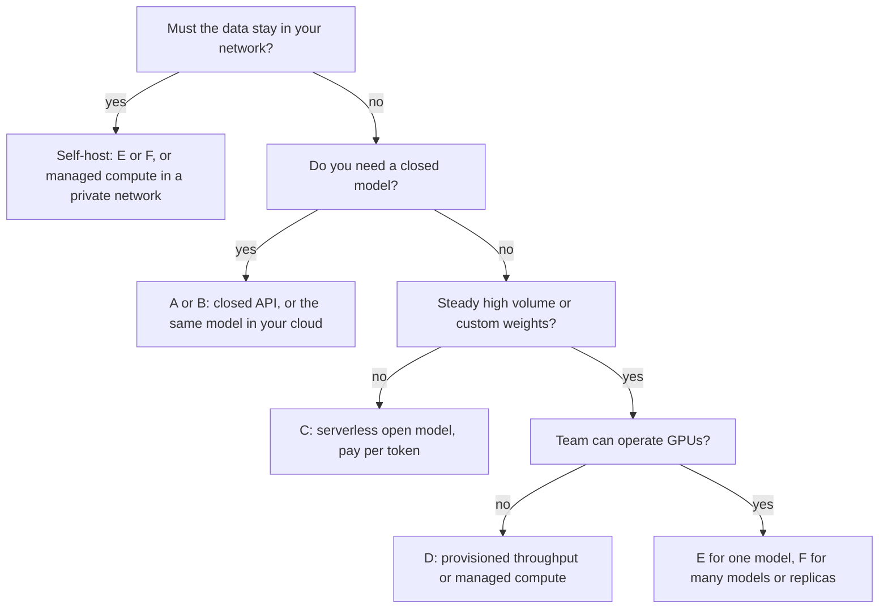
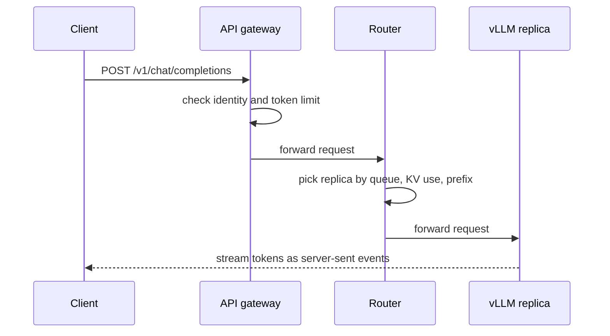

## 1. The question this idea answers

The interviewer has heard you explain inference: prefill, decode, the KV cache and batching. Then he asks: "How would you host this in the cloud?"

The question sounds simple, but a working endpoint needs many parts. Somebody must store the weights, rent the GPUs and install the driver. Somebody must run an inference engine and expose an HTTP API. Somebody must check who calls it, add capacity when traffic grows, and respond to alerts at night when a GPU fails. Each hosting option gives some of these jobs to a provider and keeps the rest with you.

So the real question is: **who does which job?** And what does each choice cost you in money, control, latency and effort? A strong answer names the options, explains the split of jobs, and then chooses one with reasons that depend on the workload.

This lesson defines every idea from zero:

1. A **cloud provider** rents computers in its data centers, for example Amazon Web Services (AWS), Microsoft Azure, Google Cloud or a specialized GPU cloud.
2. A **virtual machine (VM)** is a computer that the cloud creates in software on a physical server. A **GPU instance** is a VM type with GPUs attached. The GPU itself is explained in [GPUs, memory and bandwidth](/notes/ai/llm-systems/01-math-and-hardware/l5-gpus-memory-and-bandwidth).
3. An **API** (application programming interface) here means an HTTP address that accepts a JSON request and returns a JSON response. An **endpoint** is one such address, for example `https://host/v1/chat/completions`.
4. **Inference** means running a trained model to produce output tokens ([The life of a request](/notes/ai/llm-systems/04-inference/l1-the-life-of-a-request)). **Hosting** means everything that makes inference available to users in a reliable and safe way.

The next three lessons go deeper into the self-hosted path: [how many GPUs a model needs](/notes/ai/llm-systems/05-cloud-hosting/l2-sizing-gpus), [containers and model loading](/notes/ai/llm-systems/05-cloud-hosting/l3-containers-and-model-loading) and [Kubernetes](/notes/ai/llm-systems/05-cloud-hosting/l4-kubernetes-for-llm-serving). The managed platforms get their own lesson: [Managed platforms](/notes/ai/llm-systems/05-cloud-hosting/l6-managed-platforms).

## 2. Mental model

> [!analogy] Six ways to get dinner for a company
> 1. **Order from a famous restaurant (closed model API).** You cannot get the recipe. You pay per dish, and you trust the restaurant with your order.
> 2. **The same restaurant opens a counter in your office building (model API inside your cloud).** Your security badge works there. The bill arrives with your rent.
> 3. **A food court that cooks public recipes on demand (serverless pay-per-token for open models).** Many customers share the cooks. You pay per dish.
> 4. **A reserved chef in the provider's kitchen (dedicated endpoint, provisioned throughput, managed compute).** The chef cooks only for you. You pay per hour, even when nobody is hungry.
> 5. **Rent an empty kitchen and hire your own cooks (self-hosting on GPU VMs).** You choose every recipe and every pan. You also clean, repair and staff it.
> 6. **Run a chain of kitchens with a central manager (a Kubernetes platform).** The manager opens and closes kitchens as demand changes. The manager also replaces a cook who stops working.
>
> **Where it stops working:** a real cook serves one dish at a time. A GPU serves many requests in the same step ([batching](/notes/ai/llm-systems/04-inference/l4-batching-and-scheduling)), so a busy GPU is much cheaper per token than an idle one. And an order to a restaurant contains only a dish name. An LLM request can contain confidential data, so "who sees the order" matters much more than in a kitchen.

## 3. Terms

| Term | Plain meaning |
|---|---|
| cloud provider | A company that rents computers, storage and networks in its data centers, for example AWS, Azure or Google Cloud. |
| region | A geographic area where a cloud provider has data centers, for example an EU region. |
| virtual machine (VM) | A computer that the cloud creates in software on a physical server. You rent it by time. |
| GPU instance | A VM type with GPUs attached, for example AWS `p5.48xlarge` with 8 H100 GPUs. |
| inference engine | The program that loads the weights and serves requests with batching and a KV cache, for example vLLM. |
| endpoint | A URL that accepts inference requests. |
| closed model | A model whose weights the developer does not publish. You can use it only through an API. |
| open-weight model | A model whose weights you can download and run yourself, for example Llama-3.1-8B. |
| pay-per-token | Billing by the number of input and output tokens. No requests means no cost. |
| provisioned throughput | Serving capacity reserved for your model and billed by time or by capacity unit, used or not. |
| managed compute | The platform runs a model on GPUs that only you use. You pay per GPU hour. |
| self-hosting | You run the inference engine on GPU machines that you control. |
| Kubernetes | Open-source software that runs containers on a group of machines and keeps them running. |
| shared responsibility | The split of jobs between the provider and you, for example who updates the GPU driver. |
| utilization | The fraction of paid capacity that does useful work. |
| data residency | A rule that data must stay inside a named country or area. |
| OpenAI-compatible API | An HTTP API with the paths and JSON fields of the OpenAI API, for example `/v1/chat/completions`. |
| fixed cost | A cost that does not change with traffic, for example a GPU rented by the hour. |
| variable cost | A cost that grows with traffic, for example a price per token. |

All terms are also in the [Glossary](/notes/ai/llm-systems/glossary).

## 4. The jobs that every hosting option must do

> [!key] Hosting is a list of jobs, not a product
> Every option must do the same jobs. Only the owner of each job changes. Name the jobs first, and every hosting question becomes a question of ownership.

### 4.1 The layers, from hardware to application

Read this list from the bottom (hardware) to the top (your product):

1. **GPU capacity.** Somebody must own GPUs with enough memory for the weights and the KV cache. High-end GPUs are often scarce, so capacity can be a real limit.
2. **Driver, CUDA and container.** The GPU needs a driver on the host. The inference engine needs CUDA libraries that match the driver ([L3](/notes/ai/llm-systems/05-cloud-hosting/l3-containers-and-model-loading)).
3. **Model weights.** Somebody chooses the model, stores the weight files and loads them into GPU memory.
4. **Inference engine.** The engine runs prefill and decode, manages the KV cache in blocks, batches requests and samples tokens ([Serving engines](/notes/ai/llm-systems/04-inference/l10-serving-engines)).
5. **Autoscaling and routing.** Somebody adds replicas when the queue grows, removes them when traffic falls, and sends each request to a good replica ([L5](/notes/ai/llm-systems/05-cloud-hosting/l5-autoscaling-and-routing)).
6. **API, authentication and limits.** The endpoint must check who calls it and limit tokens per minute per caller.
7. **Operations.** Metrics, logs, alerts, upgrades, security patches and the response to failures ([L8](/notes/ai/llm-systems/05-cloud-hosting/l8-production-operations)).
8. **Application.** Prompts, tools, retrieval, evaluation and the user interface. This layer is always yours.

### 4.2 The spectrum of six options


The figure shows the main idea. On the left, the provider owns almost every layer. On the right, you own almost every layer. Control and effort grow together from left to right. The figure omits the operations job, because its owner is always the owner of the layer that fails.

## 5. The six options in detail

### 5.1 Option A: a closed model API

You send an HTTPS request with JSON to the model developer, for example Anthropic or OpenAI. The response contains the generated tokens. The wire format is covered in [Messages and content blocks](/notes/ai/llm-apis/01-messages-api/l1-messages-and-content-blocks) and [The OpenAI chat shape](/notes/ai/llm-apis/03-openai-format/l1-the-openai-chat-shape).

What you get:

1. The strongest closed models, often on the day of release.
2. No GPUs, no engine, no capacity planning.
3. Pay-per-token billing with a separate price for input and output tokens. Prompt caching can lower the input price ([Prompt caching](/notes/ai/context-engineering/01-foundations/l7-prompt-caching)).

What you lose:

1. You cannot change the weights, the engine or the decoding code.
2. Your data leaves your network. You must read and accept the provider's data terms.
3. **Rate limits**, often in requests per minute and tokens per minute, cap your traffic.
4. You depend on one company's availability and pricing.

### 5.2 Option B: a model API inside your cloud

The big clouds resell many models through their own APIs. The model still runs on the provider's capacity, but you use your cloud account, its identity system, its billing and often its private network connections. Examples, with the current product names (checked on 2026-10-15):

1. **Amazon Bedrock.** The AWS documentation calls it "a fully managed service that provides secure, enterprise-grade access to high-performing foundation models from leading AI companies".
2. **Microsoft Foundry.** Its deployments overview names a "serverless API" path that "includes the standard, provisioned throughput, batch, and developer deployment types". The Claude-on-Foundry details are in [Claude on Microsoft Foundry](/notes/ai/llm-apis/04-providers-and-caching/l1-claude-on-microsoft-foundry).
3. **Google Cloud Gemini Enterprise Agent Platform.** Google's announcement of 22 April 2026 says: "It's the evolution of Vertex AI". It provides "first-class access to more than 200 of the world's leading models through Model Garden".
4. **Databricks Model Serving.** It serves foundation models through "Foundation Model APIs with pay-per-token pricing or provisioned throughput", and it can govern models hosted elsewhere as "External models".

The main reasons to choose option B instead of option A are organizational. Your security team already trusts the cloud account. The bill goes to an existing contract. Data residency options exist, for example Foundry's Data Zone deployments or Bedrock's Geo cross-Region inference. Details and comparisons are in [Managed platforms](/notes/ai/llm-systems/05-cloud-hosting/l6-managed-platforms).

> [!trap] "Inside your cloud" does not mean "inside your network"
> In option B the model runs on capacity that the provider operates. Your request leaves your VPC (virtual private cloud: your private network in the cloud) unless the service offers a private connection. The provider's data terms still apply. Read them for each model, because a cloud can resell models from several companies.

### 5.3 Option C: serverless pay-per-token for open-weight models

Many providers serve popular open-weight models (Llama, Qwen, Mistral, gpt-oss and others) on shared GPUs and bill per token. Some clouds also accept your own fine-tuned weights. One verified example is **Amazon Bedrock Custom Model Import**:

1. You "supply the model files in the Hugging Face weights format": `.safetensors` weights, `config.json` and the tokenizer files, in an Amazon S3 bucket.
2. The model must use a supported architecture. The list includes Llama, Mistral, Mixtral, Qwen2, Qwen2.5, Qwen3 and GPT-OSS.
3. Limits on the page (checked on 2026-10-15): weights under 200 GB for text models, and a maximum context length under 128K.
4. You then call it "with on-demand throughput" through the Bedrock runtime API.

What you get: open models without GPU work, and no cost when idle. What you lose: shared capacity can mean queueing at peak times, and rate limits still apply. An imported model may also need time to load when traffic starts again after a quiet period. The page of Custom Model Import does not state a cold-start time, so measure it.

### 5.4 Option D: dedicated endpoints, provisioned throughput and managed compute

Here the provider reserves capacity for you alone. Two shapes exist:

1. **Provisioned throughput** for a catalog model. You buy capacity units for a model, for example the provisioned throughput of Databricks Foundation Model APIs or of Foundry deployments. You get predictable throughput and latency, and you pay by time.
2. **Managed compute** for any model, including your own weights. You choose the model and a GPU type. The platform starts the containers, the engine and the endpoint. Microsoft's page describes Foundry managed compute (a preview feature) as "a managed GPU platform-as-a-service (PaaS) ... with no virtual machines, clusters, or serving runtimes to own", billed "Hourly per accelerator SKU". Other examples: Amazon SageMaker AI endpoints, endpoints in Google's Agent Platform, Databricks custom model serving, and Bedrock Marketplace, which deploys a model "to an endpoint managed by SageMaker AI".

What you get: no noisy neighbors, your own weights, and still no driver or engine work. What you lose: you pay for idle hours, so utilization matters ([Cost math](/notes/ai/llm-systems/05-cloud-hosting/l7-cost-math)).

### 5.5 Option E: self-hosting on GPU virtual machines

You rent GPU instances and run the inference engine yourself. The vLLM documentation shows the shortest path, a single `docker run` of the official image (the full explanation of every flag is in [L3](/notes/ai/llm-systems/05-cloud-hosting/l3-containers-and-model-loading)):

```bash
docker run --runtime nvidia --gpus all \
  -v ~/.cache/huggingface:/root/.cache/huggingface \
  --env "HF_TOKEN=$HF_TOKEN" \
  -p 8000:8000 \
  --ipc=host \
  vllm/vllm-openai:v0.31.0 \
  --model meta-llama/Llama-3.1-8B-Instruct \
  --max-model-len 8192
```

After the model loads, the VM answers OpenAI-compatible requests on port 8000.

What you get: full control of the model, the engine version, the flags, quantization and the data path. Your data can stay inside your VPC. What you lose: you own every layer from the driver up. A single VM is also a single point of failure: one GPU fault or one restart stops the service. Production needs at least two replicas behind a load balancer, which leads to option F.

### 5.6 Option F: a Kubernetes platform for LLM serving

Kubernetes runs containers on a group of machines (a **cluster**), restarts failed ones, and spreads replicas across machines. Managed Kubernetes services such as Amazon EKS, Azure AKS and Google GKE run the control software for you. You add GPU **node pools** (groups of identical GPU machines) and run the vLLM container as many replicas ([L4](/notes/ai/llm-systems/05-cloud-hosting/l4-kubernetes-for-llm-serving)).

On top of plain Kubernetes, LLM-specific projects now exist:

1. **KServe**, a "Kubernetes-native platform for serving machine learning models" (CNCF incubating project). Its LLM resource, `LLMInferenceService`, arrived in KServe v0.16.
2. **llm-d**, accepted as a CNCF Sandbox project on 24 March 2026. The CNCF post says it "bridges the gap between high-level control planes (like KServe) and low-level inference engines (like vLLM)".
3. The **Gateway API Inference Extension**, an official Kubernetes project with the `InferencePool` resource in `inference.networking.k8s.io/v1`, for routing that knows about model servers.

What you get: many replicas, rolling upgrades, autoscaling, several models on one GPU fleet, and portability between clouds. What you lose: you need platform engineers who understand both Kubernetes and LLM serving.

### 5.7 Hybrid designs

Real systems often combine options. Four common patterns (interpretation of these notes, from the decision criteria below):

1. **API first, then move steady traffic.** Start on an API to learn the real traffic. Move the steady part to your own replicas when it passes the break-even point. Keep the API for the rest.
2. **Base load on reserved capacity, peaks on pay-per-token.** Your replicas (or provisioned throughput) carry the traffic that is always there. The gateway sends overflow to an API with the same request format.
3. **A model cascade.** A small self-hosted model answers easy requests. A router sends hard requests to a large closed model. This saves cost only if the router is cheap and accurate.
4. **Small models in-house, generation outside.** Embedding models and rerankers are small and cheap to self-host next to your data ([Production RAG architecture](/notes/ai/llm-systems/06-rag/l9-production-rag-architecture)). Text generation stays on an API.

Each pattern needs the same contract on every path: one request format, one way to authenticate, and one set of metrics. Without that contract, every switch becomes a project.

## 6. Who manages what

> [!key] The responsibility table
> Learn this table. It answers most "why would you choose X" questions in one breath.

| Layer | A: closed API | B: cloud model API | C: serverless open | D: dedicated or managed compute | E: GPU VMs | F: Kubernetes |
|---|---|---|---|---|---|---|
| Application, prompts, evaluation | You | You | You | You | You | You |
| Caller identity and per-user limits | You | You, with cloud IAM | You | You | You | You |
| Autoscaling and routing | Provider | Provider | Provider | Shared: you set limits | You | You, with cluster tools |
| Engine, batching, KV cache | Provider | Provider | Provider | Provider | You | You |
| Which weights | Provider | Provider catalog | Catalog or your import | Catalog or your weights | You | You |
| Container, CUDA, driver | Provider | Provider | Provider | Provider | You | You and the node image |
| GPU capacity and hardware faults | Provider | Provider | Provider | Provider, you pick the GPU | Shared | Shared |
| Billing basis | Tokens | Tokens or reserved units | Tokens | Reserved hours or units | VM hours | Node hours |

"Shared" for hardware faults in options E and F has a precise meaning. The cloud repairs or replaces the physical server. You must notice the failure, move the work and restart the engine.

## 7. Decision criteria

> [!key] Choose by the workload, not by habit
> Ask the same eight questions every time. Each question removes some options. Usually one or two options remain.

### 7.1 Data control and privacy

Ask: may the prompts and outputs leave our network, and who may keep them? If the data must never leave your VPC, only options E and F (or managed compute inside a private network) remain. If a provider's written data terms are acceptable, all options remain. This question comes first because it is a hard rule, not a cost trade-off.

### 7.2 Compliance and data residency

Ask: in which countries may the data be processed? Clouds offer deployment types with a processing boundary. Two verified examples (checked on 2026-10-15):

1. Microsoft Foundry: "For **Data Zone** deployment types, the service processes prompts and responses only within the specified data zone" (United States, European Union or Asia Pacific). But "For **Global** deployment types, the service can process prompts and responses in any geography where the model is deployed."
2. Amazon Bedrock: Geo cross-Region inference is "Routed within the geography" (such as US, EU and APAC). Global cross-Region inference is "Routed worldwide", and the page lists "Approximately 10% savings" for it.

So the cheapest global option can break a residency rule. Choose the deployment type before the model.

### 7.3 Latency

Ask: what time to first token (TTFT) and time per output token (TPOT) do users need ([Latency and throughput metrics](/notes/ai/llm-systems/04-inference/l2-latency-and-throughput-metrics))?

1. Distance adds network time. Host near the users.
2. Shared capacity (options A to C) can add queueing time at peak hours.
3. Self-hosting (E, F) lets you choose the GPU, the batch size limits and the context limits. A smaller batch gives a lower TPOT and a higher cost per token ([Compute-bound vs memory-bound](/notes/ai/llm-systems/04-inference/l3-compute-bound-vs-memory-bound)).

### 7.4 Cost at low volume and at high volume

Ask: how many tokens per second will we send, and how steady is that traffic? Pay-per-token is a **variable cost**: it is zero at zero traffic. A rented GPU is a **fixed cost**: it costs the same per hour at 0% and at 100% utilization. So at low volume per-token pricing wins, and at high, steady volume a busy GPU can win.

The break-even point is the traffic where both cost the same per hour:

$$
\text{tokens per second at break-even} = \frac{\text{USD per GPU hour}}{\text{USD per token} \times 3600}
$$

> [!example] Worked example: break-even with hypothetical prices
> These prices are **hypothetical**, chosen only to show the shape. [Cost math](/notes/ai/llm-systems/05-cloud-hosting/l7-cost-math) uses real, dated prices.
>
> - API price: USD 3.00 per million tokens, so USD $3.00 / 10^6 = 3 \times 10^{-6}$ per token.
> - One GPU replica: USD 4.00 per hour. It can sustain 2,000 tokens per second with good batching.
>
> Step 1, capacity per hour: $2000 \times 3600 = 7{,}200{,}000$ tokens.
>
> Step 2, self-hosted cost per million tokens at 100% utilization: $4.00 / 7.2 = 0.556$ USD.
>
> Step 3, the same at lower utilization (cost per million = 0.556 / utilization):
>
> | Utilization | USD per million tokens |
> |---|---|
> | 100% | 0.556 |
> | 50% | 1.111 |
> | 30% | 1.852 |
> | 10% | 5.556 |
>
> Step 4, break-even traffic: $4.00 / (3 \times 10^{-6} \times 3600) = 370.4$ tokens per second. That is $370.4 / 2000 = 18.5\%$ of the replica's capacity.
>
> Step 5, production has at least two replicas for availability, so the fixed cost doubles: break-even becomes $2 \times 370.4 = 740.7$ tokens per second.
>
> Step 6, per month: $370.4 \times 3600 \times 24 \times 30 \approx 0.96$ billion tokens for one replica.
>
> Conclusion: below about 740 tokens per second of steady traffic, the API is cheaper in this example. Above it, self-hosting is cheaper on GPU cost alone. The engineering salaries for operations are not in this calculation, and they move the break-even higher.

```plot
{
  "title": "Hypothetical cost per million tokens: self-hosted (blue) falls with utilization, API price (red) is flat",
  "xAxis": { "label": "utilization of one replica (fraction)", "domain": [0.05, 1] },
  "yAxis": { "label": "USD per million tokens", "domain": [0, 8] },
  "disableZoom": true,
  "data": [
    { "fn": "0.5556/x", "color": "#1E6091" },
    { "fn": "3", "color": "#C81D25" }
  ]
}
```

### 7.5 Customization

Ask: do we need weights or behavior that a catalog does not offer? Examples: a fine-tuned model, or LoRA adapters (small trained weight additions on a base model). Other examples: a quantization format ([Quantization](/notes/ai/llm-systems/04-inference/l7-quantization)), speculative decoding ([Speculative decoding](/notes/ai/llm-systems/04-inference/l6-speculative-decoding)), structured-output grammars, or a specific engine version. Custom weights exclude option A, and they limit option C to supported architectures.

### 7.6 Scale and capacity

Ask: what is the peak traffic, and can we get the capacity? APIs cap you with rate limits. Self-hosting caps you with GPU quotas and GPU availability in the region. For large or bursty traffic, plan both: reserved capacity for the base load and an overflow path for peaks.

### 7.7 Team skills and operations

Ask: who will be on call? Options E and F need people who can read GPU metrics, upgrade drivers and debug the engine. The engine also changes fast. PyPI shows vLLM 0.27.0 on 10 August 2026 and 0.31.0 on 5 October 2026 (checked on 2026-10-15): four minor versions in eight weeks. Each upgrade can change defaults and memory use, so self-hosting includes a test process for upgrades.

### 7.8 Model choice and lock-in

Ask: how hard is it to switch later? An **OpenAI-compatible API** is the usual contract. vLLM 0.31.0 serves `/v1/chat/completions`, `/v1/completions`, `/v1/responses`, `/v1/embeddings` and also `/v1/messages`, the Anthropic Messages path (read from the vLLM 0.31.0 source code). One client library can then call a provider or your own replicas, which makes hybrid designs and fallbacks cheap.

```http
POST /v1/chat/completions HTTP/1.1
Host: llm.internal.example
Authorization: Bearer <token>
Content-Type: application/json
```

```json
{
  "model": "meta-llama/Llama-3.1-8B-Instruct",
  "messages": [
    {"role": "system", "content": "You answer questions about sales data."},
    {"role": "user", "content": "Which region grew fastest last quarter?"}
  ],
  "max_tokens": 200,
  "temperature": 0.2,
  "stream": true
}
```

The same JSON goes to a provider that supports this API, with a different host, key and model name.

### 7.9 The decision as a flow



### 7.10 Questions to ask any provider or platform

Write these questions down before a meeting with a vendor. Each one maps to a criterion above.

| Question | Why it matters |
|---|---|
| Where are prompts and outputs processed and stored, and for how long? | Data control and residency |
| Can the provider use my data to train models? | Data control |
| Which deployment types exist, and what is the processing boundary of each? | Residency |
| What are the rate limits in requests and tokens per minute, and how do I raise them? | Scale |
| What is the availability commitment, and what counts as downtime? | Reliability |
| How long will this model version stay available, and how much notice comes before removal? | Stability of behavior |
| Is there a private network connection? | Data control |
| Which custom weights, architectures and context lengths are supported? | Customization |
| What are the prices for input, output, cached input and batch tokens? | Cost |

Never accept a latency number from a vendor page as your number. Measure TTFT and TPOT with your own prompt and output lengths, at your own concurrency ([Latency and throughput metrics](/notes/ai/llm-systems/04-inference/l2-latency-and-throughput-metrics)).

## 8. Three workloads, three answers

> [!example] Worked example: choose the hosting for three workloads
> **Workload 1: an internal analytics assistant.** 200 employees ask questions about sales data that lives in Databricks. Quality matters most. Traffic is low and follows office hours.
>
> 1. Data: internal, but the company already allows its cloud provider to process it under contract.
> 2. Volume: low and irregular, so a fixed GPU cost would sit idle most of the day.
> 3. Customization: none. A strong closed model is best.
> 4. Answer: **option B**: a strong model through the company's cloud or data platform, with the platform's identity and audit logs. Examples: Databricks Foundation Model APIs, or a model in Foundry or Bedrock.
>
> **Workload 2: nightly classification of 5 million product descriptions.** A fine-tuned 8B model, about 300 tokens per item (most of them prompt tokens).
>
> 1. Volume: $5{,}000{,}000 \times 300 = 1.5 \times 10^{9}$ tokens per night. That is $1.5 \times 10^{9} / (8 \times 3600) \approx 52{,}083$ tokens per second if the work must finish in 8 hours.
> 2. Traffic: steady and predictable, so utilization can be close to 100%.
> 3. Customization: custom weights.
> 4. Answer: **option E or F** with vLLM in offline batch mode, or **option D** managed compute if the team does not run GPUs. Start the GPUs for the batch and stop them after it.
>
> **Workload 3: a customer-facing chat with bursts.** It uses an open-weight model. The TTFT target is 1 second at P95 (the 95th percentile). Traffic triples at sale events.
>
> 1. Latency: strict, so shared capacity with queueing is a risk.
> 2. Scale: bursty, so a fixed number of GPUs is either too many or too few.
> 3. Answer: **option F** with autoscaling on queue depth ([L5](/notes/ai/llm-systems/05-cloud-hosting/l5-autoscaling-and-routing)). Keep a minimum of replicas for the base load. Send the overflow to an API (option A or C). Option D with provisioned throughput is the managed alternative.

## 9. A reference architecture for self-hosting an open model

When the answer is option E or F, the interviewer will ask you to draw it. The following figure is the version to draw from memory.


Follow one request through it:

1. **Client.** An application sends an OpenAI-compatible request over HTTPS (HTTP encrypted with TLS, transport layer security).
2. **API gateway.** It checks the caller's identity (an API key or an OAuth token). It applies a per-caller limit in tokens per minute and writes an audit record. The engine's own `--api-key` option is not enough. Its help text in vLLM 0.31.0 says that it "only authenticates endpoints under the `/v1`, `/v2`, and `/inference` path prefixes", that `/invocations` stays unauthenticated, and: "Do not rely on `--api-key` alone to secure vLLM".
3. **Inference-aware router.** It picks one replica. A plain round robin ignores how busy each replica is. A better router reads queue length and KV cache usage. It also sends requests with the same prompt prefix to the same replica, which reuses the cached prefix ([Prefix caching and KV reuse](/notes/ai/llm-systems/04-inference/l9-prefix-caching-and-kv-reuse)).
4. **vLLM replica.** One container with one or more GPUs. It holds the weights and the KV cache in GPU memory and streams tokens back with server-sent events.
5. **Model storage.** Weights live in object storage (Amazon S3, Azure Blob Storage, Google Cloud Storage) or on the Hugging Face Hub. A new replica downloads or streams them at startup ([L3](/notes/ai/llm-systems/05-cloud-hosting/l3-containers-and-model-loading)).
6. **Metrics and autoscaler.** Each replica exposes Prometheus metrics at `/metrics`. An autoscaler reads signals such as waiting requests and adds or removes replicas ([L5](/notes/ai/llm-systems/05-cloud-hosting/l5-autoscaling-and-routing)).
7. **Logs, traces and alerts.** They let you find a slow replica or a failing GPU ([L8](/notes/ai/llm-systems/05-cloud-hosting/l8-production-operations)).
8. **Fallback.** When all replicas are full or down, the gateway can send the request to an API provider with the same request format.

The same picture as a sequence:



### Exercises

1. **Break-even calculator.** Write `break_even_tps(usd_per_gpu_hour, usd_per_million_tokens, replicas=1)` that returns the tokens per second where self-hosting and the API cost the same.
   - Acceptance test: `break_even_tps(4.0, 3.0)` returns about 370.37, and `break_even_tps(4.0, 3.0, replicas=2)` returns about 740.74.
   - Hint 1: convert the API price to USD per token first.
   - Hint 2: one hour has 3,600 seconds, and the fixed cost per hour is the GPU price times the replicas.
2. **Monthly comparison.** Write `cheaper_option(tokens_per_month, usd_per_gpu_hour, usd_per_million_tokens, replicas, hours_per_month=720)` that returns `"api"` or `"self-host"` and both monthly costs.
   - Acceptance test: use 2 billion tokens per month, USD 4.00 per GPU hour, USD 3.00 per million tokens and 2 replicas. The result is `"self-host"`, with USD 5,760.00 vs USD 6,000.00.
   - Hint 1: self-hosting costs the same every month, whatever the traffic.
   - Hint 2: also check that the replicas can carry the traffic. At 2,000 tokens per second each, two replicas carry at most about 10.4 billion tokens in 720 hours.

## 10. Common mistakes

1. **"Self-hosting is always cheaper than an API."** A rented GPU is a fixed cost. At low utilization the cost per token is many times higher than at full use, and operations salaries add to it. Compute the break-even for your traffic before you decide.
2. **"A model API inside my cloud runs inside my network."** The provider runs the model on its own capacity. Private connections and residency options can exist, but the provider's data terms still apply. Read them per model.
3. **"Serverless means unlimited."** Shared capacity has rate limits in tokens per minute, and peak hours can add queueing time. Imported custom models can also need time to load after a quiet period.
4. **"One GPU VM is a production deployment."** One VM is one point of failure. Production needs at least two replicas, a load balancer and health checks.
5. **"Kubernetes solves LLM serving."** Kubernetes schedules containers and restarts them. It does not know about KV caches, prompt prefixes or token queues. LLM-aware routing and autoscaling need extra parts such as the Gateway API Inference Extension or llm-d.
6. **"Provisioned throughput gives a faster model."** It gives reserved capacity, so latency stays stable at your peak. The model and its per-token speed on a quiet system are the same.
7. **"The hosting decision is permanent."** With an OpenAI-compatible API on every path, you can start on an API and move steady traffic to your own replicas later. The API then stays as a fallback.

## 11. One-minute explanation

To host an LLM, somebody must own GPUs, a driver, the weights, an inference engine, autoscaling, an authenticated API and operations. The options form a spectrum. At one end, a closed model API or a model API inside my cloud does almost everything, and I pay per token. In the middle, serverless open models, provisioned throughput and managed compute give me open or custom weights with less work. The reserved options bill per hour. At the other end, I self-host vLLM on GPU VMs or on Kubernetes and own every layer, which gives full control and data isolation. I choose with eight questions: data control, residency, latency, cost at my real volume, customization, peak scale, team skills and lock-in. Cost is the subtle one. A GPU is a fixed cost, so self-hosting wins only above a break-even utilization. Two replicas for availability double that point. For a self-hosted design I draw a gateway for identity and token limits, an inference-aware router and vLLM replicas on GPU nodes. Around them I draw object storage for weights, metrics with an autoscaler, and a fallback to an API. I keep the OpenAI-compatible API as the contract so that I can move between options later.

## 12. Check questions

```check
{
  "question": "Name the six ways to host an LLM, in order from most managed to most control, and give one good reason to choose each.",
  "hint": "Start with the closed API and end with Kubernetes. The middle options differ in who owns the weights and how you pay.",
  "answer": "| Option | One good reason |\n|---|---|\n| A. Closed model API | You need the strongest closed model and you have low or irregular traffic. |\n| B. Model API inside your cloud | Your security team, billing and identity system are already in that cloud, and residency options exist. |\n| C. Serverless pay-per-token for open models | You want an open-weight (or supported imported) model with no GPU work and no idle cost. |\n| D. Dedicated endpoint, provisioned throughput or managed compute | You need stable latency at peak or your own weights, but not the GPU operations work. |\n| E. Self-hosting on GPU VMs | You need full control or data that never leaves your network, for one model. |\n| F. A Kubernetes platform | You run many replicas or many models and need autoscaling, rolling upgrades and portability. |"
}
```

```check
{
  "question": "A colleague says: \"We use the model through our cloud's model API, so the prompts never leave our network.\" What is wrong, and what should you check?",
  "hint": "Who operates the GPUs in option B?",
  "answer": "In option B the provider operates the model on its own capacity. The request leaves your VPC unless the service offers a private connection, and even then the provider processes the data under its data terms.\n\nCheck three things:\n\n1. The data terms for that specific model, because one cloud resells models from several companies.\n2. The deployment type and its processing boundary. For example, Foundry Global deployments \"can process prompts and responses in any geography where the model is deployed\", while Data Zone deployments process \"only within the specified data zone\".\n3. The network path: whether a private endpoint exists and is enabled.\n\nIf the rule is truly \"data never leaves our network\", only self-hosting (options E and F, or managed compute inside a private network) satisfies it."
}
```

```check
{
  "question": "Interview follow-up: \"Why not just self-host everything? GPUs are cheaper than APIs.\" Answer with the break-even formula and numbers: API USD 2.50 per million tokens, one GPU replica at USD 6.00 per hour that sustains 3,000 tokens per second, and production needs 2 replicas.",
  "hint": "A GPU is a fixed cost per hour. Find the tokens per second where the API bill per hour equals the GPU bill per hour.",
  "answer": "The formula:\n\n$$\n\\text{tokens/s at break-even} = \\frac{\\text{USD per hour of all replicas}}{\\text{USD per token} \\times 3600}\n$$\n\n1. USD per token: $2.50 / 10^6 = 2.5 \\times 10^{-6}$.\n2. Fixed cost: $2 \\times 6.00 = 12.00$ USD per hour.\n3. Break-even: $12.00 / (2.5 \\times 10^{-6} \\times 3600) = 12.00 / 0.009 = 1{,}333.3$ tokens per second.\n4. Capacity of 2 replicas: $2 \\times 3000 = 6{,}000$ tokens per second, so break-even is at $1333.3 / 6000 = 22.2\\%$ utilization.\n\nSo self-hosting is cheaper on GPU cost only if steady traffic stays above about 1,333 tokens per second. Below it, the API is cheaper. The numbers also exclude engineering time, upgrades and on-call work, which move the break-even higher. Traffic that is bursty makes average utilization lower, which also favors pay-per-token or autoscaling to fewer replicas at night."
}
```

```check
{
  "question": "Interview follow-up: draw the self-hosted architecture for an open model and trace one request. Where do authentication and token limits live, and why is round-robin load balancing a weak choice?",
  "hint": "Six boxes: client, gateway, router, replicas, storage, metrics with an autoscaler. Then ask what the router knows that round robin does not.",
  "answer": "1. **Client** sends an OpenAI-compatible request over HTTPS.\n2. **API gateway**: checks the API key or OAuth token, applies a per-caller limit in tokens per minute, writes an audit record. Authentication lives here, not in the engine. vLLM's `--api-key` help text says: \"Do not rely on `--api-key` alone to secure vLLM\", because `/invocations` and other paths stay unauthenticated.\n3. **Inference-aware router** picks a replica.\n4. **vLLM replica** on GPU nodes runs prefill and decode with a paged KV cache and streams tokens back with server-sent events.\n5. **Object storage** (S3, Blob, GCS) or the Hugging Face Hub holds the weights for new replicas.\n6. **Prometheus metrics** at `/metrics` feed an **autoscaler** that changes the number of replicas. Logs and traces feed alerts. A **fallback** API takes overflow.\n\nRound robin is weak for three reasons:\n\n- Requests have very different costs. A 30,000-token prompt and a 50-token prompt count as one request each.\n- A replica with a long queue or a full KV cache still receives its share, so its latency grows while another replica is idle.\n- Round robin spreads requests with the same prefix over all replicas, so each replica must compute the prefix again. A prefix-aware router sends them to one replica and reuses its cached blocks."
}
```

```check
{
  "question": "Interview follow-up: a client in the EU needs a fine-tuned 8B model. Data may be processed only in the EU. Traffic is low at night and three times higher at sale events. Which option do you choose, and how do you handle the peaks?",
  "hint": "Custom weights remove option A. Residency removes every global option. Then think about fixed vs variable cost and bursts.",
  "answer": "Reasoning step by step:\n\n1. Fine-tuned weights: option A is out. Option C works only if the platform imports this architecture in an EU region.\n2. EU only: every deployment must be in an EU region or an EU data zone. No global routing.\n3. Bursty traffic: a fixed number of GPUs is either idle at night or too small at peaks.\n\nA good answer: **option F** (Kubernetes in an EU region) or **option D** (managed compute in an EU region) with vLLM serving the fine-tuned weights. Keep a minimum of 2 replicas for availability. Autoscale on queue depth and KV cache usage, not on CPU. Before a known sale event, add replicas in advance, because a cold start takes minutes ([L3](/notes/ai/llm-systems/05-cloud-hosting/l3-containers-and-model-loading)). For overflow, a second path must also stay in the EU, for example a provisioned EU deployment of the same model. A global API fallback would break the residency rule."
}
```

```check
{
  "question": "Interview follow-up: \"What has changed recently in cloud hosting for LLMs?\" Give four verified changes with dates.",
  "hint": "Think of Kubernetes projects, product names and the vLLM release pace.",
  "answer": "Four verified changes (checked on 2026-10-15):\n\n1. **llm-d joined the CNCF as a Sandbox project** (CNCF blog, 24 March 2026). It started in May 2025 as a joint project of Red Hat, Google Cloud, IBM Research, CoreWeave and NVIDIA. It adds inference-aware scheduling, prefill/decode disaggregation and KV cache tiering on top of vLLM.\n2. **Kubernetes has an official inference routing API.** The Gateway API Inference Extension defines `InferencePool` in `inference.networking.k8s.io/v1`, with an Endpoint Picker that chooses a model server per request.\n3. **KServe added an LLM-specific resource**, `LLMInferenceService`, in v0.16 (Red Hat Developer, 21 April 2026). The KServe site shows version 0.20 and lists KServe as a CNCF incubating project.\n4. **Google renamed its AI platform**: \"Gemini Enterprise Agent Platform ... is the evolution of Vertex AI\" (Google Cloud blog, 22 April 2026).\n\nA fifth point: the engine moves fast. PyPI shows vLLM 0.27.0 on 10 August 2026 and 0.31.0 on 5 October 2026, so self-hosting needs a tested upgrade process."
}
```

```check
{
  "question": "What is the difference between provisioned throughput for a catalog model and managed compute? How do you pay for each?",
  "hint": "Ask who chooses the weights and the GPU type.",
  "answer": "- **Provisioned throughput**: you reserve capacity for a model from the provider's catalog. You buy capacity units and pay by time, used or not. You get stable throughput and latency at your peak. You usually do not choose the GPU type or the engine.\n- **Managed compute**: you choose a model (from a catalog, or your own weights) and a GPU type. The platform starts containers, the engine and the endpoint on GPUs that only you use. You pay per GPU hour, for example Foundry managed compute is billed \"Hourly per accelerator SKU\".\n\nBoth are fixed costs, so both need good utilization. Neither makes the model itself faster on a quiet system."
}
```

```check
{
  "question": "Exercise 1: show a reference solution.",
  "answer": "```python\ndef break_even_tps(usd_per_gpu_hour, usd_per_million_tokens, replicas=1):\n    usd_per_token = usd_per_million_tokens / 1_000_000\n    fixed_per_hour = usd_per_gpu_hour * replicas\n    return fixed_per_hour / (usd_per_token * 3600)\n\nprint(round(break_even_tps(4.0, 3.0), 2))              # 370.37\nprint(round(break_even_tps(4.0, 3.0, replicas=2), 2))  # 740.74\n```\n\n- `usd_per_token`: the API price is per million tokens, so divide by $10^6$.\n- `fixed_per_hour`: every replica costs the same per hour, busy or idle.\n- The return value divides the fixed cost per hour by the API cost of one token-per-second sustained for one hour ($3600$ tokens)."
}
```

```check
{
  "question": "Exercise 2: show a reference solution.",
  "answer": "```python\ndef cheaper_option(tokens_per_month, usd_per_gpu_hour, usd_per_million_tokens,\n                   replicas, hours_per_month=720, tps_per_replica=2000):\n    capacity = replicas * tps_per_replica * 3600 * hours_per_month\n    if tokens_per_month > capacity:\n        raise ValueError(f\"traffic {tokens_per_month:,} exceeds capacity {capacity:,}\")\n    self_host = usd_per_gpu_hour * replicas * hours_per_month\n    api = tokens_per_month / 1_000_000 * usd_per_million_tokens\n    best = \"self-host\" if self_host < api else \"api\"\n    return best, round(self_host, 2), round(api, 2)\n\nprint(cheaper_option(2_000_000_000, 4.0, 3.0, replicas=2))  # ('self-host', 5760.0, 6000.0)\nprint(cheaper_option(500_000_000, 4.0, 3.0, replicas=2))    # ('api', 5760.0, 1500.0)\n```\n\n- The capacity check runs first. A cheap plan that cannot carry the traffic is not a plan.\n- `self_host` does not depend on `tokens_per_month`: that is what a fixed cost means.\n- At 2 billion tokens the self-hosted cost is USD 5,760.00 and the API cost is USD 6,000.00. At 0.5 billion tokens the API costs only USD 1,500.00."
}
```

## 13. Links

- Previous lesson: [Serving engines: vLLM, SGLang, TensorRT-LLM and others](/notes/ai/llm-systems/04-inference/l10-serving-engines)
- Next lesson: [Sizing GPUs for a model](/notes/ai/llm-systems/05-cloud-hosting/l2-sizing-gpus)
- Related: [Containers and model loading](/notes/ai/llm-systems/05-cloud-hosting/l3-containers-and-model-loading), [Kubernetes for LLM serving](/notes/ai/llm-systems/05-cloud-hosting/l4-kubernetes-for-llm-serving), [Autoscaling and routing](/notes/ai/llm-systems/05-cloud-hosting/l5-autoscaling-and-routing), [Managed platforms](/notes/ai/llm-systems/05-cloud-hosting/l6-managed-platforms), [Cost math](/notes/ai/llm-systems/05-cloud-hosting/l7-cost-math), [Production operations](/notes/ai/llm-systems/05-cloud-hosting/l8-production-operations)
- Background: [The life of a request](/notes/ai/llm-systems/04-inference/l1-the-life-of-a-request), [Batching and scheduling](/notes/ai/llm-systems/04-inference/l4-batching-and-scheduling), [Claude on Microsoft Foundry](/notes/ai/llm-apis/04-providers-and-caching/l1-claude-on-microsoft-foundry)
- The paper behind vLLM: [PagedAttention on one page](/notes/papers/llm-serving/2023-pagedattention/00-paper-on-one-page)
- Drill: [Inference and cloud hosting](/notes/ai/llm-systems/08-interview-drills/l2-chain-inference-and-cloud)

### Sources

All checked on 2026-10-15.

- Amazon Bedrock, What is Amazon Bedrock: https://docs.aws.amazon.com/bedrock/latest/userguide/what-is-bedrock.html
- Amazon Bedrock Custom Model Import: https://docs.aws.amazon.com/bedrock/latest/userguide/model-customization-import-model.html
- Amazon Bedrock Marketplace: https://docs.aws.amazon.com/bedrock/latest/userguide/amazon-bedrock-marketplace.html
- Microsoft Foundry deployments overview (updated 2026-09-28): https://learn.microsoft.com/en-us/azure/foundry/concepts/deployments-overview
- Google Cloud blog, "Introducing Gemini Enterprise Agent Platform" (22 April 2026): https://cloud.google.com/blog/products/ai-machine-learning/introducing-gemini-enterprise-agent-platform
- Databricks, Deploy models using Model Serving (updated 2026-10-06): https://docs.databricks.com/aws/en/machine-learning/model-serving/
- vLLM, Using Docker: https://docs.vllm.ai/en/latest/deployment/docker/
- vLLM, `vllm serve` arguments (`--api-key`): https://docs.vllm.ai/en/latest/cli/serve/
- vLLM 0.31.0 source distribution (routes in `vllm/entrypoints`): https://pypi.org/project/vllm/0.31.0/
- vLLM release dates: https://pypi.org/project/vllm/#history
- KServe website (version 0.20, CNCF incubating): https://kserve.github.io/website/
- Red Hat Developer, "Combining KServe and llm-d" (21 April 2026, `LLMInferenceService` in KServe v0.16): https://developers.redhat.com/articles/2026/04/21/kserve-llm-d-optimized-gen-ai-inference
- CNCF blog, "Welcome llm-d to the CNCF" (24 March 2026): https://www.cncf.io/blog/2026/03/24/welcome-llm-d-to-the-cncf-evolving-kubernetes-into-sota-ai-infrastructure/
- Gateway API Inference Extension: https://gateway-api-inference-extension.sigs.k8s.io/
- AWS EC2 accelerated computing instance specifications: https://docs.aws.amazon.com/ec2/latest/instancetypes/ac.html
