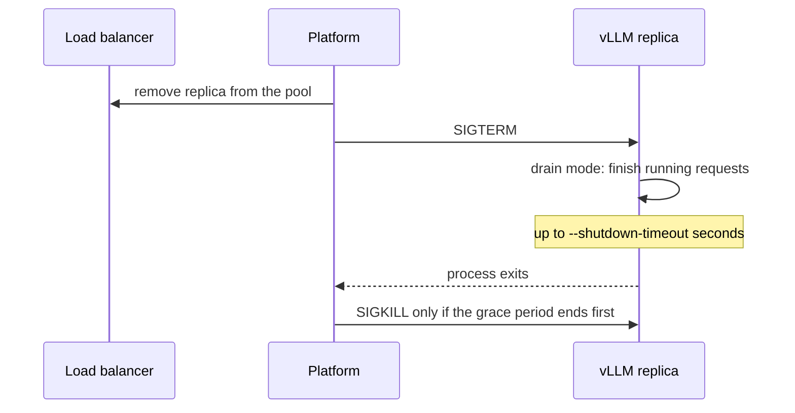

## 1. The question this idea answers

A model server is a large program with many parts that must match. The parts are a GPU driver, CUDA libraries, PyTorch, attention kernels, the inference engine and about 16 GB of weights for an 8B model. You must start it on many machines in the same way, and fast when traffic grows. You must know exactly when it can take requests. And you must stop it without losing the answers in progress.

The interviewer's version: "Your autoscaler adds a replica. Why does it take three minutes before it serves traffic, and how do you make that shorter?" To answer, you need the parts of the startup and their size in bytes and seconds. You also need the tools that remove each part.

This lesson builds on the Docker basics in [Local PostgreSQL with Docker](/notes/databases/postgres/05-local-setup/l1-local-postgres-with-docker). Short reminders:

1. An **image** is a read-only package of programs and files. It consists of **layers**: each layer is a set of file changes, stored and downloaded separately.
2. A **container** is one running instance of an image, with its own file system and processes.
3. A **registry** stores images, for example Docker Hub. A **tag** is a readable name such as `v0.31.0`. A **digest** (`sha256:...`) names one exact image and never changes.
4. The **entrypoint** is the command that the container runs at start. Arguments after the image name go to it.

## 2. Mental model

> [!analogy] A food truck at a festival
> The **image** is the truck with its kitchen equipment: CUDA, PyTorch and vLLM. The **weights** are the ingredients. They arrive separately from a warehouse (object storage or the Hugging Face Hub). The **host driver** is the power socket at the parking spot. The truck's equipment needs a socket of at least a given version, or nothing works.
>
> Before the truck opens, the cooks unload the ingredients: they load the weights into GPU memory. They also preheat the ovens: they compile the model and record CUDA graphs. Only then does the "open" sign appear: the `/health` endpoint answers 200. At closing time, the truck stops taking new orders, finishes the orders in progress (drains), and then leaves.
>
> **Where it stops working:** a real truck can open its window while the ovens heat. A vLLM server does not answer any HTTP request until the engine is ready, not even `/health`. And the "ingredients" here are 16 GB or more: delivering them is often the slowest step, not the cooking.

## 3. Terms

| Term | Plain meaning |
|---|---|
| image layer | One set of file changes inside an image. Layers download and unpack separately. |
| digest | A `sha256:` name for one exact image. Unlike a tag, it cannot change. |
| NVIDIA driver | Kernel software on the host that controls the GPU. It is not inside the container. |
| CUDA toolkit | NVIDIA's libraries and compiler for GPU programs. The serving image contains its runtime parts. |
| minor version compatibility | A CUDA rule: an application built with CUDA 13.x runs on any driver of version 580 or newer. |
| forward compatibility | NVIDIA's `cuda-compat` package. It lets a newer CUDA run on an older driver, on supported GPUs. |
| NVIDIA Container Toolkit | Host software that makes the GPUs and the driver libraries visible inside a container. |
| shared memory (`/dev/shm`) | A memory-backed file system that processes use to exchange data. PyTorch uses it between processes. |
| safetensors | A weight file format: an 8-byte header size, a JSON header, then raw tensor bytes. Loading it runs no code. |
| pickle | Python's object serialization format. Loading a pickle can run any function. |
| Hugging Face Hub | A public registry of models and datasets. Gated models need an access token. |
| object storage | A cloud service that stores files as objects: Amazon S3, Azure Blob Storage, Google Cloud Storage. |
| cold start | The time from "start a replica" to "the replica serves requests". |
| `torch.compile` | PyTorch's compiler. vLLM uses it to fuse operations into faster kernels at startup. |
| CUDA graph capture | Recording the kernel launches of common batch sizes so that decode can replay them with little CPU work. |
| health endpoint | An HTTP path that reports whether the server works. vLLM's is `GET /health`. |
| graceful shutdown | Stopping a server so that requests in progress finish (drain) before the process exits. |

All terms are also in the [Glossary](/notes/ai/llm-systems/glossary).

## 4. The serving image

### 4.1 What is inside `vllm/vllm-openai`

The vLLM project publishes the image `vllm/vllm-openai` on Docker Hub. Facts for version 0.31.0, checked on 2026-10-15:

| Fact | Value | Source |
|---|---|---|
| Tag for the release | `v0.31.0` (also `-cu129`, `-ubuntu2404`, `-x86_64-zstd` and other variants) | Docker Hub tag list |
| Compressed size of `v0.31.0` for amd64 | 9,035,211,086 bytes, about 9.04 GB | Docker Hub |
| Compressed size of `v0.31.0-x86_64-zstd` | 7,162,896,063 bytes, about 7.16 GB | Docker Hub |
| Final base image | `nvidia/cuda:${CUDA_VERSION}-base-ubuntu${UBUNTU_VERSION}`, with `CUDA_VERSION=13.0.3` and `UBUNTU_VERSION=24.04` | `docker/Dockerfile` in the vLLM 0.31.0 source |
| Python and PyTorch | Python 3.12, `torch==2.13.0` | `docker/Dockerfile`, `requirements/cuda.txt` |
| Entrypoint | `ENTRYPOINT ["vllm", "serve"]` | `docker/Dockerfile` |
| GPU architectures compiled | `7.5 8.0 8.6 8.9 9.0 10.0 11.0 12.0` | `torch_cuda_arch_list` in `docker/Dockerfile` |
| User | root by default. The docs: it "is also prepared to run as the built-in `vllm` user (UID 2000, GID 0)" | vLLM Docker docs |

Interpretation of these notes: the plain tag uses the default `CUDA_VERSION` of the Dockerfile, CUDA 13.0. The `-cu129` tags exist for hosts with older drivers.

The architecture list matters. Each number is a GPU's **compute capability**. The AWS EKS guide gives two examples: "sm_90 for H100 vs sm_89 for L4". Kernels compiled for one capability do not run on a GPU that the list does not cover.

### 4.2 The driver is on the host, CUDA is in the image


The split is the source of many startup failures:

1. **On the host:** the GPU and the NVIDIA kernel driver. The NVIDIA Container Toolkit install guide lists the driver as a prerequisite: "Install the NVIDIA GPU driver for your Linux distribution."
2. **In the image:** the CUDA runtime libraries, PyTorch, the attention kernels and vLLM.
3. **The bridge:** the NVIDIA Container Toolkit. It makes the GPU devices and the driver's user-space libraries visible in the container. For Docker you configure it once with `sudo nvidia-ctk runtime configure --runtime=docker` and restart Docker.

The rule that connects them is in the CUDA 13.0 Update 3 release notes ("Minimum Required Driver Version for CUDA Minor Version Compatibility"):

| CUDA toolkit in the image | Minimum host driver |
|---|---|
| 13.x | 580 or newer |
| 12.x | 525 or newer (and below 580) |

The same notes say: "The CUDA driver is backward compatible", so a new driver runs older CUDA applications. The reverse needs help. The vLLM image includes CUDA compatibility libraries. The vLLM docs: "For CUDA 13 images ... CUDA 13 requires an R580 or newer driver" and "Compatibility mode supports R535 and R570 host drivers". You enable it with the environment variable `VLLM_ENABLE_CUDA_COMPATIBILITY=1`, and the docs add that it "only supports select professional and datacenter NVIDIA GPUs".

> [!trap] "CUDA version" means two different things
> `nvidia-smi` on the host prints the newest CUDA version that the **driver** supports. The image contains the CUDA **toolkit** that vLLM was built with. They are allowed to differ, as long as the driver is new enough for the toolkit. A host with driver 570 and the plain CUDA 13 image fails unless you enable compatibility mode or choose a `-cu129` tag.

### 4.3 The `docker run` command, line by line

The command from the vLLM Docker docs, with a pinned tag and the 8B model:

```bash
docker run --runtime nvidia --gpus all \
  -v ~/.cache/huggingface:/root/.cache/huggingface \
  --env "HF_TOKEN=$HF_TOKEN" \
  -p 8000:8000 \
  --ipc=host \
  vllm/vllm-openai:v0.31.0 \
  --model meta-llama/Llama-3.1-8B-Instruct \
  --max-model-len 8192
```

| Part | What it does |
|---|---|
| `--runtime nvidia --gpus all` | Starts the container with the NVIDIA runtime and gives it every GPU of the host. |
| `-v ~/.cache/huggingface:/root/.cache/huggingface` | Mounts the host's Hugging Face cache. The second start finds the weights on disk and skips the download. |
| `--env "HF_TOKEN=$HF_TOKEN"` | Passes the access token for gated models such as Llama. Docker reads the value in the host's environment, not in the image. |
| `-p 8000:8000` | Publishes the server port. vLLM's default port is 8000. |
| `--ipc=host` | Uses the host's shared memory. The docs: "You can either use the `ipc=host` flag or `--shm-size` flag", because PyTorch shares memory between processes, "especially for tensor parallel inference". |
| `vllm/vllm-openai:v0.31.0` | A pinned tag. `latest` changes under you. A digest is even safer. |
| `--model ... --max-model-len 8192` | Arguments for the entrypoint `vllm serve`. [L2](/notes/ai/llm-systems/05-cloud-hosting/l2-sizing-gpus) explains why the context limit matters on small GPUs. |

Docker's default shared memory is small: the `dockerd` reference lists `--default-shm-size` with "(default 64MiB)". Without `--ipc=host` or a larger `--shm-size`, multi-GPU runs can fail.

### 4.4 Build your own image or not?

Three common choices:

1. **Use the official image unchanged** and pass flags. This is the simplest and easiest to upgrade.
2. **Add a thin layer** with `FROM vllm/vllm-openai:v0.31.0` for extra Python packages or a plugin. The vLLM docs show this pattern.
3. **Bake the weights into the image.** The pull then includes the weights, so there is no separate download. But every model change needs a new image of 25 GB or more, and every node stores another copy.

A newer option separates the two: Kubernetes **image volumes** mount an OCI image (an image in the standard container format) as a read-only volume. The Kubernetes enhancement KEP-4639 reached stable in Kubernetes v1.36, and one of its user stories is to "mount large language model weights or machine learning model weights in a pod alongside a model-server". So the engine image and the weight image can be versioned separately.

## 5. Model weights

### 5.1 Why safetensors and not pickle

Older PyTorch checkpoints (`.bin`, `.pt`, `.pth`) use Python's **pickle** format. A pickle does not only store data. It can store "call this function with these arguments", and the loader runs that call. The safetensors README marks pickle as "Unsafe, runs arbitrary code".

This demonstration runs as shown (Python 3.13, PyTorch 2.14):

```python
import pickle, torch

class Evil:
    def __reduce__(self):
        # pickle stores "call print with this argument" instead of data
        return (print, ("code ran while loading the file",))

blob = pickle.dumps({"weight": Evil()})
pickle.loads(blob)                      # runs print(): any function could run here

torch.save({"weight": Evil()}, "evil.pt")
try:
    torch.load("evil.pt")               # weights_only=True is the default since PyTorch 2.6
except Exception as e:
    print(type(e).__name__, "-", str(e).splitlines()[0][:80])
```

```text
code ran while loading the file
UnpicklingError - Weights only load failed. This file can still be loaded, to do so you have two o
```

- `__reduce__` tells pickle how to rebuild an object. Here it returns a function and its arguments.
- `pickle.loads` calls that function. An attacker would call `os.system` instead of `print`.
- `torch.load` now refuses. The PyTorch developer forum post on this change says the default of `weights_only` changed from False to True. The change applies from version 2.6.

Safetensors removes the problem by design. The format from the safetensors README:

1. "8 bytes: `N`, an unsigned little-endian 64-bit integer, containing the size of the header"
2. "N bytes: a JSON UTF-8 string representing the header": for each tensor, its dtype, shape and `data_offsets`.
3. "Rest of the file: byte-buffer."

The header has a limit: "Currently, there's a limit on the size of the header of 100MB to prevent parsing extremely large JSON." Loading reads JSON and raw bytes, and it never runs code. The raw bytes can also be memory-mapped: the operating system maps the file into memory and reads pages only when the program touches them.

You can write and read the format by hand. The code runs as shown. Its last part needs the `safetensors` package (`pip install safetensors`):

```python
import json, struct
import numpy as np

# 1. Write a tiny safetensors file by hand: one FP32 tensor of shape [2, 3]
w = np.arange(6, dtype="<f4").reshape(2, 3)
header = {"embed.weight": {"dtype": "F32", "shape": [2, 3], "data_offsets": [0, w.nbytes]},
          "__metadata__": {"format": "pt"}}
hb = json.dumps(header, separators=(",", ":")).encode()
hb += b" " * (-len(hb) % 8)                      # pad the header to a multiple of 8 bytes
with open("tiny.safetensors", "wb") as f:
    f.write(struct.pack("<Q", len(hb)))          # 8 bytes: header size N, little-endian u64
    f.write(hb)                                   # N bytes: JSON header
    f.write(w.tobytes())                          # the byte buffer

# 2. Read it back by hand, without any library
with open("tiny.safetensors", "rb") as f:
    n = struct.unpack("<Q", f.read(8))[0]
    meta = json.loads(f.read(n))
    start, end = meta["embed.weight"]["data_offsets"]
    f.seek(8 + n + start)
    arr = np.frombuffer(f.read(end - start), dtype="<f4").reshape(meta["embed.weight"]["shape"])
print("header bytes:", n)
print("tensor:", arr.tolist())

# 3. The official library reads the same file
from safetensors.numpy import load_file
print("library:", load_file("tiny.safetensors")["embed.weight"].tolist())
```

```text
header bytes: 104
tensor: [[0.0, 1.0, 2.0], [3.0, 4.0, 5.0]]
library: [[0.0, 1.0, 2.0], [3.0, 4.0, 5.0]]
```

- `struct.pack("<Q", ...)`: `<` means little-endian, `Q` means an unsigned 64-bit integer: exactly the 8-byte prefix of the format.
- The padding with spaces keeps the byte buffer aligned to 8 bytes. Interpretation of these notes: the official writer pads the same way, and the library accepted this file.
- `data_offsets` count from the start of the byte buffer, not from the start of the file. That is why the reader seeks to `8 + n + start`.

### 5.2 What a model repository contains

The Hugging Face Hub listing of `meta-llama/Llama-3.1-8B-Instruct` (checked on 2026-10-15). The model is gated, so downloads need `HF_TOKEN`.

| File | Bytes |
|---|---|
| `model-00001-of-00004.safetensors` | 4,976,698,672 |
| `model-00002-of-00004.safetensors` | 4,999,802,720 |
| `model-00003-of-00004.safetensors` | 4,915,916,176 |
| `model-00004-of-00004.safetensors` | 1,168,138,808 |
| `model.safetensors.index.json` | 23,950 |
| `config.json`, tokenizer files | small, with `tokenizer.json` at 9,085,657 |
| `original/consolidated.00.pth` | 16,060,617,592 |

The repository holds the weights twice: once as safetensors shards (16.06 GB in total) and once as the original PyTorch file. vLLM reads `model.safetensors.index.json` and downloads only the files named in its weight map. The source comment says this avoids "downloading unnecessary files (e.g., from subdirectories like "original/")". A manual download needs a filter, for example with the Hugging Face CLI:

```bash
hf download meta-llama/Llama-3.1-8B-Instruct \
  --exclude "original/*" \
  --local-dir /models/llama-3.1-8b-instruct
```

Without the filter you download about 16 GB more than you need.

### 5.3 Where the weights live

| Source | How vLLM reads it | Notes |
|---|---|---|
| Hugging Face Hub | `--model meta-llama/Llama-3.1-8B-Instruct`, cache in `HF_HOME` (default `~/.cache/huggingface`) | Needs internet access and `HF_TOKEN` for gated models. `HF_HUB_OFFLINE=1` makes the client use only the cache. |
| Local disk or a mounted volume | `--model /models/llama-3.1-8b-instruct` | Fastest when the disk is local NVMe. |
| Object storage | `--load-format runai_streamer` with `s3://`, `gs://` or `az://` paths | The Run:ai Model Streamer reads "tensors in concurrency, while streaming it to GPU memory". It supports safetensors only. |
| A weight image | an image volume mounted read-only | Kubernetes v1.36 and newer. |

For faster Hub downloads, the Hugging Face docs now recommend `HF_XET_HIGH_PERFORMANCE`. The older `HF_HUB_ENABLE_HF_TRANSFER` is marked deprecated: "Now that the Hugging Face Hub is fully powered by the Xet storage backend ... `hf_transfer` can't be used anymore."

The network path matters as much as the source. The AWS EKS guide warns about private subnets: "A NAT Gateway provides up to 100 Gbps of bandwidth", but "that bandwidth is shared across every node in the private subnet". When many new nodes download a model at the same time, they compete for it. The guide recommends a gateway VPC endpoint for S3, so that the traffic bypasses the NAT gateway.

### 5.4 From disk to GPU memory

The loader reads each tensor from the file and copies it to the GPU over PCIe. vLLM has several loaders, chosen with `--load-format` (the list in the `vllm serve` docs includes `auto`, `safetensors`, `instanttensor`, `tensorizer`, `runai_streamer`, `runai_streamer_sharded`, `ipc_cache` and `dummy`).

`--safetensors-load-strategy` changes how safetensors files are read. Its default uses memory-mapped loading and enables prefetching on NFS (a network file system) if the checkpoint fits in RAM. The `eager` value reads the whole file into CPU memory first, and the docs recommend it for network file systems.

The vLLM 0.31.0 source also contains a `vllm preload` subcommand. Its docstring: it "Launches one weight cache daemon per GPU; each daemon holds the post-quantized, TP-sharded weights of its rank in GPU memory". Restarting engines load from it with `--load-format ipc_cache` "instead of reloading from disk". This helps engine restarts on the same machine, not new machines.

## 6. The cold-start timeline

> [!key] A cold start is a sum of steps, and each step has its own fix
> Pull the image, get the weights, start the engine, load the weights into the GPU, compile, profile memory, record CUDA graphs. Measure each step separately. The biggest step is different on every platform.

### 6.1 What the sources measured

1. **AWS EKS guide, `torch.compile`.** Without a cache, the first Pod's compile took "~53s" for a 60 GB model. It took "~60s" for 140 GB and "~80s" for 640 GB. With a cache on the same node, it took "~6s" in all three cases.
2. **AWS EKS guide, whole startup, directional test.** The test used a 67 GB model with TP=2 on `p5.48xlarge`, with weights streamed from S3. The first Pod on a new node took 65 s without a compile cache and 16 s with a pre-warmed one.
3. **AWS EKS guide, storage.** Local NVMe instance store "delivers roughly 30 GB/s, compared to roughly 1 GB/s for the root Amazon EBS volume".
4. **"Breaking the Ice: Analyzing Cold Start Latency in vLLM"** by Kabakibo, Trivedi and Wang (MLSys 2026). It measured vLLM v0.10.1.1, an older version. The engine startup of Llama3.2-3B on an H100 took 20.32 s in total, without image pull or download. Step ranges from the paper:
   - Dynamo graph capture: about 3 to 6 s.
   - Compiled graphs: 11 to 21 s to compile and store without a cache, 3 to 6 s to load with a cache.
   - KV cache profiling: about 0.7 to 1 s.
   - CUDA graph capture: about 0.9 to 1.5 s.

   The paper concludes that vLLM startup is mainly CPU-bound.

### 6.2 A cold-start model for Llama-3.1-8B

The timeline below is **computed in these notes**. The bandwidths for the image and the weights are **assumptions**. The other steps use the source numbers above.

| Step | Work | Cold replica on a new node | Warm replica (image cached, weights on NVMe, compile cache) |
|---|---|---|---|
| Pull the image | 9.04 GB compressed, assumed 150 MB/s including unpacking | about 60 s | 0 s |
| Download the weights | 16.06 GB, assumed 500 MB/s from object storage | about 32 s | 0 s |
| Start the engine | imports, config, tokenizer (paper: a few seconds) | about 5 s | about 5 s |
| Read weights into the GPU | 16.06 GB from root EBS at about 1 GB/s, or NVMe at about 30 GB/s (AWS) | about 16 s | about 1 s |
| `torch.compile` | AWS: about 53 s cold, about 6 s with a cache | about 53 s | about 6 s |
| Memory profiling, KV allocation | paper: about 1 s | about 1 s | about 1 s |
| CUDA graph capture | paper: about 1 to 2 s | about 2 s | about 2 s |
| **Total** | | **about 169 s, almost 3 minutes** | **about 15 s** |

Two steps are not included. The first is the time to create a new GPU machine, which depends on the cloud and on GPU availability. The second is the time for the load balancer to add the ready replica.

> [!example] Worked example: the cold-start sum
> Cold: $60 + 32 + 5 + 16 + 53 + 1 + 2 = 169$ s.
>
> Warm: $0 + 0 + 5 + 1 + 6 + 1 + 2 = 15$ s.
>
> The three caches remove $169 - 15 = 154$ s, which is $154 / 169 \approx 91\%$ of the cold start. The result of about 15 s agrees with the 16 s that AWS measured for a warm Pod, although that test used a different model.


```video
{
  "src": "/notes/media/llm-systems/manim/m23-cold-start-timeline.mp4",
  "caption": "A new replica starts cold in about 169 seconds and warm in about 15 seconds, step by step."
}
```

### 6.3 How to make each step shorter

| Step | Fix | Source or note |
|---|---|---|
| Image pull | Keep the image on the node (pre-pull it on new nodes), and use the smaller `-x86_64-zstd` variant (7.16 GB instead of 9.04 GB). | Docker Hub sizes. Interpretation of these notes: zstd unpacks faster, but test it with your runtime. |
| Weight download | A shared cache volume, node-local NVMe, a gateway endpoint for S3, the Run:ai streamer with higher `concurrency`, and `distributed` for TP. | AWS EKS guide, vLLM docs |
| Read into the GPU | NVMe instead of network disks, `--safetensors-load-strategy eager` on network file systems. | AWS EKS guide, vLLM docs |
| `torch.compile` | Persist `VLLM_CACHE_ROOT` (default `~/.cache/vllm`) on a volume. Pre-warm it per GPU type, TP size, model and PyTorch version. | vLLM Docker docs, AWS EKS guide |
| All compile and graph steps | `--enforce-eager` skips them, but it costs speed: AWS lists "~5–30% higher" steady-state throughput for the default mode. | AWS EKS guide |
| Engine restarts on the same node | `vllm preload` with `--load-format ipc_cache`, or sleep mode. | vLLM 0.31.0 source, vLLM docs |
| Everything | Do not scale to zero for latency-sensitive traffic. Keep a minimum of warm replicas. | [Autoscaling and routing](/notes/ai/llm-systems/05-cloud-hosting/l5-autoscaling-and-routing) |

The vLLM Docker docs explain the compile cache: "each new container still starts with an empty `VLLM_CACHE_ROOT` (default `~/.cache/vllm`) and recompiles the model's `torch.compile` artifacts". The AWS guide lists what a cache depends on: the GPU type ("Compiled kernels are GPU-architecture-specific"), the TP degree, the model and the PyTorch version. A cache from an L4 does not help an H100.

## 7. Health, readiness and shutdown

### 7.1 The endpoints that operations use

From the vLLM 0.31.0 source (`vllm/entrypoints`):

| Path | Meaning |
|---|---|
| `GET /health` | Returns 200 when the engine is healthy. Returns 503 when the engine is dead (`EngineDeadError`). |
| `GET /v1/models` | Lists the served model names. A cheap functional check. |
| `GET /metrics` | Prometheus metrics: queue sizes, KV cache usage, token counts ([Production operations](/notes/ai/llm-systems/05-cloud-hosting/l8-production-operations)). |
| `GET` or `POST /ping` | The same check as `/health`. The source comment: "Endpoint required for SageMaker." |

An important detail of the startup order: vLLM binds its port early ("make sure that we bind the port before the engine is set up"), but the HTTP server starts only after the engine is built. So during model loading a client gets no HTTP answer at all: the connection is refused. A `200` from `/health` therefore means "the weights are loaded, memory is profiled and the server accepts requests".

A client or a deployment script waits for readiness like this. The output below is from a run against a fake server that opens its port after 1.5 s and answers 503 twice before 200:

```python
import time, urllib.request, urllib.error

def wait_until_ready(url, timeout_s=600, period_s=0.5):
    """Poll a health URL until it answers 200 or the timeout expires."""
    t0 = time.monotonic()
    while time.monotonic() - t0 < timeout_s:
        try:
            with urllib.request.urlopen(url, timeout=2) as r:
                if r.status == 200:
                    return time.monotonic() - t0
        except urllib.error.HTTPError as e:          # the server answered, but not 200
            print(f"{time.monotonic() - t0:4.1f} s: HTTP {e.code}")
        except (urllib.error.URLError, ConnectionError) as e:  # nothing answers yet
            print(f"{time.monotonic() - t0:4.1f} s: no answer")
        time.sleep(period_s)
    raise TimeoutError(url)
```

```text
 0.0 s: no answer
 0.5 s: no answer
 1.0 s: no answer
 1.5 s: HTTP 503
 2.0 s: HTTP 503
ready after 2.5 s
```

The test harness started a small `http.server` in a thread for this run. The exact times vary by a few milliseconds between runs.

- `urlopen(url, timeout=2)`: a short timeout per attempt. A busy server must not block the loop.
- `HTTPError` means the server answered with an error code, for example 503: it runs but is not ready.
- `URLError` with a refused connection means nothing answers yet: the engine is still loading.
- The total `timeout_s` must cover the worst cold start, about 3 minutes in section 6 plus a margin.

Kubernetes probes use the same endpoint. [L4](/notes/ai/llm-systems/05-cloud-hosting/l4-kubernetes-for-llm-serving) turns this loop into a startup probe.

### 7.2 Graceful shutdown and draining

A replica stops for many reasons: a scale-in, a rolling update, a node repair. Streams in progress must not break. vLLM 0.31.0 has the flag `--shutdown-timeout`. Its docstring: "Shutdown grace period for in-flight requests. Shutdown will be delayed for up to this amount of time to allow already-running requests to complete. Any remaining requests are aborted once the timeout is reached." The default is 0, and the engine code names the two modes: `mode = "abort" if shutdown_timeout == 0 else "drain"`.



The rules that follow:

1. **Set `--shutdown-timeout`** to a value above the length of a typical long answer, for example 60 s. With the default 0, every request in progress is aborted.
2. **Give the platform a longer grace period.** In Kubernetes the default `terminationGracePeriodSeconds` is 30 seconds, and after it the container runtime sends `SIGKILL`. So the grace period must be longer than the drain time.
3. **Stop new traffic first.** The load balancer must stop sending requests before the drain begins, or new requests arrive during the drain. Kubernetes removes the Pod from its endpoints in parallel with the signal, so a short pause at the start of shutdown helps ([L4](/notes/ai/llm-systems/05-cloud-hosting/l4-kubernetes-for-llm-serving)).

### 7.3 Configuration and secrets

1. **Flags or a file.** `vllm serve` accepts its options as flags or from a YAML file: the `--config` help text says "Read CLI options from a config file".
2. **Environment variables** configure the parts around the engine: `HF_HOME`, `HF_HUB_OFFLINE`, `VLLM_CACHE_ROOT`, `VLLM_ENABLE_CUDA_COMPATIBILITY`. vLLM also reads `VLLM_API_KEY`, and a source comment says that the `--api-key` flag "takes precedence over VLLM_API_KEY".
3. **Secrets** such as `HF_TOKEN` arrive from a secret store at run time: a Kubernetes Secret, AWS Secrets Manager, Azure Key Vault or Google Secret Manager. Never put a secret in the image: anyone who can pull the image can read every layer. Avoid secrets in command-line flags too, because the command line is visible in process lists and in the Pod specification. vLLM itself redacts sensitive arguments in its "non-default args" log line.
4. **Pin versions.** Pin the image by tag or digest and the model by repository revision. A changed default (for example `gpu_memory_utilization` changed from 0.9 to 0.92 in vLLM 0.20.0) can change your capacity silently.

### Exercises

1. **Parse a safetensors header.** Write `read_header(path)` that returns the header dictionary of a safetensors file without loading any tensor bytes.
   - Acceptance test: on `tiny.safetensors` from section 5.1 it returns a dictionary with the key `"embed.weight"`, shape `[2, 3]` and dtype `"F32"`. It reads exactly `8 + N` bytes.
   - Hint 1: the first 8 bytes are a little-endian unsigned 64-bit integer.
   - Hint 2: `struct.unpack("<Q", ...)`, then `json.loads` on the next N bytes.
2. **A cold-start calculator.** Write `cold_start(image_gb, weight_gb, pull_gbps, download_gbps, disk_gbps, compile_s, fixed_s)` that returns the total seconds and the name of the largest step.
   - Acceptance test: `cold_start(9.04, 16.06, 0.15, 0.5, 1.0, 53, 8)` returns about 169 s with the largest step `"pull"`. With `pull_gbps=10` (image already close) the largest step is `"compile"`.
   - Hint 1: time = gigabytes / (gigabytes per second) for each data step.
   - Hint 2: `fixed_s` is the sum of the engine start, profiling and graph capture (5 + 1 + 2).

## 8. Common mistakes

1. **"The container brings its own GPU driver."** The kernel driver stays on the host. The image brings the CUDA user-space libraries, and they need a host driver that is new enough: 580 or newer for CUDA 13.x.
2. **"`/health` returns 503 while the model loads."** In vLLM 0.31.0 the HTTP server does not run during loading, so the connection is refused. Probes and clients must treat "no answer" as "not ready yet", not as a failure, during the startup window.
3. **"Pickle checkpoints are fine if they come from a known site."** A pickle can run any code when it loads. Prefer safetensors, and keep `weights_only=True` in `torch.load`.
4. **"Downloading the model repository is the same as downloading the weights."** The Llama-3.1-8B repository holds about 16 GB of safetensors and about 16 GB more in `original/`. Filter the download.
5. **"`--enforce-eager` is a free way to start faster."** It skips compilation and CUDA graphs. The AWS guide lists "~5–30% higher" steady-state throughput for the default mode, and much lower per-token latency at small batch.
6. **"A compile cache works on every node."** The compiled kernels depend on the GPU architecture, the TP size, the model and the PyTorch version.
7. **"SIGTERM stops the server cleanly by default."** With the default `--shutdown-timeout 0`, vLLM aborts the requests in progress. Set a drain time and a longer platform grace period.

## 9. One-minute explanation

I run the model server as a container: the official `vllm/vllm-openai` image, pinned to a version, with `vllm serve` as its entrypoint. The GPU driver stays on the host and the CUDA libraries are in the image. So the host driver must be new enough: 580 or newer for the CUDA 13 images. If not, I use the compatibility mode or a CUDA 12.9 tag. The NVIDIA Container Toolkit makes the GPUs visible in the container, and I give it host shared memory for multi-GPU work. Weights are in safetensors, because a pickle file can run code when it loads. Safetensors is just an 8-byte length, a JSON header and raw bytes that can be memory-mapped. A cold start is a sum of steps: image pull, weight download, engine start, weight load, compile, memory profiling and CUDA graph capture. In my estimate that is almost 3 minutes cold and about 15 seconds warm. The fixes are caches at every step: the image on the node, the weights on local NVMe, and a compile cache per GPU type. `/health` answers 200 only after loading, so it is my readiness signal. For shutdown I set `--shutdown-timeout` to drain requests in progress, and a longer grace period on the platform. Secrets such as the Hugging Face token arrive from a secret store at run time, never from the image.

## 10. Check questions

```check
{
  "question": "A new GPU node has NVIDIA driver 570. You start `vllm/vllm-openai:v0.31.0` and CUDA fails to initialize. Explain why with the version rule, and give three fixes.",
  "hint": "Which CUDA version is in the plain image tag, and which driver does that CUDA major version need?",
  "answer": "The plain `v0.31.0` image builds on `nvidia/cuda:13.0.3-base-ubuntu24.04` (the default `CUDA_VERSION` in the vLLM 0.31.0 Dockerfile). The CUDA 13.0 Update 3 release notes give the rule for minor version compatibility: CUDA 13.x needs a driver of 580 or newer. Driver 570 belongs to the CUDA 12.x family (525 to below 580). The driver lives on the host, so the container cannot bring a newer one.\n\nFixes:\n\n1. Upgrade the host driver to 580 or newer (on Kubernetes, through the node image or the GPU Operator).\n2. Set `VLLM_ENABLE_CUDA_COMPATIBILITY=1`. The vLLM docs say \"Compatibility mode supports R535 and R570 host drivers\", on \"select professional and datacenter NVIDIA GPUs\".\n3. Use a CUDA 12.9 build of the same release, for example the `v0.31.0-cu129` tag, which needs a 12.x driver (Table 3 of the release notes lists 575.57.08 or newer for CUDA 12.9 Update 1; minor version compatibility allows 525 or newer with some limits)."
}
```

```check
{
  "question": "Interview follow-up: your load balancer health check calls `/health` on a vLLM replica that is still loading the model. What does it get, and why? What does a 503 from `/health` mean later?",
  "hint": "Read the startup order: when is the port bound, and when does the HTTP server start?",
  "answer": "During loading it gets **no HTTP answer**: the connection is refused. In vLLM 0.31.0 the server binds the port early (\"make sure that we bind the port before the engine is set up\"), but it starts the HTTP server only after the engine is built: weights loaded, memory profiled, CUDA graphs recorded. A bound socket that does not listen refuses connections.\n\nSo the first `200` means \"ready to serve\". The checker must treat refused connections during the startup window as \"not ready yet\". In Kubernetes this is the job of a startup probe with a long `failureThreshold × periodSeconds`.\n\nLater, a `503` means the engine process died: the handler catches `EngineDeadError` and returns 503. That replica must leave the pool and restart. A liveness probe on `/health` does exactly that."
}
```

```check
{
  "question": "Interview follow-up: \"Scale-out takes 3 minutes. Make it 20 seconds.\" Use the cold-start steps of this lesson and say which fix removes which step, with numbers.",
  "hint": "List the steps with their seconds, then attack the largest ones first.",
  "answer": "The cold model of this lesson: pull 60 s, download 32 s, engine start 5 s, read into GPU 16 s, compile 53 s, profiling 1 s, CUDA graphs 2 s: about 169 s.\n\n1. **Compile (53 s → about 6 s):** persist the compile cache (`VLLM_CACHE_ROOT`) on node-local storage and pre-warm it per GPU type, TP size, model and PyTorch version. AWS measured \"~53s\" cold and \"~6s\" with a same-node cache.\n2. **Image pull (60 s → 0 s):** pre-pull the pinned image on every GPU node when the node starts, before any Pod needs it. A smaller zstd variant also helps.\n3. **Download (32 s → 0 s):** keep the weights on a shared volume or node-local NVMe, or stream them with the Run:ai streamer over a gateway endpoint for S3 (no NAT bottleneck).\n4. **Read into GPU (16 s → about 1 s):** read from NVMe (about 30 GB/s per AWS) instead of the root EBS volume (about 1 GB/s).\n\nResult: about $5 + 1 + 6 + 1 + 2 = 15$ s. The rest is CPU work in the engine start. Two more levers: keep a minimum of warm replicas so that a cold start is rare, and for engine restarts on the same node use `vllm preload` with `--load-format ipc_cache`. Creating a new GPU node is outside these 15 s, so also keep some spare node capacity."
}
```

```check
{
  "question": "Why is safetensors safe to load while a pickle-based `.bin` file is not? Describe the safetensors byte layout exactly.",
  "hint": "What does a pickle store besides data?",
  "answer": "A pickle can store instructions of the form \"call this function with these arguments\" (through `__reduce__`), and `pickle.load` executes them. A malicious checkpoint can therefore run any code, for example a shell command, at load time. PyTorch reacted by making `weights_only=True` the default of `torch.load` from version 2.6.\n\nSafetensors contains only data:\n\n1. 8 bytes: `N`, an unsigned little-endian 64-bit integer, the size of the header.\n2. `N` bytes: a JSON header that maps each tensor name to its `dtype`, `shape` and `data_offsets` (offsets relative to the start of the byte buffer), plus an optional `__metadata__` map of strings.\n3. The rest: the raw tensor bytes.\n\nLoading parses JSON and copies bytes, so no code runs. The header is limited to 100MB, and the format guarantees that offsets do not overlap. The raw bytes can also be memory-mapped, which makes loading fast."
}
```

```check
{
  "question": "Interview follow-up: during a rolling update, users see streams cut off in the middle. vLLM runs with default flags in Kubernetes with the default grace period. Explain the cause and the fix.",
  "hint": "What is the default of `--shutdown-timeout`, and what does 0 mean?",
  "answer": "Cause: on `SIGTERM`, vLLM checks `--shutdown-timeout`. Its default is 0, and the engine code chooses `\"abort\" if shutdown_timeout == 0 else \"drain\"`. So every request in progress is aborted immediately, and the streams break.\n\nFix:\n\n1. Start vLLM with a drain time, for example `--shutdown-timeout 60`. The docstring: \"Shutdown will be delayed for up to this amount of time to allow already-running requests to complete.\"\n2. Set the Pod's `terminationGracePeriodSeconds` above the drain time plus any pre-stop pause, for example 90. The Kubernetes default is 30 seconds, and after it the runtime sends `SIGKILL`.\n3. Make sure that new requests stop arriving first: the Pod leaves the Service endpoints when it starts terminating, and a short pre-stop pause gives the load balancers time to notice.\n4. Long answers that exceed the drain time still break. Clients should retry such requests, or the product can limit `max_tokens`."
}
```

```check
{
  "question": "Should the weights be inside the container image? Give two arguments for, two against, and the newer alternative.",
  "hint": "Think of image size, versioning and the download step.",
  "answer": "For baking the weights into the image:\n\n1. One artifact: the image digest pins the engine and the weights together.\n2. No separate download step and no access to the Hub or object storage at startup.\n\nAgainst:\n\n1. Size: the 8B model adds about 16 GB to a 9 GB image. Every node pulls and stores the whole thing, and registries and pulls get slow.\n2. Coupling: a new model version needs a new image, and a new engine version needs a new copy of the weights.\n\nThe newer alternative: Kubernetes image volumes (KEP-4639, stable in v1.36) mount an OCI image as a read-only volume. One of its user stories is to \"mount large language model weights ... in a pod alongside a model-server\". The engine image and the weight image then have their own versions and caches. Other options: a shared read-only volume, node-local NVMe caches, or streaming from object storage."
}
```

```check
{
  "question": "Exercise 1: show a reference solution.",
  "answer": "```python\nimport json, struct\n\ndef read_header(path):\n    with open(path, \"rb\") as f:\n        n = struct.unpack(\"<Q\", f.read(8))[0]   # header size N\n        if n > 100 * 1024 * 1024:\n            raise ValueError(\"header larger than the 100MB limit\")\n        header = json.loads(f.read(n))\n        bytes_read = f.tell()\n    return header, bytes_read\n\nh, read = read_header(\"tiny.safetensors\")\nprint(h[\"embed.weight\"], read)\n# {'dtype': 'F32', 'shape': [2, 3], 'data_offsets': [0, 24]} 112\n```\n\n- `f.read(8)` and `\"<Q\"`: the little-endian unsigned 64-bit header size.\n- The size check rejects a file whose header claims more than the format's 100MB limit, before any large read.\n- `f.tell()` returns 112 = 8 + 104: the function never touched the tensor bytes."
}
```

```check
{
  "question": "Exercise 2: show a reference solution.",
  "answer": "```python\ndef cold_start(image_gb, weight_gb, pull_gbps, download_gbps, disk_gbps, compile_s, fixed_s):\n    steps = {\n        \"pull\": image_gb / pull_gbps,\n        \"download\": weight_gb / download_gbps,\n        \"load\": weight_gb / disk_gbps,\n        \"compile\": compile_s,\n        \"fixed\": fixed_s,\n    }\n    return round(sum(steps.values()), 1), max(steps, key=steps.get)\n\nprint(cold_start(9.04, 16.06, 0.15, 0.5, 1.0, 53, 8))  # (169.4, 'pull')\nprint(cold_start(9.04, 16.06, 10, 0.5, 1.0, 53, 8))    # (110.1, 'compile')\n```\n\n- Each data step is gigabytes divided by gigabytes per second: $9.04 / 0.15 = 60.3$ s for the pull.\n- `max(steps, key=steps.get)` returns the name of the slowest step: the one to fix first.\n- With a fast pull, the compile step (53 s) becomes the largest, so the next fix is the compile cache."
}
```

## 11. Links

- Previous lesson: [Sizing GPUs for a model](/notes/ai/llm-systems/05-cloud-hosting/l2-sizing-gpus)
- Next lesson: [Kubernetes for LLM serving](/notes/ai/llm-systems/05-cloud-hosting/l4-kubernetes-for-llm-serving)
- Related: [Ways to host a model](/notes/ai/llm-systems/05-cloud-hosting/l1-ways-to-host-a-model), [Autoscaling and routing](/notes/ai/llm-systems/05-cloud-hosting/l5-autoscaling-and-routing), [Production operations](/notes/ai/llm-systems/05-cloud-hosting/l8-production-operations), [Serving engines](/notes/ai/llm-systems/04-inference/l10-serving-engines), [The life of a request](/notes/ai/llm-systems/04-inference/l1-the-life-of-a-request)
- Docker basics: [Local PostgreSQL with Docker](/notes/databases/postgres/05-local-setup/l1-local-postgres-with-docker)
- The paper's system: [Implementation: the vLLM system and its kernels](/notes/papers/llm-serving/2023-pagedattention/08-implementation)

### Sources

All checked on 2026-10-15.

- vLLM, Using Docker: https://docs.vllm.ai/en/latest/deployment/docker/
- vLLM, `vllm serve` arguments: https://docs.vllm.ai/en/latest/cli/serve/
- vLLM, Run:ai Model Streamer: https://docs.vllm.ai/en/latest/models/extensions/runai_model_streamer/
- vLLM, sleep mode: https://docs.vllm.ai/en/latest/features/sleep_mode/
- vLLM 0.31.0 source distribution (`docker/Dockerfile`, `requirements/cuda.txt`, `vllm/entrypoints`, `vllm/v1/engine/core.py`, `vllm/config/vllm.py`, `vllm/model_executor/model_loader`): https://pypi.org/project/vllm/0.31.0/
- Docker Hub tags of `vllm/vllm-openai`: https://hub.docker.com/r/vllm/vllm-openai/tags
- NVIDIA CUDA 13.0 Update 3 release notes: https://docs.nvidia.com/cuda/archive/13.0.3/cuda-toolkit-release-notes/index.html
- NVIDIA CUDA compatibility guide: https://docs.nvidia.com/deploy/cuda-compatibility/
- NVIDIA Container Toolkit install guide: https://docs.nvidia.com/datacenter/cloud-native/container-toolkit/latest/install-guide.html
- Docker `dockerd` reference (`--default-shm-size`): https://docs.docker.com/reference/cli/dockerd/
- safetensors README: https://github.com/huggingface/safetensors
- PyTorch developer forum, `torch.load` default `weights_only=True`: https://dev-discuss.pytorch.org/t/bc-breaking-change-torch-load-is-being-flipped-to-use-weights-only-true-by-default-in-the-nightlies-after-137602/2573
- Hugging Face Hub file listing of Llama-3.1-8B-Instruct: https://huggingface.co/api/models/meta-llama/Llama-3.1-8B-Instruct/tree/main
- Hugging Face CLI guide: https://huggingface.co/docs/huggingface_hub/guides/cli
- Hugging Face environment variables: https://huggingface.co/docs/huggingface_hub/package_reference/environment_variables
- AWS EKS, Accelerate model loading: https://docs.aws.amazon.com/eks/latest/userguide/ml-inference-fast-model-loading.html
- Kabakibo, Trivedi, Wang, "Breaking the Ice: Analyzing Cold Start Latency in vLLM", MLSys 2026: https://arxiv.org/abs/2606.07362
- Kubernetes KEP-4639, OCI images as VolumeSource: https://www.kubernetes.dev/resources/keps/4639/
- Kubernetes Pod lifecycle (termination): https://kubernetes.io/docs/concepts/workloads/pods/pod-lifecycle/
