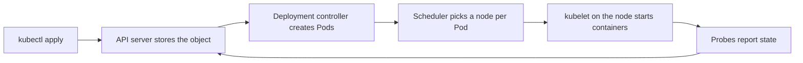

## 1. The question this idea answers

One vLLM container on one VM is easy ([L3](/notes/ai/llm-systems/05-cloud-hosting/l3-containers-and-model-loading)). Production needs more:

1. Several replicas on several machines, so that one failure does not stop the service.
2. A replica that crashes must restart without a human.
3. A new engine version must replace the old one without downtime.
4. Requests must reach only replicas that are ready.
5. GPUs are expensive, so each GPU must run the right workload, and CPU-only programs must not take GPU machines.

**Kubernetes** is the standard open-source system that does these jobs for containers. The interview question is usually: "How would you run this model on Kubernetes?" A good answer explains the core objects first, then the GPU-specific parts. Then it names the LLM-specific gaps that plain Kubernetes does not fill.

## 2. Mental model

> [!analogy] A harbor with a harbor office
> The **cluster** is a harbor. The **nodes** are the docks. The **Pods** are ships, and each ship carries one or more containers. The **control plane** is the harbor office. You never move ships yourself. You give the office a written plan, for example "two ships of type llama-8b must always be at a dock". The office compares the plan with reality every few seconds and acts on any difference.
>
> Some docks have cranes: these are **GPU nodes**. The office puts a "reserved" sign on them (a **taint**), so ordinary ships do not take the space. A ship that needs a crane carries a permit (a **toleration**) and states how many cranes it needs (a **GPU limit**). The harbor has one public address (a **Service**) that forwards each visitor to a ship that is ready.
>
> **Where it stops working:** the harbor office does not know what is inside a ship. Kubernetes counts Pods and GPUs. It does not see that one replica has a full KV cache and a long queue while another is idle. LLM-aware routing and autoscaling need extra parts (section 9).

## 3. Terms

| Term | Plain meaning |
|---|---|
| cluster | A group of machines that Kubernetes manages as one system. |
| control plane | The programs that store the desired state and act on it: the API server, the scheduler and the controllers. |
| node | One machine (a VM) in the cluster. The `kubelet` agent on it starts and stops containers. |
| Pod | The smallest unit that Kubernetes schedules: one or more containers that share a network address and volumes. |
| Deployment | An object that keeps a number of identical Pods running and replaces them step by step on an update. |
| Service | A stable name and virtual address that forwards traffic to the ready Pods with matching labels. |
| label, selector | A key-value tag on an object, and a filter that chooses objects by their labels. |
| node pool | A group of identical nodes, for example all `g6e.xlarge` machines. |
| device plugin | A program on each node that tells Kubernetes which special devices, such as GPUs, the node has. |
| `nvidia.com/gpu` | The resource name that the NVIDIA device plugin advertises. A Pod requests GPUs with it. |
| taint, toleration | A taint on a node repels Pods. A toleration on a Pod allows it to run on a tainted node. |
| probe | A check that the kubelet runs on a container: startup, readiness or liveness. |
| PersistentVolumeClaim (PVC) | A request for storage that outlives a Pod, for example a shared model cache. |
| Secret | An object that holds sensitive values, such as an access token, and gives them to Pods. |
| DaemonSet | An object that runs one copy of a Pod on every node (or on every matching node). |
| InferencePool | A resource of the Gateway API Inference Extension: a group of model server Pods behind an endpoint picker. |
| LeaderWorkerSet | A Kubernetes API that deploys a group of Pods (a leader and workers) as one unit, for multi-node inference. |

All terms are also in the [Glossary](/notes/ai/llm-systems/glossary).

## 4. Kubernetes from zero

### 4.1 Desired state and control loops

You never tell Kubernetes "start a container on machine 7". You write the **desired state** in a YAML file and send it to the API server, for example with `kubectl apply -f llama-8b.yaml`. Then several control loops work until reality matches it:



1. The **API server** validates the object and stores it.
2. The **Deployment controller** sees that 2 replicas are wanted and 0 exist. It creates 2 Pod objects.
3. The **scheduler** sees Pods without a node. It filters the nodes that have enough free CPU, memory and GPUs, and whose taints the Pod tolerates. Then it assigns each Pod to a node.
4. The **kubelet** on that node pulls the image, starts the containers and runs the probes.
5. If a Pod dies, the controller sees 1 replica instead of 2 and creates a new Pod. Nobody needs to act.

### 4.2 The objects you need for one model

| Object | Job in LLM serving |
|---|---|
| Deployment | Keeps N vLLM replicas running and updates them one by one. |
| Service | Gives the replicas one stable name, for example `llama-8b`, and sends traffic only to ready Pods. |
| Secret | Holds `HF_TOKEN` (or a token for your model registry). |
| PersistentVolumeClaim | A shared model and compile cache, so that new replicas skip downloads. |
| A gateway or router in front | Authentication, token limits and LLM-aware routing ([L1](/notes/ai/llm-systems/05-cloud-hosting/l1-ways-to-host-a-model)). |


## 5. GPUs in Kubernetes

### 5.1 The device plugin: how Kubernetes learns about GPUs

Kubernetes does not know GPUs by itself. The **NVIDIA device plugin** runs as a DaemonSet on GPU nodes. Its README describes three jobs. It exposes the number of GPUs on each node. It keeps track of their health. It lets you run GPU-enabled containers. Its prerequisites (README, checked on 2026-10-15): NVIDIA drivers, nvidia-container-toolkit 1.7.0 or later, and the NVIDIA container runtime as the default low-level runtime.

After the plugin starts, each GPU node reports a capacity such as `nvidia.com/gpu: 8`. The scheduler now counts GPUs like CPU and memory.

Installing drivers, the toolkit and the plugin on every node by hand is error-prone. Two common ways avoid it:

1. The **NVIDIA GPU Operator**. Its docs say it uses "the operator framework within Kubernetes to automate the management of all NVIDIA software components". The components include the drivers, the device plugin, the NVIDIA Container Toolkit, GPU Feature Discovery (automatic node labels) and DCGM-based monitoring.
2. The **managed Kubernetes service** of the cloud. For example, Google's GKE docs say: "By default, GKE manages the entire lifecycle of the GPU nodes, including automatic GPU driver installation".

### 5.2 Requesting GPUs

The Kubernetes "Schedule GPUs" page gives the rules (checked on 2026-10-15):

1. GPUs are "only supposed to be specified in the `limits` section".
2. If you set only a limit, Kubernetes uses the same value as the request.
3. If you set both, they must be equal.
4. You cannot set a GPU request without a matching limit.

So a Pod asks for whole GPUs, for example `nvidia.com/gpu: "1"`. Several Pods on one GPU need a sharing method of the device plugin: time-slicing, MPS or MIG (Multi-Instance GPU). The README warns about time-slicing: "nothing special is done to isolate workloads that are granted replicas from the same underlying GPU". For LLM serving, where one engine wants most of the GPU memory, one GPU per replica (or several for TP) is the usual choice.

> [!note] A newer API for devices
> Kubernetes also has **Dynamic Resource Allocation (DRA)**. Drivers publish devices as `ResourceSlice` objects, and Pods claim them with `ResourceClaim` objects. The structured-parameters design (KEP-4381) reached stable in Kubernetes v1.34. The device plugin path above is still the most common one in examples, including the vLLM docs.

### 5.3 GPU node pools, taints and tolerations

A cluster for LLM serving usually has at least two node pools:

1. A **CPU pool** for the gateway, the router, monitoring and other services.
2. One or more **GPU pools**, one per GPU type, for example `g6e.xlarge` (one L40S) and `p5.48xlarge` (8 H100).

Two mechanisms keep the pools apart:

1. **Taints on GPU nodes.** A taint such as key `nvidia.com/gpu` with effect `NoSchedule` makes the scheduler place only Pods that tolerate it. Without it, a log collector or a web server could take the CPU and memory of an expensive GPU machine. The AWS EKS example manifest uses exactly this toleration: `key: nvidia.com/gpu`, `operator: Exists`, `effect: NoSchedule`.
2. **Node selection on the model Pods.** A toleration only *allows* a Pod onto a GPU node. To *require* a GPU type, add a `nodeSelector` or a node affinity. The Kubernetes GPU page recommends labels when nodes have different GPU types, and Node Feature Discovery can add such labels. The well-known label `node.kubernetes.io/instance-type` selects a cloud instance type.

### 5.4 Shared memory for multi-GPU Pods

A container's `/dev/shm` is small by default. PyTorch and NCCL use shared memory between processes, especially with tensor parallelism ([L3](/notes/ai/llm-systems/05-cloud-hosting/l3-containers-and-model-loading)). In Kubernetes you mount a memory-backed `emptyDir` at `/dev/shm`. The Kubernetes volumes page: "If you set the `emptyDir.medium` field to `"Memory"`, Kubernetes mounts a tmpfs (RAM-backed filesystem) for you instead". It also warns: "files you write count against the memory limit of the container that wrote them".

The vLLM Kubernetes example uses `sizeLimit: 2Gi` for a one-GPU Pod. The vLLM LeaderWorkerSet example uses `sizeLimit: 15Gi` for 8-GPU Pods.

## 6. Probes for slow model loads

### 6.1 Three probes, three questions

| Probe | Question | What happens when it fails |
|---|---|---|
| startup | "Has the program finished starting?" | The kubelet kills the container and restarts it. While a startup probe is configured, Kubernetes does not run the other two probes until it succeeds. |
| readiness | "Should this Pod receive traffic now?" | The Pod is marked not ready and "stops receiving traffic from matching Services". The container keeps running. |
| liveness | "Is the program stuck or dead?" | The kubelet kills the container and restarts it. |

Defaults from the Kubernetes probes page: `initialDelaySeconds` 0, `periodSeconds` 10, `timeoutSeconds` 1, `successThreshold` 1, `failureThreshold` 3.

With the defaults and no startup probe, a liveness probe gives the container only about $3 \times 10 = 30$ seconds before the first restart. A vLLM cold start takes minutes ([L3](/notes/ai/llm-systems/05-cloud-hosting/l3-containers-and-model-loading)). So the container is killed in the middle of loading, again and again. This is the most common failure of a first LLM deployment on Kubernetes.

The vLLM Kubernetes docs describe the symptom. The container log contains "KeyboardInterrupt: terminated", and the event says "Container $NAME failed startup probe, will be restarted". The vLLM 0.31.0 source explains the first message: during initialization the server turns `SIGTERM` into `KeyboardInterrupt("terminated")`.

### 6.2 Size the startup probe from the cold start

The Kubernetes docs give the rule: set a startup probe "with a `failureThreshold * periodSeconds` long enough to cover the worst case startup time". Their example: `failureThreshold: 30` and `periodSeconds: 10` give "a maximum of 5 minutes (30 * 10 = 300s)".

> [!example] Worked example: the startup probe for the 8B model
> 1. Cold start from the model of [L3](/notes/ai/llm-systems/05-cloud-hosting/l3-containers-and-model-loading): about 169 s.
> 2. Worst case: a slow download or a busy registry can double it. Plan for $2 \times 169 = 338$ s.
> 3. Margin for a first start without any cache on a new node: round up to 600 s.
> 4. With `periodSeconds: 10`: `failureThreshold` $= 600 / 10 = 60$.
>
> The AWS EKS example uses the same pair: `periodSeconds: 10`, `failureThreshold: 60`. For a 70B model that streams 141 GB of weights, measure the cold start and set the threshold from the measurement.

### 6.3 Which endpoint for which probe

vLLM's `/health` returns 200 when the engine works and 503 when the engine is dead. During loading the server does not answer at all ([L3](/notes/ai/llm-systems/05-cloud-hosting/l3-containers-and-model-loading)). So `/health` works for all three probes:

1. **Startup** on `/health`: success means "loaded".
2. **Readiness** on `/health`, every 5 s, with a timeout of a few seconds. A replica whose engine died leaves the Service at once.
3. **Liveness** on `/health`, less often and with more tolerance. A liveness probe that is too strict restarts a replica that is only busy, which throws away its KV cache and makes the overload worse. Interpretation of these notes: give liveness a longer timeout than readiness, and several failures in a row.

## 7. A complete Deployment and Service

The manifest below serves Llama-3.1-8B-Instruct with two replicas, each on one L40S (`g6e.xlarge`, 44 GiB GPU memory according to AWS). It passed `kubernetes-validate --strict` against the Kubernetes 1.34, 1.36 and 1.37 schemas.

```yaml
apiVersion: apps/v1
kind: Deployment
metadata:
  name: llama-8b
  labels:
    app: llama-8b
spec:
  replicas: 2
  selector:
    matchLabels:
      app: llama-8b
  strategy:
    type: RollingUpdate
    rollingUpdate:
      maxSurge: 1
      maxUnavailable: 0
  template:
    metadata:
      labels:
        app: llama-8b
    spec:
      nodeSelector:
        node.kubernetes.io/instance-type: g6e.xlarge
      tolerations:
        - key: nvidia.com/gpu
          operator: Exists
          effect: NoSchedule
      terminationGracePeriodSeconds: 90
      containers:
        - name: vllm
          image: vllm/vllm-openai:v0.31.0
          args:
            - --model=meta-llama/Llama-3.1-8B-Instruct
            - --max-model-len=8192
            - --gpu-memory-utilization=0.92
            - --shutdown-timeout=60
          env:
            - name: HF_TOKEN
              valueFrom:
                secretKeyRef:
                  name: hf-token
                  key: token
            - name: HF_HOME
              value: /cache/huggingface
            - name: VLLM_CACHE_ROOT
              value: /cache/vllm
          ports:
            - name: http
              containerPort: 8000
          resources:
            requests:
              cpu: "3"
              memory: 24Gi
              nvidia.com/gpu: "1"
            limits:
              memory: 24Gi
              nvidia.com/gpu: "1"
          volumeMounts:
            - name: cache
              mountPath: /cache
            - name: shm
              mountPath: /dev/shm
          startupProbe:
            httpGet:
              path: /health
              port: http
            periodSeconds: 10
            failureThreshold: 60
          readinessProbe:
            httpGet:
              path: /health
              port: http
            periodSeconds: 5
            timeoutSeconds: 3
            failureThreshold: 2
          livenessProbe:
            httpGet:
              path: /health
              port: http
            periodSeconds: 15
            timeoutSeconds: 5
            failureThreshold: 4
          lifecycle:
            preStop:
              sleep:
                seconds: 10
      volumes:
        - name: cache
          persistentVolumeClaim:
            claimName: model-cache
        - name: shm
          emptyDir:
            medium: Memory
            sizeLimit: 2Gi
---
apiVersion: v1
kind: Service
metadata:
  name: llama-8b
spec:
  selector:
    app: llama-8b
  ports:
    - name: http
      port: 80
      targetPort: http
```

The two objects that it refers to:

```yaml
apiVersion: v1
kind: Secret
metadata:
  name: hf-token
type: Opaque
stringData:
  token: "<your Hugging Face token>"
---
apiVersion: v1
kind: PersistentVolumeClaim
metadata:
  name: model-cache
spec:
  accessModes:
    - ReadWriteMany
  resources:
    requests:
      storage: 100Gi
```

In production the Secret's value enters the cluster through a secret manager, not through a file in Git.

### 7.1 Line by line

| Lines | Meaning and reason |
|---|---|
| `kind: Deployment`, `replicas: 2` | Two identical replicas: one can fail or update while the other serves. |
| `selector.matchLabels` and `template.metadata.labels` | The Deployment owns the Pods with `app: llama-8b`. They must match, or the API server rejects the object. |
| `maxSurge: 1`, `maxUnavailable: 0` | During an update, Kubernetes first adds one new Pod and removes an old one only after the new one is ready. Capacity never drops, but the update needs one spare GPU (section 8). |
| `nodeSelector` | Only nodes of the instance type `g6e.xlarge` qualify. |
| `tolerations` | Allows the Pod onto nodes with the `nvidia.com/gpu` `NoSchedule` taint. |
| `terminationGracePeriodSeconds: 90` | Time from `SIGTERM` to `SIGKILL`. It must cover the 10 s pre-stop pause plus the 60 s drain. The default would be 30 s. |
| `image: vllm/vllm-openai:v0.31.0` | A pinned version. The image's entrypoint is `vllm serve`, so `args` are its flags. |
| `--max-model-len=8192` | A context limit that fits the product and the GPU ([L2](/notes/ai/llm-systems/05-cloud-hosting/l2-sizing-gpus)). |
| `--shutdown-timeout=60` | Drains requests in progress for up to 60 s on `SIGTERM`. The vLLM default 0 aborts them. |
| `env` with `secretKeyRef` | `HF_TOKEN` enters the container from the Secret at run time. It is not in the image or the args. |
| `HF_HOME`, `VLLM_CACHE_ROOT` | Put the Hugging Face cache and the compile cache on the shared volume, so later Pods skip the download and the compile. |
| `ports` with `name: http` | Names the port once. The probes and the Service refer to the name. |
| `resources` | One GPU (limit equals request, as the GPU rules require). The memory limit includes the 2 GiB of `/dev/shm`. `g6e.xlarge` has 4 vCPUs and 32 GiB of system memory (AWS), so the requests leave room for the system. |
| `startupProbe` | Up to $60 \times 10 = 600$ s to load. Liveness and readiness wait until it succeeds. |
| `readinessProbe` | Every 5 s. Two failures remove the Pod from the Service. |
| `livenessProbe` | Every 15 s, 5 s timeout, 4 failures: a restart only after about a minute of real failure. |
| `preStop.sleep.seconds: 10` | A built-in pause before `SIGTERM`, so that load balancers stop sending new requests first. The sleep action (KEP-3960) is stable since Kubernetes v1.34. |
| `emptyDir` with `medium: Memory` | A RAM-backed `/dev/shm` for PyTorch and NCCL. |
| `kind: Service`, `port: 80`, `targetPort: http` | Inside the cluster, `http://llama-8b` reaches a ready replica on its port 8000. |
| PVC `ReadWriteMany` | Several Pods on different nodes mount the same cache. Not every storage class supports this mode. Check yours. |

> [!example] Worked example: does the 8B model fit on one L40S with these flags?
> AWS lists 44 GiB for the L40S in `g6e.xlarge`.
>
> 1. Requested: $44 \times 0.92 = 40.48$ GiB.
> 2. Weights: 14.96 GiB. Overhead, assumed as for the L4: 1.5 GiB.
> 3. KV cache: $40.48 - 14.96 - 1.5 = 24.02$ GiB, about $24.02 \times 2^{30} / 131072 \approx 196{,}792$ tokens.
> 4. Requests of 8,192 tokens: $196{,}792 / 8192 \approx 24$ at full length.
>
> So `--max-model-len=8192` fits with room for about 24 full-length requests per replica. Check the two log lines of [L2](/notes/ai/llm-systems/05-cloud-hosting/l2-sizing-gpus) after the first start.

### 7.2 What can go wrong at deploy time

| Symptom | Likely cause |
|---|---|
| Pod stays `Pending`, the scheduler reports insufficient `nvidia.com/gpu` | No free GPU, the device plugin does not run on the node, or the `nodeSelector` matches no node. |
| Pod stays `Pending` on a tainted pool | The Pod has no toleration for the GPU taint. |
| Container restarts every few minutes during loading | The startup probe window is shorter than the cold start. |
| "CUDA driver version is insufficient" or a similar CUDA error | The node driver is older than the image's CUDA needs ([L3](/notes/ai/llm-systems/05-cloud-hosting/l3-containers-and-model-loading)). |
| Crash in NCCL with TP greater than 1 | `/dev/shm` is too small or missing. |
| `OOMKilled` | The container memory limit is too low, for example because `/dev/shm` use counts against it. |
| vLLM exits with "To serve at least one request ..." | `--max-model-len` is too large for the GPU ([L2](/notes/ai/llm-systems/05-cloud-hosting/l2-sizing-gpus)). |

## 8. Rolling updates when GPUs are scarce

A rolling update replaces Pods step by step. Two parameters control it:

1. `maxSurge`: how many extra Pods may exist above `replicas` during the update.
2. `maxUnavailable`: how many Pods may be missing below `replicas`.

With CPUs, a spare Pod is cheap. With GPUs, a spare Pod needs a free GPU, and a free H100 may not exist. So you choose:

| Setting | Effect |
|---|---|
| `maxSurge: 1`, `maxUnavailable: 0` | Full capacity during the update, but the update needs one free GPU (or a new node). |
| `maxSurge: 0`, `maxUnavailable: 1` | No extra GPU, but capacity drops by one replica during the update. |

Each step also waits for a cold start of the new Pod. With 10 replicas, `maxSurge: 1`, and about 3 minutes per cold start, the update takes about 30 minutes (computed in these notes). Warm caches make each step faster ([L3](/notes/ai/llm-systems/05-cloud-hosting/l3-containers-and-model-loading)).

## 9. Higher-level options for LLM serving

Plain Kubernetes balances traffic per connection or per request, and it autoscales on CPU or memory. LLM serving needs more: routing that knows queue length, KV cache use and shared prefixes, and autoscaling on queue depth ([L5](/notes/ai/llm-systems/05-cloud-hosting/l5-autoscaling-and-routing)). Several projects add this. Their status, checked on 2026-10-15:

| Project | What it is | Status |
|---|---|---|
| KServe | "A Kubernetes-native platform for serving machine learning models", predictive and generative. It has an LLM resource, `LLMInferenceService`, and uses vLLM and llm-d as LLM backends. | CNCF incubating project. The site shows version 0.20. `LLMInferenceService` arrived in v0.16 (Red Hat Developer, 21 April 2026). |
| vLLM production stack | A reference stack from the vLLM project: vLLM engines, a request router and a Prometheus and Grafana stack. The router offers round-robin, session-ID based and prefix-aware routing. The Helm chart is `vllm/vllm-stack`. | The README marks prefix-aware routing as work in progress. |
| llm-d | "Validated, production-ready deployment patterns" for distributed inference on Kubernetes: inference-aware traffic management, prefill and decode in "independently scalable pods", wide expert parallelism, KV cache tiering. | CNCF Sandbox since 24 March 2026. Started in May 2025 by Red Hat, Google Cloud, IBM Research, CoreWeave and NVIDIA. |
| Gateway API Inference Extension | An official Kubernetes project that turns gateways (Envoy Gateway, kgateway, GKE Gateway and others) into inference gateways. Its resource `InferencePool` groups model server Pods behind an Endpoint Picker. | `InferencePool` is in `inference.networking.k8s.io/v1`. |
| LeaderWorkerSet (LWS) | "An API for deploying a group of pods as a unit of replication", for models sharded across several nodes. | A Kubernetes SIG project, used in the vLLM docs and by llm-d. |

The vLLM Kubernetes docs also list other integrations: NVIDIA Dynamo, KubeAI, AIBrix, KAITO, llmaz, Kthena and KubeRay.

### 9.1 The InferencePool in one example

The `InferencePool` fields from the v1 API reference:

1. `selector.matchLabels` chooses the model server Pods.
2. `targetPorts` lists their ports, each with a `number`.
3. `appProtocol` defaults to `http`.
4. `endpointPickerRef` names the Endpoint Picker (EPP) Service. The EPP is the component that chooses one Pod for each request.

```yaml
apiVersion: inference.networking.k8s.io/v1
kind: InferencePool
metadata:
  name: llama-8b-pool
spec:
  selector:
    matchLabels:
      app: llama-8b
  targetPorts:
    - number: 8000
  endpointPickerRef:
    name: llama-8b-epp
    port:
      number: 9002
    failureMode: FailClose
```

- `selector` uses the same label as the Deployment above, so the pool contains its Pods.
- `endpointPickerRef.name` and `port.number` refer to the EPP's Service. The port here is an example value. The reference says that for a Service, the number is "the Service port, not the target port".
- `failureMode` is `FailOpen` or `FailClose`, and the default is `FailClose`. Interpretation of these notes: with `FailClose`, the gateway rejects a request when the EPP does not answer, instead of routing it blindly.

An HTTPRoute of the Gateway API then sends traffic to the pool as its backend, with `group: inference.networking.k8s.io`, `kind: InferencePool` and `name: llama-8b-pool`. The project's site calls its own EPP "a lightweight Endpoint Picker (EPP) reference implementation designed for conformance testing". It adds: "For production deployments, users and implementers should implement their own EPP", or use an existing one such as llm-d-router.

### 9.2 Multi-node serving with LeaderWorkerSet

Some models do not fit on one node. Llama-3.1-405B-Instruct has 405,853,388,800 BF16 parameters on the Hugging Face Hub. That is $405{,}853{,}388{,}800 \times 2 = 811.7$ GB, or 755.96 GiB, of weights. Eight H100s offer only $8 \times 80 \times 0.92 = 588.8$ GiB, so the model needs two nodes (or eight H200s, which offer $8 \times 141 \times 0.92 \approx 1{,}037.8$ GiB).

A plain Deployment cannot express "these two Pods belong together". LeaderWorkerSet can. The vLLM LWS example (checked on 2026-10-15):

| Field or setting | Value in the vLLM example |
|---|---|
| `apiVersion`, `kind` | `leaderworkerset.x-k8s.io/v1`, `LeaderWorkerSet` |
| `replicas` | 1 (one group serves the model) |
| `leaderWorkerTemplate.size` | 2 (one leader Pod and one worker Pod) |
| `restartPolicy` | `RecreateGroupOnPodRestart`: if one Pod fails, the whole group restarts |
| GPUs per Pod | `nvidia.com/gpu: "8"` |
| Parallelism | `--tensor-parallel-size 8` inside a node, `--pipeline-parallel-size $(LWS_GROUP_SIZE)` across nodes |
| Group wiring | `--nnodes $(LWS_GROUP_SIZE)`, `--node-rank $(LWS_WORKER_INDEX)`, `--master-addr $(LWS_LEADER_ADDRESS)`. Workers add `--headless`. |
| `/dev/shm` | `emptyDir` with `medium: Memory`, `sizeLimit: 15Gi` |

Why this layout: tensor parallelism needs the fast NVLink inside a node. Pipeline parallelism sends less data, so it can cross the slower network between nodes ([Parallelism](/notes/ai/llm-systems/04-inference/l8-parallelism)). With TP=8 and PP=2 over 16 GPUs, each GPU holds about $755.96 / 16 = 47.25$ GiB of weights. The all-or-nothing restart matters because a group with one dead Pod cannot serve at all.

### Exercises

1. **Startup probe from a measurement.** Write `startup_probe(measured_cold_s, safety=2.0, period_s=10)` that returns a dictionary with `periodSeconds` and `failureThreshold`, rounded up.
   - Acceptance test: `startup_probe(169)` returns `{"periodSeconds": 10, "failureThreshold": 34}`. `startup_probe(400, safety=1.5)` returns a threshold of 60.
   - Hint 1: the window is `failureThreshold * periodSeconds`.
   - Hint 2: use `math.ceil` so that the window is never shorter than needed.
2. **Validate your own manifest.** Change the Deployment above for Llama-3.1-70B in FP8 on one H200 (`p5e.48xlarge`, where each Pod takes one of the eight GPUs). Validate it with a schema validator in strict mode.
   - Acceptance test: the validator passes, the Pod requests exactly one `nvidia.com/gpu` in `limits`, and the startup window is at least 900 s.
   - Hint 1: `pip install kubernetes-validate` provides the command `kubernetes-validate --strict -k 1.36.0 file.yaml`.
   - Hint 2: the FP8 checkpoint is about 72.7 GB, so plan a longer download and load than for the 8B model.

## 10. Common mistakes

1. **"The default probes are fine."** Without a startup probe, the default liveness settings allow about 30 s, and a model load takes minutes. The kubelet then kills the container during loading, forever.
2. **"Put GPUs in `requests`, like CPU."** GPUs belong in `limits`. If both are set, they must be equal, and a request without a limit is invalid.
3. **"A toleration sends my Pod to GPU nodes."** A toleration only allows it. Use a `nodeSelector` or node affinity to require a GPU type.
4. **"`/dev/shm` does not matter."** Multi-GPU engines exchange data through shared memory. Mount a memory-backed `emptyDir`, and remember that its use counts against the container's memory limit.
5. **"A strict liveness probe makes the service more reliable."** A busy but healthy replica can answer slowly. Restarting it throws away its KV cache and adds a cold start under load.
6. **"Kubernetes load balancing is good enough for LLMs."** A Service spreads requests without knowing queue lengths, KV cache use or prompt prefixes. Use an inference-aware router or an inference gateway.
7. **"Rolling updates are free."** With `maxSurge: 1` an update needs a spare GPU, and each step waits for a cold start.

## 11. One-minute explanation

In Kubernetes I describe the desired state in YAML and control loops make it real. A Deployment keeps my vLLM replicas running, and the scheduler places them on nodes. A Service gives them one stable name and sends traffic only to ready Pods. For GPUs, the NVIDIA device plugin advertises `nvidia.com/gpu` on each node, often installed by the GPU Operator or by the managed service. A Pod asks for whole GPUs in `limits`. I keep GPU nodes in their own pool with a `NoSchedule` taint. The model Pods carry a toleration and a node selector for the GPU type. I mount a memory-backed `emptyDir` at `/dev/shm` for multi-GPU communication. The most common failure is the probes, because a model load takes minutes. So I add a startup probe on `/health` whose window, `failureThreshold` times `periodSeconds`, exceeds the worst cold start, for example 600 s. Readiness and liveness use `/health` too, with a tolerant liveness so that a busy replica is not killed. For shutdown I combine `--shutdown-timeout`, a pre-stop pause and a longer grace period. Plain Kubernetes does not know KV caches or token queues. So for routing I add the Gateway API Inference Extension with an endpoint picker, or a platform such as llm-d or KServe. For models larger than one node I use LeaderWorkerSet, with tensor parallelism inside a node and pipeline parallelism across nodes.

## 12. Check questions

```check
{
  "question": "Your vLLM Pod stays `Pending`. The scheduler reports insufficient `nvidia.com/gpu`, although the cluster has a node pool with GPUs. List four causes and how you check each.",
  "hint": "Follow the scheduler's filter: capacity, device plugin, taints, selectors.",
  "answer": "1. **No free GPU.** Every GPU on the matching nodes is already taken by other Pods. Check the node's allocatable `nvidia.com/gpu` and the GPUs requested by its Pods (`kubectl describe node`).\n2. **The device plugin does not run on that node.** Without it, the node reports no `nvidia.com/gpu` at all. Check that the plugin's DaemonSet Pod runs on the node, or that the GPU Operator or the managed service installed it.\n3. **The node selector matches no GPU node.** For example, `node.kubernetes.io/instance-type: g6e.xlarge` while the pool uses `g6e.2xlarge`. Check the node labels.\n4. **The Pod does not tolerate the GPU taint.** Then the scheduler excludes every GPU node. Check the node's taints and the Pod's `tolerations`.\n\nA fifth case on autoscaled clusters: the pool has zero nodes and the cluster autoscaler must create one first. Then `Pending` is normal for a few minutes, and GPU quota or capacity in the region can block it."
}
```

```check
{
  "question": "Interview follow-up: after deployment, a vLLM container restarts every 30 to 40 seconds and never becomes ready. The log ends with \"KeyboardInterrupt: terminated\". Explain the mechanism and give the fix with numbers.",
  "hint": "Who sends the signal, and why does vLLM turn it into a KeyboardInterrupt?",
  "answer": "Mechanism:\n\n1. The Pod has a liveness probe (or a short startup probe) on `/health` with defaults: `periodSeconds` 10, `failureThreshold` 3, `initialDelaySeconds` 0. That is about $3 \\times 10 = 30$ s of tolerance.\n2. During model loading, vLLM's HTTP server does not run, so every probe gets a refused connection.\n3. After 3 failures the kubelet kills the container with `SIGTERM`. During initialization vLLM 0.31.0 converts `SIGTERM` into `KeyboardInterrupt(\"terminated\")`, so the log ends with that line. The vLLM Kubernetes docs list it as the symptom of a failing startup probe.\n4. The container restarts and the load starts again from zero: an endless loop.\n\nFix: add a startup probe whose window covers the worst cold start. Rule from the Kubernetes docs: `failureThreshold * periodSeconds` must be \"long enough to cover the worst case startup time\". With a measured cold start of about 169 s and a safety factor: `periodSeconds: 10`, `failureThreshold: 60`, a 600 s window. Liveness and readiness start only after the startup probe succeeds."
}
```

```check
{
  "question": "A teammate writes `requests: {nvidia.com/gpu: 1}` without a limit, and another writes `nvidia.com/gpu: 0.5` to share a GPU between two small models. What happens in each case, and what should they do?",
  "hint": "Read the four GPU rules of the Kubernetes docs and the device plugin's sharing options.",
  "answer": "1. **Request without a limit:** the Kubernetes docs say you cannot set a GPU request without a matching limit. The API server rejects the Pod. GPUs belong in `limits`. If only the limit is set, Kubernetes uses it as the request too.\n2. **A fraction of a GPU:** a Pod asks for whole GPUs through `nvidia.com/gpu`. To place two small models on one GPU, the cluster must enable a sharing method of the NVIDIA device plugin: time-slicing, MPS or MIG. Each has costs: the README warns that with time-slicing \"nothing special is done to isolate workloads\", so they share memory and a fault in one can affect the other. MIG splits supported GPUs into isolated instances.\n\nFor two vLLM engines on one GPU without these features, the alternative is one Pod with one GPU that runs two engines, each with `--gpu-memory-utilization` near 0.45, or one engine that serves both models if the engine supports it."
}
```

```check
{
  "question": "Interview follow-up: you run 8 replicas of a 70B FP8 model, one H200 each, on one `p5e.48xlarge` (8 GPUs, all used). You must upgrade vLLM. Compare `maxSurge: 1, maxUnavailable: 0` with `maxSurge: 0, maxUnavailable: 1`, and estimate the duration with a 5-minute cold start.",
  "hint": "Is there a free GPU for a surge Pod?",
  "answer": "1. **`maxSurge: 1`, `maxUnavailable: 0`:** Kubernetes wants a 9th Pod before it removes an old one. All 8 GPUs of the node are taken, so the new Pod stays `Pending` until another GPU node exists. Without a second node the update stalls. With a cluster autoscaler, a new 8-GPU node appears for one Pod: expensive, and slow to create.\n2. **`maxSurge: 0`, `maxUnavailable: 1`:** Kubernetes stops one old Pod, which frees its GPU, and starts a new Pod there. Capacity drops from 8 to 7 replicas (12.5%) during each step, but no extra GPU is needed.\n\nDuration (computed in these notes): each step waits for the drain (up to the `--shutdown-timeout`) and a cold start of about 5 minutes. 8 steps × about 5 minutes ≈ 40 minutes, plus the drain time. Warm caches on the node (image, weights, compile cache) shorten each step a lot, because the new Pod lands on the same node.\n\nSo for a full GPU node, choose `maxUnavailable: 1`, run the update in a quiet hour, and make sure that 7 replicas can carry the traffic."
}
```

```check
{
  "question": "Interview follow-up: \"Why not just put a Kubernetes Service in front of the vLLM replicas?\" Explain what a Service does not know, and what the Gateway API Inference Extension adds.",
  "hint": "A Service picks a ready backend without looking at its load. What load signals matter for LLMs?",
  "answer": "A Service forwards each connection or request to one of the ready Pods. It does not know:\n\n- how many requests wait in each replica's queue,\n- how full each replica's KV cache is,\n- which replica already holds the KV blocks of a request's prompt prefix,\n- which LoRA adapters each replica has loaded.\n\nLLM requests differ by orders of magnitude in cost (a 50-token prompt vs a 30,000-token prompt), so an even spread of requests is an uneven spread of work. And spreading requests with a shared system prompt over all replicas wastes prefix caching.\n\nThe Gateway API Inference Extension adds an `InferencePool` (`inference.networking.k8s.io/v1`) that groups the model server Pods, and an Endpoint Picker that the gateway asks for every request. The Endpoint Picker uses metrics and capabilities of the model servers, for example prefix cache status and LoRA adapter availability, to choose one Pod. `failureMode` (`FailOpen` or `FailClose`, default `FailClose`) decides what happens when the picker is down. llm-d builds on it as \"a primary implementation\" and adds prefix-cache-aware routing. Details of the routing algorithms are in [Autoscaling and routing](/notes/ai/llm-systems/05-cloud-hosting/l5-autoscaling-and-routing)."
}
```

```check
{
  "question": "Interview follow-up: why does Llama-3.1-405B in BF16 need two 8 × H100 nodes, how does LeaderWorkerSet place it, and why TP inside a node and PP across nodes?",
  "hint": "Compute the weight size first. Then compare NVLink inside a node with the network between nodes.",
  "answer": "1. Weights: $405{,}853{,}388{,}800 \\times 2 = 811.7$ GB $= 755.96$ GiB. One node of 8 × H100 gives $8 \\times 80 \\times 0.92 = 588.8$ GiB to vLLM. That is less than the weights alone, so two nodes are needed (or one node of 8 × H200: about 1,037.8 GiB).\n2. LeaderWorkerSet creates a group of `size: 2` Pods, one leader and one worker, each with 8 GPUs. The leader runs `vllm serve` with `--tensor-parallel-size 8`, `--pipeline-parallel-size $(LWS_GROUP_SIZE)` and `--nnodes`, `--node-rank`, `--master-addr` from the LWS environment variables. The worker runs the same with `--headless`. `restartPolicy: RecreateGroupOnPodRestart` restarts both Pods if one fails, because half a model cannot serve.\n3. Tensor parallelism needs two all-reduce operations in every layer for every token, so it needs the fast NVLink inside a node. Pipeline parallelism sends only the activations between stages once per stage boundary, so the slower network between nodes is acceptable. With TP=8 and PP=2 each GPU holds about $755.96 / 16 = 47.25$ GiB of weights, which leaves room for the KV cache."
}
```

```check
{
  "question": "Exercise 1: show a reference solution.",
  "answer": "```python\nimport math\n\ndef startup_probe(measured_cold_s, safety=2.0, period_s=10):\n    window = measured_cold_s * safety\n    return {\"periodSeconds\": period_s,\n            \"failureThreshold\": math.ceil(window / period_s)}\n\nprint(startup_probe(169))               # {'periodSeconds': 10, 'failureThreshold': 34}\nprint(startup_probe(400, safety=1.5))   # {'periodSeconds': 10, 'failureThreshold': 60}\n```\n\n- `window`: the worst case that the probe must survive.\n- `math.ceil`: a window of 338 s needs 34 periods of 10 s. 33 periods would allow only 330 s.\n- Keep `periodSeconds` small (5 to 10 s) so that a ready replica joins the Service soon after it is ready."
}
```

```check
{
  "question": "Exercise 2: show a reference solution.",
  "answer": "This manifest passed `kubernetes-validate --strict -k 1.36.0`:\n\n```yaml\napiVersion: apps/v1\nkind: Deployment\nmetadata:\n  name: llama-70b-fp8\n  labels:\n    app: llama-70b-fp8\nspec:\n  replicas: 2\n  selector:\n    matchLabels:\n      app: llama-70b-fp8\n  strategy:\n    type: RollingUpdate\n    rollingUpdate:\n      maxSurge: 1\n      maxUnavailable: 0\n  template:\n    metadata:\n      labels:\n        app: llama-70b-fp8\n    spec:\n      nodeSelector:\n        node.kubernetes.io/instance-type: p5e.48xlarge\n      tolerations:\n        - key: nvidia.com/gpu\n          operator: Exists\n          effect: NoSchedule\n      terminationGracePeriodSeconds: 120\n      containers:\n        - name: vllm\n          image: vllm/vllm-openai:v0.31.0\n          args:\n            - --model=RedHatAI/Meta-Llama-3.1-70B-Instruct-FP8\n            - --max-model-len=32768\n            - --kv-cache-dtype=fp8\n            - --shutdown-timeout=90\n          env:\n            - name: HF_HOME\n              value: /cache/huggingface\n            - name: VLLM_CACHE_ROOT\n              value: /cache/vllm\n          ports:\n            - name: http\n              containerPort: 8000\n          resources:\n            requests:\n              cpu: \"16\"\n              memory: 160Gi\n              nvidia.com/gpu: \"1\"\n            limits:\n              memory: 160Gi\n              nvidia.com/gpu: \"1\"\n          volumeMounts:\n            - name: cache\n              mountPath: /cache\n            - name: shm\n              mountPath: /dev/shm\n          startupProbe:\n            httpGet:\n              path: /health\n              port: http\n            periodSeconds: 10\n            failureThreshold: 90\n          readinessProbe:\n            httpGet:\n              path: /health\n              port: http\n            periodSeconds: 5\n            timeoutSeconds: 3\n            failureThreshold: 2\n          livenessProbe:\n            httpGet:\n              path: /health\n              port: http\n            periodSeconds: 15\n            timeoutSeconds: 5\n            failureThreshold: 4\n          lifecycle:\n            preStop:\n              sleep:\n                seconds: 10\n      volumes:\n        - name: cache\n          persistentVolumeClaim:\n            claimName: model-cache\n        - name: shm\n          emptyDir:\n            medium: Memory\n            sizeLimit: 4Gi\n```\n\n- `failureThreshold: 90` with `periodSeconds: 10` gives a 900 s startup window for about 72.7 GB of weights.\n- `--kv-cache-dtype=fp8` halves the cache per token (160 KiB), so `--max-model-len=32768` fits many requests ([L2](/notes/ai/llm-systems/05-cloud-hosting/l2-sizing-gpus) computes about 380,000 tokens on one H200).\n- `terminationGracePeriodSeconds: 120` covers the 10 s pause and the 90 s drain.\n- The CPU and memory requests take a part of the node's 192 vCPUs and 2,048 GiB (AWS), so 8 such Pods fit on one node. This FP8 checkpoint is not gated, so no `HF_TOKEN` is set."
}
```

## 13. Links

- Previous lesson: [Containers and model loading](/notes/ai/llm-systems/05-cloud-hosting/l3-containers-and-model-loading)
- Next lesson: [Autoscaling and routing](/notes/ai/llm-systems/05-cloud-hosting/l5-autoscaling-and-routing)
- Related: [Ways to host a model](/notes/ai/llm-systems/05-cloud-hosting/l1-ways-to-host-a-model), [Sizing GPUs for a model](/notes/ai/llm-systems/05-cloud-hosting/l2-sizing-gpus), [Managed platforms](/notes/ai/llm-systems/05-cloud-hosting/l6-managed-platforms), [Production operations](/notes/ai/llm-systems/05-cloud-hosting/l8-production-operations)
- Inference background: [Parallelism](/notes/ai/llm-systems/04-inference/l8-parallelism), [Prefix caching and KV reuse](/notes/ai/llm-systems/04-inference/l9-prefix-caching-and-kv-reuse), [Serving engines](/notes/ai/llm-systems/04-inference/l10-serving-engines)
- Drill: [Inference and cloud hosting](/notes/ai/llm-systems/08-interview-drills/l2-chain-inference-and-cloud)

### Sources

All checked on 2026-10-15.

- Kubernetes, Schedule GPUs (source of the page): https://github.com/kubernetes/website/blob/main/content/en/docs/tasks/manage-gpus/scheduling-gpus.md
- Kubernetes, Liveness, readiness and startup probes (defaults): https://kubernetes.io/docs/concepts/workloads/pods/probes/
- Kubernetes, Configure liveness, readiness and startup probes: https://kubernetes.io/docs/tasks/configure-pod-container/configure-liveness-readiness-startup-probes/
- Kubernetes, Pod lifecycle (termination, grace period): https://kubernetes.io/docs/concepts/workloads/pods/pod-lifecycle/
- Kubernetes, Volumes (`emptyDir` with `medium: Memory`, image volumes): https://kubernetes.io/docs/concepts/storage/volumes/
- Kubernetes KEP-3960, Pod lifecycle sleep action: https://www.kubernetes.dev/resources/keps/3960/
- Kubernetes KEP-4381, DRA structured parameters: https://www.kubernetes.dev/resources/keps/4381/
- NVIDIA k8s-device-plugin README: https://github.com/NVIDIA/k8s-device-plugin
- NVIDIA GPU Operator overview: https://docs.nvidia.com/datacenter/cloud-native/gpu-operator/latest/overview.html
- Google Kubernetes Engine, About GPUs: https://docs.cloud.google.com/kubernetes-engine/docs/concepts/gpus
- vLLM, Using Kubernetes: https://docs.vllm.ai/en/latest/deployment/k8s/
- vLLM, LeaderWorkerSet: https://docs.vllm.ai/en/latest/deployment/frameworks/lws/
- AWS EKS, Accelerate model loading (example manifest): https://docs.aws.amazon.com/eks/latest/userguide/ml-inference-fast-model-loading.html
- AWS EC2 accelerated computing instance specifications: https://docs.aws.amazon.com/ec2/latest/instancetypes/ac.html
- Gateway API Inference Extension: https://gateway-api-inference-extension.sigs.k8s.io/
- Gateway API Inference Extension, API reference: https://gateway-api-inference-extension.sigs.k8s.io/reference/spec/
- KServe website: https://kserve.github.io/website/
- Red Hat Developer, "Combining KServe and llm-d for optimized generative AI inference" (21 April 2026): https://developers.redhat.com/articles/2026/04/21/kserve-llm-d-optimized-gen-ai-inference
- vLLM production stack README: https://github.com/vllm-project/production-stack
- CNCF blog, "Welcome llm-d to the CNCF" (24 March 2026): https://www.cncf.io/blog/2026/03/24/welcome-llm-d-to-the-cncf-evolving-kubernetes-into-sota-ai-infrastructure/
- LeaderWorkerSet overview: https://lws.sigs.k8s.io/docs/overview/
- Hugging Face model API, Llama-3.1-405B-Instruct: https://huggingface.co/api/models/meta-llama/Llama-3.1-405B-Instruct
- `kubernetes-validate` on PyPI (used for the strict schema check): https://pypi.org/project/kubernetes-validate/
