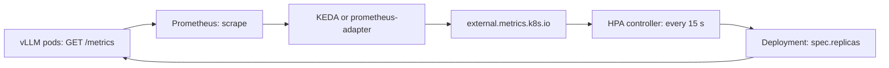

## 1. The question this idea answers

A team serves Llama-3.1-8B with vLLM on Kubernetes ([L4](/notes/ai/llm-systems/05-cloud-hosting/l4-kubernetes-for-llm-serving)). Traffic is low at night, triples at 09:00 and has short spikes after every product email. One replica holds one model copy on one GPU. A GPU costs about USD 12 per hour ([L7](/notes/ai/llm-systems/05-cloud-hosting/l7-cost-math)).

Two questions decide cost and latency:

1. **How many replicas should run right now?** Too few, and requests wait in a queue: time to first token (TTFT) explodes. Too many, and idle GPUs burn money. This is **autoscaling**.
2. **Which replica should get this request?** Requests differ by 100 times in cost. A replica may already hold the KV cache of this prompt prefix. This is **routing**.

Classic web autoscaling answers question 1 with CPU utilization and question 2 with round robin. Both answers fail for LLM serving. This lesson shows why, and what works instead. An interviewer who asks "how do you host an LLM in the cloud?" expects these follow-ups: "Which metric do you scale on? What happens during a cold start? How does a request reach the replica that has its cache?"

## 2. Mental model

> [!analogy] A bank with tellers who keep customer files on their desks
> A bank has several tellers (replicas). The manager (the autoscaler) decides how many tellers work today. A good manager counts the people **waiting in line**, not how busy the tellers look. A teller looks equally busy while serving one slow customer or ten fast ones. The line shows the truth: customers arrive faster than the tellers serve them.
>
> A greeter at the door (the router) sends each customer to a teller. A returning customer whose file is already open on one desk is served faster at that desk (a prefix cache hit). But if that teller has a long line, a free teller is faster, even with the extra file work.
>
> **Where it stops working:** a new teller needs several minutes to arrive and open a desk. That is a cold start: a GPU node, the image, the weights, the warm-up. Customers differ hugely: one asks a 10-second question, another needs 5 minutes (prompt and output lengths). And many customers share the same first pages of their files (a common system prompt), so a "file" is not tied to one customer.

## 3. Terms

| Term | Plain meaning |
|---|---|
| replica | One running copy of the model server. Here: one Kubernetes pod with vLLM and its GPUs. |
| autoscaler | A control loop that changes the number of replicas from a measured signal. |
| Horizontal Pod Autoscaler (HPA) | The Kubernetes controller that sets the replica count of a Deployment from metrics. |
| custom metric, external metric | Metrics that are not CPU or memory. The HPA reads them from the APIs `custom.metrics.k8s.io` and `external.metrics.k8s.io`. |
| KEDA | Kubernetes Event-driven Autoscaling. It feeds external metrics to an HPA and can scale a workload to zero. |
| ScaledObject | The KEDA resource that names a target Deployment and its triggers. |
| queue depth | The number of requests that wait for a batch slot. In vLLM: `vllm:num_requests_waiting`. |
| KV cache usage | The fraction of KV cache blocks in use. In vLLM: `vllm:kv_cache_usage_perc`, where 1 means 100%. |
| tolerance | The HPA dead band. If the metric is within 10% of the target, the HPA does nothing. |
| stabilization window | A time window. Before it removes replicas, the HPA takes the highest recommendation in this window. |
| scale to zero | Remove the last replica when there is no traffic. The first new request then waits for a cold start. |
| cold start | The time from "a replica is needed" to "the replica serves traffic". |
| router | The component that picks a replica for each request. It is also called a load balancer. |
| least outstanding requests | A routing rule: send the request to the replica with the fewest requests in progress. |
| session affinity | A routing rule: send all requests of one session to the same replica. |
| consistent hashing | A way to map keys to replicas so that adding a replica moves only a small share of the keys. |
| prefix-aware routing | A routing rule that prefers the replica whose KV cache already holds the longest prefix of the prompt. |
| Endpoint Picker (EPP) | The scheduler of the Kubernetes Inference Gateway. It scores replicas and picks one for each request. |
| failover | Sending traffic to another replica, region or provider when the first one fails. |
| Little's law | $L = \lambda W$: average requests in the system equal arrival rate times average time in the system. |

All terms are also in the [Glossary](/notes/ai/llm-systems/glossary).

## 4. Why CPU and GPU utilization are the wrong signals

### 4.1 What one replica looks like from outside

A vLLM replica has three parts that you can measure ([part 04 L1](/notes/ai/llm-systems/04-inference/l1-the-life-of-a-request)):

- an HTTP server process on the CPU, which tokenizes and streams,
- the engine, whose scheduler keeps a **waiting** queue and a **running** batch,
- the GPU, which runs the forward passes.

The real limit of a replica is not the CPU. It is the number of batch slots and the number of free KV cache blocks ([part 04 L4](/notes/ai/llm-systems/04-inference/l4-batching-and-scheduling)). When either one is full, new requests wait. A waiting request has no first token, so its TTFT grows every second.

### 4.2 Three tempting signals and why each fails

| Signal | What it really measures | Why it fails for LLM serving |
|---|---|---|
| CPU utilization | Work of the HTTP process: tokenization, JSON, streaming | The GPU does the expensive work. CPU can stay low while the queue grows. |
| GPU memory used | Memory that the engine reserved at start | vLLM reserves a fixed share of GPU memory at start, set by `gpu_memory_utilization` ([L2](/notes/ai/llm-systems/05-cloud-hosting/l2-sizing-gpus)). The number is flat under any load. |
| GPU utilization (`DCGM_FI_DEV_GPU_UTIL`) | The share of time in which any kernel runs | It is a duty cycle. The Google Kubernetes Engine guide notes: "Does not measure how much work is being done while the GPU is active". Interpretation of these notes: one sequence or 200 sequences can both show high values. |

The same guide also warns: "we don't recommend CPU and memory utilization as the only indicators" (checked on 2026-10-15).

> [!key] Scale on the engine's own state
> A good autoscaling signal must grow before users feel pain and must fall when capacity is enough. The engine knows both: how many requests wait, how many run, and how full the KV cache is. Read these numbers from the engine, not from the operating system.

## 5. The signals that work: vLLM metrics

### 5.1 The metric names

vLLM serves Prometheus metrics at `/metrics` on the same port as the API. **Prometheus** is a monitoring system that pulls ("scrapes") such pages on a schedule and stores the numbers as time series. The names below are from the vLLM 0.31.0 source (`vllm/v1/metrics/loggers.py`) and the "Production Metrics" page (checked on 2026-10-15). Every metric has the labels `model_name` and `engine`.

A **gauge** is a value that goes up and down. A **counter** only grows. A **histogram** counts observations in buckets, for example how many TTFT values were at most 0.5 s.

| Metric | Type | Meaning | Use |
|---|---|---|---|
| `vllm:num_requests_waiting` | gauge | Requests waiting to be processed | Main signal to add replicas |
| `vllm:num_requests_waiting_by_reason` | gauge | Waiting requests, label `reason` = `capacity` or `deferred` | Separates "no room" from other waits |
| `vllm:num_requests_running` | gauge | Requests in model execution batches | Batch size: a latency signal |
| `vllm:kv_cache_usage_perc` | gauge | KV cache usage, 1 means 100% | Memory pressure, routing |
| `vllm:num_preemptions` | counter | Preemptions since start | KV cache too small for the load |
| `vllm:time_to_first_token_seconds` | histogram | TTFT per request | SLO check |
| `vllm:inter_token_latency_seconds` | histogram | Time between output tokens | SLO check |
| `vllm:request_queue_time_seconds` | histogram | Time in the waiting phase | Proof that the queue causes the latency |
| `vllm:prefix_cache_queries`, `vllm:prefix_cache_hits` | counters | Queried and cached prompt tokens | Prefix cache hit rate |
| `vllm:prompt_tokens`, `vllm:generation_tokens` | counters | Prompt and output tokens processed | Throughput |

The docs note a deprecation policy: a metric deprecated in version X.Y is hidden in X.Y+1 and removed in X.Y+2. A hidden metric returns with `--show-hidden-metrics-for-version=X.Y`. So pin your dashboards to a vLLM version and read the release notes before an upgrade.

### 5.2 What Prometheus actually receives

The Prometheus client library appends `_total` to every counter name. A histogram becomes three series: `_bucket` (one per bucket bound `le`), `_sum` and `_count`. This program builds three vLLM-style metrics and prints the text that a scrape returns:

```python
from prometheus_client import CollectorRegistry, Counter, Gauge, Histogram, generate_latest

reg = CollectorRegistry()
labels = ["model_name", "engine"]
waiting = Gauge("vllm:num_requests_waiting", "Number of requests waiting to be processed.",
                labels, registry=reg)
gen = Counter("vllm:generation_tokens", "Number of generation tokens processed.",
              labels, registry=reg)
ttft = Histogram("vllm:time_to_first_token_seconds", "Histogram of time to first token in seconds.",
                 labels, buckets=(0.25, 0.5, 0.75, 1.0, 2.5), registry=reg)

m = ("llama-8b", "0")
waiting.labels(*m).set(7)
gen.labels(*m).inc(1200)
for s in (0.2, 0.6, 0.9, 1.7):
    ttft.labels(*m).observe(s)

text = generate_latest(reg).decode()
print("\n".join(l for l in text.splitlines() if not l.startswith("#") and "_created" not in l))
```

Output (prometheus-client 0.26.0):

```text
vllm:num_requests_waiting{engine="0",model_name="llama-8b"} 7.0
vllm:generation_tokens_total{engine="0",model_name="llama-8b"} 1200.0
vllm:time_to_first_token_seconds_bucket{engine="0",le="0.25",model_name="llama-8b"} 1.0
vllm:time_to_first_token_seconds_bucket{engine="0",le="0.5",model_name="llama-8b"} 1.0
vllm:time_to_first_token_seconds_bucket{engine="0",le="0.75",model_name="llama-8b"} 2.0
vllm:time_to_first_token_seconds_bucket{engine="0",le="1.0",model_name="llama-8b"} 3.0
vllm:time_to_first_token_seconds_bucket{engine="0",le="2.5",model_name="llama-8b"} 4.0
vllm:time_to_first_token_seconds_bucket{engine="0",le="+Inf",model_name="llama-8b"} 4.0
vllm:time_to_first_token_seconds_count{engine="0",model_name="llama-8b"} 4.0
vllm:time_to_first_token_seconds_sum{engine="0",model_name="llama-8b"} 3.4000000000000004
```

Line by line:

- The gauge appears once with its labels and its current value.
- The counter `vllm:generation_tokens` appears as `vllm:generation_tokens_total`. A query must use the `_total` name.
- Bucket counts are **cumulative**: the bucket `le="1.0"` holds every value at most 1.0 s, so 3 of the 4 values.
- `_count` is the number of observations and `_sum` their total, so the mean TTFT is $3.4 / 4 = 0.85$ s.

### 5.3 Queries that an autoscaler or a dashboard uses

PromQL is the query language of Prometheus. `rate(x[5m])` is the per-second increase of a counter over 5 minutes.

```text
# requests waiting, summed over all replicas of one model
sum(vllm:num_requests_waiting{model_name="meta-llama/Llama-3.1-8B-Instruct"})

# average KV cache usage over replicas (0 to 1)
avg(vllm:kv_cache_usage_perc)

# p90 TTFT over the last 5 minutes, from the histogram buckets
histogram_quantile(0.9, sum by (le) (rate(vllm:time_to_first_token_seconds_bucket[5m])))

# prefix cache hit rate, in tokens
sum(rate(vllm:prefix_cache_hits_total[5m])) / sum(rate(vllm:prefix_cache_queries_total[5m]))
```

> [!example] Worked example: a histogram quantile is an estimate
> Take the four TTFT values of section 5.2: 0.2, 0.6, 0.9 and 1.7 s.
>
> 1. The p90 rank is $0.9 \times 4 = 3.6$ observations.
> 2. Cumulative counts: 3 at `le="1.0"` and 4 at `le="2.5"`. So rank 3.6 lies in the bucket from 1.0 to 2.5 s.
> 3. `histogram_quantile` interpolates linearly inside that bucket: $1.0 + (2.5 - 1.0) \times \frac{3.6 - 3}{4 - 3} = 1.0 + 1.5 \times 0.6 = 1.9$ s.
> 4. The exact p90 of the raw values (NumPy linear method) is 1.46 s.
>
> The estimate is off by 0.44 s because the bucket is wide. The vLLM 0.31.0 TTFT buckets include 0.25, 0.5, 0.75, 1.0 and then 2.5 s. If your SLO is "p90 TTFT below 2 s", the bucket from 1.0 to 2.5 s makes the estimate coarse. vLLM accepts `--custom-histogram-buckets` to change the bounds of a bucket family. Each extra bound adds one time series per label set.

### 5.4 Leading and lagging signals

A request waits for one of three reasons in vLLM ([part 04 L4](/notes/ai/llm-systems/04-inference/l4-batching-and-scheduling)):

- the running batch is at `max_num_seqs`. In vLLM 0.31.0 the OpenAI server default is 1,024 on GPUs with at least 70 GiB, except A100. It is 256 on smaller GPUs (`arg_utils.py`),
- there are no free KV cache blocks for its prompt,
- the token budget of the step (`max_num_batched_tokens`) is used.

The queue grows in the same second as arrivals exceed service. TTFT reacts later: a request records its TTFT only after its prefill ends, and a `rate(...[5m])` window averages over minutes. So queue depth is a **leading** signal and TTFT is a **lagging** one. KV cache usage near 1 is a warning: the engine soon preempts requests, and `vllm:num_preemptions_total` rises ([paper 07](/notes/papers/llm-serving/2023-pagedattention/07-scheduling-and-preemption)).

The Google Kubernetes Engine guide on inference autoscaling gives two rules (checked on 2026-10-15):

- "Use queue size to maximize throughput and minimize cost within a certain target latency threshold." For the threshold, "start with a value between 3-5 and gradually increase it until requests reach the preferred latency."
- "Use batch size to reach lower target latency thresholds than queue size." Batch size is `vllm:num_requests_running`.

> [!trap] The queue is zero when capacity is exactly right
> Queue depth answers "do we need more?". It cannot answer "how many do we need now?". At the right size, the queue is near zero, and an autoscaler that sees zero removes replicas. Section 6.6 shows the result in a simulation: replicas oscillate between 1 and 12. Pair the queue with a signal that stays high under steady load, such as running requests.

## 6. The Horizontal Pod Autoscaler, from the formula up

### 6.1 The control loop



The HPA is "a control loop that runs intermittently". The interval is the `kube-controller-manager` flag `--horizontal-pod-autoscaler-sync-period`, 15 seconds by default (Kubernetes docs, checked on 2026-10-15). The HPA cannot read Prometheus by itself. An adapter translates a PromQL result into the Kubernetes metrics APIs. Two common adapters are KEDA (section 7) and the Prometheus Adapter. The vLLM production stack tutorial uses the Prometheus Adapter. There the metric appears as `vllm_num_requests_waiting`, with an underscore instead of a colon.


### 6.2 The formula and the tolerance

The Kubernetes docs give the core rule:

$$
\text{desiredReplicas} = \left\lceil \text{currentReplicas} \times \frac{\text{currentMetricValue}}{\text{desiredMetricValue}} \right\rceil
$$

The control plane "skips any scaling action if the ratio is sufficiently close to 1.0", within a tolerance of 0.1 by default. If you list several metrics, the HPA computes this for each one and takes "the largest of the desired replica counts".

> [!example] Worked example: two replicas and a growing queue
> Target: on average 5 waiting requests per replica. Now: 2 replicas, 26 waiting requests in total, so 13 per replica.
>
> 1. Ratio: $13 / 5 = 2.6$. This is far outside the band $[0.9, 1.1]$.
> 2. Desired: $\lceil 2 \times 2.6 \rceil = \lceil 5.2 \rceil = 6$ replicas.
>
> Second case: 4 replicas with an average of 5.4 waiting. Ratio $5.4 / 5 = 1.08$. That is inside the tolerance, so the HPA keeps 4 replicas.
>
> Third case: 4 replicas with an average of 4.4. Ratio 0.88 is outside the band, but $\lceil 4 \times 0.88 \rceil = \lceil 3.52 \rceil = 4$. The ceiling keeps 4 replicas.

Since Kubernetes 1.37, the `tolerance` field is configurable per HPA and per direction under `behavior.scaleUp` and `behavior.scaleDown`. Its feature gate `HPAConfigurableTolerance` is stable in 1.37. Without the field, the cluster-wide default of 10% applies.

### 6.3 AverageValue or Value

For an external metric, the target type decides how the HPA uses the number. KEDA's docs explain both with a queue example (checked on 2026-10-15):

- **AverageValue** divides the metric by the number of replicas before the comparison. The result is "regardless of the current replica count": desired $= \lceil \text{total} / \text{target} \rceil$. With a total queue of 26 and a target of 5, desired $= \lceil 5.2 \rceil = 6$.
- **Value** compares the raw metric with the target and multiplies by the current replica count. KEDA's example: 3 replicas, average queue time 20 ms, threshold 5 ms, desired $= 3 \times 20 / 5 = 12$.

Use AverageValue for amounts that capacity divides: waiting requests, running requests. Use Value for amounts that stay per request: TTFT, queue time.

### 6.4 Behavior: how fast replicas are added and removed

The default `behavior` in the Kubernetes docs:

```yaml
behavior:
  scaleDown:
    stabilizationWindowSeconds: 300
    policies:
    - type: Percent
      value: 100
      periodSeconds: 15
  scaleUp:
    stabilizationWindowSeconds: 0
    policies:
    - type: Percent
      value: 100
      periodSeconds: 15
    - type: Pods
      value: 4
      periodSeconds: 15
    selectPolicy: Max
```

- **scaleUp** has no stabilization window. In each 15-second period it may add 100% of the current replicas or 4 pods, whichever is more (`selectPolicy: Max`).
- **scaleDown** keeps the highest recommendation of the last 300 seconds. Then it may remove all extra replicas at once.

> [!example] Worked example: how many periods does a jump take?
> From 2 replicas, the HPA wants 6. Allowed in one period: $\max(2 + 100\% \times 2,\ 2 + 4) = \max(4, 6) = 6$. One period is enough.
>
> From 6 replicas, the HPA wants 20. First period: $\max(6 + 6,\ 6 + 4) = 12$. Second period: $\max(12 + 12, 12 + 4) = 24$, capped at 20. So 20 after two periods, about 30 seconds of control time. The GPUs and model loads take far longer (section 8.3).

Interpretation of these notes: for LLM replicas, removing a replica is cheap, but adding one costs minutes. So set a longer `scaleDown` stabilization window than the web default, for example 600 seconds, and remove at most one pod per period. This keeps capacity through short dips.

### 6.5 Pods that are still loading

The HPA treats pods that are not Ready with care. For external and object metrics, "the replica count is based on the number of Running and Ready Pods". With AverageValue, desired $= \lceil \text{total} / \text{target} \rceil$, so new pods that still load weights do not lower the result. The queue keeps growing while they load, because they serve nothing. So the HPA keeps adding pods during the whole cold start. Section 6.6 shows the overshoot that follows.

### 6.6 A simulation: queue only, queue plus running, and a Little's law rate

A small fluid model in these notes makes the trade-offs visible. It is a toy, not a measurement. Its rules:

- Each replica has 64 batch slots. A request stays 9.47 s (section 11). So one full replica completes $64 / 9.47 \approx 6.76$ requests per second.
- Arrivals: 4 per second, then 12 per second from $t = 300$ s.
- HPA every 15 s, default scale-up policy, 300 s scale-down window, between 1 and 12 replicas.
- A new pod is Ready 240 s after it is created.

Three rules for the desired replica count:

- **queue**: $\lceil \text{waiting} / 5 \rceil$ (AverageValue, target 5),
- **queue+running**: the larger of $\lceil \text{waiting} / 5 \rceil$ and $\lceil \text{running} / 48 \rceil$,
- **rate**: $\lceil \lambda W / 48 \rceil$ with the arrival rate $\lambda$ from the gateway (Little's law, section 11).

Ready replicas every 120 s, from the program in Exercise 5:

```text
queue          1 1 1 1 1 12 12 12 1 1 12 12 12 1 1 12 12 1 1 10   max waiting 1293
queue+running  1 1 1 1 1 12 12 12 3 3 3 3 3 3 3 3 3 3 3 3         max waiting 929
rate           1 1 1 1 1 3 3 3 3 3 3 3 3 3 3 3 3 3 3 3              max waiting 929
```

```plot
{
  "title": "Ready replicas in the toy simulation: queue only (red), queue plus running (gold), Little's law rate (blue)",
  "xAxis": {"label": "time (s)", "domain": [0, 2400]},
  "yAxis": {"label": "ready replicas", "domain": [0, 13]},
  "disableZoom": true,
  "data": [
    {"points": [[0, 1], [120, 1], [240, 1], [360, 1], [480, 1], [600, 12], [720, 12], [840, 12], [960, 1], [1080, 1], [1200, 12], [1320, 12], [1440, 12], [1560, 1], [1680, 1], [1800, 12], [1920, 12], [2040, 1], [2160, 1], [2280, 10]], "fnType": "points", "graphType": "polyline", "color": "#C81D25"},
    {"points": [[0, 1], [120, 1], [240, 1], [360, 1], [480, 1], [600, 12], [720, 12], [840, 12], [960, 1], [1080, 1], [1200, 12], [1320, 12], [1440, 12], [1560, 1], [1680, 1], [1800, 12], [1920, 12], [2040, 1], [2160, 1], [2280, 10]], "fnType": "points", "graphType": "scatter", "color": "#C81D25"},
    {"points": [[0, 1], [120, 1], [240, 1], [360, 1], [480, 1], [600, 12], [720, 12], [840, 12], [960, 3], [1080, 3], [1200, 3], [1320, 3], [1440, 3], [1560, 3], [1680, 3], [1800, 3], [1920, 3], [2040, 3], [2160, 3], [2280, 3]], "fnType": "points", "graphType": "polyline", "color": "#B8860B"},
    {"points": [[0, 1], [120, 1], [240, 1], [360, 1], [480, 1], [600, 12], [720, 12], [840, 12], [960, 3], [1080, 3], [1200, 3], [1320, 3], [1440, 3], [1560, 3], [1680, 3], [1800, 3], [1920, 3], [2040, 3], [2160, 3], [2280, 3]], "fnType": "points", "graphType": "scatter", "color": "#B8860B"},
    {"points": [[0, 1], [120, 1], [240, 1], [360, 1], [480, 1], [600, 3], [720, 3], [840, 3], [960, 3], [1080, 3], [1200, 3], [1320, 3], [1440, 3], [1560, 3], [1680, 3], [1800, 3], [1920, 3], [2040, 3], [2160, 3], [2280, 3]], "fnType": "points", "graphType": "polyline", "color": "#1E6091"},
    {"points": [[0, 1], [120, 1], [240, 1], [360, 1], [480, 1], [600, 3], [720, 3], [840, 3], [960, 3], [1080, 3], [1200, 3], [1320, 3], [1440, 3], [1560, 3], [1680, 3], [1800, 3], [1920, 3], [2040, 3], [2160, 3], [2280, 3]], "fnType": "points", "graphType": "scatter", "color": "#1E6091"}
  ]
}
```

What the simulation shows:

1. **Queue only oscillates.** During the cold start the queue reaches hundreds, so the HPA asks for the maximum of 12. Once 12 replicas drain the queue, the queue is zero, the recommendation is 1, and after the 300 s window the HPA removes 11 replicas. The queue grows again. The steady need is only 3 replicas.
2. **Queue plus running overshoots once, then holds.** The running count stays near $12 \times 9.47 \approx 114$ requests, which needs $\lceil 114 / 48 \rceil = 3$ replicas. That term holds 3 replicas when the queue is empty.
3. **The rate rule does not overshoot.** It sizes from demand, so it asks for 3 at once. The queue still grows to 929 during the 240 s cold start, because one replica serves 6.76 requests per second while 12 arrive.

> [!key] Trigger on the queue, size on demand
> Queue depth is the best **trigger**: it moves first. It is a poor **sizing** signal: it is zero at the right size, and it keeps growing while new pods load. Combine it with running requests or with an arrival-rate signal through Little's law. No autoscaler removes the cold-start queue. Only headroom does (section 8.3).

## 7. KEDA

### 7.1 What KEDA adds

KEDA is a Kubernetes add-on. You write a `ScaledObject`. KEDA then creates an HPA for the target (by default named `keda-hpa-<name>`) and serves the trigger values through `external.metrics.k8s.io`. It has scalers for many sources: Prometheus, message queues, cron schedules and more. The current docs version is 2.21 (checked on 2026-10-15).

KEDA splits the work in two phases (KEDA docs, "Activating and Scaling thresholds"):

- **Activation phase**: KEDA itself decides between 0 and 1 replica. It uses `activationThreshold`.
- **Scaling phase**: from 1 to N replicas, the generated HPA decides. It uses `threshold` as its target.

"If the minimum replicas is >= 1, the scaler is always active and the activation value will be ignored."

### 7.2 A ScaledObject for a vLLM Deployment

```yaml
apiVersion: keda.sh/v1alpha1
kind: ScaledObject
metadata:
  name: llama-8b
  namespace: llm
spec:
  scaleTargetRef:
    name: llama-8b-vllm            # the Deployment of lesson L4
  pollingInterval: 15              # default 30 s
  cooldownPeriod: 600              # default 300 s, used only for scaling to zero
  minReplicaCount: 1               # default 0
  maxReplicaCount: 8               # default 100
  advanced:
    horizontalPodAutoscalerConfig:
      behavior:
        scaleDown:
          stabilizationWindowSeconds: 600
          policies:
          - type: Pods
            value: 1
            periodSeconds: 120
  triggers:
  - type: prometheus
    metricType: AverageValue
    metadata:
      serverAddress: http://prometheus-server.monitoring.svc:9090
      query: sum(vllm:num_requests_waiting{model_name="meta-llama/Llama-3.1-8B-Instruct"})
      threshold: "5"
  - type: prometheus
    metricType: AverageValue
    metadata:
      serverAddress: http://prometheus-server.monitoring.svc:9090
      query: sum(vllm:num_requests_running{model_name="meta-llama/Llama-3.1-8B-Instruct"})
      threshold: "48"
```

Line by line:

- `scaleTargetRef.name`: the Deployment to scale. It must be in the same namespace as the ScaledObject.
- `pollingInterval`: how often KEDA queries the trigger source. Default 30 seconds. The docs add a detail for `minReplicaCount` above 0 without `idleReplicaCount`. Then KEDA reuses the HPA's own queries, so the HPA period of 15 s matters.
- `cooldownPeriod`: "only applies when scaling to 0". From 1 to N, the HPA behavior applies.
- `minReplicaCount: 1`: one warm replica always runs. Section 8 discusses 0.
- `horizontalPodAutoscalerConfig.behavior`: passed into the generated HPA. Here: wait 600 s before removing, then remove at most 1 pod per 120 s.
- First trigger: the queue. `metricType: AverageValue` is the default. Desired replicas $= \lceil \text{total waiting} / 5 \rceil$.
- Second trigger: the batch. Desired replicas $= \lceil \text{total running} / 48 \rceil$. The HPA takes the larger of the two results (section 6.2).
- `threshold` is a string. The Prometheus query "must return a vector/scalar single element response", so the query sums over pods.

The value 48 is a choice. It is 75% of the 64 concurrent requests that one replica serves within the SLO in section 11. Find your number with a benchmark ([part 04 L2](/notes/ai/llm-systems/04-inference/l2-latency-and-throughput-metrics)).

### 7.3 A schedule as a trigger

KEDA's `cron` scaler sets a replica count between a `start` and an `end` cron expression. Example: 3 replicas from 08:30 to 18:00 on weekdays, in the time zone `Europe/London`. Combined with the queue trigger, the HPA takes the larger count. So the morning ramp finds warm replicas, and the queue trigger still handles surprises.

## 8. Scale to zero and the cold-start trade-off

### 8.1 What happens at zero

**Scale to zero** removes the last replica when there is no traffic. The GPU bill stops. The next request finds no replica and must wait for a full cold start, or fail.

| Platform | How it scales to zero | What the docs say about the first request |
|---|---|---|
| Kubernetes HPA (1.37) | `minReplicas: 0`, only with object or external metrics. Feature gate `HPAScaleToZero` is beta and enabled by default in 1.37. | The HPA sets a `ScaledToZero` condition and adds a replica "when the metric indicates that at least one replica is needed". |
| KEDA | `minReplicaCount: 0` (the default), with `activationThreshold` and `cooldownPeriod` | KEDA activates the workload when the trigger passes the activation threshold. |
| SageMaker AI inference components | `MinInstanceCount` 0, and a step scaling policy on the CloudWatch metric `NoCapacityInvocationFailures` | "The provisioning process takes several minutes. During that time, any attempts to invoke the endpoint will produce an error." |
| Databricks Model Serving | `scale_to_zero_enabled` | "Scale to zero is not recommended for production endpoints, as capacity is not guaranteed when scaled to zero." |
| Bedrock Custom Model Import | Automatic | "If there are no invocations for a 5-minute period, Bedrock will scale down to zero" ([L6](/notes/ai/llm-systems/05-cloud-hosting/l6-managed-platforms)). |

All rows checked on 2026-10-15.

### 8.2 The trade-off with numbers

> [!example] Worked example: an internal assistant used on weekdays
> The assistant runs on one H100 at about USD 12.29 per GPU-hour. That is one GPU of an Azure ND96isr H100 v5 VM at USD 98.32 per hour ([L7](/notes/ai/llm-systems/05-cloud-hosting/l7-cost-math)). People use it from 08:00 to 18:00 on weekdays.
>
> 1. Busy hours per week: $5 \times 10 = 50$. Idle hours: $168 - 50 = 118$, which is about 70% of the week.
> 2. Saving from scale to zero: $118 \times 12.29 \approx$ USD 1,450 per week.
> 3. Price: every return from zero is a cold start. With one return each morning, 5 cold starts per week, the first user each day waits minutes or receives an error.
>
> Interpretation of these notes: scale to zero fits development endpoints, rare batch jobs and internal tools with a scheduled warm-up (section 7.3). It does not fit a user-facing endpoint with a TTFT SLO of seconds.

### 8.3 Why adding a replica is slow: the delay chain

From "the queue grows" to "a new replica serves", these delays accumulate:

| Step | What controls it | Default or note |
|---|---|---|
| Prometheus scrapes `/metrics` | `scrape_interval` | 1 minute by default in Prometheus. Teams often set 15 or 30 s. |
| KEDA queries Prometheus | `pollingInterval` | 30 s by default |
| HPA computes and writes replicas | sync period, behavior | 15 s by default, +100% or +4 pods per period |
| Scheduler finds a GPU | free GPU nodes | If no GPU node is free, a node autoscaler must create one. That takes minutes, and GPUs may be unavailable. |
| Image pull, weight load, CUDA graph capture, warm-up | [L3](/notes/ai/llm-systems/05-cloud-hosting/l3-containers-and-model-loading) | Minutes for a large model |
| Readiness probe passes | [L4](/notes/ai/llm-systems/05-cloud-hosting/l4-kubernetes-for-llm-serving) | Then the Service sends traffic |

So an autoscaler cannot absorb a spike that is shorter than the cold start. Three defenses remain:

1. **Headroom.** Size for a target load below 100%, for example 70% (section 11). The spare capacity absorbs the first minutes of a spike.
2. **Warm capacity.** Keep spare GPU nodes, or pods with weights already loaded. Some engines also offer a sleep mode: vLLM exposes the metric `vllm:engine_sleep_state` with the label values `awake`, `weights_offloaded` and `discard_all`.
3. **Admission control.** When the queue passes a hard limit, reject new requests early with HTTP 429 or 503 and a `Retry-After` header ([L8](/notes/ai/llm-systems/05-cloud-hosting/l8-production-operations)). A fast refusal is better than a 3-minute wait that ends in a timeout.

```video
{"src": "/notes/media/llm-systems/manim/m24-autoscaling-on-queue-depth.mp4", "caption": "A traffic step makes the vLLM queue grow, the HPA adds replicas that need a cold start, the queue drains, and a queue-only rule removes the replicas again."}
```

## 9. Routing: which replica gets the request

### 9.1 Why LLM requests are hard to balance

Two facts make LLM routing different from web routing:

1. **Requests differ hugely in cost.** A request with 100 prompt tokens and 20 output tokens is cheap. A request with 30,000 prompt tokens and 2,000 output tokens needs 300 times the prompt tokens and 100 times the decode steps ([part 04 L3](/notes/ai/llm-systems/04-inference/l3-compute-bound-vs-memory-bound)). Counting requests is not counting work.
2. **Replicas hold state.** Each replica keeps a prefix cache of KV blocks ([part 04 L9](/notes/ai/llm-systems/04-inference/l9-prefix-caching-and-kv-reuse)). The second turn of a chat repeats the first turn as its prefix. On the replica that served turn 1, the prefix is a cache hit. On any other replica, the whole prefix needs prefill again, and TTFT grows.

### 9.2 Round robin, random and least outstanding requests

- **Round robin** sends request $i$ to replica $i \bmod N$. It is fair in count and blind to cost and cache.
- **Random** behaves like round robin on average.
- **Least outstanding requests** keeps a counter of requests in progress per replica and picks the smallest. It reacts to slow replicas without any metrics. It still treats a 30,000-token request like a 100-token one.

The vLLM production stack router offers these `--routing-logic` values: `roundrobin`, `session`, `kvaware`, `loadaware`, `prefixaware`, `disaggregated_prefill`, `disaggregated_prefill_orchestrated` and `priority` (source `vllm_router/parsers/parser.py`, checked on 2026-10-15).

### 9.3 Session affinity and consistent hashing

**Session affinity** sends every request of one session to one replica, so the chat history stays a cache hit. The simple way is $\text{hash}(\text{session}) \bmod N$. That breaks when $N$ changes: adding a fifth replica moves about 80% of the sessions, and their caches are lost.

**Consistent hashing** places every replica at many points on a ring of hash values. These are **virtual nodes**. A key goes to the first replica point clockwise from the key's hash. When a replica joins, it takes only the keys between its points and their predecessors, about $1/N$ of all keys.

```python
import bisect
import hashlib


def h(text: str) -> int:
    """64-bit position on the ring, from SHA-256 of the text."""
    return int.from_bytes(hashlib.sha256(text.encode()).digest()[:8], "big")


class HashRing:
    def __init__(self, replicas, vnodes=100):
        self.points = sorted((h(f"{r}#{i}"), r) for r in replicas for i in range(vnodes))
        self.keys = [p for p, _ in self.points]

    def lookup(self, key: str) -> str:
        i = bisect.bisect(self.keys, h(key)) % len(self.keys)   # first point clockwise
        return self.points[i][1]


sessions = [f"session-{n}" for n in range(10_000)]
old = HashRing(["r0", "r1", "r2", "r3"])
new = HashRing(["r0", "r1", "r2", "r3", "r4"])
moved_ring = sum(old.lookup(s) != new.lookup(s) for s in sessions) / len(sessions)
moved_mod = sum(h(s) % 4 != h(s) % 5 for s in sessions) / len(sessions)
print(f"ring: {moved_ring:.3f} of sessions moved")
print(f"modulo: {moved_mod:.3f} of sessions moved")
```

Output:

```text
ring: 0.193 of sessions moved
modulo: 0.799 of sessions moved
```

The important lines:

- `h(...)` converts any string to a 64-bit number. SHA-256 spreads similar strings far apart.
- `vnodes=100` gives each replica 100 points on the ring. More points make the shares more even. In this run the five replicas receive between 1,801 and 2,151 of the 10,000 sessions.
- `bisect.bisect` finds the first point with a larger hash. `% len(...)` wraps around the end of the ring.
- The result matches the theory: about $1/5 = 0.2$ of sessions move to the new replica, against about $4/5$ with modulo hashing.

The production stack's `session` router uses a hash ring of this kind (the `uhashring` package) on a session key. When a request has no session ID, it uses the replica with the lowest requests per second instead.

Consistent hashing has a weakness: one very busy session, or a skewed key mix, overloads one replica. **Consistent hashing with bounded loads** (Mirrokni, Thorup and Zadimoghaddam, 2016) caps each replica at $(1 + \varepsilon)$ times the average load. A key whose replica is full walks clockwise to the next replica with room. Exercise 2 implements it.

### 9.4 Prefix-aware and KV-cache-aware routing

Session affinity needs a session ID. Prefix-aware routing works from the prompt itself. Many requests share a prefix with no common session: the same system prompt, the same tool list, the same few-shot examples. The router asks: "which replica already holds the longest prefix of this prompt?"

The Kubernetes **Inference Gateway** does this. Its scheduler is the **Endpoint Picker** (EPP). It extends any gateway that supports the Gateway API and the Envoy external processing protocol ("ext-proc"). For each request, the EPP runs a scheduling profile (llm-d router docs, checked on 2026-10-15):

1. **Filters** remove replicas that cannot serve, for example the wrong role or a missing LoRA adapter.
2. **Scorers** give each remaining replica a score between 0 and 1. Each score is multiplied by a weight, and the weighted scores are summed.
3. A **picker** chooses. The default `max-score-picker` takes the highest total. "If multiple pods share the same score, one is selected at random."

Three scorers matter most, with their documented formulas:

| Scorer | Formula | Effect |
|---|---|---|
| `prefix-cache-scorer` | $\text{matchBlocks} / \text{totalBlocks}$ (default, `matchLengthWeight` 0.0) | Prefers the replica with the longest cached prefix |
| `kv-cache-utilization-scorer` | $1 - \text{kvCacheUsagePercent}$ | Prefers replicas with free KV memory |
| `queue-scorer` | $(\text{maxQueue} - \text{queue}) / (\text{maxQueue} - \text{minQueue})$, or 1.0 if all queues are equal | Prefers short queues |

The llm-d configuration guide shows these weights as an example: 3.0 for the prefix scorer, 2.0 for KV cache utilization and 2.0 for the queue.

> [!example] Worked example: three replicas, one prompt of 4,096 tokens
> The router splits the prompt into blocks of 64 tokens: $4{,}096 / 64 = 64$ blocks. Weights: 3, 2, 2.
>
> | Replica | Cached blocks | KV usage | Waiting |
> |---|---|---|---|
> | A | 60 of 64 | 0.85 | 2 |
> | B | 0 of 64 | 0.40 | 1 |
> | C | 16 of 64 | 0.55 | 3 |
>
> 1. Prefix scores: A $60/64 = 0.9375$, B $0$, C $16/64 = 0.25$.
> 2. KV scores: A $1 - 0.85 = 0.15$, B $0.60$, C $0.45$.
> 3. Queue scores: max 3, min 1. A $(3-2)/2 = 0.5$, B $(3-1)/2 = 1.0$, C $(3-3)/2 = 0$.
> 4. Totals: A $3(0.9375) + 2(0.15) + 2(0.5) = 2.8125 + 0.3 + 1.0 = 4.1125$. B $0 + 1.2 + 2.0 = 3.2$. C $0.75 + 0.9 + 0 = 1.65$.
> 5. The picker sends the request to **A**. It skips prefill for 60 of 64 blocks, $3{,}840$ tokens.
>
> Now replica A has 6 waiting requests instead of 2. Queue scores: max 6, min 1. A $0$, B $1.0$, C $(6-3)/5 = 0.6$. Totals: A $2.8125 + 0.3 + 0 = 3.1125$, B $3.2$, C $0.75 + 0.9 + 1.2 = 2.85$. Now **B** wins. The cache benefit no longer pays for A's queue.


The prefix scorer has an optional second term for the absolute match length: $\min(1, \text{matchedTokens} / \text{matchLengthScaleTokens})^2$, with a default scale of 8,192 tokens. The square reflects that attention work grows quadratically with prompt length, so long matches save the most. The docs suggest setting the scale near the p95 prompt length.

### 9.5 How does the router know what each replica caches?

The EPP offers two data producers for the prefix scorer:

- **Approximate** (`approx-prefix-cache-producer`, the default). The router keeps its own guess. It hashes each prompt into blocks and remembers which replica received which block hashes. The llm-d example uses `blockSizeTokens: 64`. An LRU index holds up to `lruCapacityPerServer` blocks per replica, 31,250 by default. The Inference Extension guide says that the EPP "estimates the prefix cache indexes in model server HBMs", and that a wrong cache size causes false hits or misses.
- **Precise** (`precise-prefix-cache-producer`). It builds its index from KV cache events that the engines publish, so it follows real allocations and evictions.

This is the same block-hash idea as vLLM's automatic prefix caching, applied one level higher: across replicas instead of inside one ([part 04 L9](/notes/ai/llm-systems/04-inference/l9-prefix-caching-and-kv-reuse)).

### 9.6 Hot spots

Prefix affinity concentrates traffic. If 80% of requests share one long system prompt, a pure prefix rule sends 80% of traffic to the first replica that cached it. The second scenario of the worked example shows the remedy. The queue and KV terms lower the score of a busy favorite replica. The llm-d docs also describe a `prefix-cache-affinity-filter` with a "TTFT load gate" that "break[s] stickiness if sticky endpoints are significantly slower". And a cache can be warm on several replicas: once B serves the prompt, B also holds it.

### 9.7 Where these components live now

- The **Gateway API Inference Extension** project states "This project is GA'd!". It defines the `InferencePool` API, a group of model-server pods behind one gateway backend.
- The README also says that the EPP and the `InferenceObjective` API "have moved to new repositories": `llm-d/llm-d-router` (checked on 2026-10-15). The extension repository keeps a lightweight EPP for conformance tests.
- The model-server protocol of the project names the metrics that a scheduler scrapes. For vLLM: `vllm:num_requests_waiting`, `vllm:num_requests_running`, `vllm:kv_cache_usage_perc`, and `vllm:cache_config_info` for the block size.

[L4](/notes/ai/llm-systems/05-cloud-hosting/l4-kubernetes-for-llm-serving) shows how these pieces are installed in a cluster.

## 10. Multi-region failover

One region can fail, or have no free GPUs. A second region protects the service. Four questions decide the design:

1. **Active-active or active-passive?** In active-active, both regions serve traffic, and a global load balancer sends users to the nearest healthy region. In active-passive, the second region keeps a small warm pool and grows only when the first fails.
2. **Is GPU capacity there when you need it?** GPUs are scarce. On-demand capacity in the second region is not guaranteed at the moment of a failover. Reserve capacity or keep warm replicas there. A cold region needs the full delay chain of section 8.3.
3. **Are the weights there?** Copy the model files to object storage in each region. A cold start that downloads 140 GB across regions is slow and costs egress fees.
4. **Where may the data go?** Failover must stay inside the allowed geography. Managed platforms build this in. Amazon Bedrock offers geographic cross-Region inference profiles (for example US or EU) and global profiles, and its docs advise: "Choose Geographic cross-Region inference when you have data residency requirements". Microsoft Foundry offers Data Zone deployment types that process data "only within the Microsoft-specified data zone (US, EU, or Asia Pacific (APAC))" ([L6](/notes/ai/llm-systems/05-cloud-hosting/l6-managed-platforms)).

After a failover, every prefix cache in the new region is empty. Expect a TTFT spike until the caches fill. A health check must also test real generation, not only a live process. Interpretation of these notes: a synthetic request with `max_tokens: 1` every few seconds is a cheap end-to-end probe.

## 11. Capacity planning with Little's law

**Little's law** says $L = \lambda W$ ([part 04 L2](/notes/ai/llm-systems/04-inference/l2-latency-and-throughput-metrics)). $L$ is the average number of requests in the system, $\lambda$ the arrival rate, and $W$ the average time each request spends inside. It holds for any stable system, whatever the arrival pattern.

For an LLM request, $W \approx \text{TTFT} + \text{TPOT} \times (n - 1)$, where $n$ is the number of output tokens and TPOT is the time per output token.

> [!example] Worked example: how many replicas for 10 requests per second?
> Inputs: peak $\lambda = 10$ requests per second. Each request has about 1,000 prompt tokens and 300 output tokens. A benchmark of one replica of Llama-3.1-8B on one H100 shows: at 64 concurrent requests, TTFT 0.5 s and TPOT 30 ms, inside the SLO. These benchmark values are an assumption for this example.
>
> 1. Time in the system: $W = 0.5 + 0.030 \times 299 = 0.5 + 8.97 = 9.47$ s.
> 2. Concurrency: $L = \lambda W = 10 \times 9.47 = 94.7$ requests.
> 3. Replicas at 100% load: $94.7 / 64 = 1.48$, so 2.
> 4. With a 70% target load for headroom: $94.7 / (64 \times 0.7) = 94.7 / 44.8 = 2.11$, so **3 replicas**.
> 5. Cross-check with tokens: demand $= 10 \times 300 = 3{,}000$ output tokens per second. One replica decodes $64 / 0.030 \approx 2{,}133$ tokens per second. Need $3{,}000 / 2{,}133 = 1.41$ replicas at 100%. Little's law gives 1.48, a bit more, because it also counts time in prefill.
> 6. Memory check: $64 \times (1{,}000 + 300)$ tokens $\times$ 128 KiB per token $= 64 \times 1{,}300 \times 131{,}072$ bytes $\approx 10.9$ GB of KV cache ([part 03 L3](/notes/ai/llm-systems/03-kv-cache/l3-the-kv-cache-size-formula)). It fits beside 16 GB of weights on an 80 GB H100.
>
> At $\lambda = 25$: $L = 236.75$, and $236.75 / 44.8 = 5.28$, so 6 replicas.

Three cautions:

- Little's law uses **averages**. A burst above the average fills the queue. Headroom, or a 70% target, covers normal bursts.
- $W$ depends on the load. At higher concurrency, TPOT grows ([part 04 L3](/notes/ai/llm-systems/04-inference/l3-compute-bound-vs-memory-bound)), so $W$ grows, so $L$ grows. Take $W$ from a benchmark at the concurrency you plan to run.
- The same law sizes the rate rule of section 6.6: desired replicas $= \lceil \lambda W / \text{target running per replica} \rceil$.

## 12. Exercises

Write your code in the lab folder `C:\Users\ASohi\Downloads\AI\agent-harness-lab`, in the notebook folder `llm-systems/`.

1. **The HPA rule.** Write `desired_replicas(current, metric, target, tolerance=0.1)` and `limit_scale_up(current, desired)` with the default policies of section 6.4. Acceptance test: `desired_replicas(2, 13, 5) == 6`, `desired_replicas(4, 5.4, 5) == 4`, `limit_scale_up(6, 20) == 12`.
   - Hint 1: inside the tolerance band, return `current`.
   - Hint 2: the allowed maximum is `max(current + current, current + 4)`.
2. **Bounded loads.** Extend the hash ring of section 9.3: each replica takes at most $\lceil (1 + \varepsilon) n / k \rceil$ of $n$ keys on $k$ replicas. Acceptance test: use $\varepsilon = 0.05$ and 10,000 sessions on 5 replicas. No replica has more than 2,100 sessions. Fewer than 30% of sessions move when replica `r4` joins.
   - Hint 1: assign keys one by one and keep a load counter per replica.
   - Hint 2: if the first replica clockwise is full, take the next point on the ring.
3. **An Endpoint Picker.** Write `pick(pods)` that combines the three scorers of section 9.4 with weights 3, 2 and 2. Acceptance test: it returns A for the first scenario and B for the second, with totals 4.1125 and 3.2.
   - Hint 1: compute the queue scores for all pods first, because they need the min and max.
   - Hint 2: equal queues give every pod a queue score of 1.0.
4. **A capacity planner.** Write `plan(lam, ttft, tpot, out_tokens, per_replica, target_util=0.7)`. Acceptance test: `plan(10, 0.5, 0.030, 300, 64)` returns $W = 9.47$, $L = 94.7$ and 3 replicas.
   - Hint 1: $W$ counts $n - 1$ inter-token gaps after the first token.
   - Hint 2: round the replica count up with `math.ceil`.
5. **The autoscaling simulation.** Reproduce section 6.6. Then change the cold start from 240 s to 60 s and report the maximum queue for the `rate` rule. Acceptance test: your three runs print the same ready-replica rows as section 6.6.
   - Hint 1: a fluid model is enough: completions per second $=$ running $/ W$.
   - Hint 2: keep a list of "ready at" times, one per pod.

## 13. Common mistakes

1. **"Autoscale the GPU pods on CPU utilization, like a web service."** The CPU process only tokenizes and streams. The queue can grow while the CPU idles. Scale on the engine's queue and batch metrics.
2. **"GPU utilization near 100% means the replica is full."** It is a duty cycle. One small request can keep a kernel running most of the time. Use waiting requests, running requests and KV cache usage.
3. **"Queue depth alone can size the fleet."** The queue is zero at the right size, so a queue-only rule removes needed replicas and oscillates. Pair it with running requests or an arrival-rate rule.
4. **"The HPA reacts within 15 seconds, so spikes are handled."** The control loop is fast. The GPU node, image pull and weight load take minutes. Keep headroom and use admission control.
5. **"Scale to zero is free savings."** Each return from zero is a full cold start. On SageMaker AI, requests during that time "will produce an error". Use it for development and rare jobs, or warm the endpoint on a schedule.
6. **"Round robin is fair, so it is good."** It is fair in request count, not in work or cache state. A 30,000-token request costs far more than a 100-token one. A follow-up chat message that reaches a new replica loses its prefix cache.
7. **"Prefix-aware routing should always pick the best cache match."** Pure affinity creates hot spots. Weight it against queue depth and KV usage, as the Endpoint Picker does.
8. **"The counter is called `vllm:generation_tokens`, so I query that."** Prometheus exposes it as `vllm:generation_tokens_total`. Histograms appear as `_bucket`, `_sum` and `_count`.

## 14. One-minute explanation

LLM replicas are expensive and slow to start, so autoscaling and routing need engine-level signals. CPU utilization measures the HTTP process, and GPU utilization is only a duty cycle. Both miss the real limit: batch slots and KV cache blocks. vLLM exposes `vllm:num_requests_waiting`, `vllm:num_requests_running` and `vllm:kv_cache_usage_perc` at `/metrics`. Prometheus scrapes them, and KEDA or an adapter feeds them to the Horizontal Pod Autoscaler. The HPA computes $\lceil \text{current} \times \text{metric} / \text{target} \rceil$ every 15 seconds, with a 10% tolerance, and takes the largest result over metrics. The queue is the best trigger, but it is zero at the right size. So I pair it with running requests or an arrival-rate rule from Little's law, $L = \lambda W$. A new replica needs minutes for a GPU node, the image and the weights. So I keep headroom and reject requests early when the queue passes a limit. For routing, round robin ignores both request cost and cache state. Session affinity uses consistent hashing on a session key. Prefix-aware routing, as in the Endpoint Picker of the Inference Gateway, scores replicas on cached prefix blocks, free KV memory and queue depth. That balances cache hits against hot spots.

## 15. Check questions

```check
{
  "question": "Why is GPU utilization a poor signal for autoscaling a vLLM replica? Name a better one and say what it measures.",
  "hint": "What does the GPU do differently with batch 1 and batch 200, and does the duty cycle see it?",
  "answer": "GPU utilization (`DCGM_FI_DEV_GPU_UTIL`) is a duty cycle: the share of time in which any kernel runs. The GKE guide notes: \"Does not measure how much work is being done while the GPU is active\". Interpretation of these notes: a replica that decodes for one sequence and one that decodes for 200 sequences can both show high values.\n\nBetter: `vllm:num_requests_waiting`, a gauge of requests that wait for a batch slot or KV blocks. It grows the moment arrivals exceed service, so it is a leading signal. Pair it with `vllm:num_requests_running` (batch size), which stays high under steady load when the queue is empty."
}
```

```check
{
  "question": "Interview follow-up: \"Walk me through the HPA math.\" Three replicas, an external metric with AverageValue target 5 waiting requests, and a total of 26 waiting. How many replicas, and what changes if one of the three pods is still loading its weights?",
  "hint": "AverageValue on an external metric reduces to total divided by target.",
  "answer": "With AverageValue, the HPA divides the total by the replica count and multiplies back: desired $= \\lceil 3 \\times (26/3) / 5 \\rceil = \\lceil 26/5 \\rceil = \\lceil 5.2 \\rceil = 6$. The ratio $(26/3)/5 = 1.73$ is outside the 0.1 tolerance, so the HPA acts. The default scale-up policy allows $\\max(3 + 3, 3 + 4) = 7$ in one 15 s period, so 6 is reached at once.\n\nIf one pod is still loading: for external metrics the replica count uses Running and Ready pods, so the average is $26/2 = 13$ and desired $= \\lceil 2 \\times 13/5 \\rceil = 6$ again. AverageValue gives $\\lceil \\text{total}/\\text{target} \\rceil$ whatever the count. The real problem is different: the loading pod serves nothing, so the total keeps growing during its cold start, and the HPA keeps adding pods. That causes overshoot, as in the simulation of section 6.6."
}
```

```check
{
  "question": "Interview follow-up: \"Session affinity or prefix-aware routing: which do you choose, and what breaks with each?\"",
  "hint": "Think about requests without a session ID, and about shared system prompts.",
  "answer": "**Session affinity** hashes a session key, for example with consistent hashing, so every turn of a chat reaches the replica that holds its history. It is simple and needs no metrics. It breaks when: requests have no session ID, many sessions share one prefix (it cannot share a system prompt across sessions), one session is very heavy (hot spot), or replicas change (with plain modulo hashing about 80% of sessions move from 4 to 5 replicas, with a ring about 20%).\n\n**Prefix-aware routing** looks at the prompt itself and prefers the replica with the longest cached prefix, so it also wins for shared system prompts and tool lists. It needs an index of what each replica caches. The approximate index can be stale because the engine evicts blocks the router does not see. The precise index needs KV events from the engines. Pure prefix affinity creates hot spots, so production schedulers such as the Endpoint Picker weight it against queue depth and free KV memory.\n\nMy choice: prefix-aware scoring with load terms when the gateway supports it, session hashing as a simple fallback."
}
```

```check
{
  "question": "Interview follow-up: \"Size the fleet.\" Peak 20 requests per second, 800 prompt tokens and 250 output tokens per request. A benchmark gives TTFT 0.4 s and TPOT 25 ms at 64 concurrent requests per replica. Target load 70%. How many replicas?",
  "hint": "W = TTFT + TPOT × (n − 1), then L = λW, then divide by usable concurrency per replica.",
  "answer": "1. $W = 0.4 + 0.025 \\times 249 = 0.4 + 6.225 = 6.625$ s.\n2. $L = \\lambda W = 20 \\times 6.625 = 132.5$ requests in the system on average.\n3. Usable concurrency per replica: $64 \\times 0.7 = 44.8$.\n4. Replicas: $132.5 / 44.8 = 2.96$, so **3**.\n\nCross-check: output demand $20 \\times 250 = 5{,}000$ tokens per second. One replica decodes $64 / 0.025 = 2{,}560$ tokens per second at full load, so $5{,}000 / 2{,}560 = 1.95$ replicas at 100%, or $1.95 / 0.7 = 2.79$ at 70%. Both views say 3. Caution: W must come from a benchmark at the planned concurrency, because TPOT grows with batch size."
}
```

```check
{
  "question": "Interview follow-up: \"Can you scale a GPU endpoint to zero? What happens to the first request?\"",
  "hint": "Think about the delay chain of section 8.3.",
  "answer": "Yes, on several platforms, with a cost in latency:\n\n- Kubernetes 1.37: `minReplicas: 0` works with object or external metrics. The feature gate `HPAScaleToZero` is beta and enabled by default. KEDA does it with `minReplicaCount: 0`, `activationThreshold` and `cooldownPeriod` (default 300 s, used only for scaling to zero).\n- SageMaker AI: endpoints with inference components can set `MinInstanceCount` to 0. A CloudWatch alarm on `NoCapacityInvocationFailures` triggers a step scaling policy. The docs: provisioning \"takes several minutes. During that time, any attempts to invoke the endpoint will produce an error.\"\n- Databricks: `scale_to_zero_enabled` exists, but the docs say it is \"not recommended for production endpoints\".\n\nThe first request waits for the whole cold start: GPU node, image, weights, warm-up. So I use scale to zero for development, rare batch work, or internal tools warmed on a schedule (for example a KEDA cron trigger), never for a user-facing SLO of seconds."
}
```

```check
{
  "question": "A dashboard query `rate(vllm:generation_tokens[5m])` returns no data, although vLLM runs. Why?",
  "hint": "Look at the scrape output in section 5.2.",
  "answer": "`vllm:generation_tokens` is a counter. The Prometheus client library appends `_total` to counter names, so the scraped series is `vllm:generation_tokens_total`. The query must be `rate(vllm:generation_tokens_total[5m])`. Histograms appear as `_bucket`, `_sum` and `_count` series, for example `vllm:time_to_first_token_seconds_bucket`."
}
```

```check
{
  "question": "Interview follow-up: \"What changed recently in Kubernetes autoscaling and LLM routing?\"",
  "hint": "Think about Kubernetes 1.37 and the Inference Gateway repositories.",
  "answer": "Facts checked on 2026-10-15:\n\n- Kubernetes 1.37 (released 2026-08-26): the feature gate `HPAScaleToZero` became beta and enabled by default, so `minReplicas: 0` works with object or external metrics, and the HPA records a `ScaledToZero` condition. The per-HPA `tolerance` field (feature gate `HPAConfigurableTolerance`) became stable.\n- The Gateway API Inference Extension calls itself GA. Its README says the Endpoint Picker and the `InferenceObjective` API moved to the `llm-d/llm-d-router` repository. The extension keeps the `InferencePool` API and a lightweight EPP for conformance tests.\n- The llm-d router offers an approximate prefix index (the default) and a precise one built from engine KV events.\n- vLLM 0.31.0 exposes `vllm:num_requests_waiting_by_reason`, which splits the queue into `capacity` and `deferred`."
}
```

```check
{
  "question": "Exercise 1: show a reference solution.",
  "answer": "```python\nimport math\n\n\ndef desired_replicas(current, metric, target, tolerance=0.1):\n    \"\"\"HPA core rule for one metric (Value or per-pod average).\"\"\"\n    ratio = metric / target\n    if abs(ratio - 1.0) <= tolerance:\n        return current                      # inside the tolerance band: no change\n    return math.ceil(current * ratio)\n\n\ndef limit_scale_up(current, desired, percent=100, pods=4):\n    \"\"\"Default scaleUp policies, selectPolicy Max, for one 15 s period.\"\"\"\n    if desired <= current:\n        return desired\n    allowed = max(current + math.ceil(current * percent / 100), current + pods)\n    return min(desired, allowed)\n\n\nassert desired_replicas(2, 13, 5) == 6          # ratio 2.6\nassert desired_replicas(4, 5.4, 5) == 4         # ratio 1.08, inside 0.1\nassert desired_replicas(4, 4.4, 5) == 4         # ratio 0.88: ceil(3.52) = 4\nassert desired_replicas(10, 2, 5) == 4          # ratio 0.4\nassert limit_scale_up(2, 6) == 6                # max(+2, +4)\nassert limit_scale_up(6, 20) == 12              # max(+6, +4)\nprint(\"ex1 ok\", desired_replicas(4, 4.4, 5), limit_scale_up(6, 20))\n```\n\nOutput: `ex1 ok 4 12`."
}
```

```check
{
  "question": "Exercise 2: show a reference solution.",
  "answer": "```python\nimport bisect\nimport hashlib\nimport math\n\n\ndef h(text):\n    return int.from_bytes(hashlib.sha256(text.encode()).digest()[:8], \"big\")\n\n\nclass BoundedRing:\n    \"\"\"Consistent hashing with bounded loads: a replica takes at most cap keys.\"\"\"\n\n    def __init__(self, replicas, vnodes=100):\n        self.points = sorted((h(f\"{r}#{i}\"), r) for r in replicas for i in range(vnodes))\n        self.keys = [p for p, _ in self.points]\n        self.n_replicas = len(replicas)\n\n    def assign(self, keys, eps=0.05):\n        cap = math.ceil((1 + eps) * len(keys) / self.n_replicas)\n        load, where = {}, {}\n        for k in keys:\n            i = bisect.bisect(self.keys, h(k))\n            while True:                               # walk clockwise to a replica with room\n                r = self.points[i % len(self.points)][1]\n                if load.get(r, 0) < cap:\n                    break\n                i += 1\n            load[r] = load.get(r, 0) + 1\n            where[k] = r\n        return where, load\n\n\nsessions = [f\"session-{n}\" for n in range(10_000)]\nold, _ = BoundedRing([\"r0\", \"r1\", \"r2\", \"r3\"]).assign(sessions)\nnew, load = BoundedRing([\"r0\", \"r1\", \"r2\", \"r3\", \"r4\"]).assign(sessions)\nmoved = sum(old[s] != new[s] for s in sessions) / len(sessions)\nprint(\"max load\", max(load.values()), \"cap\", math.ceil(1.05 * 10_000 / 5), \"moved\", round(moved, 3))\nassert max(load.values()) <= 2100 and moved < 0.3\n```\n\nOutput: `max load 2100 cap 2100 moved 0.199`. The cap binds (without it one replica held 2,151), and still only about 20% of sessions move."
}
```

```check
{
  "question": "Exercise 3: show a reference solution.",
  "answer": "```python\ndef queue_scores(queues):\n    hi, lo = max(queues), min(queues)\n    return [1.0 if hi == lo else (hi - q) / (hi - lo) for q in queues]\n\n\ndef pick(pods, w_prefix=3.0, w_kv=2.0, w_queue=2.0):\n    \"\"\"pods: dict name -> (matched_blocks, total_blocks, kv_usage, waiting).\"\"\"\n    names = list(pods)\n    q = queue_scores([pods[n][3] for n in names])\n    total = {}\n    for i, n in enumerate(names):\n        matched, blocks, kv, _ = pods[n]\n        total[n] = w_prefix * matched / blocks + w_kv * (1 - kv) + w_queue * q[i]\n    return max(total, key=total.get), total\n\n\ns1 = {\"A\": (60, 64, 0.85, 2), \"B\": (0, 64, 0.40, 1), \"C\": (16, 64, 0.55, 3)}\ns2 = {\"A\": (60, 64, 0.85, 6), \"B\": (0, 64, 0.40, 1), \"C\": (16, 64, 0.55, 3)}\nfor s in (s1, s2):\n    best, total = pick(s)\n    print(best, {k: round(v, 4) for k, v in total.items()})\nassert pick(s1)[0] == \"A\" and pick(s2)[0] == \"B\"\n```\n\nOutput:\n\n```text\nA {'A': 4.1125, 'B': 3.2, 'C': 1.65}\nB {'A': 3.1125, 'B': 3.2, 'C': 2.85}\n```"
}
```

```check
{
  "question": "Exercise 4: show a reference solution.",
  "answer": "```python\nimport math\n\n\ndef plan(lam, ttft, tpot, out_tokens, per_replica, target_util=0.7):\n    W = ttft + tpot * (out_tokens - 1)          # seconds in the system per request\n    L = lam * W                                 # Little's law: average concurrency\n    replicas = math.ceil(L / (per_replica * target_util))\n    return W, L, replicas\n\n\nW, L, n = plan(10, 0.5, 0.030, 300, 64)\nprint(f\"W = {W:.2f} s, L = {L:.1f}, replicas = {n}\")\nassert n == 3 and round(L, 1) == 94.7\nprint(\"lam=25:\", plan(25, 0.5, 0.030, 300, 64))\n```\n\nOutput: `W = 9.47 s, L = 94.7, replicas = 3`, then about `(9.47, 236.75, 6)` for $\\lambda = 25$."
}
```

```check
{
  "question": "Exercise 5: show a reference solution.",
  "answer": "```python\nimport math\n\n\ndef simulate(mode, T=2400, cold=240, S=9.47, slots=64, q_target=5, r_target=48,\n             lo=1, hi=12, window=300, every=120):\n    \"\"\"One tick = 1 s. mode: 'queue', 'queue+running' or 'rate'.\n    Returns samples (t, spec_replicas, ready_replicas, waiting).\"\"\"\n    ready_at = [0.0]                      # ready time of each pod\n    waiting = running = 0.0\n    recs, out = [], []\n    for t in range(T):\n        lam = 12.0 if t >= 300 else 4.0   # arrivals per second: step at t = 300 s\n        ready = sum(r <= t for r in ready_at)\n        running -= running / S            # fluid completions\n        admit = min(waiting + lam, max(ready * slots - running, 0.0))\n        waiting += lam - admit\n        running += admit\n        if t % 15 == 0:                   # HPA sync period\n            if mode == \"rate\":            # Little's law: L = lam * W\n                want = math.ceil(lam * S / r_target)\n            else:                         # AverageValue on the queue\n                want = math.ceil(waiting / q_target)\n                if mode == \"queue+running\":\n                    want = max(want, math.ceil(running / r_target))\n            want = min(max(want, lo), hi)\n            recs = [(s, w) for s, w in recs if s > t - window] + [(t, want)]\n            cur = len(ready_at)\n            if want > cur:                # default scale-up policy\n                want = min(want, max(2 * cur, cur + 4))\n                ready_at += [t + cold] * (want - cur)\n            elif max(w for _, w in recs) < cur:   # stabilization window\n                ready_at = sorted(ready_at)[:max(w for _, w in recs)]\n        if t % every == 0:\n            out.append((t, len(ready_at), ready, round(waiting)))\n    return out\n\n\nif __name__ == \"__main__\":\n    for mode in (\"queue\", \"queue+running\", \"rate\"):\n        rows = simulate(mode)\n        print(mode, \"max waiting:\", max(r[3] for r in rows))\n        print(\"  ready:\", [r[2] for r in rows])\n```\n\nOutput:\n\n```text\nqueue max waiting: 1293\n  ready: [1, 1, 1, 1, 1, 12, 12, 12, 1, 1, 12, 12, 12, 1, 1, 12, 12, 1, 1, 10]\nqueue+running max waiting: 929\n  ready: [1, 1, 1, 1, 1, 12, 12, 12, 3, 3, 3, 3, 3, 3, 3, 3, 3, 3, 3, 3]\nrate max waiting: 929\n  ready: [1, 1, 1, 1, 1, 3, 3, 3, 3, 3, 3, 3, 3, 3, 3, 3, 3, 3, 3, 3]\n```\n\nWith `cold=60`, call `simulate(\"rate\", cold=60)`: the queue peaks much lower, because new pods serve after 60 s instead of 240 s."
}
```

## 16. Links

- Previous: [L4: Kubernetes for LLM serving](/notes/ai/llm-systems/05-cloud-hosting/l4-kubernetes-for-llm-serving)
- Next: [L6: Managed platforms](/notes/ai/llm-systems/05-cloud-hosting/l6-managed-platforms)
- Cold start in detail: [L3: Containers and model loading](/notes/ai/llm-systems/05-cloud-hosting/l3-containers-and-model-loading)
- GPU sizing and `gpu_memory_utilization`: [L2: Sizing GPUs for a model](/notes/ai/llm-systems/05-cloud-hosting/l2-sizing-gpus)
- TTFT, TPOT and Little's law: [part 04 L2: Latency and throughput metrics](/notes/ai/llm-systems/04-inference/l2-latency-and-throughput-metrics)
- The waiting queue and preemption: [part 04 L4: Batching and scheduling](/notes/ai/llm-systems/04-inference/l4-batching-and-scheduling)
- Block hashes inside one replica: [part 04 L9: Prefix caching and KV reuse](/notes/ai/llm-systems/04-inference/l9-prefix-caching-and-kv-reuse)
- Cost of a GPU hour: [L7: Cost math](/notes/ai/llm-systems/05-cloud-hosting/l7-cost-math)
- Alerts, retries and admission control: [L8: Production operations](/notes/ai/llm-systems/05-cloud-hosting/l8-production-operations)
- The paper: [07 Scheduling, preemption and distributed execution](/notes/papers/llm-serving/2023-pagedattention/07-scheduling-and-preemption) and [10 Limits and later work](/notes/papers/llm-serving/2023-pagedattention/10-limits-and-later-work)
- Interview drill: [Drill: inference and cloud hosting](/notes/ai/llm-systems/08-interview-drills/l2-chain-inference-and-cloud)

### Sources

- vLLM, "Production Metrics": https://docs.vllm.ai/en/latest/usage/metrics/ (checked on 2026-10-15)
- vLLM 0.31.0 source, `vllm/v1/metrics/loggers.py`, `vllm/v1/metrics/buckets.py` and `vllm/engine/arg_utils.py`: https://github.com/vllm-project/vllm/tree/v0.31.0 (checked on 2026-10-15)
- Kubernetes, "Horizontal Pod Autoscaling" (v1.37 documentation): https://kubernetes.io/docs/concepts/workloads/autoscaling/horizontal-pod-autoscale/ (checked on 2026-10-15)
- Kubernetes feature gates `HPAScaleToZero` and `HPAConfigurableTolerance`: https://kubernetes.io/docs/reference/command-line-tools-reference/feature-gates/ (checked on 2026-10-15)
- KEDA 2.21, "ScaledObject specification", "Scaling Deployments" and the Prometheus and Cron scalers: https://keda.sh/docs/2.21/reference/scaledobject-spec/ (checked on 2026-10-15)
- Gateway API Inference Extension, prefix-aware routing guide: https://gateway-api-inference-extension.sigs.k8s.io/guides/epp-configuration/prefix-aware/ (checked on 2026-10-15)
- Google Kubernetes Engine, "Best practices for autoscaling large language model (LLM) inference workloads with GPUs": https://docs.cloud.google.com/kubernetes-engine/docs/best-practices/machine-learning/inference/autoscaling (checked on 2026-10-15)
- Prometheus, configuration (`scrape_interval` default) and `histogram_quantile`: https://prometheus.io/docs/prometheus/latest/configuration/configuration/ and https://prometheus.io/docs/prometheus/latest/querying/functions/ (checked on 2026-10-15)
- vLLM production stack, router `parser.py` and `routing_logic.py`, and the HPA tutorial: https://github.com/vllm-project/production-stack (checked on 2026-10-15)
- Gateway API Inference Extension README and model-server protocol: https://github.com/kubernetes-sigs/gateway-api-inference-extension (checked on 2026-10-15)
- llm-d router architecture, scheduling, configuration and scorer docs: https://github.com/llm-d/llm-d-router and https://github.com/llm-d/llm-d/tree/main/docs/architecture/router (checked on 2026-10-15)
- Mirrokni, Thorup and Zadimoghaddam, "Consistent Hashing with Bounded Loads": https://arxiv.org/abs/1608.01350 (checked on 2026-10-15)
- Amazon SageMaker AI, "Scale an endpoint to zero instances": https://docs.aws.amazon.com/sagemaker/latest/dg/endpoint-auto-scaling-zero-instances.html (checked on 2026-10-15)
- Databricks, "Create custom model serving endpoints": https://docs.databricks.com/aws/en/machine-learning/model-serving/create-manage-serving-endpoints (checked on 2026-10-15)
- Amazon Bedrock, "Increase throughput with cross-Region inference": https://docs.aws.amazon.com/bedrock/latest/userguide/cross-region-inference.html (checked on 2026-10-15)
- Microsoft Foundry, "Deployment types for Microsoft Foundry Models": https://learn.microsoft.com/azure/foundry/foundry-models/concepts/deployment-types (checked on 2026-10-15)
