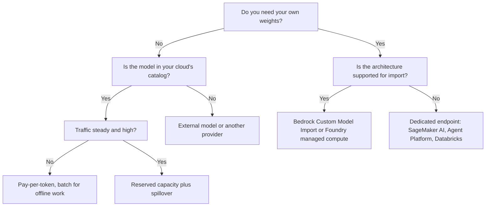

## 1. The question this idea answers

Lesson [L1](/notes/ai/llm-systems/05-cloud-hosting/l1-ways-to-host-a-model) placed hosting options on a spectrum, from a closed model API to your own Kubernetes cluster. Most companies land in the middle: a managed AI platform inside the cloud they already use. An interviewer then asks concrete questions:

- "On AWS, would you use Bedrock or SageMaker? What is the difference?"
- "What is a PTU in Azure? What happens when you exceed it?"
- "Can you bring your own fine-tuned weights? How are you billed for them?"
- "How do you keep EU data in the EU?"

Product names change often. Vertex AI was renamed in April 2026. Azure AI Foundry is now Microsoft Foundry. Databricks' AI Gateway for serving endpoints is now marked legacy. This lesson gives the current names, checked on 2026-10-15, and one vocabulary that stays valid when the names change again.

## 2. Mental model

> [!analogy] Four ways to get a meal for a team
> **A restaurant menu.** You order dishes and pay per dish. The kitchen is shared with every other guest. At the busy hour, the restaurant may ask you to wait. This is **pay-per-token** on a shared model.
>
> **A reserved table with a fixed staff.** You pay per hour for a table and a cook, whether you eat or not. Service at that table is predictable. This is **reserved capacity**: provisioned throughput.
>
> **A rented kitchen with your own recipe.** The landlord provides the stoves and the cleaning. You bring the recipe (your weights) and pay per hour of kitchen time. This is a **dedicated endpoint**.
>
> **A next-day catering order.** You accept a delay of hours and get a discount. This is **batch inference**.
>
> **Where it stops working:** a restaurant rarely removes a dish from its menu, but platforms retire models on fixed dates. A meal cannot leak to another country, but a prompt can: where the request is processed is part of the contract. And a "table" on an LLM platform is measured in tokens per minute, not in seats.

## 3. Terms

| Term | Plain meaning |
|---|---|
| pay-per-token | Billing per input and output token on capacity that the provider shares among customers. Also called on-demand or standard. |
| priority tier | A pay-per-token option at a higher price that gets served first under load. |
| batch inference | Jobs that finish within hours, usually at a 50% discount. |
| provisioned throughput | Reserved capacity for one model, billed per hour or per term, used or not. |
| model unit (MU) | Amazon Bedrock's unit of provisioned throughput: a fixed number of input and output tokens per minute. |
| PTU | Provisioned throughput unit: Microsoft Foundry's unit of reserved model capacity, billed per PTU per hour. |
| GSU | Generative AI scale unit: Google's unit for ordering Provisioned Throughput. |
| inference profile | A Bedrock resource that names a model and the regions to which requests can go. |
| Custom Model Import | A Bedrock feature that serves your own weights of a supported architecture, billed per minute of active model copies. |
| Custom Model Unit (CMU) | The billing unit of Custom Model Import. Larger models need more CMUs per copy. |
| real-time endpoint | A SageMaker AI endpoint on instances that you choose. You pay per instance-hour. |
| inference component | A SageMaker AI object that places one model on an endpoint with its own resources and scaling. |
| LMI container | Large Model Inference container: AWS images that run vLLM or TensorRT-LLM on SageMaker AI. |
| deployment type | Microsoft Foundry's choice of billing and data-processing area, for example Global Standard or Data Zone Provisioned. |
| data zone | A Microsoft-defined area for processing: US, EU or Asia Pacific. |
| spillover | A Foundry feature that sends overflow from a provisioned deployment to a standard deployment. |
| Model Garden | The model catalog of Google's Agent Platform. |
| Foundation Model APIs | Databricks-hosted open models, served pay-per-token or with provisioned throughput. |
| external model | A Databricks serving endpoint that forwards requests to a model hosted by another provider. |
| Unity Gateway | The Databricks governance layer for model services, agents and MCP servers: rate limits, guardrails, usage tracking. |

All terms are also in the [Glossary](/notes/ai/llm-systems/glossary).

## 4. One vocabulary for all clouds

Every platform sells the same four or five things under different names. Learn the pattern first.

| Purchase model | What you pay for | Risk you carry |
|---|---|---|
| Pay-per-token, standard | Tokens | Throttling (HTTP 429) at peaks, latency varies |
| Priority and flex tiers | Tokens at a premium or a discount | Flex can be slow |
| Batch | Tokens at a discount, results within hours | No interactive use |
| Reserved capacity for a catalog model | Capacity units per hour or per term | Idle capacity is still billed |
| Your own weights on dedicated compute | Instance-hours or GPU-hours (or CMU-minutes on Bedrock) | Idle capacity, cold starts, engine settings |


> [!key] The question behind every product name
> For each option ask three questions. Who pays for idle capacity: you or the provider? Who chooses the engine and the GPU? Where is the request processed? The answers decide cost at low volume, latency at peak, and compliance.

## 5. Amazon Bedrock

Amazon Bedrock is the AWS service for calling foundation models through one API. AWS runs the models. You never see a GPU.

### 5.1 Service tiers

The Bedrock docs list four service tiers (checked on 2026-10-15):

- **Reserved**: "reserve prioritized compute capacity". You choose input and output tokens-per-minute capacities. Above them, requests overflow to Standard. "Customers pay a fixed price per 1K tokens-per-minute and are billed monthly." It "targets 99.5% uptime for model response."
- **Priority**: "the fastest response times for a price premium over standard on-demand pricing". It needs no reservation.
- **Standard**: the default.
- **Flex**: "a pricing discount" for work that tolerates "longer processing times".

A request chooses its tier with the optional parameter `service_tier`, with the values `reserved`, `priority`, `default` or `flex`. Without it, the request uses Standard. The pricing page says, for several providers: "Priority tier pricing is at 75% premium to Standard tier pricing" and "Flex tier pricing is at 50% discount to Standard tier pricing". The tier support depends on the model.

### 5.2 Batch inference

The pricing page: Bedrock offers select models "for batch inference at a 50% lower price compared to on-demand inference pricing".

### 5.3 Provisioned Throughput

Provisioned Throughput reserves capacity "for a model at a fixed cost". You buy **model units**. Each MU gives a number of input tokens and a number of output tokens per minute. The commitment terms are "No commitment", "1 month" and "6 months", and "The longer the commitment duration, the more discounted the hourly price becomes." Billing is hourly until you delete it. One rule matters for fine-tuning: "If you customized a model, you must purchase Provisioned Throughput to be able to use it."

### 5.4 Cross-Region inference

An **inference profile** names a model and the regions that may serve it. With a geographic profile, Bedrock "automatically selects a commercial AWS Region within that geography", for example US, EU or APAC. With a global profile, any supported commercial region may serve. The docs: "There's no additional routing cost", and global profiles give "Approximately 10% savings". For residency rules: "Choose Geographic cross-Region inference when you have data residency requirements".

### 5.5 Custom Model Import

**Custom Model Import** serves your own weights. The docs list the supported architectures: Mistral, Mixtral, Flan, Llama 2 to Llama 3.3 and Mllama, GPTBigCode, Qwen2 to Qwen3, and GPT-OSS. The requirements:

- weights in the Hugging Face format, as `.safetensors` files, with `config.json` and the tokenizer files, in Amazon S3,
- size below 200 GB for text models and 100 GB for multimodal models,
- context length below 128K,
- no embedding models, no batch inference.

You call the imported model on demand with `InvokeModel`. Billing, from the pricing page (us-east-1, checked on 2026-10-15):

- USD 0.05718 per Custom Model Unit per minute, "Billed in 5 minute windows" from the first successful invocation,
- storage USD 1.95 per CMU per month,
- "Llama 3.1 8B 128K model requires 2 Custom Model Units" and "a Llama 3.1 70B 128k model requires 8",
- "If there are no invocations for a 5-minute period, Bedrock will scale down to zero",
- "a default maximum of 3 model copies per account per imported model".

> [!example] Worked example: a fine-tuned 8B model used in short bursts
> One copy of an 8B model needs 2 CMUs.
>
> 1. One 5-minute window: $2 \times 0.05718 \times 5 =$ USD 0.5718.
> 2. One active hour: $2 \times 0.05718 \times 60 =$ USD 6.86.
> 3. Traffic in 36 windows per day (3 hours): $36 \times 0.5718 \approx$ USD 20.58 per day, plus $2 \times 1.95 =$ USD 3.90 storage per month.
> 4. For 70B (8 CMUs): USD 2.29 per window, USD 27.45 per active hour.
>
> Compare: one H100 that runs all day costs about $12.29 \times 24 \approx$ USD 295 per day ([L7](/notes/ai/llm-systems/05-cloud-hosting/l7-cost-math)). For bursty traffic, per-window billing with scale to zero wins clearly. The docs do not state the throughput of one copy, so for steady heavy traffic, measure before you compare.

> [!trap] The pricing page contradicts itself
> The rate table says USD 0.05718 per CMU per minute. The worked example on the same page uses USD 0.1570 per minute for 2 CMUs. That is USD 0.0785 per CMU-minute and USD 0.785 per window. These notes use the rate table. Check the current page before you budget.

After a scale to zero, the next request must wait while a model copy loads. The docs do not give a number for this time.

### 5.6 What Bedrock manages, and what it does not

Bedrock manages the GPUs, the engine, scaling, patching and the model files. You manage IAM permissions, quotas, the choice of tier and region, and your prompts. You cannot choose the GPU, the engine flags or the batch size. The models of other providers come with their own terms.

## 6. Amazon SageMaker AI

SageMaker AI is the AWS service for hosting **your** containers and models on instances that you choose. You pick the instance type, the container and the number of instances.

The inference options (SageMaker AI developer guide, checked on 2026-10-15):

| Option | What the docs say | GPUs |
|---|---|---|
| Real-time inference | "ideal for inference workloads where you have interactive, low latency requirements" | Yes, by instance type |
| Asynchronous inference | "Queues incoming requests and processes them asynchronously", for payloads "up to 1GB" and processing "up to one hour" | Yes |
| Serverless inference | For "idle periods between traffic spurts" that "can tolerate cold starts". Memory from 1,024 MB to 6,144 MB, up to 200 concurrent requests per endpoint. | No: the features "not supported for Serverless Inference" include "GPUs" |

So for LLMs, the choice is real-time or asynchronous endpoints on GPU instances. You pay per instance-hour while the endpoint exists.

**Inference components** place one or more models on an endpoint, each with its own CPU, GPU and memory share and its own scaling. They also allow scale to zero: set `MinInstanceCount` to 0, and a CloudWatch alarm on `NoCapacityInvocationFailures` triggers a step scaling policy to add an instance. While at zero, "any attempts to invoke the endpoint will produce an error" during the "several minutes" of provisioning ([L5](/notes/ai/llm-systems/05-cloud-hosting/l5-autoscaling-and-routing)).

**LMI containers** are the AWS images for LLM serving. The DJL documentation says they "support vLLM and TensorRT-LLM to deploy LLMs on AWS SageMaker Endpoints", with continuous batching, token streaming, AWQ, GPTQ and FP8 quantization, tensor parallelism, LoRA serving and speculative decoding. The engine choices are the same as in self-hosting ([part 04 L10](/notes/ai/llm-systems/04-inference/l10-serving-engines)). AWS manages the instances, the endpoint and the scaling machinery.

> [!key] Bedrock or SageMaker AI?
> Use Bedrock to call a catalog model or a supported custom architecture without any servers. Use SageMaker AI when you need your own container, engine flags, GPU type or an architecture that Bedrock does not import. Bedrock Marketplace sits between the two: it deploys a model to an endpoint managed by SageMaker AI ([L1](/notes/ai/llm-systems/05-cloud-hosting/l1-ways-to-host-a-model)).

## 7. Microsoft Foundry

Microsoft Foundry is Azure's platform for AI models and agents. The top object is a **Foundry resource**. Models are used through **deployments** inside it. Lesson [Claude on Microsoft Foundry](/notes/ai/llm-apis/04-providers-and-caching/l1-claude-on-microsoft-foundry) shows a full Claude deployment with its endpoint and Entra ID tokens.

### 7.1 Two deployment options

The deployments overview (updated 2026-09-28) says: "Foundry offers two deployment options":

- **Serverless API**: "the preferred and most capable deployment path". It covers "Foundry Models sold by Azure", which "include all Azure OpenAI models", and "select Models from partners and community", such as Anthropic, Mistral, Cohere and Meta models. It includes "the standard, provisioned throughput, batch, and developer deployment types". Billing: "Token usage or provisioned throughput units".
- **Managed compute (preview)**: "For open-source, partner, and custom models that run on dedicated GPU capacity that Foundry manages for you", for example Qwen, NVIDIA Nemotron and selected Meta and Mistral models from Hugging Face. Billing: "Hourly per accelerator SKU".

A third path, **instant access (preview)**, lets you "call supported models by name" with no deployment.

### 7.2 Deployment types

The deployment type decides billing and where data is processed. The page "Deployment types for Microsoft Foundry Models" (updated 2026-08-12) lists:

| Deployment type | SKU name | Inference processed in | Billing |
|---|---|---|---|
| Global Standard | `GlobalStandard` | any Azure region | per token |
| Global Provisioned | `GlobalProvisionedManaged` | any Azure region | PTU |
| Global Batch | `GlobalBatch` | any Azure region | per token, "50% less cost than Global Standard", "24-hour target turnaround" |
| Data Zone Standard | `DataZoneStandard` | the data zone | per token |
| Data Zone Provisioned | `DataZoneProvisionedManaged` | the data zone | PTU |
| Data Zone Batch | `DataZoneBatch` | the data zone | per token, 50% discount |
| Standard | `Standard` | the Azure geography | per token |
| Regional Provisioned | `ProvisionedManaged` | the Azure geography | PTU |
| Developer | `DeveloperTier` | any Azure region | per token, no SLA, "fixed 24-hour lifetime" |

The residency rule in all cases: "Data stored at rest remains in the designated Azure geography." Only the place of inference changes. Data Zone types process data "only within the Microsoft-specified data zone (US, EU, or Asia Pacific (APAC))."

### 7.3 Provisioned throughput units

"A PTU represents a fixed amount of model processing capacity." Billing: all provisioned deployment types are billed per PTU per hour, "based on the number of PTUs deployed, regardless of the number of tokens consumed". Azure Reservations of 1 month or 1 year lower the rate, but "Reservations don't guarantee capacity. First create deployments to confirm that capacity is available, then purchase the reservation." Each model has a minimum number of PTUs per deployment.

When a provisioned deployment is full, it returns errors such as HTTP 429. **Spillover** sends those requests to a standard deployment in the same resource. You configure it for a deployment or per request with the header `x-ms-spillover-deployment`. The page says spillover is not supported for Azure DeepSeek or Meta Llama models (checked on 2026-10-15).

> [!example] Worked example: choose deployment types for three workloads
> 1. A customer chat in Germany with EU data rules and a steady 30 requests per second at office hours. Choose **Data Zone Provisioned** for the base load, plus spillover to **Data Zone Standard** for peaks. Both stay in the EU data zone.
> 2. An internal tool with low, irregular traffic and no residency rule: **Global Standard**. Pay only for tokens, with the highest default quota.
> 3. A nightly job that summarizes 2 million documents: **Global Batch** at 50% less than Global Standard, if results within 24 hours are acceptable.

### 7.4 An example price

The Azure Retail Prices API lists Llama 3.3 70B with Global deployment at USD 0.00071 per 1K tokens for input and for output. That is USD 0.71 per MTok. The regional and Data Zone meters show USD 0.000781 per 1K tokens (eastus, checked on 2026-10-15). Lesson [L7](/notes/ai/llm-systems/05-cloud-hosting/l7-cost-math) compares this price with self-hosting.

## 8. Google Cloud: Gemini Enterprise Agent Platform (formerly Vertex AI)

On 22 April 2026, Google renamed Vertex AI. The release notes call the entry "Vertex AI to Gemini Enterprise Agent Platform naming changes". Examples from its mapping table: "Vertex AI" becomes "Agent Platform", "Vertex AI API" becomes "Agent Platform API", and "Vertex AI Model Garden" becomes "Model Garden". The REST host `aiplatform.googleapis.com` still appears in release notes of July 2026. On 18 September 2026 the "Agent Platform SDK for Python" 2.0.1 shipped as the package `google-cloud-agentplatform`. Interviewers may use either name.

### 8.1 Model Garden and the two ways to run open models

**Model Garden** is the catalog: Google models such as Gemini, partner models (for example, Claude Haiku 5.5 "is available in Model Garden" since 7 October 2026), and open models. Open models run in two ways:

- **Managed open models (MaaS)**: Google serves the model, and you pay per token. The catalog changes. On 21 July 2026, for example, Google deprecated many open-model endpoints such as `deepseek-v3.2-maas`, which "will be retired on October 21, 2026".
- **Self-deployed open models**: you deploy the weights to an endpoint on machines that you choose. The docs offer prebuilt containers, a custom vLLM container and the Hex-LLM server. They recommend dedicated public endpoints, and private endpoints are also available.

Self-deployed endpoints are billed per **node hour**: "the time a virtual machine spends running your prediction job or waiting in an active state (an endpoint with one or more models deployed)". The GPU is billed per GPU-hour on top of vCPU and memory. The price list shows USD 11.2660332 per hour for an H100 80 GB and USD 0.64405 per hour for an L4, for prediction in us-central1. And: "You must undeploy your model to stop incurring further charges." (Agent Platform pricing page, checked on 2026-10-15.)

### 8.2 Paying for Gemini

- **Standard PayGo**: per token on shared capacity. On 10 September 2026 it gained a fourth usage tier for spend above USD 50,000 per 30-day period.
- **Priority PayGo**: generally available since 14 May 2026, for traffic that must be served first.
- **Provisioned Throughput**: you "place an order for GSUs" for a model and a term. On 19 May 2026 Provisioned Throughput gained "a latency SLA, measured in tokens per second".

The detailed GSU rules (throughput per GSU, term lengths) are on pages whose text could not be read for these notes. Read them before you order.

## 9. Databricks Model Serving

Model Serving is the serving layer of the Databricks platform. It "uses serverless compute". It serves three kinds of models (docs updated 6 October 2026):

- **custom models**: your MLflow models or agents,
- **foundation models** through the Foundation Model APIs,
- **external models** hosted elsewhere.

### 9.1 Foundation Model APIs

The Foundation Model APIs page (updated 2 October 2026) describes three modes:

- **Pay-per-token**: "the easiest way to start". For production, "Databricks recommends priority pay-per-token", which "is opt-in per request, requires no commitment, and is billed at a higher per-token rate."
- **Provisioned throughput**: "recommended for all production workloads, especially those that require high throughput, performance guarantees". It comes **on-demand** ("no term commitment") or **reserved** ("a fixed 1- or 3-month term"). It supports base models and fine-tuned variants, and "Provisioned throughput endpoints are available with compliance certifications like HIPAA."
- **AI Functions**: "recommended for batch inference workloads".

### 9.2 Custom models on GPUs

You choose a workload type and a workload size. On AWS the GPU workload types are:

| Workload type | GPU | GPU memory |
|---|---|---|
| `GPU_SMALL` | 1 × T4 | 16 GB |
| `GPU_MEDIUM` | 1 × A10G | 24 GB |
| `MULTIGPU_MEDIUM` | 4 × A10G | 96 GB |
| `GPU_MEDIUM_8` | 8 × A10G | 192 GB |

Workload sizes set the concurrency: "Small for 0-4 requests, Medium 8-16 requests, and Large for 16-64 requests." The setting `scale_to_zero_enabled` exists, but "Scale to zero is not recommended for production endpoints, as capacity is not guaranteed when scaled to zero." Billing is in Databricks Units (DBUs). The GPU serving price page lists 100 DBUs per hour for one H100 and 20 DBUs per hour for one A10G (checked on 2026-10-15). The price of one DBU depends on the contract and cloud.

### 9.3 External models and Unity Gateway

An **external model** endpoint forwards requests to another provider and keeps the credentials. The providers in the docs are `openai` (including Azure OpenAI), `anthropic`, `cohere`, `amazon-bedrock`, `google-cloud-vertex-ai`, `databricks-model-serving` and `custom` for OpenAI-compatible services.

**Unity Gateway** is "the Databricks governance solution for enterprise AI". It governs "runtime interactions between models, agents, MCP servers, and tools" (updated 8 October 2026). Its features:

- rate limits on model services and MCP services,
- service policies, "the mechanisms you use to implement guardrails",
- usage tracking of "requests, token usage, and latency" in system tables,
- audit logs of requests and responses "to Unity Catalog Delta tables",
- traffic splitting and failover: "Distribute requests across multiple model destinations and add failover."

The older AI Gateway settings on serving endpoints are now in a page titled "Governance for model serving endpoints (legacy)", which says: "A new Unity Gateway experience is generally available". The same gateway fronts the `system.ai` MCP servers ([Databricks MCP servers](/notes/platforms/databricks/04-mcp-and-genie/l1-databricks-mcp-servers)).

For a Databricks App, a serving endpoint is an app resource with the permissions "Can view, Can query, Can manage" ([App resources and secrets](/notes/platforms/databricks/01-apps/l2-app-resources-and-secrets)). An agent built with LangChain reaches it through `ChatDatabricks` ([ChatDatabricks](/notes/ai/langchain-langgraph/01-foundations/l3-chatdatabricks)). For Claude on Foundry from Databricks without a stored key, see [Unity Catalog service credentials](/notes/platforms/databricks/02-identity-and-auth/l2-uc-service-credentials).

## 10. Side-by-side comparison

| Question | AWS | Microsoft | Google Cloud | Databricks |
|---|---|---|---|---|
| Catalog models per token | Bedrock (Standard tier) | Foundry, Global or Data Zone Standard | Agent Platform: Gemini Standard PayGo, MaaS | Foundation Model APIs pay-per-token |
| Pay more to be served first | Bedrock Priority tier (75% premium for several providers) | Not covered here | Priority PayGo | Priority pay-per-token |
| Batch discount | Bedrock batch, 50% | Global or Data Zone Batch, 50% | Batch prediction (not covered here) | AI Functions |
| Reserved capacity | Bedrock Provisioned Throughput (MUs), Reserved tier | Provisioned deployments (PTUs) | Provisioned Throughput (GSUs) | Provisioned throughput, on-demand or reserved |
| Your weights, platform-managed | Bedrock Custom Model Import (CMU-minutes) | Managed compute (preview) | Self-deployed endpoint (node hours) | Custom model serving (DBUs) |
| Your container and engine | SageMaker AI endpoints with LMI containers | Not covered here | Custom vLLM container on a self-deployed endpoint | Not covered here |
| Keep data in a region | Geographic inference profiles | Data Zone and regional types | Regional endpoints, US and EU multi-region endpoints | Not covered here |
| Scale to zero | Custom Model Import (after 5 idle minutes), SageMaker inference components | Not covered here | Not for deployed nodes: undeploy to stop charges | Possible, "not recommended for production" |

Cells marked "not covered here" are not in the sources of this lesson.

## 11. How to choose



Three rules sit on top of the tree:

1. **Residency first.** If data must stay in the EU, only Data Zone or regional options, or geographic inference profiles, are candidates.
2. **Measure utilization.** Reserved capacity and dedicated endpoints pay off only at high, steady use ([L7](/notes/ai/llm-systems/05-cloud-hosting/l7-cost-math)).
3. **Plan for model retirement.** Catalog models have end dates. Keep the model name in configuration, and test a replacement before the date ([L8](/notes/ai/llm-systems/05-cloud-hosting/l8-production-operations)).

## 12. Exercises

Write your code in the lab folder `C:\Users\ASohi\Downloads\AI\agent-harness-lab`, in the notebook folder `llm-systems/`.

1. **Custom Model Import cost.** Write `cmi_cost_per_day(cmus, active_windows, copies=1, price=0.05718)`. Acceptance test: 2 CMUs and 36 windows give about USD 20.58. Then find how many windows per day make an 8B model cost as much as one H100 at USD 12.29 per hour for 24 hours.
   - Hint 1: one window is 5 minutes, so it costs `cmus * price * 5`.
   - Hint 2: divide the daily GPU cost by the price of one window.
2. **Deployment type picker.** Write `pick_foundry_type(residency, traffic, latency_sensitive)` that returns one of the deployment types of section 7.2. Acceptance test: ("EU", "steady", True) gives `DataZoneProvisionedManaged`, (None, "irregular", False) gives `GlobalStandard`, and (None, "offline", False) gives `GlobalBatch`.
   - Hint 1: residency decides the zone (Global, Data Zone or regional).
   - Hint 2: traffic decides the billing (standard, provisioned or batch).
3. **Bedrock tiers.** A workload pays USD 10,000 per month on the Standard tier. Compute the bill if 20% of tokens move to Priority and 50% to Flex, with the premium and discount of section 5.1. Acceptance test: USD 9,000.
   - Hint 1: Priority costs 1.75 times Standard, Flex 0.5 times.
   - Hint 2: the remaining 30% stays at 1.0 times.

## 13. Common mistakes

1. **"Vertex AI and Agent Platform are two different products."** Google renamed Vertex AI to Gemini Enterprise Agent Platform on 22 April 2026. Model Garden kept its name without "Vertex AI".
2. **"A Global deployment stores my data anywhere."** In Foundry, "Data stored at rest remains in the designated Azure geography." The deployment type decides where **inference** runs.
3. **"Buying a reservation guarantees capacity."** For Foundry PTUs: "Reservations don't guarantee capacity." Create the deployment first, then buy the reservation.
4. **"SageMaker Serverless Inference is a cheap way to host an LLM."** Serverless Inference does not support GPUs, and its memory is at most 6 GB.
5. **"Bedrock can serve any fine-tuned model per token."** Custom Model Import supports listed architectures only, below 200 GB and 128K context. A model customized inside Bedrock needs Provisioned Throughput.
6. **"An idle endpoint costs nothing."** Agent Platform bills deployed nodes while "waiting in an active state". You must undeploy to stop charges. SageMaker AI real-time endpoints also bill per instance-hour while they exist.
7. **"Databricks AI Gateway is the current product."** The serving-endpoint settings are now marked legacy. The current name is Unity Gateway.

## 14. One-minute explanation

Every cloud sells LLM inference in the same few shapes. Shared pay-per-token for catalog models, with priority and flex variants and a batch mode at about half price. Reserved capacity for one model, billed per hour whether used or not: Bedrock model units, Foundry PTUs, Google GSUs, Databricks provisioned throughput. And your own weights on dedicated compute. On AWS that is Bedrock Custom Model Import, billed per 5-minute window of CMUs. Or it is SageMaker AI endpoints with LMI containers that run vLLM or TensorRT-LLM. The others are Foundry managed compute, self-deployed Agent Platform endpoints billed per node hour, and Databricks custom model serving. Bedrock means no servers. SageMaker AI means your container on instances you choose. Data residency is a deployment choice: Foundry Data Zone types or Bedrock geographic inference profiles keep inference inside a zone. Names change fast: Vertex AI is now Gemini Enterprise Agent Platform, and Databricks calls its gateway Unity Gateway. So I compare options by who pays for idle capacity, who controls the engine, and where the request is processed.

## 15. Check questions

```check
{
  "question": "Interview follow-up: \"Bedrock or SageMaker AI for a fine-tuned Llama 3.1 8B?\"",
  "hint": "Compare billing units, control over the engine, and scale to zero.",
  "answer": "Both can work, with different trade-offs.\n\n**Bedrock Custom Model Import** takes Hugging Face weights in `.safetensors` from S3, if the architecture is on the supported list (Llama 3.1 is) and the model is below 200 GB with a context below 128K. You call it with `InvokeModel`. Billing is per CMU per minute in 5-minute windows: an 8B model needs 2 CMUs, so about USD 0.57 per window or USD 6.86 per active hour at USD 0.05718 per CMU-minute (us-east-1, checked on 2026-10-15). It scales to zero after 5 idle minutes. No servers, no engine flags.\n\n**SageMaker AI** runs your own container, for example an LMI container with vLLM, on GPU instances you choose. You control the engine, quantization, batch size and tensor parallelism. You pay per instance-hour while the endpoint exists, unless you use inference components with scale to zero, where requests fail during the minutes of provisioning.\n\nFor bursty traffic and a supported architecture: Bedrock. For control, a custom engine setup or steady heavy traffic you want to tune: SageMaker AI."
}
```

```check
{
  "question": "Interview follow-up: \"What is a PTU, and what happens when you exceed it?\"",
  "hint": "Billing unit, then overflow behavior.",
  "answer": "A PTU is a provisioned throughput unit in Microsoft Foundry: \"a fixed amount of model processing capacity\". You deploy a number of PTUs for one model and pay an hourly rate per PTU, \"regardless of the number of tokens consumed\". A 1-month or 1-year Azure Reservation lowers the rate, but does not guarantee capacity.\n\nWhen the deployment is fully used, it returns non-200 responses such as HTTP 429. The client can retry with backoff, or you configure **spillover**: overflow requests go to a standard (pay-per-token) deployment in the same resource, for the whole deployment or per request with the header `x-ms-spillover-deployment`. Spillover is not supported for Azure DeepSeek or Meta Llama models."
}
```

```check
{
  "question": "Interview follow-up: \"How do you keep EU customer prompts in the EU on Azure and on AWS?\"",
  "hint": "Think about deployment types and inference profiles.",
  "answer": "**Azure (Microsoft Foundry):** choose a Data Zone deployment type (Data Zone Standard, Data Zone Provisioned or Data Zone Batch) with the EU zone, or a regional type (Standard, Regional Provisioned) in an EU region. Data Zone types process data \"only within the Microsoft-specified data zone\". Avoid Global types, which \"may be processed in any Azure region\". Data at rest stays in the resource's geography in all cases.\n\n**AWS (Bedrock):** call the model in an EU region, or use a geographic cross-Region inference profile for the EU, never a global profile. The docs: \"Choose Geographic cross-Region inference when you have data residency requirements\".\n\nAlso check the network path (private endpoints), the logs (where request logs and traces are stored) and the failover target: a failover region must be inside the same zone ([L5](/notes/ai/llm-systems/05-cloud-hosting/l5-autoscaling-and-routing))."
}
```

```check
{
  "question": "What did Google rename in April 2026, and which names stay the same?",
  "hint": "Look at section 8.",
  "answer": "On 22 April 2026 the release notes published \"Vertex AI to Gemini Enterprise Agent Platform naming changes\". Examples: \"Vertex AI\" became \"Agent Platform\", \"Vertex AI API\" became \"Agent Platform API\", \"Vertex AI Model Garden\" became \"Model Garden\", and \"Vertex AI Model Registry\" became \"Agent Platform Model Registry\". The REST host `aiplatform.googleapis.com` still appears in July 2026 notes, and on 18 September 2026 a new Python package `google-cloud-agentplatform` 2.0.1 appeared. In an interview, say both names: \"Agent Platform, formerly Vertex AI\"."
}
```

```check
{
  "question": "Interview follow-up: \"Your Databricks team wants Claude and an open model behind one governed entry point with rate limits and logging. What do you build?\"",
  "hint": "External models plus the governance layer.",
  "answer": "On Databricks: create serving endpoints for both. The open model can use the Foundation Model APIs (pay-per-token, or provisioned throughput for production, which Databricks recommends together with priority pay-per-token). Claude can be an **external model** endpoint with the `anthropic` provider, or a Foundry deployment reached through Unity Catalog service credentials.\n\nGovern both with **Unity Gateway**: rate limits on model services, service policies as guardrails, usage tracking of requests, tokens and latency in system tables, request and response logs in Unity Catalog Delta tables, and traffic splitting with failover between model destinations. The older AI Gateway settings on serving endpoints are now labeled legacy. An App reaches the endpoints as app resources with Can query permission, and a LangChain agent uses `ChatDatabricks`."
}
```

```check
{
  "question": "Why is SageMaker Serverless Inference a poor fit for LLM serving?",
  "hint": "Check GPU support and the memory limit.",
  "answer": "The docs list GPUs among the features \"not supported for Serverless Inference\", and the memory of a serverless endpoint is at most 6,144 MB. An 8B model alone needs about 16 GB in BF16. Serverless endpoints also expect idle periods and \"can tolerate cold starts\". For LLMs, use real-time or asynchronous endpoints on GPU instances, optionally with inference components for scale to zero."
}
```

```check
{
  "question": "Exercise 1: show a reference solution.",
  "answer": "```python\ndef cmi_cost_per_day(cmus, active_windows, copies=1, price=0.05718):\n    return cmus * price * 5 * active_windows * copies\n\n\nprint(round(cmi_cost_per_day(2, 36), 2))\nwindow = cmi_cost_per_day(2, 1)\nprint(round(12.29 * 24 / window), \"windows per day\")\n```\n\nOutput: `20.58`, then `516 windows per day`. 516 windows are about 43 hours, more than a day has, so for one copy the active CMI price stays below one always-on H100 at USD 12.29 per hour. That says nothing about throughput: one copy may serve less than a tuned vLLM server."
}
```

```check
{
  "question": "Exercise 2: show a reference solution.",
  "answer": "```python\ndef pick_foundry_type(residency, traffic, latency_sensitive):\n    zone = \"Global\" if residency is None else \"DataZone\"\n    if traffic == \"offline\":\n        return zone + \"Batch\"\n    if traffic == \"steady\" and latency_sensitive:\n        return zone + \"ProvisionedManaged\"\n    return zone + \"Standard\"\n\n\nassert pick_foundry_type(\"EU\", \"steady\", True) == \"DataZoneProvisionedManaged\"\nassert pick_foundry_type(None, \"irregular\", False) == \"GlobalStandard\"\nassert pick_foundry_type(None, \"offline\", False) == \"GlobalBatch\"\nprint(\"ok\")\n```\n\nOutput: `ok`. A real picker also needs the regional types (`Standard`, `ProvisionedManaged`) for single-country rules, and the model's support for each type."
}
```

```check
{
  "question": "Exercise 3: show a reference solution.",
  "answer": "```python\nstandard = 10_000\nbill = standard * (0.2 * 1.75 + 0.5 * 0.5 + 0.3 * 1.0)\nprint(round(bill))\n```\n\nOutput: `9000`. The priority share adds USD 1,500 over standard, and the flex share saves USD 2,500."
}
```

## 16. Links

- Previous: [L5: Autoscaling and routing](/notes/ai/llm-systems/05-cloud-hosting/l5-autoscaling-and-routing)
- Next: [L7: Cost math](/notes/ai/llm-systems/05-cloud-hosting/l7-cost-math)
- The hosting spectrum: [L1: Ways to host a model](/notes/ai/llm-systems/05-cloud-hosting/l1-ways-to-host-a-model)
- Engines inside LMI containers and custom containers: [part 04 L10: Serving engines](/notes/ai/llm-systems/04-inference/l10-serving-engines)
- Claude on Foundry in detail: [Claude on Microsoft Foundry](/notes/ai/llm-apis/04-providers-and-caching/l1-claude-on-microsoft-foundry)
- Databricks: [App resources and secrets](/notes/platforms/databricks/01-apps/l2-app-resources-and-secrets), [Unity Catalog service credentials](/notes/platforms/databricks/02-identity-and-auth/l2-uc-service-credentials), [Databricks MCP servers](/notes/platforms/databricks/04-mcp-and-genie/l1-databricks-mcp-servers)
- Interview drill: [Drill: inference and cloud hosting](/notes/ai/llm-systems/08-interview-drills/l2-chain-inference-and-cloud)

### Sources

- Amazon Bedrock, "Service tiers for optimizing performance and cost": https://docs.aws.amazon.com/bedrock/latest/userguide/service-tiers-inference.html (checked on 2026-10-15)
- Amazon Bedrock, "Provisioned Throughput": https://docs.aws.amazon.com/bedrock/latest/userguide/prov-throughput.html (checked on 2026-10-15)
- Amazon Bedrock, "Increase throughput with cross-Region inference": https://docs.aws.amazon.com/bedrock/latest/userguide/cross-region-inference.html (checked on 2026-10-15)
- Amazon Bedrock, "Custom Model Import": https://docs.aws.amazon.com/bedrock/latest/userguide/model-customization-import-model.html (checked on 2026-10-15)
- Amazon Bedrock pricing: https://aws.amazon.com/bedrock/pricing/ (checked on 2026-10-15)
- Amazon SageMaker AI, deploy models for inference, Serverless Inference, and "Scale an endpoint to zero instances": https://docs.aws.amazon.com/sagemaker/latest/dg/deploy-model.html, https://docs.aws.amazon.com/sagemaker/latest/dg/serverless-endpoints.html, https://docs.aws.amazon.com/sagemaker/latest/dg/endpoint-auto-scaling-zero-instances.html (checked on 2026-10-15)
- DJL Serving, LMI containers overview: https://github.com/deepjavalibrary/djl-serving/blob/master/serving/docs/lmi/README.md (checked on 2026-10-15)
- Microsoft Foundry, deployments overview (updated 2026-09-28): https://learn.microsoft.com/en-us/azure/foundry/concepts/deployments-overview (checked on 2026-10-15)
- Microsoft Foundry, deployment types (updated 2026-08-12): https://learn.microsoft.com/azure/foundry/foundry-models/concepts/deployment-types (checked on 2026-10-15)
- Microsoft Foundry, provisioned throughput (updated 2026-07-15): https://learn.microsoft.com/azure/foundry/openai/concepts/provisioned-throughput (checked on 2026-10-15)
- Azure Retail Prices API, Azure Llama Models meters: https://prices.azure.com/api/retail/prices (checked on 2026-10-15)
- Google Cloud, Gemini Enterprise Agent Platform release notes: https://docs.cloud.google.com/gemini-enterprise-agent-platform/release-notes (checked on 2026-10-15)
- Google Cloud, deploy open models from Model Garden: https://docs.cloud.google.com/vertex-ai/generative-ai/docs/open-models/deploy-model-garden (checked on 2026-10-15)
- Google Cloud, Agent Platform pricing: https://cloud.google.com/products/gemini-enterprise-agent-platform/pricing (checked on 2026-10-15)
- Databricks, Model Serving (updated 2026-10-06), Foundation Model APIs (updated 2026-10-02), custom serving endpoints (updated 2026-10-09), external models: https://docs.databricks.com/aws/en/machine-learning/model-serving/ (checked on 2026-10-15)
- Databricks, "AI governance with Unity Gateway" (updated 2026-10-08) and "Governance for model serving endpoints (legacy)": https://docs.databricks.com/aws/en/ai-gateway/index/ (checked on 2026-10-15)
- Databricks, GPU model serving pricing: https://www.databricks.com/product/pricing/model-serving (checked on 2026-10-15)
