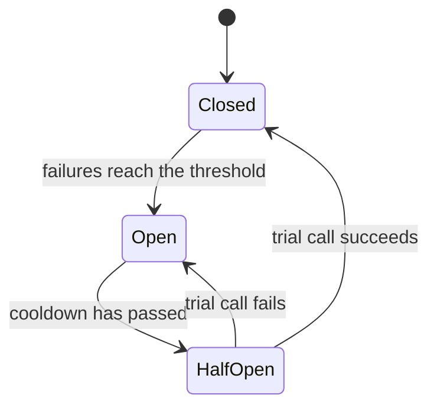

## 1. The question this idea answers

The endpoint from lessons [L1](/notes/ai/llm-systems/05-cloud-hosting/l1-ways-to-host-a-model) to [L7](/notes/ai/llm-systems/05-cloud-hosting/l7-cost-math) is live. Now real things happen. A provider returns HTTP 529 for ten minutes. A GPU reports a hardware error at 03:00. A new quantized model is 20% faster but answers worse. Somebody on the internal network calls `/pause` on the vLLM server.

An interviewer who asks about "cloud hosting" follows with operations questions:

- "Which metrics would you put on the dashboard, and which ones page someone?"
- "How do you retry? What do you never retry?"
- "How do you roll out a new model version safely?"
- "How do you secure a self-hosted endpoint?"

This lesson answers each one with the exact metric names, formulas and rules from the sources, checked on 2026-10-15.

## 2. Mental model

> [!analogy] The control room of a power grid
> Operators watch meters on every line (**metrics**). They follow one fault from a power plant to a house (**traces**). Breakers open when a line fails, so the fault does not spread (**circuit breakers**). Backup lines carry power when a main line is down (**fallbacks**). When demand is too high, operators switch off non-essential loads before the grid collapses (**load shedding**). A new plant first feeds a small district before it feeds the city (**canary rollout**).
>
> **Where it stops working:** a power line is either live or dead. An LLM can fail softly. It returns HTTP 200 with a wrong, empty or truncated answer, and no meter sees it. And a retry is not free: every retry of an LLM call spends GPU time and tokens again.

## 3. Terms

| Term | Plain meaning |
|---|---|
| SLI | Service level indicator: a measured ratio of good events to all events, for example requests with TTFT below 1 s. |
| SLO | Service level objective: a target for an SLI over a period, for example 99.9% over 30 days. |
| error budget | The share of events that may fail: 100% minus the SLO. |
| burn rate | How fast the service spends its error budget, relative to the SLO. A burn rate of 1 spends the budget in exactly one period. |
| span, trace | A span is one timed operation. A trace is the tree of spans of one request. |
| semantic conventions | Agreed attribute and metric names in OpenTelemetry, so that tools understand each other's data. |
| timeout | The longest time a caller waits before it stops waiting. |
| retry | Sending a failed request again. |
| exponential backoff | Waiting longer before each new retry, for example 0.5 s, 1 s, 2 s, 4 s. |
| jitter | A random part of the wait, so that many clients do not retry at the same moment. |
| idempotent | An operation that has the same effect if it runs once or twice. |
| circuit breaker | A switch in the client that stops calls to a failing dependency for a while. |
| fallback | A second way to answer when the first fails: another region, provider or model. |
| token bucket | A rate limiter: a bucket refills at a fixed rate, and each request takes tokens from it. |
| graceful degradation | Giving a reduced but useful service under overload, instead of failing completely. |
| canary | A new version that receives a small share of real traffic first. |
| shadow traffic | A copy of real requests sent to a new version whose responses are ignored. |
| blue-green deployment | Two complete environments. Traffic switches from the old (blue) to the new (green) at once. |
| Xid error | An error report from the NVIDIA driver about a GPU problem. |
| model supply chain | Every step from the model author to your GPU: files, containers, signatures and their checks. |

All terms are also in the [Glossary](/notes/ai/llm-systems/glossary).

## 4. SLOs and error budgets

### 4.1 SLIs for an LLM endpoint

The Google SRE workbook defines an SLI as "the ratio of two numbers: the number of good events divided by the total number of events". For LLM serving, four SLIs cover most needs:

| SLI | Good event | Why it matters |
|---|---|---|
| Availability | A response without a server error (no 5xx, no timeout) | The basic promise |
| TTFT | First token within the threshold, for example 1 s | Users see "is it working?" |
| Inter-token latency | Gaps between tokens below the threshold, for example 50 ms | Streaming feels smooth |
| Quality (sampled) | An evaluated sample passes the checks | Catches soft failures ([evaluation](/notes/ai/evaluation/02-statistics/l1-pass-rates-and-confidence-intervals)) |

The latency SLIs use histograms such as `vllm:time_to_first_token_seconds` ([L5](/notes/ai/llm-systems/05-cloud-hosting/l5-autoscaling-and-routing)) or measurements at the gateway. TTFT measured at the gateway includes the queue and the network, so it is closer to what users feel ([part 04 L2](/notes/ai/llm-systems/04-inference/l2-latency-and-throughput-metrics)).

### 4.2 The error budget

The workbook: "the error budget is 100% minus the SLO". Its example: with a 99.9% success SLO, "a service that receives 3 million requests over a four-week period had a budget of 3,000 (0.1%) errors over that period."

> [!example] Worked example: the budget in minutes
> SLO 99.9% over 30 days. Budget: $(1 - 0.999) \times 30 \times 24 \times 60 = 0.001 \times 43{,}200 = 43.2$ minutes of complete outage.
>
> SLO 99.5% over 30 days: $0.005 \times 720 = 3.6$ hours. For comparison, the Bedrock Reserved tier "targets 99.5% uptime for model response" ([L6](/notes/ai/llm-systems/05-cloud-hosting/l6-managed-platforms)).

### 4.3 Burn rate and alerts

"Burn rate is how fast, relative to the SLO, the service consumes the error budget." If the SLO allows 0.1% errors and the service now fails 1.44% of requests, the burn rate is $1.44 / 0.1 = 14.4$. At that rate, a 30-day budget is gone in $30 / 14.4 \approx 2.08$ days.

The workbook recommends alerts on several windows at once (Table 5-8, for a 99.9% SLO over 30 days):

| Notification | Long window | Short window | Burn rate | Budget spent |
|---|---|---|---|---|
| Page | 1 hour | 5 minutes | 14.4 | 2% |
| Page | 6 hours | 30 minutes | 6 | 5% |
| Ticket | 3 days | 6 hours | 1 | 10% |

An alert fires only if the burn rate is above the factor in **both** windows. The long window proves that the problem is significant. The short window proves that it is still happening, so the alert stops soon after a fix. "A good guideline is to make the short window 1/12 the duration of the long window." Check: 14.4 for 1 hour spends $14.4 \times 1 / 720 = 0.02$, so 2% of a 30-day budget.

```plot
{
  "title": "Error budget left over a 30-day period: burn rate 1 (blue), 6 (gold), 14.4 (red)",
  "xAxis": {"label": "days", "domain": [0, 30]},
  "yAxis": {"label": "budget left (%)", "domain": [0, 100]},
  "disableZoom": true,
  "data": [
    {"fn": "100 - 100*x/30", "color": "#1E6091"},
    {"fn": "100 - 100*6*x/30", "color": "#B8860B"},
    {"fn": "100 - 100*14.4*x/30", "color": "#C81D25"}
  ]
}
```

When the budget is spent, the workbook lists policy examples such as "stopping feature launches until the service is once again within SLO". For an LLM service, a new model version is a feature launch.

## 5. The metrics that matter, layer by layer


### 5.1 The gateway or client layer

The gateway sees what users see. Record per model and per tenant:

- request rate and errors by HTTP status: 429 means a rate limit, 5xx means a server fault, 529 means a provider overload,
- end-to-end latency and TTFT as measured by the client, including the queue and the network,
- input, output and cached tokens, because they are the bill ([L7](/notes/ai/llm-systems/05-cloud-hosting/l7-cost-math)),
- rate-limit rejections and fallback activations.

### 5.2 The engine layer: vLLM

The vLLM metrics of [L5](/notes/ai/llm-systems/05-cloud-hosting/l5-autoscaling-and-routing) serve both autoscaling and alerts. Counters appear with the suffix `_total` in Prometheus.

| Signal | Metric (vLLM 0.31.0) | Example alert, interpretation of these notes |
|---|---|---|
| Queue | `vllm:num_requests_waiting` | Above 20 per replica for 5 minutes, while replicas are at the maximum |
| KV pressure | `vllm:kv_cache_usage_perc` | Above 0.95 for 10 minutes |
| Preemptions | `vllm:num_preemptions_total` | Any sustained rate above 0 |
| TTFT | `vllm:time_to_first_token_seconds` | p90 above the SLO threshold (burn rate rules) |
| Inter-token latency | `vllm:inter_token_latency_seconds` | p90 above the SLO threshold |
| Prefix cache | `vllm:prefix_cache_hits_total`, `vllm:prefix_cache_queries_total` | Hit rate falls by half after a deploy |
| Finish reasons | `vllm:request_success_total{finished_reason=...}` | Share of `length` rises: answers are cut by `max_tokens` |
| Corrupt outputs | `vllm:corrupted_requests_total` | Any increase (needs `VLLM_COMPUTE_NANS_IN_LOGITS`) |

The label `finished_reason` takes the values `stop`, `length`, `abort`, `error` and `repetition`. The vLLM source defines `length` as "max_tokens was consumed, or max_model_len was reached", and `error` as a "retryable request-level internal error", always converted to HTTP 500.

### 5.3 The GPU layer: DCGM

NVIDIA's DCGM exporter publishes GPU counters for Prometheus. Its default list includes (checked on 2026-10-15):

| Metric | Meaning in the exporter's list |
|---|---|
| `DCGM_FI_DEV_GPU_UTIL` | "GPU utilization (in %)", a duty cycle ([L5](/notes/ai/llm-systems/05-cloud-hosting/l5-autoscaling-and-routing)) |
| `DCGM_FI_PROF_DRAM_ACTIVE` | "Ratio of cycles the device memory interface is active sending or receiving data" |
| `DCGM_FI_PROF_PIPE_TENSOR_ACTIVE` | "Ratio of cycles the tensor (HMMA) pipe is active" |
| `DCGM_FI_DEV_FB_USED` | "Framebuffer memory used (in MiB)" |
| `DCGM_FI_DEV_GPU_TEMP`, `DCGM_FI_DEV_POWER_USAGE` | Temperature in C, power draw in W |
| `DCGM_FI_DEV_XID_ERRORS` | "Value of the last XID error encountered" |
| `DCGM_FI_DEV_UNCORRECTABLE_REMAPPED_ROWS` | "Number of remapped rows for uncorrectable errors" |
| `DCGM_FI_DEV_ROW_REMAP_FAILURE` | "Whether remapping of rows has failed" |
| `DCGM_FI_DEV_NVLINK_BANDWIDTH_TOTAL` | "Aggregate NVLink throughput across all lanes (in MB/s)" |

Interpretation of these notes: decode is memory-bound ([part 04 L3](/notes/ai/llm-systems/04-inference/l3-compute-bound-vs-memory-bound)), so the DRAM-active ratio says more about decode load than the duty cycle does. Prefill-heavy load shows in the tensor-pipe ratio.

## 6. Tracing with the OpenTelemetry GenAI conventions

### 6.1 What a trace adds

Metrics say "TTFT p90 is 3 s". A trace says why, for one request: 2.1 s in retrieval, 0.2 s in the queue, 0.7 s in prefill. Lesson [Tracing agents](/notes/software-engineering/security-and-operations/02-observability/l1-tracing-agents) introduces traces and spans. OpenTelemetry is the open standard for this data. Its **semantic conventions** fix the names, so that every tool reads the same attribute for "model" or "input tokens".

### 6.2 The inference span

These facts are from semantic conventions v1.41.0, the last release that contained the GenAI conventions in the main repository (checked on 2026-10-15). Their status is "Development", so names can still change.

- **Span name**: "SHOULD be `{gen_ai.operation.name} {gen_ai.request.model}`", for example `chat meta-llama/Llama-3.1-8B-Instruct`.
- **Span kind**: `CLIENT` for a call to a model in another process.

| Attribute | Requirement level | Example |
|---|---|---|
| `gen_ai.operation.name` | Required | `chat`, `embeddings`, `retrieval`, `execute_tool` |
| `gen_ai.provider.name` | Required | `anthropic`, `aws.bedrock`, `azure.ai.openai`, `openai`, or a custom value |
| `gen_ai.request.model` | Conditionally required | the model name sent in the request |
| `error.type` | Conditionally required, if the operation failed | a class of error |
| `gen_ai.request.max_tokens`, `gen_ai.request.temperature`, `gen_ai.request.top_p` | Recommended | 400, 0.2, 0.9 |
| `gen_ai.response.model`, `gen_ai.response.id`, `gen_ai.response.finish_reasons` | Recommended | the model that answered, `["stop"]` |
| `gen_ai.usage.input_tokens`, `gen_ai.usage.output_tokens` | Recommended | 2000, 400 |
| `gen_ai.usage.cache_read.input_tokens`, `gen_ai.usage.cache_creation.input_tokens` | Recommended | tokens read from or written to a provider cache |
| `server.address` | Recommended | the host of the model server |
| `gen_ai.input.messages`, `gen_ai.output.messages`, `gen_ai.system_instructions` | Opt-In | the content itself |

Two recent changes matter in an interview:

1. In v1.37.0, `gen_ai.system` was renamed to `gen_ai.provider.name`.
2. In v1.42.0, "GenAI semantic conventions have moved" to a new repository, `open-telemetry/semantic-conventions-genai`. Its changelog shows only an "Unreleased" section (checked on 2026-10-15). Its draft defines a span type `gen_ai.client.inference` and new metric names such as `gen_ai.client.inference.duration`. So expect renames when it releases.

### 6.3 The metrics

The v1.41.0 GenAI metrics:

| Metric | Type | Measures |
|---|---|---|
| `gen_ai.client.token.usage` | histogram | input and output tokens per call, with `gen_ai.token.type` = `input` or `output` |
| `gen_ai.client.operation.duration` | histogram | duration of a call, seen by the client |
| `gen_ai.client.operation.time_to_first_chunk` | histogram | time to the first streamed chunk, seen by the client |
| `gen_ai.server.request.duration` | histogram | "time-to-last byte or last output token" on the server |
| `gen_ai.server.time_to_first_token` | histogram | TTFT on the server |
| `gen_ai.server.time_per_output_token` | histogram | time per output token on the server |

### 6.4 A span in code

```python
from opentelemetry import trace
from opentelemetry.sdk.trace import TracerProvider
from opentelemetry.sdk.trace.export import SimpleSpanProcessor
from opentelemetry.sdk.trace.export.in_memory_span_exporter import InMemorySpanExporter

exporter = InMemorySpanExporter()
provider = TracerProvider()
provider.add_span_processor(SimpleSpanProcessor(exporter))
tracer = provider.get_tracer("chat-backend")

model = "meta-llama/Llama-3.1-8B-Instruct"
with tracer.start_as_current_span(f"chat {model}", kind=trace.SpanKind.CLIENT) as span:
    span.set_attribute("gen_ai.operation.name", "chat")
    span.set_attribute("gen_ai.provider.name", "vllm")          # a custom value: no well-known one fits
    span.set_attribute("gen_ai.request.model", model)
    span.set_attribute("gen_ai.request.max_tokens", 400)
    span.set_attribute("gen_ai.request.temperature", 0.2)
    span.set_attribute("server.address", "llm.internal.example")
    # ... call the model here, then record what came back:
    span.set_attribute("gen_ai.response.model", model)
    span.set_attribute("gen_ai.response.finish_reasons", ["stop"])
    span.set_attribute("gen_ai.usage.input_tokens", 2000)
    span.set_attribute("gen_ai.usage.output_tokens", 400)

done = exporter.get_finished_spans()[0]
print(done.name, done.kind)
for k, v in done.attributes.items():
    print(f"  {k} = {v}")
```

Output (opentelemetry-sdk 1.44.0):

```text
chat meta-llama/Llama-3.1-8B-Instruct SpanKind.CLIENT
  gen_ai.operation.name = chat
  gen_ai.provider.name = vllm
  gen_ai.request.model = meta-llama/Llama-3.1-8B-Instruct
  gen_ai.request.max_tokens = 400
  gen_ai.request.temperature = 0.2
  server.address = llm.internal.example
  gen_ai.response.model = meta-llama/Llama-3.1-8B-Instruct
  gen_ai.response.finish_reasons = ('stop',)
  gen_ai.usage.input_tokens = 2000
  gen_ai.usage.output_tokens = 400
```

The important lines:

- `TracerProvider` plus a span processor decide where spans go. In production, an OTLP exporter sends them to a collector. The in-memory exporter here only makes the result printable.
- The span name follows the convention `{operation} {model}`.
- `gen_ai.provider.name` is required. A self-hosted vLLM server has no well-known value in the list, and the conventions allow a custom value.
- The prompt and the answer are **not** recorded. Section 7 explains why.

vLLM itself can export traces: `--otlp-traces-endpoint` sets the target URL. `--collect-detailed-traces` adds detailed spans for the modules `model`, `worker` or `all`. The source warns that this "involves use of possibly costly and or blocking operations and hence might have a performance impact."

## 7. Logging without leaking user data

Prompts contain personal data, secrets pasted by users and company documents. The semantic conventions say: "Model instructions, user messages, and model outputs are considered sensitive and are often large in size." Instrumentations "SHOULD NOT capture them by default, but SHOULD provide an option for users to opt in." They describe three patterns:

1. **Default**: do not record instructions, inputs or outputs.
2. Record them on span attributes. This is "best suited" when "privacy regulations do not apply or the telemetry storage complies with them, for example, in pre-production environments."
3. "Store content externally and record references on the spans." This is "recommended in production environments where telemetry volume is a concern or sensitive data needs to be handled securely. Using external storage enables separate access controls."

vLLM follows the same default (vLLM 0.31.0 source):

- `--enable-log-requests` is off by default. When on, it logs the request ID and parameters at INFO, and the "Prompt inputs (e.g: text, token IDs)" at DEBUG.
- `--enable-log-outputs` logs generations and "Requires `--enable-log-requests`".
- `--max-log-len` limits the logged prompt characters. "The default of None means unlimited."

A safe log line per request holds the request ID, a pseudonymous tenant ID, the model and its revision. It adds token counts, latencies, the finish reason and the error type. Never log API keys, bearer tokens or full prompts in the general log store. Content for debugging or evaluation belongs in a separate store with its own access control, retention and redaction. [Tracing agents](/notes/software-engineering/security-and-operations/02-observability/l1-tracing-agents) lists what never to record.

## 8. Reliability patterns

### 8.1 Timeouts

A streaming LLM call needs more than one timeout:

| Timeout | Guards against | Typical basis |
|---|---|---|
| Connect | A dead or unreachable host | Seconds |
| Time to first token | A request stuck in a queue or in a long prefill | The TTFT SLO plus a margin |
| Idle between tokens | A stream that stopped mid-answer | Many times the normal inter-token gap |
| Total deadline | Very long generations | The product's patience, or `max_tokens` times TPOT |

The AWS Builders' Library describes the method: choose an acceptable rate of false timeouts, then "look at the corresponding latency percentile on the downstream service (p99.9 in this example)".

Reverse proxies have their own read timeouts. A stream that waits silently in the vLLM queue or in a long prefill can be cut by the proxy. vLLM has `--sse-keep-alive-interval`: it sends "an SSE keep-alive comment line every this many seconds" while a streaming response is idle. "Defaults to 0, which disables keep-alive comments entirely."

### 8.2 Retries with exponential backoff and jitter

Retry only what a retry can fix. The Anthropic API errors page is a good reference (checked on 2026-10-15):

| Status | Error type | Retry? |
|---|---|---|
| 400, 401, 403, 404, 413 | `invalid_request_error`, `authentication_error`, `permission_error`, `not_found_error`, `request_too_large` | No: the request itself is wrong |
| 429 | `rate_limit_error` | Yes, after the `retry-after` header, except the spend-cap 429, which "has no `retry-after` header and keeps failing until access resumes" |
| 500 | `api_error` | Yes: "Retry the request with exponential backoff" |
| 504 | `timeout_error` | Consider streaming or batches |
| 529 | `overloaded_error` | Yes, with backoff: "The API is temporarily overloaded" |

The official SDK "automatically retries transient failures ... with exponential backoff, twice by default, honoring the `retry-after` header". So do not stack a second retry loop on top without care.

**Full jitter** waits a random time between 0 and $\min(\text{cap}, \text{base} \times 2^{\text{attempt}})$. Marc Brooker's AWS article compared variants and found that "The 'Full Jitter' approach uses less work, but slightly more time." Without jitter, thousands of clients that failed together retry together and overload the service again.

```python
import random

RETRYABLE = {429, 500, 502, 503, 504, 529}


class APIError(Exception):
    def __init__(self, status, retry_after=None, code=None):
        super().__init__(f"HTTP {status}")
        self.status, self.retry_after, self.code = status, retry_after, code


def backoff_delay(attempt, base=0.5, cap=30.0, rng=random.random):
    """Full jitter: a random wait between 0 and min(cap, base * 2**attempt)."""
    return rng() * min(cap, base * 2 ** attempt)


def call_with_retries(fn, max_attempts=4, deadline=60.0, sleep=lambda s: None, rng=random.random):
    waited = 0.0
    for attempt in range(max_attempts):
        try:
            return fn()
        except APIError as e:
            if e.status not in RETRYABLE or e.code == "enforced_spend_limit_reached":
                raise                                   # a retry cannot fix it
            if attempt == max_attempts - 1:
                raise
            delay = e.retry_after if e.retry_after is not None else backoff_delay(attempt, rng=rng)
            if waited + delay > deadline:
                raise                                   # stay inside the caller's time budget
            sleep(delay)
            waited += delay
```

With a fake call that fails with 529, then with 429 and `retry_after=2.0`, then succeeds, the waits are `[0.162, 2.0]` (seeded random number generator). A 400 raises at once. The caps for attempts 0 to 7 are 0.5, 1, 2, 4, 8, 16, 30 and 30 s.

Line by line:

- `RETRYABLE` lists transient statuses. 502 and 503 are common gateway errors.
- The spend-cap check uses the error code `enforced_spend_limit_reached` from the Anthropic docs. It is a 429 that no wait can fix.
- `retry_after` from the server wins over the computed backoff. The server knows when capacity returns.
- `deadline` stops retries that would exceed the caller's time budget. A user does not wait 60 s for a chat answer.

Three more rules from the AWS Builders' Library:

1. **Retry at one layer.** In a stack of 5 layers that each try 3 times, "the load on the database will increase 243x" ($3^5 = 243$).
2. **Use a retry budget.** A token bucket allows retries "as long as there are tokens", then limits them to a fixed rate.
3. **Retry only idempotent work.** "APIs with side effects aren't safe to retry unless they provide idempotency." A model call is safe to repeat, though it costs tokens again. A tool call that sends an email or writes a database row is not ([the tool call loop](/notes/ai/context-engineering/06-tools-and-mcp/l2-the-tool-call-loop)).

A streaming response can fail after the HTTP 200 header. The docs warn that then "error handling doesn't follow these standard mechanisms". Interpretation of these notes: decide per product whether to restart the whole answer or to show the partial answer with an error.

### 8.3 Fallbacks

A fallback chain answers when the primary path fails. A typical order:

1. The same model in another region or deployment (Bedrock cross-Region inference, Foundry spillover, [L6](/notes/ai/llm-systems/05-cloud-hosting/l6-managed-platforms)).
2. The same model from another provider, or a self-hosted copy.
3. A smaller or cheaper model, with a notice to the product.
4. A cached or static answer, or a clear error.

Each step has a cost. Different models use different tokenizers, chat templates and tool-call formats ([converting between formats](/notes/ai/llm-apis/03-openai-format/l2-converting-between-formats)). Quality changes. The fallback region must satisfy the same data residency rules ([L5](/notes/ai/llm-systems/05-cloud-hosting/l5-autoscaling-and-routing)). Test the fallback path regularly, or it fails on the day you need it.

### 8.4 Circuit breakers

A circuit breaker sits in the client. After a number of failures it **opens** and fails calls at once. The fallback then answers quickly, and the failing service gets time to recover. After a cooldown it lets one trial call through (**half-open**). Success closes it, failure opens it again.



```python
class CircuitBreaker:
    """CLOSED: calls pass. OPEN: calls fail fast. HALF_OPEN: one trial call decides."""

    def __init__(self, threshold=5, cooldown=30.0, clock=None):
        self.threshold, self.cooldown = threshold, cooldown
        self.clock = clock
        self.state, self.failures, self.opened_at = "CLOSED", 0, 0.0

    def allow(self):
        if self.state == "OPEN" and self.clock() - self.opened_at >= self.cooldown:
            self.state = "HALF_OPEN"                    # let one trial request through
        return self.state != "OPEN"

    def record(self, ok):
        if ok:
            self.state, self.failures = "CLOSED", 0
            return
        self.failures += 1
        if self.state == "HALF_OPEN" or self.failures >= self.threshold:
            self.state, self.opened_at = "OPEN", self.clock()
```

With a threshold of 3 and a cooldown of 30 s: failures at t = 0, 1 and 2 s open the breaker. A call at 3 s is refused. At 35 s a trial call runs and fails, so the breaker opens again. At 36 s calls are refused. At 70 s a trial call succeeds and the breaker closes.

### 8.5 Rate limits in tokens per minute

Requests per minute is a weak limit for LLMs, because one request can hold 100 tokens or 100,000. Providers limit tokens. Anthropic measures "requests per minute (RPM), input tokens per minute (ITPM), and output tokens per minute (OTPM)" with "the token bucket algorithm", so "capacity is continuously replenished up to your maximum limit". For most Claude models, "only uncached input tokens count toward your ITPM rate limits."

Apply the same idea at your own gateway, per tenant:

```python
class TokenBucket:
    """Tokens-per-minute limit with continuous refill."""

    def __init__(self, per_minute, clock):
        self.capacity = per_minute
        self.level = float(per_minute)
        self.rate = per_minute / 60.0             # tokens added per second
        self.clock, self.last = clock, clock()

    def try_take(self, n):
        now = self.clock()
        self.level = min(self.capacity, self.level + (now - self.last) * self.rate)
        self.last = now
        if n <= self.level:
            self.level -= n
            return True, 0.0
        return False, (n - self.level) / self.rate   # seconds until n tokens exist
```

With 60,000 tokens per minute: a request for 50,000 passes and leaves 10,000. A request for 20,000 is refused with a wait of 10 s, because the bucket refills at 1,000 tokens per second. After 10 s the same request passes. The refusal becomes an HTTP 429 with `Retry-After: 10`. Interpretation of these notes: output tokens are unknown at admission, so reserve `max_tokens` and return the unused part when the answer ends.

### 8.6 Graceful degradation and load shedding

When demand exceeds capacity and autoscaling cannot follow fast enough ([L5](/notes/ai/llm-systems/05-cloud-hosting/l5-autoscaling-and-routing)), degrade in steps:

1. Lower `max_tokens` for non-critical features.
2. Send low-priority traffic to a smaller model, or delay batch work.
3. Disable expensive extras: long retrieval contexts, high reasoning effort.
4. Shed load: reject new requests early with 429 or 503 and a `Retry-After` header, by priority class.

A fast refusal protects the requests already admitted. A queue without a limit makes every request slow, and then makes every request fail on its timeout.

## 9. Rollouts: canary, shadow and blue-green

### 9.1 What counts as a new version

In LLM serving, many changes alter outputs. Examples: new weights, a new quantization, a new engine version, a new chat template, new sampling defaults, a new system prompt. "Same model name" does not mean "same behavior". Pin all of them: the model revision (a commit hash), the engine version, and the container image by digest.

### 9.2 Canary

Send a small share of traffic to the new version, compare, then increase. With the Kubernetes Gateway API, an `HTTPRoute` splits traffic by weight. The docs describe `weight` as a "proportional split of traffic (rather than percentage)":

```yaml
apiVersion: gateway.networking.k8s.io/v1
kind: HTTPRoute
metadata:
  name: chat-llm
spec:
  parentRefs:
  - name: llm-gateway
  rules:
  - backendRefs:
    - name: llama-8b-v1
      port: 8000
      weight: 90
    - name: llama-8b-v2
      port: 8000
      weight: 10
```

Compare the SLIs of section 4 between the two backends, and run your evaluation set on samples of both. Increase in steps such as 1%, 10%, 50%, 100%. Roll back automatically when the canary's burn rate passes an alert threshold. A 10% canary sees few requests, so small quality differences need many samples before they are significant ([pass rates and confidence intervals](/notes/ai/evaluation/02-statistics/l1-pass-rates-and-confidence-intervals)).

### 9.3 Shadow traffic

Shadow traffic copies real requests to the new version and ignores its answers. The Gateway API filter is `RequestMirror`. Its docs state that "responses from this backend MUST be ignored by the Gateway". Users never see the new version, so even a bad model is safe to test. Two costs remain:

- the shadow fleet costs GPU time for every mirrored request,
- a mirrored request must never trigger side effects. Do not mirror agent requests whose tools act on the world.

### 9.4 Blue-green

Run two complete fleets. Switch all traffic from blue to green at once, and switch back if green fails. Rollback is instant. Interpretation of these notes: for GPU fleets this doubles capacity during the switch, which is expensive and may not be available. Warm green first: load weights, capture graphs, and send warm-up traffic so that prefix caches are not empty at the switch.

## 10. Security

### 10.1 Network: never expose the engine directly

The vLLM security guide is explicit (checked on 2026-10-15). The `--api-key` flag (or `VLLM_API_KEY`) authenticates "only for endpoints under the `/v1`, `/v2`, `/inference`, and `/cohere` path prefixes". Many endpoints stay open even with a key:

- `/invocations` gives "unauthenticated access to the same inference capabilities as the protected `/v1` endpoints",
- `/pause`, `/abort_requests` and `/scale_elastic_ep` can cause denial of service,
- `/update_weights` can "alter model behavior",
- utility endpoints such as `/health`, `/tokenize` and `/version` are open too.

The guide says: "Do not rely exclusively on `--api-key` for securing access to vLLM." It recommends a reverse proxy, "such as nginx, Envoy, or a Kubernetes Gateway", that "explicitly allowlists only the endpoints you want to expose". PyTorch distributed traffic between GPUs is "not built for use in untrusted environments", "Messages are sent unencrypted", so keep those ports on a private network. Never set `VLLM_SERVER_DEV_MODE=1` in production: it enables `/collective_rpc`, which the guide calls "extremely dangerous".

The minimum: model servers in a private subnet without public IPs, and one gateway in front. Reach managed services through private endpoints, for example private links to Bedrock or Foundry.

### 10.2 Identity and authentication

Authenticate callers at the gateway with short-lived tokens (OAuth or OIDC, or the cloud's identities), not with one shared static key. Give each tenant its own identity, so that rate limits, logs and costs can be attributed. Examples in these notes:

- Entra ID tokens for Claude on Foundry ([Claude on Microsoft Foundry](/notes/ai/llm-apis/04-providers-and-caching/l1-claude-on-microsoft-foundry)),
- keyless tokens from Databricks ([Unity Catalog service credentials](/notes/platforms/databricks/02-identity-and-auth/l2-uc-service-credentials)),
- OAuth for MCP servers ([MCP authorization and security](/notes/ai/llm-systems/07-mcp/l11-authorization-and-security)).

### 10.3 Secrets

The Hugging Face token, provider API keys and database passwords belong in a secret store, injected at runtime ([App resources and secrets](/notes/platforms/databricks/01-apps/l2-app-resources-and-secrets)). Never put them in the image, in the Git repository, in logs or in traces. Rotate them, and scope each one to the least access it needs.

### 10.4 Data residency

Residency covers inference, logs, traces and backups. Use the platform controls of [L6](/notes/ai/llm-systems/05-cloud-hosting/l6-managed-platforms): Foundry Data Zone types, Bedrock geographic inference profiles. Anthropic's own API offers `inference_geo: "us"` for US-only inference, with "a 1.1x multiplier" on all token prices for Claude 4.6 and later models (pricing page, checked on 2026-10-15). Remember that a fallback or a failover region must follow the same rules.

### 10.5 The model supply chain

A model file is code-adjacent: a malicious file can run code or change behavior.

- **Format.** Load weights from safetensors, not from pickle files, which can execute code when loaded ([L3](/notes/ai/llm-systems/05-cloud-hosting/l3-containers-and-model-loading)).
- **Remote code.** vLLM's `trust_remote_code` defaults to `False`. It allows Python code from the model repository to run. Enable it only for repositories you have reviewed.
- **Pin.** Download a fixed revision (a commit hash), not a moving branch, and copy it to your own storage.
- **Verify signatures.** The `model-signing` tool of the Sigstore project, built with the OpenSSF (PyPI package `model-signing`, version 1.1.1), signs a model directory: `model_signing sign <model-dir>`. Verification checks the signature, recomputes the file hashes, and checks the signer identity with `--identity` and `--identity-provider`.
- **Containers.** Deploy images by digest from a trusted registry, and verify their signatures in the cluster.

### 10.6 Prompt injection

Retrieved documents and tool results can carry instructions. That is an application-level risk, covered in [tool security and prompt injection](/notes/ai/context-engineering/06-tools-and-mcp/l9-tool-security-and-prompt-injection). The serving layer helps with least privilege: the model server needs no internet access and no credentials beyond its model files.

## 11. GPU failures and node health

### 11.1 How often GPUs fail

The Llama 3 paper reports its training cluster's interruptions (§3.3.4). In a 54-day snapshot there were 466 job interruptions: 47 planned and 419 unexpected. "Approximately 78% of the unexpected interruptions are attributed to confirmed hardware issues." The two largest root causes in its Table 5 are "Faulty GPU" (148 interruptions) and "GPU HBM3 Memory" (72). This is training on a very large cluster, not serving. Interpretation of these notes: at fleet scale a GPU fault is a routine event. So a serving design must survive the loss of any one GPU.

### 11.2 Signals

| Signal | Source | Meaning |
|---|---|---|
| Xid errors | `DCGM_FI_DEV_XID_ERRORS`, driver logs | The driver reports a GPU problem with a code |
| Uncorrectable memory errors | `DCGM_FI_DEV_UNCORRECTABLE_REMAPPED_ROWS`, `DCGM_FI_DEV_ROW_REMAP_FAILURE` | HBM rows were retired, or retiring failed |
| Heat and power | `DCGM_FI_DEV_GPU_TEMP`, `DCGM_FI_DEV_POWER_USAGE` | Cooling problems cause slowdowns and faults |
| Link errors | `DCGM_FI_DEV_PCIE_REPLAY_COUNTER`, NVLink bandwidth | Bad links slow tensor parallelism |
| Engine health | the health endpoint and the liveness probe ([L4](/notes/ai/llm-systems/05-cloud-hosting/l4-kubernetes-for-llm-serving)) | The engine process died or hangs |
| Wrong numbers | `vllm:corrupted_requests_total` | NaN values in logits |

### 11.3 Actions

1. **Restart** the pod when the liveness probe fails. Kubernetes does this.
2. **Cordon and drain** a node with a bad GPU, so no new pods land on it, then replace the node.
3. **Run N+1 replicas.** One replica more than the load needs, so a failure does not breach the SLO.
4. **Know your failure domain.** A replica with tensor parallelism over 8 GPUs fails as a unit if one GPU fails ([part 04 L8](/notes/ai/llm-systems/04-inference/l8-parallelism)). Eight replicas of TP=1 lose only one eighth of capacity.
5. **Spread replicas** across nodes and zones.
6. **Let clients recover.** Requests in progress on a dead replica are lost. The client retry of section 8.2 sends them to a healthy replica.

## 12. A runbook for common symptoms

| Symptom | Check first | Likely cause | Action |
|---|---|---|---|
| TTFT p90 rises, inter-token latency is flat | `vllm:num_requests_waiting` | Queueing: not enough replicas | Add replicas, shed low-priority load |
| Inter-token latency rises | `vllm:num_requests_running`, KV usage | Batch too large, or long contexts | Lower `max_num_seqs`, add replicas |
| `vllm:num_preemptions_total` grows | `vllm:kv_cache_usage_perc` | KV cache too small for the load | Shorter `max_model_len`, more memory per replica, FP8 KV cache |
| 5xx spike on one replica | engine logs, Xid errors | Engine crash or GPU fault | Restart, cordon the node |
| Prefix cache hit rate halves after a deploy | the router configuration | Routing changed, or the cache was reset | Restore prefix-aware routing ([L5](/notes/ai/llm-systems/05-cloud-hosting/l5-autoscaling-and-routing)) |
| Many `length` finishes | `vllm:request_success_total` by reason | `max_tokens` too low for the task | Raise it, or shorten the prompt |
| 429 from a provider | rate-limit headers | Token limits reached | Backoff, spread load, raise limits, cache prompts |
| Answers worse, all metrics green | sampled evaluations | A silent change: weights, template, quantization | Roll back the canary, compare versions |

## 13. Exercises

Write your code in the lab folder `C:\Users\ASohi\Downloads\AI\agent-harness-lab`, in the notebook folder `llm-systems/`.

1. **Retries.** Implement `call_with_retries` of section 8.2. Add a test that a 401 is never retried and that a 429 with `retry_after=2.0` waits exactly 2.0 s. Acceptance test: the fake sequence 529, 429, success returns `"ok"` after two waits.
   - Hint 1: pass a `sleep` function that records the waits instead of sleeping.
   - Hint 2: pass a seeded random generator to make the jitter repeatable.
2. **A circuit breaker.** Implement the breaker of section 8.4 with an injectable clock. Acceptance test: the event sequence of section 8.4 gives the same states.
   - Hint 1: the clock is a function that returns the current time.
   - Hint 2: a failure in HALF_OPEN opens the breaker at once.
3. **Error budget and burn rate.** Write `error_budget_minutes(slo, days)` and `burn_rate(error_rate, slo)`. Acceptance test: 43.2 minutes for 99.9% over 30 days, and a burn rate of 14.4 spends 2% of the budget in one hour.
   - Hint 1: the budget is $1 - \text{SLO}$.
   - Hint 2: the share spent is burn rate times hours divided by the hours of the period.
4. **A tokens-per-minute limiter.** Implement the token bucket of section 8.5. Acceptance test: 50,000 passes, 20,000 is refused with a wait of 10 s, and passes 10 s later.
   - Hint 1: refill continuously from the elapsed time.
   - Hint 2: the wait is the missing tokens divided by the refill rate.
5. **Alert rules.** Write PromQL for two alerts. First: the p90 TTFT over 5 minutes is above 1 s. Second: the KV cache usage averaged over replicas is above 0.95. Acceptance test: both expressions use the exact vLLM metric names, and the TTFT rule uses the `_bucket` series.
   - Hint 1: `histogram_quantile(0.9, sum by (le) (rate(...[5m])))`.
   - Hint 2: `avg(...) > 0.95`.

## 14. Common mistakes

1. **"Our dashboards are green, so the model is fine."** LLMs fail softly: HTTP 200 with a worse answer. Add sampled quality evaluations as an SLI.
2. **"Retry every error three times."** Retrying 400, 401 or a spend-cap 429 never helps. Retries at several layers multiply: 3 tries at 5 layers is 243 times the load.
3. **"Exponential backoff is enough."** Without jitter, clients that failed together retry together. Use full jitter and honor `retry-after`.
4. **"`--api-key` secures the vLLM server."** It protects only the `/v1`, `/v2`, `/inference` and `/cohere` prefixes. `/invocations`, `/pause` and `/update_weights` stay open. Put a gateway with an allowlist in front.
5. **"Log the prompts, we may need them."** The conventions say content should not be captured by default. Keep content, if at all, in a separate store with access control and retention.
6. **"A rate limit in requests per minute protects the GPUs."** One request can hold 100 tokens or 100,000. Limit tokens per minute per tenant.
7. **"The same model name means the same behavior."** A new quantization, engine version or chat template changes outputs. Pin versions and release with a canary.
8. **"One big TP=8 replica is as safe as eight small ones."** It is one failure domain: one bad GPU removes all eight GPUs of capacity.

## 15. One-minute explanation

I run an LLM endpoint with SLOs on availability, TTFT and inter-token latency, plus sampled quality checks, because a model can fail with HTTP 200. The error budget is 100% minus the SLO, so 99.9% over 30 days allows 43.2 minutes. I page on burn rates, for example 14.4 over one hour and five minutes, which spends 2% of the budget. I watch three layers. The gateway shows errors, tokens and client latency. vLLM shows queue, KV usage, preemptions and TTFT. DCGM shows Xid and memory errors. Traces follow the OpenTelemetry GenAI conventions, with span names like "chat model-name" and token counts, and without prompts by default. Clients use timeouts for the first token and for idle streams. They retry only transient errors, at one layer, with full jitter and the server's retry-after. Behind that sit circuit breakers, fallbacks and token-per-minute limits per tenant. New versions go out as a canary or in shadow mode. The engine stays in a private network behind a gateway, because vLLM's API key does not protect every endpoint.

## 16. Check questions

```check
{
  "question": "Interview follow-up: \"Compute the error budget and a page threshold for a 99.9% SLO.\"",
  "hint": "Budget = 1 − SLO. Burn rate = error rate / budget.",
  "answer": "Budget: $1 - 0.999 = 0.1\\%$ of events. Over 30 days of full outage time: $0.001 \\times 30 \\times 24 \\times 60 = 43.2$ minutes. Per request: 3 million requests in four weeks allow 3,000 errors (the SRE workbook example).\n\nBurn rate = observed error rate / allowed error rate. The workbook's fastest page: burn rate 14.4 over a 1-hour window and a 5-minute window. That spends $14.4 \\times 1/720 = 2\\%$ of the 30-day budget in an hour, and the whole budget in $30/14.4 \\approx 2.08$ days. A 14.4 burn rate means an error rate of $14.4 \\times 0.1\\% = 1.44\\%$. The two windows make the alert both significant (long window) and current (short window). Slower rules: 6 over 6 hours and 30 minutes (page), and 1 over 3 days and 6 hours (ticket)."
}
```

```check
{
  "question": "Interview follow-up: \"Which errors do you retry, and how?\"",
  "hint": "Separate client errors from transient server errors.",
  "answer": "Retry transient errors only: 429 rate limits (after the `retry-after` header), 500, 502, 503, 504-style timeouts, 529 overloaded and connection errors. Never retry 400, 401, 403, 404 or 413, and never the spend-cap 429 (error code `enforced_spend_limit_reached`), which \"keeps failing until access resumes\".\n\nHow: exponential backoff with full jitter, a wait drawn uniformly from 0 to $\\min(\\text{cap}, \\text{base} \\times 2^{\\text{attempt}})$, a small attempt limit, and an overall deadline that fits the user's patience. Retry at one layer only: 3 tries at each of 5 layers is $3^5 = 243$ times the load. Add a retry budget (a token bucket). Do not retry tool calls with side effects unless they are idempotent. Note that the Anthropic SDK already retries twice by default, so a second loop on top multiplies attempts."
}
```

```check
{
  "question": "Interview follow-up: \"You self-host vLLM. How do you secure the endpoint?\"",
  "hint": "Start from the vLLM security guide's list of unprotected endpoints.",
  "answer": "1. **Network:** model servers in a private subnet, no public IP, and one gateway or reverse proxy in front that allowlists only the paths users need, for example `/v1/chat/completions`. The vLLM security guide says `--api-key` protects only the `/v1`, `/v2`, `/inference` and `/cohere` prefixes. `/invocations` gives unauthenticated inference, and `/pause`, `/abort_requests` and `/update_weights` are open.\n2. **Internal ports:** PyTorch distributed traffic is unencrypted and unauthenticated, so it stays on a private network. Never set `VLLM_SERVER_DEV_MODE=1`.\n3. **Identity:** callers authenticate at the gateway with short-lived OAuth or cloud identity tokens, one identity per tenant, with token-per-minute limits.\n4. **Secrets:** the Hugging Face token and keys come from a secret store at runtime, never from the image or the logs.\n5. **Supply chain:** safetensors only, `trust_remote_code` left at `False` unless reviewed, a pinned model revision, signature checks (for example `model_signing verify`), and images deployed by digest.\n6. **Logs:** no prompts by default."
}
```

```check
{
  "question": "Interview follow-up: \"How do you roll out a new quantized model?\"",
  "hint": "Shadow first, then a weighted canary with automatic rollback.",
  "answer": "Treat it as a new version, because quantization changes outputs. Pin the model revision, the engine version and the image digest. First, run the offline evaluation set. Then send **shadow traffic** with a `RequestMirror` filter: the gateway ignores the mirror's responses, so users are safe, but it costs GPU time, and agent requests with side-effect tools must not be mirrored. Then a **canary** with `HTTPRoute` weights, for example 90/10, increased in steps such as 1%, 10%, 50%, 100%. Compare availability, TTFT, inter-token latency, finish reasons and sampled quality between the backends, and roll back automatically if the canary's burn rate crosses an alert threshold. Small quality differences need many samples before they are significant, so keep the canary long enough."
}
```

```check
{
  "question": "Why is it a bad idea to record `gen_ai.input.messages` on every span in production?",
  "hint": "Think about who can read the telemetry store.",
  "answer": "The GenAI conventions class instructions, user messages and outputs as \"sensitive\" and \"often large\". Instrumentations \"SHOULD NOT capture them by default\". Recording them puts personal data and secrets into a telemetry store that many engineers can read, with long retention, and can exceed backend size limits. The conventions recommend, for production, to \"Store content externally and record references on the spans\", which allows separate access controls. Recording on attributes is meant for cases where privacy rules do not apply, such as pre-production."
}
```

```check
{
  "question": "What changed recently in the OpenTelemetry GenAI conventions?",
  "hint": "Two versions matter: 1.37 and 1.42.",
  "answer": "Facts checked on 2026-10-15: v1.37.0 renamed `gen_ai.system` to `gen_ai.provider.name`. v1.42.0 moved the GenAI conventions (including MCP and OpenAI-specific ones) to a new repository, `open-telemetry/semantic-conventions-genai`. That repository shows only an \"Unreleased\" changelog section, and its draft defines a `gen_ai.client.inference` span and new metric names such as `gen_ai.client.inference.duration`. v1.41.0 is the last release in the main repository with the GenAI pages: span name `{gen_ai.operation.name} {gen_ai.request.model}`, metrics such as `gen_ai.client.token.usage` and `gen_ai.server.time_to_first_token`. Everything is still at status \"Development\"."
}
```

```check
{
  "question": "Interview follow-up: \"One GPU in a TP=8 replica throws an Xid error. What happens, and how do you design for it?\"",
  "hint": "What is the failure domain of a tensor-parallel replica?",
  "answer": "With tensor parallelism, every layer needs all 8 GPUs, so the whole replica stops: the engine crashes or hangs, the health endpoint fails, and the requests in progress on that replica are lost. Kubernetes restarts the pod when the liveness probe fails, but if the GPU is broken the pod fails again, so the node must be cordoned and drained and the node replaced.\n\nDesign: keep N+1 replicas so one loss does not breach the SLO, spread replicas across nodes and zones, alert on `DCGM_FI_DEV_XID_ERRORS` and uncorrectable remapped rows, and let clients retry lost requests on healthy replicas. Prefer smaller failure domains where the model allows: eight TP=1 replicas of an 8B model lose one eighth of capacity per failure, while one TP=8 replica loses all of it. The Llama 3 paper shows why this matters: 419 unexpected interruptions in 54 days of training, about 78% from hardware, with faulty GPUs and HBM3 memory on top."
}
```

```check
{
  "question": "Exercise 1: show a reference solution.",
  "answer": "```python\nimport random\n\nRETRYABLE = {429, 500, 502, 503, 504, 529}\n\n\nclass APIError(Exception):\n    def __init__(self, status, retry_after=None, code=None):\n        super().__init__(f\"HTTP {status}\")\n        self.status, self.retry_after, self.code = status, retry_after, code\n\n\ndef backoff_delay(attempt, base=0.5, cap=30.0, rng=random.random):\n    \"\"\"Full jitter: a random wait between 0 and min(cap, base * 2**attempt).\"\"\"\n    return rng() * min(cap, base * 2 ** attempt)\n\n\ndef call_with_retries(fn, max_attempts=4, deadline=60.0, sleep=lambda s: None, rng=random.random):\n    waited = 0.0\n    for attempt in range(max_attempts):\n        try:\n            return fn()\n        except APIError as e:\n            if e.status not in RETRYABLE or e.code == \"enforced_spend_limit_reached\":\n                raise                                   # a retry cannot fix it\n            if attempt == max_attempts - 1:\n                raise\n            delay = e.retry_after if e.retry_after is not None else backoff_delay(attempt, rng=rng)\n            if waited + delay > deadline:\n                raise                                   # stay inside the caller's time budget\n            sleep(delay)\n            waited += delay\n\n\n# A fake model call: two overloads, then success.\nanswers = iter([APIError(529), APIError(429, retry_after=2.0), \"ok\"])\n\n\ndef flaky():\n    a = next(answers)\n    if isinstance(a, Exception):\n        raise a\n    return a\n\n\nwaits = []\nrng = random.Random(7).random\nprint(call_with_retries(flaky, sleep=waits.append, rng=rng), [round(w, 3) for w in waits])\ntry:\n    call_with_retries(lambda: (_ for _ in ()).throw(APIError(400)))\nexcept APIError as e:\n    print(\"not retried:\", e)\nprint([round(min(30.0, 0.5 * 2 ** a), 1) for a in range(8)])\n```\n\nOutput:\n\n```text\nok [0.162, 2.0]\nnot retried: HTTP 400\n[0.5, 1.0, 2.0, 4.0, 8.0, 16.0, 30.0, 30.0]\n```\n\nFor the 401 test, raise `APIError(401)` from the fake call and assert that `sleep` was never called."
}
```

```check
{
  "question": "Exercise 2: show a reference solution.",
  "answer": "```python\nclass CircuitBreaker:\n    \"\"\"CLOSED: calls pass. OPEN: calls fail fast. HALF_OPEN: one trial call decides.\"\"\"\n\n    def __init__(self, threshold=5, cooldown=30.0, clock=None):\n        self.threshold, self.cooldown = threshold, cooldown\n        self.clock = clock\n        self.state, self.failures, self.opened_at = \"CLOSED\", 0, 0.0\n\n    def allow(self):\n        if self.state == \"OPEN\" and self.clock() - self.opened_at >= self.cooldown:\n            self.state = \"HALF_OPEN\"                    # let one trial request through\n        return self.state != \"OPEN\"\n\n    def record(self, ok):\n        if ok:\n            self.state, self.failures = \"CLOSED\", 0\n            return\n        self.failures += 1\n        if self.state == \"HALF_OPEN\" or self.failures >= self.threshold:\n            self.state, self.opened_at = \"OPEN\", self.clock()\n\n\nnow = [0.0]\ncb = CircuitBreaker(threshold=3, cooldown=30.0, clock=lambda: now[0])\nlog = []\nfor t, ok in [(0, False), (1, False), (2, False), (3, None), (35, False), (36, None), (70, True), (71, True)]:\n    now[0] = t\n    allowed = cb.allow()\n    if allowed and ok is not None:\n        cb.record(ok)\n    log.append((t, allowed, cb.state))\nfor row in log:\n    print(row)\n```\n\nOutput:\n\n```text\n(0, True, 'CLOSED')\n(1, True, 'CLOSED')\n(2, True, 'OPEN')\n(3, False, 'OPEN')\n(35, True, 'OPEN')\n(36, False, 'OPEN')\n(70, True, 'CLOSED')\n(71, True, 'CLOSED')\n```\n\nAt 35 s the call is allowed as a trial, fails, and opens the breaker again."
}
```

```check
{
  "question": "Exercise 3: show a reference solution.",
  "answer": "```python\ndef error_budget_minutes(slo, days=30):\n    return (1 - slo) * days * 24 * 60\n\n\ndef burn_rate(error_rate, slo):\n    return error_rate / (1 - slo)\n\n\ndef budget_spent(rate, hours, days=30):\n    return rate * hours / (days * 24)          # share of the period's budget\n\n\nprint(round(error_budget_minutes(0.999), 1), \"minutes per 30 days at 99.9%\")\nprint(round(error_budget_minutes(0.995) / 60, 1), \"hours per 30 days at 99.5%\")\nr = burn_rate(0.0144, 0.999)\nprint(\"burn rate\", round(r, 1), \"budget spent in 1 hour:\", round(budget_spent(r, 1), 3))\nprint(\"days to empty at burn rate 14.4:\", round(30 / 14.4, 2))\n```\n\nOutput:\n\n```text\n43.2 minutes per 30 days at 99.9%\n3.6 hours per 30 days at 99.5%\nburn rate 14.4 budget spent in 1 hour: 0.02\ndays to empty at burn rate 14.4: 2.08\n```"
}
```

```check
{
  "question": "Exercise 4: show a reference solution.",
  "answer": "```python\nclass TokenBucket:\n    \"\"\"Tokens-per-minute limit with continuous refill.\"\"\"\n\n    def __init__(self, per_minute, clock):\n        self.capacity = per_minute\n        self.level = float(per_minute)\n        self.rate = per_minute / 60.0             # tokens added per second\n        self.clock, self.last = clock, clock()\n\n    def try_take(self, n):\n        now = self.clock()\n        self.level = min(self.capacity, self.level + (now - self.last) * self.rate)\n        self.last = now\n        if n <= self.level:\n            self.level -= n\n            return True, 0.0\n        return False, (n - self.level) / self.rate   # seconds until n tokens exist\n\n\nt = [0.0]\nbucket = TokenBucket(60_000, clock=lambda: t[0])\nprint(bucket.try_take(50_000))\nprint(bucket.try_take(20_000))\nt[0] = 10.0\nprint(bucket.try_take(20_000))\n```\n\nOutput:\n\n```text\n(True, 0.0)\n(False, 10.0)\n(True, 0.0)\n```"
}
```

```check
{
  "question": "Exercise 5: show a reference solution.",
  "answer": "```text\n# p90 TTFT above 1 s over 5 minutes\nhistogram_quantile(0.9, sum by (le) (rate(vllm:time_to_first_token_seconds_bucket[5m]))) > 1\n\n# KV cache almost full on average\navg(vllm:kv_cache_usage_perc) > 0.95\n```\n\nIn a Prometheus alerting rule, add `for: 10m` so that a short spike does not page. For per-model alerts, keep the `model_name` label: `sum by (le, model_name) (...)`. Remember that `histogram_quantile` interpolates inside buckets, and the vLLM TTFT buckets jump from 1.0 to 2.5 s ([L5](/notes/ai/llm-systems/05-cloud-hosting/l5-autoscaling-and-routing))."
}
```

## 17. Links

- Previous: [L7: Cost math](/notes/ai/llm-systems/05-cloud-hosting/l7-cost-math)
- Next part: [part 06 L1: Why RAG](/notes/ai/llm-systems/06-rag/l1-why-rag)
- The metrics and the autoscaler: [L5: Autoscaling and routing](/notes/ai/llm-systems/05-cloud-hosting/l5-autoscaling-and-routing)
- Probes and health endpoints: [L3: Containers and model loading](/notes/ai/llm-systems/05-cloud-hosting/l3-containers-and-model-loading) and [L4: Kubernetes for LLM serving](/notes/ai/llm-systems/05-cloud-hosting/l4-kubernetes-for-llm-serving)
- Latency metrics: [part 04 L2: Latency and throughput metrics](/notes/ai/llm-systems/04-inference/l2-latency-and-throughput-metrics)
- Traces in agents: [Tracing agents](/notes/software-engineering/security-and-operations/02-observability/l1-tracing-agents) and [context engineering: observability, cost and latency](/notes/ai/context-engineering/09-production/l8-observability-cost-and-latency)
- Prompt injection: [tool security and prompt injection](/notes/ai/context-engineering/06-tools-and-mcp/l9-tool-security-and-prompt-injection)
- Interview drill: [Drill: inference and cloud hosting](/notes/ai/llm-systems/08-interview-drills/l2-chain-inference-and-cloud)

### Sources

- Google SRE workbook, "Implementing SLOs" and "Alerting on SLOs" (Table 5-8): https://sre.google/workbook/implementing-slos/ and https://sre.google/workbook/alerting-on-slos/ (checked on 2026-10-15)
- vLLM, "Production Metrics" and the 0.31.0 source (`vllm/v1/metrics/loggers.py`, `vllm/v1/engine/__init__.py`, `vllm/config/observability.py`, `vllm/config/model.py`, `vllm/entrypoints/launchers/cli_args.py`): https://docs.vllm.ai/en/latest/usage/metrics/ and https://github.com/vllm-project/vllm/tree/v0.31.0 (checked on 2026-10-15)
- vLLM security guide (v0.31.0): https://github.com/vllm-project/vllm/blob/v0.31.0/docs/usage/security.md (checked on 2026-10-15)
- NVIDIA DCGM exporter, default counters: https://github.com/NVIDIA/dcgm-exporter/blob/main/etc/default-counters.csv (checked on 2026-10-15)
- OpenTelemetry semantic conventions v1.41.0, GenAI spans and metrics: https://github.com/open-telemetry/semantic-conventions/tree/v1.41.0/docs/gen-ai (checked on 2026-10-15)
- OpenTelemetry semantic conventions changelog (v1.37.0 rename, v1.42.0 move): https://github.com/open-telemetry/semantic-conventions/blob/main/CHANGELOG.md (checked on 2026-10-15)
- OpenTelemetry GenAI semantic conventions repository: https://github.com/open-telemetry/semantic-conventions-genai (checked on 2026-10-15)
- Anthropic, API errors and rate limits: https://platform.claude.com/docs/en/api/errors and https://platform.claude.com/docs/en/api/rate-limits (checked on 2026-10-15)
- Anthropic, pricing (`inference_geo` multiplier): https://platform.claude.com/docs/en/about-claude/pricing (checked on 2026-10-15)
- Marc Brooker, "Exponential Backoff And Jitter", AWS Architecture Blog (2015): https://aws.amazon.com/blogs/architecture/exponential-backoff-and-jitter/ (checked on 2026-10-15)
- Marc Brooker, "Timeouts, retries, and backoff with jitter", Amazon Builders' Library: https://aws.amazon.com/builders-library/timeouts-retries-and-backoff-with-jitter/ (checked on 2026-10-15)
- Kubernetes Gateway API, traffic splitting and HTTP request mirroring: https://gateway-api.sigs.k8s.io/guides/traffic-splitting/ and https://gateway-api.sigs.k8s.io/guides/http-request-mirroring/ (checked on 2026-10-15)
- OpenSSF model signing (`model-signing` 1.1.1): https://github.com/sigstore/model-transparency (checked on 2026-10-15)
- Llama Team, "The Llama 3 Herd of Models", §3.3.4 and Table 5: https://arxiv.org/abs/2407.21783 (checked on 2026-10-15)
