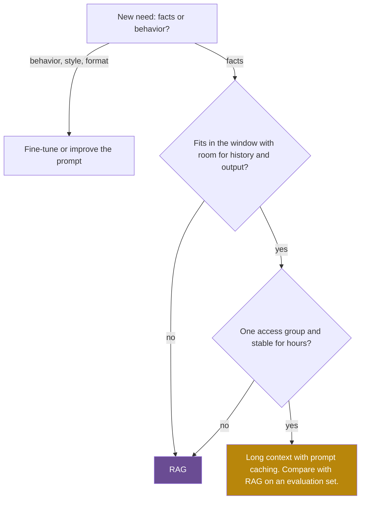

## 1. The question this idea answers

A company asks: "Can our assistant answer questions about our own policies, with the current rules, and show where each answer is written?"

A language model alone cannot do this well, for five reasons:

1. **Knowledge cutoff.** Training stopped on some date. Events and documents after that date are not in the weights. For example, the Llama-3.1-8B model card states: "The pretraining data has a cutoff of December 2023."
2. **Private data.** The company's documents were never in the training data.
3. **Hallucination.** When the model does not know a fact, it still writes fluent text. Nothing in next-token prediction forces it to say "I do not know".
4. **Freshness.** A policy changed yesterday. The weights cannot change by tomorrow.
5. **Citations and control.** The answer must show its source. Some users may see a document and others may not.

Retrieval-augmented generation (RAG) is the standard answer to all five. For each question, a search system finds the relevant passages. The application puts them into the prompt. The model answers from them. This lesson explains why that works and where the idea started. It shows the full system. It also shows when long context or fine-tuning is the better tool.

## 2. Mental model

> [!analogy] A closed-book exam and an open-book exam
> A model without retrieval takes a **closed-book exam**. It answers from memory. Memory was frozen on the day it stopped studying. When it does not remember, it guesses in confident sentences.
>
> RAG turns this into an **open-book exam with a librarian**. Before each answer, the librarian brings the five most relevant pages. The model reads them and answers. It can also say which page it used.
>
> **Where it stops working:** the librarian can bring the wrong pages, and the model then answers wrongly with full confidence. The model can also ignore a page or misread it. And unlike a student, the model does not learn from the pages: the next question starts from the same frozen memory.

## 3. Terms

| Term | Plain meaning |
|---|---|
| retrieval-augmented generation (RAG) | A design where a search step finds relevant text for each question, and the model generates its answer with that text in its context window. |
| parametric memory | Knowledge stored in the weights (parameters) of a model. Only training can change it. |
| non-parametric memory | Knowledge stored outside the model, for example in a document index. You can change it at any time. |
| knowledge cutoff | The date after which the training data has no information. |
| hallucination | Fluent model output that no source supports, for example an invented policy or citation. |
| grounding | Making an answer depend on given source text, so that each claim can be checked against that text. |
| retriever | The component that finds the passages most relevant to a query. |
| generator | The language model that writes the answer from the query and the retrieved passages. |
| passage (chunk) | A short piece of a document, the unit that the retriever returns. |
| indexing pipeline | The offline part of RAG: parse, chunk, embed and store documents. |
| query pipeline | The online part of RAG: process the question, retrieve, rerank, assemble the prompt and generate. |
| top-k | The $k$ highest-scoring passages for a query. |
| marginalization | Summing a probability over all values of a hidden choice, here: which passage the answer used. |
| long-context prompting | Putting a whole knowledge base into the prompt on every call, with no retrieval. |
| fine-tuning | Further training of a model on new examples. It changes the weights. |
| KV cache | The stored key and value vectors of every prompt token in every layer. Its size grows linearly with the prompt length. |

All terms are also in the [Glossary](/notes/ai/llm-systems/glossary).

## 4. What a model knows, and why it invents facts

### 4.1 Two places for knowledge

A language model computes the probability of the next token from two inputs only. These are its weights and the tokens in its context window (lesson [L1 of part 02](/notes/ai/llm-systems/02-attention-and-the-transformer/l1-from-text-to-vectors)). Everything it "knows" lives in one of these two places.

- The **weights** hold what training wrote into them. For Llama-3.1-8B, that is about 8.03 billion numbers, about 16 GB in BF16. They are fixed after training.
- The **context window** holds what the application sends in this one request. It changes with every call.

So there are exactly two ways to give a model a new fact. You can train it into the weights (fine-tuning). Or you can put it into the window (prompting, and RAG as an automatic form of prompting).

### 4.2 Why a model invents facts

Training teaches the model to give high probability to the next token of real text. It does not teach a separate signal for "this fact is not in my weights". So for a question about a policy that the model never saw, the most probable continuation is still a fluent, plausible policy. The papers lesson on [next-token prediction](/notes/papers/reasoning-models/2025-why-reasoning-models-loop/01-background-probability-and-next-token-prediction) shows how these probabilities form.

> [!key] RAG changes the input, not the model
> RAG does not make the model more honest. It makes the right facts present in the window, so that the most probable continuation is now the grounded one. If the retriever brings the wrong facts, the most probable continuation is a confident wrong answer.

## 5. The original RAG paper (Lewis et al., 2020)

### 5.1 The idea in two paragraphs

Lewis et al. named the method in "Retrieval-Augmented Generation for Knowledge-Intensive NLP Tasks" (NeurIPS 2020, arXiv 2005.11401). The abstract states the design: "the parametric memory is a pre-trained seq2seq model and the non-parametric memory is a dense vector index of Wikipedia". The retriever is DPR, a bi-encoder with two BERT-base encoders (lesson [L2](/notes/ai/llm-systems/06-rag/l2-embeddings-in-depth)). The index holds 21M passages of 100 words each, from the December 2018 Wikipedia dump. FAISS searches it with an HNSW index (lesson [L4](/notes/ai/llm-systems/06-rag/l4-vector-indexes)). The generator is BART-large, a sequence-to-sequence model with about 400M parameters.

Training kept the document encoder and the index fixed. It fine-tuned the query encoder and the generator together, end to end, from question and answer pairs only. No label said which passage was correct. The model learned to retrieve whatever passage made the right answer most probable. With RAG-Sequence, it reached 44.5 exact match on Natural Questions, then a new state of the art. A further test showed the core benefit: replacing the index changes what the model knows, with no retraining (section 5.3).

### 5.2 The math: the passage is a hidden variable

The retriever gives a probability to each passage $z$ for a question $x$:

$$
p_\eta(z \mid x) \propto \exp\big(d(z)^\top q(x)\big), \qquad d(z) = \mathrm{BERT}_d(z), \quad q(x) = \mathrm{BERT}_q(x)
$$

The symbols mean:

- $q(x)$ is the query vector and $d(z)$ is the passage vector. Each is a 768-dimensional output of a BERT-base encoder.
- $d(z)^\top q(x)$ is their dot product: the relevance score.
- $\propto$ means "proportional to". The scores become probabilities with a softmax over the top-$k$ passages.
- $\eta$ marks the retriever parameters. $\theta$ marks the generator parameters.

The answer $y$ has $N$ tokens $y_1, \dots, y_N$. The model does not know which passage is right, so it sums over the top-$k$ passages. The paper gives two versions:

$$
p_{\text{RAG-Sequence}}(y \mid x) \approx \sum_{z \in \text{top-}k} p_\eta(z \mid x) \prod_{i=1}^{N} p_\theta(y_i \mid x, z, y_{1:i-1})
$$

$$
p_{\text{RAG-Token}}(y \mid x) \approx \prod_{i=1}^{N} \sum_{z \in \text{top-}k} p_\eta(z \mid x)\, p_\theta(y_i \mid x, z, y_{1:i-1})
$$

- **RAG-Sequence** picks one passage for the whole answer, then averages over passages.
- **RAG-Token** may switch passages at every token. It mixes the passages inside the product.

> [!example] Worked example: RAG-Sequence and RAG-Token with two passages
> Two passages have retriever scores $3.0$ and $1.0$.
>
> **Step 1: retriever probabilities.** $p(z_1 \mid x) = e^{3} / (e^{3} + e^{1}) = 20.0855 / 22.8038 = 0.8808$. So $p(z_2 \mid x) = 0.1192$.
>
> **Step 2: generator probabilities for a 2-token answer.** With $z_1$: $0.9$ for token 1 and $0.8$ for token 2. With $z_2$: $0.3$ and $0.5$.
>
> **Step 3: RAG-Sequence.** $p(y \mid x, z_1) = 0.9 \times 0.8 = 0.72$ and $p(y \mid x, z_2) = 0.3 \times 0.5 = 0.15$. The sum is $0.8808 \times 0.72 + 0.1192 \times 0.15 = 0.6342 + 0.0179 = 0.6521$.
>
> **Step 4: RAG-Token.** Token 1: $0.8808 \times 0.9 + 0.1192 \times 0.3 = 0.8285$. Token 2: $0.8808 \times 0.8 + 0.1192 \times 0.5 = 0.7642$. The product is $0.6332$ (computed from unrounded values).
>
> Both values are below 0.72, the probability with the best passage alone. The weak passage $z_2$ pulls the answer probability down, in proportion to its retriever probability.

The same numbers in NumPy:

```python
import numpy as np

scores = np.array([3.0, 1.0])            # d(z)^T q(x) for the top-2 passages
p_z = np.exp(scores) / np.exp(scores).sum()  # retriever: softmax over the top-k

# generator probabilities p(y_i | x, z, y_<i) for a 2-token answer
gen = np.array([[0.9, 0.8],              # passage z1
                [0.3, 0.5]])             # passage z2

rag_sequence = (p_z * gen.prod(axis=1)).sum()   # one passage for the whole answer
rag_token = (p_z[:, None] * gen).sum(axis=0).prod()  # mix passages per token

print("p(z|x)       =", p_z.round(4))
print("RAG-Sequence =", round(rag_sequence, 4))
print("RAG-Token    =", round(rag_token, 4))
```

Output:

```text
p(z|x)       = [0.8808 0.1192]
RAG-Sequence = 0.6521
RAG-Token    = 0.6332
```

- `p_z` is the softmax of the scores over the top-$k$ passages only. The paper calls this "top-K truncated".
- `gen.prod(axis=1)` multiplies the token probabilities of each passage: the whole answer under one passage.
- `(p_z[:, None] * gen).sum(axis=0)` mixes the passages per token. Then `.prod()` multiplies the tokens.

Why does this matter in an interview? The gradient of this sum reaches the query encoder through $p_\eta(z \mid x)$. A passage that makes the answer more probable gets a higher retriever probability after training. That is how the paper trained the retriever without passage labels.

### 5.3 Swapping the index updates the knowledge

The paper built a second index from the December 2016 Wikipedia dump. It asked the trained model "Who is {position}?" for 82 world leaders who changed between 2016 and 2018.

| Index | Leaders asked about | Correct |
|---|---|---|
| 2016 | 2016 leaders | 70% |
| 2018 | 2018 leaders | 68% |
| 2018 | 2016 leaders | 12% |
| 2016 | 2018 leaders | 4% |

The weights did not change between rows. Only the index changed. This is the core argument for RAG: you update knowledge by updating documents.

### 5.4 What "RAG" means today

Most systems today do not train the retriever and the generator together. They use a separately trained embedding model, a vector database, often a keyword index, and an unchanged LLM behind an API. The retrieved passages go into the prompt as text. This guide uses "RAG" in this modular sense. The math of section 5.2 still explains one thing well. The answer is a mixture over the passages in the window, weighted by how much the model relies on each.

## 6. The two pipelines

### 6.1 The full architecture

A RAG system has an **offline indexing pipeline** and an **online query pipeline**. They meet at the indexes, which are the stored state of the system.


### 6.2 Offline indexing, stage by stage

| Stage | Input | Output | The decision that can break answers |
|---|---|---|---|
| Connect | Source systems: file shares, wikis, ticket tools, databases | Raw files with IDs and access lists | Which sources, how often, and who may see each file |
| Parse and clean | PDF, HTML, DOCX, scans | Clean text with structure: headings, tables, pages | Reading order, tables, OCR quality ([L3](/notes/ai/llm-systems/06-rag/l3-chunking-and-ingestion)) |
| Chunk and enrich | Clean text | Chunks with metadata and context | Chunk size, boundaries, overlap, contextual headers ([L3](/notes/ai/llm-systems/06-rag/l3-chunking-and-ingestion)) |
| Embed | Chunks | One vector per chunk | Model, dimension, prefixes ([L2](/notes/ai/llm-systems/06-rag/l2-embeddings-in-depth)) |
| Index | Vectors, text, metadata | Vector index and keyword index | Index type, parameters, filters ([L4](/notes/ai/llm-systems/06-rag/l4-vector-indexes), [L5](/notes/ai/llm-systems/06-rag/l5-hybrid-search-and-reranking)) |

### 6.3 Online query, stage by stage

| Stage | Input | Output | Typical cost driver |
|---|---|---|---|
| Receive | Question, user identity, conversation | A request with an access filter | Authentication |
| Rewrite (optional) | Question and history | One or more search queries | One LLM call ([L6](/notes/ai/llm-systems/06-rag/l6-query-side-techniques)) |
| Embed the query | Query text | Query vector | One forward pass of the embedding model |
| Retrieve | Query vector and query text | About 50 candidates from each index, filtered | Index search |
| Fuse and rerank | Candidate lists | The best 5 to 20 chunks | Cross-encoder passes ([L5](/notes/ai/llm-systems/06-rag/l5-hybrid-search-and-reranking)) |
| Assemble | Chunks with IDs, instructions, question | The prompt | Token budget ([L7](/notes/ai/llm-systems/06-rag/l7-generation-and-grounding)) |
| Generate | Prompt | Answer with citations | Prefill of the prompt and decode of the answer |

> [!key] Every RAG failure has an address
> A wrong answer starts in one stage. Examples: a bad parse, a cut chunk, a weak embedding, an index that missed, or a filter that removed the right chunk. It can also be a bad order, or a model that ignored the evidence. Log the output of each stage, so that you can find the address. Lesson [L8](/notes/ai/llm-systems/06-rag/l8-evaluating-rag) measures each stage.

### 6.4 Where the time goes in one query

Generation usually dominates, because decode writes one token at a time and each step reads all weights (lesson [Prefill and decode](/notes/ai/llm-systems/03-kv-cache/l2-prefill-and-decode)). The numbers below are ideal lower bounds that these notes computed for Llama-3.1-8B on one H100 SXM. Real systems are slower.

> [!example] Worked example: generation time for a 3,000-token RAG prompt
> **Prefill.** Linear layers: $2 \times 8.03 \times 10^{9} \times 3{,}000 = 4.818 \times 10^{13}$ FLOPs. Attention: $2 L d T^2 = 2 \times 32 \times 4{,}096 \times 3{,}000^2 = 2.359 \times 10^{12}$ FLOPs. Total $5.054 \times 10^{13}$ FLOPs. At 989 TFLOPS, that is at least 0.051 s.
>
> **Decode.** Each token reads the weights ($8.03 \times 10^9 \times 2 = 16.06$ GB) and the KV cache ($3{,}000 \times 131{,}072$ bytes $= 0.393$ GB). At 3.35 TB/s, one token takes at least $16.45 \text{ GB} / 3{,}350 \text{ GB/s} = 4.91$ ms.
>
> **A 300-token answer:** $300 \times 4.91 \text{ ms} = 1.47$ s.
>
> So with batch 1, decode takes about 29 times longer than prefill here. Retrieval steps must be fast, but the answer length usually decides the total latency.

## 7. RAG, long context or fine-tuning?

### 7.1 Long context: what it costs in the serving system

Current models accept very long prompts, and a small knowledge base can go into the prompt whole. Anthropic's contextual retrieval post (19 September 2024) gives a rule of thumb: "If your knowledge base is smaller than 200,000 tokens (about 500 pages of material)", you can include all of it in the prompt. Prompt caching makes that cheaper ([L7 of context engineering](/notes/ai/context-engineering/01-foundations/l7-prompt-caching), [Prefix caching](/notes/ai/llm-systems/04-inference/l9-prefix-caching-and-kv-reuse)).

But length has a price inside the serving system. The code below compares a 3,000-token RAG prompt with a full 131,072-token prompt, the maximum context of Llama-3.1-8B. It uses the KV cache formula of [L3 of part 03](/notes/ai/llm-systems/03-kv-cache/l3-the-kv-cache-size-formula).

```python
# Llama-3.1-8B on one H100 SXM: ideal lower bounds, no overheads
PARAMS, LAYERS, D_MODEL = 8.03e9, 32, 4096
KV_BYTES_PER_TOKEN = 2 * 32 * 8 * 128 * 2      # K and V, 32 layers, 8 KV heads, d_h 128, BF16
PEAK_FLOPS, HBM_BW = 989e12, 3.35e12          # dense BF16 FLOP/s, bytes/s
WEIGHT_BYTES = PARAMS * 2

def prefill_seconds(t):
    linear = 2 * PARAMS * t                    # every weight: one multiply and one add per token
    attention = 2 * LAYERS * D_MODEL * t**2    # causal QK^T and PV summed over positions
    return (linear + attention) / PEAK_FLOPS

def decode_ms_per_token(t):
    return (WEIGHT_BYTES + KV_BYTES_PER_TOKEN * t) / HBM_BW * 1e3

for t in (3_000, 131_072):
    print(f"{t:>7} tokens: prefill >= {prefill_seconds(t):.3f} s, "
          f"KV cache = {KV_BYTES_PER_TOKEN * t / 2**30:.3f} GiB, "
          f"decode >= {decode_ms_per_token(t):.2f} ms/token")
```

Output:

```text
   3000 tokens: prefill >= 0.051 s, KV cache = 0.366 GiB, decode >= 4.91 ms/token
 131072 tokens: prefill >= 6.682 s, KV cache = 16.000 GiB, decode >= 9.92 ms/token
```

- `linear` counts one multiply and one add per weight per token.
- `attention` grows with $T^2$. At 131,072 tokens it is $4.504 \times 10^{15}$ FLOPs, larger than the linear part ($2.105 \times 10^{15}$).
- `decode_ms_per_token` adds the KV cache bytes to the weight bytes, because each decode step reads both.

> [!example] Worked example: what the long prompt costs per request
> | Quantity | RAG, 3,000 tokens | Long context, 131,072 tokens | Ratio |
> |---|---|---|---|
> | Prefill lower bound | 0.051 s | 6.68 s | about 131 |
> | KV cache of one request | 0.366 GiB | 16 GiB | 43.7 |
> | Decode time per token | 4.91 ms | 9.92 ms | 2.0 |
>
> Take an 80 GB H100 with 16 GB of weights. From KV memory alone, at most about 3 such long requests fit at the same time. About 160 RAG requests of 3,000 tokens fit in the same memory. This is why prefix caching matters so much for long shared prompts.

Quality also changes with length. Liu et al. ("Lost in the Middle", 2023) measured GPT-3.5-Turbo with 20 documents. Accuracy was 75.8% with the answer document first and 53.8% with it at position 10. Closed-book, with no documents, the model scored 56.1% ([the paper notes](/notes/papers/long-context/2023-lost-in-the-middle/00-paper-on-one-page)). A long window does not guarantee that the model uses all of it.

### 7.2 Fine-tuning: good for behavior, weak for facts

Fine-tuning writes into parametric memory. It changes style, format and skills well. For facts it has three problems. You must train again for each change. You cannot delete one fact on request. The answer has no source to cite. Ovadia et al. compared the two for knowledge injection ("Fine-Tuning or Retrieval?", arXiv 2312.05934): "while unsupervised fine-tuning offers some improvement, RAG consistently outperforms it."

### 7.3 The decision table

| Criterion | RAG | Long context | Fine-tuning |
|---|---|---|---|
| Cost per query | Small prompt, plus retrieval | Large prompt, cheaper with cache hits | Small prompt, plus training runs |
| Latency | Retrieval (milliseconds) plus a short prefill | Long prefill, more KV reads per token | Shortest prompt |
| Freshness | Re-index one document | Rebuild the prompt | Train again |
| Quality risk | Retriever misses the right chunk | Model misses a fact inside a long window | Model mixes or forgets facts |
| Citations | Chunk IDs | Possible, if documents carry IDs | None |
| Access control | Filter in the retriever per user | One prompt per access group | One model for all users |
| Delete a fact | Delete its chunks | Remove it from the prompt | Train again, and it may still leak |
| Size limit | Billions of chunks | The context window | Model capacity |
| Best for | Large or changing or private corpora | Small, stable, shared corpora | Style, format, task skills |



The options combine. A common design fine-tunes for the output format and retrieves the facts. Another design retrieves a generous set of chunks and puts all of them into a large window.

### 7.4 What RAG does not fix

1. **A missed retrieval.** If the right chunk is not in the top $k$, the model cannot use it. Lessons [L4](/notes/ai/llm-systems/06-rag/l4-vector-indexes) and [L5](/notes/ai/llm-systems/06-rag/l5-hybrid-search-and-reranking) work on this.
2. **Ignored or misread evidence.** The model can still answer from its weights. Lesson [L7](/notes/ai/llm-systems/06-rag/l7-generation-and-grounding) covers instructions, citations and checks.
3. **Questions that need the whole corpus.** "List every policy that mentions refunds" has no single answer chunk. Lesson [L6](/notes/ai/llm-systems/06-rag/l6-query-side-techniques) covers decomposition, agentic retrieval and GraphRAG.
4. **Instructions hidden in documents.** A retrieved document can contain text that tries to steer the model. Lesson [L7](/notes/ai/llm-systems/06-rag/l7-generation-and-grounding) covers indirect prompt injection.

### Exercises

Put these in the notebook folder `llm-systems/` of `C:\Users\ASohi\Downloads\AI\agent-harness-lab`.

1. **RAG marginalization.** Write `rag_probs(scores, gen)` that returns the RAG-Sequence and RAG-Token probabilities for any $k$ passages and any answer length.
   - Acceptance test: the inputs of section 5.2 give 0.6521 and 0.6332. Scores of 50 and 0 give 0.72 for both.
   - Hint 1: compute the softmax with the maximum subtracted first, for numerical safety.
   - Hint 2: RAG-Token mixes along the passage axis before the product. RAG-Sequence multiplies first.
2. **Long context against RAG.** Write `compare(t_rag, t_long)` for Llama-3.1-8B on one H100. Return the ratios of prefill time, KV cache size and decode time per token.
   - Acceptance test: `compare(3_000, 131_072)` gives a KV ratio of 43.69 and a prefill ratio between 130 and 132.
   - Hint 1: reuse the constants of section 7.1.
   - Hint 2: the attention FLOPs grow with $T^2$, so the prefill ratio is larger than the token ratio.
3. **A design chooser.** Write `choose(kb_tokens, window, changes_per_day, access_groups, needs_citations, needs_new_style)`. Return a first design to test and a reason, as in the flowchart of section 7.3.
   - Acceptance test: a 3.2M-token corpus gives "RAG". A 90,000-token handbook with one access group gives "long context". The same handbook with two access groups gives "RAG". A style need with a large corpus gives "RAG + fine-tune".
   - Hint 1: check the size first, then access, then stability.
   - Hint 2: a style need adds fine-tuning to any design.

## 8. Common mistakes

1. **"RAG stops hallucination."** RAG puts evidence into the window. The model can still ignore it, and a wrong chunk produces a confident wrong answer.
2. **"A 1M-token window makes RAG obsolete."** Long prompts cost prefill time and KV memory on every request. For Llama-3.1-8B, one 131,072-token request needs 16 GiB of KV cache. Accuracy can also drop for facts in the middle of the window.
3. **"Fine-tune the model on our documents so that it knows them."** Fine-tuning is weak for facts that change. It cannot cite, and it cannot forget one fact on request. Use it for behavior.
4. **"The 2020 RAG paper is what we build today."** The paper trained the query encoder and the generator end to end. Most systems today combine separately trained components, with an unchanged LLM.
5. **"The retriever is the RAG system."** It is one stage of two pipelines. Parsing, chunking, filters, prompt assembly and logging decide as much as the index.
6. **"Retrieval latency is the main cost."** At batch 1, decode of a 300-token answer takes at least about 1.5 s on the example of section 6.4. Retrieval is usually milliseconds.

## 9. One-minute explanation

A language model knows only two things: its weights, frozen at a training cutoff, and the tokens in its context window. So it cannot know private or new documents, and when it does not know, it still writes fluent text. RAG adds non-parametric memory: an index of document chunks that we can update at any time. Offline, we parse documents, cut them into chunks, embed them and store them in vector and keyword indexes. Online, we embed the question, retrieve the best chunks with access filters, rerank them, and put them into the prompt with instructions to cite. The original paper by Lewis et al. in 2020 treated the passage as a hidden variable and summed over the top-k passages. It showed that swapping the index updates the knowledge without retraining. Long context is a good alternative for small, stable, shared corpora. But a 128K-token prompt costs about 131 times the prefill compute of a 3,000-token prompt and 16 GiB of KV cache on an 8B model. Fine-tuning is for behavior and format, not for facts that change.

## 10. Check questions

```check
{
  "question": "Name the five problems of a model without retrieval, and say which one RAG does not fully solve.",
  "answer": "Knowledge cutoff, private data, hallucination, freshness, and citations with access control. RAG addresses all five by putting checked text into the window. It does not fully solve hallucination: the model can ignore the evidence, and a wrong retrieved chunk produces a confident wrong answer."
}
```

```check
{
  "question": "In the RAG paper, which parts were trained and which were frozen? Why freeze the document encoder?",
  "hint": "Think about what must be recomputed when the document encoder changes.",
  "answer": "The document encoder and the index stayed fixed. The query encoder and the BART generator were fine-tuned together. If the document encoder changed, all 21M passage vectors would need to be computed again and the index rebuilt during training, which is very expensive."
}
```

```check
{
  "question": "Interview follow-up: derive the RAG-Sequence probability for retriever scores (2.0, 0.0) and a one-token answer with generator probabilities 0.6 under passage 1 and 0.9 under passage 2. Does RAG-Token give a different value here?",
  "hint": "With one token, the product over tokens has one factor.",
  "answer": "Retriever: $p(z_1) = e^2/(e^2 + e^0) = 7.389/8.389 = 0.8808$, so $p(z_2) = 0.1192$. RAG-Sequence: $0.8808 \\times 0.6 + 0.1192 \\times 0.9 = 0.5285 + 0.1073 = 0.6358$. For a one-token answer, RAG-Token is the same sum, because the product has only one factor. The two versions differ only for answers with two or more tokens."
}
```

```check
{
  "question": "Interview follow-up: a client wants to put a 131,072-token manual into every prompt of Llama-3.1-8B on one H100 80 GB. Compute the KV cache per request and the ideal prefill time, and say how many such requests can run at once.",
  "hint": "Use 131,072 bytes per token for the KV cache and 2 × params × T + 2 L d T² for prefill FLOPs.",
  "answer": "KV per token: $2 \\times 32 \\times 8 \\times 128 \\times 2 = 131{,}072$ bytes. Times 131,072 tokens = $2^{34}$ bytes = 16 GiB. Prefill: linear $2 \\times 8.03 \\times 10^9 \\times 131{,}072 = 2.105 \\times 10^{15}$ FLOPs, plus attention $2 \\times 32 \\times 4{,}096 \\times 131{,}072^2 = 4.504 \\times 10^{15}$ FLOPs, total $6.609 \\times 10^{15}$, so at least 6.68 s at 989 TFLOPS. Memory: 80 GB minus about 16 GB of weights leaves about 64 GB, which is about 59.6 GiB, so at most 3 requests at once from KV memory alone, before activations and fragmentation. Prefix caching helps if all requests share the same manual prefix, because the cached KV blocks can be shared."
}
```

```check
{
  "question": "Interview follow-up: an interviewer says 'RAG is a workaround for small context windows. Now that windows are huge, it is dead.' Give a three-part answer with numbers.",
  "answer": "1. Cost and latency: prefill grows at least linearly with prompt length, and attention grows with its square. A 131,072-token prompt needs about 131 times the prefill compute of a 3,000-token prompt on Llama-3.1-8B, and 16 GiB of KV cache against 0.37 GiB. 2. Quality: Lost in the Middle measured GPT-3.5-Turbo at 75.8% with the answer document first and 53.8% at position 10 of 20, below its closed-book 56.1%. 3. Function: retrieval gives per-user access filters, deletion, freshness and citations, and corpora larger than any window. Long context is the better first design for a small, stable, shared corpus, often with prompt caching."
}
```

```check
{
  "question": "Interview follow-up: what did the index-swap experiment of the RAG paper show, and what does it imply for a production system?",
  "answer": "With the 2016 index the model answered 70% of questions about 2016 world leaders. With the 2018 index it answered 68% about 2018 leaders. Mismatched pairs gave 12% and 4%. The weights were the same in all rows, so the index alone controlled the knowledge. In production this means: update documents, not weights, to change facts. It also means index versioning matters, because the index version decides the answers."
}
```

```check
{
  "question": "Why is decode, not retrieval, usually the largest part of RAG latency at batch 1?",
  "answer": "Each decode step reads all weights and the KV cache from GPU memory to produce one token. For Llama-3.1-8B on an H100 that is at least about 4.9 ms per token, so a 300-token answer takes at least about 1.5 s. An approximate vector search over millions of vectors usually takes milliseconds."
}
```

```check
{
  "question": "Exercise 1: show a reference solution.",
  "answer": "```python\nimport numpy as np\n\ndef rag_probs(scores, gen):\n    \"\"\"scores: [k] retriever scores. gen: [k, n] token probabilities per passage.\"\"\"\n    scores, gen = np.asarray(scores, float), np.asarray(gen, float)\n    p_z = np.exp(scores - scores.max())\n    p_z /= p_z.sum()\n    seq = float((p_z * gen.prod(axis=1)).sum())\n    tok = float((p_z[:, None] * gen).sum(axis=0).prod())\n    return seq, tok\n\nseq, tok = rag_probs([3.0, 1.0], [[0.9, 0.8], [0.3, 0.5]])\nassert round(seq, 4) == 0.6521 and round(tok, 4) == 0.6332\nseq, tok = rag_probs([50.0, 0.0], [[0.9, 0.8], [0.3, 0.5]])\nassert abs(seq - 0.72) < 1e-9 and abs(tok - 0.72) < 1e-9   # one passage dominates\nprint(\"ok\")\n```"
}
```

```check
{
  "question": "Exercise 2: show a reference solution.",
  "answer": "```python\nPARAMS, LAYERS, D_MODEL = 8.03e9, 32, 4096\nKV_PER_TOKEN = 2 * 32 * 8 * 128 * 2\nPEAK, BW, W = 989e12, 3.35e12, 8.03e9 * 2\n\ndef prefill_s(t):\n    return (2 * PARAMS * t + 2 * LAYERS * D_MODEL * t * t) / PEAK\n\ndef compare(t_rag, t_long):\n    return {\n        \"prefill_ratio\": prefill_s(t_long) / prefill_s(t_rag),\n        \"kv_ratio\": t_long / t_rag,\n        \"decode_ratio\": (W + KV_PER_TOKEN * t_long) / (W + KV_PER_TOKEN * t_rag),\n    }\n\nr = compare(3_000, 131_072)\nprint({k: round(v, 2) for k, v in r.items()})\nassert round(r[\"kv_ratio\"], 2) == 43.69\nassert 130 < r[\"prefill_ratio\"] < 132\n```\n\nOutput: `{'prefill_ratio': 130.76, 'kv_ratio': 43.69, 'decode_ratio': 2.02}`"
}
```

```check
{
  "question": "Exercise 3: show a reference solution.",
  "answer": "```python\ndef choose(kb_tokens, window, changes_per_day, access_groups,\n           needs_citations, needs_new_style):\n    \"\"\"Return a first design to test, with a reason.\"\"\"\n    if needs_new_style and kb_tokens == 0:\n        return \"fine-tune\", \"behavior change, no knowledge base\"\n    if kb_tokens > window * 0.5:\n        design, why = \"RAG\", \"the knowledge base does not fit with room to spare\"\n    elif access_groups > 1:\n        design, why = \"RAG\", \"different users may see different documents\"\n    elif changes_per_day > 24:\n        design, why = \"RAG\", \"the prompt prefix would change too often to cache\"\n    elif kb_tokens <= 200_000:\n        design, why = \"long context\", \"small, stable, shared: test it first\"\n    else:\n        design, why = \"RAG\", \"large prompts cost prefill time and KV memory\"\n    if needs_citations and design == \"long context\":\n        why += \" (label each document with an ID for citations)\"\n    if needs_new_style:\n        design += \" + fine-tune\"\n    return design, why\n\nassert choose(3_200_000, 1_000_000, 1, 1, True, False)[0] == \"RAG\"\nassert choose(90_000, 1_000_000, 0.1, 1, False, False)[0] == \"long context\"\nassert choose(90_000, 1_000_000, 0.1, 2, False, False)[0] == \"RAG\"\nassert choose(0, 128_000, 0, 1, False, True)[0] == \"fine-tune\"\nassert choose(500_000, 128_000, 1, 1, True, True)[0] == \"RAG + fine-tune\"\nprint(\"ok\")\n```\n\nThe thresholds (half the window, 24 changes per day, 200,000 tokens) are starting points for a first test, not rules. Measure both designs on an evaluation set."
}
```

## 11. Links

- Previous: [L8: Production operations](/notes/ai/llm-systems/05-cloud-hosting/l8-production-operations)
- Next: [L2: Embeddings in depth](/notes/ai/llm-systems/06-rag/l2-embeddings-in-depth)
- Related: [Why retrieval](/notes/ai/context-engineering/04-write-and-rag/l3-why-retrieval) and [The RAG pipeline](/notes/ai/context-engineering/04-write-and-rag/l4-the-rag-pipeline) in the context engineering course
- Related: [The KV cache size formula](/notes/ai/llm-systems/03-kv-cache/l3-the-kv-cache-size-formula), [Prefill and decode](/notes/ai/llm-systems/03-kv-cache/l2-prefill-and-decode), [Prefix caching and KV reuse](/notes/ai/llm-systems/04-inference/l9-prefix-caching-and-kv-reuse)
- Paper: [Lost in the Middle on one page](/notes/papers/long-context/2023-lost-in-the-middle/00-paper-on-one-page)
- Production: [L9: Production RAG architecture](/notes/ai/llm-systems/06-rag/l9-production-rag-architecture)
- Drill: [Drill: RAG](/notes/ai/llm-systems/08-interview-drills/l3-chain-rag)

### Sources

- Lewis et al., "Retrieval-Augmented Generation for Knowledge-Intensive NLP Tasks", NeurIPS 2020: https://arxiv.org/abs/2005.11401 (checked on 2026-10-15)
- Karpukhin et al., "Dense Passage Retrieval for Open-Domain Question Answering", EMNLP 2020: https://arxiv.org/abs/2004.04906 (checked on 2026-10-15)
- Anthropic, "Introducing Contextual Retrieval", 19 September 2024: https://www.anthropic.com/news/contextual-retrieval (checked on 2026-10-15)
- Liu et al., "Lost in the Middle: How Language Models Use Long Contexts": https://arxiv.org/abs/2307.03172 (checked on 2026-10-15)
- Ovadia et al., "Fine-Tuning or Retrieval? Comparing Knowledge Injection in LLMs": https://arxiv.org/abs/2312.05934 (checked on 2026-10-15)
- Meta, Llama-3.1-8B model card (context length 128k, GQA, knowledge cutoff December 2023) and its config.json (hidden size 4096, 32 layers, 8 KV heads, head dimension 128): https://huggingface.co/meta-llama/Llama-3.1-8B (checked on 2026-10-15)
- NVIDIA H100 specifications (H100 SXM: 80 GB, 3.35 TB/s, BF16 Tensor Core 1,979 TFLOPS with sparsity, so about 989 TFLOPS dense): https://www.nvidia.com/en-us/data-center/h100/ (checked on 2026-10-15)
