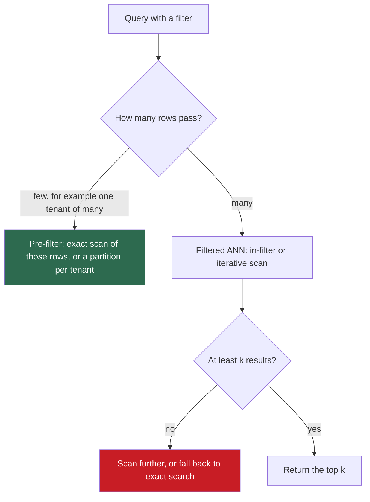

## 1. The question this idea answers

An index holds 10 million chunk vectors of 1,024 dimensions. A user asks a question. We need the 10 vectors closest to the query vector, within a few milliseconds, while new documents arrive and old ones leave. Some users may see only their own tenant's documents.

Comparing the query with every vector is exact but reads 41 GB per query. So every vector database uses an **approximate** index. The interviewer's questions follow from that word. How does the index skip most vectors? What does it miss, and how do you measure it? What do `M`, `efConstruction`, `efSearch`, `nlist` and `nprobe` do? How does a vector of 4,096 bytes shrink to 64 bytes? And why does a filter such as `tenant_id = 7` sometimes return nothing?

## 2. Mental model

> [!analogy] Finding the nearest café in a large country
> - **Flat (exact) search:** measure the distance to every café in the country. Always right, always slow.
> - **IVF:** the country has districts with a center point. Find the few districts whose centers are nearest, and measure only the cafés inside them.
> - **HNSW:** a road network with highways on top and local streets at the bottom. Drive on the highway toward the target, leave it near the target, then follow local streets, always taking the road that gets closer.
> - **PQ:** instead of exact addresses, each café has a short code such as "north-west, river side, old town". You compare codes with a small lookup table instead of measuring each distance.
>
> **Where it stops working:** the space has hundreds of dimensions, not two. A café just across a district border is missed if you scan only one district. A driver who always takes the locally closer road can stop at a dead end that only looks best. A short code loses detail. So every index is approximate, and its error must be measured, not assumed.

## 3. Terms

| Term | Plain meaning |
|---|---|
| k-nearest neighbors (k-NN) | The $k$ stored vectors closest to a query vector. |
| flat index (exact search) | An index that compares the query with every stored vector. It always returns the true k-NN. |
| approximate nearest neighbor (ANN) search | Search that compares the query with only part of the vectors. It is faster and can miss true neighbors. |
| ANN recall@k | The share of the true $k$ nearest neighbors that the index returns. |
| k-means | A clustering method. Assign each vector to its nearest centroid (a group's mean vector), move each centroid to the mean of its vectors, repeat. |
| IVF (inverted file index) | An index that groups vectors into cells around centroids and scans only the cells nearest to the query. |
| `nlist` | The number of IVF cells. pgvector calls it `lists`. |
| `nprobe` | The number of cells that an IVF query scans. pgvector calls it `ivfflat.probes`. |
| HNSW | Hierarchical navigable small world: a graph index with several layers, searched greedily from the top layer down. |
| entry point | The node where an HNSW search starts: a node in the top layer. |
| `M` | The number of links that each new HNSW node gets per layer. Layer 0 allows up to $2M$. |
| `efConstruction` | The candidate list size while HNSW inserts a node. Larger gives a better graph and a slower build. |
| `efSearch` | The candidate list size during an HNSW query. Larger gives higher recall and slower queries. |
| local minimum | A node whose neighbors are all farther from the query than itself, but which is not the true nearest node. |
| product quantization (PQ) | Compression that splits a vector into $m$ sub-vectors and stores, for each, the ID of its nearest centroid. |
| codebook | The list of $k^*$ centroids of one sub-vector space. |
| ADC (asymmetric distance computation) | Distance between an exact query and a PQ-coded vector, computed with a lookup table. |
| DiskANN | A graph index designed to keep the full vectors on an SSD and only compressed codes in memory. |
| pre-filtering, post-filtering | Applying a metadata filter before or during the vector search, or after it. |
| selectivity | The share of vectors that pass a filter. |

All terms are also in the [Glossary](/notes/ai/llm-systems/glossary).

## 4. Exact search and why it does not scale

### 4.1 The cost

For $N$ stored vectors of dimension $d$ and one query, exact search computes $N$ dot products and keeps the best $k$:

$$
\text{FLOPs} = 2Nd, \qquad \text{bytes read} = N \cdot d \cdot b
$$

The symbols mean:

- $2Nd$ counts one multiply and one add per value (lesson [Matrices and matrix multiplication](/notes/ai/llm-systems/01-math-and-hardware/l2-matrices-and-matrix-multiplication)).
- $b$ is the bytes per value: 4 for float32, 2 for float16 or BF16.

One query is a matrix-vector product, so it does about one FLOP per byte read. That is far below the ridge point of a GPU, so exact search of one query is **memory-bound** (lesson [GPUs, memory and bandwidth](/notes/ai/llm-systems/01-math-and-hardware/l5-gpus-memory-and-bandwidth)).

> [!example] Worked example: 10 million vectors on one H100
> $N = 10^7$, $d = 1{,}024$. These are ideal lower bounds computed in these notes for an H100 SXM (3.35 TB/s, about 989 TFLOPS dense BF16).
>
> - **Memory:** float32 needs $10^7 \times 1{,}024 \times 4 = 40.96$ GB. BF16 needs 20.48 GB.
> - **One query, BF16:** read 20.48 GB at 3.35 TB/s: at least 6.11 ms. FLOPs: $2 \times 10^7 \times 1{,}024 = 2.048 \times 10^{10}$. Arithmetic intensity: $2.048 \times 10^{10} / 2.048 \times 10^{10} = 1$ FLOP per byte.
> - **A batch of 1,000 queries:** the vectors are read once and reused 1,000 times. FLOPs: $2.048 \times 10^{13}$, so the intensity is about 1,000, above the ridge point of about 295. The batch is compute-bound: at least $2.048 \times 10^{13} / 989 \times 10^{12} = 20.7$ ms, about 0.02 ms per query.
>
> So exact search on a GPU is reasonable for large offline batches. For one online query at a time on a CPU, it is too slow at this size, and approximate indexes win.

### 4.2 Exact top-k in NumPy

```python
import numpy as np

def exact_topk(Q, X, k):
    """Q: [nq, d], X: [N, d], both L2-normalized. Returns ids [nq, k], best first."""
    scores = Q @ X.T                                        # [nq, N] cosine scores: 2*N*d FLOPs per query
    top = np.argpartition(-scores, k - 1, axis=1)[:, :k]    # O(N) selection, unordered
    order = np.take_along_axis(scores, top, axis=1).argsort(axis=1)[:, ::-1]
    return np.take_along_axis(top, order, axis=1)

rng = np.random.default_rng(0)
X = rng.normal(size=(100_000, 128)).astype(np.float32)
X /= np.linalg.norm(X, axis=1, keepdims=True)
Q = X[:5] + 0.1 * rng.normal(size=(5, 128)).astype(np.float32)
Q /= np.linalg.norm(Q, axis=1, keepdims=True)
ids = exact_topk(Q, X, k=10)
full = np.argsort(-(Q @ X.T), axis=1)[:, :10]               # slow reference: full sort
assert (ids == full).all()
print(ids[:, 0])                                            # each query's nearest is its source row
```

Output:

```text
[0 1 2 3 4]
```

- `Q @ X.T` is the whole search: one matrix product of shape $[n_q, d] \times [d, N] = [n_q, N]$.
- `np.argpartition` finds the top $k$ in $O(N)$ time without sorting all $N$ scores. Only the $k$ winners are then sorted.
- The test compares with a full sort. Exact search is the reference that every approximate index is measured against.

### 4.3 How to measure an approximate index

| Measure | Definition | Why |
|---|---|---|
| ANN recall@k | $\lvert A_k \cap E_k \rvert / k$, with $A_k$ the index results and $E_k$ the exact results | The error that the index adds |
| Latency, p50 and p99 | Time per query at the median and at the 99th percentile | The user's wait |
| QPS | Queries per second at a target recall | Hardware cost |
| Memory | Bytes per vector, including links and codes | Machine size |
| Build and update cost | Time to build, insert and delete | Freshness |

ANN recall is not retrieval recall. ANN recall compares the index with exact search. Retrieval recall compares the results with the chunks that truly answer the question ([L8](/notes/ai/llm-systems/06-rag/l8-evaluating-rag)). An index with ANN recall 1.0 still misses the answer if the embedding model ranks it low.

## 5. IVF: scan only the nearest cells

### 5.1 Build and search

**Build.** Run k-means on the vectors (or a sample) to find `nlist` centroids. Assign each vector to its nearest centroid. Each centroid keeps a list of its vectors: the inverted list.

**Search.** Compare the query with all `nlist` centroids. Take the `nprobe` closest cells. Compute exact distances only to the vectors in those cells.

```python
import numpy as np

def kmeans(X, n_clusters, iters=10, seed=0):
    rng = np.random.default_rng(seed)
    C = X[rng.choice(len(X), n_clusters, replace=False)]          # start from random points
    for _ in range(iters):
        assign = np.argmax(X @ C.T, axis=1)                      # nearest centroid (unit vectors)
        for c in range(n_clusters):
            members = X[assign == c]
            if len(members):
                m = members.mean(axis=0)
                C[c] = m / np.linalg.norm(m)                     # keep centroids on the unit sphere
    return C, np.argmax(X @ C.T, axis=1)

class IVF:
    def __init__(self, X, nlist):
        self.X = X
        self.C, assign = kmeans(X, nlist)
        self.lists = [np.where(assign == c)[0] for c in range(nlist)]   # inverted lists

    def search(self, q, k, nprobe):
        cells = np.argsort(-(self.C @ q))[:nprobe]               # nlist comparisons
        cand = np.concatenate([self.lists[c] for c in cells])    # vectors of the nprobe cells
        scores = self.X[cand] @ q
        best = cand[np.argsort(-scores)[:k]]
        return best, len(cand)

rng = np.random.default_rng(1)
centers = rng.normal(size=(200, 64))
X = centers[rng.integers(0, 200, 20_000)] + 1.2 * rng.normal(size=(20_000, 64))
X /= np.linalg.norm(X, axis=1, keepdims=True)
Q = centers[rng.integers(0, 200, 200)] + 1.2 * rng.normal(size=(200, 64))
Q /= np.linalg.norm(Q, axis=1, keepdims=True)
truth = np.argsort(-(Q @ X.T), axis=1)[:, :10]

ivf = IVF(X, nlist=141)                                          # about sqrt(20,000)
for nprobe in (1, 4, 16, 141):
    hits, scanned = 0, 0
    for q, t in zip(Q, truth):
        found, n = ivf.search(q, 10, nprobe)
        hits += len(set(found) & set(t))
        scanned += n
    print(f"nprobe {nprobe:3d}: recall@10 {hits / (10 * len(Q)):.3f}, "
          f"scanned {scanned / len(Q) / len(X):.1%} of vectors")
```

Output:

```text
nprobe   1: recall@10 0.879, scanned 0.8% of vectors
nprobe   4: recall@10 0.931, scanned 2.9% of vectors
nprobe  16: recall@10 0.972, scanned 11.4% of vectors
nprobe 141: recall@10 1.000, scanned 100.0% of vectors
```

- `kmeans` alternates the two steps of Lloyd's algorithm: assign each vector to the nearest centroid, then move each centroid to the mean of its members. The vectors are unit length, so the nearest centroid is the one with the largest dot product, and the centroids are normalized again.
- `self.lists` is the inverted file: one array of vector IDs per cell.
- With `nprobe = nlist`, IVF scans everything and becomes exact search.

### 5.2 The cost, and the best number of cells

If cells hold about $N/\text{nlist}$ vectors each, one query compares:

$$
\text{comparisons} \approx \text{nlist} + \text{nprobe} \cdot \frac{N}{\text{nlist}}
$$

For a fixed `nprobe`, the derivative with respect to `nlist` is $1 - \text{nprobe} \cdot N / \text{nlist}^2$. It is zero at $\text{nlist}^* = \sqrt{\text{nprobe} \cdot N}$, where the cost is $2\sqrt{\text{nprobe} \cdot N}$.

> [!example] Worked example: IVF on 10 million vectors
> - **pgvector's starting point.** The README suggests `lists` = `sqrt(rows)` for over 1M rows and `probes` = `sqrt(lists)`. So $\sqrt{10^7} = 3{,}162$ lists and $\sqrt{3{,}162} \approx 56$ probes. Comparisons: $3{,}162 + 56 \times 3{,}162 \approx 180{,}000$, which is 1.8% of exact search.
> - **The optimum for nprobe = 16.** $\text{nlist}^* = \sqrt{16 \times 10^7} = 12{,}649$. Comparisons: $2 \times 12{,}649 = 25{,}298$, which is 0.25% of exact search.
>
> The comparison count is not the whole story. With more cells and the same `nprobe`, each query scans a smaller share of the data, so recall falls. Tune `nlist` and `nprobe` together against measured recall.

### 5.3 Measured: recall against the share scanned

These notes ran FAISS 1.15.1 on 100,000 synthetic 128-dimensional vectors drawn around 1,000 overlapping cluster centers, with 1,000 queries (the code is in section 14). The numbers are specific to this data: real embeddings give other values.

```plot
{
  "title": "Measured recall@10 against the share of vectors scanned for FAISS IVF, nlist = 316, nprobe 1 to 32 (gold)",
  "xAxis": {"label": "vectors scanned (%)", "domain": [0, 25]},
  "yAxis": {"label": "recall@10", "domain": [0.7, 1.0]},
  "disableZoom": true,
  "data": [
    {"points": [[0.55, 0.766], [2.65, 0.851], [10.97, 0.928], [21.71, 0.96]], "fnType": "points", "graphType": "polyline", "color": "#B8860B"},
    {"points": [[0.55, 0.766], [2.65, 0.851], [10.97, 0.928], [21.71, 0.96]], "fnType": "points", "graphType": "scatter", "color": "#B8860B"}
  ]
}
```

At `nprobe` = 1 the index scanned 0.55% of the vectors and found 76.6% of the true top 10. At `nprobe` = 32 it scanned 21.7% and found 96.0%. The curve flattens: the last few percent of recall cost the most. The failure is the cell border. A true neighbor that sits just across the border of an unscanned cell is never seen.

FAISS stores an IVF-Flat vector in `4*d + 8` bytes: the vector plus an 8-byte ID (FAISS wiki, "Faiss indexes"). IVF builds fast and uses little extra memory. Its weak points are training and drift. Training needs representative data. If new data has a different distribution, the old centroids fit it badly.

## 6. HNSW: a layered graph

### 6.1 Graph search and its trap

Put every vector in a graph and link it to some near vectors. To search, start at some node and repeatedly move to the neighbor that is closest to the query. Stop when no neighbor is closer. On a well-built graph, this greedy walk reaches the target region in few steps.

The trap is the **local minimum**: a node whose neighbors are all farther from the query, although a closer node exists elsewhere in the graph. Two ideas fight it. A candidate list of size `ef` keeps several promising nodes instead of one. And a hierarchy of layers makes the first steps long jumps, so the walk starts near the right region.

### 6.2 The layers

Malkov and Yashunin (arXiv 1603.09320) build "a multi-layer structure consisting from hierarchical set of proximity graphs (layers) for nested subsets of the stored elements". Layer 0 holds every node. Each node also gets a random top level $l$:

$$
l = \lfloor -\ln(U) \cdot m_L \rfloor, \qquad U \sim \text{Uniform}(0, 1), \qquad m_L = \frac{1}{\ln M}
$$

The paper calls $m_L = 1/\ln(M)$ "a simple choice for the optimal mL". With it, $P(l \ge j) = P(U \le e^{-j/m_L}) = M^{-j}$. So each layer holds about $1/M$ of the nodes of the layer below, like the levels of a skip list.

> [!example] Worked example: layer sizes for 10 million nodes with M = 16
> | Layer $j$ | Expected nodes $N \cdot 16^{-j}$ |
> |---|---|
> | 0 | 10,000,000 |
> | 1 | 625,000 |
> | 2 | 39,063 |
> | 3 | 2,441 |
> | 4 | 153 |
> | 5 | 9.5 |
> | 6 | 0.6 |
>
> The top layer is near $\log_{16}(10^7) = 5.81$. A search does a few greedy steps in each of about 6 layers, then a wider search in layer 0. The paper reports "logarithmic complexity scaling" for this design. The FAISS run of this lesson built 100,000 nodes with M = 16 and reached a top level of 4, close to $\log_{16}(10^5) = 4.15$.

### 6.3 The search algorithm

The paper's K-NN-SEARCH (Algorithm 5) has two phases:

1. **Upper layers, top to layer 1:** run SEARCH-LAYER with `ef` = 1, a plain greedy walk. Its result is the entry point of the next layer down.
2. **Layer 0:** run SEARCH-LAYER with `ef` = `efSearch`, and return the best $k$ of the `ef` results.

SEARCH-LAYER (Algorithm 2) keeps two lists: candidates to expand, ordered by distance, and the best `ef` results found so far. It stops when the closest unexpanded candidate is farther than the worst result: "if distance(c, q) > distance(f, q)". A neighbor joins the lists "if distance(e, q) < distance(f, q) or │W│ < ef".

```python
import heapq

P = {'A': (1, 1), 'B': (3, 2), 'C': (2, 5), 'D': (5, 4), 'E': (7, 1),
     'F': (9, 3), 'G': (6, 7), 'H': (9, 7), 'I': (3, 8), 'J': (8, 9)}
layer2 = {'A': []}                                          # top layer: the entry point only
layer1 = {'A': ['D', 'I'], 'D': ['A', 'I'], 'I': ['A', 'D']}
edges0 = [('A', 'B'), ('B', 'D'), ('B', 'E'), ('A', 'C'), ('C', 'D'), ('C', 'I'), ('D', 'G'),
          ('D', 'E'), ('E', 'F'), ('F', 'H'), ('G', 'I'), ('H', 'J'), ('F', 'D')]
layer0 = {p: [] for p in P}
for a, b in edges0:
    layer0[a].append(b)
    layer0[b].append(a)

def dist(p, q):                                             # squared Euclidean distance
    return (P[p][0] - q[0]) ** 2 + (P[p][1] - q[1]) ** 2

def search_layer(q, entry, ef, graph):
    """Algorithm 2 of the HNSW paper: best-first search with a result list of size ef."""
    visited = set(entry)
    cand = [(dist(e, q), e) for e in entry]                 # min-heap: closest candidate first
    best = [(-dist(e, q), e) for e in entry]                # max-heap: farthest result on top
    heapq.heapify(cand)
    heapq.heapify(best)
    while cand:
        d_c, c = heapq.heappop(cand)
        if d_c > -best[0][0]:                               # closest candidate is worse than the
            break                                           # worst result: stop
        for e in graph[c]:
            if e in visited:
                continue
            visited.add(e)
            d_e = dist(e, q)
            if len(best) < ef or d_e < -best[0][0]:
                heapq.heappush(cand, (d_e, e))
                heapq.heappush(best, (-d_e, e))
                if len(best) > ef:
                    heapq.heappop(best)                     # drop the farthest result
    return sorted((-d, e) for d, e in best), len(visited)

def knn_search(q, k, ef):
    ep = ['A']
    for graph in (layer2, layer1):                          # upper layers: greedy, ef = 1
        res, _ = search_layer(q, ep, 1, graph)
        ep = [res[0][1]]
    res, n = search_layer(q, ep, max(ef, k), layer0)        # bottom layer: ef candidates
    return res[:k], ep[0], n

q = (8.5, 7.5)
for ef in (1, 2, 3):
    res, entry0, n = knn_search(q, 1, ef)
    print(f"ef={ef}: layer-0 entry {entry0}, result {res}, layer-0 distances {n}")
```

Output:

```text
ef=1: layer-0 entry D, result [(6.5, 'G')], layer-0 distances 7
ef=2: layer-0 entry D, result [(0.5, 'H')], layer-0 distances 9
ef=3: layer-0 entry D, result [(0.5, 'H')], layer-0 distances 9
```

- `cand` is a min-heap, so `heappop` returns the closest unexpanded node.
- `best` is a max-heap of negated distances, so `-best[0][0]` is the distance of the **worst** result. That is the stopping test and the admission test.
- `visited` makes sure each node's distance is computed once. The count of computed distances is the real cost of a query.
- `knn_search` runs the greedy layers first and passes one entry point down, exactly as Algorithm 5 does.


> [!example] Worked example: why ef = 1 fails on this graph
> The query is $q = (8.5, 7.5)$. The squared distances to $q$ are: A 98.5, B 60.5, C 48.5, D 24.5, E 44.5.
> The others: F 20.5, G 6.5, H 0.5, I 30.5, J 2.5.
>
> 1. **Layer 2** holds only A, the entry point. A has no neighbors here, so the search goes down at A.
> 2. **Layer 1** holds A, D and I. From A (98.5), neighbor D (24.5) is closer, so move to D. D's neighbors are A (98.5) and I (30.5). Neither is closer than 24.5. Stop. Go down at D.
> 3. **Layer 0 with ef = 1.** D's neighbors are B, C, G, E and F. The result list holds one node, so only the best one survives: G (6.5). F (20.5) was **computed and then dropped**, because 20.5 is worse than 6.5. G's only other neighbor, I (30.5), is farther. The search stops at G. This is a local minimum: the true nearest node is H (0.5).
> 4. **Layer 0 with ef = 2.** The list keeps G (6.5) and F (20.5). G gives nothing new. F is expanded next, and its neighbor H (0.5) enters. H's neighbor J (2.5) enters next. The result is H, then J. It computed 9 distances instead of 7.
>
> A larger `ef` costs more distance computations and buys recall. That is the whole `efSearch` trade-off in one example.

```video
{"src": "/notes/media/llm-systems/manim/m26-hnsw-greedy-search.mp4", "caption": "HNSW search descends from the top layer, and in layer 0 a candidate list of size 1 stops at a local minimum while a list of size 2 reaches the true nearest neighbor."}
```

### 6.4 Insertion and the neighbor heuristic

INSERT (Algorithm 1) adds a node $v$ in four steps:

1. Draw its top level $l$ with the formula of section 6.2.
2. From the entry point, walk greedily (`ef` = 1) down to layer $l + 1$.
3. On each layer from $l$ down to 0, run SEARCH-LAYER with `ef` = `efConstruction`. Choose $M$ neighbors from the results, and add links in both directions.
4. If a neighbor now has more than `Mmax` links (`Mmax0` on layer 0), prune its list back. The paper notes that "2∙M is a good choice for Mmax0".

The choice of neighbors matters. The simple rule takes the $M$ closest candidates. The paper's heuristic (Algorithm 4) takes a candidate only if it is closer to $v$ than to every neighbor already chosen. Without it, the paper says the method "fails to achieve a high recall for clustered data": all links point into the node's own cluster, and no road leads to the next cluster. The heuristic keeps some long links between clusters.

### 6.5 Parameters and defaults

| Parameter | Effect when larger | Guidance and defaults (checked on 2026-10-15) |
|---|---|---|
| `M` | Better recall, more memory, slower build | Paper: "A reasonable range of M is from 5 to 48". pgvector `m` = 16. Qdrant `m` = 16 in its example configuration. |
| `efConstruction` | Better graph, slower build | Paper: large enough for construction recall "close to unity". FAISS 40, pgvector 64, Qdrant `ef_construct` 100 in its example. |
| `efSearch` | Higher recall, slower query. Must be at least $k$. | FAISS 16, pgvector `hnsw.ef_search` 40. Qdrant: "by default is equal to `ef_construct`". |

Chroma 1.5.9 uses 16, 100 and 100 (lesson [Vector search](/notes/ai/context-engineering/04-write-and-rag/l7-vector-search), checked on 2026-10-12). Note that `efSearch` is a query-time setting. You can raise it for one request without rebuilding, for example with `SET LOCAL hnsw.ef_search = 100` inside a transaction in pgvector.

### 6.6 Memory

Each node stores its vector and its links. FAISS stores neighbor IDs as 32-bit integers (`storage_idx_t = int32_t` in `HNSW.h`). Layer 0 has $2M$ slots per node. Each upper layer has $M$ slots, and a node is on $\sum_{j \ge 1} M^{-j} = 1/(M - 1)$ upper layers on average. So:

$$
\text{link bytes per node} \approx 4 \cdot 2M + \frac{4M}{M - 1}
$$

> [!example] Worked example: HNSW memory for 10 million 1,024-dimensional vectors
> - M = 16: links $\approx 128 + 4.27 = 132.3$ bytes. Vector: 4,096 bytes. Total about 4,228 bytes per node, about 42.3 GB.
> - M = 32: links $\approx 256 + 4.13 = 260.1$ bytes. Total about 4,356 bytes per node, about 43.6 GB.
>
> The links are small next to a float32 vector of 1,024 values. The vectors dominate, which is why compression (section 7) matters more than `M` for memory. The FAISS wiki gives the same structure as `4*d + x * M * 2 * 4` bytes.

### 6.7 Measured: recall against efSearch

The same FAISS run, with `IndexHNSWFlat` (M = 16, efConstruction = 40):

```plot
{
  "title": "Measured recall@10 against efSearch for FAISS HNSW, M = 16, 100,000 synthetic vectors (blue)",
  "xAxis": {"label": "efSearch", "domain": [0, 270]},
  "yAxis": {"label": "recall@10", "domain": [0.6, 1.02]},
  "disableZoom": true,
  "data": [
    {"points": [[16, 0.724], [32, 0.864], [64, 0.954], [128, 0.978], [256, 0.986]], "fnType": "points", "graphType": "polyline", "color": "#1E6091"},
    {"points": [[16, 0.724], [32, 0.864], [64, 0.954], [128, 0.978], [256, 0.986]], "fnType": "points", "graphType": "scatter", "color": "#1E6091"}
  ]
}
```

| efSearch | recall@10 | distances per query |
|---|---|---|
| 16 | 0.724 | 401 |
| 32 | 0.864 | 525 |
| 64 | 0.954 | 682 |
| 128 | 0.978 | 1,308 |
| 256 | 0.986 | 3,173 |

The distances column is FAISS's own count (`hnsw_stats.ndis`), averaged over queries. At efSearch = 64, the index found 95.4% of the true top 10 with 682 distance computations instead of 100,000 for exact search. The FAISS default of 16 gave only 72.4% on this data. Defaults are a starting point, not a recall guarantee.

### 6.8 Deletes and updates

A graph index handles inserts well and deletes poorly. Removing a node can cut the paths that ran through it. Implementations therefore usually mark deleted nodes, skip them in results, and repair or rebuild the graph later. In pgvector, deleted rows leave dead tuples that the index skips until vacuum. The README notes that "Vacuuming can take a while for HNSW indexes" and suggests `REINDEX INDEX CONCURRENTLY` first. A corpus with heavy churn needs a rebuild plan.

## 7. Product quantization: compress the vectors

### 7.1 Why

At 100 million vectors of 1,024 float32 values, the raw vectors need 409.6 GB. That does not fit in the memory of one machine of normal size, and every distance computation streams those bytes. Product quantization, by Jégou, Douze and Schmid (IEEE TPAMI, 2011), stores a short code instead of the vector.

### 7.2 The method

1. **Split.** "The input vector x is split into m distinct subvectors" of dimension $d^* = d/m$.
2. **Train one codebook per sub-space.** Run k-means with $k^*$ centroids on each sub-space. The paper: "Using k∗ = 256 and m = 8 is often a reasonable choice."
3. **Encode.** Replace each sub-vector with the ID of its nearest centroid. With $k^* = 256$, each ID fits in one byte.

The code length is $m \log_2 k^*$ bits. The $m$ codebooks together describe $(k^*)^m$ possible vectors, without storing them. For $m = 64$ and $k^* = 256$, that is $256^{64} = 2^{512}$ combinations from 16,384 stored centroids.

**Asymmetric distance (ADC).** The query is not encoded. For each query, build a table of squared distances from each query sub-vector to every centroid of its codebook. The distance to a stored code is a sum of $m$ table entries:

$$
\tilde{d}(x, y)^2 = \sum_{j=1}^{m} \big\lVert u_j(x) - q_j(u_j(y)) \big\rVert^2 = \sum_{j=1}^{m} T_j\big[\text{code}_j(y)\big]
$$

The symbols mean:

- $u_j(x)$ is the $j$-th sub-vector of the query, kept exact.
- $q_j(u_j(y))$ is the centroid that replaced the $j$-th sub-vector of the stored vector $y$.
- $T_j$ is row $j$ of the lookup table: $k^*$ distances.

The paper: "only m additions are required per distance calculation". The symmetric variant (SDC) also encodes the query. The paper notes that "The only advantage of SDC over ADC is to limit the memory usage associated with the queries."


> [!example] Worked example: PQ with d = 4, m = 2 and k* = 2
> Codebook 1 (dimensions 1 and 2): $c_0 = [0, 0]$, $c_1 = [4, 4]$. Codebook 2 (dimensions 3 and 4): $c_0 = [1, 0]$, $c_1 = [0, 3]$.
>
> **Encode $y = [3.5, 4.2, 0.2, 2.6]$.** Half 1, $[3.5, 4.2]$: distance to $c_0$ is $12.25 + 17.64 = 29.89$, to $c_1$ is $0.25 + 0.04 = 0.29$. Code 1. Half 2, $[0.2, 2.6]$: to $c_0$ $0.64 + 6.76 = 7.40$, to $c_1$ $0.04 + 0.16 = 0.20$. Code 1. So $y$ is stored as $[1, 1]$: two small numbers instead of four floats.
>
> **Query $x = [3, 3, 0, 2]$, table.** Half 1, $[3, 3]$: to $c_0$ 18, to $c_1$ 2. Half 2, $[0, 2]$: to $c_0$ $1 + 4 = 5$, to $c_1$ $0 + 1 = 1$.
>
> **ADC.** $y$ with code $[1, 1]$: $T_1[1] + T_2[1] = 2 + 1 = 3$. The exact squared distance is $0.25 + 1.44 + 0.04 + 0.36 = 2.09$.
>
> A second vector $z = [0.3, -0.2, 1.1, 0.4]$ encodes as $[0, 0]$, with ADC $18 + 5 = 23$ against an exact 21.30. The order of $y$ and $z$ is preserved, but the distances carry the quantization error.

```python
import numpy as np

# m = 2 subspaces of 2 dimensions, k* = 2 centroids each (a real PQ uses k* = 256)
codebooks = [np.array([[0.0, 0.0], [4.0, 4.0]]),          # subspace 1: dimensions 1-2
             np.array([[1.0, 0.0], [0.0, 3.0]])]          # subspace 2: dimensions 3-4

def encode(v):
    subs = np.split(np.asarray(v, float), 2)
    return [int(np.argmin(((cb - s) ** 2).sum(axis=1))) for cb, s in zip(codebooks, subs)]

def adc_table(q):
    subs = np.split(np.asarray(q, float), 2)
    return [((cb - s) ** 2).sum(axis=1) for cb, s in zip(codebooks, subs)]   # m x k* distances

def adc_distance(table, code):
    return sum(table[j][c] for j, c in enumerate(code))     # m lookups and m - 1 additions

y = [3.5, 4.2, 0.2, 2.6]
z = [0.3, -0.2, 1.1, 0.4]
x = [3.0, 3.0, 0.0, 2.0]                                     # the query is NOT encoded
T = adc_table(x)
print("table:", [t.tolist() for t in T])
for name, v in (("y", y), ("z", z)):
    code = encode(v)
    exact = float(((np.array(v) - np.array(x)) ** 2).sum())
    print(f"{name}: code {code}, ADC {adc_distance(T, code):.2f}, exact {exact:.2f}")
```

Output:

```text
table: [[18.0, 2.0], [5.0, 1.0]]
y: code [1, 1], ADC 3.00, exact 2.09
z: code [0, 0], ADC 23.00, exact 21.30
```

### 7.3 Real sizes

> [!example] Worked example: PQ for 1,024-dimensional vectors, m = 64, k* = 256
> - **Code:** 64 bytes instead of 4,096 bytes: $4{,}096 / 64 = 64$ times smaller.
> - **Codebooks:** $64 \times 256 \times 16 \times 4 = 1{,}048{,}576$ bytes = 1 MiB, shared by all vectors.
> - **Per query:** the table has $64 \times 256 = 16{,}384$ entries. Building it costs $k^* \cdot d = 256 \times 1{,}024 = 262{,}144$ multiply-adds, once per query.
> - **Per stored vector:** 64 lookups and additions instead of 1,024 multiply-adds.

### 7.4 Measured: PQ recall, with and without re-ranking

The same FAISS run also built `IndexPQ` on the same 128-dimensional data (512 bytes per float32 vector):

| m (bytes per vector) | Compression | recall@10 from codes | recall@10 after exact re-ranking of the top 100 |
|---|---|---|---|
| 8 | 64× | 0.267 | 0.839 |
| 16 | 32× | 0.418 | 0.976 |
| 32 | 16× | 0.649 | 1.000 |

Codes alone rank poorly at high compression. But the true neighbors are usually in the code-based top 100. Re-ranking those 100 with the full vectors restores almost all the recall. This is the standard pattern: a compressed index finds candidates, and the full vectors, on disk or in a slower tier, order them.

The code that produced all FAISS measurements of this lesson is in the check question "Show the FAISS measurement code" in section 14. It uses `faiss.omp_set_num_threads(1)`, so the HNSW graph and the numbers repeat exactly.

### 7.5 Simpler compression: scalar and binary

| Method | Bytes for d = 1,024 | Idea |
|---|---|---|
| float16 or BF16 | 2,048 | Half-precision values (pgvector `halfvec`) |
| Scalar quantization to int8 (FAISS `SQ8`) | 1,024 | One byte per value with a scale per dimension |
| Binary quantization | 128 | One bit per value: the sign. Compare with Hamming distance. |
| PQ, m = 64 | 64 | Sub-vector codes, section 7.2 |

pgvector supports binary quantization with an expression index. Its README shows the re-ranking pattern in SQL. Take the top 20 by Hamming distance on `binary_quantize(embedding)`, then order those 20 by the exact cosine distance. Lesson [Quantization](/notes/ai/llm-systems/04-inference/l7-quantization) explains scale factors in depth.

## 8. Combined and disk-based indexes

### 8.1 IVF-PQ

IVF-PQ (the paper's IVFADC) combines both ideas. A coarse quantizer assigns each vector to an IVF cell. The **residual**, the vector minus its cell centroid, is encoded with PQ. Residuals are small and similar across cells, so the same codebooks fit them better than the raw vectors. FAISS gives the size as `ceil(M * nbits/8)+8` bytes per vector: the code plus an 8-byte ID.

> [!example] Worked example: IVF-PQ memory
> With $m = 64$ and 8 bits: $64 + 8 = 72$ bytes per vector.
>
> - 10 million vectors: 0.72 GB instead of 40.96 GB for float32.
> - 100 million vectors: 7.2 GB instead of 409.6 GB, about 57 times smaller.
>
> The ColBERT retriever of lesson [L5](/notes/ai/llm-systems/06-rag/l5-hybrid-search-and-reranking) used a FAISS IVFPQ index for its first stage.

### 8.2 DiskANN

Sometimes even compressed codes plus graph links are too large for RAM. DiskANN (Subramanya et al., NeurIPS 2019) keeps a graph and the full vectors on an SSD, and only compressed codes in memory. The abstract reports that it can "index, store, and search a billion point database on a single workstation with just 64GB RAM", and on SIFT1B "serves > 5000 queries a second with < 3ms mean latency and 95%+ 1-recall@1" on a 16-core machine. Milvus lists `DISKANN` among its index types.

## 9. Filtering with metadata

### 9.1 Three places for a filter

Real queries carry conditions: `tenant_id = 7`, `acl_groups` contains the user's group, `updated_at > 2026-01-01`. The filter can act in three places:

| Strategy | How | Fails when |
|---|---|---|
| Pre-filter | Find the rows that pass the filter, then search only them, usually exactly | Many rows pass: the exact scan becomes slow |
| Post-filter | Run the ANN search, then drop the rows that fail | Few rows pass: most candidates are dropped, and fewer than $k$ remain |
| In-filter | Skip failing rows during the graph walk, and widen the walk when needed | The filter removes so many nodes that the graph falls apart into islands |



### 9.2 The post-filter failure, measured

With post-filtering, the expected number of passing results is about the candidate count times the selectivity. pgvector's README states the case directly: "If a condition matches 10% of rows, with HNSW and the default `hnsw.ef_search` of 40, only 4 rows will match on average."

These notes measured it with pgvector 0.8.7 on PostgreSQL 16. A table of 50,000 random 64-dimensional vectors had 100 tenants. Tenant 7 owned 537 rows, a selectivity of 1.07%.

```sql
-- one row per chunk: the tenant and a 64-dimensional embedding
CREATE TABLE chunks (
    id        bigserial PRIMARY KEY,
    tenant_id int NOT NULL,
    embedding vector(64) NOT NULL
);
-- (50,000 rows loaded with \copy; tenant_id is uniform over 0..99)
CREATE INDEX ON chunks USING hnsw (embedding vector_cosine_ops) WITH (m = 16, ef_construction = 64);

-- the query vector is in the psql variable q
-- 1. filtered nearest-neighbor query with the defaults (hnsw.ef_search = 40)
SELECT count(*) AS rows_returned FROM (
    SELECT id FROM chunks WHERE tenant_id = 7
    ORDER BY embedding <=> :'q' LIMIT 10
) AS r;

-- 2. the same query with an iterative index scan (pgvector 0.8.0 and later)
SET hnsw.iterative_scan = strict_order;
SELECT count(*) AS rows_returned FROM (
    SELECT id FROM chunks WHERE tenant_id = 7
    ORDER BY embedding <=> :'q' LIMIT 10
) AS r;
```

Output:

```text
 rows_returned
---------------
             0
(1 row)

SET
 rows_returned
---------------
            10
(1 row)
```

The plan was an HNSW index scan with `Filter: (tenant_id = 7)` applied to its output. The scan produced about 40 candidates, and $40 \times 0.0107 \approx 0.43$ of them belonged to tenant 7 on average. This query got none. With `hnsw.iterative_scan = strict_order` (pgvector 0.8.0 and later), the scan continued until enough rows passed, up to `hnsw.max_scan_tuples` (20,000 by default). The `relaxed_order` mode allows results "slightly out of order by distance, but provides better recall".

> [!trap] An empty result is also a security signal
> Post-filtering in application code has a second problem: the other tenants' chunks already reached your process. A debug log, a cache or a reranker can leak them. Put the tenant filter inside the database query, take the tenant ID from the authenticated session, and test for leaks (lesson [Vector search](/notes/ai/context-engineering/04-write-and-rag/l7-vector-search)).

### 9.3 How systems solve it

- **pgvector:** iterative index scans, partial indexes for a few filter values (`... WHERE (category_id = 123)`), and partitioning for many. On multitenancy the README warns: "sharing an approximate index between tenants means vectors from one tenant can affect recall (and speed) for other tenants", and suggests list partitioning or separate tables.
- **Qdrant:** "extending the HNSW graph with additional edges based on indexed payload values", so the graph stays connected under a filter. A payload index lets it "accurately estimate the filter cardinality", and below `full_scan_threshold` (in kilobytes of vectors) it uses "full-scan search instead of HNSW index traversal".
- **Databricks AI Search:** on storage-optimized endpoints, the docs say that results are overfetched, then filtered. So matching rows can be missed if their scores fall outside the top results (docs checked on 2026-10-15).

## 10. Vector stores

| System | What it is | Index facts (checked on 2026-10-15) |
|---|---|---|
| FAISS 1.15.1 (PyPI) | A C++/Python library, not a database | Flat, IVF, HNSW, PQ, IVF-PQ, scalar quantization, GPU indexes. No storage service, filters or access control of its own. |
| pgvector 0.8.7 | A PostgreSQL extension | Exact search by default, HNSW and IVFFlat. `vector` indexes up to 2,000 dimensions, `halfvec` up to 4,000, `bit` up to 64,000. Operators `<->` L2, `<#>` negative inner product, `<=>` cosine. SQL filters, joins and transactions. |
| Qdrant | A vector database | HNSW with payload-aware edges for filters, and a planner that switches to full scan for small filtered sets. |
| Milvus (docs v3.0.x) | A distributed vector database | For float vectors: FLAT, IVF_FLAT, IVF_SQ8, IVF_PQ, IVF_RABITQ, HNSW, HNSW_SQ, HNSW_PQ, HNSW_PRQ, DISKANN, SCANN, AISAQ and GPU indexes such as GPU_CAGRA. |
| Chroma | An embedded or client-server vector database | HNSW, squared L2 by default (lesson [Vector search](/notes/ai/context-engineering/04-write-and-rag/l7-vector-search)). |
| Databricks AI Search (formerly Databricks Vector Search) | A managed service on Databricks | HNSW with L2 distance ("you need to normalize your datapoint embeddings" for cosine). Delta Sync or Direct Vector Access indexes. Standard endpoints: "320 million vectors at dimension 768". Storage-optimized: "over one billion vectors at dimension 768". Hybrid search with BM25 and RRF. Governed by Unity Catalog, with no row-level permissions: build application ACLs with filters. |

## 11. Choosing an index

> [!example] Worked example: memory for 10 million 1,024-dimensional vectors
> | Index | Bytes per vector | Total |
> |---|---|---|
> | Flat, float32 | 4,096 | 40.96 GB |
> | IVF-Flat | 4,104 | 41.04 GB |
> | HNSW, M = 16, float32 | about 4,228 | about 42.3 GB |
> | HNSW, M = 16, float16 | about 2,180 | about 21.8 GB |
> | IVF-PQ, m = 64 | 72 | 0.72 GB |
> | Binary codes plus an 8-byte ID | 136 | 1.36 GB |

| Situation | First choice | Why |
|---|---|---|
| Up to a few hundred thousand vectors, or offline batches on a GPU | Flat (exact) | Perfect recall, no tuning. Measure the latency first. |
| Millions of vectors in RAM, low latency, frequent inserts | HNSW | Best recall for the latency. Memory is vectors plus links. |
| Millions of vectors, fast build, little extra memory | IVF-Flat | Cheap to build. Needs training and probe tuning. |
| Hundreds of millions of vectors, limited RAM | IVF-PQ with re-ranking, or DiskANN | Codes in RAM, full vectors on disk for re-ranking. |
| Strong per-tenant isolation | A partition or index per tenant | No cross-tenant recall effects, simple deletes. |

> [!key] Approximate means measured
> Every index setting is a point on a recall-latency-memory curve. Keep a set of a few hundred real queries, compute their exact top-k once, and measure ANN recall@k, p99 latency and memory for each setting. Repeat after every change of data size, model or filter pattern.

### Exercises

1. **Tune IVF to a recall target.** Write `auto_nprobe(X, C, lists, Q_val, k, target)` that returns the smallest `nprobe` whose ANN recall@k on validation queries reaches the target.
   - Acceptance test: on clustered data with 100 cells, the result for 0.95 is at least the result for 0.90. Both are between 1 and 100.
   - Hint 1: compute the exact top-$k$ of the validation queries once.
   - Hint 2: recall is monotone in `nprobe`, so a loop from 1 upward works. A binary search is faster.
2. **HNSW levels.** Write `sample_level(M, rng)` with the formula of section 6.2.
   - Acceptance test: take 200,000 draws with M = 16. The share with level at least 1 is within 0.003 of 1/16. The share with level at least 2 is within 0.001 of 1/256.
   - Hint 1: use $1 - U$ to avoid $\ln 0$.
   - Hint 2: $m_L = 1/\ln M$, so divide by $\ln M$.
3. **PQ from scratch.** Train $m$ codebooks with k-means, encode the vectors, and search with an ADC table. Re-rank the top 100 with exact distances.
   - Acceptance test: on 5,000 clustered 32-dimensional vectors with $m = 8$ and $k^* = 16$, recall@10 after re-ranking is at least 0.9.
   - Hint 1: the table has shape $[m, k^*]$.
   - Hint 2: `T[np.arange(m), codes]` gathers one entry per sub-space for every stored vector at once.
4. **Filters.** Simulate post-filtering with a candidate list of 40 and pre-filtering, for a tenant that owns 1% of 50,000 rows.
   - Acceptance test: post-filtering returns fewer than 10 rows in more than 90% of 200 queries. Pre-filtering never does.
   - Hint 1: let the scores be independent of the tenant.
   - Hint 2: the expected number of passing candidates is $40 \times 0.01 = 0.4$.

## 12. Common mistakes

1. **"HNSW returns the exact nearest neighbors."** It is approximate. On the synthetic data of this lesson, FAISS defaults (efSearch = 16) found only 72.4% of the true top 10.
2. **"A bigger M is the way to raise recall."** `efSearch` raises recall at query time without a rebuild. `M` changes memory and build time and needs a rebuild.
3. **"IVF with more cells is always faster."** With a fixed `nprobe`, more cells scan less data but also lower recall. The comparison count is minimal at $\sqrt{\text{nprobe} \cdot N}$, and recall must be measured.
4. **"PQ distances are exact enough to rank."** Codes alone gave recall@10 of 0.27 to 0.65 here. Re-rank a candidate list with full vectors.
5. **"A filtered ANN query returns k rows."** With post-filtering, a 1% tenant got 0 of 10 rows in the pgvector measurement. Use iterative scans, in-filter search, partitions or exact search for selective filters.
6. **"FAISS is our vector database."** It is a library: no storage service, no metadata filters, no access control, no replication.
7. **"Graph indexes delete cleanly."** Deletes leave marked nodes and weaken paths. Plan vacuum, repair or rebuilds for corpora with churn.
8. **"Recall of the index is the recall of the RAG system."** ANN recall compares with exact search. The embedding model can still rank the answer low.

## 13. One-minute explanation

Exact search costs 2Nd FLOPs and reads every vector, so 10 million 1,024-dimensional float32 vectors mean 41 GB per query. IVF runs k-means and scans only the nprobe nearest cells, so recall depends on how much of the border region we scan. HNSW builds a layered graph where each node reaches level j with probability M to the minus j. The search walks greedily down the sparse upper layers, then runs a best-first search in layer 0 with a list of efSearch candidates. A larger efSearch escapes local minima and raises recall, at the cost of more distance computations. M sets the links per node and the memory, and efConstruction sets the graph quality at build time. Product quantization splits each vector into m sub-vectors and stores one byte each, so 4,096 bytes become 64. The query builds an m by 256 lookup table, so each distance is m lookups, and we re-rank a shortlist with full vectors. Filters are the classic trap: post-filtering a 1% tenant returned none of 10 rows in pgvector, so filter inside the search or use iterative scans. Every setting is a point on a recall, latency and memory curve, so we always measure recall against exact search.

## 14. Check questions

```check
{
  "question": "What is the arithmetic intensity of exact search for one query over N vectors of dimension d stored in BF16, and what does it imply on an H100?",
  "answer": "FLOPs: 2Nd (one multiply and one add per value). Bytes: 2Nd (2 bytes per value). Intensity: 1 FLOP per byte. The H100 ridge point is about 989 / 3.35 ≈ 295 FLOPs per byte, so one query is strongly memory-bound: its time is the bytes read divided by 3.35 TB/s. Batching B queries reuses each vector B times and raises the intensity to about B."
}
```

```check
{
  "question": "Interview follow-up: derive the number of IVF cells that minimizes the comparisons per query for a fixed nprobe, and compute it for N = 50 million and nprobe = 8. Why might you still choose a different value?",
  "hint": "Set the derivative of nlist + nprobe·N/nlist to zero.",
  "answer": "Comparisons ≈ nlist + nprobe · N / nlist. The derivative 1 − nprobe · N / nlist² is zero at nlist* = sqrt(nprobe · N) = sqrt(8 × 5 × 10^7) = sqrt(4 × 10^8) = 20,000, with 2 × 20,000 = 40,000 comparisons (0.08% of N). But recall depends on the share scanned, nprobe / nlist = 0.04% here, which may be too low for the target. In practice you fix a recall target and tune nlist and nprobe together on real queries. Training cost and drift also grow with nlist."
}
```

```check
{
  "question": "Interview follow-up: in HNSW, what is the probability that a node reaches layer 3 or higher with M = 32, and how many such nodes do 100 million vectors have? What is the expected top layer?",
  "hint": "The level formula gives P(level ≥ j) = M^{-j}.",
  "answer": "P(level ≥ j) = M^{−j}, so 32^{−3} = 1/32,768 ≈ 3.05 × 10^{−5}. Nodes: 10^8 / 32,768 ≈ 3,052. The top layer is near log_32(10^8) = ln(10^8)/ln(32) = 18.42/3.466 ≈ 5.3, so about 5 or 6 layers above layer 0."
}
```

```check
{
  "question": "Interview follow-up: walk through why greedy search with ef = 1 fails on the tiny graph of section 6.3, and what ef = 2 changes.",
  "answer": "The upper layers lead to D (24.5). In layer 0, D's neighbors are B 60.5, C 48.5, G 6.5, E 44.5 and F 20.5. With ef = 1 the result list keeps only G (6.5), so F (20.5) is computed and dropped. G's other neighbor I (30.5) is farther, so the search stops at G: a local minimum, while H (0.5) is the true nearest. With ef = 2 the list keeps G and F. Expanding F reaches H (0.5), and H reaches J (2.5). The cost rises from 7 to 9 layer-0 distance computations."
}
```

```check
{
  "question": "Interview follow-up: compute the PQ code size, compression ratio, codebook size and per-query table size for d = 768, m = 96, k* = 256. How many operations does one ADC distance take?",
  "answer": "Sub-vector dimension 768 / 96 = 8. Code: 96 bytes (8 bits per sub-vector). Float32 vector: 768 × 4 = 3,072 bytes, so 3,072 / 96 = 32× compression. Codebooks: 96 × 256 × 8 × 4 = 786,432 bytes = 768 KiB. Table per query: 96 × 256 = 24,576 distances, built with 256 × 768 = 196,608 multiply-adds. One ADC distance: 96 table lookups and 95 additions, instead of 768 multiply-adds."
}
```

```check
{
  "question": "Interview follow-up: a pgvector query with WHERE tenant_id = 42 ORDER BY embedding <=> $1 LIMIT 10 returns 2 rows. The tenant owns 3% of 5 million rows. Explain the number and give three fixes.",
  "answer": "The HNSW scan returns about hnsw.ef_search = 40 candidates, and the filter runs after the scan. Expected passing rows: 40 × 0.03 = 1.2, so 2 is normal. Fixes: (1) SET hnsw.iterative_scan = strict_order or relaxed_order (pgvector 0.8.0+), which scans further up to hnsw.max_scan_tuples; (2) raise hnsw.ef_search for this query with SET LOCAL; (3) partition the table by tenant (or a partial index) so each tenant searches its own index. For very small tenants, an exact scan of the tenant's rows with a B-tree on tenant_id is also good."
}
```

```check
{
  "question": "Why does a re-ranking step after PQ recover almost all the recall in the measurement of section 7.4?",
  "answer": "PQ distances carry quantization error, so the order inside the shortlist is noisy, but the true neighbors are still among the closest codes. Taking the top 100 by code and re-ranking them with full vectors fixes the order. With 16-byte codes, recall@10 rose from 0.418 to 0.976. The cost is reading 100 full vectors per query, often from a slower tier."
}
```

```check
{
  "question": "Show the FAISS measurement code of sections 5.3, 6.7 and 7.4, and explain its key calls.",
  "answer": "```python\nimport numpy as np\nimport faiss\n\nfaiss.omp_set_num_threads(1)                         # deterministic graph build\nrng = np.random.default_rng(0)\nN, d, nq, k = 100_000, 128, 1_000, 10\ncenters = rng.normal(size=(1_000, d)).astype(\"float32\")\nX = (centers[rng.integers(0, 1_000, N)] + 1.2 * rng.normal(size=(N, d))).astype(\"float32\")\nQ = (centers[rng.integers(0, 1_000, nq)] + 1.2 * rng.normal(size=(nq, d))).astype(\"float32\")\n\nflat = faiss.IndexFlatL2(d)                          # exact search: the ground truth\nflat.add(X)\n_, truth = flat.search(Q, k)\n\ndef recall(I):\n    return np.mean([len(set(I[i]) & set(truth[i])) / k for i in range(nq)])\n\nivf = faiss.IndexIVFFlat(faiss.IndexFlatL2(d), d, 316)   # nlist = 316, about sqrt(N)\nivf.train(X)                                         # k-means for the centroids\nivf.add(X)\nfor nprobe in (1, 4, 16, 32):\n    ivf.nprobe = nprobe\n    faiss.cvar.indexIVF_stats.reset()\n    _, I = ivf.search(Q, k)\n    scanned = faiss.cvar.indexIVF_stats.ndis / nq\n    print(f\"IVF  nprobe={nprobe:<3d} recall@10={recall(I):.3f} scanned={scanned / N:.2%}\")\n\nhnsw = faiss.IndexHNSWFlat(d, 16)                    # M = 16\nhnsw.hnsw.efConstruction = 40                        # the FAISS default\nhnsw.add(X)\nfor ef in (16, 32, 64, 128, 256):\n    hnsw.hnsw.efSearch = ef\n    faiss.cvar.hnsw_stats.reset()\n    _, I = hnsw.search(Q, k)\n    print(f\"HNSW efSearch={ef:<3d} recall@10={recall(I):.3f} \"\n          f\"distances={faiss.cvar.hnsw_stats.ndis / nq:.0f}\")\n\nfor m in (8, 16, 32):                                # PQ with m sub-quantizers of 8 bits\n    pq = faiss.IndexPQ(d, m, 8)\n    pq.train(X)\n    pq.add(X)\n    _, I = pq.search(Q, k)\n    _, I100 = pq.search(Q, 100)                      # 100 candidates, then exact re-ranking\n    rr = np.array([c[np.argsort(((X[c] - q) ** 2).sum(1))[:k]] for c, q in zip(I100, Q)])\n    print(f\"PQ   m={m:<3d} bytes={m:<3d} recall@10={recall(I):.3f} \"\n          f\"re-ranked top-100={recall(rr):.3f}\")\n```\n\nOutput:\n\n```text\nIVF  nprobe=1   recall@10=0.766 scanned=0.55%\nIVF  nprobe=4   recall@10=0.851 scanned=2.65%\nIVF  nprobe=16  recall@10=0.928 scanned=10.97%\nIVF  nprobe=32  recall@10=0.960 scanned=21.71%\nHNSW efSearch=16  recall@10=0.724 distances=401\nHNSW efSearch=32  recall@10=0.864 distances=525\nHNSW efSearch=64  recall@10=0.954 distances=682\nHNSW efSearch=128 recall@10=0.978 distances=1308\nHNSW efSearch=256 recall@10=0.986 distances=3173\nPQ   m=8   bytes=8   recall@10=0.267 re-ranked top-100=0.839\nPQ   m=16  bytes=16  recall@10=0.418 re-ranked top-100=0.976\nPQ   m=32  bytes=32  recall@10=0.649 re-ranked top-100=1.000\n```\n\n- `ivf.train(X)` runs k-means for the 316 centroids. `IndexHNSWFlat` and `IndexFlatL2` need no training. `IndexPQ` trains its codebooks.\n- `IndexPQ(d, m, 8)` means m sub-quantizers of 8 bits, so k* = 256.\n- `faiss.cvar.indexIVF_stats.ndis` and `faiss.cvar.hnsw_stats.ndis` count distance computations, the real cost of a query."
}
```

```check
{
  "question": "Exercise 1: show a reference solution.",
  "answer": "```python\nimport numpy as np\n\ndef recall_at_k(approx, exact):\n    return np.mean([len(set(a) & set(e)) / len(e) for a, e in zip(approx, exact)])\n\ndef ivf_build(X, nlist, iters=8, seed=0):\n    rng = np.random.default_rng(seed)\n    C = X[rng.choice(len(X), nlist, replace=False)].copy()\n    for _ in range(iters):\n        a = np.argmax(X @ C.T, axis=1)\n        for c in range(nlist):\n            if (a == c).any():\n                v = X[a == c].mean(0)\n                C[c] = v / np.linalg.norm(v)\n    a = np.argmax(X @ C.T, axis=1)\n    return C, [np.where(a == c)[0] for c in range(nlist)]\n\ndef ivf_search(X, C, lists, Q, k, nprobe):\n    out = []\n    for q in Q:\n        cand = np.concatenate([lists[c] for c in np.argsort(-(C @ q))[:nprobe]])\n        out.append(cand[np.argsort(-(X[cand] @ q))[:k]])\n    return out\n\ndef auto_nprobe(X, C, lists, Q_val, k, target):\n    exact = np.argsort(-(Q_val @ X.T), axis=1)[:, :k]\n    for nprobe in range(1, len(lists) + 1):\n        if recall_at_k(ivf_search(X, C, lists, Q_val, k, nprobe), exact) >= target:\n            return nprobe\n    return len(lists)\n\nrng = np.random.default_rng(3)\ncenters = rng.normal(size=(100, 48))\nX = centers[rng.integers(0, 100, 10_000)] + 1.2 * rng.normal(size=(10_000, 48))\nX /= np.linalg.norm(X, axis=1, keepdims=True)\nQv = centers[rng.integers(0, 100, 100)] + 1.2 * rng.normal(size=(100, 48))\nQv /= np.linalg.norm(Qv, axis=1, keepdims=True)\nC, lists = ivf_build(X, nlist=100)\nn95 = auto_nprobe(X, C, lists, Qv, 10, 0.95)\nn90 = auto_nprobe(X, C, lists, Qv, 10, 0.90)\nprint(\"nprobe for recall 0.90:\", n90, \" for 0.95:\", n95)\nassert 1 <= n90 <= n95 <= 100\n```\n\nOutput: `nprobe for recall 0.90: 2  for 0.95: 3`"
}
```

```check
{
  "question": "Exercise 2: show a reference solution.",
  "answer": "```python\nimport numpy as np\n\ndef sample_level(M, rng):\n    \"\"\"HNSW level of a new node: floor(-ln(U) * mL) with mL = 1 / ln(M).\"\"\"\n    u = 1.0 - rng.random()                     # in (0, 1], avoids log(0)\n    return int(np.floor(-np.log(u) / np.log(M)))\n\nrng = np.random.default_rng(0)\nM, n = 16, 200_000\nlevels = np.array([sample_level(M, rng) for _ in range(n)])\nshare1, share2 = (levels >= 1).mean(), (levels >= 2).mean()\nprint(f\"level>=1: {share1:.4f} (1/M = {1 / M:.4f}), level>=2: {share2:.5f} (1/M^2 = {1 / M**2:.5f})\")\nassert abs(share1 - 1 / M) < 0.003 and abs(share2 - 1 / M**2) < 0.001\nprint(\"max level:\", levels.max(), \" log_M(n) =\", round(np.log(n) / np.log(M), 2))\n```\n\nOutput: level>=1 0.0616 (1/M 0.0625), level>=2 0.00397 (1/M^2 0.00391), max level 4."
}
```

```check
{
  "question": "Exercise 3: show a reference solution.",
  "answer": "```python\nimport numpy as np\n\ndef kmeans(X, k, iters=10, seed=0):\n    rng = np.random.default_rng(seed)\n    C = X[rng.choice(len(X), k, replace=False)].copy()\n    for _ in range(iters):\n        a = ((X[:, None, :] - C[None]) ** 2).sum(-1).argmin(1)\n        for c in range(k):\n            if (a == c).any():\n                C[c] = X[a == c].mean(0)\n    return C\n\nclass PQ:\n    def __init__(self, X, m, ks=16):\n        self.m, self.ds = m, X.shape[1] // m\n        self.books = [kmeans(X[:, j * self.ds:(j + 1) * self.ds], ks, seed=j) for j in range(m)]\n        self.codes = np.stack([self.encode_sub(X, j) for j in range(m)], axis=1).astype(np.uint8)\n\n    def encode_sub(self, X, j):\n        S = X[:, j * self.ds:(j + 1) * self.ds]\n        return ((S[:, None, :] - self.books[j][None]) ** 2).sum(-1).argmin(1)\n\n    def search(self, q, k):\n        T = np.stack([((self.books[j] - q[j * self.ds:(j + 1) * self.ds]) ** 2).sum(1)\n                      for j in range(self.m)])               # [m, ks] ADC table\n        d = T[np.arange(self.m), self.codes].sum(1)          # m lookups per stored vector\n        return np.argsort(d)[:k]\n\nrng = np.random.default_rng(0)\ncenters = rng.normal(size=(50, 32))\nX = centers[rng.integers(0, 50, 5_000)] + 0.8 * rng.normal(size=(5_000, 32))\nQ = centers[rng.integers(0, 50, 50)] + 0.8 * rng.normal(size=(50, 32))\npq = PQ(X, m=8, ks=16)                                       # 8 codes of 4 bits each\nhits = 0\nfor q in Q:\n    truth = np.argsort(((X - q) ** 2).sum(1))[:10]\n    cand = pq.search(q, 100)                                 # PQ shortlist\n    rerank = cand[np.argsort(((X[cand] - q) ** 2).sum(1))[:10]]   # exact re-ranking\n    hits += len(set(rerank) & set(truth))\nprint(\"recall@10 after re-ranking:\", hits / (10 * len(Q)))\nprint(\"bytes per vector: float32\", 32 * 4, \"-> PQ codes\", 8 * 4 / 8)\nassert hits / (10 * len(Q)) >= 0.9\n```\n\nOutput: recall@10 after re-ranking 0.972. Each vector is stored as 8 codes of 4 bits, 4 bytes instead of 128."
}
```

```check
{
  "question": "Exercise 4: show a reference solution.",
  "answer": "```python\nimport numpy as np\n\ndef post_filter(scores, allowed, k, candidates):\n    \"\"\"ANN stand-in: take the best `candidates` overall, then drop disallowed rows.\"\"\"\n    top = np.argsort(-scores)[:candidates]\n    return [i for i in top if allowed[i]][:k]\n\ndef pre_filter(scores, allowed, k):\n    \"\"\"Exact search over the allowed rows only.\"\"\"\n    idx = np.where(allowed)[0]\n    return idx[np.argsort(-scores[idx])[:k]].tolist()\n\nrng = np.random.default_rng(0)\nN, k, trials = 50_000, 10, 200\ntenant = rng.integers(0, 100, N)                  # 100 tenants: selectivity about 1%\nshort_post, short_pre = 0, 0\nfor _ in range(trials):\n    scores = rng.normal(size=N)                   # similarity does not depend on the tenant\n    allowed = tenant == 7\n    short_post += len(post_filter(scores, allowed, k, candidates=40)) < k\n    short_pre += len(pre_filter(scores, allowed, k)) < k\nprint(f\"post-filter returned fewer than {k} rows in {short_post / trials:.0%} of queries\")\nprint(f\"pre-filter  returned fewer than {k} rows in {short_pre / trials:.0%} of queries\")\nassert short_post / trials > 0.9 and short_pre == 0\n```\n\nOutput: post-filter short in 100% of queries, pre-filter in 0%."
}
```

## 15. Links

- Previous: [L3: Chunking and ingestion](/notes/ai/llm-systems/06-rag/l3-chunking-and-ingestion)
- Next: [L5: Hybrid search and reranking](/notes/ai/llm-systems/06-rag/l5-hybrid-search-and-reranking)
- Related: [Vector search](/notes/ai/context-engineering/04-write-and-rag/l7-vector-search) in the context engineering course
- Related: [GPUs, memory and bandwidth](/notes/ai/llm-systems/01-math-and-hardware/l5-gpus-memory-and-bandwidth), [Compute-bound vs memory-bound](/notes/ai/llm-systems/04-inference/l3-compute-bound-vs-memory-bound), [Quantization](/notes/ai/llm-systems/04-inference/l7-quantization)
- Production: [L9: Production RAG architecture](/notes/ai/llm-systems/06-rag/l9-production-rag-architecture)
- Paper parallel: [PagedAttention: the algorithm](/notes/papers/llm-serving/2023-pagedattention/04-pagedattention-the-algorithm), another case where an index structure (the block table) decides memory use
- Drill: [Drill: RAG](/notes/ai/llm-systems/08-interview-drills/l3-chain-rag)

### Sources

- Malkov and Yashunin, "Efficient and robust approximate nearest neighbor search using Hierarchical Navigable Small World graphs": https://arxiv.org/abs/1603.09320 (checked on 2026-10-15)
- Jégou, Douze and Schmid, "Product quantization for nearest neighbor search", IEEE TPAMI 2011: https://hal.univ-grenoble-alpes.fr/inria-00514462v1 (checked on 2026-10-15)
- Subramanya et al., "DiskANN: Fast Accurate Billion-point Nearest Neighbor Search on a Single Node", NeurIPS 2019: https://papers.nips.cc/paper/2019/hash/09853c7fb1d3f8ee67a61b6bf4a7f8e6-Abstract.html (checked on 2026-10-15)
- FAISS wiki, "Faiss indexes", and source `faiss/impl/HNSW.h`, `faiss/IndexIVF.h`: https://github.com/facebookresearch/faiss (faiss-cpu 1.15.1 on PyPI, GitHub release v1.15.0, checked on 2026-10-15)
- pgvector README and CHANGELOG, version 0.8.7: https://github.com/pgvector/pgvector (checked on 2026-10-15)
- Qdrant indexing documentation: https://qdrant.tech/documentation/concepts/indexing/ (checked on 2026-10-15)
- Milvus index documentation (v3.0.x): https://milvus.io/docs/index-explained.md (checked on 2026-10-15)
- Databricks AI Search documentation: https://docs.databricks.com/aws/en/vector-search/vector-search and https://docs.databricks.com/aws/en/vector-search/query-vector-search (checked on 2026-10-15)
- NVIDIA H100 specifications: https://www.nvidia.com/en-us/data-center/h100/ (checked on 2026-10-15)
