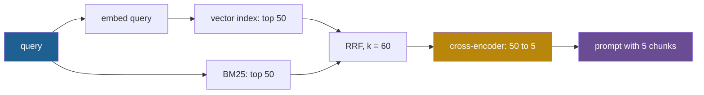

## 1. The question this idea answers

A user asks: "refund rules for ORD-55871". Dense retrieval returns five chunks about refunds in general. The one chunk that mentions order ORD-55871 is at rank 4 of the dense list, or not in it at all. Keyword search finds that chunk at rank 1, but it misses a chunk that says "money back" instead of "refund".

So production systems run both retrievers. That raises three questions an interviewer will press on. How do you merge two ranked lists whose scores live on different scales? Once you have 50 good candidates, how do you put the best 5 at the top? And what does each step cost in latency?

## 2. Mental model

> [!analogy] Two judges, then an interview panel
> Two judges rank the same applicants. Judge A reads for meaning and gives scores from 0 to 1. Judge B checks for exact keywords and gives scores from 0 to 20. Adding their raw scores lets judge B decide alone, because his numbers are bigger. A fair method uses the **places**: an applicant that both judges put near the top beats one that only one judge loved. That is rank fusion.
>
> Then an interview panel meets the top 50 applicants, one at a time, with the job description in hand. The panel is slow but sees details that the judges missed. That is reranking.
>
> **Where it stops working:** places discard how large the gaps were, so a clear winner and a near tie look the same. And the panel only meets the 50 applicants that the judges sent. If the best applicant was not in that list, no interview can find her.

## 3. Terms

| Term | Plain meaning |
|---|---|
| lexical (sparse) retrieval | Retrieval by exact terms, with an inverted index. A document is a sparse vector over the vocabulary. |
| dense retrieval | Retrieval by embedding similarity (lessons [L2](/notes/ai/llm-systems/06-rag/l2-embeddings-in-depth) and [L4](/notes/ai/llm-systems/06-rag/l4-vector-indexes)). |
| inverted index | A map from each term to the list of documents that contain it, with counts. |
| analyzer | The steps that turn text into terms: split, lowercase, and optionally stem. Documents and queries must use the same one. |
| BM25 | The standard lexical ranking function: IDF weights, saturating term frequency and length normalization. |
| IDF | Inverse document frequency: a weight that is high for rare terms and near zero for common ones. |
| $k_1$, $b$ | BM25 parameters for term-frequency saturation and length normalization. Lucene uses 1.2 and 0.75. |
| hybrid retrieval | Running dense and lexical retrieval for the same query and merging the results. |
| fusion | Merging several ranked lists into one. |
| reciprocal rank fusion (RRF) | Fusion that gives each document $\sum 1/(k + \text{rank})$ over the lists that contain it. |
| convex combination | Fusion by a weighted sum of normalized scores: $\alpha \cdot \text{dense} + (1 - \alpha) \cdot \text{lexical}$. |
| min-max normalization | Rescaling the scores of one list so that its lowest is 0 and its highest is 1. |
| reranker | A slower, more accurate model that rescores a short candidate list. |
| cross-encoder | A reranker that reads the query and one document together and outputs one score. |
| late interaction | Storing one vector per document token and comparing query tokens with document tokens at query time. |
| MaxSim | ColBERT's score: for each query token, the best similarity with any document token, summed over query tokens. |
| listwise reranking | An LLM reads several candidates at once and outputs their order. |
| sliding window | Reranking a long list with an LLM in overlapping windows, from the back to the front. |
| recall ceiling | The first stage limits the reranker: a document that the first stage did not return cannot reach the final list. |

All terms are also in the [Glossary](/notes/ai/llm-systems/glossary).

## 4. Lexical retrieval: BM25 in brief

### 4.1 The formula

The context engineering lesson [Keyword search and BM25](/notes/ai/context-engineering/05-retrieval-quality/l1-bm25) builds BM25 from first principles. Here is the formula with its Lucene IDF:

$$
\text{score}(D, Q) = \sum_{q \in Q} \text{IDF}(q) \cdot \frac{f(q, D)\,(k_1 + 1)}{f(q, D) + k_1\left(1 - b + b\,\dfrac{\lvert D \rvert}{\text{avgdl}}\right)}, \qquad \text{IDF}(q) = \ln\left(1 + \frac{N - n(q) + 0.5}{n(q) + 0.5}\right)
$$

The symbols mean:

- $f(q, D)$ is how often term $q$ appears in document $D$. $\lvert D \rvert$ is the document length in terms, and avgdl is the average length.
- $N$ is the number of documents and $n(q)$ the number that contain $q$.
- $k_1$ caps the effect of repeats: the term-frequency part can never exceed $k_1 + 1$.
- $b$ sets how strongly long documents are penalized: 0 means not at all, 1 means fully.

> [!example] Worked example: BM25 for "ORD-55871 refund status"
> A collection has $N = 1{,}000$ documents with avgdl = 100. Document $D$ has 80 terms. Use $k_1 = 1.2$ and $b = 0.75$.
>
> **Length factor:** $K = 1.2 \times (0.25 + 0.75 \times 80/100) = 1.2 \times 0.85 = 1.02$.
>
> | Term | $n(q)$ | $f(q, D)$ | IDF | TF part $\frac{2.2 f}{f + 1.02}$ | Product |
> |---|---|---|---|---|---|
> | ord-55871 | 1 | 1 | $\ln(1 + 999.5/1.5) = 6.5033$ | $2.2/2.02 = 1.0891$ | 7.0828 |
> | refund | 40 | 2 | $\ln(1 + 960.5/40.5) = 3.2075$ | $4.4/3.02 = 1.4570$ | 4.6731 |
> | status | 300 | 1 | $\ln(1 + 700.5/300.5) = 1.2033$ | 1.0891 | 1.3105 |
>
> **Score:** $7.0828 + 4.6731 + 1.3105 = 13.0664$. The one rare term contributes more than half of the score. That is exactly the case where an embedding, which compresses the whole text into one vector, gives the code little weight.

```python
import math

def bm25_term(n, f, N, dl, avgdl, k1=1.2, b=0.75):
    idf = math.log(1 + (N - n + 0.5) / (n + 0.5))       # Lucene IDF, always positive
    K = k1 * (1 - b + b * dl / avgdl)                   # length normalization
    tf = f * (k1 + 1) / (f + K)                         # saturating term frequency
    return idf, tf, idf * tf

N, avgdl, dl = 1_000, 100, 80
query = [("ord-55871", 1, 1), ("refund", 40, 2), ("status", 300, 1)]   # (term, n(q), f(q, D))
total = 0.0
for term, n, f in query:
    idf, tf, s = bm25_term(n, f, N, dl, avgdl)
    total += s
    print(f"{term:10s} IDF {idf:.4f}  tf-part {tf:.4f}  score {s:.4f}")
print(f"BM25(D, Q) = {total:.4f}")
```

Output:

```text
ord-55871  IDF 6.5033  tf-part 1.0891  score 7.0828
refund     IDF 3.2075  tf-part 1.4570  score 4.6731
status     IDF 1.2033  tf-part 1.0891  score 1.3105
BM25(D, Q) = 13.0664
```

### 4.2 The analyzer decides what can match

BM25 matches only the terms that the analyzer produced. PostgreSQL's English text search shows the risk on our query. In these notes, `plainto_tsquery('english', 'refund status ORD-55871')` returned `'refund' & 'status' & 'ord' & '-55871'`. The code became two terms. Also, `&` means every term must match, which is a filter, not a BM25-style ranking over any matching term. And PostgreSQL's `ts_rank_cd` is a cover-density ranking, not BM25. Know what your engine computes before you compare scores.

### 4.3 When each retriever wins

| Query type | Better retriever | Why |
|---|---|---|
| IDs, order numbers, error codes, SKUs | Lexical | One rare term with a high IDF. An embedding spreads it thin. |
| Product names, people, new terms the embedding model never saw | Lexical | Same reason. |
| Paraphrase ("money back" for a page about "refunds") | Dense | Vocabulary mismatch: different words, same meaning. |
| Long natural-language questions | Dense | The embedding captures the meaning of the sentence. |
| Other languages than the documents | Dense, with a multilingual model | Lexical needs the same words. |

The DPR paper gives real numbers for both sides (Table 2, top-20 retrieval accuracy). On Natural Questions, DPR reached 78.4% against 59.1% for BM25. On SQuAD, BM25 won, 68.8% against 63.2%. The authors explain that SQuAD has "a high lexical overlap between passages and questions, which gives BM25 a clear advantage". Their hybrid, which reranked the union of both top-2000 lists by $\text{BM25}(q, p) + \lambda \cdot \text{sim}(q, p)$ with $\lambda = 1.1$, reached 71.5% on SQuAD. But on Natural Questions the hybrid scored 76.6%, **below** DPR alone. Hybrid search usually helps. It is not guaranteed to help, so measure it.

## 5. Fusion: merging two ranked lists

### 5.1 Why raw scores cannot be added

The two lists for our query, with their raw scores:

| Rank | Dense | Cosine | BM25 | Score |
|---|---|---|---|---|
| 1 | C7 | 0.83 | C4 | 18.2 |
| 2 | C2 | 0.81 | C3 | 9.1 |
| 3 | C9 | 0.80 | C11 | 8.7 |
| 4 | C1 | 0.78 | C7 | 6.0 |
| 5 | C4 | 0.74 | C8 | 5.5 |
| 6 | C5 | 0.73 | C2 | 2.1 |

Add the raw scores, with 0 when a list misses a document. The order is C4 18.94, C3 9.10, C11 8.70, C7 6.83, C8 5.50, C2 2.91, then C9 0.80, C1 0.78, C5 0.73. That is exactly the BM25 order, followed by the documents that only the dense side found. The cosines lie in a narrow band below 1, so they cannot compete with BM25 values up to 18.2. C7, the best dense result, drops to fourth.

### 5.2 Reciprocal rank fusion

Cormack, Clarke and Büttcher (SIGIR 2009) defined:

$$
\text{RRF}(d) = \sum_{r \in R} \frac{1}{k + r(d)}
$$

The symbols mean:

- $R$ is the set of ranked lists, here two: dense and BM25.
- $r(d)$ is the rank of document $d$ in list $r$, starting at 1. A list that does not contain $d$ adds nothing.
- $k$ is a constant. The paper: "k = 60 was fixed during a pilot investigation and not altered during subsequent validation". Its role: "The constant k mitigates the impact of high rankings by outlier systems."


> [!example] Worked example: RRF of the two lists with k = 60
> | Document | Dense rank | BM25 rank | RRF |
> |---|---|---|---|
> | C7 | 1 | 4 | $1/61 + 1/64 = 0.016393 + 0.015625 = 0.032018$ |
> | C4 | 5 | 1 | $1/65 + 1/61 = 0.015385 + 0.016393 = 0.031778$ |
> | C2 | 2 | 6 | $1/62 + 1/66 = 0.016129 + 0.015152 = 0.031281$ |
> | C3 | | 2 | $1/62 = 0.016129$ |
> | C11 | | 3 | $1/63 = 0.015873$ |
> | C9 | 3 | | $1/63 = 0.015873$ |
> | C1 | 4 | | $1/64 = 0.015625$ |
> | C8 | | 5 | $1/65 = 0.015385$ |
> | C5 | 6 | | $1/66 = 0.015152$ |
>
> The three documents that both retrievers found take the first three places. C11 and C9 tie exactly. A fixed tie-break (here: the better single rank, then the ID) keeps evaluation results repeatable.

```python
dense = [("C7", 0.83), ("C2", 0.81), ("C9", 0.80), ("C1", 0.78), ("C4", 0.74), ("C5", 0.73)]
bm25 = [("C4", 18.2), ("C3", 9.1), ("C11", 8.7), ("C7", 6.0), ("C8", 5.5), ("C2", 2.1)]

def rrf(lists, k=60, weights=None):
    scores, best_rank = {}, {}
    for li, ranked in enumerate(lists):
        w = 1.0 if weights is None else weights[li]
        for rank, (doc, _) in enumerate(ranked, start=1):     # only the rank is used
            scores[doc] = scores.get(doc, 0.0) + w / (k + rank)
            best_rank[doc] = min(best_rank.get(doc, rank), rank)
    # deterministic tie-break: better single rank, then the ID
    return sorted(scores.items(), key=lambda x: (-x[1], best_rank[x[0]], x[0]))

def minmax(ranked):
    vals = [s for _, s in ranked]
    lo, hi = min(vals), max(vals)
    return {doc: (s - lo) / (hi - lo) for doc, s in ranked}

def convex(dense, sparse, alpha):
    d, s = minmax(dense), minmax(sparse)
    docs = set(d) | set(s)                                     # missing from a list = 0
    fused = {doc: alpha * d.get(doc, 0.0) + (1 - alpha) * s.get(doc, 0.0) for doc in docs}
    return sorted(fused.items(), key=lambda x: (-x[1], x[0]))

fmt = lambda r: ", ".join(f"{d} {v:.6f}" for d, v in r[:5])
print("RRF k=60      :", fmt(rrf([dense, bm25])))
print("RRF k=60, 2xBM:", fmt(rrf([dense, bm25], weights=[1, 2])))
print("convex a=0.5  :", ", ".join(f"{d} {v:.4f}" for d, v in convex(dense, bm25, 0.5)[:5]))
print("convex a=0.75 :", ", ".join(f"{d} {v:.4f}" for d, v in convex(dense, bm25, 0.75)[:5]))
```

Output:

```text
RRF k=60      : C7 0.032018, C4 0.031778, C2 0.031281, C3 0.016129, C11 0.015873
RRF k=60, 2xBM: C4 0.048172, C7 0.047643, C2 0.046432, C3 0.032258, C11 0.031746
convex a=0.5  : C7 0.6211, C4 0.5500, C2 0.4000, C9 0.3500, C1 0.2500
convex a=0.75 : C7 0.8106, C2 0.6000, C9 0.5250, C1 0.3750, C4 0.3250
```

- `rrf` reads only `rank`. The raw scores in the tuples are ignored, so the scales of the two retrievers cannot matter.
- `weights` gives weighted RRF: $\sum_r w_r / (k + r(d))$. Doubling BM25 moves C4, its rank-1 document, to the top.
- `best_rank` implements the tie-break.

```video
{"src": "/notes/media/llm-systems/manim/m27-reciprocal-rank-fusion.mp4", "caption": "Two ranked lists with incomparable scores become one list: each document collects 1/(60 + rank) from every list that contains it, and agreement wins."}
```

### 5.3 What k does: agreement against one first place

Compare a document X at rank 1 in one list only with a document Y at rank $r$ in both lists. Y wins when:

$$
\frac{2}{k + r} > \frac{1}{k + 1} \iff 2(k + 1) > k + r \iff r < k + 2
$$

With $k = 60$, Y wins up to rank 61 in both lists: $2/121 = 0.016529 > 1/61 = 0.016393$. So RRF with $k = 60$ rewards agreement strongly. With $k = 0$, Y must be at rank 1 in both lists to beat X. A small $k$ trusts one strong vote. A large $k$ trusts consensus.

```plot
{
  "title": "Score of one document found by one list at rank 1, 1/(k+1) (red), against one found by both lists at rank r, 2/(k+r) (blue), for k = 60",
  "xAxis": {"label": "rank r in both lists", "domain": [1, 80]},
  "yAxis": {"label": "RRF score", "domain": [0.012, 0.034]},
  "disableZoom": true,
  "data": [
    {"fn": "1/61", "color": "#C81D25"},
    {"fn": "2/(60+x)", "color": "#1E6091"}
  ]
}
```

The blue curve stays above the red line until $r = 62$, where the two are equal.

**List depth matters.** A document absent from a list gets no vote from it. If each retriever returns only 5 results, a document at dense rank 6 gets nothing from the dense side. Fuse deep lists, for example 50 to 200 per retriever, then cut. Databricks AI Search hybrid queries return "a maximum of 200 results" by default (docs checked on 2026-10-15).

### 5.4 Normalized weighted fusion

The alternative keeps the scores. Normalize each list, then mix:

$$
s(d) = \alpha \cdot \hat{s}_{\text{dense}}(d) + (1 - \alpha) \cdot \hat{s}_{\text{lex}}(d), \qquad \hat{s}(d) = \frac{s(d) - \min}{\max - \min}
$$

The symbols mean:

- $\hat{s}$ is the min-max normalized score of one list, from 0 to 1.
- $\alpha$ is the weight of the dense list, between 0 and 1.
- A document missing from a list gets 0 from it.

> [!example] Worked example: min-max fusion of the same lists
> Dense normalized (range 0.73 to 0.83): C7 1.0, C2 0.8, C9 0.7, C1 0.5, C4 0.1, C5 0.0.
> BM25 normalized (range 2.1 to 18.2): C4 1.0, C3 0.4348, C11 0.4099, C7 0.2422, C8 0.2112, C2 0.0.
>
> - $\alpha = 0.5$: C7 $0.5 \times 1.0 + 0.5 \times 0.2422 = 0.6211$, C4 $0.5 \times 0.1 + 0.5 \times 1.0 = 0.55$, C2 0.4, C9 0.35, C1 0.25.
> - $\alpha = 0.75$: C7 0.8106, C2 0.6, C9 0.525, C1 0.375, C4 0.325. The exact-code match C4 falls to fifth.
>
> Two weaknesses show. C2 is in **both** lists. But as the last BM25 result, it gets exactly 0 from BM25, like a document that BM25 never returned. And one outlier changes every value: if C4's BM25 score were 40 instead of 18.2, C7's BM25 value would fall from 0.2422 to 0.1029. Its lead over C4 at $\alpha = 0.5$ would shrink from 0.071 to 0.0015.

Still, score fusion can win when it is tuned. Bruch, Gai and Ingber studied this ("An Analysis of Fusion Functions for Hybrid Retrieval", arXiv 2210.11934). They report that a convex combination outperforms RRF in and out of domain, and that RRF is sensitive to its parameters. The convex combination needs only a small labeled set to tune $\alpha$. Products choose differently. Weaviate made "Relative Score Fusion" the default "starting in `v1.24`", with a server default of $\alpha = 0.75$, while its older ranked fusion uses $1/(\text{RANK} + 60)$. Databricks AI Search combines vector and BM25 results "using the Reciprocal Rank Fusion (RRF) function" (both checked on 2026-10-15).

> [!key] Choose fusion by measurement
> Start with RRF and $k = 60$: no tuning and robust to scale. If you have a few hundred labeled queries, try a convex combination with tuned $\alpha$, and keep it only if it wins on your data. Log both input lists with ranks, so a missing document can be traced to one retriever.

### 5.5 Hybrid search in SQL

pgvector's README links an RRF example that joins a vector search and PostgreSQL full-text search. A self-contained version, run in these notes with `psql` on PostgreSQL 16 and pgvector 0.8.7 (`\set` is a `psql` command):

```sql
CREATE TABLE docs (id int PRIMARY KEY, content text, embedding vector(3));
INSERT INTO docs VALUES
  (1, 'Refund status for order ORD-55871: refund approved', '[0.2, 0.9, 0.1]'),
  (2, 'How refunds work: money returns in 5 business days', '[0.9, 0.3, 0.1]'),
  (3, 'Track the status of any order in the portal',        '[0.7, 0.6, 0.2]'),
  (4, 'Return an opened laptop within 30 days',             '[0.6, 0.1, 0.8]');
CREATE INDEX ON docs USING GIN (to_tsvector('english', content));

-- query text and query embedding (the embedding would come from the embedding model)
\set qtext 'refund status ORD-55871'
\set qvec  '[0.85, 0.45, 0.1]'
WITH semantic AS (
    SELECT id, RANK() OVER (ORDER BY embedding <=> :'qvec') AS r
    FROM docs ORDER BY embedding <=> :'qvec' LIMIT 20
), keyword AS (
    SELECT id, RANK() OVER (ORDER BY ts_rank_cd(to_tsvector('english', content), q) DESC) AS r
    FROM docs, plainto_tsquery('english', :'qtext') AS q
    WHERE to_tsvector('english', content) @@ q
    ORDER BY ts_rank_cd(to_tsvector('english', content), q) DESC LIMIT 20
)
SELECT COALESCE(s.id, k.id) AS id, s.r AS semantic_rank, k.r AS keyword_rank,
       ROUND((COALESCE(1.0 / (60 + s.r), 0) + COALESCE(1.0 / (60 + k.r), 0))::numeric, 6) AS rrf
FROM semantic s FULL OUTER JOIN keyword k ON s.id = k.id
ORDER BY rrf DESC, id;
```

Output:

```text
 id | semantic_rank | keyword_rank |   rrf
----+---------------+--------------+----------
  1 |             4 |            1 | 0.032018
  2 |             1 |              | 0.016393
  3 |             2 |              | 0.016129
  4 |             3 |              | 0.015873
(4 rows)
```

- Document 1, the only one that mentions the order code, was **last** in the vector list. The keyword side ranked it first, and fusion put it on top.
- `FULL OUTER JOIN` keeps documents that only one side found. `COALESCE(..., 0)` gives them no vote from the other side.
- `RANK()` gives the positions. The scores never enter the fusion.

## 6. Reranking

### 6.1 The cascade and its ceiling

Retrieval has two goals that pull against each other. **Recall** needs a search over the whole corpus, so it must be cheap per document. **Precision at the top** needs a careful reading of each candidate, so it is expensive per document. A cascade splits the work: a fast first stage returns $N$ candidates, a slow reranker orders them, and the top $k$ go to the prompt.

$$
\text{Recall@}k \text{ after reranking} \le \text{Recall@}N \text{ of the first stage}
$$

The reranker only reorders. If Recall@50 is 0.80, no reranker can reach more than 0.80. So choose $N$ by measuring the first stage's Recall@$N$ for several values, and stop where a larger $N$ adds little.

### 6.2 Cross-encoders

Nogueira and Cho ("Passage Re-ranking with BERT", arXiv 1901.04085) set the pattern: "we feed the query as sentence A and the passage text as sentence B". They truncated the query to 64 tokens and the whole input to 512. Then "we use the [CLS] vector as input to a single layer neural network to obtain the probability of the passage being relevant", trained with cross-entropy. They reranked the BM25 top 1,000 and reached 36.5 MRR@10 on MS MARCO, against 27.8 for the previous best: a 27% relative gain.

Every query token attends to every passage token in every layer. So the cross-encoder sees negations, numbers and conditions that a pooled vector blurs (lesson [L2](/notes/ai/llm-systems/06-rag/l2-embeddings-in-depth)). The price is one full forward pass per candidate.

> [!example] Worked example: reranking time from a model card
> The model card of `cross-encoder/ms-marco-MiniLM-L6-v2` reports 74.30 NDCG@10 on TREC DL 19 at 1,800 documents per second. The L12 version reports 74.31 at 960 per second. "Runtime was computed on a V100 GPU."
>
> | Candidates | L6 time | L12 time |
> |---|---|---|
> | 50 | $50 / 1{,}800 = 27.8$ ms | $50 / 960 = 52.1$ ms |
> | 100 | 55.6 ms | 104.2 ms |
> | 150 | 83.3 ms | 156.3 ms |
>
> The 12-layer model takes about twice the time for 0.01 more NDCG@10. Longer passages and a CPU change these numbers, so measure on your hardware.

### 6.3 Late interaction: ColBERT

ColBERT (Khattab and Zaharia, SIGIR 2020, arXiv 2004.12832) keeps one vector per token and scores with MaxSim:

$$
S_{q,d} = \sum_{i=1}^{\lvert E_q \rvert} \max_{j=1}^{\lvert E_d \rvert} E_{q_i} \cdot E_{d_j}^{\top}
$$

The symbols mean:

- $E_{q_i}$ is the vector of query token $i$ and $E_{d_j}$ the vector of document token $j$. Both have "L2 norm equal to one", so each dot product is a cosine.
- The inner $\max$ finds, for each query token, its best match in the document.
- The sum adds these best matches over the query tokens.

Design details from the paper: the embedding dimension is $m = 128$. A [Q] or [D] marker token starts each input. Queries are padded with [mask] tokens to $N_q = 32$, which the paper calls query augmentation. Punctuation embeddings are removed from documents.

> [!example] Worked example: MaxSim rewards coverage
> Three query tokens: "refund" $(1, 0, 0)$, "laptop" $(0, 1, 0)$, "opened" $(0, 0, 1)$.
>
> - Document A has tokens $(0.8, 0.6, 0)$, $(0, 0.6, 0.8)$, $(1, 0, 0)$. Best matches: refund 1.0, laptop 0.6, opened 0.8. $S = 2.4$.
> - Document B has the token $(0, 1, 0)$ twice. Best matches: refund 0, laptop 1.0, opened 0. $S = 1.0$.
>
> B matches "laptop" perfectly and repeats it, but repeats do not count: each query token takes only its maximum. A document must cover every part of the query to score high.

```python
import numpy as np

def maxsim(Q, D):
    """Q: [n_q, d] query token vectors, D: [n_d, d] document token vectors, rows unit length."""
    sim = Q @ D.T                      # [n_q, n_d]: every query token against every document token
    return sim.max(axis=1).sum()       # best document token per query token, then sum

Q = np.array([[1.0, 0.0, 0.0],         # query token "refund"
              [0.0, 1.0, 0.0],         # query token "laptop"
              [0.0, 0.0, 1.0]])        # query token "opened"
A = np.array([[0.8, 0.6, 0.0],         # document A: three tokens
              [0.0, 0.6, 0.8],
              [1.0, 0.0, 0.0]])
B = np.array([[0.0, 1.0, 0.0],         # document B: two tokens, "laptop" twice
              [0.0, 1.0, 0.0]])
print("A:", (Q @ A.T).max(axis=1), "->", round(maxsim(Q, A), 4))
print("B:", (Q @ B.T).max(axis=1), "->", round(maxsim(Q, B), 4))
```

Output:

```text
A: [1.  0.6 0.8] -> 2.4
B: [0. 1. 0.] -> 1.0
```

Document token vectors are computed in advance, so ColBERT can rerank cheaply or even retrieve. The paper used a FAISS IVFPQ index for end-to-end search (lesson [L4](/notes/ai/llm-systems/06-rag/l4-vector-indexes)). It reports being "more than 170× faster" than BERT rerankers with "14,000× fewer FLOPs/query". The cost is storage.

> [!example] Worked example: ColBERT storage for one 300-token chunk
> - Token vectors: $300 \times 128$ values $\times$ 2 bytes (16-bit) $= 76{,}800$ bytes.
> - One 1,024-dimensional float32 vector: 4,096 bytes. ColBERT stores $76{,}800 / 4{,}096 = 18.75$ times more.
> - ColBERTv2 (Santhanam et al., arXiv 2112.01488) reports "reducing the space footprint of late interaction models by 6--10×" with residual compression: about 12,800 to 7,680 bytes for this chunk.

### 6.4 LLM rerankers

An LLM can judge relevance in three ways:

| Style | Input | Output | Calls for $N$ candidates |
|---|---|---|---|
| Pointwise | Query and one passage | A score or a yes/no | $N$ |
| Pairwise | Query and two passages | Which one is better | Up to $N(N-1)/2$ |
| Listwise | Query and a window of passages | An order such as `[2] > [3] > [1]` | One per window |

Sun et al. ("Is ChatGPT Good at Search?", arXiv 2304.09542) made the listwise style practical. The model outputs a permutation of passage identifiers. A context window cannot hold 100 passages, so they used "a window size of 20 and step size of 10", applied "in a back-to-first order" over the BM25 top 100. On TREC DL19, GPT-4 reached 75.59 NDCG@10 against 71.83 for monoT5 (3B).

```python
def sliding_window_rerank(ranked, relevance, window=20, step=10):
    """Listwise reranking from the back to the front. `relevance` stands in for the LLM:
    each call returns the window sorted by its judgment."""
    ranked, calls = list(ranked), 0
    start = max(len(ranked) - window, 0)
    while True:
        part = ranked[start:start + window]
        ranked[start:start + window] = sorted(part, key=lambda p: -relevance[p])
        calls += 1
        if start == 0:
            return ranked, calls
        start = max(start - step, 0)

first_stage = list(range(100))                     # passage IDs in first-stage order
relevance = {p: 0 for p in first_stage}
relevance[95], relevance[42], relevance[3] = 3, 2, 1   # the best passage is at rank 96
final, calls = sliding_window_rerank(first_stage, relevance)
print("LLM calls:", calls)
print("new top 3:", final[:3])
```

Output:

```text
LLM calls: 9
new top 3: [95, 42, 3]
```

- Windows start at 80, 70, 60, ..., 0: $(100 - 20)/10 + 1 = 9$ calls.
- Each window overlaps the next by $20 - 10 = 10$ positions. The best passages of one window move to its front, which is inside the next window. So the best passage climbs from rank 96 to rank 1 in one pass.

> [!example] Worked example: the carry limit of a sliding window
> The overlap is $w - s = 10$ positions, so at most 10 passages can travel from the back of the list to the front in one pass. These notes ran the same code with 12 relevant passages at ranks 89 to 100. After 9 calls, the new top 12 held only 10 of them. The two least relevant ones were left behind. With $w = 20$ and $s = 10$, a single pass can fully order only the top 10. Use a larger overlap, or a second pass, if you need a longer correct prefix.

In the RankGPT benchmarks above, the GPT-4 listwise reranker scored highest. LLM rerankers are also the most expensive option. Each call reads about 20 passages. So one pass over 100 passages of about 100 tokens reads about 18,000 passage tokens in 9 sequential calls (an estimate in these notes). The output must also be parsed. Missing or repeated identifiers need a fallback to the first-stage order.

### 6.5 Managed rerankers

Managed vector stores now offer reranking as an option. In Databricks AI Search, a reranker reads the columns named in `columns_to_rerank`, in order, and the docs say it considers only the first 2,000 characters. `num_results` sets the final count, not the number of candidates, and the Databricks SDK must be version 0.57 or above. The docs say reranking typically improves quality by about 10% and adds latency (checked on 2026-10-15). Treat any vendor gain as a hypothesis for your own evaluation set.

## 7. The latency budget

| Step | Time | Source of the number |
|---|---|---|
| Embed the query | One forward pass of a small encoder | Measure: it depends on the model and the hardware |
| Lexical search | Reads only the posting lists of the query terms | Usually fast. Measure on your index. |
| Vector search, HNSW, efSearch = 64, 100,000 vectors of 128 dimensions | 0.16 ms per query | Measured in these notes, FAISS on one core of a 2.1 GHz Xeon |
| Exact search of the same 100,000 vectors | 4.0 ms per query | Measured in these notes, same machine |
| Fusion of two lists of 50 | Sorting about 100 numbers | Negligible |
| Rerank 50 candidates, MiniLM-L6 cross-encoder | About 28 ms | Model card throughput on a V100 |
| Prefill of a 3,000-token prompt, Llama-3.1-8B, H100 | At least 0.051 s | Computed in [L1](/notes/ai/llm-systems/06-rag/l1-why-rag) |
| Decode of 300 tokens at batch 1 | At least 1.47 s | Computed in [L1](/notes/ai/llm-systems/06-rag/l1-why-rag) |

Run the two retrievers in parallel, so hybrid search costs the slower of the two, not the sum. In this budget the reranker is the largest retrieval cost, and it is still small next to generation. Fewer, better chunks also shorten the prefill. Lesson [L9](/notes/ai/llm-systems/06-rag/l9-production-rag-architecture) builds the full production budget.



### Exercises

1. **BM25 with an inverted index.** Write a `BM25` class with the Lucene IDF. Its analyzer keeps codes such as `ord-55871` whole. Its `search` reads only the posting lists of the query terms.
   - Acceptance test: on the four documents of section 5.5, "refund status ORD-55871" ranks document 0 first. A query with no known term returns an empty list.
   - Hint 1: the regex `[a-z0-9]+(?:-[a-z0-9]+)*` keeps hyphenated codes.
   - Hint 2: accumulate scores in a dictionary only for documents found in the posting lists.
2. **RRF with weights and ties.** Write `rrf(lists, k, weights)`. It raises an error for a duplicate ID in one list. It breaks ties by the best single rank, then the ID.
   - Acceptance test: the lists of section 5.1 give C7, C4, C2 first, with C7 at exactly $1/61 + 1/64$. C11 comes before C9. Doubling the BM25 weight puts C4 first.
   - Hint 1: store the best rank of each document while you add the votes.
   - Hint 2: sort by the tuple (negative score, best rank, ID).
3. **Score fusion and outliers.** Write `convex(dense, sparse, alpha, norm)` with min-max and z-score normalization.
   - Acceptance test: with min-max and $\alpha = 0.5$, C7 then C4 lead. Raising C4's BM25 score to 40 shrinks the gap between them.
   - Hint 1: guard against a list where all scores are equal.
   - Hint 2: decide what a missing document gets, and document the choice.
4. **Sliding-window limits.** Write `sliding_window_rerank(ranked, relevance, window, step)` and `n_calls(n, window, step)`.
   - Acceptance test: 100 candidates with window 20 and step 10 take 9 calls, and 150 take 14. With 12 relevant passages at the bottom, exactly 10 reach the new top 12.
   - Hint 1: start at `n - window` and move toward 0 by `step`.
   - Hint 2: the number of calls is $1 + \lceil (n - w)/s \rceil$ for $n > w$.

## 8. Common mistakes

1. **"Embeddings make keyword search obsolete."** Codes, IDs and rare names carry a high IDF in BM25 and little weight in a pooled vector. In the SQL example, the only document with the order code was last in the vector list.
2. **"Hybrid always beats either retriever."** In the DPR paper, the hybrid scored 76.6% top-20 accuracy on Natural Questions, below DPR alone at 78.4%. Measure it.
3. **"Add the cosine and the BM25 score."** The larger scale decides. The raw sum of the example reproduced the BM25 order.
4. **"RRF has no parameters."** It has $k$, and with $k = 60$ a document at rank 61 in both lists beats a single first place. It also needs a tie-break rule and a list depth.
5. **"Min-max fusion is safe."** The last item of each list gets exactly 0, like a missing item, and one outlier compresses all other scores.
6. **"The reranker will find what retrieval missed."** It only reorders the $N$ candidates. Recall@$k$ after reranking is at most Recall@$N$ before.
7. **"A sliding-window LLM reranker sorts the whole list."** One pass carries at most $w - s$ passages to the front.
8. **"PostgreSQL full-text search is BM25."** `ts_rank_cd` is a cover-density ranking, and `plainto_tsquery` requires every term.

## 9. One-minute explanation

Dense retrieval finds paraphrases and BM25 finds exact codes and rare names, so production RAG runs both. BM25 sums IDF times a saturating term frequency with length normalization, so a rare code can carry most of the score. The scores are incomparable, so reciprocal rank fusion adds one over 60 plus the rank from every list that contains a document. With k equal to 60, rank 61 in both lists still beats a single first place, so RRF rewards agreement. Normalized weighted fusion can win when tuned, but min-max gives the last item zero and reacts to outliers. A reranker then orders the top 50 to 100 candidates. A cross-encoder reads query and passage together, one forward pass per candidate, about 28 ms for 50 with MiniLM on a V100. ColBERT stores one vector per token and scores with MaxSim, which rewards covering every query token. LLM rerankers order windows of 20 passages from the back, and one pass carries at most window minus step passages to the top. The reranker cannot recover what the first stage missed, so we measure recall at N first.

## 10. Check questions

```check
{
  "question": "Compute the BM25 contribution of a term that appears in 5 of 10,000 documents, twice in a document of exactly average length, with k1 = 1.2 and b = 0.75.",
  "hint": "At average length the length factor equals k1.",
  "answer": "IDF = ln(1 + (10,000 − 5 + 0.5)/(5 + 0.5)) = ln(1 + 9,995.5/5.5) = ln(1,818.36) = 7.5057. At average length K = k1 = 1.2. TF part = 2 × 2.2 / (2 + 1.2) = 4.4/3.2 = 1.375. Contribution = 7.5057 × 1.375 = 10.32."
}
```

```check
{
  "question": "Interview follow-up: derive when a document found by both retrievers at rank r beats a document found by one retriever at rank 1 under RRF, and evaluate it for k = 10 and k = 60.",
  "answer": "Both-lists score 2/(k + r). Single-list score 1/(k + 1). The first is larger when 2(k + 1) > k + r, that is r < k + 2. For k = 10: up to rank 11 in both lists. For k = 60: up to rank 61. At equality, r = k + 2 gives a tie. A larger k makes the rank differences flatter, so consensus matters more than a single first place."
}
```

```check
{
  "question": "Interview follow-up: a team fuses with min-max normalization and alpha = 0.75, and exact-code queries got worse. Use the example of section 5.4 to explain, and propose two fixes.",
  "answer": "With alpha = 0.75 the dense side dominates. C4, the BM25 rank-1 document with the exact code, has a low normalized cosine (0.1), so it falls to fifth: 0.75 × 0.1 + 0.25 × 1.0 = 0.325. Fixes: (1) lower alpha or tune it on labeled code queries, or switch to RRF, which gives C4 a strong vote from its BM25 rank; (2) route queries that match a code pattern to give BM25 a higher weight, for example weighted RRF with weight 2 for BM25, which put C4 first in the example."
}
```

```check
{
  "question": "Interview follow-up: why can a cross-encoder not be the first stage, while ColBERT can? Use the MaxSim formula in your answer.",
  "answer": "A cross-encoder needs the query and the document in one input, so nothing can be computed before the query arrives: one full forward pass per document per query. ColBERT encodes each document's tokens into vectors offline. At query time it encodes only the query tokens and computes S = Σ_i max_j E_qi · E_dj. That is only dot products with stored vectors, so an index (the paper used FAISS IVFPQ) can find candidates by token-level nearest neighbors, and MaxSim scores them. The interaction is late (after encoding) and cheap, but it keeps token-level detail."
}
```

```check
{
  "question": "Interview follow-up: you rerank the top 100 with an LLM using windows of 20 and a step of 10. How many calls, how many passage tokens if passages have 120 tokens, and what is the largest number of passages that one pass can move from the bottom to the top?",
  "answer": "Calls: 1 + ceil((100 − 20)/10) = 9. Each call reads 20 passages × 120 tokens = 2,400 passage tokens, so 9 × 2,400 = 21,600 passage tokens, plus instructions and the query in every call. The calls are sequential, because each window needs the result of the previous one. The overlap is 20 − 10 = 10, so at most 10 passages can travel from the back to the front in one pass."
}
```

```check
{
  "question": "First-stage Recall@20 is 0.71 and Recall@100 is 0.90. The reranker keeps 5. Which candidate count do you choose, and what does the choice cost with the MiniLM-L6 cross-encoder at 1,800 documents per second?",
  "answer": "The ceiling is 0.71 with N = 20 and 0.90 with N = 100, so N = 100 allows up to 19 points more recall. Cost: 20/1,800 = 11 ms against 100/1,800 = 56 ms on the model card's V100. If the latency budget allows 56 ms, take N = 100, then measure the final Recall@5, which will be below the ceiling. Also check N = 50 as a middle point."
}
```

```check
{
  "question": "Exercise 1: show a reference solution.",
  "answer": "```python\nimport math, re\nfrom collections import Counter, defaultdict\n\ndef analyze(text):\n    return re.findall(r\"[a-z0-9]+(?:-[a-z0-9]+)*\", text.lower())   # keeps codes like ord-55871\n\nclass BM25:\n    def __init__(self, docs, k1=1.2, b=0.75):\n        self.k1, self.b = k1, b\n        self.tf = [Counter(analyze(d)) for d in docs]\n        self.len = [sum(c.values()) for c in self.tf]\n        self.avgdl = sum(self.len) / len(docs)\n        self.postings = defaultdict(list)                  # term -> doc ids\n        for i, c in enumerate(self.tf):\n            for t in c:\n                self.postings[t].append(i)\n        self.N = len(docs)\n\n    def idf(self, t):\n        n = len(self.postings.get(t, []))\n        return math.log(1 + (self.N - n + 0.5) / (n + 0.5))\n\n    def search(self, query, k=10):\n        scores = defaultdict(float)\n        for t in set(analyze(query)):\n            for i in self.postings.get(t, []):              # read only the posting lists\n                f = self.tf[i][t]\n                K = self.k1 * (1 - self.b + self.b * self.len[i] / self.avgdl)\n                scores[i] += self.idf(t) * f * (self.k1 + 1) / (f + K)\n        return sorted(scores.items(), key=lambda x: -x[1])[:k]\n\ndocs = [\"Refund status for order ORD-55871: refund approved\",\n        \"How refunds work: money returns in 5 business days\",\n        \"Track the status of any order in the portal\",\n        \"Return an opened laptop within 30 days\"]\nbm = BM25(docs)\nres = bm.search(\"refund status ORD-55871\")\nprint([(i, round(s, 4)) for i, s in res])\nassert res[0][0] == 0                                       # the exact code wins\nassert bm.search(\"vpn router\") == []                        # no matching term: no results\n```\n\nOutput: `[(0, 3.7151), (2, 0.6594)]`. Document 1 does not match \"refund\" because it says \"refunds\" and this analyzer has no stemming."
}
```

```check
{
  "question": "Exercise 2: show a reference solution.",
  "answer": "```python\ndef rrf(lists, k=60, weights=None):\n    if weights is None:\n        weights = [1.0] * len(lists)\n    scores, best = {}, {}\n    for w, ranked in zip(weights, lists):\n        if len(set(ranked)) != len(ranked):\n            raise ValueError(\"duplicate ID in one list\")\n        for r, doc in enumerate(ranked, start=1):\n            scores[doc] = scores.get(doc, 0.0) + w / (k + r)\n            best[doc] = min(best.get(doc, r), r)\n    return sorted(scores.items(), key=lambda x: (-x[1], best[x[0]], x[0]))\n\ndense = [\"C7\", \"C2\", \"C9\", \"C1\", \"C4\", \"C5\"]\nbm25 = [\"C4\", \"C3\", \"C11\", \"C7\", \"C8\", \"C2\"]\nfused = rrf([dense, bm25])\nassert [d for d, _ in fused[:3]] == [\"C7\", \"C4\", \"C2\"]\nassert abs(fused[0][1] - (1 / 61 + 1 / 64)) < 1e-12\nassert [d for d, _ in fused[4:6]] == [\"C11\", \"C9\"]          # tie at 1/63, broken by ID\nassert rrf([dense, bm25], weights=[1, 2])[0][0] == \"C4\"\nprint([(d, round(s, 6)) for d, s in fused])\n```"
}
```

```check
{
  "question": "Exercise 3: show a reference solution.",
  "answer": "```python\nimport statistics\n\ndef minmax(scores):\n    lo, hi = min(scores.values()), max(scores.values())\n    return {d: (s - lo) / (hi - lo) if hi > lo else 1.0 for d, s in scores.items()}\n\ndef zscore(scores):\n    mu = statistics.mean(scores.values())\n    sd = statistics.pstdev(scores.values()) or 1.0\n    return {d: (s - mu) / sd for d, s in scores.items()}\n\ndef convex(dense, sparse, alpha, norm=minmax, missing=None):\n    d, s = norm(dense), norm(sparse)\n    if missing is None:                       # a document absent from a list gets that list's minimum\n        missing = (min(d.values()), min(s.values()))\n    docs = set(d) | set(s)\n    fused = {x: alpha * d.get(x, missing[0]) + (1 - alpha) * s.get(x, missing[1]) for x in docs}\n    return sorted(fused.items(), key=lambda kv: (-kv[1], kv[0]))\n\ndense = {\"C7\": 0.83, \"C2\": 0.81, \"C9\": 0.80, \"C1\": 0.78, \"C4\": 0.74, \"C5\": 0.73}\nbm25 = {\"C4\": 18.2, \"C3\": 9.1, \"C11\": 8.7, \"C7\": 6.0, \"C8\": 5.5, \"C2\": 2.1}\nbase = convex(dense, bm25, 0.5)\noutlier = convex(dense, {**bm25, \"C4\": 40.0}, 0.5)\nprint(\"min-max:        \", [(d, round(v, 4)) for d, v in base[:4]])\nprint(\"min-max outlier:\", [(d, round(v, 4)) for d, v in outlier[:4]])\nprint(\"z-score:        \", [(d, round(v, 4)) for d, v in convex(dense, bm25, 0.5, zscore)[:4]])\nassert base[0][0] == \"C7\" and base[1][0] == \"C4\"\ngap_base = base[0][1] - base[1][1]\ngap_out = outlier[0][1] - outlier[1][1]\nassert gap_out < gap_base                     # one outlier squeezes the other BM25 scores\n```\n\nOutput: min-max C7 0.6211, C4 0.55. With the outlier: C7 0.5515, C4 0.55. The z-score version gives C7 0.4403, C4 0.4173."
}
```

```check
{
  "question": "Exercise 4: show a reference solution.",
  "answer": "```python\ndef sliding_window_rerank(ranked, relevance, window=20, step=10):\n    ranked, calls = list(ranked), 0\n    start = max(len(ranked) - window, 0)\n    while True:\n        ranked[start:start + window] = sorted(ranked[start:start + window], key=lambda p: -relevance[p])\n        calls += 1\n        if start == 0:\n            return ranked, calls\n        start = max(start - step, 0)\n\ndef n_calls(n, window, step):\n    return 1 if n <= window else 1 + -(-(n - window) // step)   # ceiling division\n\nassert n_calls(100, 20, 10) == 9 and n_calls(150, 20, 10) == 14\ndocs = list(range(100))\nrel = {p: 0 for p in docs}\nfor i, p in enumerate(range(88, 100)):        # 12 relevant passages at the bottom\n    rel[p] = 100 - i\nfinal, calls = sliding_window_rerank(docs, rel)\nreached = [p for p in final[:12] if rel[p] > 0]\nprint(\"calls:\", calls, \" relevant passages in the new top 12:\", len(reached))\nassert calls == 9 and len(reached) == 20 - 10     # only window - step passages are carried up\n```"
}
```

## 11. Links

- Previous: [L4: Vector indexes](/notes/ai/llm-systems/06-rag/l4-vector-indexes)
- Next: [L6: Query-side techniques and agentic RAG](/notes/ai/llm-systems/06-rag/l6-query-side-techniques)
- Related: [Keyword search and BM25](/notes/ai/context-engineering/05-retrieval-quality/l1-bm25), [Hybrid search and RRF](/notes/ai/context-engineering/05-retrieval-quality/l2-hybrid-search-and-rrf) and [Rerankers](/notes/ai/context-engineering/05-retrieval-quality/l3-rerankers) in the context engineering course
- Related: [L2: Embeddings in depth](/notes/ai/llm-systems/06-rag/l2-embeddings-in-depth) for bi-encoders and cross-encoders, [L8: Evaluating RAG](/notes/ai/llm-systems/06-rag/l8-evaluating-rag) for Recall@N and nDCG
- Drill: [Drill: RAG](/notes/ai/llm-systems/08-interview-drills/l3-chain-rag)

### Sources

- Cormack, Clarke and Büttcher, "Reciprocal Rank Fusion outperforms Condorcet and individual Rank Learning Methods", SIGIR 2009: https://cormack.uwaterloo.ca/cormacksigir09-rrf.pdf (checked on 2026-10-15)
- Bruch, Gai and Ingber, "An Analysis of Fusion Functions for Hybrid Retrieval": https://arxiv.org/abs/2210.11934 (checked on 2026-10-15)
- Karpukhin et al., "Dense Passage Retrieval for Open-Domain Question Answering", Table 2 and the hybrid method: https://arxiv.org/abs/2004.04906 (checked on 2026-10-15)
- Nogueira and Cho, "Passage Re-ranking with BERT": https://arxiv.org/abs/1901.04085 (checked on 2026-10-15)
- Khattab and Zaharia, "ColBERT", SIGIR 2020: https://arxiv.org/abs/2004.12832, and Santhanam et al., "ColBERTv2": https://arxiv.org/abs/2112.01488 (checked on 2026-10-15)
- Sun et al., "Is ChatGPT Good at Search? Investigating Large Language Models as Re-Ranking Agents": https://arxiv.org/abs/2304.09542 (checked on 2026-10-15)
- Model card of cross-encoder/ms-marco-MiniLM-L6-v2: https://huggingface.co/cross-encoder/ms-marco-MiniLM-L6-v2 (checked on 2026-10-15)
- pgvector README (hybrid search) and the pgvector-python RRF example: https://github.com/pgvector/pgvector and https://github.com/pgvector/pgvector-python (checked on 2026-10-15)
- Weaviate hybrid search concepts: https://docs.weaviate.io/weaviate/concepts/search/hybrid-search (checked on 2026-10-15)
- Databricks AI Search: https://docs.databricks.com/aws/en/vector-search/vector-search and https://docs.databricks.com/aws/en/vector-search/query-vector-search (checked on 2026-10-15)
