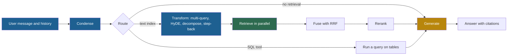
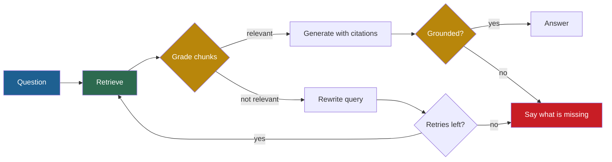
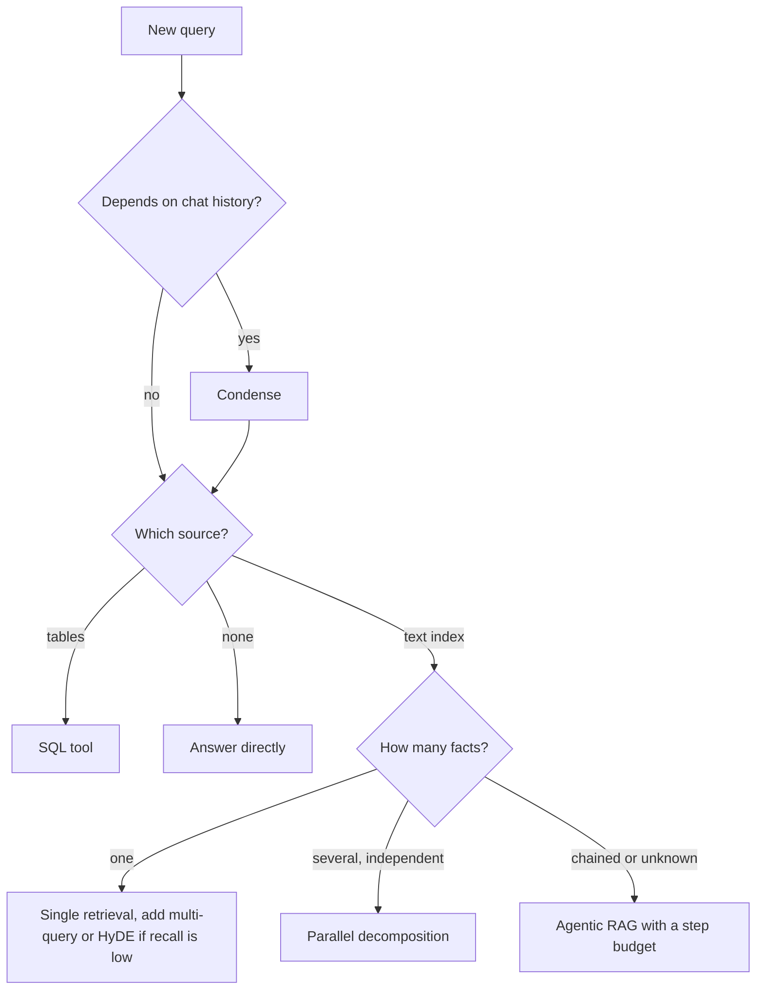

## 1. The question this idea answers

Lessons [L2](/notes/ai/llm-systems/06-rag/l2-embeddings-in-depth) to [L5](/notes/ai/llm-systems/06-rag/l5-hybrid-search-and-reranking) built a strong retriever: good embeddings, good chunks, a fast index, hybrid search and a reranker. But every retriever has one hard limit. It can only search with the text that it receives. That text is the **query**.

Real users write weak queries:

- "And for tablets?" The topic is in an earlier turn of the chat.
- "Why did the refund fail?" The documents say "chargeback rejected", not "refund failed".
- "Compare the SLA of service A and service B." One query, two targets.
- "Who approves budgets for the team that owns the payments API?" The second fact needs the first fact.

A second limit also exists. A classic RAG pipeline retrieves **once**. Some questions need two, three or five searches, and the later searches depend on what the earlier ones found.

This lesson answers two questions. How do you improve the query before the search? And when one search is not enough, how do you let a model run several searches by itself, safely and at a known cost? The interviewer's follow-ups here are usually "what does HyDE actually embed?", "how does Self-RAG decide to retrieve?" and "what does agentic RAG cost?".

## 2. Mental model

> [!analogy] A journalist who researches a story
> An editor says: "Write about the outage." A good journalist does not type those words into the archive search.
>
> 1. The journalist first makes the request complete: "the payments outage of 3 March" (**condensation**).
> 2. The journalist searches with several phrasings: "outage", "incident", "downtime" (**multi-query**).
> 3. The journalist imagines what the final article might say, and searches for documents that read like it (**HyDE**).
> 4. The journalist splits the story into parts: cause, impact, fix (**decomposition**).
> 5. The journalist first reads general background on how the payment system works (**step-back**).
> 6. The journalist chooses the right archive: incident reports, not marketing pages (**routing**).
> 7. Finally, the journalist follows leads. Each interview suggests the next one, until the facts are enough (**agentic RAG**).
>
> **Where it stops working:** a journalist knows when a lead is worthless. A model can follow weak leads, repeat the same search, or stop too early with full confidence. Every step also costs a model call and its latency. And the imagined article in step 3 can contain wrong facts. It is only a search key, never a source.

## 3. Terms

| Term | Plain meaning |
|---|---|
| query transformation | Any change to the user's text before retrieval, made to get better search results. |
| condensation | Rewriting the latest chat message plus the history into one standalone search query. |
| standalone query | A query that makes sense without the conversation history. |
| query drift | A rewritten query that no longer means what the user asked, for example because it dropped a constraint. |
| multi-query retrieval | Writing several variants of the query, retrieving for each variant, and fusing the result lists. |
| reciprocal rank fusion (RRF) | A fusion rule that gives each result the score $\sum 1/(k + \text{rank})$ over the lists, with $k = 60$ by convention. |
| HyDE | Hypothetical Document Embeddings: an LLM writes fake answer documents, and the system searches with their averaged embedding. |
| query decomposition | Splitting a question into sub-questions and retrieving for each one. |
| multi-hop question | A question whose answer needs two or more facts, where finding one fact needs another fact first. |
| step-back question | A more general question about the concept behind the user's question, asked first to retrieve background facts. |
| query routing | Choosing where a query goes: which index, which tool, or no retrieval at all. |
| agentic RAG | RAG where the model decides whether to search, what to search for, and when to stop, by calling a retrieval tool in a loop. |
| retrieval tool | A tool with a JSON Schema, such as `search_docs(query, k)`, that the model can call. |
| step budget | The largest number of loop steps or tool calls that an agent may make for one question. |
| active retrieval | Retrieval that the system triggers during generation, for example when the model is unsure of its next sentence. |
| reflection token | In Self-RAG, a special output token that says whether to retrieve, whether a passage is relevant, and whether the output is supported. |
| retrieval evaluator | In CRAG, a small model that scores how relevant each retrieved document is to the question. |
| community summary | In GraphRAG, an LLM-written summary of a group of closely connected entities in a graph built from the corpus. |

All terms are also in the [Glossary](/notes/ai/llm-systems/glossary).

## 4. Where the query side sits

### 4.1 The retriever sees only the query string

A dense retriever turns the query into one vector $q$. It returns the $k$ chunks whose vectors $d_i$ have the highest cosine similarity $q \cdot d_i / (\lVert q \rVert \lVert d_i \rVert)$ (lesson [L2](/notes/ai/llm-systems/06-rag/l2-embeddings-in-depth)). Nothing in this formula knows the conversation, the user's intent or the second fact of a multi-hop question. If $q$ is a weak vector, the top $k$ is weak, and no reranker can recover a chunk that never entered the candidate list.

> [!key] The main idea
> Query-side techniques change $q$, or the number of searches, before the index runs. They are cheap to add and easy to measure. Each one costs at least one extra model call, which runs **before** retrieval and so adds its full time to the response.

### 4.2 Seven gaps between a query and its answer

| Gap | Example | Technique |
|---|---|---|
| Missing context | "And for tablets?" | Condensation (section 5) |
| Different words | "refund failed" vs "chargeback rejected" | Multi-query (section 6), hybrid search ([L5](/notes/ai/llm-systems/06-rag/l5-hybrid-search-and-reranking)) |
| Different form | A short question vs a long statement | HyDE (section 7) |
| Several targets | "Compare A and B" | Parallel decomposition (section 8) |
| Chained facts | "Who approves budgets for the team that owns X?" | Sequential decomposition, agentic RAG (sections 8 and 10) |
| Too specific | "Which school did she attend in late 1954?" | Step-back (section 8.2) |
| Wrong source | A sales total asked to a text index | Routing (section 9) |

### 4.3 The query-side pipeline



Blue boxes work on the query. The green box touches the index. The gold box is the main model. Agentic RAG (section 10) adds an arrow from "Generate" back to "Transform": the model can ask for another search.

## 5. Condensation and query rewriting

### 5.1 The mechanism

In a chat, the latest message often depends on earlier turns. **Condensation** sends the recent history and the latest message to a small, fast model, with an instruction to write one standalone query. Retrieval uses the standalone query. Generation still receives the original conversation, so the answer stays natural.

> [!example] Worked example: condensing a follow-up
> History:
>
> 1. User: "What is the SLA of the payments API?"
> 2. Assistant: "The payments API has a 99.95% monthly availability SLA [S2]."
> 3. User: "And how are credits paid when it is missed?"
>
> Rewrite instruction to the small model: "Rewrite the last user message as one standalone search query. Keep every product name, number and date. Output only the query."
>
> Output: "payments API SLA credit payment when availability target is missed".
>
> The raw message "And how are credits paid when it is missed?" names no product. Its vector is close to every credit policy in the corpus. The condensed query names the payments API and the SLA, so it retrieves the right policy.

LlamaIndex ships this pattern as chat modes. `condense_question` rewrites the message and queries the index. `condense_plus_context` rewrites the message for retrieval and then puts the retrieved text into the system prompt (LlamaIndex docs, checked on 2026-10-15).

Four rules make condensation safe:

1. **Skip it for standalone messages.** A cheap rule, such as "the message has no pronoun and does not start with 'and'", saves a call on many turns.
2. **Keep constraints.** A rewrite that drops "in 2025" or "for EU customers" is **query drift**: the new query means something else. Tell the rewriter to keep names, numbers and dates.
3. **Keep the original for generation.** The rewrite is a search key, not the user's words.
4. **Log both queries.** When an answer fails, the log shows whether the rewrite or the retriever caused it.

### 5.2 A trained rewriter

The rewriter does not have to be a large LLM. "Query Rewriting for Retrieval-Augmented Large Language Models" (Ma et al., 2023, arXiv 2305.14283) calls the pipeline Rewrite-Retrieve-Read. It trains a T5-large model (770M parameters) as the rewriter. The reader LLM and the search engine stay frozen.

Training has two stages. A warm-up stage fine-tunes T5 on rewrites that led the reader to the correct answer. Then reinforcement learning (PPO) tunes the rewriter. The reward uses the reader's exact-match and F1 scores, plus a "hit" signal when the retrieved text contains the answer.

The paper reports, on HotpotQA with ChatGPT as the reader: 32.36 exact match without retrieval, 30.47 with plain retrieve-then-read, and 34.38 with the trained rewriter. So plain retrieval made this multi-hop benchmark **worse**, and a better query made it better.

> [!note] Why a small rewriter matters in production
> Interpretation of these notes: the rewrite runs on every turn and blocks retrieval. A 770M model on a small GPU, or a small hosted model, keeps this step short. The quality is the result of training on your own reward: did the answer become correct?

## 6. Multi-query retrieval and fusion

One phrasing misses chunks that use other words. **Multi-query retrieval** asks a model for $n$ variants, retrieves for each variant in parallel, and fuses the lists. Fusion with **reciprocal rank fusion** (lesson [L5](/notes/ai/llm-systems/06-rag/l5-hybrid-search-and-reranking)) rewards chunks that several variants rank high:

$$
\text{RRF}(c) = \sum_{j=1}^{n} \frac{1}{k + \text{rank}_j(c)}
$$

The symbols mean:

- $c$ is a chunk.
- $n$ is the number of variant lists.
- $\text{rank}_j(c)$ is the position of $c$ in list $j$, starting at 1. A list that does not contain $c$ adds nothing.
- $k$ is a constant, 60 by convention, that keeps rank 1 from dominating.

The code below shows the whole mechanism. Three variants run as concurrent searches, then RRF fuses them.

```python
import asyncio

INDEX = {
    "warranty refurbished phone": ["C4", "C1", "C6"],
    "guarantee period for renewed smartphones": ["C1", "C4", "C9"],
    "refurbished phone repair coverage months": ["C7", "C1", "C4"],
}

async def search(query: str, k: int = 3) -> list[str]:
    await asyncio.sleep(0.05)  # one network call to the index
    return INDEX[query][:k]

def rrf(lists: list[list[str]], k: int = 60) -> list[tuple[str, float]]:
    scores: dict[str, float] = {}
    for ranked in lists:
        for rank, doc_id in enumerate(ranked, start=1):
            scores[doc_id] = scores.get(doc_id, 0.0) + 1.0 / (k + rank)
    return sorted(scores.items(), key=lambda item: item[1], reverse=True)

async def multi_query(variants: list[str]) -> list[tuple[str, float]]:
    lists = await asyncio.gather(*(search(v) for v in variants))
    return rrf(lists)

for doc_id, score in asyncio.run(multi_query(list(INDEX))):
    print(doc_id, round(score, 6))
```

The important lines:

- `asyncio.gather(...)` starts all searches at once. The time of this step is the time of the **slowest** search, not the sum. Three searches of 50 ms take about 50 ms.
- `1.0 / (k + rank)` is the RRF term. Rank 1 gives $1/61 \approx 0.016393$. Rank 3 gives $1/63 \approx 0.015873$.
- `scores.get(doc_id, 0.0) + ...` adds the terms of the same chunk across lists. A chunk found by every variant collects three terms.

> [!example] Worked example: the output of the code
> - C1 has ranks 2, 1, 2: $1/62 + 1/61 + 1/62 = 0.016129 + 0.016393 + 0.016129 = 0.048652$.
> - C4 has ranks 1, 2, 3: $1/61 + 1/62 + 1/63 = 0.016393 + 0.016129 + 0.015873 = 0.048395$.
> - C7 has rank 1 in one list: $1/61 = 0.016393$.
> - C6 and C9 each have rank 3 in one list: $1/63 = 0.015873$.
>
> Final order: C1, C4, C7, C6, C9. C4 was first in the first variant, but C1 appears higher on average, so it wins. C7, found by only one variant, still beats the rank-3 chunks.

**Cost.** One LLM call writes the $n$ variants. Then $n$ query embeddings and $n$ searches run in parallel. The fused list is longer, so a reranker after it scores more pairs. Lesson [5.4 of the context engineering notes](/notes/ai/context-engineering/05-retrieval-quality/l4-query-transformation) compares RRF with a plain union of the lists.

## 7. HyDE: search with a hypothetical answer

### 7.1 The method and its formula

A question and its answer chunk have different **forms**. "What is the warranty on refurbished phones?" is a short question. The answer chunk is a statement: "Refurbished phones carry a 12-month limited warranty...". In embedding space, questions often sit near other questions, such as FAQ headings, and not near the statements that answer them.

**HyDE** (Gao, Ma, Lin and Callan, "Precise Zero-Shot Dense Retrieval without Relevance Labels", arXiv 2212.10496, ACL 2023) changes the search key:

1. An instruction-following LLM writes $N$ hypothetical documents $\hat{d}_1, \ldots, \hat{d}_N$ that answer the query.
2. A contrastive encoder $f$ embeds each of them.
3. The search vector is the average of these embeddings and the query's own embedding.
4. Inner-product search returns **real** documents near that vector.

The paper's search vector is:

$$
\hat{v}_q = \frac{1}{N + 1} \left( \sum_{k=1}^{N} f(\hat{d}_k) + f(q) \right)
$$

The symbols mean:

- $\hat{d}_k$ is the $k$-th hypothetical document, written by the LLM.
- $f(\cdot)$ is the document encoder. The paper uses unsupervised Contriever for English.
- $f(q)$ is the embedding of the original query, kept as one more vote.
- $N + 1$ counts the $N$ fake documents plus the query.

The paper's generator was InstructGPT (`text-davinci-003`) with temperature 0.7. It says plainly that the generated document "is not real, can and is likely to be ungrounded factually". Its argument is that the encoder's vector keeps the shared pattern of relevance and drops many of the invented details.

The paper reports on TREC DL19: nDCG@10 rose from 44.5 (Contriever) to 61.3 (HyDE). On DL20 it rose from 42.1 to 57.9. HyDE trained nothing. On DL19 it matched a Contriever model fine-tuned on MS MARCO labels.

### 7.2 A worked example in three dimensions

> [!example] Worked example: why the average moves the vector
> Use toy unit vectors with three axes: "question style", "warranty", "phone". These numbers are invented for teaching and were computed with NumPy.
>
> - Query $q = [0.7990, 0.3995, 0.4494]$: "What is the warranty on refurbished phones?"
> - Answer chunk $d_1 = [0.1005, 0.7035, 0.7035]$: "Refurbished phones carry a 12-month warranty."
> - FAQ heading $d_2 = [0.8575, 0.1009, 0.5044]$: "What is a refurbished phone?"
>
> **Plain search.** $\cos(q, d_1) = 0.6776$ and $\cos(q, d_2) = 0.9522$. The query looks most like the FAQ heading, because both are questions. The wrong chunk wins.
>
> **HyDE with $N = 2$.** Two fake answers: $f(\hat{d}_1) = [0.1003, 0.7519, 0.6516]$ and $f(\hat{d}_2) = [0.1543, 0.6172, 0.7715]$. The average with $f(q)$ is $\hat{v}_q = [0.3512, 0.5895, 0.6242]$.
>
> - $\cos(\hat{v}_q, d_1) = 0.9586$
> - $\cos(\hat{v}_q, d_2) = 0.7282$
>
> The answer chunk now wins. Note that the fake answers may say "24 months", a false detail. Their vectors still sit in the "warranty statement" region, and that is all the search needs.

### 7.3 Limits of HyDE

1. **Never put the hypothetical document in the context window.** It may hold invented prices, dates and names. Use it to compute the vector, then discard it.
2. **The LLM must know the domain.** For private jargon, such as an internal product called "Falcon", the fake answer may describe a bird. Then it retrieves the wrong documents.
3. **It is a dense-retrieval method.** In BM25, the invented words of the fake document match unrelated chunks.
4. **It is slow.** The LLM writes $N$ paragraphs of output before the search can start. Output tokens are the slow part of a model call (lesson [L2 of part 04](/notes/ai/llm-systems/04-inference/l2-latency-and-throughput-metrics)).

## 8. Decomposition and step-back

### 8.1 Decomposition as a small plan

A planner model splits the question into sub-questions and returns a plan as JSON. Each sub-question lists the sub-questions it depends on. The application then runs the plan as a small graph.

```json
{
  "sub_questions": [
    {"id": "q1", "text": "Which team owns the payments API?", "depends_on": []},
    {"id": "q2", "text": "What is the budget approval policy?", "depends_on": []},
    {"id": "q3", "text": "Who approves budgets for team {q1}?", "depends_on": ["q1"]}
  ]
}
```

- `q1` and `q2` have no dependencies, so they run in parallel. This is **parallel decomposition**.
- `q3` contains the placeholder `{q1}`. It can run only after the system extracts the answer to `q1`. This is **sequential decomposition**, the multi-hop case.

The time of the plan is the time of its **critical path**: the longest chain of dependent steps. Here it is plan, then retrieve `q1`, then extract the team name, then retrieve `q3`.

> [!example] Worked example: parallel vs sequential time
> Example values for this example (not measurements): one planning or extraction call $t_{\text{LLM}} = 0.6$ s, one retrieval $t_{\text{ret}} = 0.1$ s.
>
> - **Parallel, 4 independent sub-questions:** $t_{\text{LLM}} + t_{\text{ret}} = 0.6 + 0.1 = 0.7$ s. The four searches overlap.
> - **Sequential, 3 hops:** each hop needs an extraction call and a search, so about $3 \times (0.6 + 0.1) = 2.1$ s, plus the planning call: about $2.7$ s.
>
> Hops multiply latency. Parallel parts do not.

A comparison question also needs a fair share of the budget. If the system retrieves the top 6 for the full question, the more similar target can take all 6 slots. Give each sub-question its own top $k$, for example 3 each, then merge.

Two research results support decomposition. Least-to-most prompting (Zhou et al., ICLR 2023) solves simpler subproblems in sequence. IRCoT (Trivedi et al., ACL 2023) interleaves retrieval with reasoning steps. It reports gains of up to 21 points in retrieval and up to 15 points in question answering on multi-hop benchmarks.

### 8.2 Step-back prompting

Some questions are too specific to match any chunk. **Step-back prompting** (Zheng et al., Google DeepMind, arXiv 2310.06117) first asks a more general question about the concept behind the question.

The paper's example: the question "Estella Leopold went to which school between Aug 1954 and Nov 1954?" gets the step-back question "What was Estella Leopold's education history?". The education history contains the timeline that answers the original question.

For RAG, the paper retrieves for **both** the original question and the step-back question and puts both sets of passages into the prompt. With PaLM-2L on TimeQA, it reports 57.4% accuracy for RAG alone and 68.7% for step-back plus RAG. Its explanation: high-level facts are easier to retrieve than low-level details.

## 9. Routing

### 9.1 What a router chooses

A **router** sends each query to the right place before any search runs.

| Destination | Example query | Why |
|---|---|---|
| No retrieval | "Rewrite this email to be shorter." | The task needs no knowledge. A search adds cost and noise. |
| Index A or index B | HR policies vs product documentation | Each index holds a different corpus, and searching both doubles noise. |
| A SQL tool | "What was revenue in March?" | Numbers live in tables. A text index returns paragraphs about revenue, not the number. |
| A web search tool | "What did the vendor announce yesterday?" | The internal corpus is not fresh enough. |
| A clarifying question | "Tell me about the system." | The query has several likely meanings. |

Routing methods, from cheap to expensive:

1. **Rules:** keywords, the page the user is on, or metadata from the application.
2. **Embedding similarity:** embed a short description of each route and choose the closest one.
3. **A small classifier:** trained on labeled queries.
4. **An LLM with structured output:** the output must match a JSON Schema with an `enum` of route names (lesson [L5 of part 04](/notes/ai/llm-systems/04-inference/l5-sampling-and-structured-output)).

The schema below forces the router to choose one known route. The application validates the output before it acts.

```python
from jsonschema import Draft202012Validator

ROUTE_SCHEMA = {
    "type": "object",
    "properties": {
        "route": {"type": "string",
                  "enum": ["no_retrieval", "hr_policies", "product_docs", "sales_sql", "clarify"]},
        "reason": {"type": "string", "maxLength": 200},
    },
    "required": ["route", "reason"],
    "additionalProperties": False,
}
validator = Draft202012Validator(ROUTE_SCHEMA)

good = {"route": "sales_sql", "reason": "The user asks for a number from the orders table."}
bad = {"route": "web", "reason": "x", "extra": 1}
print([e.message for e in validator.iter_errors(good)])
print(sorted(e.message for e in validator.iter_errors(bad)))
```

The first print shows an empty list. The second shows two errors: `'web'` is not one of the enum values, and the property `'extra'` is not allowed. An unknown route never reaches the code that runs searches.

### 9.2 Adaptive retrieval: route by difficulty

**Adaptive-RAG** (Jeong et al., KAIST, arXiv 2403.14403) routes by question difficulty. A T5-Large classifier (770M parameters) predicts one of three labels: A (no retrieval), B (single-step retrieval) or C (multi-step retrieval). Each training label is the simplest strategy that answered that training question correctly.

With GPT-3.5 as the reader, the paper reports an average F1 of 50.91 for Adaptive-RAG and 50.87 for always running multi-step retrieval. The time per query, relative to single-step retrieval, was 1.46 against 3.33. So the router kept the accuracy of the expensive strategy at less than half of its time.

> [!example] Worked example: expected time with a router
> The paper's Table 3 gives the time per query of each label and the share of queries that the classifier sent to it. A: 0.35 s (8.60%). B: 3.08 s (53.33%). C: 27.18 s (38.07%). Its caption does not name the reader model.
>
> Expected time per query:
>
> $$
> E[t] = 0.0860 \times 0.35 + 0.5333 \times 3.08 + 0.3807 \times 27.18 = 0.030 + 1.643 + 10.347 \approx 12.02 \text{ s}
> $$
>
> Always running multi-step costs 27.18 s per query. The router costs $12.02 / 27.18 \approx 44\%$ of that. Computed in these notes from the paper's table.

## 10. Agentic RAG

### 10.1 Retrieval becomes a tool

In **agentic RAG**, retrieval is a tool that the model calls inside a loop (lesson [L2 of the tool-loop notes](/notes/ai/context-engineering/06-tools-and-mcp/l2-the-tool-call-loop)). The model decides whether to search, what query to send and when to stop. The application defines the tool with a JSON Schema:

```json
{
  "name": "search_docs",
  "description": "Search the internal policy and engineering documents. Use short keyword-rich queries with product names. Returns up to k chunks with source IDs. Call again with a new query if the results do not answer the question.",
  "input_schema": {
    "type": "object",
    "properties": {
      "query": {"type": "string", "minLength": 3, "maxLength": 300},
      "k": {"type": "integer", "minimum": 1, "maximum": 10, "default": 5},
      "source": {"type": "string", "enum": ["policies", "runbooks", "all"], "default": "all"}
    },
    "required": ["query"],
    "additionalProperties": false
  }
}
```

This example uses the field name `input_schema` of the Anthropic Messages API. MCP calls the same field `inputSchema`. The description tells the model what a good query looks like and that it may search again. The `enum` limits the sources. Note what the schema does **not** contain: a user ID, a tenant ID or a permission filter. The application adds those from the authenticated session (lesson [L9](/notes/ai/llm-systems/06-rag/l9-production-rag-architecture)). The model must never control them. Part 07 explains tool schemas in depth ([L7: JSON Schema for tool arguments](/notes/ai/llm-systems/07-mcp/l7-json-schema-for-tool-arguments)).

### 10.2 The loop and its stop conditions


The loop is the ReAct pattern (Yao et al., ICLR 2023). The model writes a thought, takes an action, reads the observation, and repeats. In the paper, the actions for Wikipedia questions were `search[entity]`, `lookup[string]` and `finish[answer]`.

An agent loop needs **hard stop conditions in code**, not only in the instructions:

1. **Step budget:** at most, for example, 5 tool calls per question.
2. **Token budget:** stop when the accumulated input reaches a limit.
3. **Repeat detection:** stop or warn when the model calls the same tool with the same arguments twice.
4. **Evidence check:** the model must answer with citations. An answer without citations fails validation.

```python
def run_agent(policy, search, question, max_steps=5):
    seen, evidence = set(), []
    for step in range(1, max_steps + 1):
        action = policy(question, evidence)          # the model chooses the next action
        if action["type"] == "finish":
            return {"answer": action["answer"], "steps": step, "evidence": evidence}
        key = (action["query"].strip().lower(), action.get("k", 5))
        if key in seen:                              # the same call twice: a loop
            return {"answer": None, "stop": "repeated call", "steps": step, "evidence": evidence}
        seen.add(key)
        evidence.extend(search(action["query"], action.get("k", 5)))
    return {"answer": None, "stop": "step budget", "steps": max_steps, "evidence": evidence}

CORPUS = {"owner of payments api": ["S1: Team Ledger owns the payments API."],
          "budget approver team ledger": ["S7: Dana Ruiz approves budgets for Team Ledger."]}
search = lambda q, k: CORPUS.get(q.lower(), [])[:k]

def scripted_policy(question, evidence):
    if not evidence:
        return {"type": "search", "query": "owner of payments API"}
    if len(evidence) == 1:
        return {"type": "search", "query": "budget approver Team Ledger"}
    return {"type": "finish", "answer": "Dana Ruiz approves the budgets [S7], for Team Ledger [S1]."}

print(run_agent(scripted_policy, search, "Who approves budgets for the team that owns the payments API?"))
```

The important lines:

- `policy(question, evidence)` replaces a model call in this sketch. A real policy sends the history and the tool results to the model and parses its tool call.
- `key = (...)` normalizes the arguments. The same query with different capital letters is still a repeat.
- `for step in range(1, max_steps + 1)` is the step budget. The loop cannot run forever, whatever the model writes.
- The two searches form a two-hop chain: the second query contains "Team Ledger", which only the first result revealed.

The output is a finished answer after 3 steps, with the two evidence chunks S1 and S7. Assume that the search function did not lowercase the query. Then the first search would return nothing, and the policy would repeat the same search. The loop would stop with `"stop": "repeated call"` at step 2. The guard turns a silent loop into a visible error.

### 10.3 What agentic RAG costs

Every step is one more model call, and each call resends the growing history ([Just-in-time retrieval](/notes/ai/context-engineering/05-retrieval-quality/l7-just-in-time-retrieval)).

> [!example] Worked example: tokens and time for $r$ searches
> Example sizes: instructions plus the tool definition 1,300 tokens, question 40 tokens. Each search adds a 60-token tool call and 5 chunks of 300 tokens: 1,560 tokens. A one-shot RAG call sends 1,000 + 1,500 + 40 = 2,540 tokens.
>
> Call $i$ of the agent (from 0 to $r$) sends $1{,}340 + 1{,}560\,i$ tokens. The cumulative input is:
>
> $$
> C(r) = 1{,}340\,(r + 1) + 1{,}560 \, \frac{r(r + 1)}{2}
> $$
>
> | Searches $r$ | Model calls | Last call input | Cumulative input |
> |---|---|---|---|
> | 1 | 2 | 2,900 | 4,240 |
> | 2 | 3 | 4,460 | 8,700 |
> | 3 | 4 | 6,020 | 14,720 |
>
> Check $r = 3$: $1{,}340 \times 4 + 1{,}560 \times 6 = 5{,}360 + 9{,}360 = 14{,}720$.
>
> **Time**, with example values of 0.8 s per tool-choosing call, 0.1 s per search and 2.0 s for the final answer: $r \times 0.9 + 2.0$. One-shot RAG: 2.1 s. Agentic with 3 searches: 4.7 s.
>
> So 3 searches cost about 5.8 times the input tokens of one-shot RAG ($14{,}720 / 2{,}540$) and 2.2 times the time. Prompt caching lowers the token cost of the repeated prefix (lesson [L9 of part 04](/notes/ai/llm-systems/04-inference/l9-prefix-caching-and-kv-reuse)). It does not remove the extra round trips.

### 10.4 Active retrieval: search when the model is unsure

**FLARE** (Jiang et al., arXiv 2305.06983) triggers retrieval during long answers. At each step, the model drafts the next sentence without new documents. Assume that a token of the draft has a probability below a threshold $\theta$. Then FLARE retrieves with the draft as the query and writes the sentence again. With $\theta = 0$ it never retrieves. With $\theta = 1$ it retrieves for every sentence.

FLARE needs token probabilities (logprobs, lesson [L5 of part 04](/notes/ai/llm-systems/04-inference/l5-sampling-and-structured-output)). Many hosted APIs return them only partly, so it is more common with self-hosted models.

## 11. Self-reflective variants (research methods)

The methods in this section are research results. They show what a "judge your own retrieval" loop can look like. Production systems usually build a simpler version of the same idea (section 11.3).

### 11.1 Self-RAG: the model emits critique tokens

**Self-RAG** (Asai et al., arXiv 2310.11511) trains the generator to write special **reflection tokens** next to its normal text:

| Token | Judges | Values |
|---|---|---|
| Retrieve | Should the model retrieve now? | yes, no, continue |
| ISREL | Is this passage relevant to the input? | relevant, irrelevant |
| ISSUP | Does the passage support the output? | fully supported, partially supported, no support |
| ISUSE | Is the response useful? | 1 to 5 |

Retrieval fires when the normalized probability of Retrieve = yes is above a threshold $\delta$ (0.2 by default for most tasks). For each retrieved passage $d$, the model writes a candidate segment $y_t$. A beam search keeps the best segment by this score:

$$
f(y_t, d) = p(y_t \mid x, d, y_{<t}) + \sum_{G} w^G s^G_t
$$

The symbols mean:

- $p(y_t \mid x, d, y_{<t})$ is the probability of the segment given the input $x$, the passage $d$ and the earlier output.
- $G$ runs over ISREL, ISSUP and ISUSE. The default weights $w^G$ are 1.0, 1.0 and 0.5.
- $s^{\text{ISREL}} = p(\text{relevant}) / (p(\text{relevant}) + p(\text{irrelevant}))$.
- $s^{\text{ISSUP}} = p(\text{fully}) / S + 0.5 \times p(\text{partially}) / S$, where $S$ sums the three ISSUP probabilities.
- $s^{\text{ISUSE}}$ weights the levels 1 to 5 with $-1, -0.5, 0, 0.5, 1$ and normalizes.

> [!example] Worked example: two candidate segments
> Toy probabilities, computed in these notes with the paper's formulas.
>
> | | Candidate A (passage $d_1$) | Candidate B (passage $d_2$) |
> |---|---|---|
> | $p(y_t \mid \ldots)$ | 0.55 | 0.70 |
> | ISREL: p(relevant), p(irrelevant) | 0.9, 0.1, so $s = 0.9$ | 0.3, 0.7, so $s = 0.3$ |
> | ISSUP: fully, partially, no | 0.6, 0.3, 0.1, so $s = 0.6 + 0.15 = 0.75$ | 0.1, 0.3, 0.6, so $s = 0.1 + 0.15 = 0.25$ |
> | ISUSE: p(1) to p(5) | 0.05, 0.05, 0.1, 0.3, 0.5, so $s = 0.575$ | 0.1, 0.2, 0.3, 0.3, 0.1, so $s = 0.05$ |
> | Critique sum $1.0 s^{\text{REL}} + 1.0 s^{\text{SUP}} + 0.5 s^{\text{USE}}$ | $0.9 + 0.75 + 0.2875 = 1.9375$ | $0.3 + 0.25 + 0.025 = 0.575$ |
> | Segment score $f$ | **2.4875** | 1.275 |
>
> B is more fluent (0.70 against 0.55), but its passage is irrelevant and does not support it. A wins.

The critic that labels the training data starts from Llama2-7B, trained on reflection tokens that GPT-4 wrote. The generator (Llama2 7B or 13B) learns from about 150,000 examples. On PopQA, the paper reports 54.9 accuracy for Self-RAG 7B and 50.8 for retrieval-augmented ChatGPT.

### 11.2 CRAG: grade the retrieval, then correct it

**Corrective RAG** (Yan et al., arXiv 2401.15884) adds a **retrieval evaluator**: a fine-tuned T5-large model (about 0.77B parameters). It scores each question-document pair between $-1$ and $1$. Two thresholds choose one of three actions:

| Action | Condition (paper) | What happens |
|---|---|---|
| Correct | At least one document scores above the upper threshold. | Refine the retrieved documents and use them. |
| Incorrect | All documents score below the lower threshold. | Discard them. Rewrite the question into at most three keywords and run a web search. |
| Ambiguous | Every other case. | Use the refined documents **and** web results. |

**Refinement** splits each document into small strips, scores each strip with the evaluator, drops low-scoring strips and joins the rest. The paper calls this decompose-then-recompose. The thresholds differ by dataset. For PopQA they are 0.59 (upper) and $-0.99$ (lower).

```python
def crag_action(scores: list[float], upper: float = 0.59, lower: float = -0.99) -> str:
    if max(scores) > upper:
        return "Correct"
    if all(s < lower for s in scores):
        return "Incorrect"
    return "Ambiguous"

print(crag_action([0.31, -0.20, 0.12, -0.95, 0.05]))       # best is 0.31: not above 0.59
print(crag_action([0.72, 0.10, -0.30, -0.50, 0.00]))       # 0.72 is above 0.59
print(crag_action([-0.995, -0.999, -1.0, -0.993, -0.998]))  # all below -0.99
```

The three lines print `Ambiguous`, `Correct` and `Incorrect`. With a lower threshold of $-0.99$, "Incorrect" needs every score near the minimum, so on PopQA most uncertain cases become "Ambiguous".

The paper reports on PopQA with a SelfRAG-LLaMA2-7b generator: 52.8 accuracy for plain RAG and 59.8 for CRAG. Self-RAG rose from 54.9 to 61.8 with the CRAG step added.

### 11.3 The production version: a grading node in a graph

Teams rarely train Self-RAG or CRAG models. They build the same control flow with an LLM or a reranker as the grader, often as a graph in LangGraph:



Interpretation of these notes: the grader can be a reranker score threshold (cheap, a few hundred milliseconds) or an LLM call (more flexible, slower). Keep a retry counter in the graph state. The groundedness check is lesson [L8](/notes/ai/llm-systems/06-rag/l8-evaluating-rag) run online.

## 12. GraphRAG in brief

Some questions are about a **whole corpus**: "What are the main themes in these 500 interviews?" No single chunk holds the answer. The GraphRAG paper (Edge et al., Microsoft, arXiv 2404.16130) states that "RAG fails on global questions directed at an entire text corpus".

**Indexing:**

1. Split the documents into chunks. The paper used 600-token chunks with 100-token overlaps.
2. An LLM extracts entities, relationships and claims from every chunk.
3. Duplicate entities merge into graph nodes. Relationships become weighted edges.
4. The Leiden algorithm groups the graph into nested communities, at levels C0 (root) to C3.
5. An LLM writes a report-style summary of every community, bottom-up.

**Global search** is map-reduce over community summaries. In the map step, each batch of summaries produces a partial answer with a helpfulness score from 0 to 100. Answers that score 0 are dropped. In the reduce step, the best partial answers form the context for the final answer.

The paper used a podcast corpus of about 1 million tokens. There, global approaches beat vector RAG on comprehensiveness in 72% to 83% of head-to-head comparisons, judged by an LLM. Vector RAG gave the most direct answers. Root-level summaries needed about 9 to 43 times fewer tokens per query than summarizing the source text directly.

The library has four query modes. Global Search uses community summaries. Local Search uses entities and their neighbors. DRIFT Search adds community context to local search. Basic Search is plain top-$k$ vector search. The PyPI package `graphrag` is at version 3.3.0 (checked on 2026-10-15).

> [!trap] GraphRAG moves the cost to indexing
> Every chunk needs extraction calls, and every community needs a summary. A changed document can change communities. Microsoft's later LazyGraphRAG reports indexing costs "identical to vector RAG and 0.1% of the costs of full GraphRAG", because it defers all LLM use to query time (Microsoft Research blog, 25 November 2024). Choose GraphRAG only when global questions are a real share of your traffic. The context engineering notes cover it and RAPTOR in more detail ([Beyond basic RAG](/notes/ai/context-engineering/05-retrieval-quality/l9-beyond-basic-rag)).

## 13. Costs, and how to choose

### 13.1 The cost table

Let $t_{\text{LLM}}$ be one transformation call and $t_{\text{ret}}$ one retrieval.

| Technique | Extra model calls | Time added before generation | Fixes |
|---|---|---|---|
| Condensation | 1 (small model) | $t_{\text{LLM}}$ | Missing context |
| Multi-query, $n$ variants | 1 | $t_{\text{LLM}}$, searches in parallel | Different words |
| HyDE, $N$ documents | 1, with $N$ paragraphs of output | $t_{\text{LLM}}$, long output | Different form |
| Parallel decomposition | 1 | $t_{\text{LLM}} + t_{\text{ret}}$ | Several targets |
| Sequential, $h$ hops | about $h + 1$ | about $h (t_{\text{LLM}} + t_{\text{ret}})$ | Chained facts |
| Step-back | 1 | $t_{\text{LLM}}$, two searches in parallel | Too specific |
| Router | 0 to 1 | 0 (rules) to $t_{\text{LLM}}$ | Wrong source, unneeded search |
| Agentic, $r$ searches | $r + 1$ | about $r (t_{\text{LLM}} + t_{\text{ret}})$ | Unknown number of hops |

> [!example] Worked example: a stacked pipeline
> Example values, not measurements: condensation 0.45 s, multi-query variants 0.55 s, query embedding 0.03 s, parallel search 0.04 s, reranking 0.25 s.
>
> Time before the main model starts: $0.45 + 0.55 + 0.03 + 0.04 + 0.25 = 1.32$ s. The two LLM calls are $1.00 / 1.32 \approx 76\%$ of it. To shorten this path, merge condensation and variant writing into one call, or skip both when a rule says the message is standalone.

### 13.2 A decision order



Add a technique only after the evaluation set shows the failure that it fixes (lesson [L8](/notes/ai/llm-systems/06-rag/l8-evaluating-rag)). Measure Recall@k before and after, on the query type that it targets.

### Exercises

Use the lab folder `C:\Users\ASohi\Downloads\AI\agent-harness-lab`, notebook folder `llm-systems/`.

1. **Multi-query with RRF.** Write `multi_query(variants, search, k=60)` that runs the searches concurrently and fuses them. Acceptance test: the three lists of section 6 give C1, C4, C7, C6, C9, with C1 at 0.048652. Hint 1: `asyncio.gather` returns the lists in the order of the variants. Hint 2: ties keep their first-seen order if you sort with a stable sort.
2. **HyDE vector.** Write `hyde_vector(query_vec, fake_doc_vecs)` with the formula of section 7.1. Acceptance test: with the vectors of section 7.2, the cosine to $d_1$ is 0.9586 and to $d_2$ is 0.7282. Hint 1: the query vector is one more vote, so divide by $N + 1$. Hint 2: cosine needs the norm of the averaged vector, which is not 1.
3. **A safe agent loop.** Extend `run_agent` of section 10.2 with a token budget: stop when the total characters of evidence exceed a limit. Acceptance test: with a limit of 30 characters, the two-hop example stops after the first search with `"stop": "token budget"`. Hint 1: check the budget right after `evidence.extend(...)`. Hint 2: return the partial evidence, so the caller can say what is missing.
4. **A CRAG-style grader.** Write `grade_and_route(scores, upper, lower)`. It returns the action and the indices of the documents to keep. Keep scores above 0 for "Correct" and "Ambiguous", and none for "Incorrect". Acceptance test: `[0.72, 0.10, -0.30]` gives `("Correct", [0, 1])`. Hint 1: reuse `crag_action`. Hint 2: an empty score list must raise `ValueError`.

## 14. Common mistakes

1. **"The retriever is the problem, so tune the index first."** Often the query is the problem. Log the queries of failed answers and read them. "And for tablets?" cannot work with any index.
2. **"HyDE answers the question."** The hypothetical document is only a search key. It may contain false details and must never enter the context window.
3. **"Rewrite every message."** A rewrite costs a full model call before retrieval. Skip it for standalone messages, and keep the original message for generation.
4. **"Agentic RAG is always better."** It adds model calls, tokens and latency, and the model can loop. Use it for multi-hop or open-ended questions, and enforce a step budget in code.
5. **"The model can pass the tenant or user ID to the search tool."** A prompt injection could then change it. The application sets permission filters from the session, never from tool arguments.
6. **"Self-RAG and CRAG are libraries that I install."** They are research methods with trained models. Production systems usually build a grader node with a reranker or an LLM.
7. **"GraphRAG is better RAG."** It targets global questions about a whole corpus, at a high indexing cost. For direct factual questions, vector RAG gave the most direct answers in the paper's own evaluation.

## 15. One-minute explanation

The retriever can only search with the query text, and user queries are often weak. So we improve the query before the search. Condensation turns a follow-up like "and for tablets?" into a standalone query. Multi-query writes several phrasings and fuses the lists with reciprocal rank fusion. HyDE asks an LLM for fake answers and searches with the average of their embeddings and the query embedding, because answers look like answer chunks. Decomposition splits multi-part questions, and sequential hops multiply latency. A router decides between no retrieval, which index, or a SQL tool. When the number of searches is unknown, agentic RAG gives the model a search tool inside a loop. Code enforces a step budget, repeat detection and citation checks. Self-RAG and CRAG are research versions that grade retrieval and correct it, and GraphRAG answers corpus-wide questions from community summaries. Every technique adds calls and latency, so I add one only when the evaluation set shows the failure that it fixes.

## 16. Check questions

```check
{"question": "Interview follow-up: what exactly does HyDE embed? Write the formula for the search vector and say why it can work even though the generated document contains false facts.", "hint": "Count the vectors that enter the average.", "answer": "HyDE embeds $N$ hypothetical documents written by an LLM, plus the original query, and averages them:\n\n$$\n\\hat{v}_q = \\frac{1}{N + 1} \\left( \\sum_{k=1}^{N} f(\\hat{d}_k) + f(q) \\right)\n$$\n\n$f$ is the document encoder (unsupervised Contriever in the paper). The search uses $\\hat{v}_q$ against the real document vectors with an inner product.\n\nIt works because a fake answer has the **form** of an answer chunk: a statement with the vocabulary of the topic. Its vector lands in the region of real answer chunks, even if a detail such as a number is wrong. The paper argues that the encoder's vector keeps the shared relevance pattern and drops many invented details. The fake text is only a search key. It must never enter the context window, because the generator could repeat its false facts."}
```

```check
{"question": "A user writes \"And what about EU customers?\" after a turn about the refund policy for US customers. The system retrieves chunks about EU data protection law. Diagnose the failure and give the fix, including two safety rules for the fix.", "answer": "The retriever received a message with no topic. \"EU customers\" alone is closest to chunks about EU law, so retrieval drifted. Fix: **condense** the message with the history into a standalone query, for example \"refund policy for EU customers\".\n\nSafety rules:\n\n1. Keep every constraint of the conversation, here \"refund policy\" and \"EU\". Otherwise the rewrite drifts.\n2. Keep the original message for generation, and log both queries. Then a failure can be traced to the rewriter or to the retriever.\n\nA third useful rule: skip the rewrite when a cheap check shows that the message is already standalone."}
```

```check
{"question": "Interview follow-up: an agentic RAG system makes 3 searches. Instructions and tool definitions use 1,300 tokens, the question 40, each search adds 1,560 tokens (tool call plus results). What is the cumulative input of the task? Why is it not 1,340 + 3 × 1,560?", "hint": "Each model call resends the whole history.", "answer": "There are $r + 1 = 4$ model calls. Call $i$ sends $1{,}340 + 1{,}560\\,i$ tokens: 1,340, 2,900, 4,460 and 6,020. The sum is\n\n$$\nC(3) = 1{,}340 \\times 4 + 1{,}560 \\times \\frac{3 \\times 4}{2} = 5{,}360 + 9{,}360 = 14{,}720 \\text{ tokens.}\n$$\n\n$1{,}340 + 3 \\times 1{,}560 = 6{,}020$ is only the **last** call. Every earlier search result is sent again on every later call, so the cumulative input grows with $r^2$. Prompt caching bills the repeated prefix at a lower rate, but the round trips and their latency remain."}
```

```check
{"question": "Interview follow-up: how does CRAG decide what to do with retrieved documents? Give the three actions, the rule for each, and the PopQA thresholds.", "answer": "A fine-tuned T5-large retrieval evaluator (about 0.77B parameters) scores each question-document pair between $-1$ and $1$.\n\n- **Correct:** at least one document scores above the upper threshold. The documents are refined (split into strips, low-scoring strips dropped) and used.\n- **Incorrect:** all documents score below the lower threshold. They are discarded, the question is rewritten into at most three keywords, and a web search supplies new documents.\n- **Ambiguous:** every other case. Refined documents and web results are both used.\n\nFor PopQA the thresholds are 0.59 (upper) and $-0.99$ (lower). With such a low lower threshold, \"Incorrect\" is rare and most uncertain cases are \"Ambiguous\". The paper reports PopQA accuracy rising from 52.8 (plain RAG) to 59.8 (CRAG) with a SelfRAG-LLaMA2-7b generator."}
```

```check
{"question": "Interview follow-up: in Self-RAG, candidate A has segment probability 0.5, ISREL probabilities (relevant 0.8, irrelevant 0.2), ISSUP (fully 0.5, partially 0.4, no 0.1) and ISUSE probabilities for levels 1 to 5 of (0, 0, 0.2, 0.4, 0.4). Compute its segment score with the default weights.", "hint": "ISSUP gives half credit to partial support. ISUSE weights the levels with -1, -0.5, 0, 0.5, 1.", "answer": "- $s^{\\text{ISREL}} = 0.8 / (0.8 + 0.2) = 0.8$.\n- $s^{\\text{ISSUP}} = 0.5 / 1.0 + 0.5 \\times 0.4 / 1.0 = 0.5 + 0.2 = 0.7$.\n- $s^{\\text{ISUSE}} = (-1 \\times 0 - 0.5 \\times 0 + 0 \\times 0.2 + 0.5 \\times 0.4 + 1 \\times 0.4) / 1.0 = 0.6$.\n- Critique sum: $1.0 \\times 0.8 + 1.0 \\times 0.7 + 0.5 \\times 0.6 = 1.8$.\n- Segment score: $f = 0.5 + 1.8 = 2.3$.\n\nThe critique terms dominate the score, so a fluent segment built on an irrelevant passage loses to a slightly less fluent one with full support."}
```

```check
{"question": "A router uses an LLM with structured output. Why validate its output against a JSON Schema with an enum, when the model was already told the allowed routes?", "answer": "An instruction is a request, not a guarantee. The model can invent a route (\"web\"), add fields, or produce malformed JSON, especially under prompt injection. Validation in code (for example with `Draft202012Validator`) rejects anything outside the enum before the application acts on it. Constrained decoding in the serving engine can also force the output to match the schema. The application should still validate, because the schema is the contract between the model and the code that runs searches."}
```

```check
{"question": "Interview follow-up: compare the expected time per query of always running multi-step retrieval with an Adaptive-RAG style router, using the paper's Table 3: label A 0.35 s (8.60%), B 3.08 s (53.33%), C 27.18 s (38.07%).", "answer": "$E[t] = 0.0860 \\times 0.35 + 0.5333 \\times 3.08 + 0.3807 \\times 27.18 = 0.030 + 1.643 + 10.347 \\approx 12.02$ s. Always multi-step costs 27.18 s, so the router uses about $12.02 / 27.18 \\approx 44\\%$ of the time. The trade-off: questions misclassified as A or B lose accuracy. The paper reports almost the same average F1 for the router (50.91) and always multi-step (50.87) with GPT-3.5, so in that setting the saving was nearly free. The caption of Table 3 does not name the reader model."}
```

```check
{"question": "When should you choose GraphRAG over hybrid vector RAG? Give the cost that you accept and one cheaper alternative.", "answer": "Choose GraphRAG when a real share of questions are **global**: about themes, patterns or relationships across the whole corpus, which no single chunk answers. You accept a large indexing cost: LLM extraction calls for every chunk, a summary for every community, and rework when documents change. In the paper, vector RAG still gave the most direct answers. Cheaper alternatives exist. Microsoft reports LazyGraphRAG at indexing costs identical to vector RAG, because it defers LLM use to query time. For occasional global questions, a plain map-reduce summary over the documents can be enough."}
```

```check
{"question": "Exercise 1: show a reference solution", "answer": "```python\nimport asyncio\n\ndef rrf(lists, k=60):\n    scores = {}\n    for ranked in lists:\n        for rank, doc_id in enumerate(ranked, start=1):\n            scores[doc_id] = scores.get(doc_id, 0.0) + 1.0 / (k + rank)\n    return sorted(scores.items(), key=lambda item: item[1], reverse=True)  # stable sort\n\nasync def multi_query(variants, search, k=60):\n    lists = await asyncio.gather(*(search(v) for v in variants))\n    return rrf(lists, k=k)\n\nLISTS = {\"v1\": [\"C4\", \"C1\", \"C6\"], \"v2\": [\"C1\", \"C4\", \"C9\"], \"v3\": [\"C7\", \"C1\", \"C4\"]}\n\nasync def search(q):\n    await asyncio.sleep(0.01)\n    return LISTS[q]\n\nfused = asyncio.run(multi_query([\"v1\", \"v2\", \"v3\"], search))\nassert [d for d, _ in fused] == [\"C1\", \"C4\", \"C7\", \"C6\", \"C9\"]\nassert round(fused[0][1], 6) == 0.048652\nprint(fused)\n```"}
```

```check
{"question": "Exercise 2: show a reference solution", "answer": "```python\nimport numpy as np\n\ndef unit(v):\n    v = np.asarray(v, dtype=float)\n    return v / np.linalg.norm(v)\n\ndef hyde_vector(query_vec, fake_doc_vecs):\n    vecs = [np.asarray(query_vec, dtype=float)] + [np.asarray(v, dtype=float) for v in fake_doc_vecs]\n    return np.mean(vecs, axis=0)           # (sum of N fake vectors + query) / (N + 1)\n\ndef cosine(a, b):\n    return float(a @ b / (np.linalg.norm(a) * np.linalg.norm(b)))\n\nq = unit([0.8, 0.4, 0.45])\nd1, d2 = unit([0.1, 0.7, 0.7]), unit([0.85, 0.1, 0.5])\nh1, h2 = unit([0.1, 0.75, 0.65]), unit([0.15, 0.6, 0.75])\nv = hyde_vector(q, [h1, h2])\nprint(round(cosine(v, d1), 4), round(cosine(v, d2), 4))   # 0.9586 0.7282\nassert round(cosine(v, d1), 4) == 0.9586 and round(cosine(v, d2), 4) == 0.7282\n```"}
```

```check
{"question": "Exercise 3: show a reference solution", "answer": "```python\ndef run_agent(policy, search, question, max_steps=5, max_chars=2000):\n    seen, evidence = set(), []\n    for step in range(1, max_steps + 1):\n        action = policy(question, evidence)\n        if action[\"type\"] == \"finish\":\n            return {\"answer\": action[\"answer\"], \"steps\": step, \"evidence\": evidence}\n        key = (action[\"query\"].strip().lower(), action.get(\"k\", 5))\n        if key in seen:\n            return {\"answer\": None, \"stop\": \"repeated call\", \"steps\": step, \"evidence\": evidence}\n        seen.add(key)\n        evidence.extend(search(action[\"query\"], action.get(\"k\", 5)))\n        if sum(len(e) for e in evidence) > max_chars:\n            return {\"answer\": None, \"stop\": \"token budget\", \"steps\": step, \"evidence\": evidence}\n    return {\"answer\": None, \"stop\": \"step budget\", \"steps\": max_steps, \"evidence\": evidence}\n\nCORPUS = {\"owner of payments api\": [\"S1: Team Ledger owns the payments API.\"],\n          \"budget approver team ledger\": [\"S7: Dana Ruiz approves budgets for Team Ledger.\"]}\nsearch = lambda q, k: CORPUS.get(q.lower(), [])[:k]\n\ndef policy(question, evidence):\n    if not evidence:\n        return {\"type\": \"search\", \"query\": \"owner of payments API\"}\n    if len(evidence) == 1:\n        return {\"type\": \"search\", \"query\": \"budget approver Team Ledger\"}\n    return {\"type\": \"finish\", \"answer\": \"Dana Ruiz [S7]\"}\n\nout = run_agent(policy, search, \"Who approves budgets?\", max_chars=30)\nprint(out)\nassert out[\"stop\"] == \"token budget\" and out[\"steps\"] == 1\n```"}
```

```check
{"question": "Exercise 4: show a reference solution", "answer": "```python\ndef crag_action(scores, upper=0.59, lower=-0.99):\n    if max(scores) > upper:\n        return \"Correct\"\n    if all(s < lower for s in scores):\n        return \"Incorrect\"\n    return \"Ambiguous\"\n\ndef grade_and_route(scores, upper=0.59, lower=-0.99):\n    if not scores:\n        raise ValueError(\"no retrieved documents to grade\")\n    action = crag_action(scores, upper, lower)\n    keep = [] if action == \"Incorrect\" else [i for i, s in enumerate(scores) if s > 0]\n    return action, keep\n\nprint(grade_and_route([0.72, 0.10, -0.30]))      # ('Correct', [0, 1])\nprint(grade_and_route([0.31, -0.20, 0.12]))      # ('Ambiguous', [0, 2])\nprint(grade_and_route([-0.995, -0.999]))         # ('Incorrect', [])\nassert grade_and_route([0.72, 0.10, -0.30]) == (\"Correct\", [0, 1])\ntry:\n    grade_and_route([])\nexcept ValueError as e:\n    print(\"ValueError:\", e)\n```"}
```

## 17. Links

- Previous: [L5: Hybrid search and reranking](/notes/ai/llm-systems/06-rag/l5-hybrid-search-and-reranking)
- Next: [L7: Generation, grounding and citations](/notes/ai/llm-systems/06-rag/l7-generation-and-grounding)
- Related: [L2: Embeddings in depth](/notes/ai/llm-systems/06-rag/l2-embeddings-in-depth), [L8: Evaluating RAG](/notes/ai/llm-systems/06-rag/l8-evaluating-rag), [L9: Production RAG architecture](/notes/ai/llm-systems/06-rag/l9-production-rag-architecture)
- Inference: [L2: Latency and throughput metrics](/notes/ai/llm-systems/04-inference/l2-latency-and-throughput-metrics), [L5: Sampling and structured output](/notes/ai/llm-systems/04-inference/l5-sampling-and-structured-output), [L9: Prefix caching and KV reuse](/notes/ai/llm-systems/04-inference/l9-prefix-caching-and-kv-reuse)
- MCP: [L6: Tools in depth](/notes/ai/llm-systems/07-mcp/l6-tools-in-depth), [L7: JSON Schema for tool arguments](/notes/ai/llm-systems/07-mcp/l7-json-schema-for-tool-arguments)
- Earlier notes: [Query transformation](/notes/ai/context-engineering/05-retrieval-quality/l4-query-transformation), [Just-in-time retrieval](/notes/ai/context-engineering/05-retrieval-quality/l7-just-in-time-retrieval), [Beyond basic RAG](/notes/ai/context-engineering/05-retrieval-quality/l9-beyond-basic-rag)
- Interview drill: [Drill: RAG](/notes/ai/llm-systems/08-interview-drills/l3-chain-rag)

### Sources

All checked on 2026-10-15.

- Gao, Ma, Lin, Callan. Precise Zero-Shot Dense Retrieval without Relevance Labels (HyDE). https://arxiv.org/abs/2212.10496
- Ma et al. Query Rewriting for Retrieval-Augmented Large Language Models. https://arxiv.org/abs/2305.14283
- Zheng et al. Take a Step Back: Evoking Reasoning via Abstraction in Large Language Models. https://arxiv.org/abs/2310.06117
- Jeong et al. Adaptive-RAG. https://arxiv.org/abs/2403.14403
- Yao et al. ReAct: Synergizing Reasoning and Acting in Language Models. https://arxiv.org/abs/2210.03629
- Jiang et al. Active Retrieval Augmented Generation (FLARE). https://arxiv.org/abs/2305.06983
- Asai et al. Self-RAG: Learning to Retrieve, Generate, and Critique through Self-Reflection. https://arxiv.org/abs/2310.11511
- Yan et al. Corrective Retrieval Augmented Generation. https://arxiv.org/abs/2401.15884
- Edge et al. From Local to Global: A GraphRAG Approach to Query-Focused Summarization. https://arxiv.org/abs/2404.16130
- Microsoft GraphRAG documentation. https://microsoft.github.io/graphrag/
- Microsoft Research. LazyGraphRAG: Setting a new standard for quality and cost. https://www.microsoft.com/en-us/research/blog/lazygraphrag-setting-a-new-standard-for-quality-and-cost/
- LlamaIndex chat engine usage pattern. https://developers.llamaindex.ai/python/framework/module_guides/deploying/chat_engines/usage_pattern/
- PyPI: graphrag. https://pypi.org/project/graphrag/
