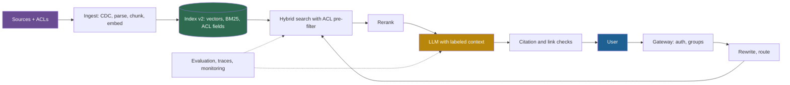

## 1. The question this idea answers

A notebook RAG prototype is about 50 lines: load files, chunk, embed, search, prompt. Then the interviewer says: "Design it for production. 10 million internal documents. Every user may only see documents that they can open in the source system. A changed document must be searchable within 15 minutes. Time to first token under 2 seconds. Draw it."

None of the 50 lines answers these questions:

- How do new, changed and deleted documents reach the index, and how fast?
- What happens when you change the embedding model, and all 50 million vectors become useless?
- Where exactly is the permission check, and why is "filter the results afterwards" wrong?
- What can you cache, and what does a cache break?
- Where do the 2 seconds go, and what does one answer cost?
- How do you notice that quality fell last Tuesday?

This lesson builds the full system, with numbers. It ends with the diagram to draw in the interview and a catalog of failure modes with fixes.

## 2. Mental model

> [!analogy] A city water system
> A city takes water from rivers and wells (**sources**). A treatment plant cleans it (**parsing and chunking**). The clean water fills a reservoir (**the index**). Pipes carry it to every building, and each building has its own valve (**permissions**). Meters measure the flow and the quality at many points (**monitoring**). When the plant changes its treatment chemical, the whole reservoir must be treated again. Meanwhile, the city keeps a second reservoir in service (**re-embedding with a blue-green index**).
>
> **Where it stops working:** in a city, every building gets the same water. In RAG, every user gets **different** water: the same question must return different chunks for different users. Also, stale water often looks or tastes wrong. A stale chunk looks exactly like a fresh one, so you need explicit freshness metrics.

## 3. Terms

| Term | Plain meaning |
|---|---|
| write path | The pipeline that brings documents into the index: connectors, parsing, chunking, embedding, indexing. |
| read path | The pipeline that answers one query: authentication, retrieval, reranking, generation, checks. |
| connector | A component that reads documents and their permissions from one source system, such as a wiki or a file share. |
| change data capture (CDC) | Reading the inserts, updates and deletes of a data source as a stream of change records. |
| manifest | A table with one row per source document: its content hash, version, chunk IDs and the time it was indexed. |
| idempotent | An operation that gives the same result if it runs once or several times. |
| freshness lag | The time between a change in the source and the moment that the change is searchable. |
| embedding model version | The exact model, version, dimensions and input format that produced the vectors of an index. |
| re-embedding | Computing new vectors for the whole corpus with a new embedding model. |
| blue-green index | Two indexes side by side: the current one serves traffic while the new one is built and tested, then an alias switches. |
| index alias | A stable name, such as `docs-current`, that refers to one physical index version and can be switched. |
| access control list (ACL) | The list of users or groups that may read a document. |
| security trimming | Removing the documents that a user may not read from search results, with a filter on the user's groups. |
| pre-filtering | Applying the permission filter inside the search, so that only allowed chunks can enter the top $k$. |
| post-filtering | Removing disallowed chunks after the search returned its top $k$. |
| tenant | One customer or organization whose data must stay separate from all others. |
| semantic cache | A cache that returns a stored answer when a new query's embedding is close enough to a cached query's embedding. |
| latency budget | The planned share of the total response time for each stage of the read path. |
| retrieval drift | A slow change in what retrieval returns, caused by new queries, new documents or new models. |
| data poisoning | Placing crafted documents in the corpus so that retrieval returns them for chosen questions. |

All terms are also in the [Glossary](/notes/ai/llm-systems/glossary).

## 4. The reference architecture

### 4.1 Three planes

A production RAG system has three planes:

1. **Write path:** keeps the index equal to the sources, including deletes and permissions.
2. **Read path:** answers each query within the latency budget, with only the chunks that the user may read.
3. **Control plane:** evaluation, tracing, monitoring and the configuration of versions (embedding model, index alias, prompt).


```video
{"src": "/notes/media/llm-systems/manim/m29-production-rag-data-flow.mp4", "caption": "One document change and one user query travel through the write path and the read path of a production RAG system."}
```

> [!key] The main idea
> The model call is one box of many. Most production failures of RAG are data and systems failures: a stale chunk, a permission leak, a mixed embedding version, a shared cache entry. Design the write path, the permission model and the versioning first.

### 4.2 The read path, step by step

1. **Authenticate.** The gateway verifies the user's token and resolves the user's groups and tenant from the identity provider. Only the session provides these values.
2. **Check the cache.** Look for a cached answer within the user's permission scope and the current index version (section 10).
3. **Condense and route.** Rewrite a follow-up into a standalone query, and choose the index or tool ([L6](/notes/ai/llm-systems/06-rag/l6-query-side-techniques)).
4. **Embed the query** with exactly the model version of the index.
5. **Search.** Run the vector search and BM25 in parallel, both with the permission filter inside the search ([L4](/notes/ai/llm-systems/06-rag/l4-vector-indexes), [L5](/notes/ai/llm-systems/06-rag/l5-hybrid-search-and-reranking)).
6. **Fuse and rerank** about 50 candidates down to about 8.
7. **Assemble the context** with labels, dates and spotlighting ([L7](/notes/ai/llm-systems/06-rag/l7-generation-and-grounding)).
8. **Generate** and stream the answer.
9. **Check** citations and links before or while the answer streams.
10. **Log** one trace with a span per stage, the chunk IDs, the index version and the model versions.

### 4.3 The write path, step by step

1. **Detect changes** with connectors: scheduled scans, webhooks, or CDC.
2. **Fetch** the document and its ACL from the source.
3. **Parse and clean:** text, tables, headings, OCR for scans ([L3](/notes/ai/llm-systems/06-rag/l3-chunking-and-ingestion)).
4. **Chunk** and attach metadata: document ID, version, section, effective date, tenant, allowed groups.
5. **Embed** the chunks with the current model version.
6. **Write** to the index: delete the old chunks of the document, insert the new ones, update the manifest.
7. **Record** the freshness lag and any failure. Failed documents go to a dead-letter queue for retry and review.

## 5. Ingestion

### 5.1 Three ways to detect changes

| Method | How it works | Freshness | Weak point |
|---|---|---|---|
| Scheduled scan | List all documents every $N$ minutes, compare hashes with the manifest | $N$ minutes plus processing | Expensive for large sources. Misses deletes if the scan is partial. |
| Events (webhooks) | The source calls your endpoint on every change | Seconds | Events can be lost. Run a periodic full reconciliation as well. |
| Change data capture | Read the change log of a database or table | Seconds to minutes | Needs a source that exposes a change log |

**CDC on Delta tables.** In Databricks, Delta Lake's change data feed records row-level changes. You enable it with `ALTER TABLE ... SET TBLPROPERTIES (delta.enableChangeDataFeed = true)`. Each change row gets three columns: `_change_type` (`insert`, `update_preimage`, `update_postimage` or `delete`), `_commit_version` and `_commit_timestamp`. You read changes with the SQL function `table_changes('<table>', <start_version>)`, or with the `readChangeFeed` option in Spark (Databricks docs, checked on 2026-10-15). A common design stores one chunk per row in a Delta table with the change data feed enabled. The index then syncs from that table (section 6.2).

### 5.2 Make every step idempotent

Pipelines fail halfway. A retry must not create duplicates or leave half-updated documents. Three rules:

1. **Deterministic chunk IDs:** derive each ID from the document ID, the document version and the chunk position. A rerun produces the same IDs and overwrites instead of duplicating.
2. **Delete before insert, per document:** a changed document can have fewer chunks than before. Delete all chunks with its document ID, then insert the new set. Do both in one transaction where the store supports it.
3. **Update the manifest last:** only after the index write succeeded.

```python
import hashlib

def content_hash(text: str) -> str:
    return hashlib.sha256(" ".join(text.split()).encode()).hexdigest()

def chunk_id(doc_id: str, version: str, position: int) -> str:
    return hashlib.sha256(f"{doc_id}|{version}|{position}".encode()).hexdigest()[:16]

def sync_plan(source: dict[str, str], manifest: dict[str, str]) -> dict[str, list[str]]:
    plan = {"new": [], "changed": [], "unchanged": [], "deleted": []}
    for doc_id, text in sorted(source.items()):
        h = content_hash(text)
        if doc_id not in manifest:
            plan["new"].append(doc_id)
        elif manifest[doc_id] != h:
            plan["changed"].append(doc_id)
        else:
            plan["unchanged"].append(doc_id)
    plan["deleted"] = sorted(set(manifest) - set(source))
    return plan

manifest = {"refund.md": content_hash("Refunds within 30 days."), "old.md": content_hash("Retired page.")}
source = {"refund.md": "Refunds within 14 days.", "sla.md": "99.95% availability."}
print(sync_plan(source, manifest))
print(chunk_id("refund.md", "v4", 0) == chunk_id("refund.md", "v4", 0))
```

The plan prints `refund.md` as changed, `sla.md` as new and `old.md` as deleted. The last line prints `True`: the same inputs always give the same chunk ID. `content_hash` normalizes whitespace first, so a reformatted file with the same words does not count as a change.

### 5.3 Size the initial build

> [!example] Worked example: 10 million documents
> Assumptions for this example: 10,000,000 documents of about 2,000 tokens. Chunks of 512 tokens with a 64-token overlap, so a new chunk starts every 448 tokens. Embedding with `text-embedding-3-small` at USD 0.02 per million tokens, 1,536 dimensions by default (OpenAI docs, checked on 2026-10-15).
>
> - **Chunks per document:** $\lceil (2{,}000 - 64) / 448 \rceil = \lceil 4.32 \rceil = 5$. Total: 50,000,000 chunks.
> - **Tokens to embed:** each document's chunks hold $2{,}000 + 4 \times 64 = 2{,}256$ tokens, because the 4 overlaps are embedded twice. Total: $22{,}560{,}000{,}000$ tokens.
> - **Embedding cost:** $22{,}560 \times$ USD 0.02 $=$ USD 451.20.
> - **Raw vector storage:** $50{,}000{,}000 \times 1{,}536 \times 4$ bytes $= 307.2$ GB in float32. With 768 dimensions: 153.6 GB. With int8 quantization of 1,536 dimensions: 76.8 GB. Index structures such as HNSW graphs add more ([L4](/notes/ai/llm-systems/06-rag/l4-vector-indexes)).
> - **Time:** at a hypothetical rate limit of 5 million tokens per minute, $22.56 \times 10^9 / (5 \times 10^6) = 4{,}512$ minutes, about 75.2 hours.
> - **Daily churn of 1%:** 100,000 documents, 225.6 million tokens, about USD 4.51 and about 45 minutes per day at the same rate.
>
> The money is small. The **time** is the constraint: the first build takes days unless you parallelize, use a batch API or run your own embedding model. That same time returns on every model change (section 7).

## 6. Index refresh and freshness

### 6.1 Freshness is a measured SLO

Define a freshness target, for example: "95% of source changes are searchable within 15 minutes". Measure the **freshness lag** of every processed change:

$$
\text{lag} = t_{\text{searchable}} - t_{\text{source change}}
$$

Alert on its p95. Deletes and **permission revocations** need the tightest targets. A deleted document that still answers questions is a correctness bug. A revoked user who still sees a document is a security bug.

### 6.2 Example: Databricks AI Search

Databricks now calls its vector search product **Databricks AI Search** ("formerly Databricks Vector Search"). The facts below are from its docs, checked on 2026-10-15:

| Item | What the docs state |
|---|---|
| Index types | Delta Sync Index with Databricks-computed embeddings, Delta Sync Index with self-managed embeddings, and Direct Vector Access Index (you write vectors through the REST API). A full-text index is in Beta. |
| Sync modes | `pipeline_type` `"TRIGGERED"`: the index syncs when you start it, for example with `index.sync()`. `"CONTINUOUS"`: it follows source changes with "seconds of latency" and costs more, because a streaming pipeline runs all the time. |
| Source requirement | For standard endpoints, the source table must use change data feed. Tables with row tracking enabled use it automatically. |
| Algorithm and metric | HNSW, with L2 distance. Cosine similarity needs normalized embeddings, and then L2 ranking equals cosine ranking. |
| Hybrid search | Vector similarity plus Okapi BM25 keyword scores, merged with reciprocal rank fusion |
| Capacity | Standard endpoint: about 320 million vectors at 768 dimensions. Storage-optimized endpoint: over one billion at 768 dimensions, with about 250 ms of added query latency, and only triggered sync. Maximum dimension 4,096. |
| Permissions | Indexes are governed by Unity Catalog. Users who do not own an index need `USE CATALOG`, `USE SCHEMA` and `SELECT`. Row-level and column-level permissions are not supported. The docs suggest application-level ACLs through filters. |
| Python SDK | PyPI package `databricks-ai-search` (version 0.78, described as "formerly Vector Search"), with `from databricks.ai_search.client import AISearchClient` |

Interpretation of these notes: for a 15-minute freshness target, a triggered index with a sync every few minutes is often enough. It costs less than continuous sync. Measure the lag either way.

## 7. Embedding model versioning and re-embedding

### 7.1 Why vectors never mix

Each embedding model learns its own coordinate system. A query vector from model B compared with document vectors from model A gives numbers without meaning. If the dimensions match, nothing raises an error, and the results are close to random ([L2](/notes/ai/llm-systems/06-rag/l2-embeddings-in-depth)).

So every index carries a small **index manifest**. It records the model name and version, the dimensions, the normalization, any query or document prefix, the chunking settings and the creation time. The read path checks the query embedder against it and refuses to search on a mismatch.

### 7.2 Blue-green re-embedding

```mermaid
flowchart LR
    A["1 Build index v3 with the new model"] --> B["2 Dual-write: new changes go to v2 and v3"]
    B --> C["3 Backfill all documents into v3"]
    C --> D["4 Offline evaluation: v2 vs v3 on the same set"]
    D --> E["5 Shadow traffic to v3"]
    E --> F["6 Switch the alias docs-current to v3"]
    F --> G["7 Keep v2 for rollback, then delete it"]
    style A fill:#2D6A4F,color:#fff
    style F fill:#1E6091,color:#fff
    style G fill:#8A8A8A,color:#fff
```



The details that interviewers probe:

- **Dual-write before backfill.** Otherwise changes made during the multi-day backfill never reach v3.
- **The query embedder switches with the alias.** The read path reads the query model from the manifest of the index behind the alias. A separate setting could disagree with the index.
- **Caches carry the index version** in their keys, so the switch invalidates them (section 10).
- **Cost:** for the example of section 5.3, a full re-embed costs about USD 451 and, at the same rate limit, about 75 hours. Raw storage doubles during the migration: $2 \times 307.2 = 614.4$ GB.

The same procedure applies to a change of chunk size, parser or document prefix: anything that changes the stored vectors.

## 8. Permissions at query time

### 8.1 The design

1. **Ingest ACLs with the content.** The connector reads each document's allowed users and groups and stores them on every chunk, for example as `allowed_groups`.
2. **Resolve the user at query time.** The gateway takes the user's identity from the verified token and resolves group membership from the identity provider. Cache this mapping for a short time.
3. **Filter inside the search.** The search receives a filter such as "`allowed_groups` contains any of the user's groups". Only allowed chunks can enter the top $k$.
4. **Never let the model choose the filter.** The filter is built in code from the session. It is not a tool argument.

Azure AI Search documents the same pattern under the name security trimming. Its docs warn that the principal is "just a string, used in a filter expression" and that "There's no authentication or authorization through the security principal" (Microsoft Learn, checked on 2026-10-15). In other words, the search engine trusts whatever groups your application sends. Your gateway is the real security boundary.

```python
FORBIDDEN_TOOL_KEYS = {"allowed_groups", "tenant_id", "user_id", "filters"}

def build_search_request(session: dict, tool_args: dict) -> dict:
    bad = FORBIDDEN_TOOL_KEYS & set(tool_args)
    if bad:
        raise PermissionError(f"tool arguments may not set {sorted(bad)}")
    return {
        "query": tool_args["query"],
        "k": min(int(tool_args.get("k", 8)), 20),
        "filter": {"tenant_id": session["tenant_id"],
                   "allowed_groups_any": sorted(session["groups"])},
    }

session = {"user": "dana", "tenant_id": "acme", "groups": ["finance", "all-staff"]}
print(build_search_request(session, {"query": "Q3 budget approval policy"}))
try:
    build_search_request(session, {"query": "salaries", "allowed_groups": ["hr-admins"]})
except PermissionError as e:
    print("blocked:", e)
```

The first call builds a filter from the session. The second call imitates a manipulated model that tries to widen its own access: the code refuses it. The cap `min(..., 20)` stops a tool call from requesting thousands of chunks.

### 8.2 Why post-filtering fails

Post-filtering retrieves the top $k$ over **all** chunks and removes the disallowed ones afterwards. It has two problems.

1. **Leakage.** Disallowed chunks leave the database and travel through application code, logs and caches. One bug exposes them.
2. **Missing results.**

> [!example] Worked example: a user who can read 2% of the corpus
> The search returns the top 100 chunks over the whole corpus, then a post-filter keeps the user's chunks. Assume, for this estimate, that each of the 100 chunks is readable with probability 0.02, independently.
>
> - Expected readable chunks: $100 \times 0.02 = 2$.
> - Probability of **zero** readable chunks: $0.98^{100} = 0.133$.
> - Probability of at least 5: about 0.051.
>
> So about one query in eight returns nothing, although the user's own relevant documents exist further down the ranking. A pre-filter searches only the user's 2% and always fills the top $k$ when enough readable chunks exist.

Approximate indexes complicate pre-filtering too. A graph search with a very selective filter can stop before it finds $k$ allowed vectors. Databricks warns that on storage-optimized endpoints "It is possible that no results will be returned even if there are results in the dataset that match the filter condition." Test recall with your real filter selectivity ([L4](/notes/ai/llm-systems/06-rag/l4-vector-indexes)).

### 8.3 The hard parts

| Problem | Example | Mitigation |
|---|---|---|
| Revocation lag | A user leaves a project, but the index still lists their group for 6 hours | Event-driven ACL updates, a freshness target for ACL changes, short group-cache TTL |
| Group explosion | A user belongs to 1,500 groups, but Databricks allows up to 1,024 elements per filter clause | Map groups to fewer "access classes" at ingestion, or split per tenant or per department |
| Inherited permissions | A folder permission changes, and 40,000 documents inherit it | Store the folder ID as an ACL principal, so one change updates one mapping |
| Cache leaks | User A's cached answer is served to user B | Permission scope in every cache key (section 10) |
| Answers that combine documents | A summary mixes a public and a restricted chunk | Only chunks that pass the user's filter enter the context, so the answer can only use what the user may read |

OWASP's LLM08:2025 "Vector and Embedding Weaknesses" lists "Permission and access control" as its first mitigation. Its second attack scenario is this exact leak: groups share one vector database, and one group's embeddings are retrieved for another group's queries.

## 9. Multi-tenancy

| Design | Isolation | Cost and operations | Deleting a tenant |
|---|---|---|---|
| One index per tenant | Strongest. A query cannot reach another tenant. | Many indexes to create, monitor and migrate. Small tenants waste capacity. | Drop the index |
| One index, a partition or namespace per tenant | Strong, if the store enforces the partition | Moderate | Delete the partition |
| One shared index with a `tenant_id` filter | Depends on the filter in every query | Simplest. One migration for all tenants. | Delete by filter, then verify |

Rules for every design:

1. Take the tenant ID from the authenticated session, never from the user's text or a tool argument.
2. Put the tenant ID in every cache key, log line and trace.
3. **Test isolation like a security feature.** For each tenant, run queries copied word for word from other tenants' documents. Assert that no foreign chunk ID returns.
4. Watch for **noisy neighbors**: one tenant's bulk re-index must not slow every tenant's queries. Rate-limit ingestion per tenant.

## 10. Caching

### 10.1 Four caches

| Cache | Key | Saves | Main risk |
|---|---|---|---|
| Embedding cache | Hash of (model version, normalized text) | Embedding calls for repeated chunks and repeated queries | Low. A wrong model version in the key mixes vectors. |
| Retrieval cache | (normalized query, permission scope, filters, index version) | Search and rerank time | Staleness after an index update |
| Semantic answer cache | Query embedding within a similarity threshold, plus permission scope and index version | The whole pipeline, including the LLM | Wrong answers for similar but different questions, and permission leaks |
| Prefix (prompt) cache | The exact token prefix of the prompt | Prefill time and input cost of the stable instructions | Low, but only if stable parts come first ([L9 of part 04](/notes/ai/llm-systems/04-inference/l9-prefix-caching-and-kv-reuse)) |

### 10.2 The semantic cache and its risks

A semantic cache embeds the new query and returns a cached answer if the nearest cached query is closer than a threshold $\tau$. The vCache paper (Schroeder et al., arXiv 2502.03771) explains the core problem: a fixed threshold "assumes that similarity correlates uniformly with correctness across all prompts and their embeddings". Two questions can be very close in embedding space and still need different answers.

```python
import numpy as np

def unit(v):
    v = np.asarray(v, dtype=float)
    return v / np.linalg.norm(v)

class SemanticCache:
    def __init__(self, threshold: float):
        self.threshold, self.entries = threshold, []

    def get(self, scope: str, vec: np.ndarray):
        candidates = [(float(v @ vec), answer) for s, v, answer in self.entries if s == scope]
        if not candidates:
            return None, None
        sim, answer = max(candidates)
        return (answer if sim >= self.threshold else None), round(sim, 4)

    def put(self, scope: str, vec: np.ndarray, answer: str):
        self.entries.append((scope, vec, answer))

password = unit([0.9, 0.3, 0.1, 0.3])   # toy embedding of "How do I reset my password?"
pin = unit([0.8, 0.45, 0.1, 0.15])      # toy embedding of "How do I reset my card PIN?"
cache = SemanticCache(threshold=0.95)
cache.put("acme|finance|index-v3", password, "Use the self-service portal, then ...")
print(cache.get("acme|finance|index-v3", pin))   # a false hit
print(cache.get("acme|hr|index-v3", pin))        # another scope: no hit
```

The first lookup returns the password answer for a PIN question: the toy similarity is 0.9728, above the threshold 0.95. That is a **false hit**, and every user who asks about PINs now gets password instructions. The second lookup finds nothing, because the scope string differs. The scope holds the tenant, the permission group set and the index version. So the cache never crosses a permission boundary or survives an index switch.

Rules for a semantic cache:

1. Use it for high-volume, low-risk questions, such as FAQ traffic, and never for personal or permission-dependent answers without a scope key.
2. Tune the threshold on labeled pairs of "same answer" and "different answer" questions, and measure the false-hit rate. vCache learns a threshold per cached entry to bound the error rate.
3. Give entries a time to live, and invalidate them when the index version changes.

> [!example] Worked example: what a 20% hit rate saves
> Use the cost per query of section 12: USD 0.0182. A cache hit costs one query embedding, about USD 0.0000004. With a hit rate $h = 0.2$:
>
> $$
> \text{cost} = (1 - h) \times 0.0182 + 0.0000004 \approx 0.01456 \text{ USD per query}
> $$
>
> That is USD 14.56 instead of USD 18.20 per 1,000 queries, a saving of about 20%. Compare it with the cost of one false hit: a wrong answer that many users receive.

## 11. The latency budget


The table is an example budget of these notes, not a measurement. Two values are from the Databricks AI Search retrieval quality guide (checked on 2026-10-15). It says that the reranker "Reranks 50 results in under 1 second in typical workloads" and is "As fast as ~250 msec for shorter chunks". For RAG agents it gives the example "Time to First Token (TTFT) target (for example, <2 sec)".

| Stage | Example p50 | Notes |
|---|---|---|
| Authenticate and resolve groups | 10 ms | Group mapping cached |
| Condense and route (small LLM) | 350 ms | Skip for standalone messages |
| Query embedding | 30 ms | |
| Vector search and BM25, in parallel | 40 ms | The slower of the two counts |
| Fusion | 2 ms | |
| Rerank 50 candidates | 250 ms | Databricks: about 250 ms for short chunks |
| Context assembly and guards | 5 ms | |
| LLM time to first token | 600 ms | Grows with input length and server load |
| **Time to first token, total** | **1,287 ms** | Under the 2 s target |
| Decode 300 output tokens at 20 ms each | 5,980 ms | $\text{TPOT} \times (n - 1)$ |
| **End-to-end** | **7,267 ms** | $\text{TTFT} + \text{TPOT} \times (n - 1)$ |

The end-to-end formula is the one of [L2 of part 04](/notes/ai/llm-systems/04-inference/l2-latency-and-throughput-metrics): $1{,}287 + 20 \times 299 = 7{,}267$ ms. Streaming makes the answer feel fast after 1.3 s, even though it finishes after 7.3 s.

Levers, from cheapest to most expensive:

1. **Skip the rewrite** when the message is standalone: saves 350 ms on those turns.
2. **Run independent stages in parallel:** vector search and BM25, or retrieval for several sub-questions.
3. **Shorten the reranker's input:** fewer candidates or truncated chunks. The Databricks reranker already reads only the first 2,000 characters of the listed columns.
4. **Shorten the prompt:** fewer, better chunks lower the prefill time.
5. **Watch p99, not only p50.** A rare slow reranker call or a cold index partition dominates the tail. Set a timeout per stage with a fallback, for example "answer without reranking".

## 12. The cost per query

> [!example] Worked example: one answer
> Hypothetical prices for this example: main model USD 3.00 per million input tokens and USD 15.00 per million output tokens. Small rewrite model USD 0.25 and USD 1.25. Embeddings USD 0.02 per million tokens.
>
> | Item | Tokens | Cost (USD) |
> |---|---|---|
> | Main model input (instructions, 8 chunks, history, question) | 4,500 | $4{,}500 \times 3.00 / 10^6 = 0.0135$ |
> | Main model output | 300 | $300 \times 15.00 / 10^6 = 0.0045$ |
> | Rewrite call | 600 in, 40 out | $0.00015 + 0.00005 = 0.0002$ |
> | Query embedding | 20 | $0.0000004$ |
> | **Total per query** | | **about 0.0182** |
>
> Per 1,000 queries: about USD 18.20. The main model is about 99% of the token cost. The search endpoint, the reranker and the ingestion pipeline add infrastructure costs per hour, which depend on the platform and are not in this table.

The levers follow from the table. Send fewer input tokens: better chunks, and fewer of them. Use prefix caching for the stable instructions, a smaller model for easy questions (routing), and caching for repeated questions. Part 05 explains how to compute the cost per token of a self-hosted model ([L7: Cost math](/notes/ai/llm-systems/05-cloud-hosting/l7-cost-math)).

## 13. Monitoring

| Signal | Definition | Example alert |
|---|---|---|
| Freshness lag | Source change to searchable, p95 | p95 above the 15-minute target |
| Ingestion failures | Documents in the dead-letter queue | More than 0.5% of a run |
| Empty or low-score retrieval | Queries whose best reranker score is below a threshold | Rate doubles against last week |
| Abstention rate | Answers that say "not found" | Sudden rise: an index or permission problem |
| Invalid citations | Unknown IDs or unsupported numbers | Any rise after a release |
| Sampled faithfulness | A judge on a random sample of answers ([L8](/notes/ai/llm-systems/06-rag/l8-evaluating-rag)) | Below the release gate |
| Filter coverage | Share of searches that carried a permission filter | Anything below 100% is a security incident |
| Retrieval drift | Distribution of top-1 scores, share of queries per topic | A shift without a release |
| Latency per stage | p50, p95, p99 of every span | p99 above the budget |
| Cost per query | Tokens and calls per answer | Rise after a prompt change |

Every trace carries these fields:

- the request ID and the tenant,
- the index version and alias, and the embedding model version,
- the prompt version,
- the retrieved chunk IDs with their scores,
- the reranker and LLM model IDs.
 With these fields, any bad answer can be replayed and explained. Never log the full text of restricted chunks into a log store with weaker access rules than the source. Part 05 covers metrics, tracing and logging of the serving layer ([L8: Production operations](/notes/ai/llm-systems/05-cloud-hosting/l8-production-operations)).

## 14. Failure modes and fixes

| Symptom | Cause | Fix |
|---|---|---|
| Answers quote an outdated policy | Old chunks were not deleted when the document changed | Delete by document ID before insert. Alert on freshness lag. |
| Results near random after a deploy | Query embedded with a different model or version than the index | Index manifest check at query time. Switch the query model with the alias. |
| Quality drop with an asymmetric model | Missing query or document prefix | Store the prefixes in the index manifest and apply them in one shared function. |
| A user sees another team's document | Post-filter bug, missing ACL sync, or a shared cache entry | Pre-filter in the search. Permission scope in cache keys. Isolation tests in CI. |
| A revoked user still sees documents | ACL changes are synced slowly | Event-driven ACL updates. A freshness target for revocations. |
| Some users get too few results | Post-filtering, or a selective filter on an approximate index | Filtered search. Test recall at real filter selectivity. |
| Sudden rise of empty results | Index sync stopped, or the embedding endpoint fails | Alerts on freshness lag and empty-result rate. |
| Wrong numbers from tables | The parser flattened a table | Structure-aware parsing. Table questions in the evaluation set. |
| The answer ignores the right chunk | Too many chunks, relevant chunk in the middle | Fewer chunks, strongest at the edges ([L7](/notes/ai/llm-systems/06-rag/l7-generation-and-grounding)). |
| A phishing link in an answer | Indirect prompt injection in a document | Link allowlist, no tools for the answerer, spotlighting, injection tests. |
| Many users get the same wrong answer | Semantic cache false hit | Higher threshold, scoped keys, TTL, invalidation on index change. |
| Duplicate chunks fill the context | One document ingested from two sources | Deduplicate by content hash at ingestion. |
| Re-embedding takes weeks | Rate limits not planned | Batch API, parallel workers, or a self-hosted embedding model. Dual-write during backfill. |
| Invented citations | The model writes IDs that do not exist | Citation checker on every answer. |
| Slow decline of quality | New topics, changed documents, model updates | Online signals, new failures added to the evaluation set, scheduled re-evaluation. |

## 15. Drawing it in the interview

Draw from left to right, and talk while you draw:



A two-minute script:

1. "Two paths. The write path keeps the index equal to the sources: CDC or events, parsing, chunking with metadata including ACLs and versions, embedding, delete-then-insert, a manifest, a freshness SLO."
2. "The read path: authenticate, resolve groups from the session, rewrite and route, hybrid search with the permission filter inside the search, rerank 50 to 8, assemble labeled context, generate, verify citations, stream."
3. "Versioning: every index records its embedding model. Model changes use a blue-green index with dual-write, backfill, evaluation, shadow traffic and an alias switch."
4. "Caches carry the permission scope and the index version. A semantic cache only for low-risk traffic."
5. "Budget: about 1.3 s to the first token. Cost: about 2 cents per answer at the example prices, dominated by the LLM."
6. "Quality: an evaluation set gates releases. Online, I watch freshness lag, empty results, abstentions, invalid citations and sampled faithfulness."

### Exercises

Use the lab folder `C:\Users\ASohi\Downloads\AI\agent-harness-lab`, notebook folder `llm-systems/`.

1. **Apply a sync plan.** Extend `sync_plan` of section 5.2 into `apply_sync(source, manifest, index)`, where `index` is a dictionary from chunk ID to (document ID, text). Split each document into chunks of 3 words. Acceptance test: after a document shrinks from 9 words to 6 words, the index holds exactly 2 chunks for it. A second run changes nothing. Hint 1: delete by document ID first. Hint 2: write the manifest entry last.
2. **Post-filter simulation.** Simulate 10,000 queries over a corpus where a user can read 2% of the chunks, with a top-100 post-filter. Acceptance test: the share of queries with zero readable chunks is within 0.01 of 0.133. Hint 1: draw 100 Bernoulli(0.02) values per query. Hint 2: fix the random seed.
3. **A scoped cache key.** Write `cache_scope(session, index_version)` that returns a stable string from the tenant, the sorted groups and the index version. Acceptance test: the same groups in a different order give the same key, and a different index version gives a different key. Hint 1: sort and join. Hint 2: hash the result if the group list is long.

## 16. Common mistakes

1. **"The model is the system."** The model call is one stage. Freshness, permissions, versions and caches cause most production failures.
2. **"Filter the results by permission after the search."** It leaks restricted chunks into your code and logs, and it returns too few results. Filter inside the search.
3. **"The search engine enforces permissions."** It filters by whatever groups you send. Your gateway must resolve them from the verified session.
4. **"We can upgrade the embedding model in place."** Old and new vectors are incompatible. Build a new index, dual-write, backfill, evaluate, then switch an alias.
5. **"A semantic cache is a free speed-up."** It can serve a wrong answer to many users and can cross permission boundaries. Scope it, tune it on labeled pairs, and give it a TTL.
6. **"Re-index nightly and you are fresh."** Between runs, deleted and revoked documents still answer. Measure freshness lag, with tighter targets for deletes and revocations.
7. **"Average latency is fine, so users are fine."** The tail matters. Budget p99 per stage and add timeouts with fallbacks.

## 17. One-minute explanation

A production RAG system has a write path, a read path and a control plane. The write path detects changes with CDC, events or scans, then parses, chunks and embeds the documents. Each chunk carries metadata such as version, tenant and allowed groups. Writes are delete-then-insert per document, with deterministic IDs and a manifest. I measure freshness lag against an SLO, with the tightest targets for deletes and permission revocations. Every index records its embedding model version. A model change means a blue-green rebuild with dual-write, backfill, evaluation, shadow traffic and an alias switch. On the read path, the gateway resolves the user's groups from the session. The permission filter runs inside the search, never after it and never from a tool argument. Caches carry the tenant, permission scope and index version, and a semantic cache serves only low-risk questions. A typical budget is about 1.3 seconds to the first token, and the LLM dominates the cost per query. I monitor freshness, empty results, abstentions, invalid citations, filter coverage and sampled faithfulness, and I gate releases on an evaluation set.

## 18. Check questions

```check
{"question": "Interview follow-up: you must re-embed 4 million documents of about 1,200 tokens, with 400-token chunks and a 50-token overlap, into 1,024-dimension float32 vectors. Estimate the chunks, the tokens, the cost at USD 0.02 per million tokens, the raw storage, and the time at 5 million tokens per minute.", "hint": "A new chunk starts every 400 − 50 = 350 tokens. Overlaps are embedded twice.", "answer": "- Chunks per document: $\\lceil (1{,}200 - 50)/350 \\rceil = \\lceil 3.29 \\rceil = 4$. Total: 16,000,000 chunks.\n- Tokens per document: $1{,}200 + 3 \\times 50 = 1{,}350$. Total: $5.4 \\times 10^9$ tokens.\n- Cost: $5{,}400 \\times$ USD 0.02 $=$ USD 108.\n- Raw storage: $16 \\times 10^6 \\times 1{,}024 \\times 4 = 65.5$ GB, plus index overhead. During a blue-green migration, both versions exist.\n- Time: $5.4 \\times 10^9 / (5 \\times 10^6) = 1{,}080$ minutes $= 18$ hours, plus parsing and writes.\n\nThe money is small. Plan the time: dual-write during the backfill, and parallelize the embedding."}
```

```check
{"question": "Interview follow-up: a user may read 5% of the chunks. The system retrieves the top 50 over the whole corpus and post-filters. What is the expected number of readable chunks, and the probability of none? State the assumption.", "answer": "Assume that each of the 50 chunks is readable with probability 0.05, independently. Expected readable chunks: $50 \\times 0.05 = 2.5$. Probability of none: $0.95^{50} = 0.077$, about one query in thirteen.\n\nReal rankings are not independent: if the user's documents are about other topics than the query, the result is worse. The fix is a pre-filter inside the search, so that the top $k$ comes only from readable chunks. Post-filtering also leaks restricted chunks into application code and logs."}
```

```check
{"question": "Interview follow-up: walk through a blue-green embedding model migration. What breaks if you skip the dual-write step? How does the query side know which model to use?", "answer": "Steps:\n\n1. Create index v3 with the new model.\n2. Dual-write: every new change goes to v2 and v3.\n3. Backfill all documents into v3.\n4. Evaluate v2 against v3 offline on the same evaluation set.\n5. Shadow live traffic to v3.\n6. Switch the alias, for example `docs-current`, to v3.\n7. Keep v2 for rollback, then delete it.\n\nWithout dual-write, every document that changes during a multi-day backfill is indexed in v2 only. After the switch, v3 serves stale or missing versions of exactly the most recently changed documents.\n\nThe query side reads the embedding model name, version, dimensions and prefixes from the manifest of the index behind the alias. The query model therefore switches with the alias, and a mismatch is impossible by construction. Caches include the index version in their keys, so the switch also invalidates them."}
```

```check
{"question": "Interview follow-up: with the example budget of section 11 (TTFT 1,287 ms), how would you bring the time to first token below 1 second? Give two changes with their effect.", "answer": "1. **Skip the rewrite for standalone messages:** saves the 350 ms call on those turns, giving $1{,}287 - 350 = 937$ ms.\n2. **Rerank fewer or shorter candidates**, for example 25 instead of 50, or truncated chunks. If that saves about 150 ms: $937 - 150 = 787$ ms.\n\nOther levers: run retrieval for several sub-queries in parallel, and shorten the prompt so that prefill is faster. Use prefix caching for the stable instructions, and put a timeout with a fallback on the reranker for the p99 tail. Measure p95 and p99 after each change, not only p50."}
```

```check
{"question": "A user is removed from the group \"finance\". Which design makes the change effective within minutes without re-indexing any document?", "answer": "Store **group IDs** on the chunks (`allowed_groups`), not user IDs, and resolve the user's group membership at query time from the identity provider, with a short cache TTL. Removing the user from the group changes only the membership lookup, so the next query after the TTL already uses the smaller group list. No chunk changes.\n\nA change to a **document's** ACL, for example a folder that becomes restricted, does need an update of the chunk metadata. It needs its own freshness target, because it is a security change."}
```

```check
{"question": "A semantic answer cache has a 30% hit rate. The full pipeline costs USD 0.0182 per query and a lookup costs USD 0.0000004. What is the new cost per 1,000 queries, and what must you measure before you enable it?", "answer": "Cost per query: $0.7 \\times 0.0182 + 0.0000004 = 0.01274$ USD, so about USD 12.74 per 1,000 queries instead of USD 18.20.\n\nBefore enabling it, measure the **false-hit rate** on labeled pairs of questions that look similar but need different answers, and choose the threshold from that, not from a default. Also confirm that the key contains the tenant, the permission scope and the index version, and that entries expire on index changes. One false hit can send the same wrong answer to many users, which may cost more than the saving."}
```

```check
{"question": "A SaaS product has 5,000 small tenants and 3 large regulated tenants. Which multi-tenancy design would you choose for each group, and why?", "answer": "Small tenants: one shared index with a `tenant_id` field taken from the session and enforced as a filter inside every search, plus isolation tests in CI. 5,000 separate indexes would waste capacity and make migrations painful.\n\nRegulated tenants: one index (or a dedicated partition with its own keys) per tenant. Isolation is structural, deletion is simple, and contracts often require it. Both groups share the same code and the same read path. Only the index routing differs."}
```

```check
{"question": "Exercise 1: show a reference solution", "answer": "```python\nimport hashlib\n\ndef content_hash(text):\n    return hashlib.sha256(\" \".join(text.split()).encode()).hexdigest()\n\ndef chunk_id(doc_id, version, position):\n    return hashlib.sha256(f\"{doc_id}|{version}|{position}\".encode()).hexdigest()[:16]\n\ndef chunks_of(text, size=3):\n    words = text.split()\n    return [\" \".join(words[i:i + size]) for i in range(0, len(words), size)]\n\ndef apply_sync(source, manifest, index):\n    \"\"\"manifest: doc_id -> hash. index: chunk_id -> (doc_id, text). Returns counts.\"\"\"\n    counts = {\"new\": 0, \"changed\": 0, \"deleted\": 0, \"unchanged\": 0}\n    for doc_id, text in sorted(source.items()):\n        h = content_hash(text)\n        if manifest.get(doc_id) == h:\n            counts[\"unchanged\"] += 1\n            continue\n        counts[\"changed\" if doc_id in manifest else \"new\"] += 1\n        for cid in [c for c, (d, _) in index.items() if d == doc_id]:\n            del index[cid]                                   # delete first\n        for pos, chunk in enumerate(chunks_of(text)):\n            index[chunk_id(doc_id, h[:8], pos)] = (doc_id, chunk)\n        manifest[doc_id] = h                                 # manifest last\n    for doc_id in sorted(set(manifest) - set(source)):\n        for cid in [c for c, (d, _) in index.items() if d == doc_id]:\n            del index[cid]\n        del manifest[doc_id]\n        counts[\"deleted\"] += 1\n    return counts\n\nmanifest, index = {}, {}\nprint(apply_sync({\"a.md\": \"one two three four five six seven eight nine\"}, manifest, index))\nprint(apply_sync({\"a.md\": \"one two three four five six\"}, manifest, index))\nassert sum(1 for d, _ in index.values() if d == \"a.md\") == 2\nprint(apply_sync({\"a.md\": \"one two three four five six\"}, manifest, index))\n```"}
```

```check
{"question": "Exercise 2: show a reference solution", "answer": "```python\nimport numpy as np\n\nrng = np.random.default_rng(42)\nreadable = rng.random((10_000, 100)) < 0.02          # 10,000 queries x top 100 chunks\nzero_share = float((readable.sum(axis=1) == 0).mean())\nprint(round(zero_share, 4), round(0.98 ** 100, 4))\nassert abs(zero_share - 0.133) < 0.01\n```"}
```

```check
{"question": "Exercise 3: show a reference solution", "answer": "```python\nimport hashlib\n\ndef cache_scope(session, index_version):\n    groups = \",\".join(sorted(set(session[\"groups\"])))\n    raw = f'{session[\"tenant_id\"]}|{groups}|{index_version}'\n    return hashlib.sha256(raw.encode()).hexdigest()[:20]\n\na = cache_scope({\"tenant_id\": \"acme\", \"groups\": [\"finance\", \"all-staff\"]}, \"docs-v3\")\nb = cache_scope({\"tenant_id\": \"acme\", \"groups\": [\"all-staff\", \"finance\"]}, \"docs-v3\")\nc = cache_scope({\"tenant_id\": \"acme\", \"groups\": [\"finance\", \"all-staff\"]}, \"docs-v4\")\nprint(a == b, a == c)    # True False\nassert a == b and a != c\n```"}
```

## 19. Links

- Previous: [L8: Evaluating RAG](/notes/ai/llm-systems/06-rag/l8-evaluating-rag)
- Next: [L1: Why MCP exists](/notes/ai/llm-systems/07-mcp/l1-why-mcp)
- Related in this part: [L1: Why RAG](/notes/ai/llm-systems/06-rag/l1-why-rag), [L3: Chunking and ingestion](/notes/ai/llm-systems/06-rag/l3-chunking-and-ingestion), [L4: Vector indexes](/notes/ai/llm-systems/06-rag/l4-vector-indexes), [L6: Query-side techniques](/notes/ai/llm-systems/06-rag/l6-query-side-techniques), [L7: Generation, grounding and citations](/notes/ai/llm-systems/06-rag/l7-generation-and-grounding)
- Inference: [L2: Latency and throughput metrics](/notes/ai/llm-systems/04-inference/l2-latency-and-throughput-metrics), [L9: Prefix caching and KV reuse](/notes/ai/llm-systems/04-inference/l9-prefix-caching-and-kv-reuse)
- Cloud hosting: [L5: Autoscaling and routing](/notes/ai/llm-systems/05-cloud-hosting/l5-autoscaling-and-routing), [L6: Managed platforms](/notes/ai/llm-systems/05-cloud-hosting/l6-managed-platforms), [L7: Cost math](/notes/ai/llm-systems/05-cloud-hosting/l7-cost-math), [L8: Production operations](/notes/ai/llm-systems/05-cloud-hosting/l8-production-operations)
- Databricks notes: [Databricks MCP servers](/notes/platforms/databricks/04-mcp-and-genie/l1-databricks-mcp-servers), [Statement execution and Delta](/notes/platforms/databricks/03-sql-and-delta/l1-statement-execution-and-delta), [User identity in apps](/notes/platforms/databricks/02-identity-and-auth/l3-user-identity-in-apps)
- Earlier notes: [The RAG pipeline](/notes/ai/context-engineering/04-write-and-rag/l4-the-rag-pipeline), [Beyond basic RAG](/notes/ai/context-engineering/05-retrieval-quality/l9-beyond-basic-rag), [Vector search](/notes/ai/context-engineering/04-write-and-rag/l7-vector-search)
- Interview drill: [Drill: RAG](/notes/ai/llm-systems/08-interview-drills/l3-chain-rag), [A full mock interview](/notes/ai/llm-systems/08-interview-drills/l6-mock-interview)

### Sources

All checked on 2026-10-15.

- Databricks. Databricks AI Search (formerly Vector Search). https://docs.databricks.com/aws/en/generative-ai/vector-search
- Databricks. Create AI Search endpoints and indexes. https://docs.databricks.com/aws/en/vector-search/create-vector-search
- Databricks. Query an AI Search index. https://docs.databricks.com/aws/en/ai-search/query-ai-search
- Databricks. AI Search retrieval quality guide. https://docs.databricks.com/aws/en/ai-search/retrieval-quality
- Databricks. Use Delta Lake change data feed. https://docs.databricks.com/aws/en/delta/delta-change-data-feed
- PyPI: databricks-ai-search (version 0.78). https://pypi.org/project/databricks-ai-search/
- Microsoft Learn. Security filters for trimming results in Azure AI Search. https://learn.microsoft.com/en-us/azure/search/search-security-trimming-for-azure-search
- OWASP GenAI Security Project. LLM08:2025 Vector and Embedding Weaknesses. https://genai.owasp.org/llmrisk/llm082025-vector-and-embedding-weaknesses/
- Schroeder et al. vCache: Verified Semantic Prompt Caching. https://arxiv.org/abs/2502.03771
- OpenAI. Embeddings guide and text-embedding-3-small model page (price and dimensions). https://developers.openai.com/api/docs/guides/embeddings , https://developers.openai.com/api/docs/models/text-embedding-3-small
