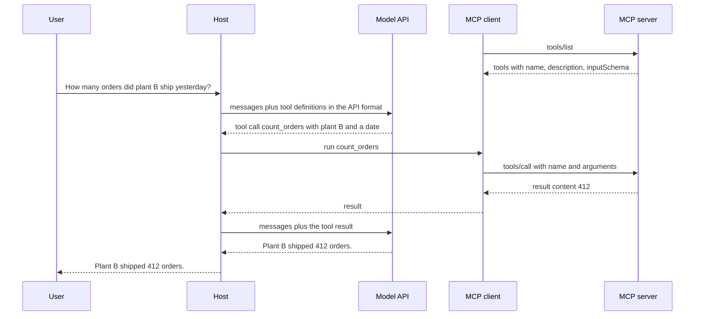

## 1. The question this idea answers

A food manufacturer has four AI applications: a desktop chat app, an IDE assistant, a LangGraph agent and a Databricks app. It has six services that the applications should use: a production-orders database, Jira, GitHub, SharePoint, Slack and a quality system.

Each AI application needs tools for each service. A tool is a function that the model may ask the application to run (see [LLM APIs: tool use and tool result](/notes/ai/llm-apis/01-messages-api/l2-tool-use-and-tool-result)). Without a standard, every application writes its own code for every service. Every change in one service API breaks several copies of that code.

The Model Context Protocol (MCP) answers four questions:

1. How can one integration for a service work in every AI application?
2. Which programs talk to each other, and who is in charge?
3. What can a server offer, and who decides when each offer is used?
4. What does the protocol leave to the application, for example safety decisions?

This lesson answers them from first principles. Lessons L2 to L5 then go down to the messages, the lifecycle, the transports and the difference between the stateful and the stateless protocol. That difference is the main change of the current revision, 2026-07-28.

## 2. Mental model

> [!analogy] One plug standard for many devices
> Before USB-C, phones, laptops and cameras each had their own plug. A charger fit only one kind of device. With one standard port, any charger fits any device. MCP is one standard "port" between AI applications and services. A service writes one MCP server, and every application that speaks MCP can use it.
>
> **Where it stops working:** (1) A USB-C port does not decide if a device is safe. MCP does not either: the spec says that MCP "cannot enforce these security principles at the protocol level". The host application must ask the user for consent. (2) The model is not the device that connects. The host holds every connection, and the model only sees what the host passes to it. (3) A cable stays connected, and the two ends remember each other. That matched MCP up to revision 2025-11-25, which was a "stateful session protocol". In revision 2026-07-28 every request is a self-contained envelope, so there is no connection state at the protocol level (lesson [L5](/notes/ai/llm-systems/07-mcp/l5-stateful-vs-stateless)).

## 3. Terms

| Term | Plain meaning |
|---|---|
| Model Context Protocol (MCP) | An open protocol that standardizes how AI applications connect to programs that offer tools, data and prompt templates. |
| host | The AI application that the user runs, for example a chat app, an IDE or your own agent. It creates and manages MCP clients. |
| MCP client | A connector inside the host. Each client talks to exactly one MCP server. |
| MCP server | A program that offers tools, resources or prompts to clients over MCP. It can be a local process or a remote service. |
| tool | A function that a server offers and that the model may ask to call. Tools are model-controlled. |
| resource | Data that a server offers, named by a URI, for example a file or a database schema. Resources are application-controlled. |
| prompt (MCP prompt) | A message template that a server offers and that the user picks, for example a slash command. Prompts are user-controlled. |
| server primitive | One of the three kinds of things a server offers: tools, resources and prompts. |
| client feature | Something a client offers to servers: elicitation, and in older or deprecated form, sampling and roots. |
| capability | A declared feature, for example "this server offers tools". Each side uses only the features that the other side declared. |
| JSON-RPC 2.0 | The small message standard that MCP uses: requests with an ID, responses with the same ID, and notifications with no ID (lesson [L2](/notes/ai/llm-systems/07-mcp/l2-json-rpc)). |
| transport | The channel that carries MCP messages: stdio for a local process, or Streamable HTTP for a remote server (lesson [L4](/notes/ai/llm-systems/07-mcp/l4-transports)). |
| spec revision | A version of the MCP specification, named by its release date, for example 2025-11-25 or 2026-07-28. |
| Language Server Protocol (LSP) | A protocol between code editors and language servers. MCP took its inspiration from it. |
| SEP | Specification Enhancement Proposal: the document that proposes a change to MCP, for example SEP-2575 "Make MCP Stateless". |
| extension | An optional, opt-in feature outside the core protocol, for example Tasks or MCP Apps. |
| N × M problem | The cost of writing one custom integration for every pair of N applications and M services. |
| Agentic AI Foundation (AAIF) | A directed fund under the Linux Foundation. MCP has been one of its projects since 2025-12-09. |

All terms are also in the [Glossary](/notes/ai/llm-systems/glossary).

## 4. The N × M integration problem

### 4.1 How tools worked inside one application

A model API accepts a list of tool definitions with each request. Each definition has a name, a description and a JSON Schema for the arguments. The model answers with a tool call: a tool name and arguments. The application runs the function and sends the result back in the next request. The model never runs code itself (see [the tool call loop](/notes/ai/context-engineering/06-tools-and-mcp/l2-the-tool-call-loop)).

So, inside one application, a "Jira integration" is three things:

1. Tool definitions in the format of the model API that the application uses.
2. Code that calls the Jira REST API with the right credentials.
3. Code that turns the Jira answer into a tool result.

Every application writes all three parts again. The field names differ between model APIs: Anthropic uses `input_schema`, OpenAI uses `parameters`, and MCP uses `inputSchema` ([lesson 6.3](/notes/ai/context-engineering/06-tools-and-mcp/l3-tool-schemas-and-structured-outputs), checked on 2026-10-12).

### 4.2 Counting the integrations

Let $N$ be the number of AI applications and $M$ the number of services. Without a standard, each pair needs its own integration. With MCP, each application implements an MCP client once, and each service ships one MCP server:

$$
I_{\text{custom}} = N \times M \qquad I_{\text{MCP}} = N + M
$$

- $N$ is the number of AI applications (hosts).
- $M$ is the number of services.
- $I$ is the number of integrations that someone must build and maintain.

> [!example] Worked example: the manufacturer of section 1
> - $N = 4$ applications, $M = 6$ services.
> - Custom: $4 \times 6 = 24$ integrations.
> - MCP: $4 + 6 = 10$ pieces: 4 clients (one per application, usually from an SDK) and 6 servers.
> - Now Jira changes its API. Custom: 4 integrations break, one in each application. MCP: 1 server breaks, and the 4 applications do not change.
> - At $N = M = 20$: custom $20 \times 20 = 400$, MCP $20 + 20 = 40$.

The gap grows quickly. For $N = M$, the custom count grows with $N^2$ and the MCP count grows with $2N$.

```plot
{
  "title": "Integrations for N applications and 6 services: custom 6N (red), MCP N + 6 (blue)",
  "xAxis": { "label": "N (applications)", "domain": [0, 20] },
  "yAxis": { "label": "integrations", "domain": [0, 130] },
  "disableZoom": true,
  "data": [
    { "fn": "6*x", "color": "#C81D25" },
    { "fn": "x+6", "color": "#1E6091" },
    { "points": [[4, 24]], "fnType": "points", "graphType": "polyline", "color": "#C81D25" },
    { "points": [[4, 24]], "fnType": "points", "graphType": "scatter", "color": "#C81D25" },
    { "points": [[4, 10]], "fnType": "points", "graphType": "polyline", "color": "#1E6091" },
    { "points": [[4, 10]], "fnType": "points", "graphType": "scatter", "color": "#1E6091" }
  ]
}
```

The two dots mark the manufacturer: 24 custom integrations against 10 MCP pieces at $N = 4$.

> [!note] Source check: the problem statement
> Anthropic's announcement of 2024-11-25 says: "Every new data source requires its own custom implementation, making truly connected systems difficult to scale." The N × M arithmetic is the interpretation of these notes. The announcement does not give the formula.

### 4.3 What MCP standardizes, and what it leaves to the host

| MCP standardizes | MCP does not standardize |
|---|---|
| The message format: JSON-RPC 2.0 (lesson L2) | Which model the host uses |
| Method names and fields, for example `tools/list` and `tools/call` | How the host shows tools to its model, or the prompt format |
| How each side declares its features (capabilities) | The agent loop: when to call a tool and when to stop |
| Two standard transports: stdio and Streamable HTTP (lesson L4) | The business logic inside a server |
| An authorization framework for HTTP, based on OAuth 2.1 (lesson [L11](/notes/ai/llm-systems/07-mcp/l11-authorization-and-security)) | User consent. The spec asks hosts to ask for it, but the protocol cannot enforce it. |

> [!key] The main idea of section 4
> MCP moves the integration work from "every application times every service" to "every application once plus every service once". It standardizes the wire between the host and the service. It does not standardize the model, the agent loop or the safety decisions, which stay in the host.

## 5. Hosts, clients and servers

### 5.1 The three roles

The specification (revision 2026-07-28, checked on 2026-10-15) defines three roles:

- **Hosts**: "LLM applications that initiate connections".
- **Clients**: "Connectors within the host application".
- **Servers**: "Services that provide context and capabilities".

It adds: "A host application creates and manages multiple clients, with each client having a 1:1 relationship with a particular server."


The architecture page lists the duties of each role. The host:

- "Creates and manages multiple client instances"
- "Controls client connection permissions and lifecycle"
- "Enforces security policies and consent requirements"
- "Handles user authorization decisions"
- "Coordinates AI/LLM integration and sampling"
- "Manages context aggregation across clients"

Each client "Communicates with exactly one server". The duties of a client changed between revisions:

| Revision | What the spec says a client does |
|---|---|
| 2025-11-25 | "Establishes one stateful session per server" and "Handles protocol negotiation and capability exchange" |
| 2026-07-28 | "Attaches protocol version and capabilities to every request" |

That one line is the whole difference of lesson [L5](/notes/ai/llm-systems/07-mcp/l5-stateful-vs-stateless) in miniature. In 2025-11-25 the client negotiates once and the server remembers. In 2026-07-28 every request carries what the server needs.

A server can be "local processes or remote services". It exposes "resources, tools and prompts via MCP primitives".

### 5.2 Why one client for each server

Why does the host not use one client for all servers? The spec's third design principle answers this: "Servers should not be able to read the whole conversation, nor 'see into' other servers". It continues: "Full conversation history stays with the host" and "Each server maintains isolation".

Interpretation of these notes: one client for each server gives four kinds of isolation.

1. **Data isolation.** Server A never receives messages for server B.
2. **Credential isolation.** Each client holds the token for its own server only. A token for the GitHub server never travels to the Jira server.
3. **Failure isolation.** A crashed server affects only its own client.
4. **Version isolation.** Each client can speak a different protocol revision. One server can be 2025-11-25 and another 2026-07-28.

### 5.3 Where the model sits

The model is not a party in MCP. The host talks to the model through a model API, and to the servers through its clients. The host translates between the two.



```video
{"src": "/notes/media/llm-systems/manim/m30-mcp-roles-and-one-tool-call.mp4", "caption": "One question travels from the user to the host, the model, an MCP client and a server, and the answer travels back, while the model never talks to the server."}
```

### 5.4 Worked example: one tool, three formats

> [!example] Worked example: from an MCP tool to a model API tool
> 1. The client sends `tools/list`. The server answers with one tool. This JSON is a real answer from a small Python SDK 2.3.0 server in a test of these notes. The revision is 2026-07-28, and the fields are trimmed to the tool:
>
> ```json
> {
>   "name": "count_orders",
>   "description": "Count the orders that one plant shipped on one date (YYYY-MM-DD).",
>   "inputSchema": {
>     "type": "object",
>     "properties": {
>       "plant": { "title": "Plant", "type": "string" },
>       "date": { "title": "Date", "type": "string" }
>     },
>     "required": ["plant", "date"]
>   }
> }
> ```
>
> 2. The host copies the name and the description. It copies `inputSchema` into the schema field of its model API: `input_schema` for the Anthropic Messages API, `parameters` for OpenAI.
> 3. Many hosts add a prefix to avoid name clashes between servers. For example, one agent SDK names this tool `mcp__<server key>__count_orders` ([in-process MCP tools](/notes/ai/claude-agent-sdk/03-custom-tools/l1-in-process-mcp-tools)). The prefix is a host choice, not part of MCP.
> 4. The model answers with a tool call for that name. The host removes the prefix, finds the client for that server, and sends `tools/call` with `"name": "count_orders"` and the arguments.

## 6. What a server offers: three primitives

The spec names three server primitives and says who controls each (2026-07-28, "Server Features"):

| Primitive | Control | Spec description | Methods | Example in the manufacturer |
|---|---|---|---|---|
| Prompts | User-controlled | "Interactive templates invoked by user choice" | `prompts/list`, `prompts/get` | A "/shift-report" slash command that the user picks |
| Resources | Application-controlled | "Contextual data attached and managed by the client" | `resources/list`, `resources/read`, `resources/templates/list` | The schema of the orders table, attached by the app |
| Tools | Model-controlled | "Functions exposed to the LLM to take actions" | `tools/list`, `tools/call` | `count_orders`, `create_ticket` |

The control column is the key idea. It answers "who decides when this is used?":

- **The model** decides when to call a tool. The host puts the tool definitions into the model request, and the model emits a tool call.
- **The application** decides when to read a resource, for example when the user attaches a file, or when the app always loads a schema.
- **The user** decides when to use a prompt, for example by typing a slash command. The server returns messages that the host puts into the conversation.

Interpretation of these notes: choose the primitive by the decision maker. If the model must decide at run time, use a tool. If the app or the user decides, a resource or a prompt keeps the model's tool list short (lesson [L8](/notes/ai/llm-systems/07-mcp/l8-resources-and-prompts) goes deeper).

## 7. What a client offers: client features

A server sometimes needs something from the client side. The spec defines client features for this. Their status changed in 2026-07-28:

| Client feature | What the server gets | 2025-11-25 | 2026-07-28 |
|---|---|---|---|
| Elicitation | Input from the user, through a form or a URL | Active. The server sends `elicitation/create`. | Active. It is the only client feature that the 2026-07-28 overview lists. Delivered inside a result (MRTR). |
| Sampling | A completion from the host's model | Active. The server sends `sampling/createMessage`. | Deprecated (SEP-2577). Still works during the deprecation window. |
| Roots | The folders and files that the user allows | Active. The server sends `roots/list`. | Deprecated (SEP-2577). |

In 2025-11-25 the server sent its own JSON-RPC requests to the client. In 2026-07-28 the spec says: "Servers **MUST NOT** initiate JSON-RPC requests". The server instead returns a result with `resultType: "input_required"` and a map of `inputRequests`. The client collects the answers and repeats the original request with `inputResponses`. This is the Multi Round-Trip Requests pattern (MRTR, lesson [L9](/notes/ai/llm-systems/07-mcp/l9-mrtr-elicitation-sampling-and-roots)).

The deprecated features remain for at least twelve months. Their earliest removal is the "First revision released on or after 2027-07-28" (deprecated features registry, checked on 2026-10-15). The suggested migrations are:

- Roots: pass folders or files as tool parameters, resource URIs or server configuration.
- Sampling: call the model provider APIs directly.
- Logging: write to stderr (stdio) or use OpenTelemetry.

Besides features, the spec lists utilities and extensions:

- **Utilities**: the 2026-07-28 pages cover progress, cancellation, pagination, completion, caching and the deprecated logging (lesson [L10](/notes/ai/llm-systems/07-mcp/l10-utilities-and-errors)).
- **Extensions** are "always opt-in". The spec index names three: Tasks (long-running work with durable handles), Skills over MCP, and MCP Apps (interactive UI inside conversations).

## 8. The design principles

The architecture page states four design principles. Each one explains a later design choice.

| Principle (spec wording) | What it means in practice |
|---|---|
| "Servers should be extremely easy to build" | The host carries the hard parts: orchestration, the model, consent. A server can be a few typed functions (lesson [L13](/notes/ai/llm-systems/07-mcp/l13-build-an-mcp-server)). |
| "Servers should be highly composable" | A host combines many small servers. Each server does one focused job. |
| "Servers should not be able to read the whole conversation, nor 'see into' other servers" | The host passes only the arguments of a call. The conversation stays in the host. |
| "Features can be added to servers and clients progressively" | Capabilities and extensions let each side adopt new features when it is ready. |

Interpretation of these notes: principle 1 also explains the 2026-07-28 changes. A stateful session made servers harder to build and to deploy (lesson L5). A stateless request keeps a server close to an ordinary web handler.

## 9. The Language Server Protocol: the idea that MCP reused

The spec says: "MCP takes some inspiration from the Language Server Protocol, which standardizes how to add support for programming languages across a whole ecosystem of development tools."

Before LSP, every code editor needed its own plugin for every language: completion, "go to definition", error marks. That is the same N × M problem, with editors and languages. LSP puts the language knowledge into a separate process, the language server. The editor talks to it with JSON-RPC messages. One Python language server then works in every editor that speaks LSP.

| | LSP 3.18 | MCP 2025-11-25 | MCP 2026-07-28 |
|---|---|---|---|
| Parties | Editor and language server | Host (client) and server | Host (client) and server |
| Message format | JSON-RPC | JSON-RPC 2.0 | JSON-RPC 2.0 |
| Framing on a byte stream | A `Content-Length` header, then the content | One message per line | One message per line |
| First message | "The initialize request is sent as the first request from the client to the server." | `initialize`, then `notifications/initialized` | No handshake. Optional `server/discover`. |

Sources: LSP specification 3.18 and the MCP specifications, checked on 2026-10-15. Interpretation of these notes: MCP's old `initialize` and `initialized` pair looks very much like LSP's lifecycle. A language server runs next to one editor for hours, so a handshake fits it well. A remote MCP server behind a load balancer is a different situation. That difference is one reason for the 2026-07-28 redesign (lesson L5).

## 10. History and governance

| Date | Event | Source |
|---|---|---|
| 2024-11-25 | Anthropic open-sources MCP: "a new standard for connecting AI assistants" | Anthropic announcement |
| 2024-11-05 | The first spec revision (the date in its name is earlier than the announcement) | MCP specification |
| 2025-03-26 | Revision: OAuth 2.1 authorization, Streamable HTTP, tool annotations | Changelog |
| 2025-06-18 | Revision: batching removed, structured tool output, elicitation | Changelog |
| 2025-11-25 | Revision: icons, URL-mode elicitation, experimental tasks, JSON Schema 2020-12 as the default dialect | Changelog |
| 2025-12-09 | Anthropic donates MCP to the Agentic AI Foundation, "a directed fund under the Linux Foundation, co-founded by Anthropic, Block and OpenAI" | Anthropic and Linux Foundation announcements |
| 2026-07-28 | Current revision: a stateless protocol core | Changelog and blog post |

Changes to the spec start as a SEP (Specification Enhancement Proposal). For example, SEP-2575 "Make MCP Stateless" removed the handshake, and SEP-2567 removed sessions. Since 2026-07-28 a feature lifecycle policy defines the states Active, Deprecated and Removed, with "a minimum twelve-month deprecation window". Lesson [L12](/notes/ai/llm-systems/07-mcp/l12-whats-new-version-history) covers every revision in detail.

Adoption numbers with their sources: on 2025-12-09 Anthropic reported "more than 10,000 active public MCP servers" and "97M+ monthly SDK downloads across Python and TypeScript". The 2026-07-28 blog post reports close to half a billion monthly downloads across the Tier 1 SDKs. These numbers are reports by the projects themselves, not an independent count.

## 11. What MCP is not

| Compared with | Difference |
|---|---|
| A model API (Messages, Chat Completions) | A model API connects the host to a model. MCP connects the host to tools and data. A host uses both. |
| An agent framework (LangGraph, an agent SDK) | A framework runs the loop of model calls and tool calls. MCP only defines how tools are found and called. |
| A REST API with an OpenAPI description | Interpretation of these notes: MCP adds four things. They are runtime discovery made for models (`tools/list` with descriptions), three primitives with control rules, a local transport for subprocesses (stdio), and one authorization model. A server often wraps a REST API inside. |
| Agent2Agent (A2A) | A2A connects agents to other agents. MCP connects an agent to tools and data ([lesson 6.7](/notes/ai/context-engineering/06-tools-and-mcp/l7-mcp-the-protocol)). |
| A security layer | MCP "cannot enforce these security principles at the protocol level". Hosts ask for consent, and servers check every input (lesson L11). |

### Exercises

Lab folder: `C:\Users\ASohi\Downloads\AI\agent-harness-lab`, notebook folder `llm-systems/`, notebook `07-mcp-l1.ipynb`.

1. **Count the integrations.** Write `integrations(n_apps, n_services)` that returns a dict with `custom`, `mcp` and `saved`. Then write `breakage(n_apps)` that returns how many integrations break when one service changes its API, for both designs. Acceptance test: `integrations(4, 6)` returns `{"custom": 24, "mcp": 10, "saved": 14}` and `breakage(4)` returns `{"custom": 4, "mcp": 1}`. Hint 1: the custom design has one integration per pair. Hint 2: with MCP, a service change touches only its own server.
2. **Pick the primitive.** For each feature, choose tool, resource or prompt, and name who controls it: (a) "the model looks up the stock of one product", (b) "the app always attaches the table schema", (c) "the user starts a weekly quality report", (d) "the model creates a Jira ticket". Acceptance test: each answer names the controller and gives one sentence of reason. Hint 1: ask "who decides when it runs?". Hint 2: an action that changes data is almost always a tool.
3. **Draw the roles.** Draw the host, the clients and the servers for your own four applications and six services. Acceptance test: every arrow has a transport label (stdio or Streamable HTTP), and no client connects to two servers. Hint 1: count the clients: one for each server in each host. Hint 2: a local file server usually uses stdio.

```check
{
  "question": "Exercise 1: show a reference solution.",
  "answer": "```python\ndef integrations(n_apps: int, n_services: int) -> dict:\n    \"\"\"Integrations to build: one per pair (custom) or one per party (MCP).\"\"\"\n    if n_apps < 0 or n_services < 0:\n        raise ValueError(\"counts must be non-negative\")\n    custom = n_apps * n_services          # every app x every service\n    mcp = n_apps + n_services             # one client per app + one server per service\n    return {\"custom\": custom, \"mcp\": mcp, \"saved\": custom - mcp}\n\ndef breakage(n_apps: int) -> dict:\n    \"\"\"Integrations that break when ONE service changes its API.\"\"\"\n    return {\"custom\": n_apps,   # that service's adapter in every app\n            \"mcp\": 1}           # only that service's MCP server\n\nassert integrations(4, 6) == {\"custom\": 24, \"mcp\": 10, \"saved\": 14}\nassert breakage(4) == {\"custom\": 4, \"mcp\": 1}\nassert integrations(20, 20)[\"custom\"] == 400 and integrations(20, 20)[\"mcp\"] == 40\nprint(integrations(4, 6), breakage(4))\n```\n\nThe custom design needs one adapter for every pair, so a change in one service breaks one adapter in each of the `n_apps` applications. With MCP, the service owns one server, so one change touches one server. Note the edge case `integrations(1, 1)`: custom 1, MCP 2, saved -1. With one application, MCP adds a piece. The saving appears only when servers are reused by more than one host."
}
```

```check
{
  "question": "Exercise 2: show a reference solution.",
  "answer": "(a) Tool, model-controlled: the model decides at run time which product to check. (b) Resource, application-controlled: the app decides to attach it, so the model does not need a tool call for it. (c) Prompt, user-controlled: the user picks the report template, for example as a slash command. (d) Tool, model-controlled: it is an action that changes data, so the host should also ask the user to approve it."
}
```

## 12. Common mistakes

1. **"The model connects to the MCP server."** The host connects through one client for each server. The model only sees the tool definitions and results that the host passes to it.
2. **"The chat app is the MCP client."** The chat app is the host. It holds one client for each server it uses.
3. **"MCP replaces function calling."** MCP feeds function calling. The host still turns MCP tools into the tool format of its model API.
4. **"MCP makes tools safe."** The spec says that MCP cannot enforce security at the protocol level. The host must ask for consent, and the server must validate every input.
5. **"A server has exactly three capabilities."** It has three primitives. The spec also defines client features (elicitation, and the deprecated sampling and roots), utilities and opt-in extensions.
6. **"Sampling and roots are normal current features."** Both are deprecated since 2026-07-28 (SEP-2577). They still work during the deprecation window, but new implementations should not adopt them.
7. **"MCP is Anthropic's product."** Anthropic created it and open-sourced it in November 2024. Since 2025-12-09 it is a project of the Agentic AI Foundation under the Linux Foundation.

## 13. One-minute explanation

MCP is an open protocol between AI applications and the services they use. Without it, every application writes its own integration for every service, so N applications and M services need N times M integrations. With MCP, every application implements a client once and every service ships one server, so the count is N plus M. The application is the host. It holds one client for each server, and it translates MCP tools into the tool format of its own model. The model never talks to a server directly. A server offers three primitives: tools that the model controls, resources that the application controls, and prompts that the user picks. A client can offer elicitation, and the older sampling and roots features, which are deprecated in the current revision. Messages are JSON-RPC 2.0, sent over stdio or Streamable HTTP. MCP took the idea from the Language Server Protocol, which solved the same problem for editors and languages. MCP does not enforce safety, so the host must ask the user for consent. The current revision, 2026-07-28, made the protocol stateless: every request now carries its own version and capabilities.

## 14. Check questions

```check
{
  "question": "A company has 6 AI applications and 15 internal services. How many integrations does it need without a standard and with MCP? What does each side build? When is the saving smallest?",
  "hint": "N × M against N + M.",
  "answer": "Without a standard: $6 \\times 15 = 90$ integrations. With MCP: $6 + 15 = 21$ pieces: each application implements an MCP client once (usually from an SDK), and each service ships one MCP server. The saving is $90 - 21 = 69$. The saving is smallest when one side is small. With $N = 1$ application, custom needs $M$ integrations and MCP needs $1 + M$, so MCP adds one piece. The benefit is the result of reuse across many hosts."
}
```

```check
{
  "question": "A LangGraph agent uses a GitHub MCP server over Streamable HTTP and a local files MCP server over stdio. Name the host, the clients and the servers. How many clients exist?",
  "answer": "The LangGraph agent application is the host. It holds two MCP clients: one for the GitHub server and one for the files server. Each client has a 1:1 relationship with one server. The GitHub service and the local files process are the two servers. The model is none of these. The host calls the model through a model API and passes tool definitions and results between the model and the clients."
}
```

```check
{
  "question": "Name the three server primitives, who controls each, and the list and use methods of each.",
  "answer": "| Primitive | Control | Methods |\n|---|---|---|\n| Tools | Model-controlled | `tools/list`, `tools/call` |\n| Resources | Application-controlled | `resources/list`, `resources/read`, `resources/templates/list` |\n| Prompts | User-controlled | `prompts/list`, `prompts/get` |\n\nThe model decides when to call a tool. The application decides when to read a resource. The user decides when to use a prompt."
}
```

```check
{
  "question": "What are the client features, and how did their status and delivery change in revision 2026-07-28?",
  "answer": "In 2025-11-25 the client features were roots, sampling and elicitation. The server sent its own JSON-RPC requests: `roots/list`, `sampling/createMessage`, `elicitation/create`. In 2026-07-28, SEP-2577 deprecated Roots and Sampling (and the Logging utility). They still work during a deprecation window of at least twelve months. Elicitation stays active. The delivery also changed: servers MUST NOT initiate JSON-RPC requests. A server returns a result with `resultType: \"input_required\"` and an `inputRequests` map, and the client retries the original request with `inputResponses` (Multi Round-Trip Requests)."
}
```

```check
{
  "question": "Interview follow-up: why does a host create one client for each server, instead of one client for all servers? Give the spec principle and the practical reasons.",
  "hint": "Think about what a server may see, and about credentials.",
  "answer": "The spec principle: \"Servers should not be able to read the whole conversation, nor 'see into' other servers\". The conversation stays in the host, and each server stays isolated. Practical reasons (interpretation of these notes):\n\n1. Data isolation: server A never receives messages meant for server B.\n2. Credential isolation: each client holds the token for its own server only. A GitHub token never reaches the Jira server.\n3. Failure isolation: a crashed or slow server affects only its own client.\n4. Version isolation: each client can speak a different protocol revision, for example 2025-11-25 to one server and 2026-07-28 to another."
}
```

```check
{
  "question": "Interview follow-up: MCP says it took inspiration from the Language Server Protocol. What did it reuse, and where does it differ today?",
  "answer": "Reused: a separate process exposes capabilities to many front ends, editors in LSP and AI hosts in MCP. This turns N × M integrations into N + M. MCP also reused JSON-RPC as the message format. Differences:\n\n1. Framing: LSP sends a `Content-Length` header before each message. MCP stdio puts one JSON message on each line.\n2. Handshake: LSP's first request is `initialize`. MCP up to 2025-11-25 also used `initialize` and `notifications/initialized`, but 2026-07-28 removed the handshake. Each request now carries its version and capabilities in `_meta`, and `server/discover` is optional. Interpretation of these notes: a handshake fits a language server that runs next to one editor for hours. It fits badly for remote servers behind load balancers, which is the main deployment of MCP today."
}
```

```check
{
  "question": "Interview follow-up: \"Why not just give the model an OpenAPI description of our REST API? Why MCP?\"",
  "answer": "Interpretation of these notes, with the facts it rests on:\n\n1. MCP offers runtime discovery made for models. `tools/list` returns names, descriptions and a JSON Schema for each tool, in one shape that every host understands.\n2. It separates three primitives by who controls them: model, application, user. A REST description does not.\n3. It defines a local transport, stdio. A host can run a server as a subprocess with credentials from the environment.\n4. It defines one authorization model for HTTP servers, based on OAuth 2.1.\n5. It lets a server ask the user for input during a call (elicitation). A REST API usually stays behind the server: the MCP server wraps it with fewer, task-shaped tools. OpenAPI is a fine source to generate a server from, but many REST endpoints are too fine-grained to be good model tools."
}
```

```check
{
  "question": "Interview follow-up: compare the architecture pages of 2025-11-25 and 2026-07-28. Which sentences changed, and what do the changes mean?",
  "answer": "2025-11-25 says MCP \"provides a stateful session protocol\", and a client \"Establishes one stateful session per server\" and \"Handles protocol negotiation and capability exchange\". Servers \"Request sampling through client interfaces\". 2026-07-28 says \"MCP is a stateless protocol: every request is self-contained and carries its own protocol version and capabilities\". A client \"Attaches protocol version and capabilities to every request\". Servers \"Request client input (sampling, elicitation, roots) via `InputRequiredResult` within a reply\". Capability negotiation moved from once per session to each request, with `server/discover` for the server's side. Meaning: no server-held protocol state, no server-initiated requests, and any server instance can answer any request."
}
```

## 15. Links

- Previous: [Part 06, L9: Production RAG architecture](/notes/ai/llm-systems/06-rag/l9-production-rag-architecture)
- Next: [L2: JSON-RPC 2.0 from zero](/notes/ai/llm-systems/07-mcp/l2-json-rpc)
- The stateless revision in depth: [L5: Stateful vs stateless MCP](/notes/ai/llm-systems/07-mcp/l5-stateful-vs-stateless)
- Tools in depth: [L6: Tools in depth](/notes/ai/llm-systems/07-mcp/l6-tools-in-depth)
- Every revision: [L12: What is new: the version history](/notes/ai/llm-systems/07-mcp/l12-whats-new-version-history)
- Older lessons: [6.7 MCP: the protocol](/notes/ai/context-engineering/06-tools-and-mcp/l7-mcp-the-protocol), [6.1 Tools are context](/notes/ai/context-engineering/06-tools-and-mcp/l1-tools-are-context), [Databricks MCP servers](/notes/platforms/databricks/04-mcp-and-genie/l1-databricks-mcp-servers)
- Interview drill: [L4: Drill: MCP](/notes/ai/llm-systems/08-interview-drills/l4-chain-mcp)

### Sources

- MCP specification 2026-07-28: overview, architecture, server features, client features, deprecated features registry, changelog. https://modelcontextprotocol.io/specification/2026-07-28 (checked on 2026-10-15)
- MCP specification 2025-11-25: architecture and lifecycle. https://modelcontextprotocol.io/specification/2025-11-25 (checked on 2026-10-15)
- MCP blog, "The 2026-07-28 Specification". https://blog.modelcontextprotocol.io/posts/2026-07-28/ (checked on 2026-10-15)
- Anthropic, "Introducing the Model Context Protocol", 2024-11-25. https://www.anthropic.com/news/model-context-protocol (checked on 2026-10-15)
- Anthropic, "Donating the Model Context Protocol and establishing the Agentic AI Foundation", 2025-12-09. https://www.anthropic.com/news/donating-the-model-context-protocol-and-establishing-of-the-agentic-ai-foundation (checked on 2026-10-15)
- Linux Foundation press release on the Agentic AI Foundation, 2025-12-09. https://www.linuxfoundation.org/press/linux-foundation-announces-the-formation-of-the-Agentic-ai-foundation (checked on 2026-10-15)
- Language Server Protocol specification 3.18. https://microsoft.github.io/language-server-protocol/specifications/lsp/3.18/specification/ (checked on 2026-10-15)
- MCP Python SDK 2.3.0 (the `tools/list` answer in section 5.4 was produced in a test of these notes). https://github.com/modelcontextprotocol/python-sdk (checked on 2026-10-15)
