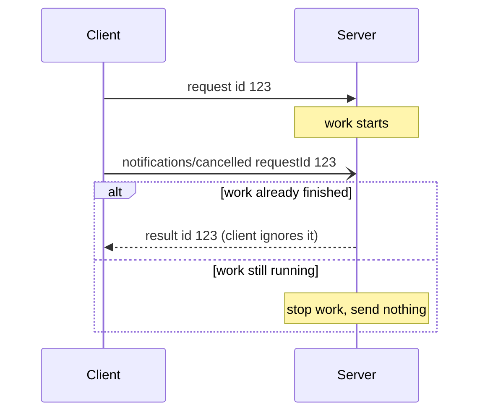
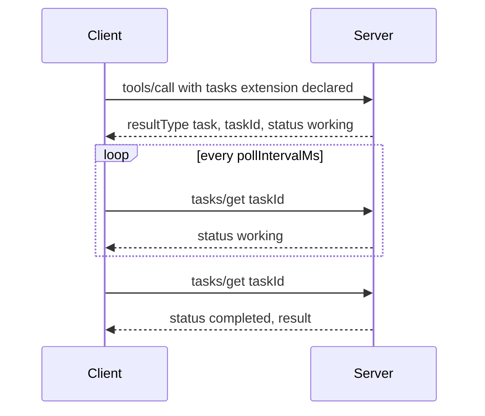

## 1. The question this idea answers

A tool call can take ten minutes. A server can have 400 tools. A request can fail for twenty different reasons. A user can press "Stop" while a query still runs. Every protocol needs shared rules for these cases, or every client and server invents its own.

MCP calls these shared rules **utilities**: progress reports, cancellation, pagination, logging, argument completion, error codes and a place for extra metadata. They are small, but interviewers like them. "What happens when a tool runs for ten minutes?" "How does the client stop it?" "Which error code do you return?" "What changed in 2026?" Each question has an exact answer in the specification.

Revision 2026-07-28 changed several utilities. It removed `ping` and `logging/setLevel`. It made a closed HTTP stream count as cancellation. It moved Tasks into an extension. It renumbered the MCP error codes. This lesson gives the old rule, the new rule and the reason for each change.

## 2. Mental model

> [!analogy] A parcel service
> Each parcel has a tracking number (the request `id`). If you want updates, you attach a tracking slip (the `progressToken`), and the depot sends you "50 of 100 km" messages. If you change your mind, you call the depot and cancel (`notifications/cancelled`), or on HTTP you simply hang up. A thick catalog arrives one booklet at a time, with a bookmark that says where to continue (the `cursor`). A failed delivery comes with a standard reason code (the error `code`). Sticky notes on the box carry extra facts that are not part of the contents (`_meta`).
>
> **Where it stops working:** a depot can recall a parcel before it leaves. An MCP server may finish the work before the cancellation arrives, and both sides must accept that race. Also, you cannot read the bookmark to jump to booklet 5. An MCP cursor is opaque: only the server knows what it means.

## 3. Terms

| Term | Plain meaning |
|---|---|
| utility | A cross-cutting MCP feature that many requests use: progress, cancellation, pagination, logging, completion. |
| `_meta` | A reserved object inside `params` or `result` for metadata that is not part of the method's own data. |
| reserved prefix | A `_meta` key prefix that only the MCP specification may define. Any prefix whose second label is `modelcontextprotocol` or `mcp`. |
| progress token | A string or integer that the client puts in `_meta.progressToken` to ask for progress notifications for one request. |
| `notifications/progress` | The notification that carries `progressToken`, `progress`, an optional `total` and an optional `message`. |
| cancellation | A signal that the client no longer wants the result of a request. |
| race condition | Two events whose order nobody controls, for example a cancellation and the final result crossing each other. |
| timeout | The longest time a sender waits for a response before it cancels the request. |
| pagination | Returning a long list in several pages. |
| cursor | An opaque string that marks a position in a list. The client sends it back to get the next page. |
| opaque | The client must not parse, build or change the value. Only the server knows its format. |
| `ttlMs` and `cacheScope` | Caching hints on list and read results: freshness time in milliseconds, and who may share the cached copy. |
| protocol error | A JSON-RPC `error` response with an integer `code`. The request itself failed. |
| tool execution error | A normal result with `isError: true`. The tool ran and failed, and the model can read why. |
| log level | One of eight syslog severities from `debug` to `emergency` (RFC 5424). |
| completion | Autocomplete suggestions for prompt and resource-template arguments, through `completion/complete`. |
| trace context | The W3C `traceparent`, `tracestate` and `baggage` values that link spans of one distributed trace. |
| task | A durable handle for long work. The client polls it instead of keeping a request open. |
| extension | An optional, opt-in addition to MCP with its own identifier, for example `io.modelcontextprotocol/tasks`. |

All terms are also in the [Glossary](/notes/ai/llm-systems/glossary).

## 4. `_meta`: the side channel on every message

### 4.1 What `_meta` is

Every request, notification and result can carry a `_meta` object. The method's own data lives next to it. For example, `tools/call` has `name` and `arguments`, and `_meta` sits beside them in `params`. The receiver reads `_meta` for metadata: protocol version, progress token, trace ids, identity strings.

`_meta` exists so that the protocol can add metadata without colliding with method fields. Tool arguments live one level deeper, inside `arguments`. So a tool can have an argument called `version`, and it never clashes with the version in `_meta`.

> [!key] The main idea
> In revision 2026-07-28, `_meta` is not decoration. It carries the protocol version and the client capabilities of every request, because there is no handshake any more. A request without them is malformed and gets `-32602` (HTTP 400).

### 4.2 Key names: prefix and name

The spec (2026-07-28, "General fields") defines the key format:

1. A key has an optional **prefix** and a **name**.
2. A prefix is dot-separated labels followed by a slash, for example `com.example/`. Each label starts with a letter and ends with a letter or digit. Hyphens may appear inside.
3. Implementations SHOULD use reverse DNS order: `com.example/`, not `example.com/`.
4. A prefix is **reserved for MCP** when its second label is `modelcontextprotocol` or `mcp`. So `io.modelcontextprotocol/`, `dev.mcp/` and `com.mcp.tools/` are reserved. `com.example.mcp/` is not reserved, because its second label is `example`.
5. A name, unless empty, begins and ends with a letter or digit. Hyphens, underscores and dots may appear inside.

> [!example] Worked example: classify eight `_meta` keys
> The function in Exercise 3 applies the five rules. Its real output:
>
> | Key | Result | Reason |
> |---|---|---|
> | `io.modelcontextprotocol/protocolVersion` | reserved | second label is `modelcontextprotocol` |
> | `dev.mcp/trace` | reserved | second label is `mcp` |
> | `com.example.mcp/tenant` | ok | second label is `example` |
> | `com.example/tenant` | ok | a vendor prefix |
> | `traceparent` | reserved | the OpenTelemetry exception |
> | `progressToken` | reserved | a reserved key with no prefix |
> | `example.com/x-` | invalid | the name ends with a hyphen |
> | `1com.example/a` | invalid | a label starts with a digit |

### 4.3 The reserved keys

| Key | Where | Meaning |
|---|---|---|
| `progressToken` | request `_meta` | Opts the request into progress notifications |
| `io.modelcontextprotocol/protocolVersion` | every request | Protocol version of this request. Required. |
| `io.modelcontextprotocol/clientCapabilities` | every request | Client capabilities relevant to this request. Required. |
| `io.modelcontextprotocol/clientInfo` | every request | Client name and version. Clients SHOULD send it. |
| `io.modelcontextprotocol/logLevel` | request | Minimum log level for this request (deprecated Logging feature) |
| `io.modelcontextprotocol/subscriptionId` | notifications on a listen stream | The id of the `subscriptions/listen` request that opened the stream |
| `io.modelcontextprotocol/serverInfo` | every result | Server name and version. Servers SHOULD send it. |
| `traceparent`, `tracestate`, `baggage` | any message | OpenTelemetry trace context, in W3C formats |

Two rules matter in practice:

1. A request that misses a required key is malformed. The server MUST reject it with `-32602`. On HTTP, the status MUST be `400 Bad Request`.
2. `clientInfo` and `serverInfo` are self-reported. The spec says implementations SHOULD NOT use them for security decisions. A client can write any name there.

Here is a real exchange with the server of [L13](/notes/ai/llm-systems/07-mcp/l13-build-an-mcp-server), over stdio, with Python SDK 2.3.0. The request has no `_meta`:

```json
{"jsonrpc": "2.0", "id": 3, "method": "tools/list", "params": {}}
```

The real reply:

```json
{"jsonrpc":"2.0","id":3,"error":{"code":-32602,"message":"params._meta must be an object carrying the required 'io.modelcontextprotocol/protocolVersion' and 'io.modelcontextprotocol/clientCapabilities' envelope keys"}}
```

### 4.4 Trace context in `_meta`

SEP-414 documents how OpenTelemetry trace context travels in `_meta`. The keys `traceparent`, `tracestate` and `baggage` have no prefix, as an exception, to match the existing OpenTelemetry conventions for MCP. Their values MUST follow W3C Trace Context and W3C Baggage.

A `traceparent` value has four parts separated by hyphens:

```text
00-0af7651916cd43dd8448eb211c80319c-00f067aa0ba902b7-01
|  |                                |                |
|  trace-id: 16 bytes = 32 hex      parent-id: 8 bytes = 16 hex
version                                              flags: 01 = sampled
```

The host starts a span for the model's tool call and puts its ids in `_meta.traceparent`. The server continues the same trace. A trace viewer then shows one tree: user turn, model call, tool call, database query. See [Tracing agents](/notes/software-engineering/security-and-operations/02-observability/l1-tracing-agents) for spans and traces.

## 5. Progress

### 5.1 The flow

1. The client puts a `progressToken` in the request's `_meta`. The token MUST be a string or an integer, and MUST be unique across all active requests.
2. The server MAY send `notifications/progress` messages. Each one carries the `progressToken`, the current `progress`, an optional `total` and an optional `message`.
3. The final result ends the request. Progress notifications MUST stop after completion.

```json
{
  "jsonrpc": "2.0",
  "id": 1,
  "method": "tools/call",
  "params": {
    "name": "count_orders",
    "arguments": {"status": "released"},
    "_meta": {
      "progressToken": "abc123",
      "io.modelcontextprotocol/protocolVersion": "2026-07-28",
      "io.modelcontextprotocol/clientCapabilities": {}
    }
  }
}
```

```json
{
  "jsonrpc": "2.0",
  "method": "notifications/progress",
  "params": {"progressToken": "abc123", "progress": 1, "total": 2, "message": "scanning orders"}
}
```

### 5.2 The rules

| Rule | Strength |
|---|---|
| `progress` increases with each notification, even when `total` is unknown | MUST |
| `progress` and `total` may be floating point | MAY |
| Notifications reference only tokens of active, in-progress requests | MUST |
| The server may send none, may choose its own frequency, may omit `total` | MAY |
| Both sides rate-limit progress messages | SHOULD |

The percentage is $100 \times \text{progress} / \text{total}$ when `total` exists. Without `total`, the client can show only "still working" and the last `message`.

In 2026-07-28, progress is **request-scoped**. On Streamable HTTP, the notifications travel on the SSE response stream of the same POST, before the final result. They never travel on a `subscriptions/listen` stream.

### 5.3 In code

The Python SDK gives a tool a `Context` object. `ctx.report_progress(progress, total, message)` sends the notification. The client passes a `progress_callback`. This is the real output of the L13 client for a tool that reports two steps:

```text
  progress 1.0/2.0: scanning orders
  progress 2.0/2.0: done
count_orders structuredContent: {'result': 2}
```

### 5.4 Progress and timeouts

The cancellation page says: implementations SHOULD set a timeout on every request. They MAY reset the timeout clock when a progress notification arrives, because progress proves that work happens. But they SHOULD always enforce a maximum timeout, so a server that sends progress forever cannot hold a request open forever.

> [!example] Worked example: two clocks
> A job takes 200 s. The client has an idle timeout of 30 s that restarts on each progress message, and a maximum of 120 s.
>
> 1. Progress every 20 s. Each message arrives before the idle clock reaches 30 s. The idle clock never fires. The maximum fires at 120 s, so the client cancels at **120 s**.
> 2. Progress every 40 s. The first message would arrive at 40 s, but the idle clock fires at 30 s. The client cancels at **30 s**.
> 3. A 90 s job with progress every 20 s finishes before both clocks. No cancellation.
>
> The function in Exercise 2 computes these three cases. Its real output is `120`, `30.0` and `None`.

## 6. Cancellation

### 6.1 The message

```json
{
  "jsonrpc": "2.0",
  "method": "notifications/cancelled",
  "params": {"requestId": "123", "reason": "User requested cancellation"}
}
```

`requestId` is the JSON-RPC `id` of the request to stop. `reason` is optional text for logs and the user interface. The message is a notification, so the receiver never replies to it.

### 6.2 What the receiver does

The receiver SHOULD stop processing, free the resources and send no response for the cancelled request. It MAY ignore the cancellation when the request is unknown, already complete, or cannot be stopped. The sender SHOULD ignore any response that arrives after its cancellation. Invalid cancellations SHOULD be ignored. This keeps the "fire and forget" nature of notifications.



### 6.3 What changed in 2026-07-28


| Question | 2025-11-25 | 2026-07-28 |
|---|---|---|
| Who may cancel? | Either side, for requests it sent "in the same direction" | The client. A server MUST send `notifications/cancelled` only to end a `subscriptions/listen` stream. |
| How on Streamable HTTP? | Send `notifications/cancelled`. "Disconnection SHOULD NOT be interpreted as the client cancelling its request." | Close the SSE response stream. The server MUST treat the disconnect as cancellation. No message is expected. |
| How on stdio? | Send `notifications/cancelled` | Send `notifications/cancelled` (MUST, because there is no per-request stream) |
| Special cases | `initialize` MUST NOT be cancelled. Task-augmented requests use `tasks/cancel`. | No `initialize` exists. Tasks live in an extension with its own `tasks/cancel`. |

> [!note] Two spec pages disagree
> The Cancellation page of 2026-07-28 says a server MUST send `notifications/cancelled` when it tears down a `subscriptions/listen` stream. The Subscriptions page says that a server which ends a subscription SHOULD send a successful `subscriptions/listen` response, then close the stream. On 2026-10-15 the two pages describe the server-side end differently. A robust client handles both.

Why the reversal? The 2026 spec says: "Because each request has its own response stream, the transport-level disconnect is unambiguous." Interpretation of these notes: in 2025-11-25, a stream could break and resume with `Last-Event-ID`. The GET stream also carried unrelated messages. So a dropped connection did not mean "stop". Without resumability and without the GET stream, a closed stream has only one meaning.

> [!trap] A broken stream loses the request
> Because streams are not resumable in 2026-07-28, a network failure also cancels the request. The changelog says a client MUST re-issue it as a new request with a new request ID. So a tool with side effects must be safe to repeat. Or it must return a handle (a task or a state handle) before the long work starts.

### 6.4 Timeouts

The spec says implementations SHOULD set a timeout for every request they send. When a timeout fires, the sender SHOULD cancel: close the stream on HTTP, or send `notifications/cancelled` on stdio. SDKs SHOULD allow a timeout per request. The Python SDK `Client` has `read_timeout_seconds`. When a request exceeds its timeout, the SDK raises a local `MCPError` with code `-32001` (section 9). The SDK source calls it an SDK-internal code that the MCP schema does not define.

## 7. Pagination

### 7.1 The model

MCP uses an **opaque cursor**, not page numbers. The server chooses the page size, and the client MUST NOT assume one. A result that has more data includes `nextCursor`. The client sends that value back as `params.cursor`.

```json
{
  "jsonrpc": "2.0",
  "id": "123",
  "result": {
    "resultType": "complete",
    "resources": [],
    "nextCursor": "eyJwYWdlIjogM30=",
    "ttlMs": 300000,
    "cacheScope": "public"
  }
}
```

(The spec example shows `[...]` inside `resources`. The empty list here keeps the JSON valid.)

Four list methods support pagination in 2026-07-28: `tools/list`, `resources/list`, `resources/templates/list` and `prompts/list`.

### 7.2 The rules

1. A missing `nextCursor` means the end of the results. The client SHOULD treat it so.
2. The client MUST treat the cursor as opaque: no parsing, no editing, no decisions based on its value. An empty string is a valid cursor and MUST NOT be treated as the end.
3. Servers SHOULD provide stable cursors and SHOULD handle invalid cursors gracefully.
4. An invalid cursor SHOULD produce error `-32602` (Invalid params).

> [!example] Worked example: why "opaque" matters
> The spec's example cursor `eyJwYWdlIjogM30=` is Base64. Decoded, it is the text `{"page": 3}` (checked with Python's `base64` module). A client could build `{"page": 9}` itself and skip pages. That breaks the contract. The server may change its cursor format at any release, for example to an encrypted offset or a database key. A client that parsed the old format then fails. The toy server in Exercise 1 uses a different format, `{"o": 3}`, to make the point.

### 7.3 Pages and caching

In 2026-07-28, list results carry `ttlMs` and `cacheScope`. Each page is a separate cacheable response with its own `ttlMs`. The server MUST use the same `cacheScope` on all pages of one list. There is no consistency across pages: if the data changes between two page fetches, the client can see duplicates or gaps. A client that needs a consistent snapshot SHOULD fetch again from the first page.

A cached result is fresh while $t_{\text{now}} < t_{\text{received}} + \text{ttlMs}$. A result received at $t = 1{,}000$ ms with `ttlMs` 300,000 is fresh until $t = 301{,}000$ ms. Lesson [L6](/notes/ai/llm-systems/07-mcp/l6-tools-in-depth) covers the caching rules for `tools/list`.

## 8. Logging, completion and the removed ping

### 8.1 Logging (deprecated in 2026-07-28)

The log levels follow syslog (RFC 5424): `debug`, `info`, `notice`, `warning`, `error`, `critical`, `alert`, `emergency`. A server that emits logs declares the `logging` capability and sends `notifications/message` with `level`, an optional `logger` and any JSON `data`.

| | 2025-11-25 | 2026-07-28 |
|---|---|---|
| How the client sets the level | `logging/setLevel` request with `params.level` | `io.modelcontextprotocol/logLevel` in each request's `_meta` |
| When the server may log | Any time after the level is set | Only for a request that carries `logLevel`, and only at or above that level |
| Where the messages travel | Any stream of the session | Only the response stream of that request |
| Status | Active | Deprecated by SEP-2577. Earliest removal: the first revision released on or after 2027-07-28. |

The suggested migration: log to `stderr` on stdio, and use OpenTelemetry for structured observability. Log messages MUST NOT contain credentials, personal data or internal details that help an attacker. In the Python SDK, a `Client(..., log_level="info")` stamps the opt-in on every request.

### 8.2 Completion

Completion gives autocomplete for the arguments of prompts and resource templates. A server that supports it declares the `completions` capability. The client sends `completion/complete`:

```json
{
  "jsonrpc": "2.0",
  "id": 1,
  "method": "completion/complete",
  "params": {
    "ref": {"type": "ref/prompt", "name": "code_review"},
    "argument": {"name": "framework", "value": "fla"},
    "context": {"arguments": {"language": "python"}}
  }
}
```

```json
{
  "jsonrpc": "2.0",
  "id": 1,
  "result": {"resultType": "complete", "completion": {"values": ["flask"], "total": 1, "hasMore": false}}
}
```

`ref` names a prompt (`ref/prompt` with `name`) or a resource template (`ref/resource` with `uri`). `context.arguments` carries the arguments that the user already chose. A response holds at most 100 values. Lesson [L8](/notes/ai/llm-systems/07-mcp/l8-resources-and-prompts) shows where completion fits next to prompts.

### 8.3 `ping`: removed

In 2025-11-25, either side could send `{"jsonrpc": "2.0", "id": "123", "method": "ping"}`, and the receiver MUST answer promptly with an empty result `{}`. Implementations SHOULD ping periodically to detect dead connections.

Revision 2026-07-28 removes `ping` (SEP-2575). Interpretation of these notes: a stateless protocol has no session whose health needs checking. Each request gets a response or fails on its own. For long-lived streams such as `subscriptions/listen`, the spec encourages SSE comment lines as keep-alives. A comment line starts with `:`. It stops intermediaries from closing quiet connections.

## 9. Errors: the complete code map


### 9.1 Two kinds of failure

| Kind | Shape | Example | Who reads it |
|---|---|---|---|
| Protocol error | JSON-RPC `error` with `code`, `message`, optional `data` | unknown tool, malformed params, unsupported version | the client code |
| Tool execution error | normal `result` with `isError: true` and text in `content` | API failure, invalid date, business rule | the model, which can retry with better arguments |

Since 2025-11-25 (SEP-1303), input validation errors are tool execution errors, so the model can correct itself. Lesson [L6](/notes/ai/llm-systems/07-mcp/l6-tools-in-depth) covers this split in depth.

### 9.2 The code table

| Code | Name | When | Version notes |
|---|---|---|---|
| -32700 | Parse error | The body is not valid JSON | JSON-RPC 2.0 |
| -32600 | Invalid Request | Not a valid request object | JSON-RPC 2.0 |
| -32601 | Method not found | Unknown method. On HTTP: status 404. | JSON-RPC 2.0 |
| -32602 | Invalid params | Bad params, missing `_meta` keys, unknown tool, invalid cursor, unknown resource | Resource not found uses -32602 since 2026-07-28 |
| -32603 | Internal error | Server failure | JSON-RPC 2.0 |
| -32000 to -32019 | legacy range | No new codes may be allocated. Receivers MUST NOT assume a meaning, except -32002. | Python SDK uses -32000 (connection closed) and -32001 (request timeout) |
| -32002 | Resource not found | 2025-11-25 and earlier | Must not be emitted in 2026-07-28. Clients SHOULD still accept it. |
| -32020 | HeaderMismatch | HTTP headers do not match the body, or a required header is missing | New in 2026-07-28. HTTP 400. |
| -32021 | MissingRequiredClientCapability | The request needs a capability that the client did not declare. `data.requiredCapabilities` lists them. | New in 2026-07-28. HTTP 400. |
| -32022 | UnsupportedProtocolVersion | The server does not implement the requested version. `data.supported` and `data.requested`. | New in 2026-07-28. HTTP 400. |
| -32042 | URL elicitation required | 2025-11-25 only | Retired. Never reused. |

The 2026 changelog explains the numbers. A draft of the release used `-32001`, `-32003` and `-32004` for the three new errors. The release then defined an **allocation policy**: `-32000` to `-32019` stays implementation-defined ("existing SDK usage is grandfathered"), and `-32020` to `-32099` belongs to the MCP specification. The three codes moved to `-32020`, `-32021` and `-32022`. Codes for purposes that the spec does not define SHOULD go outside the JSON-RPC reserved range `-32768` to `-32000`.

Interpretation of these notes: the old draft numbers sat in the band that SDKs already used. The Python SDK 2.3.0, for example, raises `-32001` locally when a request exceeds its timeout ("SDK-only: a request timed out waiting for its response"). The same number could not also mean HeaderMismatch.

### 9.3 Real errors from a real server

These responses are real. The L13 server ran on Streamable HTTP with Python SDK 2.3.0, measured in these notes. The `date`, `server` and `content-length` headers are omitted.

The `Mcp-Name` header says `count_orders`, but the body calls `get_order`:

```http
HTTP/1.1 400 Bad Request
content-type: application/json

{"jsonrpc":"2.0","id":3,"error":{"code":-32020,"message":"mcp-name header does not match the request body's 'name' parameter"}}
```

The client asks for version `1900-01-01`:

```http
HTTP/1.1 400 Bad Request
content-type: application/json

{"jsonrpc":"2.0","id":5,"error":{"code":-32022,"message":"Unsupported protocol version","data":{"supported":["2026-07-28"],"requested":"1900-01-01"}}}
```

The client retries with a version from `data.supported`. That is the whole version negotiation of 2026-07-28: no handshake, one error, one retry.

### 9.4 HTTP status codes next to JSON-RPC codes

| HTTP status | When (2026-07-28) |
|---|---|
| 200 | A request with a JSON result or an SSE stream |
| 202 | A notification that the server accepted. No body. |
| 400 | Missing `_meta` keys, header mismatch, unsupported version, missing client capability |
| 401 / 403 | Authorization: missing or invalid token, or insufficient scope ([L11](/notes/ai/llm-systems/07-mcp/l11-authorization-and-security)) |
| 403 | An invalid `Origin` header (DNS-rebinding defense) |
| 404 | Unknown method, with JSON-RPC code -32601 in the body |
| 405 | A GET or DELETE on the endpoint from an old client. The L13 server answered GET with `405` and `allow: POST`. |

## 10. Tasks: long work without a long request

### 10.1 Why tasks exist

Some operations take minutes or hours: a CI pipeline, a batch import, a human approval. Holding one request open that long fails in practice. Proxies close idle connections, clients restart, and in 2026-07-28 a broken stream cancels the request. A **task** gives the client a durable handle, so it can poll, reconnect and fetch the result later.

### 10.2 2025-11-25: experimental core feature

| Element | 2025-11-25 |
|---|---|
| Opt-in | Capabilities at initialization, for example `tasks.requests.tools.call`, plus `execution.taskSupport` on each tool: `"required"`, `"optional"` or `"forbidden"` |
| Create | The requestor adds `"task": {"ttl": 60000}` to the request params. The receiver returns a `CreateTaskResult`. |
| Methods | `tasks/get` (status), `tasks/result` (blocks until done), `tasks/list`, `tasks/cancel` |
| Notification | `notifications/tasks/status` (optional) |
| Direction | Both: a server could also create tasks on the client, for example for `sampling/createMessage` |
| Linking | `_meta["io.modelcontextprotocol/related-task"]` with the `taskId` |

### 10.3 2026-07-28: the Tasks extension

SEP-2663 moved tasks into the official extension `io.modelcontextprotocol/tasks`. The changelog lists the redesign. Polling with `tasks/get` replaces the blocking `tasks/result`. A new `tasks/update` sends input from client to server. `tasks/list` is gone. Servers may return a task without a per-request opt-in.

1. **Opt-in once.** The client declares `"extensions": {"io.modelcontextprotocol/tasks": {}}` inside `io.modelcontextprotocol/clientCapabilities`. The server advertises the same in `server/discover`.
2. **The server decides.** For a supported request, it may return a `CreateTaskResult`, identified by `resultType: "task"`. The extension guide says: "Never return a task to a client that did not declare support."
3. **Poll.** The client calls `tasks/get` with the `taskId` and respects `pollIntervalMs`.
4. **Give input.** If the status is `input_required`, the task carries `inputRequests`. The client answers with `tasks/update` and `inputResponses`.
5. **Finish.** A `completed` task carries `result`, which is exactly what the original request would have returned. A `failed` task carries `error`.
6. **Cancel.** `tasks/cancel` is cooperative: the server acknowledges it but may still reach another terminal status.

The task object of the extension schema has these fields: `taskId`, `status`, optional `statusMessage`, `createdAt`, `lastUpdatedAt`, `ttlMs` and optional `pollIntervalMs`. The two dates are ISO 8601 text. `ttlMs` is a number, or `null` for unlimited. The 2025-11-25 names were `ttl` and `pollInterval`. Status values: `working`, `input_required`, `completed`, `failed`, `cancelled`. The last three are terminal.

An illustration built from those schema fields (the values are invented):

```json
{
  "jsonrpc": "2.0",
  "id": 7,
  "result": {
    "resultType": "task",
    "taskId": "786512e2-9e0d-44bd-8f29-789f320fe840",
    "status": "working",
    "statusMessage": "Import started",
    "createdAt": "2026-10-15T10:30:00Z",
    "lastUpdatedAt": "2026-10-15T10:30:00Z",
    "ttlMs": 3600000,
    "pollIntervalMs": 5000
  }
}
```

> [!example] Worked example: how many polls?
> A task finishes 42 s after creation. The client polls every `pollIntervalMs` = 5,000 ms, starting 5 s after creation. Polls happen at 5, 10, ..., 45 s. The first poll that sees `completed` is poll number $\lceil 42 / 5 \rceil = 9$, at 45 s. The client learns the result 3 s late. A shorter interval reduces the delay but multiplies the requests. Servers can also push `notifications/tasks` on a `subscriptions/listen` stream, so a client may rely on those instead of polling.

The 2025-11-25 tasks page set security rules for task ids. When an authorization context exists, the receiver MUST bind tasks to it. Without one, task ids MUST be cryptographically random. Interpretation of these notes: the same reasoning holds for the extension, because a task id is the key to its result.



## 11. Production notes

| Concern | What to do |
|---|---|
| Long tools | Report progress. Return a task or a state handle for work longer than a client timeout. |
| Retries | A broken stream cancels the request in 2026-07-28. Make side effects idempotent or handle-based. |
| Timeouts | One idle timeout that resets on progress, plus a hard maximum. |
| Lists | Never parse cursors. Cap the number of pages a client walks. |
| Errors | Tool failures as `isError: true` with a helpful message. Protocol errors only for broken requests. |
| Observability | Propagate `traceparent` in `_meta`. Log to stderr on stdio. Do not build new features on MCP Logging. |
| Versions | Accept `-32002` from old servers. Emit only 2026 codes. |

### Exercises

These go in the notebook folder `llm-systems/` of `C:\Users\ASohi\Downloads\AI\agent-harness-lab`.

1. **A paginating client.** Write `list_all(fetch, max_pages=100)`. `fetch(cursor)` returns one page as a dictionary. Acceptance test: a toy server has 7 items and a page size of 3. The function returns all 7 items in order. It treats an empty-string cursor as valid. It raises after `max_pages` pages. Hint 1: stop only when `nextCursor` is absent or `None`. Hint 2: the page cap protects you from a buggy server that returns the same cursor forever.
2. **Two timeout clocks.** Write `cancel_time(job_seconds, progress_every, idle_timeout, max_timeout)`. It returns the second at which the client cancels, or `None`. Acceptance test: the three cases of section 5.4 return `120`, `30` and `None`. Hint 1: progress restarts only the idle clock. Hint 2: at each step, compare the next progress time with the earliest deadline.
3. **A `_meta` key checker.** Write `classify(key)` that returns `"reserved"`, `"ok"` or `"invalid"`. Acceptance test: the eight keys of section 4.2 give the results in the table. Hint 1: split on the last `/`. Hint 2: the reserved test checks the second label only.

## 12. Common mistakes

1. **"A closed HTTP stream is just a network glitch, the server keeps working."** In 2026-07-28, the server MUST treat a closed response stream as cancellation. In 2025-11-25 the opposite rule held.
2. **"An empty-string cursor means the end of the list."** Only a missing `nextCursor` means the end. An empty string is a valid cursor.
3. **"I can decode the cursor to jump to page 5."** Cursors are opaque. The format can change at any release.
4. **"Resource not found is -32002."** It was, until 2025-11-25. In 2026-07-28 it is -32602, and -32002 must not be emitted.
5. **"A failing tool returns a JSON-RPC error."** It returns a result with `isError: true`, so the model can read the reason and retry.
6. **"`clientInfo` tells me who the user is."** It is self-reported and unverified. Use the access token for identity (L11).
7. **"Keep pinging the server to keep the session alive."** `ping` and sessions do not exist in 2026-07-28.
8. **"Tasks are part of the core protocol."** They were experimental core in 2025-11-25. In 2026-07-28 they are the `io.modelcontextprotocol/tasks` extension, and `tasks/result` and `tasks/list` are gone.

## 13. One-minute explanation

MCP utilities are the shared plumbing of every request. `_meta` is a side channel next to the method data, and since 2026-07-28 it carries the protocol version and client capabilities on every request. A client asks for progress by putting a `progressToken` in `_meta`, and the server sends `notifications/progress` with an increasing `progress` and an optional `total`. On Streamable HTTP, a client cancels by closing that request's stream, while on stdio it sends `notifications/cancelled`. Lists are paginated with an opaque cursor: the client sends back `nextCursor` until it is absent. There are two kinds of failure: protocol errors with JSON-RPC codes, and tool execution errors with `isError: true` that the model can read. The 2026 release reserved `-32020` to `-32099` for MCP and added HeaderMismatch, MissingRequiredClientCapability and UnsupportedProtocolVersion, and resource-not-found moved from -32002 to -32602. It also removed `ping` and `logging/setLevel`, and deprecated Logging. Long jobs use the Tasks extension: the server returns a task handle, and the client polls `tasks/get`.

## 14. Check questions

```check
{
  "question": "A client calls a slow tool over Streamable HTTP in revision 2026-07-28 and the user presses Stop. What exactly does the client send, and what must the server do? How was it different in 2025-11-25?",
  "hint": "Think about what each request owns in 2026-07-28.",
  "answer": "In 2026-07-28 the client sends nothing: it closes the SSE response stream of that POST. The server MUST treat the disconnect as cancellation, SHOULD stop the work as soon as practical, and MUST NOT send further messages for that request. In 2025-11-25 the spec said the opposite: \"Disconnection SHOULD NOT be interpreted as the client cancelling its request.\" The client had to send a `notifications/cancelled` notification with the `requestId`. In that revision, a broken stream could also resume with `Last-Event-ID`. On stdio, both versions use `notifications/cancelled`."
}
```

```check
{
  "question": "A server returns `\"nextCursor\": \"\"` on page 4. Your client stops and shows the user 4 pages. Is that correct?",
  "answer": "No. The spec says an empty string is a valid cursor and MUST NOT be treated as the end of results. Only a missing (or null) `nextCursor` ends the list. The client must send `\"cursor\": \"\"` back and fetch page 5."
}
```

```check
{
  "question": "Name the five JSON-RPC standard error codes and the three error codes that revision 2026-07-28 defines. Which code means \"resource not found\" now, and which one meant it before?",
  "answer": "Standard: -32700 Parse error, -32600 Invalid Request, -32601 Method not found, -32602 Invalid params, -32603 Internal error. MCP 2026-07-28: -32020 HeaderMismatch, -32021 MissingRequiredClientCapability, -32022 UnsupportedProtocolVersion. Resource not found is -32602 now (SEP-2164 aligned it with JSON-RPC). Until 2025-11-25 it was -32002. A 2026 server must not emit -32002, but clients SHOULD still accept it from older servers."
}
```

```check
{
  "question": "Interview follow-up: Why did MCP reserve -32020 to -32099 for the specification in 2026-07-28, and why did the three new codes start at -32020 instead of -32001?",
  "hint": "Look at what SDKs already did with the server-error range.",
  "answer": "JSON-RPC leaves -32000 to -32099 to implementations, so SDKs had already allocated codes there. For example, the Python SDK raises -32000 for a closed connection and -32001 for a request timeout, both locally. A draft of the 2026 release had used -32001, -32003 and -32004 for the new errors. The release defined an allocation policy: -32000 to -32019 stays implementation-defined (existing SDK usage is grandfathered, no new codes there), and -32020 to -32099 is reserved for codes that the MCP spec defines. The three codes were renumbered to -32020, -32021 and -32022. Interpretation of these notes: this removes ambiguity, because a receiver can now trust the meaning of any code in the reserved band."
}
```

```check
{
  "question": "Interview follow-up: A tool reports progress every 20 s. The client restarts an idle timeout of 30 s on every progress message, and has no maximum. The tool has a bug and loops forever while it still sends progress. What happens, and what does the spec recommend?",
  "answer": "The idle clock never fires, because a progress message arrives every 20 s, which is less than 30 s. The request stays open forever and holds resources on both sides. The cancellation page says implementations MAY reset the timeout on progress, but SHOULD always enforce a maximum timeout regardless of progress notifications, to limit the impact of a misbehaving client or server. With a maximum of 120 s, the client cancels at 120 s: it closes the stream on HTTP or sends `notifications/cancelled` on stdio."
}
```

```check
{
  "question": "Interview follow-up: What changed for long-running operations between 2025-11-25 and 2026-07-28? Name the methods on each side.",
  "answer": "In 2025-11-25, tasks were an experimental core feature. The requestor added a `task` object with `ttl` to a request, then used `tasks/get` to poll, the blocking `tasks/result` to fetch the result, `tasks/list` and `tasks/cancel`, with optional `notifications/tasks/status`. Tools declared `execution.taskSupport` (required, optional or forbidden), and both client and server could create tasks. In 2026-07-28 (SEP-2663), tasks are the extension `io.modelcontextprotocol/tasks`. The client opts in once through the `extensions` field of its per-request capabilities. The server decides per request and returns `resultType: \"task\"` with `taskId`, `status`, `ttlMs` and `pollIntervalMs`. The client polls `tasks/get`, answers `input_required` with `tasks/update` and `inputResponses`, and may send a cooperative `tasks/cancel`. `tasks/result` and `tasks/list` were removed. Status updates can arrive as `notifications/tasks` on a `subscriptions/listen` stream."
}
```

```check
{
  "question": "A server receives a `tools/call` whose `_meta` has `io.modelcontextprotocol/protocolVersion` but no `io.modelcontextprotocol/clientCapabilities`, over HTTP. What does it return? What if it has both, but the tool needs elicitation and the capabilities object is empty?",
  "answer": "First case: the request is malformed. The server MUST reject it with JSON-RPC error -32602 (Invalid params), and on HTTP the status MUST be 400 Bad Request. Second case: the request is well formed, but the server MUST NOT rely on a capability that the client did not declare. If processing needs elicitation, it MUST return MissingRequiredClientCapabilityError, code -32021, whose `data.requiredCapabilities` lists what is missing, again with HTTP 400."
}
```

```check
{
  "question": "Exercise 1: show a reference solution.",
  "answer": "Real output: the seven tool names in order, then the opaque first cursor `eyJvIjogM30=`.\n\n```python\nimport base64\nimport json\n\nTOOLS = [f\"tool_{i:02d}\" for i in range(7)]          # the server's full list\nPAGE = 3                                               # page size: the server's choice\n\n\ndef server_list(cursor: str | None) -> dict:\n    \"\"\"A toy tools/list handler with an opaque cursor.\"\"\"\n    offset = 0 if cursor is None else json.loads(base64.urlsafe_b64decode(cursor))[\"o\"]\n    page = TOOLS[offset:offset + PAGE]\n    result = {\"resultType\": \"complete\", \"tools\": page, \"ttlMs\": 60000, \"cacheScope\": \"public\"}\n    if offset + PAGE < len(TOOLS):\n        result[\"nextCursor\"] = base64.urlsafe_b64encode(json.dumps({\"o\": offset + PAGE}).encode()).decode()\n    return result\n\n\ndef list_all(fetch, max_pages: int = 100) -> list:\n    \"\"\"Client loop: stop only when nextCursor is absent or None.\"\"\"\n    items, cursor = [], None\n    for _ in range(max_pages):                         # guard against a cursor loop\n        page = fetch(cursor)\n        items.extend(page[\"tools\"])\n        cursor = page.get(\"nextCursor\")\n        if cursor is None:                             # \"\" would be a valid cursor\n            return items\n    raise RuntimeError(f\"more than {max_pages} pages: stopping\")\n\n\nprint(list_all(server_list))\nprint(server_list(None)[\"nextCursor\"])\n```"
}
```

```check
{
  "question": "Exercise 2: show a reference solution.",
  "answer": "Real output: `120`, `30.0`, `None`.\n\n```python\ndef cancel_time(job_seconds, progress_every, idle_timeout, max_timeout):\n    \"\"\"Return the second at which the client cancels, or None if the job finishes first.\n\n    The idle clock restarts at each progress notification.\n    The total clock never restarts.\"\"\"\n    last_signal = 0.0\n    t = 0.0\n    while True:\n        next_progress = last_signal + progress_every\n        idle_deadline = last_signal + idle_timeout\n        candidates = [job_seconds, idle_deadline, max_timeout]\n        if next_progress < min(candidates):\n            last_signal = next_progress            # progress arrived in time\n            continue\n        t = min(candidates)\n        return None if t == job_seconds else t\n\n\nprint(cancel_time(job_seconds=200, progress_every=20, idle_timeout=30, max_timeout=120))\nprint(cancel_time(job_seconds=200, progress_every=40, idle_timeout=30, max_timeout=120))\nprint(cancel_time(job_seconds=90, progress_every=20, idle_timeout=30, max_timeout=120))\n```"
}
```

```check
{
  "question": "Exercise 3: show a reference solution.",
  "answer": "Real output: the eight results of the table in section 4.2.\n\n```python\nimport re\n\nLABEL = r\"[A-Za-z](?:[A-Za-z0-9-]*[A-Za-z0-9])?\"\nPREFIX = re.compile(rf\"^(?:{LABEL}\\.)*{LABEL}/$\")\nNAME = re.compile(r\"^(?:[A-Za-z0-9](?:[A-Za-z0-9._-]*[A-Za-z0-9])?)?$\")\nOTEL = {\"traceparent\", \"tracestate\", \"baggage\"}\n\n\ndef classify(key: str) -> str:\n    \"\"\"Return 'invalid', 'reserved' or 'ok' for a _meta key.\"\"\"\n    if key in OTEL:\n        return \"reserved\"                       # the OpenTelemetry exception\n    prefix, _, name = key.rpartition(\"/\")\n    if prefix and not PREFIX.match(prefix + \"/\"):\n        return \"invalid\"\n    if not NAME.match(name):\n        return \"invalid\"\n    labels = prefix.split(\".\") if prefix else []\n    if len(labels) >= 2 and labels[1] in (\"modelcontextprotocol\", \"mcp\"):\n        return \"reserved\"\n    if not prefix and name == \"progressToken\":\n        return \"reserved\"\n    return \"ok\"\n\n\nfor k in [\"io.modelcontextprotocol/protocolVersion\", \"dev.mcp/trace\", \"com.example.mcp/tenant\",\n          \"com.example/tenant\", \"traceparent\", \"progressToken\", \"example.com/x-\", \"1com.example/a\"]:\n    print(f\"{k:42} {classify(k)}\")\n```"
}
```

## 15. Links

- Previous: [L9: Asking the client for input: MRTR, elicitation, sampling and roots](/notes/ai/llm-systems/07-mcp/l9-mrtr-elicitation-sampling-and-roots)
- Next: [L11: Authorization and security](/notes/ai/llm-systems/07-mcp/l11-authorization-and-security)
- [L2: JSON-RPC 2.0 from zero](/notes/ai/llm-systems/07-mcp/l2-json-rpc): the error object and the standard codes
- [L4: Transports: stdio and Streamable HTTP](/notes/ai/llm-systems/07-mcp/l4-transports): SSE streams and the HTTP headers
- [L5: Stateful vs stateless MCP](/notes/ai/llm-systems/07-mcp/l5-stateful-vs-stateless): why each request carries its own `_meta`
- [L6: Tools in depth](/notes/ai/llm-systems/07-mcp/l6-tools-in-depth): `isError`, `ttlMs` and `cacheScope` on `tools/list`
- [L12: What is new: the version history](/notes/ai/llm-systems/07-mcp/l12-whats-new-version-history)
- [L4: Tool results and errors](/notes/ai/context-engineering/06-tools-and-mcp/l4-tool-results-and-errors): what the model does with an error result
- [Tracing agents](/notes/software-engineering/security-and-operations/02-observability/l1-tracing-agents): spans and traces

### Sources

All checked on 2026-10-15.

- MCP specification 2026-07-28: [Overview (messages, error codes, `_meta`)](https://modelcontextprotocol.io/specification/2026-07-28/basic/index), [Progress](https://modelcontextprotocol.io/specification/2026-07-28/basic/patterns/progress), [Cancellation](https://modelcontextprotocol.io/specification/2026-07-28/basic/patterns/cancellation), [Subscriptions](https://modelcontextprotocol.io/specification/2026-07-28/basic/patterns/subscriptions), [Pagination](https://modelcontextprotocol.io/specification/2026-07-28/server/utilities/pagination), [Caching](https://modelcontextprotocol.io/specification/2026-07-28/server/utilities/caching), [Logging](https://modelcontextprotocol.io/specification/2026-07-28/server/utilities/logging), [Completion](https://modelcontextprotocol.io/specification/2026-07-28/server/utilities/completion), [Streamable HTTP](https://modelcontextprotocol.io/specification/2026-07-28/basic/transports/streamable-http), [Changelog](https://modelcontextprotocol.io/specification/2026-07-28/changelog)
- MCP specification 2025-11-25: [Ping](https://modelcontextprotocol.io/specification/2025-11-25/basic/utilities/ping), [Cancellation](https://modelcontextprotocol.io/specification/2025-11-25/basic/utilities/cancellation), [Tasks](https://modelcontextprotocol.io/specification/2025-11-25/basic/utilities/tasks), [Logging](https://modelcontextprotocol.io/specification/2025-11-25/server/utilities/logging), [Transports](https://modelcontextprotocol.io/specification/2025-11-25/basic/transports)
- [Tasks extension overview](https://modelcontextprotocol.io/extensions/tasks/overview) and [ext-tasks repository, schema 2026-07-28](https://github.com/modelcontextprotocol/ext-tasks)
- [W3C Trace Context](https://www.w3.org/TR/trace-context/)
- MCP Python SDK 2.3.0 (`mcp_types` error constants), run in these notes
