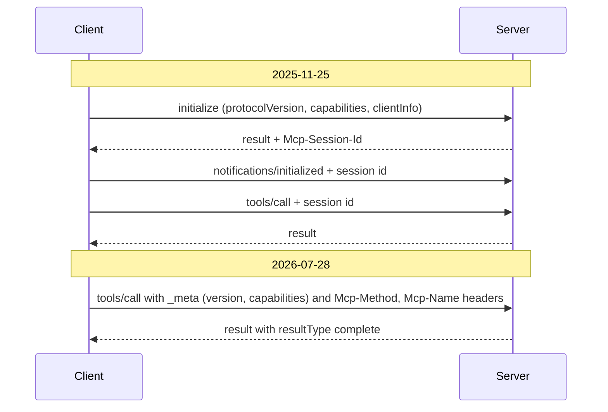

## 1. The question this idea answers

The interviewer asked the friend: "What's new in MCP?" A vague answer such as "they added auth and some streaming" signals that you used MCP once. A strong answer names the current revision, the big change, the reason for it, and two or three concrete fields or methods. Then it survives the follow-ups: "What did they remove?", "Why stateless?", "What happens to old clients?", "What is deprecated, and until when?".

MCP changes fast. Five revisions appeared in less than two years: 2024-11-05, 2025-03-26, 2025-06-18, 2025-11-25 and 2026-07-28. Each one has an official changelog. This lesson walks through all five, item by item, from those changelogs. It also covers the machinery around the versions. How are revisions named? How do a client and a server agree on one? How are features deprecated, and who decides? Which extensions and SDKs exist?

All facts in this lesson were checked on 2026-10-15. The current revision on that day is **2026-07-28**.

## 2. Mental model

> [!analogy] Dated editions of a rulebook
> A sports league prints its rulebook in dated editions: the 2024-11 edition, the 2025-03 edition, and so on. A new edition appears only when a rule changes in a way that old players could get wrong. Small clarifications go into the current edition without a new date. Before a match, both teams must agree which edition they play. Rules that are on their way out are marked "retiring" in one edition and stay valid for at least a year, so teams can retrain. A committee decides each change through written proposals.
>
> **Where it stops working:** in MCP 2026-07-28, there is no "before the match". Every single request names its edition in `_meta`, and the server accepts or rejects each request on its own. A server may also play several editions at once. The Python SDK 2.3.0 serves the old handshake editions and the new one on the same endpoint.

## 3. Terms

| Term | Plain meaning |
|---|---|
| revision (protocol version) | One dated edition of the MCP specification, named `YYYY-MM-DD`. |
| Draft, Current, Final | Revision states: in progress, the one to use (may still get compatible changes), and frozen. |
| backwards compatible | A change that old implementations can ignore without breaking. |
| breaking change | A change that makes old implementations fail or behave wrongly. |
| changelog | The official list of changes of one revision, with PR or SEP numbers. |
| SEP | Specification Enhancement Proposal: the design document for a significant MCP change. |
| feature lifecycle | The states Active, Deprecated and Removed of a single feature (SEP-2596). |
| deprecation window | The minimum time a Deprecated feature must keep working: at least 12 months. |
| earliest removal | The first revision released on or after the end of the deprecation window. |
| legacy, modern, dual-era | Handshake revisions (2025-11-25 and earlier), per-request revisions (2026-07-28 and later), and implementations that speak both. |
| extension | An optional, opt-in addition with an identifier such as `io.modelcontextprotocol/tasks`, versioned outside the core. |
| SDK tier | The support level of an official SDK: Tier 1 (full), Tier 2 (working toward full), Tier 3 (experimental). |
| conformance tests | Automated test scenarios that check an SDK against the specification. |
| Agentic AI Foundation (AAIF) | A directed fund under the Linux Foundation that hosts MCP since 2025-12-09. |
| core maintainers | The group that steers the specification and approves SEPs. |
| working group | A group that builds a concrete deliverable, for example a SEP or an implementation. |

All terms are also in the [Glossary](/notes/ai/llm-systems/glossary).

## 4. How MCP versions work

### 4.1 Names and states

The version page says: MCP uses version strings "following the format `YYYY-MM-DD`, to indicate the last date backwards incompatible changes were made." The version is **not** incremented for backwards-compatible updates. So "2026-07-28" names the day of the last breaking change, not the day of the last edit.

Revisions are **Draft** (not ready), **Current** (ready, may still receive backwards-compatible changes) or **Final** (frozen). On 2026-10-15, 2026-07-28 is Current, and the four older revisions are Final.

A release has a public run-up. For 2026-07-28, the release candidate was "locked as of May 21, 2026", and the blog gave "a ten-week window" for SDK maintainers and client implementers to validate the changes. The final specification was published on 2026-07-28.

### 4.2 How a client and a server agree on a version

| | Legacy (2024-11-05 to 2025-11-25) | Modern (2026-07-28) |
|---|---|---|
| Where the version travels | `protocolVersion` in the `initialize` request and result | `io.modelcontextprotocol/protocolVersion` in the `_meta` of every request, and the `MCP-Protocol-Version` header on HTTP |
| Negotiation | The client proposes. The server answers with the same version or another one it supports. The client SHOULD disconnect if it cannot accept the answer. | No handshake. The server accepts each request, or returns `UnsupportedProtocolVersionError` (-32022) with `data.supported`. The client retries with a common version. |
| Up-front discovery | Part of `initialize` | Optional `server/discover`, which servers MUST implement |

The Python SDK 2.3.0 lists the versions it knows. Real output of `mcp_types.version` in these notes:

```text
KNOWN_PROTOCOL_VERSIONS = ('2024-11-05', '2025-03-26', '2025-06-18', '2025-11-25', '2026-07-28')
HANDSHAKE_PROTOCOL_VERSIONS = ('2024-11-05', '2025-03-26', '2025-06-18', '2025-11-25')
MODERN_PROTOCOL_VERSIONS = ('2026-07-28',)
LATEST_PROTOCOL_VERSION = 2026-07-28
```

## 5. The five revisions at a glance


```video
{"src": "/notes/media/llm-systems/manim/m37-version-timeline.mp4", "caption": "Five MCP revisions on one time axis, with the headline change of each and the move from a stateful handshake to stateless requests."}
```

| Revision | Gap (days) | Headline | The changes to remember |
|---|---|---|---|
| 2024-11-05 | | First revision | JSON-RPC, `initialize` handshake, tools, resources, prompts, sampling, roots, stdio and HTTP+SSE |
| 2025-03-26 | 141 | Remote servers get serious | OAuth 2.1 authorization, Streamable HTTP, tool annotations, batching |
| 2025-06-18 | 84 | Security and structure | Batching removed, structured tool output, server as OAuth resource server, RFC 8707, elicitation, resource links, `MCP-Protocol-Version` header |
| 2025-11-25 | 160 | One year of MCP | Experimental tasks, URL elicitation, sampling with tools, CIMD, icons, JSON Schema 2020-12, governance and SDK tiers |
| 2026-07-28 | 245 | Stateless core | No `initialize`, no sessions, `_meta` on every request, `server/discover`, MRTR, `subscriptions/listen`, tasks extension, deprecations |

The gaps are computed from the revision dates with Python's `datetime`. The whole history spans 630 days.

### 5.1 The feature matrix

Each cell says whether a feature exists in a revision. "dep." means Deprecated: still in the spec, scheduled for removal. Every cell is based on the changelogs and specification pages listed in Sources.

| Feature | 2024-11-05 | 2025-03-26 | 2025-06-18 | 2025-11-25 | 2026-07-28 |
|---|---|---|---|---|---|
| `initialize` handshake | yes | yes | yes | yes | no |
| stdio transport | yes | yes | yes | yes | yes |
| HTTP+SSE (two endpoints) | yes | dep. | dep. | dep. | dep. |
| Streamable HTTP | no | yes | yes | yes | yes, no GET stream |
| `Mcp-Session-Id` sessions | no | yes | yes | yes | no |
| SSE resumability (`Last-Event-ID`) | no | yes | yes | yes | no |
| JSON-RPC batching | no | yes | no | no | no |
| `MCP-Protocol-Version` HTTP header | no | no | yes | yes | yes |
| `Mcp-Method` and `Mcp-Name` headers | no | no | no | no | yes |
| OAuth authorization | no | yes | yes | yes | yes |
| Protected Resource Metadata | no | no | yes | yes | yes |
| Client ID Metadata Documents | no | no | no | yes | yes |
| Dynamic Client Registration | no | yes | yes | yes | dep. |
| Tool annotations | no | yes | yes | yes | yes |
| Audio content | no | yes | yes | yes | yes |
| `outputSchema` and `structuredContent` | no | no | yes | yes | yes |
| Resource links in tool results | no | no | yes | yes | yes |
| Elicitation | no | no | yes | yes, plus URL mode | yes, through MRTR |
| Sampling | yes | yes | yes | yes, plus tools | dep. |
| Roots | yes | yes | yes | yes | dep. |
| Logging (`notifications/message`) | yes | yes | yes | yes | dep. |
| `ping` | yes | yes | yes | yes | no |
| Icons | no | no | no | yes | yes |
| Tasks | no | no | no | experimental core | extension |
| `server/discover` | no | no | no | no | yes |
| `resultType` on results | no | no | no | no | yes |
| `ttlMs` and `cacheScope` | no | no | no | no | yes |

Two cells need a footnote. HTTP+SSE was described as deprecated from 2025-03-26 on, and SEP-2596 made it formally Deprecated in 2026-07-28. In 2025-03-26, clients SHOULD send `MCP-Protocol-Version` only during authorization metadata discovery. The header became a transport rule in 2025-06-18.

Exercise 2 turns a few rows of this table into code.

## 6. 2024-11-05: the first revision

Anthropic announced MCP on **2024-11-25**: "Today, we're open-sourcing the Model Context Protocol (MCP)". The launch included the specification and SDKs, and local MCP server support in Claude Desktop. It also included an open-source repository of servers, for example for Google Drive, Slack, GitHub, Git, Postgres and Puppeteer. The first revision carries an earlier date, 2024-11-05. Interpretation of these notes: a revision is named after its last breaking change, which can come before the public release.

What 2024-11-05 defined, from its specification pages:

- **Base protocol:** JSON-RPC 2.0 messages, "Stateful connections", and "Server and client capability negotiation" through the `initialize` lifecycle.
- **Roles:** hosts, clients and servers. The spec names the Language Server Protocol as an inspiration.
- **Server features:** resources, prompts and tools.
- **Client features:** sampling, and roots (a `client/roots` page exists in this revision).
- **Utilities:** ping, cancellation, progress, logging, completion and pagination.
- **Transports:** stdio, and HTTP with Server-Sent Events. HTTP+SSE used two endpoints. A GET opened an SSE stream. The server sent an `endpoint` event with a URL. The client POSTed every message to that URL.
- **Security:** principles only (user consent, data privacy, tool safety, sampling controls). No authorization framework. The spec states that MCP "cannot enforce these security principles at the protocol level".

## 7. 2025-03-26: authorization and Streamable HTTP

The changelog lists four major changes:

1. A comprehensive **authorization framework** based on OAuth 2.1 (PR #133).
2. The HTTP+SSE transport replaced by a more flexible **Streamable HTTP** transport (PR #206).
3. Support for JSON-RPC **batching** (PR #228).
4. Comprehensive **tool annotations** that describe behavior, for example read-only or destructive (PR #185).

Other schema changes: a `message` field in `ProgressNotification`, audio content next to text and image, and a `completions` capability.

What these meant in practice:

- **Streamable HTTP, first shape.** One MCP endpoint for POST and GET. A POST could return one JSON object or an SSE stream. The server MAY assign an `Mcp-Session-Id` at initialization, and the client MUST then send it on every request. A GET opened a stream for server-initiated messages. Streams could resume with `Last-Event-ID`. A DELETE ended a session. The spec said that a disconnection "SHOULD NOT be interpreted as the client cancelling its request".
- **Authorization, first shape.** OAuth 2.1 with PKCE "REQUIRED for all clients". The example assumed that the MCP server is also the authorization server. Metadata lived at the server's base URL (`/.well-known/oauth-authorization-server`), with default endpoints `/authorize`, `/token` and `/register`. Dynamic Client Registration was a SHOULD.

## 8. 2025-06-18: structure and security

Major changes, from the changelog:

1. **Batching removed** (PR #416). It had existed for one revision.
2. **Structured tool output** (PR #371): `outputSchema` on tools and `structuredContent` in results.
3. MCP servers **classified as OAuth resource servers**, with Protected Resource Metadata to discover the authorization server (PR #338).
4. MCP clients **MUST implement Resource Indicators**, RFC 8707, "to prevent malicious servers from obtaining access tokens" (PR #734).
5. Clarified **security considerations**, and a new **security best practices** page.
6. **Elicitation**: servers can request information from users during interactions (PR #382).
7. **Resource links** in tool results (PR #603).
8. The negotiated version MUST travel in the **`MCP-Protocol-Version` header** on later HTTP requests (PR #548).
9. **SHOULD changed to MUST** in "Lifecycle Operation".

Other schema changes: `_meta` on more interface types, with rules for its use (PR #710). A `context` field in `CompletionRequest` for already-resolved arguments (PR #598). A `title` field for display names, so that `name` stays a programmatic identifier (PR #663).

The authorization text of this revision also has two rules to remember. A 401 MUST carry `WWW-Authenticate` with the metadata URL (2025-11-25 relaxed this to an option with a well-known fallback). And "MCP servers MUST NOT accept or transit any other tokens." Every later revision keeps the second rule.

## 9. 2025-11-25: one year of MCP

The changelog has nine major changes:

1. Authorization server discovery with **OpenID Connect Discovery 1.0** (PR #797).
2. **Icons** as metadata for tools, resources, resource templates and prompts (SEP-973).
3. **Incremental scope consent** through `WWW-Authenticate` (SEP-835).
4. **Guidance on tool names** (SEP-986). The tools page gives SHOULD rules: 1 to 128 characters, only ASCII letters, digits, `_`, `-` and `.`.
5. `ElicitResult` and `EnumSchema` in a **standards-based** form, with titled, untitled, single-select and multi-select enums (SEP-1330).
6. **URL mode elicitation** (SEP-1036): the user opens a URL for a sensitive interaction that must not pass through the client.
7. **Tool calling in sampling** through `tools` and `toolChoice` (SEP-1577).
8. **OAuth Client ID Metadata Documents** as a recommended registration mechanism (SEP-991, PR #1296).
9. Experimental **tasks** for durable requests with polling and deferred results (SEP-1686).

Ten minor changes:

1. stdio servers may use stderr for all logging, not only errors (PR #670).
2. An optional `description` field on `Implementation`.
3. Servers respond with **403** for an invalid `Origin` header (PR #1439).
4. Updated security best practices.
5. **Input validation errors are tool execution errors**, not protocol errors, so the model can correct itself (SEP-1303).
6. **SSE polling**: servers may disconnect at will, and the client reconnects (SEP-1699).
7. Clarification of SEP-1699: GET streams support polling, and resumption always uses GET (issue #1847).
8. Protected Resource Metadata discovery aligned with RFC 9728: the `WWW-Authenticate` header became optional, with a fallback to the well-known URI (SEP-985).
9. Default values for all primitive types in elicitation schemas (SEP-1034).
10. **JSON Schema 2020-12** as the default dialect (SEP-1613).

Other schema changes: request payloads decoupled from method definitions into standalone parameter schemas (SEP-1319). Governance: the formal governance structure (SEP-932), communication practices (SEP-994), working groups and interest groups (SEP-1302), and the **SDK tiering system** (SEP-1730).

The deprecated-features registry adds one item to this revision: the `includeContext` values `"thisServer"` and `"allServers"` of sampling became soft-deprecated in 2025-11-25.

The anniversary blog post (2025-11-25) reported that the MCP Registry had "close to two thousand entries", and it promised: "Your existing implementations keep working."

## 10. 2026-07-28: the stateless core

### 10.1 Why

The pressure arose in deployment. Three quotes tell the story:

- The Transports Working Group, blog post of 2025-12-19: "Stateful connections force “sticky” routing that pins traffic to specific servers, preventing effective auto-scaling."
- The same post, on the goal: "We envision a future where agentic applications are stateful, but the protocol itself doesn’t need to be."
- The release post of 2026-07-28, on the result: "Any request can now land on any server instance behind a plain round-robin load balancer without needing shared storage."

Lesson [L5](/notes/ai/llm-systems/07-mcp/l5-stateful-vs-stateless) explains stateful vs stateless in depth, and [L13](/notes/ai/llm-systems/07-mcp/l13-build-an-mcp-server) shows it with two real server instances.

### 10.2 The nine major changes

1. **No sessions** (SEP-2567). `Mcp-Session-Id` is gone from Streamable HTTP. List endpoints no longer vary per connection. Servers that need state across calls use "explicit, server-minted handles passed as ordinary tool arguments".
2. **No handshake** (SEP-2575). `initialize` and `notifications/initialized` are removed. Every request carries `io.modelcontextprotocol/protocolVersion` and `io.modelcontextprotocol/clientCapabilities` in `_meta`. Clients SHOULD send `io.modelcontextprotocol/clientInfo`, and servers SHOULD send `io.modelcontextprotocol/serverInfo` in each result's `_meta`. A version mismatch returns `UnsupportedProtocolVersionError`.
3. **`server/discover`** (SEP-2575). Servers MUST implement it. It returns the supported versions, the capabilities and the identity. Clients MAY call it first, or use it as a backward-compatibility probe on stdio.
4. **`subscriptions/listen`** (SEP-2575) replaces both the HTTP GET stream and `resources/subscribe`/`resources/unsubscribe`. It is one long-lived POST whose response stream carries the change notifications that the client opted into: `toolsListChanged`, `promptsListChanged`, `resourcesListChanged`, `resourceSubscriptions`. Notifications carry `io.modelcontextprotocol/subscriptionId`. Request-scoped notifications such as progress stay on their own request's stream.
5. **Removed: `ping`, `logging/setLevel` and `notifications/roots/list_changed`** (SEP-2575). The log level is now set per request with `io.modelcontextprotocol/logLevel`.
6. **Tasks move to an extension**, `io.modelcontextprotocol/tasks` (SEP-2663). Polling with `tasks/get` replaces the blocking `tasks/result`. A new `tasks/update` carries client input. `tasks/list` is removed. Servers may return task handles without a per-request opt-in.
7. **Multi Round-Trip Requests** (SEP-2322) replace server-initiated `roots/list`, `sampling/createMessage` and `elicitation/create`. The server returns `InputRequiredResult` with `resultType: "input_required"` and `inputRequests`. The client retries the original request with `inputResponses`. Lesson [L9](/notes/ai/llm-systems/07-mcp/l9-mrtr-elicitation-sampling-and-roots) covers MRTR.
8. **`resultType` on every result** (SEP-2322): `"complete"` or `"input_required"`. Clients MUST treat a missing `resultType` from older servers as `"complete"`.
9. **No SSE resumability** (SEP-2575). `Last-Event-ID` and SSE event IDs are removed. A broken stream loses the in-flight request, and the client MUST re-issue it with a new request ID.

### 10.3 The twelve minor changes

1. An `extensions` field in `ClientCapabilities` and `ServerCapabilities`.
2. OpenTelemetry trace context in `_meta`: `traceparent`, `tracestate`, `baggage` (SEP-414).
3. Servers SHOULD return tools from `tools/list` in a **deterministic order**, for client caching and better LLM prompt-cache hit rates.
4. **Required HTTP headers** `Mcp-Method` and `Mcp-Name` on Streamable HTTP POSTs, and custom headers from tool parameters through `x-mcp-header` (SEP-2243).
5. **`ttlMs` and `cacheScope`** required on results of `tools/list`, `prompts/list`, `resources/list`, `resources/read` and `resources/templates/list`, through a `CacheableResult` interface (SEP-2549). The Caching page also lists `server/discover`.
6. **Resource not found** changes from `-32002` to `-32602` (Invalid Params).
7. Authorization servers SHOULD include **`iss`** in authorization responses (RFC 9207), and clients MUST validate a present `iss` (SEP-2468).
8. Clients MUST send an appropriate **`application_type`** during Dynamic Client Registration (SEP-837).
9. Client credentials are **bound to the issuer** that issued them (SEP-2352).
10. `inputSchema` and `outputSchema` may use **any JSON Schema 2020-12 keyword**, and `structuredContent` may be any JSON value. `$ref` resolution rules and resource bounds for composition keywords are added (SEP-2106).
11. **Removed:** `notifications/elicitation/complete` and the `elicitationId` of URL mode, both from 2025-11-25. Under MRTR, the client learns the outcome by retrying. A server that needs to correlate encodes its own identifier in `requestState`.
12. An **error code allocation policy**: `-32000` to `-32019` stays implementation-defined, `-32020` to `-32099` is reserved for the spec. The new codes become HeaderMismatch `-32020`, MissingRequiredClientCapability `-32021` and UnsupportedProtocolVersion `-32022` (renumbered from the draft's `-32001`, `-32003` and `-32004`).

### 10.4 Deprecated, other changes and process

**Deprecated** (still working, scheduled for removal):

1. **Roots, Sampling and Logging** (SEP-2577). Migrations: pass directories through tool parameters, resource URIs or server configuration instead of Roots. Call LLM provider APIs directly instead of Sampling. Log to `stderr` or use OpenTelemetry instead of Logging.
2. The **HTTP+SSE transport**, deprecated since 2025-03-26, reclassified as Deprecated under the new policy (SEP-2596).
3. The `includeContext` values `"thisServer"` and `"allServers"`, soft-deprecated since 2025-11-25, reclassified as Deprecated (SEP-2596).
4. **Dynamic Client Registration**, in favor of Client ID Metadata Documents (PR #2858).

**Other schema changes:** `schema.json` now shows `minimum`, `maximum` and `default` as numbers, not only integers (PR #2710).

**Governance:** the feature lifecycle and deprecation policy, with a minimum twelve-month window and a registry of deprecated features (SEP-2596). **Process:** a PR-based SEP workflow with files in `seps/`, PR-derived numbers and sponsors (SEP-1850).

### 10.5 The same tool call in both eras

The same `tools/call` in 2025-11-25 needed three earlier messages on the same session. In 2026-07-28 it is one self-contained request. Real HTTP requests to a Python SDK 2.3.0 server are in [L13](/notes/ai/llm-systems/07-mcp/l13-build-an-mcp-server). The shapes:



### 10.6 Authorization across the revisions

Authorization changed in four of the five revisions. Interviewers often ask about it separately, so here is the thread in one picture. Lesson [L11](/notes/ai/llm-systems/07-mcp/l11-authorization-and-security) explains each mechanism.


### 10.7 The wire, before and after

The same tool call, written out as JSON. First 2025-11-25, inside a session that `initialize` opened earlier. On HTTP, the `Mcp-Session-Id` and `MCP-Protocol-Version: 2025-11-25` headers carry the session and the version, so the body has neither:

```json
{"jsonrpc": "2.0", "id": 4, "method": "tools/call", "params": {"name": "get_order", "arguments": {"order_id": "PO-1001"}}}
```

Then 2026-07-28. The body is self-describing:

```json
{
  "jsonrpc": "2.0",
  "id": 4,
  "method": "tools/call",
  "params": {
    "name": "get_order",
    "arguments": {"order_id": "PO-1001"},
    "_meta": {
      "io.modelcontextprotocol/protocolVersion": "2026-07-28",
      "io.modelcontextprotocol/clientCapabilities": {},
      "io.modelcontextprotocol/clientInfo": {"name": "my-agent", "version": "0.1.0"}
    }
  }
}
```

The 2026 result carries `resultType` and the server's identity:

```json
{
  "jsonrpc": "2.0",
  "id": 4,
  "result": {
    "resultType": "complete",
    "content": [{"type": "text", "text": "PO-1001: 1200 x Bagels (released)"}],
    "isError": false,
    "_meta": {"io.modelcontextprotocol/serverInfo": {"name": "orders-demo", "version": "1.0.0"}}
  }
}
```

These three messages are illustrations built from the field definitions. The real exchanges with a Python SDK server are in [L13](/notes/ai/llm-systems/07-mcp/l13-build-an-mcp-server).

For comparison, the one-revision feature that was removed: a JSON-RPC batch, valid only in 2025-03-26, is a JSON array of messages:

```json
[
  {"jsonrpc": "2.0", "id": 1, "method": "tools/list"},
  {"jsonrpc": "2.0", "id": 2, "method": "prompts/list"}
]
```

Since 2025-06-18, a message is never an array. The 2025-11-25 transport page says the body of a POST "MUST be a single JSON-RPC request, notification, or response".

## 11. Old and new together: compatibility

The 2026 versioning page defines three kinds of implementation. **Legacy** speaks 2025-11-25 or earlier. **Modern** speaks 2026-07-28 or later. **Dual-era** speaks both.

| Client | Server | Outcome (from the spec's compatibility matrix) |
|---|---|---|
| Modern | Modern | Works. A version mismatch returns -32022, and the client retries. |
| Modern | Legacy | Fails. On stdio, clients SHOULD send `server/discover` first, to fail deterministically. |
| Dual-era | Modern | Works. The client stays modern. |
| Dual-era | Legacy | Works. The client reverts to `initialize`, and maybe further to HTTP+SSE. |
| Legacy | Modern | Fails. The server rejects `initialize`. Legacy clients have no way forward. |
| Legacy | Dual-era | Works, with the negotiated legacy revision. |
| Legacy | Legacy | Works with the legacy revision. |

How a dual-era client detects the era:

- **stdio:** send `server/discover`. A `DiscoverResult` or a recognized modern error means modern. Any other error, or a timeout, means legacy: send `initialize`.
- **Streamable HTTP:** send a modern request. On `400 Bad Request`, read the body. A recognized modern error such as -32022 means modern: fix the request or retry with a supported version. An empty body, or an unrecognized error, means legacy: send `initialize`.

Clients SHOULD cache the result per stdio process or per HTTP origin. A modern-only server SHOULD name its supported versions in any error it returns to an `initialize` request. That message may be the only diagnostic that a legacy client can show.

Measured in these notes: the Python SDK 2.3.0 `Client` defaults to `mode="auto"`, which probes `server/discover` and reverts to the handshake for legacy servers. Against the L13 server it reported `protocol version: 2026-07-28`. With `mode="legacy"` the same server answered the `initialize` handshake and the client reported `2025-11-25`. So the SDK server is dual-era.

## 12. How MCP evolves: SEPs, lifecycle, governance

### 12.1 SEPs

A SEP is "a design document providing information to the MCP community, or describing a new feature". There are four types: **Standards Track**, **Informational**, **Process** and **Extensions Track**. A SEP moves through `draft`, `in-review`, then `accepted` or `rejected`, and finally `final`. Other states: `withdrawn`, `superseded` and `dormant` (no sponsor within 6 months).

Since SEP-1850, a SEP is a markdown file in the `seps/` folder of the specification repository. Its number is the number of its pull request. A **sponsor** (a maintainer or core maintainer) moves it through review. Core maintainers review SEPs every two weeks. A SEP needs a prototype before acceptance. Since SEP-2484, a Standards Track SEP with observable protocol behavior also needs a merged **conformance test** before it can become `final`.

### 12.2 The feature lifecycle (SEP-2596)


| State | Meaning | Implementer expectation |
|---|---|---|
| Active | Part of the Current revision | Implement it |
| Deprecated | Still in the spec, scheduled for removal, with a migration path | New implementations should not adopt it. Existing ones should migrate before the earliest removal. |
| Removed | Deleted from `draft`, absent from the next Current revision | Do not depend on it |

The minimum window is twelve months, counted from the release of the revision that first marks the feature Deprecated. The feature becomes eligible for removal in the first revision released as Current on or after the end of the window. Removal is a later core-maintainer decision, and features "may remain Deprecated, without removal, for much longer". For an active security risk, an expedited removal can shorten the window, but never below ninety days.

> [!example] Worked example: when can Sampling disappear?
> Sampling became Deprecated in 2026-07-28. Twelve months later is 2027-07-28 (the function of Exercise 2 computes it). So the earliest removal is the first revision released on or after 2027-07-28. The registry states exactly that. If MCP publishes a revision on 2027-05-01, Sampling must still be in it. If the next revision after that appears on 2027-09-15, Sampling may be removed there, but it does not have to be.

Tier 1 SDKs must mark deprecated APIs with the language's mechanism in their next release, for example `@deprecated` in TypeScript. They should emit a runtime warning, such as Python's `DeprecationWarning`. The Python SDK 2.3.0 exports an `MCPDeprecationWarning` class (seen in these notes).

### 12.3 Who decides, and where MCP lives

| Date | Event |
|---|---|
| 2024-11-25 | Anthropic open-sources MCP |
| 2025-07-31 | Blog post "Building to Last: A New Governance Model for MCP" |
| 2025-09-08 | The MCP Registry launches in preview |
| 2025-12-09 | MCP joins the **Agentic AI Foundation**, "a directed fund under the Linux Foundation", "co-founded by Anthropic, Block and OpenAI". Founding projects with MCP: goose (Block) and AGENTS.md (OpenAI). |
| 2026-05-21 | The 2026-07-28 release candidate is locked |
| 2026-07-28 | Revision 2026-07-28 and the Tier 1 SDK releases |

The AAIF post says: "For MCP little changes." The Linux Foundation "will not dictate the technical direction of MCP". The project's legal form is "Model Context Protocol a Series of LF Projects, LLC". Technical governance has four roles: contributors, maintainers, core maintainers and lead maintainers. Lead maintainers hold final authority. On 2026-10-15 the governance page lists David Soria Parra and Den Delimarsky as lead maintainers. Membership belongs to people, not companies.

## 13. Extensions

An extension adds optional capabilities outside the core. Its identifier is `{vendor-prefix}/{extension-name}`, with the `_meta` prefix rules of [L10](/notes/ai/llm-systems/07-mcp/l10-utilities-and-errors). Official extensions use `io.modelcontextprotocol/` and live in repositories that start with `ext-`. Experimental ones live in `experimental-ext-` repositories and need a working or interest group.

Negotiation: the client lists extensions in the `extensions` field of `io.modelcontextprotocol/clientCapabilities` on each request. The server lists its extensions in the `server/discover` result. An empty object means "supported, no settings". Extensions are "always disabled by default". If only one side supports an extension, the supporting side MUST revert to core behavior or reject the request.

| Extension | Identifier | What it adds |
|---|---|---|
| Tasks | `io.modelcontextprotocol/tasks` | Durable handles for long work: `tasks/get`, `tasks/update`, `tasks/cancel` (SEP-2663). See [L10](/notes/ai/llm-systems/07-mcp/l10-utilities-and-errors). |
| MCP Apps | `io.modelcontextprotocol/ui` | Servers ship interactive HTML user interfaces as `ui://` resources (SEP-1865). The MCP blog called it an official extension on 2026-01-26. The versioning page's example uses the MIME type `text/html;profile=mcp-app`. |
| Skills | `io.modelcontextprotocol/skills` | Discover and read Agent Skills from a server: `skills/list`, `skills/get`, files through `resources/read`. SEP-2640 is Final. |
| OAuth Client Credentials | `io.modelcontextprotocol/oauth-client-credentials` | Machine-to-machine tokens without a user (SEP-1046) |
| Enterprise-Managed Authorization | `io.modelcontextprotocol/enterprise-managed-authorization` | The company identity provider decides access, through an ID-JAG (SEP-990). Announced as stable on 2026-06-18. |

## 14. SDK support tiers

SEP-1730 (2025-11-25) created three tiers. Conformance is measured with the automated tests of the `modelcontextprotocol/conformance` repository.

| Requirement | Tier 1 | Tier 2 | Tier 3 |
|---|---|---|---|
| Conformance tests | 100% pass | 80% pass | no minimum |
| New protocol features | before the new spec release | within 6 months | no commitment |
| Issue triage | within 2 business days | within a month | none |
| Critical bug fix | within 7 days | within two weeks | none |

The SDK page on 2026-10-15 lists six Tier 1 SDKs: TypeScript, Python, C#, Go, Rust and Ruby. Java is Tier 2. Swift, PHP and Kotlin are Tier 3. Extensions such as Tasks and MCP Apps are not required for any tier.

On release day, the blog said: "All four Tier 1 SDKs speak `2026-07-28` as of today" (TypeScript, Python, Go and C#), and the Rust SDK "supports the new spec in beta". The Ruby SDK reached 1.0 on 2026-07-27. The SDK page of 2026-10-15 thus lists more Tier 1 SDKs than the release post did.

Version facts that change often (PyPI and the SDK READMEs, checked on 2026-10-15):

| SDK | Current line | Notes |
|---|---|---|
| Python `mcp` | 2.3.0, released 2026-10-02 | 2.0.0 on 2026-07-28. v1 still maintained: 1.30.0 on 2026-09-07. `FastMCP` is now `MCPServer`. |
| TypeScript | v2, split packages | `@modelcontextprotocol/server` and `@modelcontextprotocol/client`. v1.x gets fixes for at least 6 months after v2. |

## 15. What comes next

The blog post "The New MCP Roadmap" (2026-08-22) names five priority areas:

1. Agentic messaging primitives: server-initiated events such as webhooks, and maturing the Tasks extension "so it can move into the specification".
2. HTTP-native transport unification and hardening, including local servers "speaking Streamable HTTP over stdio".
3. Agent identity and enterprise-ready security, with work on DPoP and Workload Identity Federation.
4. Improved primitives: standard tool result handling and "progressive discovery" of large tool catalogs.
5. Improved SDK developer experience and conformance.

The post gives no date and no version number for the next revision.

## 16. Interview answers

> [!key] The 30-second answer
> The current revision is 2026-07-28, and its big change is a stateless core. The `initialize` handshake and the `Mcp-Session-Id` session are gone. Every request carries its protocol version and client capabilities in `_meta`, so any server instance behind a plain round-robin load balancer can answer it. Server-to-client requests became Multi Round-Trip Requests: the server returns `input_required`, and the client retries with the answers. Tasks moved into an extension, auth added issuer validation, and Roots, Sampling and Logging are deprecated with at least a twelve-month window.

> [!key] The 2-minute answer
> MCP versions are dates: the date of the last breaking change. There have been five: 2024-11-05, 2025-03-26, 2025-06-18, 2025-11-25 and the current 2026-07-28.
>
> The arc is easy to tell. 2025-03-26 made remote servers practical: OAuth 2.1 and Streamable HTTP, which replaced the two-endpoint HTTP+SSE transport, plus tool annotations. 2025-06-18 tightened it. The MCP server became an OAuth resource server with Protected Resource Metadata. Clients must send RFC 8707 resource indicators, token passthrough is forbidden, and tools got structured output. It also added elicitation and removed JSON-RPC batching. 2025-11-25 added experimental tasks, URL-mode elicitation, sampling with tools, Client ID Metadata Documents, and JSON Schema 2020-12 as the default dialect. It also formalized governance and SDK tiers.
>
> 2026-07-28 is the big one: a stateless protocol core. No `initialize` and no sessions. Each request is self-describing through `_meta`, and a new `server/discover` method gives capabilities on demand. Because nothing lives in a session, server-initiated sampling, elicitation and roots requests became Multi Round-Trip Requests: an `InputRequiredResult`, then a retry with `inputResponses`. Every result has a `resultType`. Change notifications moved to a `subscriptions/listen` stream, `ping` is gone, and SSE resumability is gone. HTTP requests carry `Mcp-Method` and `Mcp-Name` headers for gateways. List results carry `ttlMs` and `cacheScope`, and servers should keep tool order deterministic. Auth added RFC 9207 issuer validation and deprecated Dynamic Client Registration. Tasks became an extension, next to MCP Apps and Skills.
>
> The reason was scale: stateful sessions forced sticky routing and shared session stores. The trade-off: servers that need state now pass explicit handles as tool arguments. Old clients keep working with dual-era servers, and deprecated features keep working for at least twelve months under the new lifecycle policy.

### Exercises

These go in the notebook folder `llm-systems/` of `C:\Users\ASohi\Downloads\AI\agent-harness-lab`.

1. **Era detection over HTTP.** Write `classify_http_reply(status, body)` that returns `modern`, a modern error action, or `legacy: send initialize`. Acceptance test: a 200 is modern. A 400 with code -32022 is modern. A 404 with code -32601 is modern. An empty 400 or 405 is legacy. Hint 1: parse the body as JSON only if it is not empty. Hint 2: the modern codes are -32020, -32021 and -32022.
2. **A feature table.** Store, for each feature, the first revision that has it and the first revision without it. Write `has(feature, revision)` and `earliest_removal(deprecated_in)`. Acceptance test: batching exists only in 2025-03-26. `ping` exists in the four legacy revisions. `server/discover` exists only in 2026-07-28. The earliest removal for 2026-07-28 is `2027-07-28`. Hint 1: ISO dates compare correctly as text. Hint 2: add 12 to the month and carry into the year.

## 17. Common mistakes

1. **"The current MCP version is 2025-11-25, with `initialize`."** On 2026-10-15 the current revision is 2026-07-28, which has no `initialize`.
2. **"A new MCP version appears whenever the spec changes."** The date changes only for backwards-incompatible changes. Compatible changes go into the Current revision.
3. **"Batching is part of MCP."** It existed only in 2025-03-26 and was removed in 2025-06-18.
4. **"HTTP+SSE was removed in 2026."** It has been deprecated since 2025-03-26 and is classified Deprecated in 2026-07-28. It is not removed.
5. **"Sampling and Roots were removed in 2026."** They are Deprecated and still work. The earliest removal is the first revision on or after 2027-07-28.
6. **"Tasks are a 2026 core feature."** They were experimental core in 2025-11-25. In 2026-07-28 they are an extension.
7. **"Stateless MCP means servers cannot keep state."** The protocol is stateless. Applications keep state with explicit handles, for example a basket ID passed as a tool argument.
8. **"Moving to the Linux Foundation changed who designs MCP."** The AAIF post says "For MCP little changes": the maintainers and the SEP process continue.

## 18. One-minute explanation

MCP versions are dates that mark the last breaking change, and there have been five. 2024-11-05 was the first, with the `initialize` handshake, tools, resources, prompts, stdio and HTTP+SSE. 2025-03-26 added OAuth 2.1 and Streamable HTTP. 2025-06-18 made the server an OAuth resource server, required resource indicators, added structured tool output and elicitation, and removed batching. 2025-11-25 added experimental tasks, URL elicitation, Client ID Metadata Documents and JSON Schema 2020-12. The current 2026-07-28 made the protocol stateless: no handshake, no sessions, `_meta` on every request, `server/discover`, and Multi Round-Trip Requests instead of server-initiated requests. It also moved tasks into an extension and added `Mcp-Method` and `Mcp-Name` headers and cache hints. It deprecated Roots, Sampling and Logging for at least twelve months. Every change needs a SEP, deprecations follow a published lifecycle policy, and MCP lives in the Agentic AI Foundation under the Linux Foundation.

## 19. Check questions

```check
{
  "question": "List the five MCP revisions in order, with one headline change for each.",
  "answer": "2024-11-05: the first revision (JSON-RPC, `initialize` handshake, tools, resources, prompts, sampling, roots, stdio and HTTP+SSE). 2025-03-26: OAuth 2.1 authorization and Streamable HTTP (also tool annotations and batching). 2025-06-18: batching removed, structured tool output, the server as an OAuth resource server, RFC 8707 resource indicators, elicitation. 2025-11-25: experimental tasks, URL-mode elicitation, sampling with tools, Client ID Metadata Documents, JSON Schema 2020-12 by default. 2026-07-28: the stateless core (no `initialize`, no sessions, `_meta` on every request, `server/discover`, MRTR)."
}
```

```check
{
  "question": "What does the date in a protocol version such as 2026-07-28 mean, and why can the spec change without the date changing?",
  "answer": "The versioning page says the string indicates \"the last date backwards incompatible changes were made\". The version is not incremented for updates that keep backwards compatibility. Those go into the Current revision, which \"may continue to receive backwards compatible changes\". Only a breaking change produces a new dated revision."
}
```

```check
{
  "question": "Interview follow-up: Why did MCP become stateless in 2026-07-28? What did it remove, what did it add, and what is the trade-off?",
  "hint": "Think about a load balancer in front of several server instances.",
  "answer": "Why: in 2025-11-25 a session (`Mcp-Session-Id`) lived in one server instance. That forced sticky routing or a shared session store, made serverless hosting hard, and server-to-client requests needed an open stream to the same instance. The Transports Working Group wrote: \"Stateful connections force “sticky” routing that pins traffic to specific servers, preventing effective auto-scaling.\". Removed: `initialize`, `notifications/initialized`, `Mcp-Session-Id`, the HTTP GET stream, `resources/subscribe`, `ping`, `logging/setLevel`, `notifications/roots/list_changed`, SSE resumability, server-initiated sampling, elicitation and roots requests. Added: per-request `_meta` with protocol version and client capabilities, `server/discover`, `resultType` on every result, Multi Round-Trip Requests (`input_required`, `inputRequests`, `inputResponses`, `requestState`), `subscriptions/listen`, `Mcp-Method` and `Mcp-Name` headers, `ttlMs` and `cacheScope`. Trade-off: the protocol no longer manages state, so servers that need state across calls mint explicit handles and receive them as tool arguments, and each request repeats its metadata. A broken stream also loses the in-flight request, because streams are not resumable."
}
```

```check
{
  "question": "Interview follow-up: A colleague says \"Sampling was removed in 2026, so our server must stop using it now.\" Correct this with the exact policy.",
  "answer": "Sampling was deprecated, not removed, in 2026-07-28 (SEP-2577). Under the feature lifecycle policy (SEP-2596), a Deprecated feature remains part of the specification and keeps working. New implementations should not adopt it, and existing ones should migrate (the suggested migration is to call LLM provider APIs directly). The minimum window is twelve months from the release of 2026-07-28, so the earliest removal is the first revision released on or after 2027-07-28. Removal is then a core-maintainer decision and may happen later. Only an active security risk can shorten the window, and never below ninety days."
}
```

```check
{
  "question": "Interview follow-up: A modern 2026-07-28 client connects over Streamable HTTP to an unknown server and gets HTTP 400. How does it decide whether to retry modern or to revert to `initialize`?",
  "answer": "It reads the body. A recognized modern JSON-RPC error means the server speaks a modern version: -32022 UnsupportedProtocolVersion (retry with a version from `data.supported`), -32021 MissingRequiredClientCapability, or -32020 HeaderMismatch (fix the request). A 404 with -32601 also comes from a modern server and means the method is unknown. An empty body or an unrecognized error means a legacy server: the client sends `initialize` and may revert further to the deprecated HTTP+SSE transport. The client SHOULD cache the era per origin. On stdio the probe is `server/discover` instead."
}
```

```check
{
  "question": "Interview follow-up: How do extensions work in 2026-07-28? Name three official extensions with their identifiers.",
  "answer": "An extension is an optional addition outside the core, named `{vendor-prefix}/{extension-name}` with the `_meta` key rules. Official ones use `io.modelcontextprotocol/` and live in `ext-` repositories. The client lists supported extensions in the `extensions` field of `io.modelcontextprotocol/clientCapabilities` on each request. The server lists its own in the `server/discover` result. Extensions are disabled by default. If only one side supports an extension, the supporting side must revert to core behavior or reject the request. Examples: `io.modelcontextprotocol/tasks` (durable long-running work), `io.modelcontextprotocol/ui` (MCP Apps, interactive user interfaces), `io.modelcontextprotocol/skills` (Agent Skills), `io.modelcontextprotocol/oauth-client-credentials` and `io.modelcontextprotocol/enterprise-managed-authorization`."
}
```

```check
{
  "question": "What are the SDK tiers, and which SDKs supported 2026-07-28 on release day?",
  "answer": "SEP-1730 defined three tiers. Tier 1 needs 100% of the applicable conformance tests, support for new features before a spec release, triage within 2 business days and critical fixes within 7 days. Tier 2 needs 80%, new features within 6 months, triage within a month and critical fixes within two weeks. Tier 3 has no minimum. On release day the blog said all four Tier 1 SDKs (TypeScript, Python, Go and C#) spoke 2026-07-28, and the Rust SDK supported it in beta. On 2026-10-15 the SDK page lists TypeScript, Python, C#, Go, Rust and Ruby as Tier 1, Java as Tier 2, and Swift, PHP and Kotlin as Tier 3."
}
```

```check
{
  "question": "Exercise 1: show a reference solution.",
  "answer": "Real output: `200 modern`, `400 modern: fix the request or retry with data.supported`, `404 modern: the method is unknown`, `400 legacy: send initialize`, `405 legacy: send initialize`.\n\n```python\nimport json\n\nMODERN_ERROR_CODES = {-32020, -32021, -32022}      # HeaderMismatch, MissingRequiredClientCapability, UnsupportedProtocolVersion\n\n\ndef classify_http_reply(status: int, body: str) -> str:\n    \"\"\"Decide the server era after a first modern request, per 2026-07-28 Streamable HTTP rules.\"\"\"\n    if 200 <= status < 300:\n        return \"modern\"\n    try:\n        error = json.loads(body).get(\"error\", {}) if body else {}\n    except (ValueError, AttributeError):\n        error = {}\n    code = error.get(\"code\")\n    if status == 400 and code in MODERN_ERROR_CODES:\n        return \"modern: fix the request or retry with data.supported\"\n    if status == 404 and code == -32601:\n        return \"modern: the method is unknown\"\n    if status in (400, 404, 405):\n        return \"legacy: send initialize\"\n    return \"error\"\n\n\ncases = [\n    (200, '{\"jsonrpc\":\"2.0\",\"id\":1,\"result\":{\"resultType\":\"complete\",\"tools\":[]}}'),\n    (400, '{\"jsonrpc\":\"2.0\",\"id\":5,\"error\":{\"code\":-32022,\"message\":\"Unsupported protocol version\",\"data\":{\"supported\":[\"2026-07-28\"],\"requested\":\"1900-01-01\"}}}'),\n    (404, '{\"jsonrpc\":\"2.0\",\"id\":2,\"error\":{\"code\":-32601,\"message\":\"Method not found\"}}'),\n    (400, ''),\n    (405, ''),\n]\nfor status, body in cases:\n    print(status, classify_http_reply(status, body))\n```"
}
```

```check
{
  "question": "Exercise 2: show a reference solution.",
  "answer": "Real output: batching only in 2025-03-26, `ping` in the four legacy revisions, `server/discover` only in 2026-07-28, core tasks only in 2025-11-25, and `2027-07-28`.\n\n```python\nfrom datetime import date\n\nREVISIONS = [\"2024-11-05\", \"2025-03-26\", \"2025-06-18\", \"2025-11-25\", \"2026-07-28\"]\n\n# feature: (first revision with it, first revision without it or None)\nFEATURES = {\n    \"initialize handshake\": (\"2024-11-05\", \"2026-07-28\"),\n    \"HTTP+SSE transport\": (\"2024-11-05\", None),            # deprecated since 2025-03-26, not removed\n    \"Streamable HTTP\": (\"2025-03-26\", None),\n    \"JSON-RPC batching\": (\"2025-03-26\", \"2025-06-18\"),\n    \"ping\": (\"2024-11-05\", \"2026-07-28\"),\n    \"Mcp-Session-Id\": (\"2025-03-26\", \"2026-07-28\"),\n    \"elicitation\": (\"2025-06-18\", None),\n    \"structuredContent\": (\"2025-06-18\", None),\n    \"core tasks (experimental)\": (\"2025-11-25\", \"2026-07-28\"),\n    \"server/discover\": (\"2026-07-28\", None),\n    \"resultType\": (\"2026-07-28\", None),\n}\n\n\ndef has(feature: str, revision: str) -> bool:\n    first, gone = FEATURES[feature]\n    return first <= revision and (gone is None or revision < gone)   # ISO dates sort as text\n\n\ndef earliest_removal(deprecated_in: str, months: int = 12) -> str:\n    \"\"\"The date on or after which the first new revision may remove the feature.\"\"\"\n    d = date.fromisoformat(deprecated_in)\n    y, m = divmod(d.month - 1 + months, 12)\n    return date(d.year + y, m + 1, d.day).isoformat()\n\n\nfor f in [\"JSON-RPC batching\", \"ping\", \"server/discover\", \"core tasks (experimental)\"]:\n    print(f\"{f:28}\", [r for r in REVISIONS if has(f, r)])\nprint(earliest_removal(\"2026-07-28\"))\n```"
}
```

## 20. Links

- Previous: [L11: Authorization and security](/notes/ai/llm-systems/07-mcp/l11-authorization-and-security)
- Next: [L13: Build an MCP server and client](/notes/ai/llm-systems/07-mcp/l13-build-an-mcp-server)
- [L3: The stateful protocol (2025-11-25)](/notes/ai/llm-systems/07-mcp/l3-the-stateful-protocol)
- [L5: Stateful vs stateless MCP](/notes/ai/llm-systems/07-mcp/l5-stateful-vs-stateless)
- [L9: Asking the client for input: MRTR, elicitation, sampling and roots](/notes/ai/llm-systems/07-mcp/l9-mrtr-elicitation-sampling-and-roots)
- [L10: Utilities: progress, cancellation, pagination, errors](/notes/ai/llm-systems/07-mcp/l10-utilities-and-errors)
- [MCP: the protocol](/notes/ai/context-engineering/06-tools-and-mcp/l7-mcp-the-protocol): the shorter overview of the same history
- [Drill: MCP](/notes/ai/llm-systems/08-interview-drills/l4-chain-mcp)

### Sources

All checked on 2026-10-15.

- Changelogs: [2025-03-26](https://modelcontextprotocol.io/specification/2025-03-26/changelog), [2025-06-18](https://modelcontextprotocol.io/specification/2025-06-18/changelog), [2025-11-25](https://modelcontextprotocol.io/specification/2025-11-25/changelog), [2026-07-28](https://modelcontextprotocol.io/specification/2026-07-28/changelog)
- Specification pages: [2024-11-05 overview](https://modelcontextprotocol.io/specification/2024-11-05), [2024-11-05 transports](https://modelcontextprotocol.io/specification/2024-11-05/basic/transports), [2025-03-26 transports](https://modelcontextprotocol.io/specification/2025-03-26/basic/transports), [2025-03-26 authorization](https://modelcontextprotocol.io/specification/2025-03-26/basic/authorization), [2025-06-18 authorization](https://modelcontextprotocol.io/specification/2025-06-18/basic/authorization), [2026-07-28 versioning](https://modelcontextprotocol.io/specification/2026-07-28/basic/versioning), [2026-07-28 deprecated features](https://modelcontextprotocol.io/specification/2026-07-28/deprecated)
- Docs: [Versioning](https://modelcontextprotocol.io/docs/2026-07-28/learn/versioning), [SDKs](https://modelcontextprotocol.io/docs/2026-07-28/sdk), [Extensions overview](https://modelcontextprotocol.io/extensions/overview)
- Community: [Feature lifecycle](https://modelcontextprotocol.io/community/feature-lifecycle), [SEP guidelines](https://modelcontextprotocol.io/community/sep-guidelines), [Governance](https://modelcontextprotocol.io/community/governance), [SDK tiers](https://modelcontextprotocol.io/community/sdk-tiers)
- Blog: [2026-07-28 release](https://blog.modelcontextprotocol.io/posts/2026-07-28/), [release candidate](https://blog.modelcontextprotocol.io/posts/2026-07-28-release-candidate/), [future of transports](https://blog.modelcontextprotocol.io/posts/2025-12-19-mcp-transport-future/), [joins the AAIF](https://blog.modelcontextprotocol.io/posts/2025-12-09-mcp-joins-agentic-ai-foundation/), [one year of MCP](https://blog.modelcontextprotocol.io/posts/2025-11-25-first-mcp-anniversary/), [MCP Apps](https://blog.modelcontextprotocol.io/posts/2026-01-26-mcp-apps/), [the new roadmap](https://blog.modelcontextprotocol.io/posts/mcp-roadmap/)
- [Anthropic announcement, 2024-11-25](https://www.anthropic.com/news/model-context-protocol)
- [PyPI: mcp](https://pypi.org/project/mcp/), [Python SDK](https://github.com/modelcontextprotocol/python-sdk), [TypeScript SDK](https://github.com/modelcontextprotocol/typescript-sdk)
