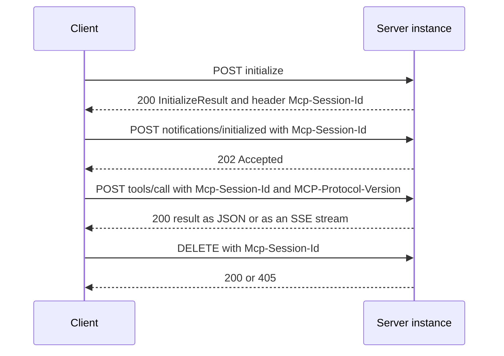

## 1. The question this idea answers

Before a host can call a tool, the host and the server must agree on two things. Which protocol revision will they speak? Which optional features does each side support? A server cannot send an elicitation request to a client that cannot show a form. A client cannot subscribe to resource changes on a server that never sends them.

Up to revision 2025-11-25, MCP solved this with a handshake at the start of every connection. The result of the handshake was kept for the whole connection, in a **session**. This made MCP a stateful protocol: later messages only made sense together with the earlier handshake.

This lesson teaches the 2025-11-25 lifecycle in full detail, field by field, with real traces. You need it for three reasons. Many deployed hosts and servers still speak it. A dual-era server must still answer `initialize`. And the interview question "stateful or stateless?" only makes sense once you know exactly what the old protocol kept. Lesson [L5](/notes/ai/llm-systems/07-mcp/l5-stateful-vs-stateless) then shows what 2026-07-28 changed and why.

## 2. Mental model

> [!analogy] A phone call to a support line
> You call a support line. First you agree on a language. You say: "I speak English, version 2025". The agent answers: "Fine, English 2025". Then you say what you can do: "I can receive text messages, and I can fill in a form". The agent says what the line offers: "We can check orders and open tickets". Now the call is set, and it stays open. You ask questions, and the agent can also ask you things: "Please confirm the order number in the form I just sent." When you hang up, everything that you agreed is gone. The next call starts with the language question again.
>
> **Where it stops working:** (1) Over HTTP there is no single phone line. There are many separate HTTP requests, and a session ID header ties them together. (2) The memory of the call lives inside one server process. A second agent in the same call center does not know your call. (3) The agent can only "ask you things" if you keep a line open for incoming messages. These three points are the scaling problems of lesson L5.

## 3. Terms

| Term | Plain meaning |
|---|---|
| lifecycle | The three phases of an MCP connection in 2025-11-25: initialization, operation, shutdown. |
| `initialize` | The first request of a connection. The client sends its protocol version, capabilities and identity. |
| `InitializeResult` | The server's answer to `initialize`: the chosen protocol version, the server capabilities, the server identity and optional instructions. |
| `notifications/initialized` | The notification that the client sends after the `InitializeResult`, to say "ready for normal operation". |
| protocol version | A revision name such as `"2025-11-25"`. Both sides must speak the same one in a session. |
| version negotiation | The rule set that picks one protocol version for the session. |
| capability | A declared optional feature, for example `"tools": {"listChanged": true}`. |
| capability negotiation | Each side declares its capabilities in the handshake, and both sides use only declared features. |
| `Implementation` | The identity object: `name`, `version`, and optional `title`, `description`, `icons`, `websiteUrl`. |
| `instructions` | Optional text from the server that tells the host how to use it, for example in the system prompt. |
| session | The logically related interactions between one client and one server, from initialization to shutdown. The server keeps their shared state. |
| server-initiated request | A JSON-RPC request that the server sends to the client: `sampling/createMessage`, `elicitation/create`, `roots/list` or `ping`. |
| sampling | A server asks the host's model for a completion. Deprecated in 2026-07-28. |
| elicitation | A server asks the user for input through the client, with a form or a URL. |
| roots | The folders or files that the client tells the server it may use. Deprecated in 2026-07-28. |
| `ping` | A request with no params that checks that the other side still answers. Removed in 2026-07-28. |
| `listChanged` | A sub-capability: the server sends a notification when its list of tools, prompts or resources changes. |
| `subscribe` | A sub-capability of resources: the client may subscribe to changes of one resource. |

All terms are also in the [Glossary](/notes/ai/llm-systems/glossary).

## 4. The three phases

The 2025-11-25 lifecycle page says: "The Model Context Protocol (MCP) defines a rigorous lifecycle for client-server connections that ensures proper capability negotiation and state management." It has three phases:

1. **Initialization**: "Capability negotiation and protocol version agreement"
2. **Operation**: "Normal protocol communication"
3. **Shutdown**: "Graceful termination of the connection"


"The initialization phase **MUST** be the first interaction between client and server." During this phase the two sides:

- "Establish protocol version compatibility"
- "Exchange and negotiate capabilities"
- "Share implementation details"

> [!key] The main idea of the lifecycle
> In 2025-11-25 the handshake happens once, and its result is remembered for the whole connection. Every later message is read in the context of that remembered result. That memory is the session, and it is what makes the protocol stateful.

## 5. The `initialize` request, field by field

This is the example from the 2025-11-25 lifecycle page, unchanged:

```json
{
  "jsonrpc": "2.0",
  "id": 1,
  "method": "initialize",
  "params": {
    "protocolVersion": "2025-11-25",
    "capabilities": {
      "roots": {
        "listChanged": true
      },
      "sampling": {},
      "elicitation": {
        "form": {},
        "url": {}
      },
      "tasks": {
        "requests": {
          "elicitation": {
            "create": {}
          },
          "sampling": {
            "createMessage": {}
          }
        }
      }
    },
    "clientInfo": {
      "name": "ExampleClient",
      "title": "Example Client Display Name",
      "version": "1.0.0",
      "description": "An example MCP client application",
      "icons": [
        {
          "src": "https://example.com/icon.png",
          "mimeType": "image/png",
          "sizes": ["48x48"]
        }
      ],
      "websiteUrl": "https://example.com"
    }
  }
}
```

| Field of `params` | Required | Meaning (schema 2025-11-25) |
|---|---|---|
| `protocolVersion` | yes | "The latest version of the Model Context Protocol that the client supports. The client MAY decide to support older versions as well." |
| `capabilities` | yes | A `ClientCapabilities` object. `{}` means "no optional features". |
| `clientInfo` | yes | An `Implementation` object. `name` and `version` are required. `title`, `description`, `icons` and `websiteUrl` are optional. |
| `_meta` | no | Optional metadata, for example a `progressToken`. |

The capabilities in this example say:

- `"roots": {"listChanged": true}`: the client can list roots, and it will send `notifications/roots/list_changed` when they change.
- `"sampling": {}`: the client can run `sampling/createMessage`. An empty object means "supported, with no sub-features".
- `"elicitation": {"form": {}, "url": {}}`: the client supports both elicitation modes.
- `"tasks": {...}`: the server may run a sampling or elicitation request of this client as a task (an experimental feature of 2025-11-25).

> [!note] `name` against `title`
> Since 2025-06-18, `name` is "Intended for programmatic or logical use" and `title` is the human-readable display name. A host shows `title` to the user and logs `name`.

## 6. The `InitializeResult`, field by field

The server "**MUST** respond with its own capabilities and information". The example of the lifecycle page:

```json
{
  "jsonrpc": "2.0",
  "id": 1,
  "result": {
    "protocolVersion": "2025-11-25",
    "capabilities": {
      "logging": {},
      "prompts": {
        "listChanged": true
      },
      "resources": {
        "subscribe": true,
        "listChanged": true
      },
      "tools": {
        "listChanged": true
      },
      "tasks": {
        "list": {},
        "cancel": {},
        "requests": {
          "tools": {
            "call": {}
          }
        }
      }
    },
    "serverInfo": {
      "name": "ExampleServer",
      "title": "Example Server Display Name",
      "version": "1.0.0",
      "description": "An example MCP server providing tools and resources",
      "icons": [
        {
          "src": "https://example.com/server-icon.svg",
          "mimeType": "image/svg+xml",
          "sizes": ["any"]
        }
      ],
      "websiteUrl": "https://example.com/server"
    },
    "instructions": "Optional instructions for the client"
  }
}
```

| Field of `result` | Required | Meaning (schema 2025-11-25) |
|---|---|---|
| `protocolVersion` | yes | "The version of the Model Context Protocol that the server wants to use. This may not match the version that the client requested. If the client cannot support this version, it MUST disconnect." |
| `capabilities` | yes | A `ServerCapabilities` object |
| `serverInfo` | yes | An `Implementation` object |
| `instructions` | no | "Instructions describing how to use the server and its features." The schema adds: "It can be thought of like a 'hint' to the model. For example, this information MAY be added to the system prompt." |

## 7. Version negotiation

### 7.1 The rules

The 2025-11-25 lifecycle page gives four rules:

1. "In the `initialize` request, the client **MUST** send a protocol version it supports. This **SHOULD** be the _latest_ version supported by the client."
2. "If the server supports the requested protocol version, it **MUST** respond with the same version."
3. "Otherwise, the server **MUST** respond with another protocol version it supports. This **SHOULD** be the _latest_ version supported by the server."
4. "If the client does not support the version in the server's response, it **SHOULD** disconnect."

So the server picks, and the client accepts or leaves. There is no second round.

```python
SERVER_SUPPORTED = ["2025-11-25", "2025-06-18", "2025-03-26", "2024-11-05"]   # newest first

def server_choose(requested: str, supported=SERVER_SUPPORTED) -> str:
    """Server side of 2025-11-25 version negotiation."""
    if requested in supported:
        return requested          # MUST respond with the same version
    return supported[0]           # otherwise another supported version, SHOULD be the latest

def client_accept(chosen: str, client_supported) -> bool:
    """Client side: keep the session only if it speaks the chosen version."""
    return chosen in client_supported   # if not, the client SHOULD disconnect
```

> [!example] Worked example: three handshakes against a real server
> A small Python SDK 2.3.0 server was sent three `initialize` requests in a test of these notes:
>
> | Client sends `protocolVersion` | Server answers `protocolVersion` | Rule |
> |---|---|---|
> | `"2024-11-05"` | `"2024-11-05"` | Rule 2: supported, so the same version |
> | `"1.0.0"` | `"2025-11-25"` | Rule 3: unknown, so the server's latest handshake version |
> | `"2026-07-28"` | `"2025-11-25"` | Rule 3: 2026-07-28 has no handshake, so it cannot be chosen here |
>
> The third row matters in practice. A client that only speaks 2026-07-28 and sends `initialize` gets `"2025-11-25"` back. By rule 4 it should disconnect. The function `client_accept("2025-11-25", {"2026-07-28"})` returns `False`.

The lifecycle page shows an error for a version that the server cannot use at all:

```json
{
  "jsonrpc": "2.0",
  "id": 1,
  "error": {
    "code": -32602,
    "message": "Unsupported protocol version",
    "data": {
      "supported": ["2024-11-05"],
      "requested": "1.0.0"
    }
  }
}
```

In 2025-11-25 this error used the generic code -32602. Revision 2026-07-28 gave it its own code, -32022 `UnsupportedProtocolVersion` ([L2](/notes/ai/llm-systems/07-mcp/l2-json-rpc)).

### 7.2 The version after the handshake

On stdio, the session is the process, so the server remembers the version. On HTTP, every later request is a new HTTP request. The lifecycle page says: "If using HTTP, the client **MUST** include the `MCP-Protocol-Version: <protocol-version>` HTTP header on all subsequent requests to the MCP server." If this header is missing and the server has no other way to know the version, it "**SHOULD** assume protocol version `2025-03-26`". An invalid or unsupported header value gets "`400 Bad Request`" (lesson [L4](/notes/ai/llm-systems/07-mcp/l4-transports)).

> [!trap] Version strings look like dates, but they are names
> The Python SDK says in its version registry: "versions are an enumerated set, not an ordered scalar". Do not compare versions with `<` on strings. Keep an explicit list of known versions in order.

## 8. Capability negotiation

### 8.1 The capability names

"Client and server capabilities establish which optional protocol features will be available during the session." The lifecycle page lists them:

| Side | Capability | Sub-capabilities (schema 2025-11-25) | What it unlocks |
|---|---|---|---|
| Client | `roots` | `listChanged` | The server may send `roots/list`. The client sends `notifications/roots/list_changed`. |
| Client | `sampling` | `context`, `tools` | The server may send `sampling/createMessage`, optionally with `includeContext` or with tools. |
| Client | `elicitation` | `form`, `url` | The server may send `elicitation/create` in the declared modes. |
| Client | `tasks` | `list`, `cancel`, `requests.sampling.createMessage`, `requests.elicitation.create` | Task-augmented sampling or elicitation |
| Client | `experimental` | free-form | Non-standard features |
| Server | `prompts` | `listChanged` | `prompts/list`, `prompts/get`, and the prompts change notification |
| Server | `resources` | `subscribe`, `listChanged` | `resources/list`, `resources/read`, `resources/templates/list`, `resources/subscribe`, change notifications |
| Server | `tools` | `listChanged` | `tools/list`, `tools/call`, and the tools change notification |
| Server | `logging` | none | `logging/setLevel` and `notifications/message` |
| Server | `completions` | none | `completion/complete` |
| Server | `tasks` | `list`, `cancel`, `requests.tools.call` | Task-augmented `tools/call` |
| Server | `experimental` | free-form | Non-standard features |


### 8.2 The rule

During operation, "Both parties **MUST**: Respect the negotiated protocol version" and "Only use capabilities that were successfully negotiated". Revision 2025-06-18 changed this from SHOULD to MUST.

Read the rule in both directions:

- A capability that **the server** declares allows **the client** to send the matching requests. Example: `tools` allows `tools/call`.
- A capability that **the client** declares allows **the server** to send the matching requests. Example: `elicitation` allows `elicitation/create`.

This code turns the table into a check. It is the logic a careful SDK applies before it sends a message.

```python
NEEDS = {
    # sent by the client -> needs a SERVER capability
    "tools/list": ("server", "tools"), "tools/call": ("server", "tools"),
    "resources/list": ("server", "resources"), "resources/read": ("server", "resources"),
    "resources/subscribe": ("server", "resources.subscribe"),
    "prompts/list": ("server", "prompts"), "prompts/get": ("server", "prompts"),
    "logging/setLevel": ("server", "logging"), "completion/complete": ("server", "completions"),
    # sent by the server -> needs a CLIENT capability
    "sampling/createMessage": ("client", "sampling"), "roots/list": ("client", "roots"),
    "elicitation/create": ("client", "elicitation"),
    # either side, no capability
    "ping": (None, None),
}

def declared(caps: dict, path: str) -> bool:
    node = caps
    for part in path.split("."):
        if not isinstance(node, dict) or part not in node:
            return False
        node = node[part]
    return node is not False          # {} or True both mean "supported"

def allowed(method: str, client_caps: dict, server_caps: dict) -> bool:
    side, path = NEEDS[method]
    if side is None:
        return True
    return declared(server_caps if side == "server" else client_caps, path)
```

> [!example] Worked example: what may each side send?
> Client capabilities: `{"elicitation": {"form": {}}}`. Server capabilities: `{"tools": {"listChanged": true}, "resources": {"subscribe": false}}`. Output of `allowed()` in a test of these notes:
>
> | Method | Sender | Allowed | Why |
> |---|---|---|---|
> | `tools/call` | client | True | The server declared `tools`. |
> | `resources/subscribe` | client | False | `subscribe` is `false`. |
> | `prompts/list` | client | False | The server did not declare `prompts`. |
> | `elicitation/create` | server | True | The client declared `elicitation`. |
> | `sampling/createMessage` | server | False | The client did not declare `sampling`. |
> | `ping` | either | True | `ping` needs no capability. |

> [!trap] The SDK does not always enforce the rule for you
> In a test of these notes, a Python SDK 2.3.0 server sent `elicitation/create` to a client that had declared `"capabilities": {}`. The SDK did not block the request. The elicitation page says: "Servers **MUST NOT** send elicitation requests with modes that are not supported by the client." So the tool code must check the declared capabilities first. Also note: `"elicitation": {}` means form mode only, "For backwards compatibility".

The key point for lesson L5: in 2025-11-25 these capability sets are declared once and **remembered by both sides for the whole session**.

## 9. `notifications/initialized` and the ordering rules

"After successful initialization, the client **MUST** send an `initialized` notification to indicate it is ready to begin normal operations":

```json
{
  "jsonrpc": "2.0",
  "method": "notifications/initialized"
}
```

Two ordering rules protect the handshake:

- "The client **SHOULD NOT** send requests other than pings before the server has responded to the `initialize` request."
- "The server **SHOULD NOT** send requests other than pings and logging before receiving the `initialized` notification."

Interpretation of these notes: the second rule is the reason for the third message. Without it, the server would not know when the client is ready to receive server-initiated requests such as `elicitation/create`. The `InitializeResult` only tells the client the server's choices. The `initialized` notification tells the server that the client accepted them.

## 10. The operation phase

### 10.1 Who may send what

In 2025-11-25, requests are "sent from the client to the server or vice versa". The `schema.ts` unions list every message (checked on 2026-10-15):

| Kind | Client to server | Server to client |
|---|---|---|
| Requests | `initialize`, `ping`, `tools/list`, `tools/call`, `resources/list`, `resources/templates/list`, `resources/read`, `resources/subscribe`, `resources/unsubscribe`, `prompts/list`, `prompts/get`, `completion/complete`, `logging/setLevel`, `tasks/get`, `tasks/result`, `tasks/list`, `tasks/cancel` | `ping`, `sampling/createMessage`, `elicitation/create`, `roots/list`, `tasks/get`, `tasks/result`, `tasks/list`, `tasks/cancel` |
| Notifications | `notifications/initialized`, `notifications/cancelled`, `notifications/progress`, `notifications/roots/list_changed`, `notifications/tasks/status` | `notifications/cancelled`, `notifications/progress`, `notifications/message`, `notifications/resources/updated`, `notifications/resources/list_changed`, `notifications/tools/list_changed`, `notifications/prompts/list_changed`, `notifications/elicitation/complete`, `notifications/tasks/status` |

The right column is the important one. In 2025-11-25 a server could start a conversation with the client. Lesson L5 shows why that one fact forces a stateful deployment.

### 10.2 Server-initiated requests

**Sampling.** The server asks the host's model for a completion. The request example of the sampling page:

```json
{
  "jsonrpc": "2.0",
  "id": 1,
  "method": "sampling/createMessage",
  "params": {
    "messages": [
      {
        "role": "user",
        "content": { "type": "text", "text": "What is the capital of France?" }
      }
    ],
    "modelPreferences": {
      "hints": [{ "name": "claude-3-sonnet" }],
      "intelligencePriority": 0.8,
      "speedPriority": 0.5
    },
    "systemPrompt": "You are a helpful assistant.",
    "maxTokens": 100
  }
}
```

The params of `CreateMessageRequestParams` are `messages`, `modelPreferences`, `systemPrompt`, `includeContext`, `temperature`, `maxTokens` (required), `stopSequences`, `metadata`, and since 2025-11-25 `tools` and `toolChoice`. The page warns: "For trust & safety and security, there **SHOULD** always be a human in the loop with the ability to deny sampling requests."

**Elicitation.** The server asks the user for input. In form mode it sends a message and a restricted JSON Schema, `requestedSchema`. The client answers with `action` (`"accept"`, `"decline"` or `"cancel"`) and, on accept, `content`. "Servers **MUST NOT** use form mode elicitation to request sensitive information". URL mode sends the user to a web page instead, for example for credentials or payment (lesson [L9](/notes/ai/llm-systems/07-mcp/l9-mrtr-elicitation-sampling-and-roots)).

**Roots.** The server sends `roots/list` with no params. The client answers with `roots`, a list of objects with a `uri` and an optional `name`, for example `{"uri": "file:///home/user/projects/myproject", "name": "My Project"}`.

> [!example] Worked example: a real server-initiated request
> A Python SDK 2.3.0 server has a tool `cancel_order` that calls `ctx.elicit(...)` to ask for confirmation. In a test of these notes, the client declared `"elicitation": {"form": {}}` in `initialize` and then called the tool. The exact lines over stdio:
>
> ```text
> >> {"jsonrpc":"2.0","id":2,"method":"tools/call","params":{"name":"cancel_order","arguments":{"order_id":"A-1001"}}}
> << {"jsonrpc":"2.0","id":1,"method":"elicitation/create","params":{"mode":"form","message":"Cancel order A-1001?","requestedSchema":{"properties":{"ok":{"title":"Ok","type":"boolean"}},"required":["ok"],"title":"Confirm","type":"object"}}}
> >> {"jsonrpc":"2.0","id":1,"result":{"action":"accept","content":{"ok":true}}}
> << {"jsonrpc":"2.0","id":2,"result":{"content":[{"text":"Order A-1001 cancelled.","type":"text"}],"isError":false,"structuredContent":{"result":"Order A-1001 cancelled."}}}
> ```
>
> 1. The client's `tools/call` has id 2. It now waits.
> 2. The server sends its own **request** with id 1. The client had also used id 1, for `initialize`. There is no clash, because each side numbers its own requests.
> 3. The client answers the server's request with a **response** with id 1.
> 4. Only then does the server finish the tool call and answer id 2.
>
> Between steps 2 and 3, the server holds a suspended tool call in its memory. It waits for an answer that must arrive on the same connection. Lesson L5 shows that this is exactly the part that breaks behind a load balancer.

### 10.3 `ping`

Either side can check that the other side still answers:

```json
{ "jsonrpc": "2.0", "id": "123", "method": "ping" }
```

"The receiver **MUST** respond promptly with an empty response": `{"jsonrpc": "2.0", "id": "123", "result": {}}`. If no response arrives in time, the sender "**MAY**: Consider the connection stale, Terminate the connection, Attempt reconnection procedures". The page adds that implementations "**SHOULD** periodically issue pings to detect connection health". Revision 2026-07-28 removed `ping`, because there is no long-lived connection to check.

### 10.4 Other state that the operation phase creates

Two more requests change what the server must remember:

- `resources/subscribe` with a `uri`: from now on, the server sends `notifications/resources/updated` for that resource, until `resources/unsubscribe`.
- `logging/setLevel` with a `level`: from now on, the server sends `notifications/message` at that level or above.

Both settings live in the session. If the connection drops, they are gone.

## 11. Timeouts, progress and cancellation

"Implementations **SHOULD** establish timeouts for all sent requests, to prevent hung connections and resource exhaustion." When a request has no answer in time, "the sender **SHOULD** issue a cancellation notification for that request and stop waiting for a response":

```json
{
  "jsonrpc": "2.0",
  "method": "notifications/cancelled",
  "params": { "requestId": 2, "reason": "User pressed stop" }
}
```

In 2025-11-25 either side can send it, and the schema says: "A client MUST NOT attempt to cancel its `initialize` request." A progress notification may reset the timeout clock, but implementations "**SHOULD** always enforce a maximum timeout, regardless of progress notifications". Lesson [L10](/notes/ai/llm-systems/07-mcp/l10-utilities-and-errors) covers progress and cancellation in full.

## 12. Shutdown

"No specific shutdown messages are defined". The transport ends the session:

- **stdio**: the client "**SHOULD** initiate shutdown by: 1. First, closing the input stream to the child process (the server) 2. Waiting for the server to exit, or sending `SIGTERM` if the server does not exit within a reasonable time 3. Sending `SIGKILL` if the server does not exit within a reasonable time after `SIGTERM`".
- **HTTP**: "shutdown is indicated by closing the associated HTTP connection(s)". A client that no longer needs a session "**SHOULD** send an HTTP DELETE to the MCP endpoint with the `MCP-Session-Id` header" (lesson L4).

## 13. What exactly is the session?

The 2025-11-25 transports page defines it: "An MCP 'session' consists of logically related interactions between a client and a server, beginning with the initialization phase." The architecture page calls MCP "a stateful session protocol" and says that a client "Establishes one stateful session per server".

This table collects what a 2025-11-25 server must remember for one session. The rows are based on the spec pages of this lesson and on the list in SEP-2567, which names five session-scoped categories.

| What the server remembers | Set by | Lost when the session ends? |
|---|---|---|
| The negotiated protocol version | `initialize` | Yes |
| The client's capabilities and `clientInfo` | `initialize` | Yes |
| Whether the client said `initialized` | `notifications/initialized` | Yes |
| Resource subscriptions | `resources/subscribe` | Yes |
| The log level | `logging/setLevel` | Yes |
| Suspended tool calls that wait for a sampling, elicitation or roots answer | A server-initiated request | Yes, the tool call fails |
| Open SSE streams and their event IDs (HTTP) | POST and GET requests | Yes |
| The session ID (HTTP) | The `InitializeResult` response header | Yes |
| Application state that the server tied to the session, for example a shopping cart | The server's own code | Yes |
| Tool lists that differ per session | The server's own code | Yes |

Where does this memory live? On stdio, inside the one server process that the host started. Interpretation of these notes: on stdio the session and the process lifetime are the same thing. SEP-2567 says it directly: "Servers that appear to be using session state successfully are usually stdio servers relying on process lifetime". On HTTP, the memory lives in whichever server process handled `initialize`, keyed by the session ID. That is the root of the scaling problem in L5.

## 14. A complete annotated trace

These lines were exchanged over stdio with a small Python SDK 2.3.0 server in a test of these notes. Results are trimmed with `...` where marked.

```text
>> {"jsonrpc":"2.0","id":1,"method":"initialize","params":{"protocolVersion":"2025-11-25","capabilities":{},"clientInfo":{"name":"demo-host","version":"0.1.0"}}}
<< {"jsonrpc":"2.0","id":1,"result":{"capabilities":{"prompts":{"listChanged":false},"resources":{"listChanged":false,"subscribe":false},"tools":{"listChanged":false}},"protocolVersion":"2025-11-25","serverInfo":{"name":"orders","version":""}}}
>> {"jsonrpc":"2.0","method":"notifications/initialized"}
>> {"jsonrpc":"2.0","id":2,"method":"tools/list"}
<< {"jsonrpc":"2.0","id":2,"result":{"tools":[{"description":"Count the orders that one plant shipped on one date (YYYY-MM-DD).","inputSchema":{...},"name":"count_orders","outputSchema":{...}}]}}
>> {"jsonrpc":"2.0","id":3,"method":"tools/call","params":{"name":"count_orders","arguments":{"plant":"B","date":"2026-10-14"}}}
<< {"jsonrpc":"2.0","id":3,"result":{"content":[{"text":"412","type":"text"}],"isError":false,"structuredContent":{"result":412}}}
>> {"jsonrpc":"2.0","id":4,"method":"ping"}
<< {"jsonrpc":"2.0","id":4,"result":{}}
(client closes stdin, the server process exits with code 0)
```

1. **Initialization.** The client offers 2025-11-25 and declares no optional capabilities (`{}`). The server accepts the same version. It declares prompts, resources and tools, each without change notifications.
2. **Ready.** The client sends `notifications/initialized`. No answer follows, because it is a notification.
3. **Discovery.** `tools/list` returns one tool. Note that `tools/list` has no `params` at all. The server knows the version and the capabilities from the session.
4. **The call.** `tools/call` names the tool and passes the arguments. Again no version or capability data: the session supplies it.
5. **Health check.** `ping` gets an empty result.
6. **Shutdown.** The client closes the server's stdin. The server exits, and the session is gone.

Compare points 3 and 4 with lesson [L5](/notes/ai/llm-systems/07-mcp/l5-stateful-vs-stateless). In 2026-07-28 the same `tools/call` carries `_meta` with the version and the capabilities, because no session exists to supply them.

```video
{"src": "/notes/media/llm-systems/manim/m32-handshake-vs-self-describing-requests.mp4", "caption": "The 2025-11-25 handshake stores the version and capabilities in a server-side session, while a 2026-07-28 request carries them in its own _meta."}
```

Over Streamable HTTP the same session looks like this (real headers in lesson L4):



## 15. Code: drive a server by hand

This script starts a server as a subprocess and writes raw JSON lines to it. It is the smallest possible MCP client. It produced the trace of section 14.

```python
import json, subprocess, sys, time

msgs = [json.loads(l) for l in open(sys.argv[1])]          # one JSON message per line
p = subprocess.Popen([sys.executable, "o_orders.py"], stdin=subprocess.PIPE,
                     stdout=subprocess.PIPE, stderr=subprocess.PIPE, text=True)
for m in msgs:
    line = json.dumps(m, separators=(",", ":"))             # compact, no newlines inside
    print(">>", line)
    p.stdin.write(line + "\n"); p.stdin.flush()             # one message, one line
    if "id" in m:                                           # a request: wait for its answer
        while True:
            out = p.stdout.readline()
            print("<<", out.strip())
            if json.loads(out).get("id") == m["id"]:
                break
    else:
        time.sleep(0.3)                                     # a notification: no answer comes
p.stdin.close(); p.wait(timeout=5)                          # stdio shutdown, step 1 and 2
print("exit", p.returncode)
```

- `json.dumps(..., separators=(",", ":"))` writes compact JSON on one line. The stdio rule is one message per line.
- `if "id" in m` separates requests from notifications. Only requests wait for an answer.
- The inner loop reads until it sees the matching id. A real client would also handle server-initiated requests that arrive in between, as in the elicitation example of section 10.2.
- `p.stdin.close()` is the first shutdown step. `p.wait(timeout=5)` is the second. A real client would then send `SIGTERM` and `SIGKILL`.

### Exercises

Lab folder: `C:\Users\ASohi\Downloads\AI\agent-harness-lab`, notebook folder `llm-systems/`, notebook `07-mcp-l3.ipynb`.

1. **Negotiation table.** Use `server_choose` and `client_accept` of section 7.1. Build a table for three servers (`["2025-11-25"]`, `["2025-06-18", "2025-03-26"]`, `["2025-11-25", "2025-06-18"]`) and three clients (`{"2025-11-25"}`, `{"2025-11-25", "2025-06-18"}`, `{"2026-07-28"}`). Each client offers its newest version. Acceptance test: each cell shows the chosen version and "keep" or "disconnect", and the modern-only client disconnects from every server. Hint 1: sort the client versions with an explicit list, not with string comparison. Hint 2: the client offers only one version, its newest.
2. **A capability guard.** Extend `allowed()` with `tasks/cancel` (server side needs `tasks.cancel`) and with the elicitation modes: `elicitation/create` with `mode: "url"` needs `elicitation.url`. Acceptance test: a client with `{"elicitation": {"form": {}}}` allows form mode and rejects URL mode. Hint 1: pass the request params to `allowed()`. Hint 2: the schema says that a missing `mode` means form mode.
3. **Answer a server request.** Run the elicitation example: a tool that calls `ctx.elicit(...)`, a client that declares form elicitation. Then run it again with `"capabilities": {}`. Acceptance test: record what the server does in the second run, and explain which rule applies. Hint 1: read the lifecycle rule about negotiated capabilities. Hint 2: record the raw lines, not only the final result.

```check
{
  "question": "Exercise 1: show a reference solution.",
  "answer": "```python\nKNOWN = [\"2024-11-05\", \"2025-03-26\", \"2025-06-18\", \"2025-11-25\", \"2026-07-28\"]  # oldest to newest\n\ndef newest(versions):\n    return max(versions, key=KNOWN.index)        # order by the explicit list, not by string\n\ndef server_choose(requested, supported):\n    return requested if requested in supported else newest(supported)\n\nservers = {\"S1\": [\"2025-11-25\"], \"S2\": [\"2025-06-18\", \"2025-03-26\"], \"S3\": [\"2025-11-25\", \"2025-06-18\"]}\nclients = {\"C1\": {\"2025-11-25\"}, \"C2\": {\"2025-11-25\", \"2025-06-18\"}, \"C3\": {\"2026-07-28\"}}\n\nprint(\"| Client | \" + \" | \".join(servers) + \" |\")\nprint(\"|---|\" + \"---|\" * len(servers))\nfor cname, cvers in clients.items():\n    cells = []\n    for sname, svers in servers.items():\n        chosen = server_choose(newest(cvers), svers)\n        cells.append(f\"{chosen} {'keep' if chosen in cvers else 'disconnect'}\")\n    print(f\"| {cname} | \" + \" | \".join(cells) + \" |\")\n```\n\nOutput in a test of these notes:\n\n| Client | S1 | S2 | S3 |\n|---|---|---|---|\n| C1 | 2025-11-25 keep | 2025-06-18 disconnect | 2025-11-25 keep |\n| C2 | 2025-11-25 keep | 2025-06-18 keep | 2025-11-25 keep |\n| C3 | 2025-11-25 disconnect | 2025-06-18 disconnect | 2025-11-25 disconnect |\n\nC1 cannot speak 2025-06-18, so it leaves S2. C2 supports two versions and keeps every session. C3 speaks only 2026-07-28, which has no handshake, so the handshake can never produce a version it accepts. `newest()` orders versions by the explicit list `KNOWN`, not by string comparison."
}
```

```check
{
  "question": "Exercise 2: show a reference solution.",
  "answer": "```python\nNEEDS = {\n    \"tools/call\": (\"server\", \"tools\"),\n    \"tasks/cancel\": (\"server\", \"tasks.cancel\"),\n    \"sampling/createMessage\": (\"client\", \"sampling\"),\n    \"elicitation/create\": (\"client\", \"elicitation\"),\n    \"ping\": (None, None),\n}\n\ndef declared(caps, path):\n    node = caps\n    for part in path.split(\".\"):\n        if not isinstance(node, dict) or part not in node:\n            return False\n        node = node[part]\n    return node is not False\n\ndef allowed(method, client_caps, server_caps, params=None):\n    side, path = NEEDS[method]\n    if side is None:\n        return True\n    caps = server_caps if side == \"server\" else client_caps\n    if not declared(caps, path):\n        return False\n    if method == \"elicitation/create\":\n        mode = (params or {}).get(\"mode\", \"form\")         # a missing mode means form mode\n        modes = client_caps[\"elicitation\"]\n        if modes == {}:                                    # {} is the same as {\"form\": {}}\n            modes = {\"form\": {}}\n        return mode in modes\n    return True\n\nc = {\"elicitation\": {\"form\": {}}}\nassert allowed(\"elicitation/create\", c, {}, {\"mode\": \"form\"})\nassert allowed(\"elicitation/create\", c, {}, {})            # no mode: form\nassert not allowed(\"elicitation/create\", c, {}, {\"mode\": \"url\"})\nassert allowed(\"elicitation/create\", {\"elicitation\": {}}, {}, {\"mode\": \"form\"})\nassert not allowed(\"elicitation/create\", {\"elicitation\": {}}, {}, {\"mode\": \"url\"})\nassert allowed(\"tasks/cancel\", {}, {\"tasks\": {\"cancel\": {}}})\nassert not allowed(\"tasks/cancel\", {}, {\"tasks\": {\"list\": {}}})\nprint(\"all tests pass\")\n```\n\nTwo rules from the 2025-11-25 elicitation page drive the code: \"Clients **MUST** treat requests without a `mode` field as form mode\", and \"an empty capabilities object is equivalent to declaring support for `form` mode only\". The page also says: \"Servers **MUST NOT** send elicitation requests with modes that are not supported by the client.\"\n\nExercise 3, the result: in a test of these notes, a Python SDK 2.3.0 server sent `elicitation/create` to a client that had declared `\"capabilities\": {}`. The SDK did not block it. This breaks the rule \"Only use capabilities that were successfully negotiated\". So the tool code must check the client's declared capabilities before it elicits. A client should reply to such a request with a JSON-RPC error instead of showing a form."
}
```

## 16. Common mistakes

1. **"`initialize` is optional."** In 2025-11-25, "The initialization phase **MUST** be the first interaction between client and server."
2. **"The client and the server negotiate the version back and forth."** There is one round. The server either echoes the client's version or names its own, and the client keeps the session or disconnects.
3. **"`notifications/initialized` gets a response."** It is a notification. Nobody answers it.
4. **"A capability object must have fields."** Presence is enough. `"sampling": {}` means "supported, with no sub-features".
5. **"Only the client sends requests."** In 2025-11-25 the server sends `sampling/createMessage`, `elicitation/create`, `roots/list` and `ping`. That changed in 2026-07-28.
6. **"The session is only an HTTP thing."** The session is a protocol concept that starts with `initialize`. On HTTP it also has an ID header. On stdio it lives as long as the process.
7. **"`tools/call` in 2025-11-25 carries the protocol version."** It does not. The version and the capabilities are remembered from the handshake. Over HTTP, only the `MCP-Protocol-Version` header repeats the version.

## 17. One-minute explanation

In revision 2025-11-25, every MCP connection has three phases: initialization, operation and shutdown. The client starts with an `initialize` request that carries its newest protocol version, its capabilities and its identity. The server answers with the version it will use, its own capabilities, its identity and optional instructions. If the server supports the client's version, it must echo it. Otherwise it names its own newest version, and the client disconnects if it cannot speak that. The client then sends `notifications/initialized`. From then on, both sides may only use features that the other side declared. For example, the server may send `elicitation/create` only if the client declared `elicitation`. Requests flow in both directions: the server can ask the client for a model completion, user input, the roots list or a ping. Everything agreed in the handshake, plus subscriptions, log level and suspended server requests, lives in the session. On stdio the session is the process lifetime. On HTTP it is keyed by the `Mcp-Session-Id` header in the server instance that handled `initialize`. Shutdown has no message: the client closes stdin or the HTTP connection, or sends DELETE.

## 18. Check questions

```check
{
  "question": "List the fields of the initialize params and of the InitializeResult in 2025-11-25. Which are required?",
  "answer": "Params: `protocolVersion` (required), `capabilities` (required, `ClientCapabilities`), `clientInfo` (required, an `Implementation` with required `name` and `version` and optional `title`, `description`, `icons`, `websiteUrl`), and optional `_meta`. Result: `protocolVersion` (required), `capabilities` (required, `ServerCapabilities`), `serverInfo` (required, an `Implementation`), and optional `instructions`, which the host may add to the system prompt."
}
```

```check
{
  "question": "A client sends protocolVersion 2025-11-25. The server supports only 2025-06-18 and 2025-03-26. What does each side do? What changes if the client also supports 2025-06-18?",
  "answer": "The server does not support 2025-11-25, so it MUST answer with another version it supports, and it SHOULD pick its latest: 2025-06-18. If the client does not support 2025-06-18, it SHOULD disconnect. If it does, the session continues on 2025-06-18. Over HTTP the client then sends `MCP-Protocol-Version: 2025-06-18` on every later request. There is no second round of negotiation."
}
```

```check
{
  "question": "For each message, name the required capability and the side that must declare it. The messages: (a) tools/call, (b) elicitation/create in URL mode, (c) resources/subscribe, (d) sampling/createMessage, (e) notifications/tools/list_changed.",
  "answer": "(a) The server must declare `tools`. (b) The client must declare `elicitation` with `url`. An empty `elicitation` object means form mode only. (c) The server must declare `resources` with `subscribe: true`. (d) The client must declare `sampling`. (e) The server must declare `tools` with `listChanged: true`."
}
```

```check
{
  "question": "Interview follow-up: why does the 2025-11-25 handshake need a third message, notifications/initialized? What would go wrong without it?",
  "hint": "Which side may send requests, and when does it know the other side is ready?",
  "answer": "The rule is: \"The server **SHOULD NOT** send requests other than pings and logging before receiving the `initialized` notification.\" The `InitializeResult` tells the client what the server chose. Only the `initialized` notification tells the server that the client accepted the chosen version and is ready. Interpretation of these notes: without it, a server could send `elicitation/create` or `sampling/createMessage` too early. The client might still be about to disconnect because of the version, or its handlers might not be ready. The notification closes that race. It is a notification, so it needs no answer and adds no extra round-trip wait."
}
```

```check
{
  "question": "Interview follow-up: a client that speaks only 2026-07-28 meets a dual-era server, and a 2025-11-25-only client meets a server that speaks only 2026-07-28. What happens in each case?",
  "answer": "Case 1: if the modern client sends a modern request with `_meta`, a dual-era server serves it statelessly. If it sent `initialize` with `\"2026-07-28\"`, a server would counter-offer a handshake version. In a test of these notes, a Python SDK 2.3.0 server answered `\"2025-11-25\"`, and the modern-only client should then disconnect. So a modern client should never start with `initialize`. On stdio it can probe with `server/discover`. Case 2: the compatibility matrix of 2026-07-28 says \"Legacy | Modern | Fails\". On stdio the server rejects `initialize` with an implementation-defined error. On HTTP the request lacks the required headers and gets `400 Bad Request`. \"Legacy clients have no fall-forward mechanism\", so the spec asks modern servers to name their supported versions in the error."
}
```

```check
{
  "question": "Interview follow-up: in 2025-11-25, where does the session live on stdio and on HTTP? Why does that difference matter?",
  "answer": "On stdio there is no session ID. The host starts one server process, and the session lives in that process from `initialize` until the client closes stdin. Interpretation of these notes: the session and the process lifetime are the same thing. On HTTP the server may assign an `MCP-Session-Id` in the response to `initialize`. The session state lives in the memory of the server instance that handled it. Every later request must reach that instance or a store that it shares. On stdio that is automatic, because there is one process. On HTTP with several replicas it needs sticky routing or a shared session store. That is the scaling problem of lesson L5."
}
```

```check
{
  "question": "Interview follow-up: a 2025-11-25 server has sent elicitation/create in the middle of a tools/call. What exactly does the server hold in memory now, and what happens if the HTTP connection drops?",
  "answer": "The server holds a suspended tool call. That is the running handler (for example an awaiting coroutine) with its local variables. It also holds the pending id of its own `elicitation/create` request, and the id of the client's `tools/call` that it must answer later. It waits for a JSON-RPC response with the elicitation id from the same client. Over Streamable HTTP, that response arrives as a new POST with the session ID. It must reach the same server instance, or a shared store that the instance polls. If the stream drops, 2025-11-25 allowed resumption with `Last-Event-ID` if the server supports it. Otherwise the suspended call is lost and the client must call the tool again. SEP-2322 (MRTR) names this as the problem: \"Server A must somehow discover the elicitation response delivered to server B.\""
}
```

```check
{
  "question": "Interview follow-up: why was ping removed in 2026-07-28, and how does a client check liveness now?",
  "answer": "SEP-2575 says: \"Server-to-client ping is removed because servers can no longer independently send requests. Client-to-server ping is also removed because any normal RPC call already proves server liveness, and transport-layer mechanisms (HTTP keep-alives, SSE comments, STDIO process status) handle connection-health checks more appropriately.\" In practice, a client uses request timeouts and treats a failed request as the signal. It watches the stdio process. Long-lived `subscriptions/listen` streams may carry SSE comment lines such as `:` as keep-alives. A 2026-07-28 server answers `ping` with -32601 \"Method not found\", which a test of these notes confirmed with the Python SDK 2.3.0."
}
```

## 19. Links

- Previous: [L2: JSON-RPC 2.0 from zero](/notes/ai/llm-systems/07-mcp/l2-json-rpc)
- Next: [L4: Transports: stdio and Streamable HTTP](/notes/ai/llm-systems/07-mcp/l4-transports)
- What changed and why: [L5: Stateful vs stateless MCP](/notes/ai/llm-systems/07-mcp/l5-stateful-vs-stateless)
- Server requests in depth: [L9: Asking the client for input: MRTR, elicitation, sampling and roots](/notes/ai/llm-systems/07-mcp/l9-mrtr-elicitation-sampling-and-roots)
- Progress and cancellation: [L10: Utilities: progress, cancellation, pagination, errors](/notes/ai/llm-systems/07-mcp/l10-utilities-and-errors)
- Every revision: [L12: What is new: the version history](/notes/ai/llm-systems/07-mcp/l12-whats-new-version-history)
- Older lesson: [6.7 MCP: the protocol](/notes/ai/context-engineering/06-tools-and-mcp/l7-mcp-the-protocol)

### Sources

- MCP specification 2025-11-25: lifecycle, transports, architecture, ping, cancellation, progress, sampling, elicitation, roots. https://modelcontextprotocol.io/specification/2025-11-25/basic/lifecycle (checked on 2026-10-15)
- MCP `schema.ts` 2025-11-25 (`InitializeRequestParams`, `InitializeResult`, `ClientCapabilities`, `ServerCapabilities`, message unions). https://github.com/modelcontextprotocol/modelcontextprotocol/blob/main/schema/2025-11-25/schema.ts (checked on 2026-10-15)
- MCP 2025-06-18 changelog (SHOULD to MUST in the operation rule, `title` field). https://modelcontextprotocol.io/specification/2025-06-18/changelog (checked on 2026-10-15)
- SEP-2567 "Sessionless MCP via Explicit State Handles" (the five session-scoped categories). https://modelcontextprotocol.io/seps/2567-sessionless-mcp (checked on 2026-10-15)
- MCP Python SDK 2.3.0 (version registry comment, the traces and the negotiation results measured in a test of these notes). https://github.com/modelcontextprotocol/python-sdk (checked on 2026-10-15)
