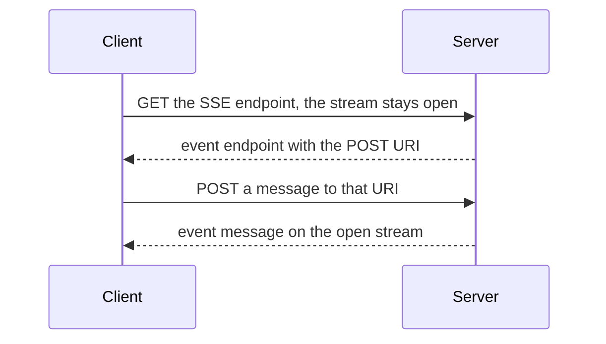

## 1. The question this idea answers

Lessons L2 and L3 described messages: JSON objects with an id, a method and params. But a JSON object is an idea. Something must carry its bytes from the host to the server and back. Where does one message end and the next one begin? How does the server send something that the client did not ask for? What happens when the network breaks in the middle of an answer?

MCP calls the carrier a **transport**. It defines two standard ones: stdio for a server that runs as a local process, and Streamable HTTP for a server on the network. This lesson builds both from zero, with real bytes from a real server. Then it shows exactly what revision 2026-07-28 changed in Streamable HTTP. Those changes are a large part of the answer to "what is new in MCP?".

## 2. Mental model

> [!analogy] A speaking tube and a service counter
> **stdio** is a speaking tube between two rooms of one house. The host builds the room for the server, connects the tube and talks through it. Every sentence ends with a pause (a newline). Noise from the server's room travels in a separate pipe (stderr), so it never mixes with the sentences.
>
> **Streamable HTTP** is a service counter in another building. Every request is one visit. You give the clerk a form (a POST). You get one answer sheet (JSON), or you stand at the window while the clerk reads updates and then the answer (an SSE stream).
>
> **Where it stops working:** in 2025-11-25 the counter also gave you a visitor badge (`Mcp-Session-Id`). It also gave you a phone line on which the clerk could call you (the GET stream). The badge only worked at the one window that issued it. Revision 2026-07-28 removed the badge and the phone line, so any window can serve any visit. A real speaking tube also has no rule about who may speak first. In 2026-07-28 the server may only speak in answer to the host.

## 3. Terms

| Term | Plain meaning |
|---|---|
| transport | The channel that carries MCP messages. The spec calls it a binding: it defines framing, delivery, metadata and cancellation. |
| process | A running program with its own memory. The host starts the stdio server as a child process. |
| standard streams | Three byte channels that every process has: stdin (0), stdout (1) and stderr (2). |
| pipe | A one-way byte channel between two processes, managed by the operating system. |
| framing | The rule that says where one message ends. stdio uses a newline. |
| HTTP request | A method (POST, GET, DELETE), a path, headers and an optional body, sent from a client to a server. |
| HTTP header | A `Name: value` line in a request or response. Header names are case-insensitive. |
| status code | The three-digit result of an HTTP request, for example 200, 202, 400, 404, 405. |
| `Accept` | The request header that lists the response formats that the client can read. |
| `Content-Type` | The header that names the format of a body, for example `application/json` or `text/event-stream`. |
| server-sent events (SSE) | A text format for a stream of events from a server to a client over one HTTP response. |
| MCP endpoint | The single HTTP path of an MCP server, for example `https://example.com/mcp`. |
| `Origin` | A request header that browsers send with the site that started the request. |
| DNS rebinding | An attack in which a web page makes the browser send requests to a server on your own machine. |
| `MCP-Protocol-Version` | The HTTP header with the protocol revision of a request. |
| `Mcp-Session-Id` | The 2025-11-25 HTTP header that carries the session ID. Removed in 2026-07-28. |
| `Last-Event-ID` | The header that resumes an SSE stream after the last event the client received. Removed in 2026-07-28. |
| `Mcp-Method`, `Mcp-Name` | The 2026-07-28 headers that copy the method and the tool, prompt or resource name from the body. |

All terms are also in the [Glossary](/notes/ai/llm-systems/glossary).

## 4. What a transport must do

The 2026-07-28 transports page defines a transport as "a **binding**: it defines how messages are framed and delivered, how request metadata is carried, and how cancellation and termination are signaled. It does not define what the messages mean". It also restricts the directions: "A binding **MUST** deliver client-sent _requests_ and _notifications_ to the server, and server-sent _responses_ and _notifications_ to the client. No other message direction exists".

| Job | stdio | Streamable HTTP |
|---|---|---|
| Framing | One message per line | One message per POST body. One message per SSE event in a response. |
| Delivery to the server | Write to the server's stdin | POST to the MCP endpoint |
| Delivery to the client | The server writes to its stdout | The HTTP response: JSON or an SSE stream |
| Metadata | In the body only (`_meta`) | In the body, and mirrored in headers (2026-07-28) |
| Cancellation | `notifications/cancelled` | 2026-07-28: close the response stream |
| Termination | Close stdin, then signals | Close the connection |

Both 2025-11-25 and 2026-07-28 say: "JSON-RPC messages **MUST** be UTF-8 encoded."

## 5. stdio

### 5.1 Processes, streams and pipes from zero

A process is a running program. The operating system gives every process three standard streams: standard input (stdin, number 0), standard output (stdout, number 1) and standard error (stderr, number 2). A program reads from stdin, writes results to stdout and writes diagnostics to stderr.

When the host starts the server as a child process, it replaces the server's three streams with pipes. A pipe is a one-way byte channel. The host writes into the pipe that is the server's stdin, and reads from the pipe that is the server's stdout. Nobody else can reach these pipes. No network port is open.

### 5.2 The rules

The stdio rules are the same in 2025-11-25 and 2026-07-28:

- "The client launches the MCP server as a subprocess."
- "Messages are delimited by newlines, and **MUST NOT** contain embedded newlines."
- "The server **MAY** write UTF-8 strings to its standard error (`stderr`) for any logging purposes including informational, debug, and error messages."
- "The client **MAY** capture, forward, or ignore the server's `stderr` output and **SHOULD NOT** assume `stderr` output indicates error conditions."
- "The server **MUST NOT** write anything to its `stdout` that is not a valid MCP message."
- "The client **MUST NOT** write anything to the server's `stdin` that is not a valid MCP message."

> [!example] Worked example: a newline inside a tool result
> A tool returns the text "line1", a newline, "line2". Does this break the "no embedded newlines" rule? No. JSON writes a newline inside a string as the two characters backslash and `n`. Python's `json.dumps({"type": "text", "text": "line1\nline2"})` gives the 40 characters `{"type": "text", "text": "line1\nline2"}`, with no real newline byte (0x0A) inside. A test of these notes confirmed that the output contains no newline byte. So the only real newline is the one that ends the message.

> [!trap] `print()` in a stdio server
> A `print("loaded 120 orders")` writes a line to stdout that is not an MCP message. The client tries to parse it as JSON and fails. Log to stderr instead (`logging` writes to stderr by default, or use `print(..., file=sys.stderr)`). See [6.8 Build an MCP server](/notes/ai/context-engineering/06-tools-and-mcp/l8-build-an-mcp-server).

### 5.3 What 2026-07-28 added to stdio

The 2026-07-28 stdio page keeps the rules above and adds five points:

1. **Direction.** "The client **MUST NOT** write JSON-RPC _responses_." "The server **MUST NOT** write JSON-RPC _requests_ to `stdout`." Server input requests travel inside results instead (MRTR, lesson [L9](/notes/ai/llm-systems/07-mcp/l9-mrtr-elicitation-sampling-and-roots)).
2. **One channel.** "All messages share this single channel; there are no per-request streams." Notifications of a `subscriptions/listen` stream carry `io.modelcontextprotocol/subscriptionId` in `_meta`, so the client can tell them apart.
3. **Cancellation.** "To cancel an in-flight request, the client **MUST** send a `notifications/cancelled` notification referencing the request's ID."
4. **Shutdown and crashes.** "Servers **SHOULD** exit promptly when their standard input is closed or reads return end-of-file." If the server crashes, "the client **SHOULD** restart it. Because the protocol is stateless, any in-flight requests are simply lost and the client can retry them against the fresh process."
5. **Other byte streams.** The same framing "works unchanged over Unix domain sockets, TCP connections, or any similar channel". Custom transports on such streams "**SHOULD** reuse this framing".

On Windows there are no POSIX signals, so the spec names `TerminateProcess` or Job Objects for forced termination.

### 5.4 Credentials on stdio

The base protocol page says that implementations using stdio "**SHOULD NOT** follow this specification, and instead retrieve credentials from the environment". The host passes secrets as environment variables when it starts the server. There is no OAuth flow on stdio (lesson [L11](/notes/ai/llm-systems/07-mcp/l11-authorization-and-security)).

## 6. HTTP from zero

HTTP is a request and response protocol. A client opens a TCP connection and sends a request. The server sends one response. This is a request from a test of these notes, sent with `curl` to a Python SDK 2.3.0 server. The `User-Agent` header that `curl` added is omitted:

```http
POST /mcp HTTP/1.1
Host: 127.0.0.1:8765
Content-Type: application/json
Accept: application/json, text/event-stream
MCP-Protocol-Version: 2026-07-28
Mcp-Method: tools/call
Mcp-Name: count_orders

{"jsonrpc":"2.0","id":1,"method":"tools/call","params":{"name":"count_orders","arguments":{"plant":"B","date":"2026-10-14"},"_meta":{"io.modelcontextprotocol/protocolVersion":"2026-07-28","io.modelcontextprotocol/clientCapabilities":{},"io.modelcontextprotocol/clientInfo":{"name":"demo-host","version":"0.1.0"}}}}
```

And the real response, without its `date` header:

```http
HTTP/1.1 200 OK
server: uvicorn
content-length: 229
content-type: application/json

{"jsonrpc":"2.0","id":1,"result":{"content":[{"text":"412","type":"text"}],"isError":false,"resultType":"complete","structuredContent":{"result":412},"_meta":{"io.modelcontextprotocol/serverInfo":{"name":"orders","version":""}}}}
```

The parts:

- **Request line**: the method `POST`, the path `/mcp`, the version `HTTP/1.1`.
- **Headers**: one `Name: value` per line. Header names are case-insensitive, so `content-type` and `Content-Type` are the same header. The 2026-07-28 page says: "Clients and servers **MUST** use case-insensitive comparisons for header names. Header _values_ (such as method names) are case-sensitive."
- **A blank line**, then the **body**.
- **Status line** of the response: `200 OK`.

The status codes that MCP uses:

| Status | Meaning | MCP example |
|---|---|---|
| 200 OK | Success with a body | A JSON result or an SSE stream |
| 202 Accepted | Accepted, no body | A POSTed notification |
| 400 Bad Request | The request is wrong | A header mismatch, an unsupported version, a missing session ID (2025-11-25) |
| 403 Forbidden | Not allowed | An invalid `Origin` |
| 404 Not Found | Unknown target | An expired session (2025-11-25), an unknown method (2026-07-28) |
| 405 Method Not Allowed | Wrong HTTP method | GET or DELETE on a 2026-07-28 server |
| 406 Not Acceptable | The server cannot answer in an accepted format | In a test of these notes, the SDK answered 406 to `Accept: application/json` without `text/event-stream` |

## 7. Server-sent events from zero

### 7.1 The format

An HTTP response usually has one body. Server-sent events (SSE) let one response body carry many events over time. The HTML standard defines it:

- "This event stream format's MIME type is `text/event-stream`."
- "Event streams in this format must always be encoded as UTF-8."
- A line has the form `field: value`. The fields are `event` (the event type), `data` (the payload), `id` (the event ID) and `retry` (the reconnection time in milliseconds). Other field names are ignored.
- A blank line dispatches the event. Several `data` lines are joined with a newline.
- A line that starts with a colon is a comment and is ignored.
- "The default event type is "message"."
- On reconnection, the client sends the last ID it saw in the `Last-Event-ID` header.

This is a real SSE response from the SDK server in a test of these notes (2025-11-25 session, `json_response=False`, `date` header omitted). The `\r\n` line ends are shown as line breaks:

```http
HTTP/1.1 200 OK
cache-control: no-cache, no-transform
connection: keep-alive
content-type: text/event-stream
mcp-session-id: c789b9d320394ceaa44c2f9239ad2744
x-accel-buffering: no
Transfer-Encoding: chunked

event: message
data: {"jsonrpc":"2.0","id":2,"result":{"content":[{"text":"412","type":"text"}],"isError":false,"structuredContent":{"result":412}}}

```

There is no `id:` line in this stream. The server was started without an event store, so it did not make the stream resumable. The `x-accel-buffering: no` header tells proxies such as nginx not to buffer the stream. The 2026-07-28 spec says servers "**SHOULD** include" it.

### 7.2 Code: an SSE parser

```python
import re

def parse_sse(text: str):
    """Parse a text/event-stream body into a list of events (dicts)."""
    events, data, event_type, last_id = [], [], "message", None
    for line in re.split(r"\r\n|\r|\n", text):        # CRLF, LF or CR end a line
        if line == "":                                 # blank line: dispatch the event
            if data:
                events.append({"event": event_type, "data": "\n".join(data), "id": last_id})
            data, event_type = [], "message"
            continue
        if line.startswith(":"):                       # comment, for example a keep-alive
            continue
        field, _, value = line.partition(":")
        if value.startswith(" "):
            value = value[1:]                          # one leading space is removed
        if field == "data":
            data.append(value)
        elif field == "event":
            event_type = value
        elif field == "id" and "\0" not in value:
            last_id = value
        elif field == "retry" and value.isdigit():
            events.append({"retry_ms": int(value)})
        # any other field name is ignored
    return events
```

The test body had a progress notification, a `:` keep-alive comment, and a response split over two `data` lines. The output in a test of these notes was:

```text
{'event': 'message', 'data': '{"jsonrpc":"2.0","method":"notifications/progress","params":{"progressToken":7,"progress":1,"total":2}}', 'id': None}
{'event': 'message', 'data': '{"jsonrpc":"2.0","id":2,\n"result":{"resultType":"complete","content":[]}}', 'id': 's1-2'}
```

The second `data` value has a newline between two JSON tokens. That is still valid JSON, because whitespace between tokens does not matter. The comment line produced no event.

> [!key] The main idea of sections 6 and 7
> A POST carries exactly one client message. The answer is either one JSON body or an SSE stream. An SSE stream lets the server send notifications about the request, and then the response, over the same HTTP response.

## 8. Streamable HTTP in 2025-11-25

### 8.1 One endpoint, two methods

"The server **MUST** provide a single HTTP endpoint path (hereafter referred to as the **MCP endpoint**) that supports both POST and GET methods." Streamable HTTP "was introduced in protocol version 2025-03-26 as a replacement for the HTTP+SSE transport from protocol version 2024-11-05".

### 8.2 Sending: one POST per message

1. "Every JSON-RPC message sent from the client **MUST** be a new HTTP POST request to the MCP endpoint."
2. "The client **MUST** include an `Accept` header, listing both `application/json` and `text/event-stream` as supported content types."
3. "The body of the POST request **MUST** be a single JSON-RPC _request_, _notification_, or _response_." In 2025-11-25 the client also POSTs its _responses_ to server-initiated requests.
4. For a response or a notification: "the server **MUST** return HTTP status code 202 Accepted with no body".
5. For a request: the server returns either `Content-Type: application/json` or `Content-Type: text/event-stream`. "The client **MUST** support both these cases."

### 8.3 An SSE response to a POST

If the server answers a POST with an SSE stream:

- It "**SHOULD** immediately send an SSE event consisting of an event ID and an empty `data` field in order to prime the client to reconnect".
- It "**MAY** close the _connection_ (without terminating the _SSE stream_) at any time". It then "**SHOULD** send an SSE event with a standard `retry` field", and the client "**MUST** respect the `retry` field".
- "The server **MAY** send JSON-RPC _requests_ and _notifications_ before sending the JSON-RPC _response_. These messages **SHOULD** relate to the originating client _request_." This is where a 2025-11-25 server sends `elicitation/create` during a tool call.
- "After the JSON-RPC _response_ has been sent, the server **SHOULD** terminate the SSE stream."
- "Disconnection **SHOULD NOT** be interpreted as the client cancelling its request." To cancel, the client sends `notifications/cancelled`.

### 8.4 The GET stream

"The client **MAY** issue an HTTP GET to the MCP endpoint. This can be used to open an SSE stream, allowing the server to communicate to the client, without the client first sending data via HTTP POST." The server returns `text/event-stream` or "HTTP 405 Method Not Allowed". Messages on this stream "**SHOULD** be unrelated to any concurrently-running JSON-RPC _request_ from the client". Examples are `notifications/tools/list_changed` or a `ping`.

"The server **MUST** send each of its JSON-RPC messages on only one of the connected streams; that is, it **MUST NOT** broadcast the same message across multiple streams."

### 8.5 Resumability

The server "**MAY** attach an `id` field to their SSE events". The ID "**MUST** be globally unique across all streams within that session". To resume, the client "**SHOULD** issue an HTTP GET to the MCP endpoint, and include the `Last-Event-ID` header". The server may replay the missed messages of that one stream, and "**MUST NOT** replay messages that would have been delivered on a different stream".

Interpretation of these notes: to replay, the server must keep the sent events of each stream for some time. That is more state, and with several server instances it must be shared. The TypeScript SDK examples call this an event store and back it with a database in their multi-node example.

### 8.6 Sessions

- "A server using the Streamable HTTP transport **MAY** assign a session ID at initialization time, by including it in an `MCP-Session-Id` header on the HTTP response containing the `InitializeResult`."
- "The session ID **SHOULD** be globally unique and cryptographically secure". It "**MUST** only contain visible ASCII characters (ranging from 0x21 to 0x7E)".
- The client "**MUST** include it in the `MCP-Session-Id` header on all of their subsequent HTTP requests".
- "Servers that require a session ID **SHOULD** respond to requests without an `MCP-Session-Id` header (other than initialization) with HTTP 400 Bad Request."
- After the server ends a session, it "**MUST** respond to requests containing that session ID with HTTP 404 Not Found". The client "**MUST** start a new session by sending a new `InitializeRequest` without a session ID attached".
- A client that is done "**SHOULD** send an HTTP DELETE to the MCP endpoint with the `MCP-Session-Id` header". The server "**MAY** respond to this request with HTTP 405 Method Not Allowed".

The spec writes the header as `MCP-Session-Id` in the rules and as `Mcp-Session-Id` in diagrams. Header names are case-insensitive, so both are the same header.

### 8.7 The protocol version header and security

The client "**MUST** include the `MCP-Protocol-Version: <protocol-version>` HTTP header on all subsequent requests". Without it, and with no other way to know, the server "**SHOULD** assume protocol version `2025-03-26`". An invalid or unsupported value gets `400 Bad Request`.

Three security rules apply to every Streamable HTTP server:

1. "Servers **MUST** validate the `Origin` header on all incoming connections to prevent DNS rebinding attacks". An invalid `Origin` gets "HTTP 403 Forbidden".
2. "When running locally, servers **SHOULD** bind only to localhost (127.0.0.1) rather than all network interfaces (0.0.0.0)".
3. "Servers **SHOULD** implement proper authentication for all connections".

DNS rebinding in brief: a page on `evil.example` first resolves to the attacker's server. Then the attacker changes the DNS answer to `127.0.0.1`. The page's scripts now send requests that reach a server on your own machine, while the browser still treats them as same-site requests to `evil.example`. The `Origin` header still says `https://evil.example`, so an `Origin` check stops the attack. In a test of these notes, the SDK server answered such a request with `403 Forbidden` and the body `Invalid Origin header`.

### 8.8 A real 2025-11-25 session over HTTP

Statuses from the SDK server in a test of these notes (session IDs shortened):

| Step | Request | Status | Note |
|---|---|---|---|
| 1 | POST `initialize` | 200 | Response header `mcp-session-id: 8e6a3c83...` |
| 2 | POST `notifications/initialized` with the session ID | 202 | No body |
| 3 | POST `tools/call` with the session ID and `MCP-Protocol-Version: 2025-11-25` | 200 | The result |
| 4 | POST `tools/call` without the session ID | 400 | `{"code":-32600,"message":"Bad Request: Missing session ID"}` |
| 5 | DELETE with the session ID | 200 | Session ended |
| 6 | POST `tools/call` with the old session ID | 404 | `{"code":-32600,"message":"Session not found"}` |
| 7 | GET with the session ID and `Accept: text/event-stream` | 200 | A `text/event-stream` response that stays open |

## 9. The deprecated HTTP+SSE transport (2024-11-05)

The first revision had a different HTTP transport. "The server **MUST** provide two endpoints": an SSE endpoint and a POST endpoint. "When a client connects, the server **MUST** send an `endpoint` event containing a URI for the client to use for sending messages." All server messages were "sent as SSE `message` events".



Interpretation of these notes: every answer travelled on one long-lived stream, so a server could not answer a client that had no open stream. Streamable HTTP lets the answer travel in the response to the POST itself.

The transport has been "deprecated since protocol version `2025-03-26`". Revision 2026-07-28 reclassifies it as Deprecated under the feature lifecycle policy (SEP-2596), with the earliest removal "Three months after SEP-2596 reaches Final". A client that must reach old servers POSTs first. Assume that this fails with 400, 404 or 405, and (in 2026-07-28) the body is not a recognized modern JSON-RPC error. Then the client sends a GET and waits for an `endpoint` event.

## 10. What 2026-07-28 changed

### 10.1 The changes at a glance

The 2026-07-28 Streamable HTTP page opens with a warning: "Revision 2026-07-28 changed the behavior of Streamable HTTP." The changes:

| Topic | 2025-11-25 | 2026-07-28 |
|---|---|---|
| HTTP methods | POST and GET (and DELETE for sessions) | POST only. GET and DELETE get "`405 Method Not Allowed`". |
| POST body | A request, a notification or a response | "a single JSON-RPC _request_ or _notification_". "The client **MUST NOT** send JSON-RPC _responses_." |
| Sessions | Optional `MCP-Session-Id` | None. A server should ignore the header and not "mint or echo session IDs". |
| Server requests on SSE | Allowed, related to the POST | "The server **MUST NOT** send independent JSON-RPC _requests_ on this stream." |
| Long-lived server messages | The GET stream | A `subscriptions/listen` request whose response stream stays open |
| Resumability | `Last-Event-ID` and event IDs | "Resumable SSE streams via `Last-Event-ID` are not supported." |
| Cancellation | `notifications/cancelled` | "Closing the SSE response stream **MUST** be treated by the server as cancellation of that request." |
| A broken stream | Resume, if supported | The request is lost. The client "**MUST** re-issue it as a new request with a new request ID". |
| Headers | `MCP-Protocol-Version`, `MCP-Session-Id` | `MCP-Protocol-Version`, `Mcp-Method`, `Mcp-Name`, and `Mcp-Param-{Name}` |
| Unknown method | A JSON-RPC error | "`404 Not Found` and a JSON-RPC error with code `-32601`" |


### 10.2 The request headers

"The Streamable HTTP transport mirrors selected JSON-RPC body fields into HTTP headers so that intermediaries (load balancers, gateways, observability tooling) can route and inspect requests without parsing the body."

| Header | Copied from | Required for |
|---|---|---|
| `MCP-Protocol-Version` | `params._meta["io.modelcontextprotocol/protocolVersion"]` | Every POST |
| `Mcp-Method` | `method` | All requests |
| `Mcp-Name` | `params.name` or `params.uri` | `tools/call`, `resources/read`, `prompts/get` |

"The header value **MUST** match the `io.modelcontextprotocol/protocolVersion` field carried in the request body's `_meta`." "The body remains the source of truth". If a header and the body disagree, the server "**MUST** reject the request with `400 Bad Request` and a `HeaderMismatch` JSON-RPC error", code -32020. The reason is in the spec: "This prevents potential security vulnerabilities when different components in the network rely on different sources of truth (e.g., a load balancer routing on the header value while the MCP server executes based on the body value)."

### 10.3 Values that are not plain ASCII

HTTP header values must be visible ASCII, space and tab. A tool name or a URI can contain other characters. Then the client "**MUST** use Base64 encoding of the UTF-8 representation with the following format": `=?base64?{Base64EncodedValue}?=`. The markers "are case-sensitive and **MUST** appear exactly as shown". A plain value that already looks like the sentinel is also encoded, "To avoid ambiguity".

> [!example] Worked example: encoding header values
> Output of `encode_value()` (below) in a test of these notes. Each line matches the table of the 2026-07-28 spec:
>
> | Value | Encoded header value |
> |---|---|
> | `"us-west1"` | `us-west1` |
> | `"Hello, 世界"` | `=?base64?SGVsbG8sIOS4lueVjA==?=` |
> | `" padded "` | `=?base64?IHBhZGRlZCA=?=` |
> | `"line1\nline2"` | `=?base64?bGluZTEKbGluZTI=?=` |
> | `"=?base64?literal?="` | `=?base64?PT9iYXNlNjQ/bGl0ZXJhbD89?=` |
> | `42` | `42` |
> | `true` | `true` |
>
> `"Hello, 世界"` is 9 characters and 13 UTF-8 bytes. Base64 turns every 3 bytes into 4 characters and pads the last group, so 13 bytes become $4 \times \lceil 13/3 \rceil = 20$ characters, of which 2 are `=` padding.

### 10.4 Custom headers from tool parameters: `x-mcp-header`

A server can ask the client to copy a tool argument into a header. It marks the property in the tool's `inputSchema` with `x-mcp-header`. The header name becomes `Mcp-Param-{name}`. "While the use of `x-mcp-header` is optional for servers, clients **MUST** support this feature."

The constraints on the value of `x-mcp-header` are these. It is not empty, and it is a valid HTTP field-name token. It is unique without regard to case. It marks only a string, integer or boolean property. "Parameters with type `number` are not permitted." The property must be reachable from the root through `properties` keys only: not through `items`, `oneOf`, `anyOf`, `allOf`, `not`, `if`/`then`/`else` or `$ref`. A client "**MUST** exclude the invalid tool from the result of `tools/list`".

The spec's example tool marks `region` with `"x-mcp-header": "Region"`. This code builds the headers for a call:

```python
import base64, re

SAFE = re.compile(r"^[\x21-\x7e]([\x20-\x7e]*[\x21-\x7e])?$")   # visible ASCII, inner spaces allowed

def encode_value(v) -> str:
    """Header value encoding of 2026-07-28 Streamable HTTP."""
    if isinstance(v, bool):
        s = "true" if v else "false"
    elif isinstance(v, int):
        s = str(v)
    else:
        s = v
    sentinel = s.startswith("=?base64?") and s.endswith("?=")
    if SAFE.match(s) and not sentinel:
        return s
    return "=?base64?" + base64.b64encode(s.encode("utf-8")).decode("ascii") + "?="

def headers_for(msg: dict, input_schema: dict | None = None) -> dict:
    p = msg.get("params", {})
    h = {"Content-Type": "application/json",
         "Accept": "application/json, text/event-stream",
         "MCP-Protocol-Version": p["_meta"]["io.modelcontextprotocol/protocolVersion"],
         "Mcp-Method": msg["method"]}
    if msg["method"] in ("tools/call", "prompts/get"):
        h["Mcp-Name"] = encode_value(p["name"])
    elif msg["method"] == "resources/read":
        h["Mcp-Name"] = encode_value(p["uri"])
    if msg["method"] == "tools/call" and input_schema:
        for prop, sub in input_schema.get("properties", {}).items():   # top-level only here
            name = sub.get("x-mcp-header")
            value = p.get("arguments", {}).get(prop)
            if name and value is not None:
                h[f"Mcp-Param-{name}"] = encode_value(value)
    return h
```

For the call `execute_sql` with `region` `"us-west1"`, the output in a test of these notes was:

```http
Content-Type: application/json
Accept: application/json, text/event-stream
MCP-Protocol-Version: 2026-07-28
Mcp-Method: tools/call
Mcp-Name: execute_sql
Mcp-Param-Region: us-west1
```

- `isinstance(v, bool)` comes before `isinstance(v, int)`, because a Python `bool` is also an `int`. The spec wants lowercase `true` and `false`.
- `SAFE` accepts visible ASCII with inner spaces. A leading or trailing space forces Base64, as the spec's `" padded "` row shows.
- `value is not None` follows the rule "Parameter value is `null`: Client MUST omit the header".
- This sketch reads only top-level properties. The spec also allows nested properties, as long as every step is a `properties` key.

### 10.5 Real 2026-07-28 traces

Statuses and bodies from the SDK server in a test of these notes:

| Request | Status | Body |
|---|---|---|
| `tools/call` with all headers | 200 | The result with `resultType: "complete"` |
| `tools/call` without `Mcp-Name` | 400 | `{"code":-32020,"message":"mcp-name header does not match the request body's 'name' parameter"}` |
| `tools/call` with `Mcp-Name: delete_orders` but body name `count_orders` | 400 | The same -32020 error |
| `tools/list` with version `2030-01-01` in the header and the body | 400 | `{"code":-32022,"message":"Unsupported protocol version","data":{"supported":["2026-07-28"],"requested":"2030-01-01"}}` |
| `ping` | 404 | `{"code":-32601,"message":"Method not found","data":"ping"}` |
| GET | 405 | Empty body, header `allow: POST` |
| A batch array | 400 | `{"code":-32600,"message":"Body must be a single JSON-RPC request or notification object"}` |
| Broken JSON | 400 | `{"code":-32700,"message":"Parse error"}` |

One more measured detail: a request with `MCP-Protocol-Version: 2025-11-25` in the header but 2026-07-28 in the body got `400` with "Bad Request: Missing session ID". Interpretation of these notes: this dual-era SDK picks the era from the header first, and a 2025-11-25 request needs a session.

### 10.6 Long-lived notifications: `subscriptions/listen`

The GET stream is gone. A client that wants change notifications sends a request whose response stays open:

```json
{
  "jsonrpc": "2.0",
  "id": 1,
  "method": "subscriptions/listen",
  "params": {
    "_meta": {
      "io.modelcontextprotocol/protocolVersion": "2026-07-28",
      "io.modelcontextprotocol/clientInfo": { "name": "ExampleClient", "version": "1.0.0" },
      "io.modelcontextprotocol/clientCapabilities": {}
    },
    "notifications": {
      "toolsListChanged": true,
      "resourceSubscriptions": ["file:///project/config.json"]
    }
  }
}
```

The server answers with an SSE stream. The first message is `notifications/subscriptions/acknowledged`, and every message on the stream carries `"io.modelcontextprotocol/subscriptionId": 1`, the id of the listen request. "Request-scoped notifications like `notifications/progress` and `notifications/message` are **not** delivered on the listen stream". For quiet periods, servers are "encouraged to periodically emit an SSE comment line (a line beginning with a colon, e.g. `:\r\n`) as a keep-alive". Lesson [L8](/notes/ai/llm-systems/07-mcp/l8-resources-and-prompts) covers the subscription filter in detail.

### 10.7 Talking to older counterparts

A 2026-07-28-only server that receives old traffic "**SHOULD** respond as follows": GET or DELETE get `405`, an `Mcp-Session-Id` header is ignored ("do not mint or echo session IDs"), and a `Last-Event-ID` header is ignored. A dual-era client sends a modern request first. On `400 Bad Request` it reads the body: "If the body contains a recognized modern JSON-RPC error, the server speaks a modern version of MCP". Otherwise it uses `initialize` instead (lesson [L5](/notes/ai/llm-systems/07-mcp/l5-stateful-vs-stateless)).

## 11. Choosing a transport

| Question | stdio | Streamable HTTP |
|---|---|---|
| Where does the server run? | On the user's machine, started by the host | Anywhere on the network |
| How many users? | One host process | Many clients, many replicas |
| Credentials | Environment variables | OAuth 2.1-based authorization (lesson L11) |
| Network exposure | None | An endpoint that needs `Origin` checks, TLS and authentication |
| Typical use | File, git and local database tools, development | Shared company services, SaaS integrations |
| Main failure mode | Stray output on stdout, a crashed process | Proxies that buffer SSE, broken streams, header mismatches |

### Exercises

Lab folder: `C:\Users\ASohi\Downloads\AI\agent-harness-lab`, notebook folder `llm-systems/`, notebook `07-mcp-l4.ipynb`.

1. **Test the SSE parser.** Use `parse_sse` of section 7.2. Write four tests. They cover CR-only line ends, a `data:` line without a space, an event without data, and an `id` with a NULL character. Acceptance test: four tests pass, and an event without `data` lines produces no event. Hint 1: the parser only dispatches when the data buffer is not empty. Hint 2: `"\0"` is the NULL character in Python.
2. **A server-side validator.** Write `validate(method_http, headers, body)` that returns `(status, jsonrpc_code)` for a 2026-07-28 POST. The expected results:
   - 403 for a foreign `Origin`, and 405 for GET.
   - 400/-32700 for broken JSON, and 400/-32600 for an array.
   - 400/-32020 for a missing or mismatched header. Decode Base64 first.
   - 400/-32022 for an unsupported version, and 404/-32601 for an unknown method.
   - 400/-32602 for missing capabilities in `_meta`.

    Acceptance test: lowercase header names pass, and `Mcp-Name: =?base64?Y291bnRfb3JkZXJz?=` matches `count_orders`. Hint 1: lowercase all header names first. Hint 2: compare the decoded header value with the body value.
3. **Watch both eras on the wire.** Start the SDK server with `mcp.run(transport="streamable-http", port=18766)`. With `httpx`, run a 2025-11-25 session: initialize, initialized, a call, a call without the session, DELETE, a call after DELETE. Then send three 2026-07-28 requests: a call, a call without `Mcp-Name`, and a GET. Acceptance test: the statuses are 200, 202, 200, 400, 200, 404, then 200, 400, 405. Hint 1: create the client with `trust_env=False` if a proxy is set. Hint 2: read the session ID from the response header `mcp-session-id`.

```check
{
  "question": "Exercise 1: show a reference solution.",
  "answer": "```python\nfrom l4_sse import parse_sse   # the parser of section 7.2\n\ndef test_cr_only():\n    assert parse_sse(\"data: a\\rdata: b\\r\\r\") == [{\"event\": \"message\", \"data\": \"a\\nb\", \"id\": None}]\n\ndef test_no_space_after_colon():\n    assert parse_sse(\"data:x\\n\\n\")[0][\"data\"] == \"x\"\n\ndef test_event_without_data_is_not_dispatched():\n    assert parse_sse(\"event: ping-like\\n\\n\") == []\n\ndef test_id_with_null_is_ignored():\n    events = parse_sse(\"id: a\\0b\\ndata: x\\n\\n\")\n    assert events[0][\"id\"] is None\n\nfor t in (test_cr_only, test_no_space_after_colon,\n          test_event_without_data_is_not_dispatched, test_id_with_null_is_ignored):\n    t()\nprint(\"4 tests pass\")\n```\n\nThis printed `4 tests pass` in a test of these notes. The tests follow the HTML standard. A CR alone ends a line. One leading space after the colon is removed. A blank line dispatches only if the data buffer is not empty. An `id` value that contains NULL is ignored."
}
```

```check
{
  "question": "Exercise 2: show a reference solution.",
  "answer": "```python\nimport base64, json\n\nSUPPORTED = {\"2026-07-28\"}\nMETHODS = {\"server/discover\", \"tools/list\", \"tools/call\", \"resources/list\", \"resources/read\",\n           \"resources/templates/list\", \"prompts/list\", \"prompts/get\", \"completion/complete\",\n           \"subscriptions/listen\"}\nNAMED = {\"tools/call\": \"name\", \"prompts/get\": \"name\", \"resources/read\": \"uri\"}\nALLOWED_ORIGINS = {None, \"http://localhost:3000\"}\n\ndef decode(v):\n    if v.startswith(\"=?base64?\") and v.endswith(\"?=\"):\n        return base64.b64decode(v[9:-2]).decode(\"utf-8\")\n    return v\n\ndef validate(method_http: str, headers: dict, body: str):\n    \"\"\"Return (http_status, jsonrpc_code or None) for one 2026-07-28 POST.\"\"\"\n    h = {k.lower(): v for k, v in headers.items()}          # header names are case-insensitive\n    if h.get(\"origin\") not in ALLOWED_ORIGINS:\n        return 403, None\n    if method_http != \"POST\":\n        return 405, None                                     # no GET stream, no DELETE\n    try:\n        msg = json.loads(body)\n    except json.JSONDecodeError:\n        return 400, -32700\n    if not isinstance(msg, dict):\n        return 400, -32600                                   # one message per POST\n    params = msg.get(\"params\") or {}\n    meta = params.get(\"_meta\") or {}\n    version = meta.get(\"io.modelcontextprotocol/protocolVersion\")\n    if \"mcp-protocol-version\" not in h or \"mcp-method\" not in h:\n        return 400, -32020                                   # required header missing\n    if h[\"mcp-protocol-version\"] != version or h[\"mcp-method\"] != msg.get(\"method\"):\n        return 400, -32020                                   # header does not match body\n    if msg.get(\"method\") in NAMED:\n        field = NAMED[msg[\"method\"]]\n        if \"mcp-name\" not in h or decode(h[\"mcp-name\"]) != params.get(field):\n            return 400, -32020\n    if version not in SUPPORTED:\n        return 400, -32022\n    if msg.get(\"method\") not in METHODS:\n        return 404, -32601\n    if \"io.modelcontextprotocol/clientCapabilities\" not in meta:\n        return 400, -32602\n    return 200, None\n\nMETA = {\"io.modelcontextprotocol/protocolVersion\": \"2026-07-28\",\n        \"io.modelcontextprotocol/clientCapabilities\": {}}\ncall = json.dumps({\"jsonrpc\": \"2.0\", \"id\": 1, \"method\": \"tools/call\",\n                   \"params\": {\"name\": \"count_orders\", \"arguments\": {}, \"_meta\": META}})\ngood = {\"MCP-Protocol-Version\": \"2026-07-28\", \"Mcp-Method\": \"tools/call\", \"Mcp-Name\": \"count_orders\"}\ncases = [\n    (\"good request\", \"POST\", good, call),\n    (\"lower-case header names\", \"POST\", {k.lower(): v for k, v in good.items()}, call),\n    (\"Mcp-Name missing\", \"POST\", {k: v for k, v in good.items() if k != \"Mcp-Name\"}, call),\n    (\"Mcp-Name mismatch\", \"POST\", {**good, \"Mcp-Name\": \"delete_orders\"}, call),\n    (\"Mcp-Name base64\", \"POST\", {**good, \"Mcp-Name\": \"=?base64?Y291bnRfb3JkZXJz?=\"}, call),\n    (\"GET stream\", \"GET\", good, \"\"),\n    (\"foreign Origin\", \"POST\", {**good, \"Origin\": \"https://evil.example\"}, call),\n    (\"broken JSON\", \"POST\", good, call[:20]),\n]\nfor name, m, hdrs, body in cases:\n    print(f\"{name:24} {validate(m, hdrs, body)}\")\n```\n\nOutput in a test of these notes:\n\n```text\ngood request             (200, None)\nlower-case header names  (200, None)\nMcp-Name missing         (400, -32020)\nMcp-Name mismatch        (400, -32020)\nMcp-Name base64          (200, None)\nGET stream               (405, None)\nforeign Origin           (403, None)\nbroken JSON              (400, -32700)\n```\n\nThe spec does not fix the order of the checks. This order rejects cheap problems first and checks header-body agreement before it trusts any value for routing. The SDK server gave the same statuses for the same cases, with one difference: its 403 body was the plain text `Invalid Origin header`."
}
```

```check
{
  "question": "Exercise 3: show a reference solution.",
  "answer": "```python\nimport httpx\n\nURL = \"http://127.0.0.1:18766/mcp\"         # the SDK server, started with transport=\"streamable-http\"\nBASE = {\"Content-Type\": \"application/json\", \"Accept\": \"application/json, text/event-stream\"}\nMETA = {\"io.modelcontextprotocol/protocolVersion\": \"2026-07-28\",\n        \"io.modelcontextprotocol/clientCapabilities\": {}}\nCALL = {\"name\": \"count_orders\", \"arguments\": {\"plant\": \"B\", \"date\": \"2026-10-14\"}}\nc = httpx.Client(trust_env=False)\n\ndef show(label, r):\n    print(f\"{label:34} {r.status_code}  session={r.headers.get('mcp-session-id', '-')[:8]}\")\n\n# 2025-11-25: a session\nr = c.post(URL, headers=BASE, json={\"jsonrpc\": \"2.0\", \"id\": 1, \"method\": \"initialize\", \"params\": {\n    \"protocolVersion\": \"2025-11-25\", \"capabilities\": {}, \"clientInfo\": {\"name\": \"lab\", \"version\": \"1\"}}})\nshow(\"legacy initialize\", r)\nsid = r.headers[\"mcp-session-id\"]\nlegacy = {**BASE, \"Mcp-Session-Id\": sid, \"MCP-Protocol-Version\": \"2025-11-25\"}\nshow(\"legacy initialized\", c.post(URL, headers=legacy, json={\"jsonrpc\": \"2.0\", \"method\": \"notifications/initialized\"}))\nshow(\"legacy tools/call\", c.post(URL, headers=legacy, json={\"jsonrpc\": \"2.0\", \"id\": 2, \"method\": \"tools/call\", \"params\": CALL}))\nno_sid = {k: v for k, v in legacy.items() if k != \"Mcp-Session-Id\"}\nshow(\"legacy tools/call, no session\", c.post(URL, headers=no_sid, json={\"jsonrpc\": \"2.0\", \"id\": 3, \"method\": \"tools/call\", \"params\": CALL}))\nshow(\"legacy DELETE\", c.delete(URL, headers=legacy))\nshow(\"legacy tools/call after DELETE\", c.post(URL, headers=legacy, json={\"jsonrpc\": \"2.0\", \"id\": 4, \"method\": \"tools/call\", \"params\": CALL}))\n\n# 2026-07-28: no session\nmodern = {**BASE, \"MCP-Protocol-Version\": \"2026-07-28\", \"Mcp-Method\": \"tools/call\", \"Mcp-Name\": \"count_orders\"}\nbody = {\"jsonrpc\": \"2.0\", \"id\": 5, \"method\": \"tools/call\", \"params\": {**CALL, \"_meta\": META}}\nshow(\"modern tools/call\", c.post(URL, headers=modern, json=body))\nshow(\"modern without Mcp-Name\", c.post(URL, headers={k: v for k, v in modern.items() if k != \"Mcp-Name\"}, json=body))\nshow(\"modern GET\", c.get(URL, headers={\"Accept\": \"text/event-stream\", \"MCP-Protocol-Version\": \"2026-07-28\"}))\n```\n\nOutput in a test of these notes:\n\n```text\nlegacy initialize                  200  session=8e6a3c83\nlegacy initialized                 202  session=8e6a3c83\nlegacy tools/call                  200  session=8e6a3c83\nlegacy tools/call, no session      400  session=5407910b\nlegacy DELETE                      200  session=8e6a3c83\nlegacy tools/call after DELETE     404  session=-\nmodern tools/call                  200  session=-\nmodern without Mcp-Name            400  session=-\nmodern GET                         405  session=-\n```\n\nOne oddity: the SDK put a new session ID header even on the 400 answer for the request without a session. A client should ignore a session ID on an error response. No modern response carries a session ID."
}
```

## 12. Common mistakes

1. **"stdio and HTTP carry different messages."** The messages are the same. The transport only defines framing, delivery, metadata and cancellation.
2. **"Logging with `print()` is fine."** On stdio, stdout is the protocol channel. Log to stderr.
3. **"Remote MCP uses HTTP+SSE."** That is the deprecated 2024-11-05 transport. Use Streamable HTTP.
4. **"Streamable HTTP always streams."** The server chooses per request: one JSON body or an SSE stream.
5. **"The GET stream still exists in 2026."** It does not. Change notifications travel on the response stream of `subscriptions/listen`.
6. **"Headers are a convenience copy, so the server can trust them."** The body is the source of truth. A server must reject a request whose headers disagree with the body, with 400 and -32020.
7. **"A dropped SSE stream can be resumed."** Only in 2025-11-25, with `Last-Event-ID` and server support. In 2026-07-28 the client re-issues the request with a new id.
8. **"Binding to 0.0.0.0 is fine for a local server."** The spec says local servers should bind to 127.0.0.1 and must validate `Origin`.

## 13. One-minute explanation

MCP has two standard transports. With stdio, the host starts the server as a child process and writes one JSON-RPC message per line to its stdin. The server answers on stdout, and logs go to stderr, because anything else on stdout breaks the protocol. With Streamable HTTP, the server has one endpoint, and every client message is its own POST. The server answers with one JSON body or with a server-sent events stream that carries notifications and then the response. In 2025-11-25 this transport also had sessions with the `Mcp-Session-Id` header, a GET stream for server messages, and resumable streams with `Last-Event-ID`. Revision 2026-07-28 removed all three. A request now carries `MCP-Protocol-Version`, `Mcp-Method` and, for tool calls, resource reads and prompts, `Mcp-Name`, so gateways can route without reading the body. The server must check that these headers match the body and answer a mismatch with 400 and code -32020. Closing the response stream cancels a request, and long-lived notifications use `subscriptions/listen`. Every HTTP server must check the `Origin` header, and local servers should listen only on 127.0.0.1.

## 14. Check questions

```check
{
  "question": "Give four rules of the stdio transport, and explain why a tool result that contains a newline does not break the framing.",
  "answer": "(1) The client launches the server as a subprocess. (2) Messages are delimited by newlines and MUST NOT contain embedded newlines. (3) The server MUST NOT write anything to stdout that is not a valid MCP message, and logs go to stderr. (4) The client MUST NOT write anything to stdin that is not a valid MCP message. A newline inside a JSON string is written as the two characters backslash and `n`, so the serialized message has no real newline byte. Only the newline at the end of the message is a real 0x0A byte."
}
```

```check
{
  "question": "In 2025-11-25 Streamable HTTP, what must the server answer to a POSTed request, a POSTed notification, and a POSTed response? What changed in 2026-07-28?",
  "answer": "A request: either `Content-Type: application/json` with one JSON object, or `Content-Type: text/event-stream` with an SSE stream, and the client must support both. A notification or a response: `202 Accepted` with no body, or an HTTP error status if the server cannot accept it. In 2026-07-28 a client MUST NOT send responses at all, because servers no longer send requests. The core protocol also defines no client-to-server notifications over Streamable HTTP. Cancellation is closing the response stream."
}
```

```check
{
  "question": "Write the SSE bytes for one JSON-RPC response with event ID s1-2. Then say what the client does if the connection breaks, in 2025-11-25 and in 2026-07-28.",
  "answer": "```text\nid: s1-2\nevent: message\ndata: {\"jsonrpc\":\"2.0\",\"id\":2,\"result\":{...}}\n\n```\n\nThe blank line dispatches the event. `event: message` is optional, because \"message\" is the default type. In 2025-11-25, if the server supports resumability, the client sends an HTTP GET with `Last-Event-ID: s1-2`. The server may then replay what followed on that stream only. In 2026-07-28 resumability does not exist: the in-flight request is lost, and the client MUST re-issue it as a new request with a new id."
}
```

```check
{
  "question": "Interview follow-up: in 2026-07-28 a client sends Mcp-Name: get_weather but the body says \"name\": \"delete_all\". Why must the server reject it, with what, and why is the body not enough?",
  "hint": "Who reads the header and who reads the body?",
  "answer": "The server must answer `400 Bad Request` with JSON-RPC error -32020 `HeaderMismatch`. The headers exist so that load balancers, gateways and rate limiters can route and enforce policy without parsing the body. The spec warns about \"different components in the network rely on different sources of truth (e.g., a load balancer routing on the header value while the MCP server executes based on the body value)\". Without the check, an attacker could pass a gateway policy that allows `get_weather` and then execute `delete_all`. The body stays the source of truth, and the server enforces agreement. The spec also says that intermediaries that enforce policy on headers SHOULD reject requests whose `MCP-Protocol-Version` does not require header-body validation."
}
```

```check
{
  "question": "Interview follow-up: what problem do Mcp-Method, Mcp-Name and x-mcp-header solve, and what are the constraints on an x-mcp-header parameter?",
  "answer": "They let infrastructure see what a request does without reading or buffering the JSON body. Examples: route `tools/call` for an expensive tool to a separate pool, rate-limit per tool name, or route by a region argument via `Mcp-Param-Region`. Constraints on `x-mcp-header`: it is not empty, a valid HTTP field-name token, and free of CR or LF. It is unique without regard to case. It applies only to string, integer or boolean properties. `number` is not permitted, and integers must be in the JavaScript safe range of $-(2^{53}-1)$ to $2^{53}-1$. The property must be reachable from the root through `properties` keys only, never through `items`, composition keywords, conditionals or `$ref`. Clients MUST support the feature, and MUST drop a tool whose annotation is invalid from `tools/list`."
}
```

```check
{
  "question": "Interview follow-up: 2025-11-25 had resumable SSE streams. Why would 2026-07-28 remove a reliability feature?",
  "answer": "Resumability needs state. Event IDs must be unique across all streams of a session. The server needs a store of sent events per stream, so it can replay them after `Last-Event-ID`. With several server instances, that store must be shared. The 2026-07-28 design keeps every request independent. A lost stream means a lost request, and the client re-issues it with a new id (changelog item 9, SEP-2575). Interpretation of these notes: for most tool calls a retry is cheaper than a shared event store. Work that must survive a broken stream belongs in the Tasks extension, which gives a durable handle that the client can poll with `tasks/get`. A non-idempotent tool needs care with retries, which is one reason the `idempotentHint` annotation exists."
}
```

```check
{
  "question": "Interview follow-up: how does a client cancel a request on each transport in 2025-11-25 and in 2026-07-28?",
  "answer": "2025-11-25: on both transports, either side sends `notifications/cancelled` with the `requestId`. On Streamable HTTP, a disconnect \"SHOULD NOT be interpreted as the client cancelling its request\". 2026-07-28: on stdio, the client MUST send `notifications/cancelled`, because there is no per-request stream to close. On Streamable HTTP, closing the SSE response stream is the cancellation, and the server MUST treat it so. Each request has its own stream, so the signal is unambiguous. In both revisions the server SHOULD stop work as soon as practical and send nothing more for that request."
}
```

## 15. Links

- Previous: [L3: The stateful protocol (2025-11-25)](/notes/ai/llm-systems/07-mcp/l3-the-stateful-protocol)
- Next: [L5: Stateful vs stateless MCP](/notes/ai/llm-systems/07-mcp/l5-stateful-vs-stateless)
- Authorization on HTTP: [L11: Authorization and security](/notes/ai/llm-systems/07-mcp/l11-authorization-and-security)
- Run a server over both transports: [L13: Build an MCP server and client](/notes/ai/llm-systems/07-mcp/l13-build-an-mcp-server)
- Load balancers and routing: [Part 05, L5: Autoscaling and routing](/notes/ai/llm-systems/05-cloud-hosting/l5-autoscaling-and-routing)
- Identity headers behind a proxy: [Identity headers behind a proxy](/notes/software-engineering/security-and-operations/01-access-control/l2-identity-headers-behind-a-proxy)
- Older lessons: [6.7 MCP: the protocol](/notes/ai/context-engineering/06-tools-and-mcp/l7-mcp-the-protocol), [6.8 Build an MCP server](/notes/ai/context-engineering/06-tools-and-mcp/l8-build-an-mcp-server)

### Sources

- MCP specification 2026-07-28: transports overview, stdio, Streamable HTTP, subscriptions, cancellation, deprecated features. https://modelcontextprotocol.io/specification/2026-07-28/basic/transports (checked on 2026-10-15)
- MCP specification 2025-11-25: transports. https://modelcontextprotocol.io/specification/2025-11-25/basic/transports (checked on 2026-10-15)
- MCP specification 2024-11-05: transports (HTTP with SSE). https://modelcontextprotocol.io/specification/2024-11-05/basic/transports (checked on 2026-10-15)
- HTML Living Standard, server-sent events. https://html.spec.whatwg.org/multipage/server-sent-events.html (checked on 2026-10-15)
- TypeScript SDK v1 examples README, multi-node deployment and event store. https://github.com/modelcontextprotocol/typescript-sdk/blob/v1.x/src/examples/README.md (checked on 2026-10-15)
- MCP Python SDK 2.3.0 (all HTTP traces measured in a test of these notes). https://github.com/modelcontextprotocol/python-sdk (checked on 2026-10-15)
