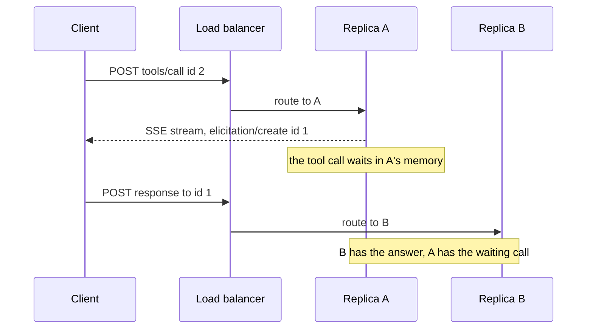

## 1. The question this idea answers

The interviewer asked: "What is the difference between stateful and stateless MCP?" A weak answer is "the new one has no sessions". A strong answer says exactly which state disappeared and which state did not. It explains why the old design hurt in production, how people worked around it, and what the new design costs.

This lesson builds that answer. It separates three kinds of state. It shows, with two real server instances, why a session breaks behind a load balancer. It explains the "stateless HTTP" mode that SDKs offered before 2026, and why it was not enough. Then it walks through every piece of the 2026-07-28 design and ends with traces, trade-offs and a 2-minute answer that you can say out loud.

Prerequisites: the 2025-11-25 lifecycle ([L3](/notes/ai/llm-systems/07-mcp/l3-the-stateful-protocol)) and Streamable HTTP ([L4](/notes/ai/llm-systems/07-mcp/l4-transports)).

## 2. Mental model

> [!analogy] A bank teller who remembers you, and a complete form
> **Stateful.** You walk into a bank. Teller 3 asks your language and which services you use, and writes it on a card in her drawer. For the rest of the visit you must return to teller 3, because only her drawer has your card. If teller 3 goes on a break, you start again at another window. If teller 3 needs your signature, she must keep a line open to you.
>
> **Stateless.** Every time you go to any window, you give the teller a complete form: your language, your services, your request. Any teller can serve you. If a teller needs your signature, she hands the form back with a note "please sign here", and you bring it to any window again.
>
> **Where it stops working:** the bank still keeps your account. A stateless protocol does not mean a stateless application. Your balance lives in the bank's database, and you name it with an account number on the form. In MCP that account number is an explicit handle, such as a `basket_id`. Also, the complete form is longer than "it's me again": every request carries a few hundred extra bytes.

## 3. Terms

| Term | Plain meaning |
|---|---|
| state | Data that a party remembers between two messages and that changes how it handles the next message. |
| stateful protocol | A protocol in which the meaning of a message depends on earlier messages, for example on a handshake. |
| stateless protocol | A protocol in which "all the information needed to process a request is contained in the request itself" (2026-07-28). |
| protocol state | What the protocol itself remembers: version, capabilities, subscriptions, pending server requests. In 2025-11-25 it lives in the session. |
| application state | What the server's business logic remembers: a shopping cart, a browser, a database transaction. |
| conversation state | The messages, tool calls and tool results of a chat. The host keeps it. |
| replica (server instance) | One running copy of a server program. Several replicas serve the same endpoint. |
| load balancer | A component that spreads incoming requests over replicas. |
| round robin | A load-balancing rule that sends each new request to the next replica in turn. |
| sticky session (session affinity) | A load-balancer rule that sends all requests of one session to the same replica. |
| shared session store | A database or cache that all replicas use to read and write session data. |
| self-describing request | A request that carries its own protocol version and client capabilities in `_meta`. |
| `server/discover` | The 2026-07-28 method that returns the server's supported versions, capabilities and identity. Optional for clients. |
| `resultType` | The 2026-07-28 result field: `"complete"` or `"input_required"`. |
| Multi Round-Trip Requests (MRTR) | The 2026-07-28 pattern: the server returns `input_required` with `inputRequests`, and the client retries with `inputResponses`. |
| `requestState` | An opaque string that the server puts into an `input_required` result and the client echoes in the retry. |
| explicit state handle | A server-minted ID, such as `basket_id`, that a tool returns and later tools take as an argument. |
| dual-era | An implementation that speaks both 2025-11-25 (with `initialize`) and 2026-07-28 (stateless). |

All terms are also in the [Glossary](/notes/ai/llm-systems/glossary).

## 4. Three kinds of state

### 4.1 Separate them first

The word "state" hides three different things. Most confusion in this topic is the result of mixing them.

| Level | Examples | Who keeps it in 2025-11-25 | Who keeps it in 2026-07-28 |
|---|---|---|---|
| Protocol state | Negotiated version, client capabilities, `initialized` flag, resource subscriptions, log level, suspended server requests, SSE event logs | The server process that handled `initialize`, keyed by the session | Nobody between requests. Each request carries it in `_meta`. A long-lived request such as `subscriptions/listen` keeps state "scoped to the request itself". |
| Application state | A shopping cart, a browser tab, an open database transaction | The server, often tied to the session ID or the process | The server, in its own storage, named by an explicit handle that the client passes "on each request" |
| Conversation state | Messages, tool calls, tool results, the model's context | The host | The host. "Full conversation history stays with the host" in both revisions. |


> [!key] The one-sentence definition
> "Stateless MCP" means that the **protocol** keeps no state between requests: every request carries its version, capabilities and inputs, and any server instance can answer it. The application may still keep state, but it must name that state with an explicit handle in the request.

### 4.2 The exact spec wording

The 2025-11-25 architecture page says: "MCP provides a stateful session protocol". A client "Establishes one stateful session per server".

The 2026-07-28 base protocol page says: "The Model Context Protocol (MCP) is a **stateless protocol**: all the information needed to process a request is contained in the request itself. A server processes each request independently; no state should be inferred from previous requests, even those on the same connection or stream." It then gives five rules:

1. "Servers **MUST NOT** rely on prior requests over the same connection to establish context (e.g., capabilities, protocol version, client identity)."
2. "Servers **SHOULD** be prepared to handle requests associated with multiple tasks, threads, or conversations."
3. "Servers **SHOULD NOT** require that a client reuse the same connection or process to perform related operations."
4. "Clients **SHOULD NOT** use an individual task, thread, or conversation as the lifetime boundary for the stdio process."
5. "State that needs to span multiple requests (e.g., long-running tasks, application-level handles) **MUST** be referenced by an explicit identifier the client passes on each request."

And a note: "an open connection, such as a STDIO process, is not a conversation or session".

Note one historical irony. JSON-RPC 2.0 calls itself "a stateless, light-weight remote procedure call (RPC) protocol". The statefulness of MCP up to 2025-11-25 was a layer that MCP added on top ([L2](/notes/ai/llm-systems/07-mcp/l2-json-rpc)). Revision 2026-07-28 removed that layer.

## 5. Why a stateful session is hard to scale

### 5.1 Load balancing from zero

One server process can only serve so many requests. To serve more, you run several replicas of the same server and put a load balancer in front of them. The load balancer receives every request on one address and forwards it to one replica. The simplest rule is round robin: request 1 to replica A, request 2 to replica B, and so on. Other rules pick the least busy replica or a random one. Lesson [Part 05, L5](/notes/ai/llm-systems/05-cloud-hosting/l5-autoscaling-and-routing) covers routing in depth.

These rules assume that **any replica can answer any request**. A stateful session breaks that assumption.

### 5.2 Measured: a session lives in one replica

In a test of these notes, two replicas of the same Python SDK 2.3.0 server ran with stateful Streamable HTTP. Replica A used port 18766, and replica B used port 18767. The client sent `initialize` to A, then the same `tools/call` with the same session ID to A and to B. Then it sent a 2026-07-28 request, without a session, to both. The exact output:

```text
legacy -> A 200 {'jsonrpc': '2.0', 'id': 2, 'result': {'content': [{'text': '412', 'type': 'text'}], 'isError': False, 'structuredContent': {'result': 412}}}
legacy -> B 404 {'jsonrpc': '2.0', 'id': None, 'error': {'code': -32600, 'message': 'Session not found'}}
modern -> A 200 {'jsonrpc': '2.0', 'id': 2, 'result': {'content': [{'text': '412', 'type': 'text'}], 'isError': False, 'resultType': 'complete', 'structuredContent': {'result': 412}, '_meta': {'io.modelcontextprotocol/serverInfo': {'name': 'orders', 'version': ''}}}}
modern -> B 200 {'jsonrpc': '2.0', 'id': 2, 'result': {'content': [{'text': '412', 'type': 'text'}], 'isError': False, 'resultType': 'complete', 'structuredContent': {'result': 412}, '_meta': {'io.modelcontextprotocol/serverInfo': {'name': 'orders', 'version': ''}}}}
```

Replica B had never seen the session, so it answered 404 "Session not found". By the 2025-11-25 rules, a 404 tells the client to start a new session with `initialize`. The modern request worked on both replicas, because it carried everything in its own `_meta`.

> [!example] Worked example: how often does a plain load balancer break a session?
> Assume the load balancer picks a replica at random for each request, with $k$ replicas. The client sends `initialize` and then $r$ more requests in the session. All $r$ requests reach the session's replica with probability:
>
> $$
> P(\text{all on the right replica}) = \left(\frac{1}{k}\right)^{r}
> $$
>
> - $k = 2$, $r = 3$: $(1/2)^3 = 0.125$, so 12.5 percent.
> - $k = 4$, $r = 3$: $(1/4)^3 = 1/64 \approx 0.0156$, so about 1.6 percent.
> - $k = 4$, $r = 10$: $(1/4)^{10} \approx 9.5 \times 10^{-7}$.
>
> These values were computed with Python. Round robin with many concurrent clients behaves in a similar unpredictable way. Interpretation of these notes: without stickiness, almost every multi-request session breaks once there is more than one replica.

### 5.3 How operators coped before 2026

The TypeScript SDK examples describe three multi-node patterns for 2025-11-25 (checked on 2026-10-15):

| Pattern | How it works | Cost |
|---|---|---|
| Sticky sessions | The load balancer routes by the `Mcp-Session-Id` header (or a cookie) to the replica that created the session. | An L7 load balancer that reads headers. Uneven load. A replica crash loses all its sessions. |
| Persistent storage mode | `sessionIdGenerator: () => randomUUID()` and a database-backed `eventStore`. "All session state is stored in the database, and any node can serve any client". | "Somewhat higher latency due to database access for each request". A database on the hot path. |
| Local state with message routing | A message queue and pub/sub. A node that does not own a session publishes the request, and the owning node processes it and publishes the answer back. | A message broker, a session ownership registry, and complex failure handling |

SEP-2575 ("Make MCP Stateless") names the problems in its motivation:

1. **Scalability.** "A simple stateless load balancer (e.g., L4/L7 round-robin) cannot be used, as it would route a client's requests to different backend servers, none of which would have the correct session state. Operators are forced to implement complex and fragile solutions like sticky sessions".
2. **Resilience.** "if the specific server instance handling a client session fails, that session state is lost. The client must detect the connection failure, re-establish a connection (likely to a new server instance via the load balancer), and perform the entire initialization handshake again."
3. **Complexity.** Server developers "must implement logic to create, manage, and eventually garbage-collect per-client session state. This is a common source of bugs and memory leaks."

The SDKs show the memory cost directly. In Python SDK 2.3.0, the stateful mode has `session_idle_timeout` with a default of 1800 seconds and `max_sessions` with a default of 10,000. Its docstring says that an idle session "is terminated and removed; its ID then answers 404 and the client has to initialize a new session". When the limit is full, "a request that would open another one receives a 503 response".

### 5.4 The hardest part: server-initiated requests

A session that only remembers the version and capabilities can be copied into a shared store. Server-initiated requests are much harder. SEP-2322 (MRTR) walks through the 2025-11-25 flow:

1. "Client sends tool call request. For this example, let's assume that the load balancers happen to send this request to server instance A."
2. "Server A opens an SSE stream and sends the elicitation request on that stream."
3. "Client sends the elicitation response as a separate request, for which the load balancers will choose a server instance completely independently of the one they chose in step 1."
4. "Server A must somehow discover the elicitation response delivered to server B."
5. "Server A then sends the tool call result on the SSE stream opened in step 2."



"The difficult part here is step 4, which requires some sort of statefulness on the server side." Interpretation of these notes: the waiting tool call is a running coroutine with its local variables in the memory of replica A. You cannot copy a running coroutine into a database. So server-initiated requests force either stickiness or a shared message channel, even when everything else is stored outside.

### 5.5 More reasons, from the field

SEP-2567 ("Sessionless MCP via Explicit State Handles") adds evidence that sessions were also unreliable as a container for application state:

- "sessions have not converged on a consistent meaning across clients: some scope them per tool call, some per application launch, some per page load, and almost none resume them."
- It reports that ChatGPT "creates a fresh session for every individual tool call", while "most desktop and IDE clients create one at application launch".
- Lists could not be cached: "Because `tools/list` may be session-dependent, a client cannot assume a result fetched in one session is valid in the next."
- Cardinality: "Session state has a cardinality of exactly one per session." The model "gets one cart, one browser" and cannot have two.

Interpretation of these notes about serverless platforms: a function platform starts short-lived instances on demand and may stop them between requests. A session in instance memory does not survive that, and holding a GET stream open for hours keeps an instance busy. A self-describing request fits that model.

## 6. The "stateless HTTP" mode before 2026

### 6.1 What the SDKs offered

SEP-2567 says: "All official SDKs except PHP already provide a stateless mode, implemented as not generating a session ID (e.g. `sessionIdGenerator: undefined` in the TypeScript SDK, `stateless_http=True` in the Python SDK)."

```python
# Python SDK v1 (tested with mcp 1.30.0): options in the constructor
from mcp.server.fastmcp import FastMCP
mcp = FastMCP("orders", stateless_http=True, json_response=True)
```

```python
# Python SDK v2 (tested with mcp 2.3.0): options passed to run() or streamable_http_app()
from mcp.server import MCPServer
mcp = MCPServer("orders")
mcp.run(transport="streamable-http", stateless_http=True, json_response=True)
```

The TypeScript SDK example `simpleStatelessStreamableHttp.ts` creates its transport with this line:

```text
new StreamableHTTPServerTransport({ sessionIdGenerator: undefined })
```

In SDK v2 the flag only changes how legacy clients (2025-11-25 and earlier) are served. Modern requests are stateless anyway. In a test of these notes, 2026-07-28 requests to a server without the flag worked on both replicas (section 5.2).

What the mode does, from the Python SDK source (`StreamableHTTPSessionManager`): "If True, creates a completely fresh transport for each request with no session tracking or state persistence between requests." Each request gets a new transport with `mcp_session_id=None` and `event_store=None`. In SDK v1 the server session also starts in the state `Initialized`, so it accepts a request that never had an `initialize`.

> [!note] Measured: a legacy stateless server
> In a test of these notes, a Python SDK 2.3.0 server ran with `stateless_http=True`. It answered a 2025-11-25 `tools/call` that had no `initialize` before it, with status 200 and the result. It also answered `initialize`, but its response had no `mcp-session-id` header.

### 6.2 Why it was not enough

Interpretation of these notes, based on the protocol rules of 2025-11-25:

1. **The client still did the handshake.** The protocol required `initialize` first, so clients sent it, and the server forgot the result immediately.
2. **The server did not know the client's capabilities.** They arrived only in `initialize`, which another replica may have handled. A later `tools/call` carried no capabilities. So the server could not know if the client supports elicitation.
3. **No server-initiated requests.** An elicitation answer arrives as a new POST, which a fresh transport handles. The waiting tool call in the original transport never sees it.
4. **No GET stream and no resumability.** There is no session to attach them to.
5. **It was a server choice, invisible to clients.** A client could not tell whether a server was stateless. So it could not cache lists across sessions.

Revision 2026-07-28 fixes each point at the protocol level. The next section shows how.

## 7. The 2026-07-28 design, piece by piece

| 2025-11-25 mechanism | Problem | 2026-07-28 replacement | Source |
|---|---|---|---|
| `initialize` and `notifications/initialized` | State in one replica | Version, capabilities and client info in every request's `_meta` | SEP-2575 |
| Server capabilities in `InitializeResult` | Only available after the handshake | `server/discover`, optional and cacheable | SEP-2575 |
| `Mcp-Session-Id` | Sticky routing, undefined lifetime | Removed. Application state uses explicit handles. | SEP-2567 |
| Server-initiated `sampling/createMessage`, `elicitation/create`, `roots/list` | A suspended call in one replica | MRTR: `resultType: "input_required"` and a retry with `inputResponses` | SEP-2322 |
| GET stream, `resources/subscribe` | Connection-scoped state | `subscriptions/listen`, a request with a long-lived response | SEP-2575 |
| `logging/setLevel` | Session-scoped setting | `io.modelcontextprotocol/logLevel` in each request's `_meta` | SEP-2575 |
| `ping` | Checks a connection that no longer exists | Removed | SEP-2575 |
| `Last-Event-ID` resumability | Shared event store | Removed. Re-issue the request with a new id. | SEP-2575 |
| Lists that vary per session | No caching across sessions | Lists do not vary per connection. `ttlMs`, `cacheScope`, deterministic tool order. | SEP-2567, SEP-2549 |

### 7.1 Self-describing requests

Every client request carries these fields in `params._meta`:

| Key | Required | Meaning |
|---|---|---|
| `io.modelcontextprotocol/protocolVersion` | yes | "Protocol version for this request (e.g., `"2026-07-28"`)" |
| `io.modelcontextprotocol/clientCapabilities` | yes | "Client capabilities relevant to this request". `{}` means no optional capabilities. |
| `io.modelcontextprotocol/clientInfo` | no, but clients "**SHOULD** include" it | "Client name and version" |
| `io.modelcontextprotocol/logLevel` | no (deprecated with Logging) | "Minimum log level the server should emit for this request" |

The rules:

- "A request missing any required field is malformed; the server **MUST** reject it with JSON-RPC error code `-32602` (Invalid params). On HTTP, the response status **MUST** be `400 Bad Request`."
- "A server **MUST NOT** rely on capabilities the client has not declared." If a request needs an undeclared capability, the server "**MUST** return a `MissingRequiredClientCapabilityError` (`-32021`) whose `data.requiredCapabilities` lists the missing capabilities".
- Servers "**SHOULD** include" `io.modelcontextprotocol/serverInfo` in every result's `_meta`.
- `clientInfo` and `serverInfo` "are self-reported by the sender and are not verified by the protocol". Implementations "**SHOULD NOT** rely on them for security decisions".

### 7.2 `server/discover`

"Servers **MUST** implement it." Clients "**MAY** call it before sending any other requests ... but are not required to". The real answer of the SDK server in a test of these notes:

```json
{
  "jsonrpc": "2.0",
  "id": 1,
  "result": {
    "cacheScope": "private",
    "capabilities": {
      "prompts": { "listChanged": true },
      "resources": { "listChanged": true, "subscribe": true },
      "tools": { "listChanged": true }
    },
    "resultType": "complete",
    "supportedVersions": ["2026-07-28"],
    "ttlMs": 0,
    "_meta": { "io.modelcontextprotocol/serverInfo": { "name": "orders", "version": "" } }
  }
}
```

The fields: `supportedVersions`, `capabilities`, optional `instructions`, the server identity in `_meta`, and the cache hints `ttlMs` and `cacheScope`. The spec names two uses: "Presenting server information" in one request, and a "stdio backward-compatibility probe".

### 7.3 Version negotiation per request

"There is no negotiation handshake. Every request carries its protocol version, and the server accepts or rejects each request independently." An unsupported version gets -32022 with `data.supported` and `data.requested`. "The client **SHOULD** select a mutually supported version from the `supported` list and retry the request". Measured in a test of these notes: `"2030-01-01"` got `{"code":-32022,"message":"Unsupported protocol version","data":{"supported":["2026-07-28"],"requested":"2030-01-01"}}`, with HTTP 400.

### 7.4 `resultType`

Every result now says what it is: "`resultType` of `"complete"` indicates the request completed successfully" and `"input_required"` "indicates the request is incomplete and more information is needed". "A `resultType` of any value unrecognized by the client **MUST** be considered invalid." For older servers, "clients **MUST** treat an absent `resultType` as `"complete"`".

### 7.5 MRTR: the server asks by returning, not by calling

"Servers **MUST NOT** initiate JSON-RPC requests". Instead, a server that needs input answers the original request with an `InputRequiredResult`, and the client retries. The pattern applies to `tools/call`, `resources/read` and `prompts/get` only. Lesson [L9](/notes/ai/llm-systems/07-mcp/l9-mrtr-elicitation-sampling-and-roots) covers every field. Here is why it is stateless:

- "the requests in each step are completely independent: the server processing the retry does not need any information beyond what is directly present in the retry request."
- The server can carry its own progress in `requestState`, "an opaque string meaningful only to the server". The client "**MUST** echo back the exact value".
- "The JSON-RPC `id` **MUST** be different between the initial request and the retry".
- Because the state travels through the client, servers "**MUST** treat `requestState` as an attacker-controlled input" and protect its integrity "(e.g. HMAC or AEAD)" when it affects authorization or business logic. They "**SHOULD**" bind it to the principal, a short expiry and the originating request.

> [!example] Worked example: MRTR against a real server
> A Python SDK 2.3.0 tool `cancel_order` returns an `InputRequiredResult` when it has no confirmation yet. In a test of these notes:
>
> 1. Round 1, id 1: the result was `"resultType": "input_required"` with `inputRequests.confirm` (an `elicitation/create` form) and `requestState: "v1.vOm3aLvay..."`. The SDK encrypted the plain state string of the tool with its built-in AES-256-GCM codec.
> 2. Round 2, id 2: the same params plus `inputResponses: {"confirm": {"action": "accept", "content": {"ok": true}}}` and the exact `requestState`. The result was `"resultType": "complete"` with the text "Order A-1001 cancelled."
> 3. A retry with a forged `requestState` (the plain text `"cancel:A-1001"`) got `{"code":-32602,"message":"Invalid or expired requestState","data":{"reason":"invalid_request_state"}}`.
>
> Nothing waited in memory between rounds 1 and 2. They could reach different replicas, if all replicas share the sealing key. The SDK's default key is generated per process, and its docstring says: "Multi-instance deployments must share a key via `keys=[...]`."

### 7.6 `subscriptions/listen`

Change notifications still need a channel from the server to the client. 2026-07-28 makes it a request: the client sends `subscriptions/listen` with a `notifications` filter (`toolsListChanged`, `promptsListChanged`, `resourcesListChanged`, `resourceSubscriptions`). The response is a stream that stays open. The first message is `notifications/subscriptions/acknowledged`. Every message carries `io.modelcontextprotocol/subscriptionId`, the id of the listen request.

Is that not state? It is, but it is scoped to one open request. The spec says: "Long-lived requests like `subscriptions/listen` remain request/response; the response is just an open stream of notifications. Their state is scoped to the request itself, not to the connection underneath." If the stream breaks, the client sends the request again: "the server holds no subscription state across reconnections".

### 7.7 Explicit handles for application state

The changelog: "Servers that need cross-call state use explicit, server-minted handles passed as ordinary tool arguments". SEP-2567 is clear that this is "not a protocol change": "There is no `handles/*` method, no handle type in the schema". A handle "is a tool-design pattern". Its example:

```json
[
  { "call": { "name": "create_basket", "arguments": {} },
    "result": { "structuredContent": { "basket_id": "bsk_a1b2c3" } } },
  { "call": { "name": "add_item", "arguments": { "basket_id": "bsk_a1b2c3", "sku": "shoes" } } },
  { "call": { "name": "checkout", "arguments": { "basket_id": "bsk_a1b2c3" } } }
]
```

(This array only lists the calls and results of SEP-2567 in one valid JSON value. It is not an MCP message.)

The same pattern with the Python SDK:

```python
import secrets, time
from typing import TypedDict
from mcp.server import MCPServer
from mcp.server.mcpserver.exceptions import ToolError

mcp = MCPServer("shop")
TTL_S = 24 * 3600
BASKETS: dict[tuple[str, str], dict] = {}     # production: a shared database, not process memory

class BasketRef(TypedDict):
    basket_id: str

class BasketSize(TypedDict):
    basket_id: str
    items: int

class Order(TypedDict):
    ordered: list[str]

def principal() -> str:
    return "local-user"    # over HTTP: the subject of the verified access token, never a tool argument

def load(basket_id: str) -> dict:
    b = BASKETS.get((principal(), basket_id))                  # bound to the caller
    if b is None or time.time() - b["touched"] > TTL_S:
        raise ToolError(f"Basket {basket_id} does not exist or has expired. Call create_basket first.")
    b["touched"] = time.time()
    return b

@mcp.tool()
def create_basket() -> BasketRef:
    """Create an empty basket. Returns basket_id. Baskets expire after 24 hours without use."""
    basket_id = "bsk_" + secrets.token_urlsafe(16)            # 16 random bytes = 128 bits
    BASKETS[(principal(), basket_id)] = {"items": [], "touched": time.time()}
    return {"basket_id": basket_id}

@mcp.tool()
def add_item(basket_id: str, sku: str) -> BasketSize:
    """Add one item to the basket with this basket_id."""
    b = load(basket_id)
    b["items"].append(sku)
    return {"basket_id": basket_id, "items": len(b["items"])}

@mcp.tool()
def checkout(basket_id: str) -> Order:
    """Place the order for the basket with this basket_id and close the basket."""
    b = load(basket_id)
    del BASKETS[(principal(), basket_id)]
    return {"ordered": b["items"]}
```

Output over stdio with 2026-07-28 requests, in a test of these notes. The handle is random on every run, and some arguments are shortened with `...`:

```text
create_basket({}) -> isError=False {'basket_id': 'bsk_dNpTa2-2AUG04N_5I0GvQQ'}
add_item(... 'sku': 'bagels-6') -> isError=False {'basket_id': 'bsk_dNpTa2-2AUG04N_5I0GvQQ', 'items': 1}
add_item(... 'sku': 'croissant-4') -> isError=False {'basket_id': 'bsk_dNpTa2-2AUG04N_5I0GvQQ', 'items': 2}
checkout(...) -> isError=False {'ordered': ['bagels-6', 'croissant-4']}
add_item(... 'sku': 'muffin-2') -> isError=True Error executing tool add_item: Basket bsk_dNpTa2-2AUG04N_5I0GvQQ does not exist or has expired. Call create_basket first.
add_item({'basket_id': 'bsk_guess', ...}) -> isError=True Error executing tool add_item: Basket bsk_guess does not exist or has expired. Call create_basket first.
```

The design choices, each from SEP-2567's guidance or the 2026-07-28 security page:

- **Opaque and random.** `secrets.token_urlsafe(16)` gives 128 random bits. For servers without authentication, SEP-2567 asks for "at least 128 bits of cryptographically secure entropy".
- **Bound to the caller.** The key is `(principal, basket_id)`. The security page says servers "**MUST NOT** treat possession of a state handle as authentication" and "**SHOULD** bind handles server-side to the authenticated user, for example by keying stored state as `<user_id>:<handle>`".
- **Durability in the description.** "Baskets expire after 24 hours without use" is in the tool description, where the model can read it.
- **Useful expiry errors.** The error says what happened and what to do, so the model can recover.
- **Shared storage in production.** The dictionary is in process memory only for this demo. With several replicas, the baskets live in a database that every replica reads. That is application state, and it is the server's job.

### 7.8 Cacheable lists

Without sessions, `tools/list` no longer varies "per-connection". Lists can still vary by the authorization of the request. Revision 2026-07-28 adds cache hints to `server/discover`, `tools/list`, `prompts/list`, `resources/list`, `resources/templates/list` and `resources/read`:

- `ttlMs`: "how long, in milliseconds, the client MAY consider the result fresh". 0 means "immediately stale".
- `cacheScope`: `"public"` (no user-specific data, shared caches may keep it) or `"private"` (only "for the same authorization context").
- "Servers **SHOULD** return tools from `tools/list` in a deterministic order to enable client-side caching and improve LLM prompt cache hit rates."

> [!example] Worked example: lists for an orchestrator with subagents
> An orchestrator starts 20 subagents, and each uses the same 5 servers. SEP-2567 says that session-scoped lists force "`O(subagents × servers)` calls to `tools/list`". Before: $20 \times 5 = 100$ calls. With session-independent lists and a fresh cache: one call per server, so $5$ calls, which the subagents reuse.

## 8. The same tool call, side by side

### 8.1 Over Streamable HTTP

**2025-11-25** (three HTTP requests before the first result, real statuses from the SDK server):

```http
POST /mcp HTTP/1.1
Content-Type: application/json
Accept: application/json, text/event-stream

{"jsonrpc":"2.0","id":1,"method":"initialize","params":{"protocolVersion":"2025-11-25","capabilities":{},"clientInfo":{"name":"demo-host","version":"0.1.0"}}}
```

```http
HTTP/1.1 200 OK
content-type: application/json
mcp-session-id: 9fc6adf090fe4fd289043eb7c6eab7bf

{"jsonrpc":"2.0","id":1,"result":{"capabilities":{"prompts":{"listChanged":false},"resources":{"listChanged":false,"subscribe":false},"tools":{"listChanged":false}},"protocolVersion":"2025-11-25","serverInfo":{"name":"orders","version":""}}}
```

```http
POST /mcp HTTP/1.1
Content-Type: application/json
Accept: application/json, text/event-stream
Mcp-Session-Id: 9fc6adf090fe4fd289043eb7c6eab7bf
MCP-Protocol-Version: 2025-11-25

{"jsonrpc":"2.0","method":"notifications/initialized"}
```

The server answered `202 Accepted` with no body. Then:

```http
POST /mcp HTTP/1.1
Content-Type: application/json
Accept: application/json, text/event-stream
Mcp-Session-Id: 9fc6adf090fe4fd289043eb7c6eab7bf
MCP-Protocol-Version: 2025-11-25

{"jsonrpc":"2.0","id":2,"method":"tools/call","params":{"name":"count_orders","arguments":{"plant":"B","date":"2026-10-14"}}}
```

```http
HTTP/1.1 200 OK
content-type: application/json
mcp-session-id: 9fc6adf090fe4fd289043eb7c6eab7bf

{"jsonrpc":"2.0","id":2,"result":{"content":[{"text":"412","type":"text"}],"isError":false,"structuredContent":{"result":412}}}
```

**2026-07-28** (one HTTP request):

```http
POST /mcp HTTP/1.1
Content-Type: application/json
Accept: application/json, text/event-stream
MCP-Protocol-Version: 2026-07-28
Mcp-Method: tools/call
Mcp-Name: count_orders

{"jsonrpc":"2.0","id":1,"method":"tools/call","params":{"name":"count_orders","arguments":{"plant":"B","date":"2026-10-14"},"_meta":{"io.modelcontextprotocol/protocolVersion":"2026-07-28","io.modelcontextprotocol/clientCapabilities":{},"io.modelcontextprotocol/clientInfo":{"name":"demo-host","version":"0.1.0"}}}}
```

```http
HTTP/1.1 200 OK
content-type: application/json

{"jsonrpc":"2.0","id":1,"result":{"content":[{"text":"412","type":"text"}],"isError":false,"resultType":"complete","structuredContent":{"result":412},"_meta":{"io.modelcontextprotocol/serverInfo":{"name":"orders","version":""}}}}
```

Read the differences line by line:

| Line | 2025-11-25 | 2026-07-28 |
|---|---|---|
| Version | Once in `initialize`, then the `MCP-Protocol-Version` header | In `_meta` and in the header of every request |
| Capabilities | Once in `initialize` | In `_meta` of every request |
| Identity | `clientInfo` once, `serverInfo` once | `clientInfo` in each request, `serverInfo` in each result |
| Routing data | `Mcp-Session-Id` | `Mcp-Method` and `Mcp-Name` |
| Result | No `resultType` | `"resultType": "complete"` |
| Which replica may answer | Only the one with the session | Any |

### 8.2 The cost in bytes and round trips

> [!example] Worked example: bytes on the wire
> Count the JSON bodies and the MCP-specific headers only (`Content-Type` and `Accept` are the same in both). The counts were computed with Python from the messages above.
>
> - 2025-11-25: the `initialize` body has 158 bytes. The `initialized` body has 54 bytes, plus 84 bytes of `Mcp-Session-Id` and `MCP-Protocol-Version` header lines. Each `tools/call` body has 125 bytes, plus the same 84 bytes of headers.
> - 2026-07-28: each `tools/call` body 314 bytes plus 82 bytes of `MCP-Protocol-Version`, `Mcp-Method` and `Mcp-Name` header lines. Without the optional `clientInfo`, the body is 238 bytes.
>
> | Tool calls | 2025-11-25 total | 2026-07-28 total |
> |---|---|---|
> | 1 | $158 + 54 + 84 + 209 = 505$ bytes in 3 requests | $314 + 82 = 396$ bytes in 1 request |
> | 10 | 2,386 bytes | 3,960 bytes |
> | 100 | 21,196 bytes | 39,600 bytes |
>
> Each 2026-07-28 call carries about 190 more body bytes ($314 - 125 = 189$). Interpretation of these notes: that is small next to a typical tool result, and it buys two things. The first result needs one round trip instead of at least two (`initialize`, then the call). And no replica must remember anything.

## 9. Deployment: sticky sessions against plain round robin


```video
{"src": "/notes/media/llm-systems/manim/m31-session-behind-load-balancer.mp4", "caption": "A 2025-11-25 session breaks when the load balancer sends a follow-up request to another replica, while 2026-07-28 requests succeed on any replica."}
```

| Concern | 2025-11-25 behind a load balancer | 2026-07-28 behind a load balancer |
|---|---|---|
| Routing rule | Sticky by `Mcp-Session-Id`, or a shared store, or message routing | Plain round robin or least-busy |
| A replica crashes | Its sessions and suspended calls are lost. Clients get 404 and must call `initialize` again. | In-flight requests on that replica fail and are retried. Nothing else is lost. |
| Scaling down | Draining must wait for sessions to end, or break them | Any replica can stop after its in-flight requests end |
| Elicitation during a tool call | The answer must reach the replica that waits | The retry can reach any replica |
| Gateway policy | Must parse the body or track sessions | Can read `Mcp-Method` and `Mcp-Name` |
| Application state | Often in the session or the process | In a shared store, named by handles |

## 10. Trade-offs: what statelessness costs

A good interview answer names the costs too.

| Topic | Stateful (2025-11-25) | Stateless (2026-07-28) |
|---|---|---|
| Horizontal scaling | Hard: stickiness or shared state | Easy: any replica answers |
| Failure recovery | The session is lost with its replica | Retry the request on another replica |
| Bytes per request | Small after the handshake | About 190 more bytes in the example above |
| Latency of the first call | At least two round trips | One round trip |
| Server push | Any time, on the GET stream | Only on an open `subscriptions/listen` stream, or as notifications on a request's own stream |
| Server asks the client | Directly, mid-call | MRTR: the server returns, and the client retries. The tool code may run again from the start, so it must be safe to repeat up to the point where it asks. |
| Long-running work | The connection holds it | The Tasks extension gives a durable handle (`tasks/get`, `tasks/update`) |
| Application state | Implicit, one per session | Explicit handles. The model must carry the IDs, and they can be lost in compaction. |
| List caching | Unsafe across sessions | Safe, with `ttlMs` and `cacheScope` |
| Security surface | Session hijacking: "MCP Servers **MUST NOT** use sessions for authentication" (2025-11-25) | State handle hijacking: "MUST NOT treat possession of a state handle as authentication". Forged `requestState`: integrity protection required. |
| Ecosystem | Widely deployed | New. Dual-era support needed for a while. |

Interpretation of these notes: the costs are real but mostly small or one-time. The benefit, that any replica can answer any request, is what production deployments need most.

## 11. Living with both eras

A dual-era server "**MAY** serve both eras concurrently on the same endpoint or process". It picks the behavior from how the client opens: "A request carrying modern per-request `_meta` is served statelessly according to this revision." "An `initialize` request selects legacy semantics, scoped to the stdio process (stdio) or the session (HTTP)". The compatibility matrix in short:

| Client | Server | Outcome |
|---|---|---|
| Modern | Modern | Works. `server/discover` optional. |
| Modern | Legacy | Fails. On stdio, probe with `server/discover` first to fail deterministically. |
| Dual-era | Modern | Works, stays modern. |
| Dual-era | Legacy | Works: the client uses `initialize` instead. |
| Legacy | Modern | Fails. "Legacy clients have no fall-forward mechanism." |
| Legacy | Dual-era | Works with the legacy revision. |

The client detects the era differently per transport. On stdio it sends `server/discover` first: a `DiscoverResult` or a modern error means modern, and "any other error, or does not respond within a reasonable timeout" means legacy. On HTTP it sends a modern request and inspects a `400` body. "The fallback **MUST NOT** be keyed to one specific error code". "Clients **SHOULD** cache the result for the lifetime of the server process (stdio) or origin (HTTP)".

Measured in a test of these notes: the dual-era Python SDK 2.3.0 server routed a request by its `MCP-Protocol-Version` header. A request with header `2025-11-25` and a 2026-07-28 body got the legacy answer "Bad Request: Missing session ID".

## 12. Is a stdio server stateful?

On stdio there was never a session ID. One process serves one host, so state in global variables appears to work. SEP-2567 notes that "Servers that appear to be using session state successfully are usually stdio servers relying on process lifetime, which is a property of the transport rather than the protocol."

Revision 2026-07-28 says that such a process "is not a conversation or session: clients may interleave unrelated requests on the same transport". A host may send requests from several conversations or subagents through one process, and it may restart the process at any time. So the same rule applies to stdio: put application state behind explicit handles, not in globals keyed by "the current user".

## 13. The interview answer

> [!key] The 2-minute answer: "What is the difference between stateful and stateless MCP?"
> Up to revision 2025-11-25, MCP was a stateful session protocol. Every connection started with an `initialize` handshake. It negotiated the protocol version and both sides' capabilities, and the server remembered the result for the whole session. Over HTTP the session had an `Mcp-Session-Id` header. The server could also send its own requests to the client in the middle of a call, for sampling, elicitation or roots. While it waited, it held the suspended tool call in memory. So a session lived in one server replica. Behind a load balancer you needed sticky sessions, a shared session store or message routing, and a replica crash lost its sessions.
>
> Revision 2026-07-28 made the protocol stateless. There is no handshake and no session. Every request carries its protocol version and client capabilities in `_meta`. `server/discover` is an optional, cacheable way to learn the server's capabilities. Instead of calling the client, a server returns `resultType: "input_required"` with `inputRequests`. The client retries with `inputResponses` and an opaque, integrity-protected `requestState`. Change notifications use a `subscriptions/listen` request, and lists are cacheable with `ttlMs` and `cacheScope`.
>
> A stateless protocol does not mean a stateless application. A server that needs a cart or a workflow returns an explicit handle. Later tools take that handle as an argument, bound to the authenticated user. The result: any request can go to any replica behind a plain round-robin load balancer. The cost is a couple hundred bytes per request and some retry logic.

The 30-second version: "2025-11-25 negotiated version and capabilities once in an `initialize` handshake and kept them in a session, often pinned to one server instance, and the server could call back into the client mid-request. 2026-07-28 removed the handshake and sessions: each request carries its version and capabilities in `_meta`, server input requests became a return-and-retry pattern called MRTR, and application state uses explicit handles. So any replica can serve any request."

### Exercises

Lab folder: `C:\Users\ASohi\Downloads\AI\agent-harness-lab`, notebook folder `llm-systems/`, notebook `07-mcp-l5.ipynb`.

1. **Numbers for a capacity review.** Write `p_session_survives(k, r)` for the random routing model of section 5.2, and `list_calls(subagents, servers, cacheable)` for section 7.8. Acceptance test: `p_session_survives(4, 3)` returns `0.015625`, `list_calls(20, 5, False)` returns `100`, and `list_calls(20, 5, True)` returns `5`. Hint 1: each request is an independent choice. Hint 2: with caching, each server is listed once.
2. **From session state to a handle.** A 2025-11-25 server keeps `CART = {}` keyed by the `Mcp-Session-Id`, with tools `add_item(sku)` and `checkout()`. Rewrite it for 2026-07-28 with explicit handles. Acceptance test: two baskets can exist at once. A guessed handle gives `isError: true` with a useful message. A handle created by one principal fails for another. Hint 1: add a `create_basket` tool. Hint 2: key the store by `(principal, basket_id)`.
3. **Seal `requestState`.** Write `seal(data, principal, method, params, ttl_s)` and `unseal(state, principal, method, params)` with HMAC-SHA256. Acceptance test: unseal returns the data, and it rejects a changed character, another principal, other arguments and an expired token. Hint 1: sign the encoded payload, and compare with `hmac.compare_digest`. Hint 2: put a digest of the method and the salient params into the payload.

```check
{
  "question": "Exercise 1: show a reference solution.",
  "answer": "```python\ndef p_session_survives(k: int, r: int) -> float:\n    \"\"\"Probability that r follow-up requests all reach the session's replica, with random routing.\"\"\"\n    return (1 / k) ** r\n\ndef list_calls(subagents: int, servers: int, cacheable: bool) -> int:\n    \"\"\"tools/list calls when every subagent uses every server.\"\"\"\n    return servers if cacheable else subagents * servers\n\nassert p_session_survives(4, 3) == 0.015625\nassert list_calls(20, 5, False) == 100 and list_calls(20, 5, True) == 5\nfor k in (2, 4, 8):\n    print(k, [round(p_session_survives(k, r), 6) for r in (1, 3, 10)])\n```\n\nOutput in a test of these notes. The rows are k = 2, 4 and 8. The columns are r = 1, 3 and 10:\n\n```text\n2 [0.5, 0.125, 0.000977]\n4 [0.25, 0.015625, 1e-06]\n8 [0.125, 0.001953, 0.0]\n```\n\nThe last value is about $9.3 \\times 10^{-10}$, which rounds to 0.0 at six decimals. The model assumes independent random routing. Real round robin is deterministic for one client, but with many concurrent clients the replica of the next request is just as unpredictable."
}
```

```check
{
  "question": "Exercise 2: show a reference solution.",
  "answer": "```python\nimport secrets, time\n\nTTL_S = 24 * 3600\nSTORE: dict[str, dict] = {}            # production: a shared database table\n\ndef _key(principal: str, basket_id: str) -> str:\n    return f\"{principal}:{basket_id}\"  # the <user_id>:<handle> key of the security page\n\ndef create_basket(principal: str) -> dict:\n    basket_id = \"bsk_\" + secrets.token_urlsafe(16)\n    STORE[_key(principal, basket_id)] = {\"items\": [], \"touched\": time.time()}\n    return {\"basket_id\": basket_id}\n\ndef _load(principal: str, basket_id: str) -> dict:\n    b = STORE.get(_key(principal, basket_id))\n    if b is None or time.time() - b[\"touched\"] > TTL_S:\n        raise LookupError(f\"Basket {basket_id} does not exist or has expired. Call create_basket first.\")\n    b[\"touched\"] = time.time()\n    return b\n\ndef add_item(principal: str, basket_id: str, sku: str) -> dict:\n    b = _load(principal, basket_id)\n    b[\"items\"].append(sku)\n    return {\"basket_id\": basket_id, \"items\": len(b[\"items\"])}\n\ndef checkout(principal: str, basket_id: str) -> dict:\n    b = _load(principal, basket_id)\n    del STORE[_key(principal, basket_id)]\n    return {\"ordered\": b[\"items\"]}\n\n# acceptance tests\nb1 = create_basket(\"user-42\")[\"basket_id\"]\nb2 = create_basket(\"user-42\")[\"basket_id\"]           # two baskets at once\nadd_item(\"user-42\", b1, \"bagels-6\"); add_item(\"user-42\", b2, \"muffin-2\")\nfor who, bid in ((\"user-42\", \"bsk_guess\"), (\"user-7\", b1)):\n    try:\n        add_item(who, bid, \"x\")\n        print(\"accepted (bad)\")\n    except LookupError as e:\n        print(f\"{who}: {e}\")\nprint(checkout(\"user-42\", b1), checkout(\"user-42\", b2))\n```\n\nOutput in a test of these notes (the handle is random):\n\n```text\nuser-42: Basket bsk_guess does not exist or has expired. Call create_basket first.\nuser-7: Basket bsk_2LOzSCve-0Ykr7mCOHDt0w does not exist or has expired. Call create_basket first.\n{'ordered': ['bagels-6']} {'ordered': ['muffin-2']}\n```\n\nThe functions take the principal as a parameter so that they are easy to test. In the MCP tool wrapper, the principal is the subject of the verified access token, never a tool argument that the model writes. The error for another user's basket is the same as for an unknown basket, so it does not reveal that the basket exists. In the tool wrapper, raise a tool error so the result has `isError: true`."
}
```

```check
{
  "question": "Exercise 3: show a reference solution.",
  "answer": "```python\nimport base64, hashlib, hmac, json, time\n\nKEY = b\"server-secret-from-a-vault\"          # shared by all server instances\n\ndef _b64(b: bytes) -> str:\n    return base64.urlsafe_b64encode(b).decode().rstrip(\"=\")\n\ndef _unb64(s: str) -> bytes:\n    return base64.urlsafe_b64decode(s + \"=\" * (-len(s) % 4))\n\ndef digest(method: str, params: dict) -> str:\n    salient = {\"name\": params.get(\"name\"), \"arguments\": params.get(\"arguments\")}\n    return hashlib.sha256((method + json.dumps(salient, sort_keys=True)).encode()).hexdigest()[:16]\n\ndef seal(data: dict, principal: str, method: str, params: dict, ttl_s: int = 300) -> str:\n    payload = {\"sub\": principal, \"exp\": int(time.time()) + ttl_s,\n               \"req\": digest(method, params), \"data\": data}\n    body = _b64(json.dumps(payload, separators=(\",\", \":\")).encode())\n    mac = _b64(hmac.new(KEY, body.encode(), hashlib.sha256).digest())\n    return body + \".\" + mac\n\ndef unseal(state: str, principal: str, method: str, params: dict) -> dict:\n    body, _, mac = state.partition(\".\")\n    good = _b64(hmac.new(KEY, body.encode(), hashlib.sha256).digest())\n    if not hmac.compare_digest(mac, good):          # constant-time comparison\n        raise ValueError(\"tampered requestState\")\n    payload = json.loads(_unb64(body))\n    if payload[\"exp\"] < time.time():\n        raise ValueError(\"expired requestState\")\n    if payload[\"sub\"] != principal:\n        raise ValueError(\"requestState belongs to another principal\")\n    if payload[\"req\"] != digest(method, params):\n        raise ValueError(\"requestState belongs to another request\")\n    return payload[\"data\"]\n\nparams = {\"name\": \"cancel_order\", \"arguments\": {\"order_id\": \"A-1001\"}}\ns = seal({\"step\": \"confirm\"}, \"user-42\", \"tools/call\", params)\nprint(unseal(s, \"user-42\", \"tools/call\", params))\ntests = {\n    \"tampered\": (s[:-2] + (\"A\" if s[-2] != \"A\" else \"B\") + s[-1], \"user-42\", params),\n    \"other principal\": (s, \"user-7\", params),\n    \"other request\": (s, \"user-42\", {\"name\": \"cancel_order\", \"arguments\": {\"order_id\": \"A-9999\"}}),\n    \"expired\": (seal({\"step\": \"confirm\"}, \"user-42\", \"tools/call\", params, ttl_s=-1), \"user-42\", params),\n}\nfor name, (st, who, prm) in tests.items():\n    try:\n        unseal(st, who, \"tools/call\", prm)\n        print(name, \"ACCEPTED (bad)\")\n    except ValueError as e:\n        print(f\"{name:16} rejected: {e}\")\n```\n\nOutput in a test of these notes:\n\n```text\n{'step': 'confirm'}\ntampered         rejected: tampered requestState\nother principal  rejected: requestState belongs to another principal\nother request    rejected: requestState belongs to another request\nexpired          rejected: expired requestState\n```\n\nThe payload is signed, not encrypted, so the client can read it. Use AEAD encryption (for example AES-GCM) if the state must stay secret. The key must be the same on every replica, for example from a secret manager. The spec adds that these checks \"do not by themselves guarantee single-use\". A one-time action needs a server-side record of used states."
}
```

## 14. Common mistakes

1. **"Stateless MCP means the server keeps no data."** The protocol keeps no state between requests. The application can keep any state, named by explicit handles.
2. **"Stateless MCP has no long-lived streams."** `subscriptions/listen` is long-lived. Its state is scoped to that one request, not to a connection or session.
3. **"The SDK stateless mode before 2026 was the same thing."** It only stopped minting session IDs. The protocol still had `initialize`, no per-request capabilities and server-initiated requests that could not work across replicas.
4. **"MRTR means the server keeps the tool call waiting."** The opposite: the first request ends with `input_required`, and the retry is an independent request with a new id. Any state travels in `requestState`, which the server must protect.
5. **"A handle is a protocol feature."** It is a tool-design pattern. The schema has no handle type.
6. **"Possession of the handle proves who the caller is."** The security page says servers "**MUST NOT** treat possession of a state handle as authentication". Bind handles to the authenticated user.
7. **"A stdio process equals one conversation."** The spec says it "is not a conversation or session". A host may interleave requests from different conversations on one process.
8. **"Stateless is free."** Each request carries about 190 more bytes in the example, MRTR may run tool code twice, and long-running work needs the Tasks extension.

## 15. One-minute explanation

MCP has three kinds of state: protocol state, application state, and conversation state, which the host always keeps. In revision 2025-11-25, the `initialize` handshake fixed the version and capabilities, and the server kept them in a session. The session also held subscriptions, the log level and any suspended server request, in the one replica that handled `initialize`. A request that reached another replica got 404, so operators needed sticky sessions, a shared store or message routing. SDK stateless modes dropped the session ID, but requests still lacked capabilities, and server requests could not work. Revision 2026-07-28 makes every request self-describing: `_meta` carries the version and capabilities, and `server/discover` is optional. A server that needs input returns `input_required`, and the client retries with the answers, so nothing waits in memory. Change notifications use a `subscriptions/listen` request, and lists are cacheable with `ttlMs` and `cacheScope`. Application state still exists, but it uses explicit handles that are bound to the authenticated user. So any replica can answer any request, at the cost of a few hundred bytes per request and some retry logic.

## 16. Check questions

```check
{
  "question": "Name the three levels of state in an MCP system and give one example of each. Who keeps each one in 2025-11-25 and in 2026-07-28?",
  "answer": "| Level | Example | 2025-11-25 | 2026-07-28 |\n|---|---|---|---|\n| Protocol state | Negotiated version, client capabilities, subscriptions, log level, a suspended elicitation | The server replica that handled `initialize`, in the session | Nobody between requests. Each request carries it in `_meta`. A `subscriptions/listen` stream keeps state scoped to that one request. |\n| Application state | A shopping cart, a browser, a database transaction | The server, often keyed by the session or the process | The server, in its own storage, named by an explicit handle passed on each request |\n| Conversation state | Messages and tool results | The host | The host |"
}
```

```check
{
  "question": "In the two-replica test of section 5.2, why did replica B answer 404, and what does the 2025-11-25 spec tell the client to do next?",
  "answer": "Replica A handled `initialize`, minted the session ID and kept the session in its memory. Replica B never saw that session, so the ID was unknown to it. The 2025-11-25 rule says a server that has no such session MUST answer 404 Not Found. A client that receives 404 for a request with an `MCP-Session-Id` \"MUST start a new session by sending a new `InitializeRequest` without a session ID attached\". Behind a random load balancer, that new session may land on yet another replica, so the problem repeats unless routing is sticky."
}
```

```check
{
  "question": "Which _meta keys must a 2026-07-28 request carry, which are optional, and what happens when one is missing or a needed capability is absent?",
  "answer": "Required: `io.modelcontextprotocol/protocolVersion` and `io.modelcontextprotocol/clientCapabilities`. Recommended: `io.modelcontextprotocol/clientInfo` (clients SHOULD send it). Optional: `io.modelcontextprotocol/logLevel` (deprecated with Logging), `progressToken`, and trace keys such as `traceparent`. A missing required field makes the request malformed: error -32602, and HTTP 400. If processing needs a capability that the client did not declare, the server returns -32021 `MissingRequiredClientCapability` with `data.requiredCapabilities`, and HTTP 400. Servers SHOULD put `io.modelcontextprotocol/serverInfo` in every result's `_meta`."
}
```

```check
{
  "question": "Interview follow-up: \"Our 2025 server already ran with stateless_http=True behind a load balancer. So what did 2026-07-28 really change?\"",
  "hint": "Which information did a request in that mode not carry?",
  "answer": "The SDK mode removed session IDs and gave each request a fresh transport, so any replica could answer simple calls. But the protocol around it was still stateful. Clients still had to send `initialize`, and its result was thrown away. Later requests carried no client capabilities, so a server could not know if the client supports elicitation or sampling. Server-initiated requests could not work. The client's answer arrives as a new POST that a fresh transport handles, while the waiting call sits in another transport. No GET stream, no resumability, and clients could not tell that a server was stateless, so they could not cache lists. Revision 2026-07-28 moves the version and capabilities into every request's `_meta` and adds `server/discover`. It replaces server requests with MRTR, adds `subscriptions/listen` and cacheable lists, and removes sessions for everyone. SEP-2567 notes that it makes the SDK stateless mode \"the only option for servers speaking the new protocol version\"."
}
```

```check
{
  "question": "Interview follow-up: with MRTR, where does the in-progress state of a tool call live between the two rounds? Which attacks must the server defend against?",
  "answer": "Either nowhere, because the tool simply starts again with the answers in `inputResponses`. Or inside `requestState`, an opaque string that the server returns and the client must echo exactly. Because it passes through the client, the server MUST treat it as attacker-controlled input. If it affects authorization, resource access or business logic, the server MUST protect its integrity (HMAC or AEAD) and reject state that fails verification. Against replay it SHOULD bind the state to the authenticated principal, a short expiry, and the originating request. The request is named by its method plus a digest of the salient params. These checks do not guarantee single use, so one-time actions need a server-side record. In a test of these notes, the Python SDK 2.3.0 encrypted the tool's state with AES-256-GCM into a `v1.` token. It rejected a forged state with -32602 \"Invalid or expired requestState\"."
}
```

```check
{
  "question": "Interview follow-up: design the application state for a Playwright browser MCP server under 2026-07-28. What are the tools, and what security rules apply to the handle?",
  "answer": "Tools: `create_browser(start_url)` returns `{\"browser_id\": \"brw_...\"}`. `navigate(browser_id, url)`, `click(browser_id, selector)` and `screenshot(browser_id)` take the handle as an argument. `close_browser(browser_id)` frees it, and `list_browsers()` helps the model recover. Put the lifetime in the create tool's description, for example \"browsers close after 15 minutes idle\". Store `(principal, browser_id) -> browser` in a shared store, or in a browser pool that routes by handle, so any replica can find it. Security: the handle is opaque and random (at least 128 bits if the server has no authentication). Possession is not authentication: the server checks the handle against the authenticated user on every call. An expired handle returns a clear tool error, so the model can create a new one. Two subagents can share one handle or each create their own, which a session could not express."
}
```

```check
{
  "question": "Interview follow-up: what does the stateless design cost? Give at least four concrete costs.",
  "answer": "1. Bytes: every request repeats the version, capabilities and usually `clientInfo`. In the example of section 8.2 that is about 190 extra body bytes per call (314 against 125). 2. Re-execution: with MRTR a tool may run again from the start on the retry. The code before the input point must be safe to repeat, or its state must go into a protected `requestState`. 3. Server push only on an open `subscriptions/listen` stream, and long-running work needs the Tasks extension. 4. Application state moves into tool design: the model must carry handles, which can be lost in context compaction, and servers must garbage-collect expired handles. 5. Security work: `requestState` integrity and handle-to-user binding. 6. A migration period: dual-era clients and servers must detect the counterpart's era."
}
```

```check
{
  "question": "Interview follow-up: \"Why not keep 2025-11-25 and just use sticky sessions?\" Give the technical counterarguments.",
  "answer": "Sticky routing needs an L7 load balancer that reads the `Mcp-Session-Id` header or a cookie. It spreads load unevenly, because long sessions pin traffic to one replica. Scaling down or deploying must drain or break sessions. A replica crash loses every session on it, and its suspended tool calls. Clients then get 404 and must re-initialize. SEP-2575 calls sticky sessions \"complex and fragile\". Session semantics also differed between hosts: per tool call, per app launch, per page load. So servers could not rely on the session for application state anyway (SEP-2567). Lists could not be cached across sessions. Stickiness hides these problems but does not remove them, and serverless platforms cannot provide it cheaply."
}
```

```check
{
  "question": "Interview follow-up: subscriptions/listen keeps a stream open for hours. Is 2026-07-28 then really stateless?",
  "answer": "The protocol is stateless in the sense that no request depends on an earlier request. The listen stream is one long request: its filter is in its own params, and its state is \"scoped to the request itself, not to the connection underneath\". Every notification on it carries `io.modelcontextprotocol/subscriptionId`, the id of the listen request. If the stream breaks, the client sends `subscriptions/listen` again, and \"the server holds no subscription state across reconnections\". So the state lives exactly as long as one open request, like a long download. A load balancer only needs to keep that one HTTP response connected, not to route later requests to the same replica."
}
```

## 17. Links

- Previous: [L4: Transports: stdio and Streamable HTTP](/notes/ai/llm-systems/07-mcp/l4-transports)
- Next: [L6: Tools in depth](/notes/ai/llm-systems/07-mcp/l6-tools-in-depth)
- The old lifecycle: [L3: The stateful protocol (2025-11-25)](/notes/ai/llm-systems/07-mcp/l3-the-stateful-protocol)
- MRTR in full: [L9: Asking the client for input: MRTR, elicitation, sampling and roots](/notes/ai/llm-systems/07-mcp/l9-mrtr-elicitation-sampling-and-roots)
- Subscriptions and resources: [L8: Resources and prompts](/notes/ai/llm-systems/07-mcp/l8-resources-and-prompts)
- Handle hijacking and tokens: [L11: Authorization and security](/notes/ai/llm-systems/07-mcp/l11-authorization-and-security)
- Every change of 2026-07-28: [L12: What is new: the version history](/notes/ai/llm-systems/07-mcp/l12-whats-new-version-history)
- Run it stateless: [L13: Build an MCP server and client](/notes/ai/llm-systems/07-mcp/l13-build-an-mcp-server)
- Load balancing: [Part 05, L5: Autoscaling and routing](/notes/ai/llm-systems/05-cloud-hosting/l5-autoscaling-and-routing)
- Conversation state in the host: [Three copies of a conversation](/notes/ai/conversation-state/01-where-state-lives/l1-three-copies-of-a-conversation)
- Interview drill: [L4: Drill: MCP](/notes/ai/llm-systems/08-interview-drills/l4-chain-mcp)

### Sources

- MCP specification 2026-07-28: base protocol (statelessness, `_meta`, error codes), versioning, `server/discover`, patterns (MRTR, subscriptions), caching, Streamable HTTP, changelog. https://modelcontextprotocol.io/specification/2026-07-28/basic (checked on 2026-10-15)
- MCP specification 2025-11-25: architecture, lifecycle, transports. https://modelcontextprotocol.io/specification/2025-11-25 (checked on 2026-10-15)
- SEP-2575 "Make MCP Stateless". https://modelcontextprotocol.io/seps/2575-stateless-mcp (checked on 2026-10-15)
- SEP-2567 "Sessionless MCP via Explicit State Handles". https://modelcontextprotocol.io/seps/2567-sessionless-mcp (checked on 2026-10-15)
- SEP-2322 "Multi Round-Trip Requests". https://modelcontextprotocol.io/seps/2322-MRTR (checked on 2026-10-15)
- MCP security best practices: 2026-07-28 (State Handle Hijacking) and 2025-11-25 (Session Hijacking). https://modelcontextprotocol.io/docs/2026-07-28/tutorials/security/security_best_practices (checked on 2026-10-15)
- MCP blog, "The 2026-07-28 Specification". https://blog.modelcontextprotocol.io/posts/2026-07-28/ (checked on 2026-10-15)
- TypeScript SDK v1 examples README, multi-node deployment. https://github.com/modelcontextprotocol/typescript-sdk/blob/v1.x/src/examples/README.md (checked on 2026-10-15)
- MCP Python SDK: v1 `FastMCP` options and v2.3.0 `StreamableHTTPSessionManager` (all traces and the two-replica test measured in a test of these notes). https://github.com/modelcontextprotocol/python-sdk (checked on 2026-10-15)
- JSON-RPC 2.0 Specification. https://www.jsonrpc.org/specification (checked on 2026-10-15)
