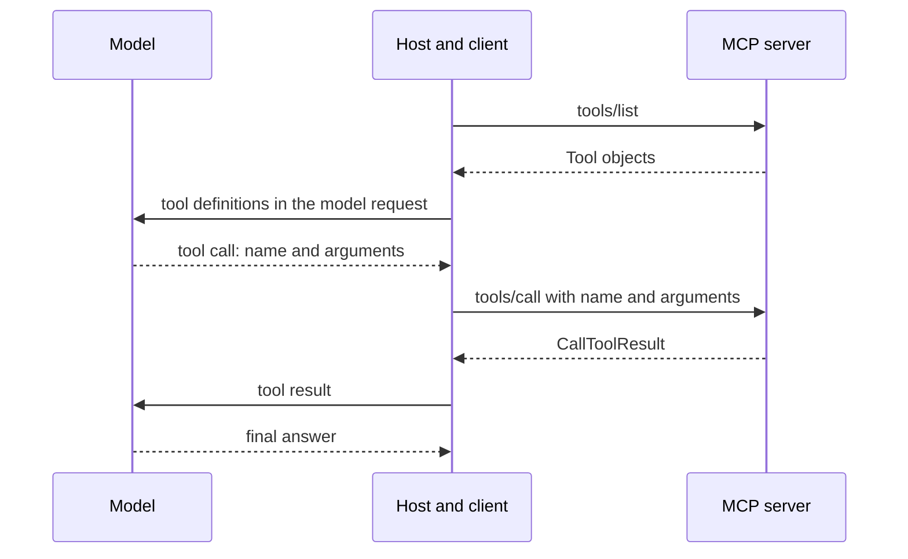

## 1. The question this idea answers

A model can only produce text. To act, it needs tools: a database query, a ticket, a payment. MCP gives a server a standard way to offer tools and gives a client a standard way to call them. The interviewer will not stop at "a tool has a name and a schema". He will ask for every field, the exact arguments of the request, the shape of the reply, and what changed in the 2026 revision.

So this lesson answers four questions at the level of single JSON fields. What is in a tool definition, and who reads each field? What does a client send to list tools and to call one? What does a server send back, for success and for failure? And what changed between revision 2025-11-25 (stateful) and revision 2026-07-28 (stateless)?

The JSON Schema inside `inputSchema` has its own lesson: [L7: JSON Schema for tool arguments](/notes/ai/llm-systems/07-mcp/l7-json-schema-for-tool-arguments). This lesson treats the schema as one field of the tool.

## 2. Mental model

> [!analogy] A catalog of request forms at a government office
> The office (the **server**) prints a catalog of forms (`tools/list`). Each form has a short code for the clerks (`name`), a display title (`title`) and instructions (`description`). It lists the fields and their rules (`inputSchema`) and shows a sample receipt (`outputSchema`). Stickers such as "read-only" or "cannot be undone" sit on the cover (`annotations`).
>
> A clerk (the **client**) fills one form with your answers and hands it in (`tools/call` with `name` and `arguments`). The office returns a receipt (`CallToolResult`). The receipt has a text for you (`content`) and a machine-readable stamp for the office systems (`structuredContent`). A red "rejected" stamp (`isError`) marks a failure.
>
> If the clerk brings a form code that does not exist, the front desk refuses it before anyone reads it. That is a **protocol error**. If the form is real but a field is wrong, the office returns a receipt that explains the problem. That is a **tool execution error**, and you can fix the form and hand it in again.
>
> **Where it stops working:** in an office, the person who chooses the form is you. In MCP, the **model** chooses the tool and writes the arguments, and the model can be tricked. Also, the stickers on a form are written by the office itself. A dishonest office can put "read-only" on a form that deletes data. The spec says that clients must treat annotations as untrusted unless the server is trusted.

## 3. Terms

| Term | Plain meaning |
|---|---|
| tool | A function that an MCP server offers, so that a model can ask the host to run it. |
| `Tool` object | The JSON object that describes one tool in a `tools/list` result: `name`, `inputSchema` and optional fields. |
| `inputSchema` | The JSON Schema that the `arguments` of a call must match. Its root must have `"type": "object"`. |
| `outputSchema` | An optional JSON Schema for the `structuredContent` of the result. |
| `tools/list` | The request that returns the tools of a server, one page at a time. |
| `tools/call` | The request that runs one tool with `name` and `arguments`. |
| `CallToolResult` | The result of `tools/call`: `content`, optional `structuredContent`, optional `isError`, and `resultType` in 2026-07-28. |
| content block | One item of `content`: text, image, audio, a resource link or an embedded resource. |
| `structuredContent` | Typed JSON data in a result, for programs. Since 2026-07-28 it can be any JSON value. |
| `isError` | A boolean in the result. `true` means that the tool ran and failed. If it is absent, it counts as `false`. |
| protocol error | A JSON-RPC `error` response, for example code -32602 for an unknown tool. |
| tool execution error | A normal result with `isError: true` and a text that explains the failure. |
| tool annotations | Hints about behavior: `readOnlyHint`, `destructiveHint`, `idempotentHint`, `openWorldHint` and `title`. |
| cursor | An opaque string that names a position in a list. The client sends it back to get the next page. |
| `ttlMs` | A freshness hint in milliseconds on list results in 2026-07-28. The client may reuse the result that long. |
| `cacheScope` | `"public"` or `"private"`. It says whether a shared cache may reuse a result across users. |
| `_meta` | A reserved object for metadata. In 2026-07-28 every request carries the protocol version and client capabilities in it. |
| `resultType` | A required string on every 2026-07-28 result: `"complete"`, `"input_required"` or a value that an extension adds. |
| `x-mcp-header` | A 2026-07-28 annotation inside a property schema. The client copies that argument into an HTTP header. |
| handle | An ID that a server returns from one tool and accepts in later calls, so that state survives without a session. |

All terms are also in the [Glossary](/notes/ai/llm-systems/glossary).

## 4. Where tools sit in the MCP flow

### 4.1 Who does what

Three parties take part in every tool call. The **host** is the AI application. It runs the model and holds one **client** for each **server** ([L1: Why MCP exists](/notes/ai/llm-systems/07-mcp/l1-why-mcp)). The server never talks to the model. The model never talks to the server.



The spec calls tools **model-controlled**: "the language model can discover and invoke tools automatically based on its contextual understanding and the user's prompts". It adds a safety rule: "there **SHOULD** always be a human in the loop with the ability to deny tool invocations". So the host decides how much freedom the model gets. A host can ask for confirmation, show the arguments, or block a tool.

### 4.2 The capability

A server that offers tools declares the `tools` capability. In 2025-11-25 it sends the capability in its `initialize` result. In 2026-07-28 it sends it in its `server/discover` result ([L3](/notes/ai/llm-systems/07-mcp/l3-the-stateful-protocol), [L5](/notes/ai/llm-systems/07-mcp/l5-stateful-vs-stateless)).

The capability object is `{"tools": {"listChanged": true}}`. `listChanged: true` means that the server will send `notifications/tools/list_changed` when its tool set changes. Revision 2026-07-28 adds two rules for the list itself. The set "**MUST NOT** vary per-connection or as a side effect of other requests on the connection". But it "**MAY** vary by the authorization presented on the request", for example to show only the tools that the caller's scopes allow. Credentials arrive with every request, so they are input, not connection state.

> [!key] The main idea of this lesson
> A tool is a contract in three parts. The model reads the definition (`name`, `description`, `inputSchema`). The host sends the request (`tools/call` with `name` and `arguments`). The host gives part of the result to the model (`content`, `isError`) and keeps the rest for programs (`structuredContent`). Every field has one main reader. Learn the reader of each field and the rest follows.

## 5. The `Tool` object, field by field

### 5.1 The complete field table

The source of truth is the TypeScript schema `schema.ts` of each revision. The table lists every field of `Tool` in revision 2026-07-28 and compares it with 2025-11-25 (both checked on 2026-10-15).

| Field | Type | Required | Meaning | 2025-11-25 |
|---|---|---|---|---|
| `name` | string | yes | The ID of the tool. The client sends it in `tools/call`. | same |
| `title` | string | no | A display name for people. | same |
| `description` | string | no | Text that tells the model what the tool does. The schema calls it a hint to the model. | same |
| `inputSchema` | object | yes | JSON Schema for `arguments`. Root `"type": "object"` is required. Any 2020-12 keyword may appear. | Same rule in prose. The TypeScript type listed only `$schema`, `type`, `properties`, `required`. |
| `outputSchema` | object | no | JSON Schema for `structuredContent`. Any 2020-12 schema. | Root had to be `"type": "object"`. |
| `annotations` | `ToolAnnotations` | no | Behavior hints (section 5.4). | same |
| `icons` | `Icon[]` | no | Images for a user interface (section 5.5). | same (added in 2025-11-25) |
| `_meta` | object | no | Metadata with namespaced keys (section 5.5). | same |
| `execution` | `ToolExecution` | not in 2026-07-28 | Removed from the core. Tasks became an extension. | Optional. `execution.taskSupport` is `"forbidden"` (the default), `"optional"` or `"required"`. |

Display names follow a fixed order. The schema says: "Display name precedence order is: `title`, `annotations.title`, then `name`."

Here is a complete tool definition with every optional field that a real server would use. It validates against the official 2026-07-28 `schema.json` (measured in these notes with the `jsonschema` library):

```json
{
  "name": "search_orders",
  "title": "Search orders",
  "description": "Search the orders of one customer, newest first. Returns at most `limit` orders with ID, status and total in cents, and a `next_page_token` when more exist. Use it when the user asks about a customer's orders and the customer ID is known. It cannot change orders.",
  "inputSchema": {
    "type": "object",
    "properties": {
      "customer_id": {
        "type": "string",
        "pattern": "^CUS-[0-9]{4}$",
        "description": "Customer ID, format CUS-NNNN, for example CUS-0042."
      },
      "status": {
        "type": "string",
        "enum": ["pending", "shipped", "cancelled"],
        "description": "Only orders with this status. Omit for all statuses."
      },
      "limit": {
        "type": "integer",
        "minimum": 1,
        "maximum": 50,
        "default": 20,
        "description": "Orders per page, 1 to 50. Default 20."
      },
      "page_token": {
        "type": "string",
        "description": "Opaque token from the previous result. Omit on the first call."
      }
    },
    "required": ["customer_id"],
    "additionalProperties": false
  },
  "outputSchema": {
    "type": "object",
    "properties": {
      "orders": {
        "type": "array",
        "items": {
          "type": "object",
          "properties": {
            "order_id": {"type": "string"},
            "status": {"type": "string", "enum": ["pending", "shipped", "cancelled"]},
            "total_cents": {"type": "integer"}
          },
          "required": ["order_id", "status", "total_cents"]
        }
      },
      "next_page_token": {"type": ["string", "null"]}
    },
    "required": ["orders", "next_page_token"]
  },
  "annotations": {"title": "Search orders", "readOnlyHint": true, "openWorldHint": false},
  "icons": [{"src": "https://example.com/search.png", "mimeType": "image/png", "sizes": ["48x48"]}],
  "_meta": {"com.example/owner": "orders-team"}
}
```

Read it from the model's point of view. The model sees the name, the description and the input schema. The description says what the tool does, what it returns, when to use it and what it cannot do. Each property says its format with an example. The model never sees the icon, the owner tag in `_meta` or the output schema, unless the host chooses to include them.

### 5.2 Tool name rules

Revision 2025-11-25 added naming guidance (SEP-986). Revision 2026-07-28 keeps it unchanged:

1. Tool names **SHOULD** be 1 to 128 characters long, inclusive.
2. They **SHOULD** be case-sensitive.
3. The only allowed characters **SHOULD** be ASCII letters `A-Z` and `a-z`, digits `0-9`, underscore `_`, hyphen `-` and dot `.`.
4. They **SHOULD NOT** contain spaces, commas or other special characters.
5. They **SHOULD** be unique within a server. The spec's valid examples are `getUser`, `DATA_EXPORT_v2` and `admin.tools.list`.

As a regular expression, the rule is `^[A-Za-z0-9._-]{1,128}$`. The Python SDK 2.3.0 uses this expression in `mcp/shared/tool_name_validation.py`. It only warns, because the rules are SHOULD rules.

Uniqueness covers one server only. The spec says that clients or proxies that aggregate tools "**MAY** encounter naming collisions" and "**SHOULD** implement a disambiguation strategy such as prefixing tool names with a server identifier". It also warns that the server `name` from `serverInfo` "is not guaranteed to be unique across servers". Section 11 builds such a prefix scheme.

> [!trap] A valid MCP name can be an invalid model API name
> The dot is legal in MCP. The Anthropic Messages API requires tool names that match `^[a-zA-Z0-9_-]{1,128}$` (Anthropic docs, checked on 2026-10-15). So `admin.tools.list` is a good MCP name and a rejected Anthropic name. The host must map names, and it must keep a table back to the original name.

### 5.3 `inputSchema` and `outputSchema` in one paragraph each

`inputSchema` describes the `arguments` object. The spec says it "**MUST** be a valid JSON Schema object (not `null`)" and that it defaults to JSON Schema 2020-12 when it has no `$schema` field. For a tool with no parameters, the spec recommends `{ "type": "object", "additionalProperties": false }`, which accepts only `{}`. The other valid form, `{ "type": "object" }`, accepts any object.

`outputSchema` describes `structuredContent`. If a tool has one, "Servers **MUST** provide structured results that conform to this schema" and "Clients **SHOULD** validate structured results against this schema". Lesson [L7](/notes/ai/llm-systems/07-mcp/l7-json-schema-for-tool-arguments) explains every keyword, the 2026 loosening (SEP-2106) and the `$ref` rules.

### 5.4 Annotations: five hints

`ToolAnnotations` has five optional fields (schema 2026-07-28, identical in 2025-11-25):

| Field | Default | Meaning |
|---|---|---|
| `title` | none | "A human-readable title for the tool." |
| `readOnlyHint` | `false` | "If true, the tool does not modify its environment." |
| `destructiveHint` | `true` | "If true, the tool may perform destructive updates to its environment. If false, the tool performs only additive updates." Meaningful only when `readOnlyHint == false`. |
| `idempotentHint` | `false` | "If true, calling the tool repeatedly with the same arguments will have no additional effect on its environment." Meaningful only when `readOnlyHint == false`. |
| `openWorldHint` | `true` | "If true, this tool may interact with an \"open world\" of external entities." A web search is open. A memory tool is closed. |

Examine the defaults. A tool with no annotations counts as not read-only, destructive, not idempotent and open-world. That is the worst case on purpose: a host that knows nothing must assume the most dangerous behavior.

Here is the second tool of the example server. Cancelling an order changes data, and it destroys the old state. A second cancel of the same order has no extra effect, so the tool is idempotent:

```json
{
  "name": "cancel_order",
  "title": "Cancel order",
  "description": "Cancel one order that is still pending. Returns the old and the new status. Use it only when the user asks to cancel. Shipped orders cannot be cancelled.",
  "inputSchema": {
    "type": "object",
    "properties": {"order_id": {"type": "string", "pattern": "^ORD-[0-9]{4}$", "description": "Order ID."}},
    "required": ["order_id"],
    "additionalProperties": false
  },
  "annotations": {
    "readOnlyHint": false,
    "destructiveHint": true,
    "idempotentHint": true,
    "openWorldHint": false
  }
}
```

> [!trap] Annotations are claims, not guarantees
> The schema says: "all properties in `ToolAnnotations` are **hints**. They are not guaranteed to provide a faithful description of tool behavior". The tools page adds: "clients **MUST** consider tool annotations to be untrusted unless they come from trusted servers." A malicious server can mark a delete tool as `readOnlyHint: true`. Use annotations to make the user interface better, for example to ask for confirmation on destructive tools. Never use them as the only safety check ([L11](/notes/ai/llm-systems/07-mcp/l11-authorization-and-security)).

### 5.5 Icons and `_meta`

Each `Icon` has a required `src`: an HTTP or HTTPS URL, or a `data:` URI with base64 data. The optional fields are `mimeType`, `sizes` (strings such as `"48x48"` or `"any"`) and `theme` (`"light"` or `"dark"`). Clients that show icons **MUST** support `image/png` and `image/jpeg`, and **SHOULD** support `image/svg+xml` and `image/webp`. The schema warns that SVG files "can contain executable JavaScript", and that icon URLs should be on the same domain as the server or on a trusted domain.

`_meta` is a free object for extra data. Its keys have an optional prefix and a name. A prefix is a list of dot-separated labels and a slash, for example `com.example/`. A prefix whose second label is `modelcontextprotocol` or `mcp` is reserved, so `io.modelcontextprotocol/` and `dev.mcp/` are reserved, but `com.example.mcp/` is not. The example tool uses `com.example/owner`. Lesson [L10](/notes/ai/llm-systems/07-mcp/l10-utilities-and-errors) covers `_meta` in full.

### 5.6 `x-mcp-header`: an argument copied into an HTTP header (new in 2026-07-28)

A property schema inside `inputSchema` may carry `"x-mcp-header": "<Name>"`. On the Streamable HTTP transport, the client then sends that argument value in a header `Mcp-Param-<Name>`. A load balancer or a firewall can then route on the value without parsing the JSON body. The spec's example: a property `region` with `"x-mcp-header": "Region"`, called with `"region": "us-west1"`, makes the client add `Mcp-Param-Region: us-west1`.

The value of `x-mcp-header` has strict rules. It **MUST NOT** be empty. It **MUST** match the HTTP token syntax of RFC 9110 (`1*tchar`). It **MUST NOT** contain control characters such as CR or LF. It **MUST** be case-insensitively unique within the `inputSchema`. It **MUST** sit only on properties of type `integer`, `string` or `boolean`, not `number`. Integer values must lie within the safe range of IEEE 754 doubles, from $-(2^{53}-1)$ to $2^{53}-1 = 9{,}007{,}199{,}254{,}740{,}991$. And it must sit only on properties that are statically reachable from the schema root.

A value that is not plain ASCII, or that has leading or trailing spaces or a line break, travels in base64 with a sentinel: `=?base64?{Base64EncodedValue}?=`. The spec's example: `"Hello, 世界"` becomes `Mcp-Param-Greeting: =?base64?SGVsbG8sIOS4lueVjA==?=`. The same encoding applies to `Mcp-Name`.

A client on Streamable HTTP **MUST** reject a tool that breaks these rules. Rejection means that the client removes that tool from its `tools/list` result. It should also log a warning. Clients on stdio **MAY** ignore `x-mcp-header`. Servers **SHOULD NOT** mark passwords, keys, tokens or personal data, because intermediaries can read headers.


## 6. `tools/list`: the request and the result

### 6.1 The request

`tools/list` is a paginated request. Its `params` has one tool-specific field, `cursor`, which is optional. In 2026-07-28 every request also carries `_meta` with two required keys and one recommended key ([L5](/notes/ai/llm-systems/07-mcp/l5-stateful-vs-stateless)):

```json
{
  "jsonrpc": "2.0",
  "id": 1,
  "method": "tools/list",
  "params": {
    "_meta": {
      "io.modelcontextprotocol/protocolVersion": "2026-07-28",
      "io.modelcontextprotocol/clientCapabilities": {"elicitation": {"form": {}}},
      "io.modelcontextprotocol/clientInfo": {"name": "orders-agent", "version": "1.4.0"}
    }
  }
}
```

| `_meta` key | Required | Meaning |
|---|---|---|
| `io.modelcontextprotocol/protocolVersion` | yes | The revision of this request, for example `"2026-07-28"`. On HTTP it must match the `MCP-Protocol-Version` header. |
| `io.modelcontextprotocol/clientCapabilities` | yes | The client's capabilities for this request. `{}` means no optional capabilities. |
| `io.modelcontextprotocol/clientInfo` | SHOULD | `name` and `version` of the client software. Self-reported, so not for security decisions. |

A request without a required key is malformed. The server **MUST** reject it with -32602 (Invalid params), and on HTTP with status 400.

To read the next page, the client sends the same request with one more field in `params`. That field is `cursor`, set to the `nextCursor` of the last result, for example `"cursor": "eyJvZmZzZXQiOjJ9"`.

### 6.2 The result

| Field | Required in 2026-07-28 | Meaning |
|---|---|---|
| `tools` | yes | An array of `Tool` objects. It may be empty. |
| `nextCursor` | no | An opaque string. If present, more tools may exist. |
| `ttlMs` | yes | Milliseconds for which the client may treat the result as fresh. Must be 0 or more. |
| `cacheScope` | yes | `"public"` or `"private"`. |
| `resultType` | yes | `"complete"` for a normal result. |
| `_meta` | no | Servers SHOULD put `io.modelcontextprotocol/serverInfo` here. |

A result for the two tools of the example server. Each `Tool` is cut to three fields here. Section 5 shows the full objects:

```json
{
  "jsonrpc": "2.0",
  "id": 1,
  "result": {
    "resultType": "complete",
    "tools": [
      {"name": "search_orders", "title": "Search orders", "inputSchema": {"type": "object"}},
      {"name": "cancel_order", "title": "Cancel order", "inputSchema": {"type": "object"}}
    ],
    "nextCursor": "eyJvZmZzZXQiOjJ9",
    "ttlMs": 300000,
    "cacheScope": "public",
    "_meta": {"io.modelcontextprotocol/serverInfo": {"name": "orders-server", "version": "2.0.1"}}
  }
}
```

The cursor is opaque. The client must not parse it or build its own. The cursor in the example happens to be base64 of `{"offset":2}`, but another server can use any format. The page size belongs to the server: clients "**MUST NOT** assume a fixed page size".

> [!example] Worked example: pagination and freshness
> A server has 120 tools and pages of 50.
>
> 1. Call 1 has no cursor. The result has tools 1 to 50, `nextCursor: "c1"` and `ttlMs: 300000`.
> 2. Call 2 sends `cursor: "c1"`. The result has tools 51 to 100 and `nextCursor: "c2"`.
> 3. Call 3 sends `cursor: "c2"`. The result has tools 101 to 120 and no `nextCursor`, so the list is complete: $50 + 50 + 20 = 120$ tools in $\lceil 120 / 50 \rceil = 3$ calls.
>
> Freshness: the spec defines a result as fresh while $\text{now} < t_{\text{received}} + \text{ttlMs}$. A page received at 10:00:00.000 with `ttlMs: 300000` is fresh until $10{:}00{:}00 + 300\,\text{s} = 10{:}05{:}00$. Each page has its own clock, and servers may give pages different TTLs. A client that needs one consistent snapshot of the full list re-reads from the start, without a cursor.

### 6.3 Caching rules for `ttlMs` and `cacheScope` (new in 2026-07-28)

Revision 2026-07-28 made `ttlMs` and `cacheScope` required on the results of `tools/list`, `prompts/list`, `resources/list`, `resources/read` and `resources/templates/list` (SEP-2549), and the caching page adds `server/discover`. The rules:

1. `ttlMs: 0` means stale at once. A positive value means fresh for that many milliseconds. A missing value (old servers) counts as 0. A negative value is ignored and treated as 0.
2. TTL is a freshness hint, not a polling interval. A client that polls anyway **MUST** use jitter and backoff.
3. A `notifications/tools/list_changed` invalidates a fresh cached list at once.
4. `"public"`: any client, gateway or proxy **MAY** store the result and serve it to any user. `"private"`: the result may be reused only in the same authorization context. A different access token needs a different cache.
5. All pages of one list **MUST** have the same `cacheScope`.
6. Results of a retry with `inputResponses` or `requestState` **MUST NOT** be cached ([L9](/notes/ai/llm-systems/07-mcp/l9-mrtr-elicitation-sampling-and-roots)).

The Python SDK 2.3.0 sends the safest values by default. These notes built a small server with `MCPServer` and called it over stdio with a raw JSON-RPC message. This is its real output, shortened with `...`:

```text
{"jsonrpc": "2.0", "id": 2, "result": {"cacheScope": "private", "resultType": "complete",
  "tools": [{"annotations": {"openWorldHint": false, "readOnlyHint": true},
             "description": "Search the orders of one customer. Returns at most `limit` orders, newest first.",
             "inputSchema": {"type": "object", "properties": {...}, "required": ["customer_id"],
                             "title": "search_ordersArguments"},
             "name": "search_orders", "outputSchema": {...}}],
  "ttlMs": 0, "_meta": {"io.modelcontextprotocol/serverInfo": {"name": "orders", "version": ""}}}}
```

The SDK sends `ttlMs: 0` and `cacheScope: "private"`. These values are always correct, but they disable caching. A server whose tool list is the same for every user can send `"public"` and a positive TTL.

### 6.4 Deterministic order

Revision 2026-07-28 adds: "Servers **SHOULD** return tools in a deterministic order". The spec gives two reasons. Clients can cache the tool list. And it "improves LLM prompt cache hit rates when tools are included in model context". The host puts tool definitions near the start of every model request. Prompt caching reuses work only for an identical prefix. If the order of tools changes between two turns, the prefix changes and the cache misses ([prompt caching](/notes/ai/context-engineering/01-foundations/l7-prompt-caching), [prefix caching](/notes/ai/llm-systems/04-inference/l9-prefix-caching-and-kv-reuse)).

### 6.5 Change notifications

In 2025-11-25 a server with `listChanged: true` could send `notifications/tools/list_changed` at any time on the session. In 2026-07-28 there is no session. The client opens a `subscriptions/listen` request with `"toolsListChanged": true`. The server sends the notification only on that stream, tagged with `io.modelcontextprotocol/subscriptionId`. [L8](/notes/ai/llm-systems/07-mcp/l8-resources-and-prompts) shows the full exchange.

## 7. `tools/call`: the request

### 7.1 Every parameter

| Field of `params` | 2026-07-28 | 2025-11-25 | Meaning |
|---|---|---|---|
| `name` | required | required | The tool name, exactly as in `tools/list`. |
| `arguments` | optional | optional | An object. Its type in the schema is a map from string to any value. It must match `inputSchema`. |
| `_meta` | required | optional | Request metadata: the per-request keys of section 6.1, and optionally `progressToken`, `traceparent`, `tracestate`, `baggage`. |
| `inputResponses` | optional | not present | Answers to the server's questions, on a retry after an `InputRequiredResult`. |
| `requestState` | optional | not present | The opaque string that the server returned with the questions, echoed exactly. |
| `task` | not present | optional | A `TaskMetadata` object that asked for task-augmented execution. Tasks moved to an extension. |

A complete 2026-07-28 request. The `progressToken` asks the server for `notifications/progress` messages about this request ([L10](/notes/ai/llm-systems/07-mcp/l10-utilities-and-errors)). The `traceparent` carries W3C trace context for OpenTelemetry. Both are optional:

```json
{
  "jsonrpc": "2.0",
  "id": 7,
  "method": "tools/call",
  "params": {
    "name": "search_orders",
    "arguments": {"customer_id": "CUS-0042", "status": "shipped", "limit": 2},
    "_meta": {
      "io.modelcontextprotocol/protocolVersion": "2026-07-28",
      "io.modelcontextprotocol/clientCapabilities": {"elicitation": {"form": {}}},
      "io.modelcontextprotocol/clientInfo": {"name": "orders-agent", "version": "1.4.0"},
      "progressToken": "p-7",
      "traceparent": "00-0af7651916cd43dd8448eb211c80319c-00f067aa0ba902b7-01"
    }
  }
}
```

Four details matter in interviews:

1. **`arguments` is an object, never a string.** Some model APIs return tool arguments as a JSON string. OpenAI's `function.arguments` is an example ([the OpenAI chat shape](/notes/ai/llm-apis/03-openai-format/l1-the-openai-chat-shape)). The host must parse that string and send the object.
2. **The protocol does not apply defaults.** If the model omits `limit`, the server receives no `limit`. The `default: 20` in the schema is an annotation. The server code applies it ([L7](/notes/ai/llm-systems/07-mcp/l7-json-schema-for-tool-arguments)).
3. **On Streamable HTTP, headers repeat the body.** In 2026-07-28 the POST carries `Mcp-Method: tools/call` and `Mcp-Name: search_orders`, and `MCP-Protocol-Version: 2026-07-28`. A mismatch with the body gives error -32020 (HeaderMismatch) and HTTP 400 ([L4](/notes/ai/llm-systems/07-mcp/l4-transports)).
4. **A retry is a new request.** After an `InputRequiredResult`, the client sends `tools/call` again with the same `name` and `arguments`, plus `inputResponses` and `requestState`. The spec says: "the JSON-RPC `id` **MUST** be different between the initial request and the retry."

### 7.2 The same call in 2025-11-25

In the stateful revision, the session already holds the version and the capabilities from `initialize`, so the request has no `_meta`. The result has no `resultType`. One request and its result, one message per line:

```json
{"jsonrpc": "2.0", "id": 3, "method": "tools/call", "params": {"name": "search_orders", "arguments": {"customer_id": "CUS-0042"}}}
{"jsonrpc": "2.0", "id": 3, "result": {"content": [{"type": "text", "text": "2 orders found."}], "isError": false}}
```

A 2026-07-28 client that receives a result without `resultType` from an older server "**MUST** treat the absent field as `\"complete\"`".

## 8. The result: `CallToolResult`

### 8.1 Fields

| Field | Type | Required | Meaning |
|---|---|---|---|
| `content` | `ContentBlock[]` | yes | The unstructured result. It may be an empty array. |
| `structuredContent` | any JSON value (2026-07-28), object (2025-11-25) | no | Typed data that matches `outputSchema` if one exists. |
| `isError` | boolean | no | "If not set, this is assumed to be false (the call was successful)." |
| `resultType` | string | yes in 2026-07-28 | `"complete"` here. `tools/call` may also return `"input_required"` ([L9](/notes/ai/llm-systems/07-mcp/l9-mrtr-elicitation-sampling-and-roots)). |
| `_meta` | object | no | Result metadata, for example `io.modelcontextprotocol/serverInfo`. |

The successful result for the call of section 7.1. The text block repeats the structured data as JSON:

```json
{
  "jsonrpc": "2.0",
  "id": 7,
  "result": {
    "resultType": "complete",
    "content": [
      {
        "type": "text",
        "text": "{\"orders\": [{\"order_id\": \"ORD-1001\", \"status\": \"shipped\", \"total_cents\": 8997}, {\"order_id\": \"ORD-0987\", \"status\": \"shipped\", \"total_cents\": 2450}], \"next_page_token\": \"t2\"}"
      }
    ],
    "structuredContent": {
      "orders": [
        {"order_id": "ORD-1001", "status": "shipped", "total_cents": 8997},
        {"order_id": "ORD-0987", "status": "shipped", "total_cents": 2450}
      ],
      "next_page_token": "t2"
    },
    "isError": false,
    "_meta": {"io.modelcontextprotocol/serverInfo": {"name": "orders-server", "version": "2.0.1"}}
  }
}
```

### 8.2 Content blocks

`ContentBlock` is a union of five object types. Every type has an optional `annotations` object and an optional `_meta`.

| `type` | Required fields | Notes |
|---|---|---|
| `"text"` | `text` | The most common block. |
| `"image"` | `data`, `mimeType` | `data` is base64. Providers support different image types. |
| `"audio"` | `data`, `mimeType` | `data` is base64, for example `audio/wav`. |
| `"resource_link"` | `uri`, `name` | A pointer to a resource, with the optional fields of `Resource`: `title`, `description`, `mimeType`, `size`, `icons`. It "is not guaranteed" to appear in `resources/list`. |
| `"resource"` | `resource` | An embedded resource: `TextResourceContents` (`uri`, `text`, optional `mimeType`) or `BlobResourceContents` (`uri`, `blob` in base64, optional `mimeType`). |

`Annotations` on a block has three optional fields. `audience` is an array of `"user"` and `"assistant"`. `priority` is a number from 0 to 1, where 1 means "effectively required". `lastModified` is an ISO 8601 string. A host can use `audience` to show an image only to the user and keep it out of the model input.

A result with all four non-audio block types. It validates against the 2026-07-28 schema:

```json
{
  "resultType": "complete",
  "content": [
    {
      "type": "text",
      "text": "Order ORD-1001: shipped on 2026-10-02. Invoice and label attached."
    },
    {
      "type": "image",
      "data": "iVBORw0KGgo=",
      "mimeType": "image/png",
      "annotations": {"audience": ["user"], "priority": 0.4}
    },
    {
      "type": "resource_link",
      "uri": "orders://invoices/ORD-1001.pdf",
      "name": "ORD-1001.pdf",
      "description": "Invoice for ORD-1001",
      "mimeType": "application/pdf",
      "size": 48213
    },
    {
      "type": "resource",
      "resource": {
        "uri": "orders://orders/ORD-1001",
        "mimeType": "application/json",
        "text": "{\"order_id\": \"ORD-1001\", \"status\": \"shipped\"}"
      },
      "annotations": {"audience": ["assistant"], "priority": 0.9, "lastModified": "2026-10-02T14:30:00Z"}
    }
  ],
  "isError": false
}
```

> [!note] Source check: where `annotations` go on an embedded resource
> **Discrepancy.** The tools page of both revisions shows an embedded resource with `annotations` inside the inner `resource` object. In `schema.ts`, `annotations` is a field of `EmbeddedResource` itself, and `ResourceContents` has no `annotations` field. The example above follows `schema.ts`, which the spec calls the source of truth. Source: spec pages and `schema.ts`, 2025-11-25 and 2026-07-28, checked on 2026-10-15.

> [!example] Worked example: the size of a base64 image
> Base64 writes every 3 bytes as 4 characters. A PNG of 30,000 bytes becomes $4 \times \lceil 30{,}000 / 3 \rceil = 4 \times 10{,}000 = 40{,}000$ characters, which is about 33% more than the raw bytes. These notes confirmed the count with Python's `base64` module. A host that sends this image to a model pays for it as an image input. A host that puts the base64 text into the context as plain text pays much more. Use `audience: ["user"]` or a `resource_link` when the model does not need the bytes.

### 8.3 `structuredContent` and `outputSchema`

`structuredContent` is "server-produced result data and is unrelated to LLM \"structured outputs\" (schema-constrained model generation)". It is for programs: a user interface, a chart, the next step of a workflow. The text in `content` is for the model.

The rules, revision 2026-07-28:

1. `structuredContent` can be "any JSON value (object, array, string, number, boolean, or null) that conforms to the tool's `outputSchema` if one is defined."
2. "For backwards compatibility, a tool that returns structured content SHOULD also return the serialized JSON in a TextContent block."
3. If the tool has an `outputSchema`, the server **MUST** conform to it and the client **SHOULD** validate.

The Python SDK 2.3.0 builds `outputSchema` from the return type of the function. Measured in these notes: a function that returns `int` gets an output schema with one property `result`. Its call returns `"structuredContent": {"result": 5}` and a text block `"5"`. A function that returns `list[str]` is wrapped the same way, as `{"result": [...]}`. The SDK keeps an object at the root, so a 2025-11-25 client also accepts the result.

## 9. Two kinds of errors

### 9.1 The rule

The tools page of 2026-07-28 defines two mechanisms:

| | Protocol error | Tool execution error |
|---|---|---|
| Wire form | JSON-RPC `error` with `code` and `message` | Normal `result` with `isError: true` |
| Causes listed by the spec | Unknown tool. Malformed request that fails the `CallToolRequest` schema. Server errors. | API failures. Input validation errors, for example a date in the wrong format or a value out of range. Business logic errors. |
| Who should see it | Clients **MAY** give it to the model, "though these are less likely to result in successful recovery." | Clients **SHOULD** give it to the model "to enable self-correction." |

A protocol error for a misspelled tool name:

```json
{"jsonrpc": "2.0", "id": 9, "error": {"code": -32602, "message": "Unknown tool: serch_orders"}}
```

A tool execution error for an argument with the wrong format. The text says what was wrong, what was expected and what to do next:

```json
{
  "jsonrpc": "2.0",
  "id": 8,
  "result": {
    "resultType": "complete",
    "content": [
      {
        "type": "text",
        "text": "Invalid customer_id \"42\": expected the format CUS-NNNN, for example CUS-0042. Call search_customers to find the ID."
      }
    ],
    "isError": true
  }
}
```

Revision 2025-11-25 added the explicit rule that input validation errors are tool execution errors (SEP-1303). The reason is in the `isError` comment of `schema.ts`: otherwise "the LLM would not be able to see that an error occurred and self-correct."


### 9.2 What the Python SDK does (measured)

These notes ran a server built with `MCPServer` from the Python SDK 2.3.0 and sent raw messages over stdio:

| Request | Measured response |
|---|---|
| `search_orders` with `customer_id: "42"` and `limit: 500` | Result with `isError: true` and two Pydantic messages: `String should match pattern '^CUS-\d{4}$'` and `Input should be less than or equal to 50`. |
| Unknown tool `nope` | Result with `isError: true` and the text "Unknown tool: nope". Not a -32602 error. |
| `add` with `a: "2"` | Accepted as 2, although the published schema says `"type": "integer"` ([L7](/notes/ai/llm-systems/07-mcp/l7-json-schema-for-tool-arguments) explains why). |

> [!note] Source check: unknown tool
> **Discrepancy.** The spec lists "Unknown tool" under protocol errors and shows a -32602 response. The `MCPServer` class of the Python SDK 2.3.0 returns a result with `isError: true` instead (measured in these notes on 2026-10-15). Both reach the client. A client must handle both forms. Source: MCP spec 2026-07-28, server/tools, and the SDK's behavior.

### 9.3 Other result types

A `tools/call` can also return:

1. `resultType: "input_required"`: the server needs answers from the client before it can finish. This is the Multi Round-Trip Request pattern of 2026-07-28 ([L9](/notes/ai/llm-systems/07-mcp/l9-mrtr-elicitation-sampling-and-roots)).
2. `resultType: "task"`: a `CreateTaskResult` from the official tasks extension `io.modelcontextprotocol/tasks`. The server returns it only to clients that declared the extension in their capabilities. The client then polls with `tasks/get` ([L10](/notes/ai/llm-systems/07-mcp/l10-utilities-and-errors)).

The core spec says: "A `resultType` of any value unrecognized by the client **MUST** be considered invalid."

In 2025-11-25 the tool itself declared task support with `execution.taskSupport`, and the client asked for a task with the `task` parameter. A 2025-11-25 tool definition with that field (valid against the 2025-11-25 schema):

```json
{
  "name": "export_orders",
  "description": "Export the orders of one month as CSV. Can take minutes.",
  "inputSchema": {"type": "object", "properties": {"month": {"type": "string"}}, "required": ["month"]},
  "execution": {"taskSupport": "optional"}
}
```

In 2026-07-28 the tasks extension removes this per-tool field and the per-request flag. Its overview says that the server "decides per-request whether to create a task" and that clients opt in once through the extension capability.

## 10. Stateful tools without sessions: handles

Revision 2026-07-28 has no protocol session ([L5](/notes/ai/llm-systems/07-mcp/l5-stateful-vs-stateless)). A tool that needs state across calls, such as a shopping cart, a browser tab or a database transaction, returns an explicit **handle**. The spec's example: `create_basket` returns `{"basket_id": "bsk_a1b2c3"}`, and `add_item` takes `basket_id` as an ordinary argument. "The model is responsible for carrying `basket_id` forward".

The spec's design guidance for handles (non-normative):

| Concern | Guidance |
|---|---|
| Authorization | For an authenticated server, "a handle is a name, not a capability". Check the caller's rights on every call. For an unauthenticated server, the handle is a bearer secret: use enough entropy, for example a UUIDv4, and a bounded lifetime. |
| Opacity | Do not encode internal structure. It invites guessing. |
| Lifetime | State the retention in the creation tool's description, for example "baskets expire after 24 hours of inactivity", so the model sees it. |
| Expiry | An unknown or expired handle gives a tool execution error that says so, so the model can create a new one. |

## 11. From MCP tools to a model API

### 11.1 The host's job

The model provider does not speak MCP. The host converts each MCP tool into the provider's tool format, and each tool call of the model into a `tools/call`. For the field names of each provider, see [tool use and tool result](/notes/ai/llm-apis/01-messages-api/l2-tool-use-and-tool-result) and [converting between formats](/notes/ai/llm-apis/03-openai-format/l2-converting-between-formats).

| MCP `Tool` field | Anthropic Messages tool | OpenAI Chat Completions tool | Sent to the model? |
|---|---|---|---|
| `name` | `name` (must match `^[a-zA-Z0-9_-]{1,128}$`) | `function.name` | yes, after mapping |
| `description` | `description` | `function.description` | yes |
| `inputSchema` | `input_schema` | `function.parameters` | yes, maybe transformed for strict mode |
| `title`, `icons` | none | none | no, user interface only |
| `annotations` | none | none | no, host policy only |
| `outputSchema` | none | none | no, host validation only |

And in the other direction:

| MCP result | Anthropic `tool_result` block | OpenAI `tool` message |
|---|---|---|
| text blocks of `content` | `content` | `content` (a string) |
| `isError: true` | `is_error: true` | no flag: write the failure into the text |
| `structuredContent` | no field: the host may add it as JSON text | no field: the host may add it as JSON text |

### 11.2 Code: a name map and a converter

This code builds the model-facing tool lists for two servers and a route table back to MCP. It replaces every character outside `[a-zA-Z0-9_-]` and stops on a collision:

```python
import re

ANTHROPIC_NAME = re.compile(r"^[a-zA-Z0-9_-]{1,128}$")

def model_name(server_id: str, tool_name: str) -> str:
    safe = re.sub(r"[^a-zA-Z0-9_-]", "_", f"{server_id}__{tool_name}")[:128]
    assert ANTHROPIC_NAME.match(safe)
    return safe

def build_tool_table(servers: dict[str, list[dict]]):
    routes, anthropic_tools, openai_tools = {}, [], []
    for server_id, tools in servers.items():
        for tool in tools:
            name = model_name(server_id, tool["name"])
            if name in routes:
                raise ValueError(f"name collision: {name} <- {routes[name]} and {(server_id, tool['name'])}")
            routes[name] = (server_id, tool["name"])
            anthropic_tools.append({"name": name, "description": tool.get("description", ""),
                                    "input_schema": tool["inputSchema"]})
            openai_tools.append({"type": "function", "function": {
                "name": name, "description": tool.get("description", ""),
                "parameters": tool["inputSchema"]}})
    return routes, anthropic_tools, openai_tools

def to_tool_result(tool_use_id: str, result: dict) -> dict:
    texts = [b["text"] for b in result["content"] if b["type"] == "text"]
    return {"type": "tool_result", "tool_use_id": tool_use_id,
            "content": [{"type": "text", "text": "\n".join(texts)}],
            "is_error": bool(result.get("isError", False))}
```

What each part does:

1. `model_name` joins a stable server ID and the tool name with `__`, replaces illegal characters with `_`, and cuts the result to 128 characters. The assertion makes a bug visible at once.
2. `build_tool_table` keeps `routes`, a dictionary from the model-facing name to `(server_id, original_name)`. When the model calls `crm__admin_tools_list`, the host sends `tools/call` with `name: "admin.tools.list"` to the `crm` connection.
3. A collision raises an error instead of silently dropping one tool.
4. `to_tool_result` keeps the error flag, so the model knows that the call failed.

Output of the code in these notes, with the two example tools, one `crm` tool and a deliberate collision:

```text
routes = {'orders__search_orders': ('orders', 'search_orders'), 'orders__cancel_order': ('orders', 'cancel_order'), 'crm__admin_tools_list': ('crm', 'admin.tools.list')}
anthropic[2]['name'] = 'crm__admin_tools_list'
openai[0]['function']['name'] = 'orders__search_orders'
ValueError: name collision: crm__admin_tools_list <- ('crm', 'admin.tools.list') and ('crm', 'admin_tools.list')
tool_result = {'type': 'tool_result', 'tool_use_id': 'toolu_01', 'content': [{'type': 'text', 'text': 'Invalid customer_id "42": expected the format CUS-NNNN, for example CUS-0042. Call search_customers to find the ID.'}], 'is_error': True}
```

### Exercises

Put your code in `C:\Users\ASohi\Downloads\AI\agent-harness-lab\llm-systems\mcp_tools.ipynb`.

1. **Lint tool definitions.** Write `lint_tool(tool) -> list[str]`. It reports a name outside `^[A-Za-z0-9_.-]{1,128}$` and an `inputSchema` that is not an object schema. It also reports each broken `x-mcp-header` rule of section 5.6 that you can check locally: token syntax, case-insensitive uniqueness and allowed types.
   - Acceptance test: the spec's `execute_sql` example gives `[]`. Take a tool named `run query`. It has headers `Region` and `region` on two string properties, `Ratio` on a `number` property and `Bad Header` on a string property. It gives exactly four problems. A tool with `inputSchema: None` gives one problem.
   - Hint 1: RFC 9110 section 5.6.2 lists the token characters: letters, digits and fifteen symbols such as `!`, `#`, `-`, `.` and `_`. A space is not one of them.
   - Hint 2: keep a set of lowercased header names.
2. **List all tools.** Write `list_all_tools(send, now)`. It calls `send(params)` until a result has no `nextCursor` and joins the pages. It also returns the time until which the whole list is fresh.
   - Acceptance test: use three fake pages of 50, 50 and 20 tools with TTLs of 300000, 300000 and 60000 ms, and `now() = 1000.0` seconds. The result has 120 tools, 3 pages and `fresh_until = 1060.0`. The calls are `{}`, `{"cursor": "c1"}`, `{"cursor": "c2"}`.
   - Hint 1: the whole list is only as fresh as its stalest page.
   - Hint 2: a missing or negative `ttlMs` counts as 0.
3. **Convert a result for the OpenAI chat shape.** Write `to_openai_tool_message(tool_call_id, result)`. It returns `{"role": "tool", "tool_call_id": ..., "content": <string>}`. The string joins all text blocks. A `resource_link` becomes a line `[link] <name> <uri>`. An image or audio block becomes a line `[image omitted: <mimeType>]` or `[audio omitted: <mimeType>]`. If `isError` is true, the string starts with `ERROR: `, because this shape has no error flag.
   - Acceptance test: the rich result of section 8.2 gives a string of four lines that starts with the order text and contains `[image omitted: image/png]` and `[link] ORD-1001.pdf orders://invoices/ORD-1001.pdf`. The error result of section 9.1 gives a string that starts with `ERROR: Invalid customer_id`.
   - Hint 1: an embedded text resource has its text at `block["resource"]["text"]`.
   - Hint 2: `isError` may be absent.

## 12. Security duties

The tools page of 2026-07-28 lists the duties. Servers **MUST** validate all tool inputs, implement access controls, rate limit tool calls and sanitize tool outputs. Clients **SHOULD** ask the user to confirm sensitive operations and show tool inputs before the call, to stop data exfiltration. Clients **SHOULD** also validate tool results before they reach the model, follow the `$ref` resolution rules, use timeouts and log tool usage. Lesson [L11](/notes/ai/llm-systems/07-mcp/l11-authorization-and-security) explains the attacks.

## 13. What changed for tools: 2025-11-25 to 2026-07-28

| Topic | 2025-11-25 | 2026-07-28 |
|---|---|---|
| Version and capabilities | Once, in `initialize` | In `_meta` of every request |
| `tools/list` result | `tools`, `nextCursor` | adds required `ttlMs`, `cacheScope`, `resultType` |
| Order of tools | not specified | SHOULD be deterministic |
| Set of tools | not specified per connection | MUST NOT vary per connection, MAY vary by authorization |
| `inputSchema` | object schema, TypeScript type listed four keys | object schema, any 2020-12 keyword (SEP-2106) |
| `outputSchema` | root `type: "object"` only | any 2020-12 schema |
| `structuredContent` | object only | any JSON value |
| `tools/call` params | `name`, `arguments`, optional `_meta`, optional `task` | `name`, `arguments`, required `_meta`, optional `inputResponses`, `requestState` |
| Results | no `resultType` | `resultType` required |
| Tasks | `execution.taskSupport` on the tool, `task` on the request | extension `io.modelcontextprotocol/tasks`, `resultType: "task"` |
| Asking the user mid-call | server-initiated `elicitation/create` on the session | `InputRequiredResult` and a retry (MRTR) |
| List change notification | sent on the session | sent only on a `subscriptions/listen` stream |
| HTTP headers | `MCP-Protocol-Version` | adds `Mcp-Method`, `Mcp-Name`, `Mcp-Param-*` from `x-mcp-header` |

## 14. Common mistakes

1. **"The model calls the MCP server."** The host calls the server through its client. The model only produces a tool call in its own provider format, and the host converts it.
2. **"A tool without annotations is harmless."** The defaults are the worst case: not read-only, destructive, not idempotent, open-world. And present annotations are untrusted hints.
3. **"An unknown tool and a bad argument are the same kind of error."** An unknown tool is a protocol error in the spec. A bad argument value is a tool execution error with `isError: true`, so the model can correct it.
4. **"`structuredContent` must be an object."** That was the 2025-11-25 rule. In 2026-07-28 it can be any JSON value. Still send the same data as JSON text for older clients.
5. **"`default` in the schema fills in missing arguments."** The protocol sends what the model wrote. The server code applies defaults.
6. **"MCP tool names and model API tool names follow the same rules."** MCP allows dots. The Anthropic API does not. The host maps names and keeps a route table.
7. **"`ttlMs` tells the client how often to poll."** It is a freshness hint. The client re-reads only when it needs the list and the cached copy is stale.
8. **"Revision 2026-07-28 still has `execution.taskSupport`."** The core `Tool` has no `execution` field in 2026-07-28. Tasks are an extension.

## 15. One-minute explanation

An MCP tool is a function that a server offers and that the model can ask the host to run. The server lists tools with `tools/list`, and each `Tool` has a required `name` and `inputSchema` plus an optional `title`, `description`, `outputSchema`, `annotations`, `icons` and `_meta`. The model reads the name, the description and the input schema. The host uses the title and icons for the interface, the output schema to validate results, and the annotations only as untrusted hints. The client calls a tool with `tools/call` and two main parameters, `name` and `arguments`. In 2026-07-28 every request also carries `_meta` with the protocol version and the client capabilities. List results carry `ttlMs` and `cacheScope` for caching, and a server should return its tools in a deterministic order. The result has `content` blocks for the model, optional `structuredContent` for programs, and `isError`. Problems with the request itself, such as an unknown tool, are JSON-RPC errors. Failures inside the tool, including bad argument values, are results with `isError: true`, so the model can read them and fix its call.

## 16. Check questions

```check
{
  "question": "A server returns a tool with no annotations at all. What must a host assume about it, field by field, and what should the host do before it calls the tool?",
  "hint": "Each hint has a default value in the schema.",
  "answer": "Use the documented defaults: readOnlyHint false, destructiveHint true, idempotentHint false, openWorldHint true. So the host must assume the worst case. The tool can change its environment and destroy data, it is not safe to repeat, and it can reach the open world. The host should show the arguments to the user and ask for confirmation before it calls the tool. Even if annotations were present, the host must treat them as untrusted unless the server is trusted."
}
```

```check
{
  "question": "Name every field of the `params` object of a `tools/call` request in revision 2026-07-28. Mark each one as required or optional.",
  "answer": "`name` is required: the tool name. `arguments` is an optional object that must match the tool's `inputSchema`. `_meta` is required in 2026-07-28. It must hold `io.modelcontextprotocol/protocolVersion` and `io.modelcontextprotocol/clientCapabilities`, and it should hold `io.modelcontextprotocol/clientInfo`. It may also hold `progressToken`, the deprecated `io.modelcontextprotocol/logLevel` and the trace keys `traceparent`, `tracestate` and `baggage`. `inputResponses` and `requestState` are optional, and only appear on a retry after an `InputRequiredResult`. Revision 2025-11-25 had an optional `task` object instead of the last two, and `_meta` was optional."
}
```

```check
{
  "question": "Interview follow-up: why does MCP put a tool's input validation error inside a normal result with `isError: true`, and not in a JSON-RPC error response? Give the exact rule and the reason.",
  "hint": "Who reads a result, and who reads a JSON-RPC error?",
  "answer": "The schema of `CallToolResult` says that errors that originate from the tool \"SHOULD be reported inside the result object, with `isError` set to true, _not_ as an MCP protocol-level error response. Otherwise, the LLM would not be able to see that an error occurred and self-correct.\" Revision 2025-11-25 made this explicit for input validation errors (SEP-1303). The host gives a result to the model as a tool result. A JSON-RPC error often stops at the client code, and the spec says that clients only MAY give protocol errors to the model. So a validation message inside the result lets the model read \"expected CUS-NNNN\" and call again with a fixed argument. Protocol errors stay for problems that the model is unlikely to fix. Examples are an unknown tool, a request that does not match the `CallToolRequest` schema, and a server failure."
}
```

```check
{
  "question": "Interview follow-up: a server returns `structuredContent: [1, 2, 3]` and an `outputSchema` with `\"type\": \"array\"`. Is this valid in 2025-11-25? In 2026-07-28? What does an older client need?",
  "answer": "In 2025-11-25 it is invalid: `structuredContent` had to be a JSON object, and `outputSchema` was \"restricted to type: \\\"object\\\" at the root level\". The official 2025-11-25 schema.json rejects both (measured in these notes with the jsonschema library). In 2026-07-28 it is valid: SEP-2106 allows any JSON value in `structuredContent` and any JSON Schema 2020-12 in `outputSchema`. For backward compatibility the server SHOULD also return the serialized JSON in a text block, so a client that ignores `structuredContent` still gets the data. A server that must also serve 2025-11-25 clients can wrap the array in an object, for example `{\"result\": [1, 2, 3]}`. The Python SDK 2.3.0 does exactly that for list return types."
}
```

```check
{
  "question": "Interview follow-up: the host uses prompt caching with a model provider. A server returns its tools in a random order on every `tools/list`. What breaks, and what does 2026-07-28 say about it?",
  "hint": "Where do tool definitions sit in the model input?",
  "answer": "The host puts tool definitions into the model input, usually near the start. Prompt caching reuses work only for an identical prefix. A new order of tools changes the prefix text, so every turn misses the cache and pays full input cost and latency. Revision 2026-07-28 says that servers SHOULD return tools in a deterministic order. It gives two reasons. Clients can cache the tool list reliably, and it \"improves LLM prompt cache hit rates when tools are included in model context\". Hosts can also sort tools themselves before they build the request."
}
```

```check
{
  "question": "A `tools/list` result arrives at 10:00:00.000 with `ttlMs: 300000` and `cacheScope: \"private\"`. At 10:03:00 the host needs the list again. At 10:06:00 it needs it again. At 10:04:00 a `notifications/tools/list_changed` arrives on the subscription stream. What does the client do each time, and can a shared gateway cache this list for another user?",
  "hint": "Freshness: now < t_received + ttlMs.",
  "answer": "Fresh while now < 10:00:00 + 300 000 ms = 10:05:00. At 10:03:00 the cache is fresh, so the client uses it. At 10:04:00 the notification invalidates the cached list at once, so it is stale even though the TTL has not expired. At 10:06:00 the list is stale for both reasons, so the client sends `tools/list` again. `cacheScope: \"private\"` means the response may be reused only within the same authorization context. A shared gateway must not serve it to a request with another access token."
}
```

```check
{
  "question": "Interview follow-up: two servers both expose a tool named `search`. The host sends tools to a model API whose tool names must match `^[a-zA-Z0-9_-]{1,128}$`. One server also exposes `admin.tools.list`. Design the name mapping and say what the host must store.",
  "answer": "The spec says that tool names are unique only within one server. Clients SHOULD disambiguate collisions, for example with a server prefix, and `serverInfo.name` is not guaranteed to be unique. So the host gives each connection its own stable ID, for example from its configuration. It builds `<server_id>__<tool_name>` and replaces every character outside `[a-zA-Z0-9_-]` with `_`, so `admin.tools.list` becomes `admin_tools_list`. It cuts the name to 128 characters. It keeps a route table from the model-facing name back to `(server_id, original tool name)`. It raises an error when two different tools map to the same model-facing name. When the model calls a tool, the host looks in the route table and sends `tools/call` with the original name to the right server."
}
```

```check
{
  "question": "Exercise 1: show a reference solution.",
  "answer": "```python\nimport re\n\nNAME_OK = re.compile(r\"^[A-Za-z0-9_.-]{1,128}$\")\nTCHAR = re.compile(r\"^[!#$%&'*+.^_`|~0-9A-Za-z-]+$\")      # RFC 9110 token\n\ndef lint_tool(tool: dict) -> list[str]:\n    problems = []\n    name = tool.get(\"name\", \"\")\n    if not NAME_OK.match(name):\n        problems.append(f\"name {name!r}: use 1-128 chars from A-Z a-z 0-9 _ - .\")\n    schema = tool.get(\"inputSchema\")\n    if not isinstance(schema, dict) or schema.get(\"type\") != \"object\":\n        problems.append(\"inputSchema: root must be an object schema with type 'object'\")\n        return problems\n    seen = set()\n    for prop, sub in schema.get(\"properties\", {}).items():\n        header = sub.get(\"x-mcp-header\") if isinstance(sub, dict) else None\n        if header is None:\n            continue\n        if not TCHAR.match(header):\n            problems.append(f\"{prop}: x-mcp-header {header!r} is not an HTTP token\")\n        if header.lower() in seen:\n            problems.append(f\"{prop}: x-mcp-header {header!r} is not unique (case-insensitive)\")\n        seen.add(header.lower())\n        if sub.get(\"type\") not in (\"string\", \"integer\", \"boolean\"):\n            problems.append(f\"{prop}: x-mcp-header needs type string, integer or boolean\")\n    return problems\n```\n\nRun on the `bad` tool of the acceptance test, it returns four problems:\n\n```text\nname 'run query': use 1-128 chars from A-Z a-z 0-9 _ - .\nzone: x-mcp-header 'region' is not unique (case-insensitive)\nratio: x-mcp-header needs type string, integer or boolean\nnote: x-mcp-header 'Bad Header' is not an HTTP token\n```"
}
```

```check
{
  "question": "Exercise 2: show a reference solution.",
  "answer": "```python\nimport time\n\ndef list_all_tools(send, now=time.monotonic):\n    \"\"\"send(params) -> result dict. Follows nextCursor until it is absent.\"\"\"\n    tools, cursor, pages, min_ttl = [], None, 0, None\n    while True:\n        params = {} if cursor is None else {\"cursor\": cursor}\n        result = send(params)\n        pages += 1\n        tools.extend(result[\"tools\"])\n        ttl = max(0, result.get(\"ttlMs\", 0))          # absent or negative counts as 0\n        min_ttl = ttl if min_ttl is None else min(min_ttl, ttl)\n        cursor = result.get(\"nextCursor\")\n        if not cursor:\n            return {\"tools\": tools, \"pages\": pages, \"fresh_until\": now() + min_ttl / 1000}\n```\n\nThe acceptance test passes:\n\n```text\ntools=120 pages=3 fresh_until=1060.0 calls=[{}, {'cursor': 'c1'}, {'cursor': 'c2'}]\n```"
}
```

```check
{
  "question": "Exercise 3: show a reference solution.",
  "answer": "```python\ndef to_openai_tool_message(tool_call_id: str, result: dict) -> dict:\n    lines = []\n    for block in result.get(\"content\", []):\n        kind = block[\"type\"]\n        if kind == \"text\":\n            lines.append(block[\"text\"])\n        elif kind == \"resource_link\":\n            lines.append(f\"[link] {block['name']} {block['uri']}\")\n        elif kind == \"resource\":\n            inner = block[\"resource\"]\n            lines.append(inner.get(\"text\", f\"[binary resource: {inner['uri']}]\"))\n        else:                                   # image or audio\n            lines.append(f\"[{kind} omitted: {block['mimeType']}]\")\n    text = \"\\n\".join(lines)\n    if result.get(\"isError\", False):\n        text = \"ERROR: \" + text\n    return {\"role\": \"tool\", \"tool_call_id\": tool_call_id, \"content\": text}\n```\n\nOutput on the two test results:\n\n```text\n{'role': 'tool', 'tool_call_id': 'call_1', 'content': 'Order ORD-1001: shipped on 2026-10-02. Invoice and label attached.\\n[image omitted: image/png]\\n[link] ORD-1001.pdf orders://invoices/ORD-1001.pdf\\n{\"order_id\": \"ORD-1001\", \"status\": \"shipped\"}'}\n{'role': 'tool', 'tool_call_id': 'call_2', 'content': 'ERROR: Invalid customer_id \"42\": expected the format CUS-NNNN, for example CUS-0042. Call search_customers to find the ID.'}\n```"
}
```

## 17. Links

- Previous: [L5: Stateful vs stateless MCP](/notes/ai/llm-systems/07-mcp/l5-stateful-vs-stateless)
- Next: [L7: JSON Schema for tool arguments](/notes/ai/llm-systems/07-mcp/l7-json-schema-for-tool-arguments)
- [L2: JSON-RPC 2.0 from zero](/notes/ai/llm-systems/07-mcp/l2-json-rpc): requests, results and error objects
- [L8: Resources and prompts](/notes/ai/llm-systems/07-mcp/l8-resources-and-prompts): `resource_link` targets and subscriptions
- [L9: MRTR, elicitation, sampling and roots](/notes/ai/llm-systems/07-mcp/l9-mrtr-elicitation-sampling-and-roots): the `input_required` result
- [L10: Utilities and errors](/notes/ai/llm-systems/07-mcp/l10-utilities-and-errors): progress, cancellation, the error code table, tasks
- [L13: Build an MCP server and client](/notes/ai/llm-systems/07-mcp/l13-build-an-mcp-server)
- Older lessons: [Tool results and errors](/notes/ai/context-engineering/06-tools-and-mcp/l4-tool-results-and-errors), [MCP: the protocol](/notes/ai/context-engineering/06-tools-and-mcp/l7-mcp-the-protocol)
- Drill: [L4: Drill: MCP](/notes/ai/llm-systems/08-interview-drills/l4-chain-mcp)

### Sources

All checked on 2026-10-15.

- MCP specification 2026-07-28, Tools: https://modelcontextprotocol.io/specification/2026-07-28/server/tools
- MCP specification 2025-11-25, Tools: https://modelcontextprotocol.io/specification/2025-11-25/server/tools
- MCP schema reference 2026-07-28: https://modelcontextprotocol.io/specification/2026-07-28/schema, and the source `schema.ts` and `schema.json`: https://github.com/modelcontextprotocol/modelcontextprotocol/tree/main/schema
- MCP specification 2026-07-28, Overview (`_meta`, `resultType`, error codes): https://modelcontextprotocol.io/specification/2026-07-28/basic
- MCP specification 2026-07-28, Caching: https://modelcontextprotocol.io/specification/2026-07-28/server/utilities/caching
- MCP specification 2026-07-28, Pagination: https://modelcontextprotocol.io/specification/2026-07-28/server/utilities/pagination
- MCP specification 2026-07-28, Key Changes: https://modelcontextprotocol.io/specification/2026-07-28/changelog
- MCP Tasks extension overview: https://modelcontextprotocol.io/extensions/tasks/overview
- Anthropic tool definition and name pattern: https://platform.claude.com/docs/en/agents-and-tools/tool-use/implement-tool-use
- MCP Python SDK 2.3.0 on PyPI: https://pypi.org/project/mcp/
