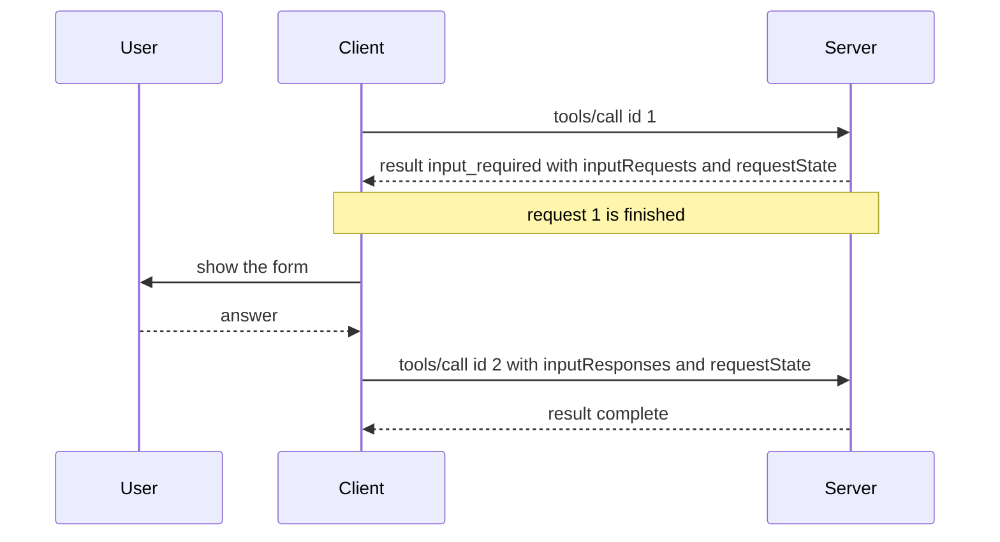

## 1. The question this idea answers

Some tool calls cannot finish with the arguments alone. `cancel_order` should ask the user "Are you sure?". A support tool may want the client's model to write a one-line summary. A code tool may need to know which folders the user opened. Only the client can provide these: it has the user, the model and the workspace.

So the server must ask the client for something **in the middle of a request**. Revision 2025-11-25 did this with requests that the server sent to the client over an open session. Revision 2026-07-28 has no sessions ([L5](/notes/ai/llm-systems/07-mcp/l5-stateful-vs-stateless)), so it replaced them with **Multi Round-Trip Requests** (MRTR, SEP-2322). The interviewer asked "what's new" and "stateful vs stateless". MRTR is the clearest example of both, and this lesson traces it message by message.

## 2. Mental model

> [!analogy] A form that needs one more signature
> **Old way.** You phone the bank to close an account. The clerk says "hold the line", reads the rules, then asks: "Do you confirm?" You answer on the same call, and the same clerk finishes. If the call drops, or your answer reaches another clerk, the work is lost. That is a server-initiated request on a session.
>
> **New way.** You hand in a form. The clerk returns it with a sticky note ("sign here") and a sealed envelope with the clerk's notes. You sign, and you hand in the whole form again, with the sealed envelope, at **any** window. The clerk there opens the envelope, checks the seal, and finishes. That is MRTR: `inputRequests` is the sticky note, `requestState` is the sealed envelope, and the retry is a new, complete request.
>
> **Where it stops working:** a real envelope seal is visible. A `requestState` is just a string that passes through the client. So the server must make tampering detectable with cryptography, and it must reject old or foreign envelopes. And a clerk who already did part of the work before asking may do it twice on the retry. The server must ask first and act second.

## 3. Terms

| Term | Plain meaning |
|---|---|
| client feature | Something the client offers the server: elicitation, sampling or roots. |
| elicitation | The server asks the user for input through the client: `elicitation/create`. |
| form mode | Elicitation with a small JSON Schema. The client shows a form and returns the data. |
| URL mode | Elicitation that sends the user to a web page, for secrets and third-party login. The data never passes through the client. |
| sampling | The server asks the client's model for a completion: `sampling/createMessage`. |
| roots | The client tells the server which `file://` folders are relevant: `roots/list`. |
| server-initiated request | A JSON-RPC request that the server sends to the client. Used in 2025-11-25. |
| Multi Round-Trip Request (MRTR) | The 2026-07-28 pattern: the server returns a request for input, and the client retries the original request with the answers. |
| `InputRequiredResult` | A result with `resultType: "input_required"`, optional `inputRequests` and optional `requestState`. |
| `inputRequests` | A map from a server-chosen key to an elicitation, sampling or roots request object. |
| `inputResponses` | A map from the same keys to the client's results, sent in the retry. |
| `requestState` | An opaque string that the server returns and the client echoes exactly in the retry. |
| AEAD | Authenticated encryption, such as AES-GCM: it hides data and detects any change to it. |
| HMAC | A keyed hash that detects any change to data without hiding it. |
| replay | Sending an old, valid message again to repeat its effect. |
| `ElicitResult` | The client's answer to an elicitation: `action` (`accept`, `decline`, `cancel`) and `content` for an accepted form. |

All terms are also in the [Glossary](/notes/ai/llm-systems/glossary).

## 4. Three things a server may need

| Feature | Method | What the server sends | What the client returns | Status in 2026-07-28 |
|---|---|---|---|---|
| Elicitation | `elicitation/create` | `mode`, `message`, then `requestedSchema` (form) or `url` (URL) | `ElicitResult`: `action`, optional `content` | Active, only through MRTR |
| Sampling | `sampling/createMessage` | `messages`, `maxTokens` and optional model settings | `role`, `content`, `model`, `stopReason` | Deprecated (SEP-2577) |
| Roots | `roots/list` | no parameters | `roots`: `uri` (`file://`) and optional `name` | Deprecated (SEP-2577) |

A client offers a feature by declaring a capability: `elicitation` (with `form` and `url`), `sampling` (with optional `tools` and `context`) and `roots`. In 2025-11-25 it declared them once in `initialize`. In 2026-07-28 it declares them in `_meta["io.modelcontextprotocol/clientCapabilities"]` on **every** request. A server **MUST NOT** ask for a feature that the client did not declare.

## 5. The old way: server-initiated requests (2025-11-25)

### 5.1 A real trace

These notes ran a server built with the Python SDK 2.3.0. Its tool uses `ctx.elicit()`, and a raw client talked to it over stdio with the 2025-11-25 handshake. The server code:

```python
from pydantic import BaseModel
from mcp.server import MCPServer
from mcp.server.mcpserver import Context

mcp = MCPServer("orders-legacy")

class Confirm(BaseModel):
    confirm: bool

@mcp.tool()
async def cancel_order(order_id: str, ctx: Context) -> str:
    """Cancel one order. Asks the user to confirm first."""
    answer = await ctx.elicit(f"Cancel order {order_id}? This cannot be undone.", Confirm)
    if answer.action == "accept" and answer.data.confirm:
        return f"Order {order_id} cancelled."
    return f"Order {order_id} kept."

if __name__ == "__main__":
    mcp.run()
```

The real messages, `>>>` from the client and `<<<` from the server:

```text
>>> {"jsonrpc": "2.0", "id": 1, "method": "initialize", "params": {"protocolVersion": "2025-11-25", "capabilities": {"elicitation": {"form": {}}}, "clientInfo": {"name": "raw-client", "version": "0.1.0"}}}
<<< {"jsonrpc": "2.0", "id": 1, "result": {"capabilities": {"prompts": {"listChanged": false}, "resources": {"listChanged": false, "subscribe": false}, "tools": {"listChanged": false}}, "protocolVersion": "2025-11-25", "serverInfo": {"name": "orders-legacy", "version": ""}}}
>>> {"jsonrpc": "2.0", "method": "notifications/initialized"}
>>> {"jsonrpc": "2.0", "id": 2, "method": "tools/call", "params": {"name": "cancel_order", "arguments": {"order_id": "ORD-1001"}}}
<<< {"jsonrpc": "2.0", "id": 1, "method": "elicitation/create", "params": {"mode": "form", "message": "Cancel order ORD-1001? This cannot be undone.", "requestedSchema": {"properties": {"confirm": {"title": "Confirm", "type": "boolean"}}, "required": ["confirm"], "title": "Confirm", "type": "object"}}}
>>> {"jsonrpc": "2.0", "id": 1, "result": {"action": "accept", "content": {"confirm": true}}}
<<< {"jsonrpc": "2.0", "id": 2, "result": {"content": [{"text": "Order ORD-1001 cancelled.", "type": "text"}], "isError": false, "structuredContent": {"result": "Order ORD-1001 cancelled."}}}
```

Follow the ids. The client's `tools/call` has id 2. While it is open, the server sends **its own request** `elicitation/create` with id 1. That id belongs to the server's id space, so it can equal an id that the client used earlier. The client answers with a response for id 1. Only then does the server finish request 2. The tool call was suspended in the server's memory the whole time.

### 5.2 The three request types in 2025-11-25

**Elicitation, form mode.** The params are `mode` (`"form"`, optional for form), `message` and `requestedSchema`:

```json
{
  "jsonrpc": "2.0",
  "id": 1,
  "method": "elicitation/create",
  "params": {
    "mode": "form",
    "message": "Cancel order ORD-1001? This cannot be undone.",
    "requestedSchema": {
      "type": "object",
      "properties": {
        "confirm": {"type": "boolean", "title": "Confirm", "description": "Cancel the order now?"}
      },
      "required": ["confirm"]
    }
  }
}
```

**Elicitation, URL mode (new in 2025-11-25).** The params are `mode: "url"`, `message`, `url` and an `elicitationId`. The server could later send `notifications/elicitation/complete` with that id. It could also refuse a request until the user finished, with error -32042 `URLElicitationRequiredError`. The request, the error and the completion notification, one message per line:

```json
{"jsonrpc": "2.0", "id": 2, "method": "elicitation/create", "params": {"mode": "url", "message": "Connect your carrier account to track this parcel.", "url": "https://orders.example.com/connect?elicitation=7f3c", "elicitationId": "7f3c2a9e-1b4d-4c55-9a51-0d6e3f2b8c11"}}
{"jsonrpc": "2.0", "id": 5, "error": {"code": -32042, "message": "This request requires more information.", "data": {"elicitations": [{"mode": "url", "message": "Connect your carrier account.", "url": "https://orders.example.com/connect?elicitation=7f3c", "elicitationId": "7f3c2a9e-1b4d-4c55-9a51-0d6e3f2b8c11"}]}}}
{"jsonrpc": "2.0", "method": "notifications/elicitation/complete", "params": {"elicitationId": "7f3c2a9e-1b4d-4c55-9a51-0d6e3f2b8c11"}}
```

**Sampling.** Every parameter of `sampling/createMessage`, valid against the 2025-11-25 schema:

```json
{
  "jsonrpc": "2.0",
  "id": 3,
  "method": "sampling/createMessage",
  "params": {
    "messages": [
      {
        "role": "user",
        "content": {
          "type": "text",
          "text": "Summarize this complaint in one sentence: 'The parcel arrived wet and the box was open.'"
        }
      }
    ],
    "modelPreferences": {
      "hints": [{"name": "small-fast-model"}],
      "costPriority": 0.8,
      "speedPriority": 0.7,
      "intelligencePriority": 0.2
    },
    "systemPrompt": "You summarize customer complaints for a support team.",
    "includeContext": "none",
    "temperature": 0.2,
    "maxTokens": 60,
    "stopSequences": ["\n\n"],
    "metadata": {"ticket": "T-881"}
  }
}
```

| Parameter | Required | Meaning |
|---|---|---|
| `messages` | yes | `SamplingMessage` items: `role` and one block or an array of blocks (text, image, audio, `tool_use`, `tool_result`). |
| `maxTokens` | yes | The maximum number of tokens. The client MAY sample fewer. |
| `modelPreferences` | no | `hints` (model name substrings, tried in order), and `costPriority`, `speedPriority`, `intelligencePriority`, each from 0 to 1. Advisory only. |
| `systemPrompt` | no | A system prompt. The client MAY change or omit it. |
| `includeContext` | no | `"none"` (default), `"thisServer"` or `"allServers"`. The last two were soft-deprecated in 2025-11-25. |
| `temperature`, `stopSequences`, `metadata` | no | Sampling settings and provider-specific data. |
| `tools`, `toolChoice` | no | Tools for the sampled model, added in 2025-11-25 (SEP-1577). `toolChoice.mode` is `auto`, `required` or `none`. Needs the `sampling.tools` capability. |

The result:

```json
{"role": "assistant", "content": {"type": "text", "text": "The parcel arrived wet and opened."}, "model": "provider-model-name", "stopReason": "endTurn"}
```

The client keeps full control and chooses the model. The spec says that the client should let the user see and approve the request and the response.

**Roots.** `roots/list` has no parameters. The result lists `file://` URIs. A client with `roots: {"listChanged": true}` also sent `notifications/roots/list_changed` when the user opened another folder:

```json
{"jsonrpc": "2.0", "id": 4, "method": "roots/list"}
{"jsonrpc": "2.0", "id": 4, "result": {"roots": [{"uri": "file:///home/user/projects/orders-service", "name": "orders-service"}]}}
```

### 5.3 Why this needs a stateful session

A server-initiated request needs two things:

1. **A channel from the server to the client while a request is open.** On stdio this is the process pipe. On Streamable HTTP it is an SSE stream on the response of the POST, or the separate GET stream ([L4](/notes/ai/llm-systems/07-mcp/l4-transports)).
2. **The answer must reach the same server process.** The suspended tool call lives in the memory of one replica. The client's answer arrives as a new HTTP POST. If a load balancer sends it to another replica, that replica has no waiting call with that id.

So deployments needed sticky sessions on `Mcp-Session-Id`, or a shared message bus between replicas. That is the cost that revision 2026-07-28 removed ([L5](/notes/ai/llm-systems/07-mcp/l5-stateful-vs-stateless)).

```video
{
  "src": "/notes/media/llm-systems/manim/m35-old-elicitation-vs-mrtr.mp4",
  "caption": "The old server-initiated elicitation needs the same server process behind a sticky session, while MRTR retries need no affinity."
}
```

## 6. The new way: Multi Round-Trip Requests (2026-07-28)

### 6.1 The flow

The MRTR page gives four steps:

1. The client sends a request with the parameters for the operation.
2. The server decides that it needs more information and responds with a request for it.
3. The client gathers the information and **retries the original request** with that information.
4. The server has enough information and responds with the final result.



The MRTR note says it plainly: "Servers **MUST** send server-to-client requests (such as `roots/list`, `sampling/createMessage`, or `elicitation/create`) using the MRTR pattern. The previous pattern of server-initiated requests is no longer supported. This is a breaking change."

> [!key] The main idea of MRTR
> Round 1 is a complete request with a complete answer. Round 2 is a new, complete request. Nothing waits in server memory between them. Everything the server needs to continue travels in the retry: the original arguments, the answers in `inputResponses`, and the server's own notes in `requestState`. So any replica can serve round 2.

### 6.2 `InputRequiredResult`, field by field

| Field | Required | Meaning |
|---|---|---|
| `resultType` | yes | `"input_required"`. |
| `inputRequests` | no | A map. Keys are server-assigned and **MUST** be unique within the request. Values are `ElicitRequest`, `CreateMessageRequest` or `ListRootsRequest` objects: `method` and `params`, with no `jsonrpc` and no `id`. |
| `requestState` | no | "An opaque string meaningful only to the server". The format is free: base64 JSON, an encrypted token, binary. |
| `_meta` | no | Result metadata. |

At least one of `inputRequests` and `requestState` **MUST** be present. An `InputRequiredResult` is allowed only for `tools/call`, `prompts/get` and `resources/read`. Servers **MUST NOT** send it for any other request.

A round-1 result that asks for a confirmation and a model summary at once:

```json
{
  "jsonrpc": "2.0",
  "id": 1,
  "result": {
    "resultType": "input_required",
    "inputRequests": {
      "confirm": {
        "method": "elicitation/create",
        "params": {
          "mode": "form",
          "message": "Cancel order ORD-1001? This cannot be undone.",
          "requestedSchema": {
            "type": "object",
            "properties": {
              "confirm": {"type": "boolean", "title": "Confirm", "description": "Cancel the order now?"}
            },
            "required": ["confirm"]
          }
        }
      },
      "summary": {
        "method": "sampling/createMessage",
        "params": {
          "messages": [
            {
              "role": "user",
              "content": {
                "type": "text",
                "text": "Summarize this complaint in one sentence: 'The parcel arrived wet and the box was open.'"
              }
            }
          ],
          "maxTokens": 60
        }
      }
    },
    "requestState": "v1.Kq3...sealed-by-the-server"
  }
}
```

### 6.3 The retry, field by field

The retry repeats the original method and parameters, and adds two fields:

| Field | Meaning |
|---|---|
| `inputResponses` | A map with the same keys as `inputRequests`. Each value is the client's result: `ElicitResult`, `CreateMessageResult` or `ListRootsResult`. |
| `requestState` | The exact string from the `InputRequiredResult`, if there was one. |

```json
{
  "jsonrpc": "2.0",
  "id": 2,
  "method": "tools/call",
  "params": {
    "name": "cancel_order",
    "arguments": {"order_id": "ORD-1001"},
    "inputResponses": {
      "confirm": {"action": "accept", "content": {"confirm": true}},
      "summary": {
        "role": "assistant",
        "content": {"type": "text", "text": "The parcel arrived wet and opened."},
        "model": "provider-model-name",
        "stopReason": "endTurn"
      }
    },
    "requestState": "v1.Kq3...sealed-by-the-server",
    "_meta": {
      "io.modelcontextprotocol/protocolVersion": "2026-07-28",
      "io.modelcontextprotocol/clientCapabilities": {"elicitation": {"form": {}}, "sampling": {}},
      "io.modelcontextprotocol/clientInfo": {"name": "orders-agent", "version": "1.4.0"}
    }
  }
}
```

And the final result:

```json
{"jsonrpc": "2.0", "id": 2, "result": {"resultType": "complete", "content": [{"type": "text", "text": "Order ORD-1001 cancelled."}], "isError": false}}
```

Note the `_meta` of the retry. It declares `sampling` too, because the server asked for a sampling result. A server **MUST NOT** put a request into `inputRequests` that the client did not declare in this request's capabilities. If the server cannot continue without that feature, it returns error -32021 `MissingRequiredClientCapability`, with the missing capabilities in `data.requiredCapabilities`.

### 6.4 The rules for each side

| Server | Client |
|---|---|
| **MAY** answer `tools/call`, `prompts/get` or `resources/read` with an `InputRequiredResult`. | **MUST** build every requested input before it retries. With no `inputRequests`, it **MAY** retry at once. |
| **MUST** include `inputRequests` or `requestState`, or both. | **MUST** echo `requestState` exactly, and **MUST NOT** inspect, parse or change it. |
| **MUST NOT** ask for features that the client did not declare. | **MUST NOT** send a `requestState` if none was given. |
| **MUST NOT** assume that the client will answer or retry. **MAY** ask again on the retry. | **MUST** use a new JSON-RPC `id` for the retry. |
| **SHOULD** ask again, not fail, if a needed answer is missing. **SHOULD** ignore unknown extra answers. | **MUST NOT** reuse `inputRequests` or `requestState` for any other parallel request. |

Two consequences matter in practice. First, a `requestState` alone, with no questions, is valid: the spec calls it load shedding. A server can return partial progress and let the client retry:

```json
{"jsonrpc": "2.0", "id": 7, "result": {"resultType": "input_required", "requestState": "v1.page-2-of-export"}}
```

Second, results of a retry **MUST NOT** be cached, because they depend on inputs that are not part of the cache key ([L6](/notes/ai/llm-systems/07-mcp/l6-tools-in-depth)).

### 6.5 `requestState` is attacker-controlled

The state passes through the client, and a malicious client can change it. The MRTR page sets these rules:

1. Servers **MUST** treat `requestState` as attacker-controlled input.
2. If it influences authorization, resource access or business logic, servers **MUST** protect its integrity, for example with HMAC or AEAD. They **MUST** reject state that fails verification. Integrity protection **MAY** be omitted "only when tampering can cause nothing worse than request failure".
3. To prevent replay, servers **SHOULD** put three items into the protected payload and check each one. The items are the authenticated principal, a short expiry and an identifier of the original request. That identifier is the method name and a digest of its main parameters.
4. These measures do not make a state single-use. An action that must happen at most once, such as a one-time redemption, **MUST** be enforced on the server side.

The Python SDK 2.3.0 implements this in `mcp.server.request_state`. Read from its source on 2026-10-15: `MCPServer` seals every `requestState` with AES-256-GCM, a 600-second lifetime, the server name as the audience and the authenticated principal. Without configuration it uses `RequestStateSecurity.ephemeral()`, a key that only this process holds. Its docstring warns: "state minted before a restart or by another worker is rejected. Multi-instance deployments must share a key via `keys=[...]`."

> [!trap] A stateless protocol still needs a shared secret
> MRTR removes the need for sticky sessions, but replica B must open what replica A sealed. With the SDK's default per-process key, a round-2 request that lands on another replica fails. Configure the same key list on every replica, and rotate keys with the documented order: `keys=[old, new]`, then `keys=[new, old]`, then `keys=[new]`.

### 6.6 A real MRTR exchange

The same `cancel_order` tool, written for MRTR. Round 1 changes nothing and only asks. Round 2 checks the state and acts:

```python
import json
from mcp.server import MCPServer
from mcp.server.mcpserver import Context
from mcp.server.request_state import RequestStateSecurity
from mcp.shared.exceptions import MCPError
from mcp.types import (CallToolResult, ElicitRequest, ElicitRequestFormParams,
                       InputRequiredResult, TextContent)

# One shared key for every replica, so that any replica can open the state.
security = RequestStateSecurity(keys=["replace-with-a-32-byte-secret-from-a-vault"], ttl=300)
mcp = MCPServer("orders-mrtr", request_state_security=security)

@mcp.tool()
def cancel_order(order_id: str, ctx: Context) -> CallToolResult | InputRequiredResult:
    """Cancel one order. Asks the user to confirm first."""
    caps = ctx.client_capabilities
    if caps is None or caps.elicitation is None:          # never ask what the client cannot show
        raise MCPError(-32021, "Client must support elicitation",
                       {"requiredCapabilities": {"elicitation": {"form": {}}}})
    answers = ctx.input_responses or {}
    if "confirm" not in answers:                          # round 1: ask, change nothing
        ask = ElicitRequest(params=ElicitRequestFormParams(
            message=f"Cancel order {order_id}? This cannot be undone.",
            requested_schema={"type": "object",
                              "properties": {"confirm": {"type": "boolean", "title": "Confirm"}},
                              "required": ["confirm"]}))
        state = json.dumps({"order_id": order_id})        # the SDK seals it before it leaves
        return InputRequiredResult(input_requests={"confirm": ask}, request_state=state)
    if json.loads(ctx.request_state)["order_id"] != order_id:   # round 2: same order only
        return CallToolResult(content=[TextContent(text="State is for another order.")], is_error=True)
    reply = answers["confirm"]
    if reply.action == "accept" and (reply.content or {}).get("confirm") is True:
        return CallToolResult(content=[TextContent(text=f"Order {order_id} cancelled.")])
    return CallToolResult(content=[TextContent(text=f"Order {order_id} kept: the user did not confirm.")])

if __name__ == "__main__":
    mcp.run()
```

A minimal client loop that completes every round. It sends a new request with a new id each time, and it stops after three rounds:

```python
def call_tool(send, name, arguments, answer, capabilities, max_rounds=3):
    """Call a tool and complete every MRTR round. answer(key, request) -> result for that key."""
    request_state, responses = None, None
    for _ in range(max_rounds):
        params = {"name": name, "arguments": arguments, "_meta": {
            "io.modelcontextprotocol/protocolVersion": "2026-07-28",
            "io.modelcontextprotocol/clientCapabilities": capabilities}}
        if responses is not None:
            params["inputResponses"] = responses
        if request_state is not None:
            params["requestState"] = request_state         # echo it exactly, never parse it
        reply = send("tools/call", params)                 # send() gives every call a new id
        result = reply.get("result")
        if result is None or result.get("resultType", "complete") != "input_required":
            return reply                                   # final result or a JSON-RPC error
        request_state = result.get("requestState")
        responses = {key: answer(key, req) for key, req in result.get("inputRequests", {}).items()}
    raise RuntimeError("too many input rounds")
```

What the loop did against the real server over stdio. The `requestState` is cut after 12 characters, and `_meta` is removed for space:

```text
>>> {"jsonrpc": "2.0", "id": 1, "method": "tools/call", "params": {"name": "cancel_order", "arguments": {"order_id": "ORD-1001"}}}
<<< {"jsonrpc": "2.0", "id": 1, "result": {"inputRequests": {"confirm": {"method": "elicitation/create", "params": {"message": "Cancel order ORD-1001? This cannot be undone.", "mode": "form", "requestedSchema": {"properties": {"confirm": {"type": "boolean", "title": "Confirm"}}, "required": ["confirm"], "type": "object"}}}}, "requestState": "v1.g-aBlmqYz...", "resultType": "input_required"}}
>>> {"jsonrpc": "2.0", "id": 2, "method": "tools/call", "params": {"name": "cancel_order", "arguments": {"order_id": "ORD-1001"}, "inputResponses": {"confirm": {"action": "accept", "content": {"confirm": true}}}, "requestState": "v1.g-aBlmqYz..."}}
<<< {"jsonrpc": "2.0", "id": 2, "result": {"content": [{"text": "Order ORD-1001 cancelled.", "type": "text"}], "isError": false, "resultType": "complete"}}
```

The same call from a client that declares no capabilities:

```text
>>> {"jsonrpc": "2.0", "id": 3, "method": "tools/call", "params": {"name": "cancel_order", "arguments": {"order_id": "ORD-1001"}}}
<<< {"jsonrpc": "2.0", "id": 3, "error": {"code": -32021, "message": "Client must support elicitation", "data": {"requiredCapabilities": {"elicitation": {"form": {}}}}}}
```

And a retry with a changed `requestState` (the last two characters replaced):

```text
<<< {"jsonrpc": "2.0", "id": 5, "error": {"code": -32602, "message": "Invalid or expired requestState", "data": {"reason": "invalid_request_state"}}}
```

Read the measured output:

1. Round 1 returned `resultType: "input_required"` and no content. The tool did not cancel anything.
2. The `requestState` on the wire starts with `v1.`. That is the SDK's sealed token, not the JSON that the tool code wrote.
3. Round 2 was a new request with id 2. It carried the arguments again, the answer under the key `confirm`, and the sealed state.
4. Without the `elicitation` capability, the tool answered -32021 with `requiredCapabilities`. In these notes, a version of the tool **without** the capability check returned the elicitation request anyway: the SDK did not block it. The check is the server author's job.
5. A changed state failed verification with -32602 "Invalid or expired requestState".

```video
{
  "src": "/notes/media/llm-systems/manim/m34-mrtr-retry-flow.mp4",
  "caption": "A tool call returns input_required, the client asks the user, and a new request with inputResponses and requestState finishes on any replica."
}
```


### 6.7 Elicitation, sampling and roots inside MRTR

The request objects are the same as in 2025-11-25, minus `jsonrpc` and `id`. URL mode changed the most.

**URL mode** has no `elicitationId` in 2026-07-28, and `notifications/elicitation/complete` and error -32042 are gone. The server encodes its own correlation id in `requestState`. An `accept` only means that the user agreed to open the URL. When the client retries, the server checks whether the browser flow finished, and returns the result or another `InputRequiredResult`:

```json
{"method": "elicitation/create", "params": {"mode": "url", "message": "Connect your carrier account to track this parcel.", "url": "https://orders.example.com/connect?r=4b1e"}}
```

**Roots** as an input request and the client's answer:

```json
{"method": "roots/list"}
{"roots": [{"uri": "file:///home/user/projects/orders-service", "name": "orders-service"}]}
```

**Tasks.** For long operations, the tasks extension `io.modelcontextprotocol/tasks` uses the same input model inside a task. A task in status `input_required` carries `inputRequests`, and the client answers with `tasks/update` ([L10](/notes/ai/llm-systems/07-mcp/l10-utilities-and-errors)).

## 7. Elicitation in detail

### 7.1 The restricted form schema

`requestedSchema` is a JSON Schema with strict limits: "form mode elicitation schemas are limited to flat objects with primitive properties only". Its root is `{"type": "object", "properties": {...}, "required": [...]}`, and each property is one of these:

| Property schema | Fields |
|---|---|
| String | `type: "string"`, `title`, `description`, `minLength`, `maxLength`, `format` (`email`, `uri`, `date`, `date-time`), `default` |
| Number | `type: "number"` or `"integer"`, `title`, `description`, `minimum`, `maximum`, `default` |
| Boolean | `type: "boolean"`, `title`, `description`, `default` |
| Single-select enum | `type: "string"` with `enum`, or with `oneOf` of `{"const", "title"}` pairs for display labels |
| Multi-select enum | `type: "array"` with `items.enum`, or `items.anyOf` of `{"const", "title"}` pairs, plus `minItems` and `maxItems` |
| Legacy titled enum | `enum` with `enumNames`. Kept for compatibility. Use the `oneOf` form instead. |

Not supported: nested objects, arrays of objects beyond enum selections, and other advanced JSON Schema features ([L7](/notes/ai/llm-systems/07-mcp/l7-json-schema-for-tool-arguments) explains the full language). Clients that support defaults **SHOULD** fill the form with them.

> [!note] Source check: `pattern` in elicitation strings
> **Discrepancy.** The 2025-11-25 elicitation page shows a string schema example with `"pattern": "^[A-Za-z]+$"`, but the `StringSchema` type in the 2025-11-25 `schema.ts` has no `pattern` field. The 2026-07-28 page removed `pattern` from the example, and its schema also has none. Do not rely on `pattern` in a form. Source: elicitation pages and `schema.ts` of both revisions, checked on 2026-10-15.

### 7.2 The three answers

| `action` | Meaning | `content` |
|---|---|---|
| `"accept"` | The user submitted the form or agreed to open the URL. | The form data for form mode. Omitted for URL mode. |
| `"decline"` | The user said no explicitly. | Usually omitted. |
| `"cancel"` | The user closed the dialog without a choice. | Usually omitted. |

The server should treat them differently: process the data, offer an alternative, or ask again later. The client answer for a form can contain only strings, numbers, booleans and arrays of strings.

### 7.3 Safety rules

| Rule | Who |
|---|---|
| **MUST NOT** ask for passwords, API keys, access tokens or payment credentials in form mode. Use URL mode for those. | Server |
| Show which server is asking, offer clear decline and cancel options, and let the user review and change form answers before sending. | Client (**MUST**) |
| URL mode: do not pre-fetch the URL or open it without explicit consent. Show the full URL. Open it so that the client and the model cannot read the page. | Client (**MUST**) |
| URL mode: highlight the domain and warn on suspicious URLs such as Punycode. | Client (**SHOULD**) |
| Put no credentials or personal data into the URL, and never a pre-authenticated URL. | Server (**MUST NOT**) |
| Bind each elicitation to the client and the user identity, and never trust a user identity that the client asserts. | Server |
| Verify that the person who opens a URL is the same user who started the elicitation, to stop phishing. | Server (**MUST**) |
| Third-party credentials obtained through URL mode never pass through the MCP client, and the server never sends them to it. | Server (**MUST NOT**) |

The phishing case is worth knowing. Alice starts a URL elicitation, takes the URL, and tricks Bob into opening it. Bob completes a third-party login, and the server binds Bob's tokens to Alice. The fix in the spec: send the user to a "connect" page on the server first. That page checks that the browser session belongs to the same user, for example by the same `sub` claim. Only then does it redirect to the third-party login.

## 8. Deprecation of Roots, Sampling and Logging

Revision 2026-07-28 deprecated three features (SEP-2577). They "remain fully functional during the deprecation window but new implementations should not add support for them".

| Feature | Migration in the changelog | Earliest removal |
|---|---|---|
| Roots | Pass directories or files through tool parameters, resource URIs or server configuration. | First revision released on or after 2027-07-28 |
| Sampling | Integrate directly with LLM provider APIs. | First revision released on or after 2027-07-28 |
| Logging | Log to `stderr` (stdio) or use OpenTelemetry. | First revision released on or after 2027-07-28 |

Interpretation of these notes: sampling let a server use the client's model without its own API key. But it pushed model choice, cost and approval into every host, and hosts supported it unevenly. Roots gave hints, not access control: the roots page says that "The protocol does not enforce that servers stay within roots". A tool parameter or a server setting says the same thing more directly. Elicitation stays, because only the client can reach the user.

## 9. Old vs new, side by side

| Step | 2025-11-25 | 2026-07-28 |
|---|---|---|
| Capability | once, in `initialize` | in `_meta` of every request |
| The question | server sends a JSON-RPC request with its own `id` | server returns `InputRequiredResult` as the result of the original request |
| Where the call waits | suspended in server memory | nowhere: round 1 is finished |
| The answer | a JSON-RPC response to the server's `id` | `inputResponses` in a new request with a new `id` |
| Server context between rounds | in memory, tied to the session | in `requestState`, sealed, carried by the client |
| Load balancer | sticky sessions or a shared bus | any replica, with a shared sealing key |
| URL mode completion | `elicitationId`, `notifications/elicitation/complete`, error -32042 | the retry, with the server's id inside `requestState` |
| Sampling and roots | active | deprecated, still functional |

### Exercises

Put your code in `C:\Users\ASohi\Downloads\AI\agent-harness-lab\llm-systems\mcp_mrtr.ipynb`.

1. **Seal and open a request state.** Write `seal(principal, method, params, data, key, now)` and `unseal(token, key, principal, method, params, now)` with HMAC-SHA256 from Python's `hmac` module. The sealed payload holds the principal, an expiry time, a digest of the method and the parameters, and the server's own `data`.
   - Acceptance test: a token made for principal `u1` and `tools/call` with `{"order_id": "ORD-1001"}` opens with the same values. It fails after one changed character, for principal `u2`, for `{"order_id": "ORD-2002"}`, and after the expiry.
   - Hint 1: compare tags with `hmac.compare_digest`.
   - Hint 2: digest the parameters with `json.dumps(params, sort_keys=True)`.
2. **A client loop with a user.** Extend `call_tool` of section 6.6 so that `answer` can return `decline`. The loop must also work for `prompts/get` and `resources/read`.
   - Acceptance test: against the server of section 6.6, a decline gives the text "kept: the user did not confirm.". A fake server that always asks makes the loop stop with `RuntimeError` after `max_rounds`.
   - Hint 1: the method name and its parameters can be arguments of the loop.
   - Hint 2: count rounds, not requests.

## 10. Common mistakes

1. **"In 2026-07-28 the server still sends `elicitation/create` to the client."** Server-initiated requests are no longer supported. The request travels inside an `InputRequiredResult`.
2. **"The retry reuses the JSON-RPC id."** The retry is a new request, and the id **MUST** be different.
3. **"`requestState` is private to the server, so it is safe."** It passes through the client. Seal it, bind it to the user and the request, and give it a short life.
4. **"MRTR makes the server fully stateless, so replicas need nothing in common."** They need the same sealing key, and the SDK's default key is per process.
5. **"The tool can act first and ask afterwards."** Round 1 may run again on a retry or never get a retry. Ask first, act in the final round.
6. **"Form mode is fine for an API key if the user agrees."** Form mode **MUST NOT** ask for passwords, API keys, tokens or payment data. Use URL mode.
7. **"Sampling and roots were removed in 2026-07-28."** They are deprecated and still work. The earliest removal is the first revision released on or after 2027-07-28.

## 11. One-minute explanation

Sometimes a server needs something that only the client has: a user's answer, a completion from the client's model, or the user's folders. In revision 2025-11-25 the server sent its own JSON-RPC request, such as `elicitation/create`, to the client. The tool call waited in server memory, so the answer had to reach the same server process, which needed a session and sticky load balancing. Revision 2026-07-28 replaces this with Multi Round-Trip Requests. The server finishes round 1 with `resultType: "input_required"`, an `inputRequests` map and an opaque `requestState`. The client asks the user, then sends a new request with a new id that repeats the arguments and adds `inputResponses` and the exact `requestState`. Any replica that can verify the state can finish it. So the server must seal the state, bind it to the user and the request, and give it a short life. Form elicitation uses a flat, restricted schema, and secrets must use URL mode. Sampling, roots and logging are deprecated in 2026-07-28 but still work for at least a year.

## 12. Check questions

```check
{
  "question": "In revision 2025-11-25, how did a server ask the user to confirm during a `tools/call`? Name the message, its direction, its id space, and why the server needed a session.",
  "answer": "The server sent its own JSON-RPC request `elicitation/create` to the client, while the client's `tools/call` was still open. The request had an id from the server's id space, for example 1, which is independent of the client's ids. The client answered with a JSON-RPC response with the same id and `{\"action\": \"accept\", \"content\": {...}}`. Then the server finished the tool call. This needs a session. The server must be able to send a message to this client while a request is in flight. It uses stdio, or an SSE stream over HTTP. And the client's answer must reach the same server process that holds the waiting call. The client must also have declared the `elicitation` capability in `initialize`."
}
```

```check
{
  "question": "List the fields of an `InputRequiredResult` and the client's duties when it receives one.",
  "answer": "`resultType: \"input_required\"` is required. `inputRequests` is an optional map from a server-chosen key to an `elicitation/create`, `sampling/createMessage` or `roots/list` request object, without `jsonrpc` and `id`. `requestState` is an optional opaque string. `_meta` is optional. At least one of `inputRequests` and `requestState` MUST be present. The client MUST build every requested input before it retries. It MUST echo `requestState` exactly and never inspect it, and MUST NOT add a `requestState` if none was given. It MUST use a new JSON-RPC `id` for the retry. It MUST NOT use the inputs or the state for any other parallel request. If only `requestState` is present, the client MAY retry immediately."
}
```

```check
{
  "question": "Interview follow-up: why must a server treat `requestState` as attacker-controlled, and what protections does the spec ask for? What does the Python SDK 2.3.0 do by default?",
  "hint": "Who carries the state between round 1 and round 2?",
  "answer": "`requestState` travels through the client, so a malicious or buggy client can change it. If the state affects authorization, resource access or business logic, the server MUST protect its integrity, for example with an HMAC or an AEAD cipher. It MUST reject state that fails verification. To limit replay, the server SHOULD seal three items and check each one. They are the authenticated principal, a short expiry, and an identifier of the original request. The identifier is the method and a digest of its main parameters. These measures do not make a state single-use: a one-time action needs a server-side record. The SDK 2.3.0 seals every `requestState` with AES-256-GCM through `RequestStateSecurity`. The default lifetime is 600 seconds, the audience is the server name, and the authenticated principal is bound in. Without configuration it uses `RequestStateSecurity.ephemeral()`, a key generated per process, so state from another replica or from before a restart is rejected. Multiple replicas need a shared key list: `RequestStateSecurity(keys=[...])`. Measured: a changed state gave error -32602 \"Invalid or expired requestState\"."
}
```

```check
{
  "question": "Interview follow-up: a load balancer sends round 1 of a `tools/call` to replica A and the MRTR retry to replica B. Walk through what happens in 2025-11-25 style and in 2026-07-28 style.",
  "answer": "Old style: replica A sent `elicitation/create` and keeps the tool call suspended in memory, waiting for the response with its id. The client's response arrives as a new HTTP POST, and the balancer sends it to B. B has no waiting call with that id. The answer is lost, and the call on A hangs until its timeout. To work, the deployment needs sticky sessions keyed by `Mcp-Session-Id`, or a shared message bus between replicas. New style: A returns an `InputRequiredResult` with the question and a sealed `requestState`, and keeps nothing. The client asks the user and sends a new, complete `tools/call` with `inputResponses` and `requestState`. B opens the state with the shared key, checks expiry and binding, and finishes the call. No affinity is needed. This works only if all replicas share the sealing key and the round-1 code made no side effect that a retry could repeat."
}
```

```check
{
  "question": "Interview follow-up: write a valid form-mode `requestedSchema` that asks for a delivery date and a contact email. Then name two JSON Schema features that it may not use.",
  "answer": "`{\"type\": \"object\", \"properties\": {\"delivery_date\": {\"type\": \"string\", \"format\": \"date\", \"title\": \"Delivery date\"}, \"email\": {\"type\": \"string\", \"format\": \"email\", \"title\": \"Contact email\"}}, \"required\": [\"delivery_date\"]}`. The schema must be a flat object whose properties are primitive schemas. A string allows `minLength`, `maxLength`, `default` and a `format` from `email`, `uri`, `date`, `date-time`. A number or integer allows `minimum`, `maximum` and `default`. A boolean and the enum forms are also allowed. Not allowed: nested objects, arrays of objects, `$ref`, and composition keywords such as `oneOf` except for titled enum options. Arrays are allowed only as arrays of enum strings for multi-select. Also, form mode MUST NOT ask for passwords, API keys, access tokens or payment credentials: those need URL mode."
}
```

```check
{
  "question": "Name the parameters of `sampling/createMessage`, mark the required one, and say what changed for sampling in 2025-11-25 and 2026-07-28.",
  "answer": "`messages` is a required array of `SamplingMessage`. Each has a `role` and one or more content blocks: text, image, audio, `tool_use` or `tool_result`. `maxTokens` is a required number. The optional parameters are `modelPreferences`, `systemPrompt`, `includeContext`, `temperature`, `stopSequences`, `metadata`, `tools` and `toolChoice`. `modelPreferences` holds `hints` with model name substrings and `costPriority`, `speedPriority` and `intelligencePriority`, each from 0 to 1. `includeContext` is `\"none\"`, `\"thisServer\"` or `\"allServers\"`. `toolChoice.mode` is `auto`, `required` or `none`. The result has `role`, `content`, `model` and an optional `stopReason` such as `endTurn` or `toolUse`. Revision 2025-11-25 added `tools` and `toolChoice` (SEP-1577) and soft-deprecated the `includeContext` values `thisServer` and `allServers`. Revision 2026-07-28 moved the request inside `inputRequests` (MRTR) and deprecated the whole Sampling feature (SEP-2577), with the migration \"integrate directly with LLM provider APIs\"."
}
```

```check
{
  "question": "Interview follow-up: in URL mode, how does a 2026-07-28 server know that the user finished the out-of-band step, now that `elicitationId` and `notifications/elicitation/complete` are gone?",
  "answer": "In 2025-11-25 the request carried an `elicitationId`, and the server could send `notifications/elicitation/complete` with that id, or answer with error -32042 `URLElicitationRequiredError`. Revision 2026-07-28 removed all three. The `accept` action only means that the user agreed to open the URL. The server encodes its own correlation id in `requestState`. When the client retries the original request, the server checks whether the browser flow finished. It looks in its own store, keyed by that id and bound to the authenticated user. If yes, it returns the final result. If not, it returns another `InputRequiredResult`. The spec says that clients SHOULD give the user manual controls to retry or cancel."
}
```

```check
{
  "question": "Which three client features are deprecated in 2026-07-28, what replaces each, and when can they be removed?",
  "answer": "Roots, Sampling and Logging, by SEP-2577. Migrations from the changelog: pass directories or files through tool parameters, resource URIs or server configuration instead of Roots. Integrate directly with LLM provider APIs instead of Sampling. Log to stderr (stdio) or use OpenTelemetry instead of Logging. The deprecated features registry gives the earliest removal as the \"First revision released on or after 2027-07-28\", so they stay fully functional for at least twelve months. Elicitation is not deprecated. It is now carried by MRTR."
}
```

```check
{
  "question": "Exercise 1: show a reference solution.",
  "answer": "```python\nimport base64, hashlib, hmac, json\n\ndef _b64(b: bytes) -> str:\n    return base64.urlsafe_b64encode(b).decode().rstrip(\"=\")\n\ndef _unb64(s: str) -> bytes:\n    return base64.urlsafe_b64decode(s + \"=\" * (-len(s) % 4))\n\ndef _digest(method: str, params: dict) -> str:\n    return hashlib.sha256((method + json.dumps(params, sort_keys=True)).encode()).hexdigest()\n\ndef seal(principal: str, method: str, params: dict, data: dict, key: bytes, now: float, ttl: float = 300) -> str:\n    payload = {\"sub\": principal, \"exp\": now + ttl, \"req\": _digest(method, params), \"data\": data}\n    body = json.dumps(payload, sort_keys=True).encode()\n    tag = hmac.new(key, body, hashlib.sha256).digest()\n    return _b64(body) + \".\" + _b64(tag)\n\ndef unseal(token: str, key: bytes, principal: str, method: str, params: dict, now: float) -> dict:\n    try:\n        body_part, tag_part = token.split(\".\")\n        body, tag = _unb64(body_part), _unb64(tag_part)\n    except ValueError:\n        raise ValueError(\"malformed state\")\n    if not hmac.compare_digest(tag, hmac.new(key, body, hashlib.sha256).digest()):\n        raise ValueError(\"bad signature\")\n    payload = json.loads(body)\n    if payload[\"sub\"] != principal:\n        raise ValueError(\"other principal\")\n    if payload[\"req\"] != _digest(method, params):\n        raise ValueError(\"other request\")\n    if now >= payload[\"exp\"]:\n        raise ValueError(\"expired\")\n    return payload[\"data\"]\n```\n\nThe four attacks fail (measured):\n\n```text\none changed character: ValueError: bad signature\nprincipal u2: ValueError: other principal\nother order: ValueError: other request\nafter expiry: ValueError: expired\n```\n\nHMAC proves integrity but does not hide the payload. Use AEAD, for example AES-GCM, if the state holds anything the client must not read."
}
```

```check
{
  "question": "Exercise 2: show a reference solution.",
  "answer": "```python\ndef call_with_input(send, method, params, answer, capabilities, max_rounds=3):\n    # One MRTR exchange for tools/call, prompts/get or resources/read.\n    state, responses = None, None\n    for _ in range(max_rounds):\n        p = dict(params, _meta={\"io.modelcontextprotocol/protocolVersion\": \"2026-07-28\",\n                                \"io.modelcontextprotocol/clientCapabilities\": capabilities})\n        if responses is not None:\n            p[\"inputResponses\"] = responses\n        if state is not None:\n            p[\"requestState\"] = state\n        reply = send(method, p)\n        result = reply.get(\"result\")\n        if result is None or result.get(\"resultType\", \"complete\") != \"input_required\":\n            return reply\n        state = result.get(\"requestState\")\n        responses = {k: answer(k, r) for k, r in result.get(\"inputRequests\", {}).items()}\n    raise RuntimeError(f\"no final result after {max_rounds} rounds\")\n```\n\nMeasured against the server of section 6.6 and a fake server that always asks:\n\n```text\ndecline -> Order ORD-1001 kept: the user did not confirm.\nalways_ask -> RuntimeError: no final result after 3 rounds\n```"
}
```

## 13. Links

- Previous: [L8: Resources and prompts](/notes/ai/llm-systems/07-mcp/l8-resources-and-prompts)
- Next: [L10: Utilities: progress, cancellation, pagination, errors](/notes/ai/llm-systems/07-mcp/l10-utilities-and-errors)
- [L3: The stateful protocol (2025-11-25)](/notes/ai/llm-systems/07-mcp/l3-the-stateful-protocol): `initialize` and client capabilities
- [L5: Stateful vs stateless MCP](/notes/ai/llm-systems/07-mcp/l5-stateful-vs-stateless): why sessions were removed
- [L6: Tools in depth](/notes/ai/llm-systems/07-mcp/l6-tools-in-depth): the `inputResponses` and `requestState` parameters of `tools/call`
- [L11: Authorization and security](/notes/ai/llm-systems/07-mcp/l11-authorization-and-security): token passthrough and phishing
- [L12: What is new: the version history](/notes/ai/llm-systems/07-mcp/l12-whats-new-version-history)
- Drill: [L4: Drill: MCP](/notes/ai/llm-systems/08-interview-drills/l4-chain-mcp)

### Sources

All checked on 2026-10-15.

- MCP specification 2026-07-28, Multi Round-Trip Requests: https://modelcontextprotocol.io/specification/2026-07-28/basic/patterns/mrtr
- MCP specification 2026-07-28, Elicitation: https://modelcontextprotocol.io/specification/2026-07-28/client/elicitation
- MCP specification 2025-11-25, Elicitation: https://modelcontextprotocol.io/specification/2025-11-25/client/elicitation
- MCP specification 2026-07-28 and 2025-11-25, Sampling: https://modelcontextprotocol.io/specification/2026-07-28/client/sampling and https://modelcontextprotocol.io/specification/2025-11-25/client/sampling
- MCP specification 2026-07-28 and 2025-11-25, Roots: https://modelcontextprotocol.io/specification/2026-07-28/client/roots and https://modelcontextprotocol.io/specification/2025-11-25/client/roots
- MCP specification 2026-07-28, Key Changes: https://modelcontextprotocol.io/specification/2026-07-28/changelog
- MCP specification 2026-07-28, Deprecated features: https://modelcontextprotocol.io/specification/2026-07-28/deprecated
- MCP Tasks extension overview: https://modelcontextprotocol.io/extensions/tasks/overview
- MCP `schema.ts` and `schema.json`: https://github.com/modelcontextprotocol/modelcontextprotocol/tree/main/schema
- MCP Python SDK 2.3.0 on PyPI: https://pypi.org/project/mcp/ (source module `mcp/server/request_state.py`)
