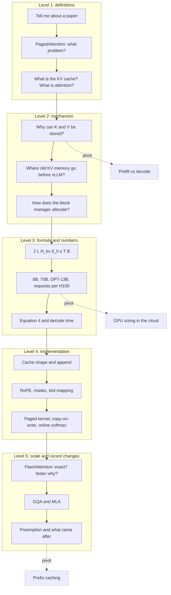

## 1. The question this idea answers

In the friend's interview, the interviewer asked for a research paper. The candidate named PagedAttention. The interviewer "immediately deep dived into the KV cache, its formula, and implementation and what is attention". He did not change the topic after each answer. He took one word from the answer and asked why, how, how much and what breaks.

Parts 01 to 03 and the paper pages teach each idea on its own. This page trains the movement between the ideas. Each question below is one step of that chain. The question of this page is: **can you answer the next question at once, at the depth that the interviewer expects?**

How to use this page:

1. Read a question. Answer it aloud before you open it. Give yourself 30 to 90 seconds.
2. Open the hint only after 20 seconds of silence.
3. Compare your answer with the model answer. Write every missing number or step on the [mistakes page](/notes/ai/llm-systems/00-progress/mistakes).
4. On another day, answer the whole chain from Level 1 to Level 5 without notes.

## 2. Mental model

> [!analogy] A staircase down to the engine room
> The interviewer stands with you at the top of a staircase. Level 1 is the lobby: what the paper is and what problem it solves. Each answer that you give names a door on the floor below. He opens that door: why does it work, what is the formula, how is it coded, what breaks at scale, what changed recently. Five floors down is the engine room: byte counts, kernel details and the newest versions. A good answer leaves one clear door open to the next floor, and you already know what is behind it.
>
> **Where it stops working:** a real interviewer does not always go down. Sometimes he jumps sideways to a neighboring topic (a pivot). Sometimes he returns to a claim that you made ten minutes earlier and tests it (a trap). A staircase has no side doors, but an interview has many.

## 3. Terms

| Term | Plain meaning |
|---|---|
| question chain | A sequence of questions in which each question takes a word from the previous answer and goes one level deeper. |
| level | The depth of a question: 1 definition, 2 mechanism, 3 formula and numbers, 4 implementation, 5 scale, limits and recent changes. |
| trap question | A question with a common wrong answer that sounds right. |
| pivot | A jump from the current topic to a neighboring topic. |
| PagedAttention | Attention that reads the KV cache from fixed-size blocks through a block table (Kwon et al., SOSP 2023). |
| KV cache | The stored key and value vectors of all earlier tokens, per layer and per KV head. |
| block table | For one sequence, the list that maps each logical block to a physical block number. |
| prefill | The first forward pass over the whole prompt. It is compute-bound. |
| decode | One forward pass per new token. It is memory-bound. |
| arithmetic intensity | FLOPs divided by the bytes moved from memory. |
| ridge point | The intensity at which a GPU changes from memory-bound to compute-bound: about 295 FLOPs per byte on an H100 SXM. |
| online softmax | A softmax computed tile by tile with a running maximum and a running sum. |
| FlashAttention | An exact attention kernel that keeps tiles of the scores in on-chip SRAM and never writes the $T \times T$ matrix to HBM. |
| GQA | Grouped-query attention: a group of query heads shares one KV head. |
| MLA | Multi-head latent attention: each token caches one compressed latent vector plus a small RoPE key per layer. |

All terms are also in the [Glossary](/notes/ai/llm-systems/glossary).

## 4. How the chain works

### 4.1 The five levels

| Level | What the interviewer wants | Typical words | Example in this chain |
|---|---|---|---|
| 1 | A correct definition and the problem that it solves | "Tell me about", "What is" | "What problem does PagedAttention solve?" |
| 2 | The mechanism and the reason for it | "Why?", "How does it work?" | "Why can you cache keys and values but not queries?" |
| 3 | The formula and a number that you compute live | "Write the formula", "How big?" | "Compute the cache of Llama-3.1-70B at 128K tokens and batch 8." |
| 4 | The code and the data structures | "How do you implement it?" | "Write the two lines that append to the cache." |
| 5 | Limits, scale and recent changes | "What breaks?", "What came after?" | "Is FlashAttention an approximation? What came after PagedAttention?" |

### 4.2 The shape of one good answer

Every answer, at every level, has the same five parts. Say them in this order. Stop after the part that the question needs.

1. **Definition.** One sentence that a non-expert understands.
2. **Mechanism.** How it works, in two to four steps.
3. **Numbers.** One formula and one computed number for a real model.
4. **Trade-off.** What it costs, and when it does not help.
5. **Production.** Where it appears in a real engine: a flag, a default or a log line.

> [!example] Worked example: "What is the KV cache?" in five parts
> 1. **Definition.** The KV cache stores the key and value vectors of all earlier tokens. Then each decode step computes keys and values only for the new token.
> 2. **Mechanism.** In a causal model, the hidden state of a past token depends only on that token and earlier tokens. So its keys and values never change. Each step projects the new token, appends its key and value in every layer, and the new query attends over the whole cache.
> 3. **Numbers.** Bytes per token $= 2 \times L \times H_{kv} \times d_h \times s$. For Llama-3.1-8B in BF16: $2 \times 32 \times 8 \times 128 \times 2 = 131{,}072$ bytes, which is 128 KiB. A 128K-token request holds 16 GiB, more than the 14.96 GiB of weights.
> 4. **Trade-off.** It trades memory for compute. For a 1,000-token prompt and 1,000 new tokens, it saves about 718 times the FLOPs. But the cache fills GPU memory and limits the batch size.
> 5. **Production.** vLLM stores the cache in blocks of 16 tokens and logs "Available KV cache memory" at startup. An FP8 cache is `--kv-cache-dtype fp8`.

> [!key] Lead with the number
> The interviewer of this chain asked for "its formula". A definition without a number sounds memorized. A definition followed by $2 L H_{kv} d_h s$ and "128 KiB per token for Llama-3.1-8B" shows that you can compute.

### 4.3 Traps and pivots

A **trap** has a wrong answer that sounds right. Examples: "FlashAttention approximates attention", "PagedAttention makes attention faster", "the formula uses the number of attention heads". The questions below mark traps with "(Trap question.)". Answer a trap in three steps: the correct claim, the reason, then one number.

A **pivot** jumps sideways, for example from the KV cache to GPU sizing in the cloud. The questions below mark pivots with "(Pivot.)". Answer a pivot in two or three sentences. Connect it to the topic that you just explained. Then let the interviewer choose the next step.

If you do not know an answer, say what you know, compute what you can, and say how you would check the rest. [L6](/notes/ai/llm-systems/08-interview-drills/l6-mock-interview) trains this.

## 5. The map of this chain

The solid arrows are the main chain. The dashed arrows are the pivots that this chain prepares.



## 6. Common mistakes

1. **"PagedAttention makes attention faster."** Its attention kernel was 20 to 26% slower than the FasterTransformer kernel. The system wins because the batch grows: 30.42 requests at a time against 7.00 for Orca (Max) on OPT-13B.
2. **"FlashAttention is an approximation."** It is exact up to floating-point rounding. It reduces memory traffic, not FLOPs.
3. **"The cache formula uses the number of attention heads."** It uses the number of KV heads $H_{kv}$. With $H = 32$ instead of $H_{kv} = 8$, Llama-3.1-8B gives 512 KiB per token instead of 128 KiB.
4. **"The KV cache stores queries or scores."** Only keys and values have later readers. A query is used once, by its own position.
5. **"PagedAttention and FlashAttention are alternatives."** One manages memory, the other orders the computation. vLLM reads its paged cache with FlashAttention kernels.
6. **"20.4% to 38.2% is the waste."** It is the useful part. The waste is 61.8% to 79.6%.
7. **"Paging removes all waste."** At most $B - 1$ slots per sequence stay empty: 15 slots, 1.875 MiB for Llama-3.1-8B.
8. **"A definition is a complete answer."** This interviewer asked for "its formula" and "implementation". Give a number and a code detail.

## 7. One-minute explanation

I read the vLLM paper, "Efficient Memory Management for Large Language Model Serving with PagedAttention", from SOSP 2023. Decode is memory-bound, so throughput grows with the batch, and the batch is limited by the KV cache. The cache stores one key and one value vector per token, per layer and per KV head. That is $2 L H_{kv} d_h s$ bytes per token: 128 KiB for Llama-3.1-8B and 800 KiB for OPT-13B. Earlier systems reserved one contiguous chunk at the maximum length, and only 20.4% to 38.2% of KV memory held real tokens. PagedAttention splits the cache into blocks of 16 tokens and gives each sequence a block table, like a page table. Blocks are allocated on demand, so the waste is less than one block per sequence, and copy-on-write shares blocks between samples and beams. Attention itself is unchanged: $\mathrm{softmax}(QK^\top/\sqrt{d_k})V$, computed block by block with one shared denominator, so the result is exact. The kernel was 20 to 26% slower, but the larger batch gave 2 to 4 times the throughput. FlashAttention solves another problem, the $T \times T$ score matrix in HBM, and GQA and MLA shrink the bytes per token. Today vLLM still uses blocks of 16, with prefix caching and chunked prefill enabled by default.

## 8. Check questions

The questions follow the chain of section 5. Answer each one aloud before you open it.

### Level 1: the opening
```check
{
  "question": "Opening question: \"Tell me about a research paper that you read recently.\"",
  "hint": "Name the paper, the problem with one number, the idea with its analogy, and the result with one number.",
  "answer": "**A 90-second model answer:**\n\n\"I read *Efficient Memory Management for Large Language Model Serving with PagedAttention* by Kwon et al., SOSP 2023. It is the vLLM paper.\n\nThe problem: an LLM server is limited by GPU memory for the KV cache, the stored keys and values of every token. Earlier systems such as FasterTransformer and Orca reserved one contiguous chunk per request at the maximum length, for example 2,048 tokens. The paper measured that only 20.4% to 38.2% of the KV cache memory held real token states.\n\nThe idea is borrowed from operating systems. Split the cache into fixed-size blocks, 16 tokens by default. Give each request a block table, like a page table, and allocate blocks on demand. The waste falls below one block per sequence. Blocks can also be shared with reference counts and copy-on-write, for parallel sampling, beam search and shared prefixes.\n\nThe attention kernel reads the blocks through the table. It was 20 to 26% slower than the FasterTransformer kernel, but the batch grew, so throughput rose 2 to 4 times at the same latency.\"\n\n**Why this answer works:** it names the problem with a number, the idea with its analogy, and the result with a number. Each sentence opens a door to the next level: KV cache, block table, copy-on-write, kernel.\n\nDetails: [paper page 03](/notes/papers/llm-serving/2023-pagedattention/03-the-question), [paper page 04](/notes/papers/llm-serving/2023-pagedattention/04-pagedattention-the-algorithm), [paper page 09](/notes/papers/llm-serving/2023-pagedattention/09-results)."
}
```

```check
{
  "question": "Interview follow-up: \"What is the KV cache, and why does it exist?\"",
  "hint": "Two choices exist for the keys and values of earlier tokens at each step. Name both.",
  "answer": "**Definition.** The vLLM paper: \"the key and value vectors of existing tokens are often cached for generating future tokens, known as KV cache\" (§2.2).\n\n**Why it exists.** To produce token $t+1$, the newest query must attend to the keys and values of all earlier tokens, in every layer. There are two choices:\n\n1. Recompute them at every step. That reruns the whole sequence through every layer, because the key of a token in layer 20 needs its hidden state after layer 19.\n2. Store them once and read them at every later step.\n\nChoice 2 is the KV cache. For Llama-3.1-8B with a 1,000-token prompt and 1,000 new tokens, it needs about $3.0 \\times 10^{13}$ FLOPs instead of $2.15 \\times 10^{16}$: about 718 times less arithmetic.\n\n**Price.** Memory: 128 KiB per token for Llama-3.1-8B in BF16. Attention still reads the whole cache at every step.\n\nSource lesson: [part 03 L1](/notes/ai/llm-systems/03-kv-cache/l1-why-the-kv-cache-exists)."
}
```

```check
{
  "question": "Interview follow-up: \"Before we go further: what is attention?\"",
  "hint": "A weighted average. Name what gives the weights and what is averaged.",
  "answer": "**One sentence:** attention gives each token a weighted average of the value vectors of the tokens that it may see. The weights are dot products of its query with their keys, after a softmax.\n\n**Formula:**\n\n$$\n\\mathrm{Attention}(Q, K, V) = \\mathrm{softmax}\\!\\left(\\frac{QK^\\top}{\\sqrt{d_k}}\\right) V, \\qquad Q = XW_Q,\\ K = XW_K,\\ V = XW_V\n$$\n\n**Four steps:** project, score and scale, softmax each row over the keys, mix the values.\n\n**Toy number:** with the guide's toy weights, the row of \"sat\" has weights $[0.1400, 0.5760, 0.2840]$ over \"the\", \"cat\", \"sat\", and its output is $[1.7160, 2.1400]$.\n\n**Why it matters:** attention is the only layer where tokens exchange information. The embedding, the norms, the MLP and the LM head act on each token alone.\n\nSource lessons: [part 02 L3](/notes/ai/llm-systems/02-attention-and-the-transformer/l3-scaled-dot-product-attention) and [part 02 L2](/notes/ai/llm-systems/02-attention-and-the-transformer/l2-why-attention)."
}
```

```check
{
  "question": "Interview follow-up: \"Why is it called *paged* attention?\"",
  "hint": "The paper gives a one-line mapping between three OS ideas and three serving ideas.",
  "answer": "Because it copies virtual memory from operating systems. The paper: \"one can think of blocks as pages, tokens as bytes, and requests as processes\" (§1).\n\n| Operating system | vLLM |\n|---|---|\n| process | sequence |\n| virtual page | logical KV block |\n| physical frame | physical KV block |\n| page table | block table |\n| swap to disk | swap to CPU memory |\n| copy-on-write after `fork` | shared blocks with reference counts |\n\n**Translation:** logical block $= \\lfloor t/B \\rfloor$, offset $= t \\bmod B$, slot $=$ table[logical block] $\\times B +$ offset.\n\n**Two differences:** vLLM translates in software, inside the attention kernel, not with an MMU. A lost KV block can be recomputed from the tokens, while a lost OS page cannot.\n\nSource lessons: [paper page 01](/notes/papers/llm-serving/2023-pagedattention/01-background-virtual-memory-and-paging) and [paper page 05](/notes/papers/llm-serving/2023-pagedattention/05-the-kv-cache-manager)."
}
```

```check
{
  "question": "Interview follow-up: \"What are prefill and decode, and why do they behave differently?\"",
  "hint": "Compare the shape of the matrix products in the two phases.",
  "answer": "**Prefill** runs the whole prompt through the model in one forward pass. It writes the KV cache and produces the first output token. Each weight multiplies thousands of rows, so it is matrix-matrix work and compute-bound.\n\n**Decode** produces one token per step. Each weight multiplies one row per sequence, so it is matrix-vector work and memory-bound.\n\n**Numbers for Llama-3.1-8B on one H100 SXM (ideal bounds):**\n\n- Prefill of 2,000 tokens: about $2.9 \\times 10^{13}$ FLOPs, about 29 ms. Intensity about 1,775 FLOPs per byte, far above the ridge point of about 295.\n- One decode step at batch 1 and context 2,000: about 16.32 GB read, about 4.87 ms, at most about 205 tokens per second. Intensity about 1.\n\nPrefill sets the time to first token (TTFT). Decode sets the time per output token (TPOT).\n\nSource lesson: [part 03 L2](/notes/ai/llm-systems/03-kv-cache/l2-prefill-and-decode)."
}
```

### Level 2: why and how

```check
{
  "question": "Interview follow-up: \"Why is it correct to reuse the keys and values of earlier tokens? Prove it for a 32-layer model.\"",
  "hint": "Use induction over the layers. Which two properties of a decoder does the step need?",
  "answer": "**Claim:** $h_i^{(\\ell)}$, the hidden state of position $i$ after layer $\\ell$, depends only on tokens $1$ to $i$.\n\n1. **Base:** $h_i^{(0)}$ is the embedding row of token $i$.\n2. **Step:** in layer $\\ell$, the norm, the projections, RoPE (an angle of position $i$ only), the residual and the MLP act on position $i$ alone. Attention at position $i$ reads only positions $j \\le i$, because of the causal mask. All of them depend only on tokens $1$ to $i$ by the assumption for layer $\\ell - 1$.\n3. **So** a new token $t+1$ changes no $h_i^{(\\ell)}$ with $i \\le t$, and so no key $k_i^{(\\ell)}$ and no value $v_i^{(\\ell)}$.\n\n**The two conditions:** causality and per-position operations. A bidirectional encoder breaks the first one, and a cache would then give wrong answers.\n\n**Toy check:** after \"down\" arrives, the keys $[1,0], [0,2], [0,1]$ and values $[2,3], [2,2], [1,2]$ of \"the\", \"cat\", \"sat\" are unchanged.\n\nSource lesson: [part 03 L1](/notes/ai/llm-systems/03-kv-cache/l1-why-the-kv-cache-exists)."
}
```

```check
{
  "question": "Interview follow-up: \"So you cache Q, K and V?\" (Trap question.)",
  "hint": "Which vectors of a past position does any later step read?",
  "answer": "**No. Only keys and values.** It is a KV cache, not a QKV cache.\n\n- The query $q_i$ is read only by position $i$ itself, to compute its own output $o_i$. That happened at the step that produced position $i$.\n- At step $t$, the only query in use is $q_t$ of the new token, and it is new anyway.\n- Every later query reads every earlier key and value, in every layer. So only keys and values have later readers.\n\nThe cache also does not store scores, weights or outputs: they all depend on the newest query.\n\nSource lessons: [part 03 L1](/notes/ai/llm-systems/03-kv-cache/l1-why-the-kv-cache-exists) and [part 02 L4](/notes/ai/llm-systems/02-attention-and-the-transformer/l4-causal-masking-and-generation)."
}
```

```check
{
  "question": "Interview follow-up: \"Where did the KV memory go in the systems before vLLM?\"",
  "hint": "Three kinds of waste. One of them is used in the end.",
  "answer": "They reserved **one contiguous chunk per request at the maximum length**, because the output length is unknown and kernels expected contiguous tensors. That creates three kinds of waste:\n\n1. **Reservation:** slots for future tokens of the same request. They are used in the end, but blocked from the first step.\n2. **Internal fragmentation:** slots after the final length. Never used.\n3. **External fragmentation:** gaps between chunks left by the allocator. Never used by that request.\n\n**Figure 2 of the paper, as these notes read it:**\n\n| System | Token states | Reservation | Internal | External and others |\n|---|---|---|---|---|\n| Orca (Max) | 20.4% | 13.3% | 57.3% | 8.9% |\n| Orca (Oracle) | 38.2% | 25.2% | none | 36.6% |\n| vLLM | 96.3% | | | |\n\nOrca (Oracle) knows every output length and still uses only 38.2%. So the fix must change the memory layout, not only the size of the reservation.\n\nSource lesson: [paper page 03](/notes/papers/llm-serving/2023-pagedattention/03-the-question)."
}
```

```check
{
  "question": "Interview follow-up: \"Why does wasted memory lower throughput? Serving is compute-bound, isn't it?\" (Trap question.)",
  "hint": "Start from what one decode step must read from memory.",
  "answer": "**Decode is memory-bound, not compute-bound.** The chain of causes:\n\n1. One decode step reads all weights once, whatever the batch size.\n2. So more sequences per step give more tokens for almost the same time.\n3. The batch size is limited by the KV memory.\n4. Wasted KV memory therefore means a smaller batch and lower throughput.\n\n**Numbers (OPT-13B on an A100 40 GB):** about 26 GB of weights and about 12 GiB of KV memory, which is $12 \\times 2^{30} / 819{,}200 \\approx 15{,}729$ token slots. Reserving 2,048 slots per request fits 7 requests. Holding only about 500 real tokens fits about 31. A bandwidth model of these notes gives about 377 tokens per second against about 1,246, a ratio of about 3.3. The paper measures 2 to 4 times.\n\nSource lessons: [paper page 03](/notes/papers/llm-serving/2023-pagedattention/03-the-question) and [paper page 09](/notes/papers/llm-serving/2023-pagedattention/09-results)."
}
```

```check
{
  "question": "Interview follow-up: \"Walk me through how vLLM allocates blocks for one request.\"",
  "hint": "Use the paper's 7-token prompt and block size 4.",
  "answer": "The paper's example (§4.3), block size $B = 4$:\n\n1. **Prefill:** a 7-token prompt needs $\\lceil 7/4 \\rceil = 2$ blocks. The manager gives physical blocks 7 and 1. The block table is: logical 0 → 7 (4 filled), logical 1 → 1 (3 filled).\n2. **Decode 1:** the input \"fathers\" is at position 7: logical block 1, offset 3, slot $1 \\times 4 + 3 = 7$. A free slot exists, so no allocation.\n3. **Decode 2:** \"brought\" is at position 8. Logical block 1 is full, so the manager takes block 3 from the free queue. Slot $3 \\times 4 + 0 = 12$.\n4. **End:** all blocks return to the free queue.\n\n**Bound:** a sequence of $n$ tokens holds $\\lceil n/B \\rceil$ blocks, all full except the last. So the empty slots are $\\lceil n/B \\rceil B - n \\le B - 1$.\n\n**Detail to mention:** a decode step writes the KV of its input token, the token sampled in the previous step.\n\nSource lesson: [paper page 05](/notes/papers/llm-serving/2023-pagedattention/05-the-kv-cache-manager)."
}
```

```check
{
  "question": "Interview follow-up: \"Why does attention divide by $\\sqrt{d_k}$, and not by $d_k$?\"",
  "hint": "Compute the variance of a dot product of two random vectors with unit-variance entries.",
  "answer": "**Derivation.** Assume the entries of $q$ and $k$ are independent with mean 0 and variance 1.\n\n$$\n\\mathrm{Var}(q_i k_i) = E[q_i^2]\\,E[k_i^2] = 1, \\qquad \\mathrm{Var}(q \\cdot k) = \\sum_{i=1}^{d_k} 1 = d_k\n$$\n\nThe standard deviation is $\\sqrt{d_k}$: about 11.31 for $d_k = 128$. Dividing by $\\sqrt{d_k}$ brings the variance back to 1.\n\n**Why it matters:** with a spread of about 11, the softmax becomes almost one-hot, and its Jacobian $p_i(\\delta_{ij} - p_j)$ is almost zero. In the lesson's example the largest Jacobian entry falls from 0.2422 to 0.0000378, about 6,400 times smaller. Then $W_Q$ and $W_K$ get almost no gradient.\n\n**Why not $d_k$:** that gives variance $1/d_k$, a standard deviation of about 0.088 at 128, and an almost uniform softmax.\n\n**Trap inside the question:** the scale is not there to prevent overflow. Subtracting the maximum does that.\n\nSource lesson: [part 02 L3](/notes/ai/llm-systems/02-attention-and-the-transformer/l3-scaled-dot-product-attention)."
}
```

```check
{
  "question": "Interview follow-up: \"Why a softmax? Why not take the value of the best-matching key? And why are keys and values different vectors?\"",
  "hint": "Think about gradients, and about the two jobs that one token vector would otherwise do.",
  "answer": "**Softmax, not argmax:**\n\n- An argmax has a zero gradient almost everywhere, so gradient descent cannot learn $W_Q$ and $W_K$ through it.\n- The softmax gives positive weights that sum to 1, so the output is a true weighted average and stays in the range of the values.\n- It can still become sharp when the model learns large score gaps.\n\nToy: the hard lookup for \"sat\" returns $[2, 2]$, the soft lookup $[1.716, 2.14]$.\n\n**Keys vs values:** the key decides **how much** a token is read. The value decides **what** it delivers. In the toy, $k_{cat} = [0, 2]$ but $v_{cat} = [2, 2]$. Separate $W_Q$ and $W_K$ also make the score asymmetric: \"the\" reading \"cat\" scores 2, \"cat\" reading \"the\" scores 0.\n\nSource lessons: [part 02 L2](/notes/ai/llm-systems/02-attention-and-the-transformer/l2-why-attention) and [part 02 L3](/notes/ai/llm-systems/02-attention-and-the-transformer/l3-scaled-dot-product-attention)."
}
```

### Level 3: the formula and the numbers

```check
{
  "question": "Interview follow-up: \"Write the formula for the size of the KV cache. Explain every factor.\"",
  "hint": "Start from one stored number and multiply outward to the whole batch.",
  "answer": "$$\n\\text{KV bytes} = 2 \\times L \\times H_{kv} \\times d_h \\times s \\times T \\times B\n$$\n\nBuild it from one stored number outward:\n\n1. $s$: bytes per number, 2 for BF16, 1 for FP8.\n2. $d_h$: numbers in one key or value vector of one head.\n3. $H_{kv}$: KV heads per layer. Not query heads, because queries are not cached.\n4. $2$: one key and one value.\n5. $L$: every layer has its own cache.\n6. $T$: tokens per sequence.\n7. $B$: sequences in the batch. With different lengths, use $\\sum_b T_b$.\n\nThe first five factors give the bytes per token. The number of query heads $H$ does not appear.\n\nSource lesson: [part 03 L3](/notes/ai/llm-systems/03-kv-cache/l3-the-kv-cache-size-formula)."
}
```

```check
{
  "question": "Interview follow-up: \"Compute it for Llama-3.1-8B: per token, at 8,192 tokens and at 131,072 tokens. Compare with the weights.\"",
  "hint": "$L = 32$, $H_{kv} = 8$, $d_h = 128$, BF16.",
  "answer": "Config: $L = 32$, $H_{kv} = 8$, $d_h = 128$, $s = 2$.\n\n- Per token: $2 \\times 32 \\times 8 \\times 128 \\times 2 = 131{,}072$ bytes $= 128$ KiB $= 2^{17}$ bytes.\n- 8,192 tokens: $2^{17} \\times 2^{13} = 2^{30}$ bytes $= 1$ GiB.\n- 131,072 tokens: $2^{17} \\times 2^{17} = 2^{34}$ bytes $= 16$ GiB.\n\nWeights: $8{,}030{,}261{,}248 \\times 2 = 16{,}060{,}522{,}496$ bytes $\\approx 16.06$ GB $= 14.96$ GiB. So one full-context request holds more cache than the whole model. The crossing point is $16{,}060{,}522{,}496 / 131{,}072 \\approx 122{,}532$ cached tokens.\n\n**Trap:** do not divide a budget in GB by a size in GiB. $1$ GiB $= 1.0737$ GB, a 7% error.\n\nSource lessons: [part 03 L3](/notes/ai/llm-systems/03-kv-cache/l3-the-kv-cache-size-formula) and [part 01 L4](/notes/ai/llm-systems/01-math-and-hardware/l4-numbers-in-memory)."
}
```

```check
{
  "question": "Interview follow-up: \"Now Llama-3.1-70B at 128K tokens and batch 8. Does it fit on 8 H100s? What does an FP8 cache change?\"",
  "hint": "320 KiB per token. Tensor parallelism splits the cache by KV head.",
  "answer": "Config: $L = 80$, $H_{kv} = 8$, $d_h = 128$.\n\n- Per token: $2 \\times 80 \\times 8 \\times 128 \\times 2 = 327{,}680$ bytes $= 320$ KiB.\n- Total: $327{,}680 \\times 131{,}072 \\times 8 = 343{,}597{,}383{,}680$ bytes $= 320$ GiB $\\approx 343.6$ GB.\n\n**On 8 H100s with tensor parallelism of 8:**\n\n- Weights: $2 \\times 70{,}553{,}706{,}496 \\approx 141.1$ GB, about 17.6 GB per GPU.\n- Cache: 8 KV heads over 8 GPUs is one KV head per GPU, so $320/8 = 40$ GiB $\\approx 42.9$ GB per GPU.\n- About 60.6 GB per GPU before activations. It fits, with less than 20 GB per GPU for everything else.\n\n**FP8 cache:** $s = 1$, so 160 GiB in total and 20 GiB per GPU. Each decode step also reads half the cache bytes. Cost: a possible small loss of quality.\n\nSource lesson: [part 03 L3](/notes/ai/llm-systems/03-kv-cache/l3-the-kv-cache-size-formula)."
}
```

```check
{
  "question": "Interview follow-up: \"The paper says one OPT-13B token needs 800 KB. Derive it. Is it KB or KiB? And what does 12 GB of KV memory hold?\"",
  "hint": "In MHA, $H_{kv} \\times d_h$ equals the hidden size.",
  "answer": "OPT-13B uses MHA: 40 layers, hidden size 5,120, FP16.\n\n$$\n2 \\times 5{,}120 \\times 40 \\times 2 = 819{,}200 \\text{ bytes} = 800 \\text{ KiB}\n$$\n\nSo the paper's \"800 KB\" is exactly 800 KiB, or 819.2 KB in decimal units.\n\n- A 2,048-token request: $819{,}200 \\times 2{,}048 = 1{,}677{,}721{,}600$ bytes $= 1.5625$ GiB $\\approx 1.68$ GB. The paper writes \"1.6 GB\".\n- Table 1 lists 12 GB of KV memory and \"15.7K\" slots. $12 \\times 2^{30} / 819{,}200 = 15{,}728.6$ matches. $12 \\times 10^9 / 819{,}200 = 14{,}648$ would not. So the 12 GB is 12 GiB (an interpretation of these notes).\n- Max-length reservations that fit: $\\lfloor 15{,}728.6 / 2{,}048 \\rfloor = 7$.\n\nSource lessons: [paper page 03](/notes/papers/llm-serving/2023-pagedattention/03-the-question) and [part 03 L3](/notes/ai/llm-systems/03-kv-cache/l3-the-kv-cache-size-formula)."
}
```

```check
{
  "question": "Interview follow-up: \"How many concurrent 8K-token requests can one H100 serve with Llama-3.1-8B? State your assumptions.\"",
  "hint": "Subtract the weights and the other memory from the usable budget, then divide by 1 GiB.",
  "answer": "$$\nM_{KV} = M_{GPU} \\times u - M_{weights} - M_{other}, \\qquad N_{req} = \\left\\lfloor \\frac{M_{KV}}{\\text{bytes per token} \\times T} \\right\\rfloor\n$$\n\n**Assumptions:** 80 GiB exposed, $u = 0.90$, $M_{other} = 4$ GiB for activations, CUDA graphs and the CUDA context.\n\n1. Budget: $80 \\times 0.90 = 72$ GiB.\n2. Weights: 14.96 GiB in BF16.\n3. KV memory: $72 - 14.96 - 4 = 53.04$ GiB $= 434{,}523$ tokens $= 27{,}157$ blocks of 16.\n4. One 8,192-token request needs 1 GiB, so **53 requests**.\n\n**What changes the answer:** $u = 0.92$ (the current vLLM default) gives 54. An FP8 cache gives 106. Reserving the full 131,072-token context per request fits only 3. A real activation peak can be much larger: a public A100 log shows 9.37 GiB.\n\nSource lesson: [part 03 L3](/notes/ai/llm-systems/03-kv-cache/l3-the-kv-cache-size-formula). Cloud version of this question: [part 05 L2](/notes/ai/llm-systems/05-cloud-hosting/l2-sizing-gpus)."
}
```

```check
{
  "question": "Interview follow-up: \"Why is decode slow? Compute the time per token for Llama-3.1-8B at batch 1 on an H100.\"",
  "hint": "Divide the bytes that one step must read by the HBM bandwidth.",
  "answer": "**Memory bound:** each decode step reads all weights from HBM.\n\n$$\nt_{step} \\ge \\frac{16.06 \\text{ GB}}{3.35 \\text{ TB/s}} \\approx 4.8 \\text{ ms} \\quad \\Rightarrow \\quad \\le 208 \\text{ tokens per second}\n$$\n\n**Compute bound:** about 16 GFLOP per token at about 989 dense BF16 TFLOPS is about 16 µs. So the arithmetic is about 300 times faster than the memory reads.\n\n**Intensity:** about 1 FLOP per byte, because each 2-byte weight serves one multiply-add per sequence. The H100 ridge point is $989 / 3.35 \\approx 295$. The step is deeply memory-bound.\n\n**Refinements:** the cache adds bytes: at context 2,000 the step reads about 16.32 GB, about 4.87 ms. A step reads only one row of the 1.05 GB embedding table, so the tighter bound is about 223 tokens per second. Real engines reach less than either bound.\n\nSource lessons: [part 01 L5](/notes/ai/llm-systems/01-math-and-hardware/l5-gpus-memory-and-bandwidth) and [part 03 L2](/notes/ai/llm-systems/03-kv-cache/l2-prefill-and-decode)."
}
```

```check
{
  "question": "Interview follow-up: \"Compute the decode step for the token 'down' in the toy example.\"",
  "hint": "$q_4 = [1, 2]$, $k_4 = [1, 1]$, $v_4 = [1, 3]$.",
  "answer": "Cache after \"the cat sat\": $K = [[1,0],[0,2],[0,1]]$, $V = [[2,3],[2,2],[1,2]]$.\n\n1. Project only the new token: $q_4 = [1, 2]$, $k_4 = [1, 1]$, $v_4 = [1, 3]$.\n2. Append $k_4$ and $v_4$.\n3. Raw scores $q_4 \\cdot k_j$: $[1, 4, 2, 3]$.\n4. Scale by $1/\\sqrt{2}$: $[0.7071, 2.8284, 1.4142, 2.1213]$.\n5. Subtract the maximum 2.8284, exponentiate: $[0.1199, 1, 0.2431, 0.4931]$, sum 1.8561.\n6. Weights: $[0.0646, 0.5388, 0.1310, 0.2657]$.\n7. Output: $o_4 = [1.6034, 2.3302]$.\n\nNo mask is needed: the newest token may read every cached token. A full recomputation of all four tokens gives the same last row.\n\nSource lessons: [part 02 L4](/notes/ai/llm-systems/02-attention-and-the-transformer/l4-causal-masking-and-generation) and [part 03 L1](/notes/ai/llm-systems/03-kv-cache/l1-why-the-kv-cache-exists)."
}
```

```check
{
  "question": "Interview follow-up: \"Write Equation 4 of the paper. Is PagedAttention exact?\"",
  "hint": "Per block: the exponentials of the scores. Then divide by one total over all blocks.",
  "answer": "$$\nA_{ij} = \\frac{\\exp\\left(q_i^\\top K_j / \\sqrt{d}\\right)}{\\sum_{t=1}^{\\lceil i/B \\rceil} \\exp\\left(q_i^\\top K_t \\mathbf{1} / \\sqrt{d}\\right)}, \\qquad o_i = \\sum_{j=1}^{\\lceil i/B \\rceil} V_j A_{ij}^\\top\n$$\n\n$K_j$ and $V_j$ hold the $B$ keys and values of block $j$. $A_{ij}$ is the row of final weights on block $j$. The denominator is **one** total over all blocks.\n\n**Exact:** the blocks only group the same positions, so the sum over blocks equals the sum over positions.\n\n**Toy, $B = 2$, the query of \"down\":** block totals $18.9469$ and $12.4554$, denominator $31.4023$, weights $[0.0646, 0.5388]$ and $[0.1310, 0.2657]$, block parts $[1.2067, 1.2713]$ and $[0.3966, 1.0589]$, output $[1.6034, 2.3302]$. That is the normal result.\n\n**Reading trap:** $\\exp(q_i^\\top K_t \\mathbf{1}/\\sqrt{d})$ means the sum of the block's exponentials, not the exponential of the summed scores. The wrong reading gives $e^{5/\\sqrt{2}} \\approx 34.31$ instead of $18.9469$ for block 1.\n\nSource lesson: [paper page 04](/notes/papers/llm-serving/2023-pagedattention/04-pagedattention-the-algorithm)."
}
```

```check
{
  "question": "Interview follow-up: \"Derive the arithmetic intensity of decode attention. Does a bigger batch make it compute-bound?\" (Trap question.)",
  "hint": "Count FLOPs and cache bytes for one sequence. Which variables cancel?",
  "answer": "For one sequence and one layer at context $t$:\n\n- FLOPs: $H$ query heads, each with $t$ dot products of length $d_h$ and $t$ weighted value additions: $4 t H d_h$.\n- Bytes: $2 t H_{kv} d_h$ numbers of 2 bytes: $4 t H_{kv} d_h$.\n\n$$\n\\text{intensity} = \\frac{4 t H d_h}{4 t H_{kv} d_h} = \\frac{H}{H_{kv}}\n$$\n\nSo 1 FLOP per byte for MHA and 4 for Llama-3.1-8B. **Batching does not change it:** each new sequence brings its own cache bytes with its own FLOPs. Batching raises only the intensity of the weight multiplications. So with long contexts, decode stays memory-bound at any batch size, and the cache reads dominate.\n\nSource lesson: [part 03 L2](/notes/ai/llm-systems/03-kv-cache/l2-prefill-and-decode)."
}
```

### Level 4: the implementation

```check
{
  "question": "Interview follow-up: \"How do you implement a KV cache? Give the data structure and its exact shape.\"",
  "hint": "Batch, KV heads, tokens, head dimension. One pair per layer.",
  "answer": "Per layer, one key tensor and one value tensor:\n\n$$\nK^{(\\ell)}, V^{(\\ell)} \\in \\mathbb{R}^{B \\times H_{kv} \\times T \\times d_h}, \\qquad \\ell = 1, \\dots, L\n$$\n\n**Why this axis order:**\n\n1. Attention multiplies the last two axes and treats $[B, H]$ as batch axes: $[B, H, 1, d_h] \\times [B, H, d_h, T] = [B, H, 1, T]$.\n2. The append happens on axis 2, the time axis.\n3. $d_h$ is last, so one key vector is contiguous in memory.\n\n**Llama-3.1-8B:** each tensor is $[B, 8, T, 128]$. One token in one layer, K and V: $2 \\times 8 \\times 128 \\times 2 = 4{,}096$ bytes. All 32 layers: 128 KiB.\n\n**Common bug:** storing the expanded $H$ heads instead of $H_{kv}$ makes the cache 4 times larger and removes the GQA saving.\n\nSource lesson: [part 03 L4](/notes/ai/llm-systems/03-kv-cache/l4-implementing-a-kv-cache)."
}
```

```check
{
  "question": "Interview follow-up: \"Write the code that appends to the cache. What does it cost per step?\"",
  "hint": "Concatenation does not append in place.",
  "answer": "**Dynamic cache:**\n\n```python\nself.k = torch.cat([self.k, k_new], dim=2)\nself.v = torch.cat([self.v, v_new], dim=2)\n```\n\n`torch.cat` allocates a new tensor, reads the $T$ old slots and writes $T + 1$ slots. So one step moves about twice the cache bytes that attention reads anyway.\n\n**Numbers, Llama-3.1-8B, batch 1, $T = 8{,}192$, H100:** the cache is 1 GiB. The attention read takes about 0.32 ms, the copy about 0.64 ms, the weights about 4.79 ms. The copy adds about 12.5% to the step (ideal estimates of these notes).\n\n**Static cache:** preallocate $T_{max}$ slots and write in place:\n\n```python\nself.k.index_copy_(2, idx, k_new)\n```\n\nFixed shapes suit `torch.compile` and CUDA graphs. The mask must then hide every slot after the write index, because a zero key gives a score of 0, not $-\\infty$.\n\nSource lesson: [part 03 L4](/notes/ai/llm-systems/03-kv-cache/l4-implementing-a-kv-cache)."
}
```

```check
{
  "question": "Interview follow-up: \"Do you cache keys before or after RoPE? Why?\"",
  "hint": "Does the rotation of a stored key ever need to change?",
  "answer": "**After RoPE**, in standard Llama code.\n\n$$\n(R_m q)^\\top (R_n k) = q^\\top R_m^\\top R_n k = q^\\top R_{n-m}\\, k\n$$\n\nThe rotated key $R_n k$ depends only on its own position $n$, and that position never changes. So the code rotates each key once, when it enters the cache. The query is rotated at its own step, and the score depends only on the distance $n - m$.\n\n**Toy:** with 1 radian per position, the key of \"cat\" at position 1 is stored as $[-1.6829, 1.0806]$. The query of \"down\" at position 3 becomes $[-1.2722, -1.8389]$. Score: $0.154$. If the decode step wrongly passes position 0 for the new token, the score becomes 0.4783, with no error message.\n\n**Exceptions:** StreamingLLM caches keys before RoPE, because it renumbers positions inside the cache. MLA caches a latent without RoPE plus a small decoupled RoPE key.\n\nSource lessons: [part 03 L4](/notes/ai/llm-systems/03-kv-cache/l4-implementing-a-kv-cache) and [part 02 L6](/notes/ai/llm-systems/02-attention-and-the-transformer/l6-the-transformer-block)."
}
```

```check
{
  "question": "Interview follow-up: \"Your decode step calls `F.scaled_dot_product_attention(q, K, V, is_causal=True)` with one query and four cached keys. What happens?\" (Trap question.)",
  "hint": "Which corner of a non-square score matrix does the PyTorch causal mask align to?",
  "answer": "**It silently returns a wrong result.**\n\nThe PyTorch documentation says that for a non-square mask, `is_causal=True` uses the **upper-left** causal bias. With 1 query and 4 keys, the single query row is aligned with key 1, so it may read only \"the\".\n\nMeasured in the lesson with PyTorch 2.14.1, for the decode step of \"down\":\n\n| Call | Output |\n|---|---|\n| no mask | $[1.6034, 2.3302]$ (correct) |\n| `is_causal=True` | $[2, 3]$ (wrong) |\n| lower-right causal mask | $[1.6034, 2.3302]$ (correct) |\n\n**Fix:** for one new token, pass no mask. For several new tokens after a cache, use a lower-right causal mask, for example `torch.nn.attention.bias.causal_lower_right`.\n\nSource lesson: [part 02 L4](/notes/ai/llm-systems/02-attention-and-the-transformer/l4-causal-masking-and-generation)."
}
```

```check
{
  "question": "Interview follow-up: \"How does vLLM write the key of a new token? The block table is [7, 1, 3, 6] and B = 4. Where does position 13 go?\"",
  "hint": "Logical block, offset, physical block, slot.",
  "answer": "**Address translation:**\n\n1. Logical block: $\\lfloor 13/4 \\rfloor = 3$. Offset: $13 \\bmod 4 = 1$.\n2. Physical block: table[3] $= 6$.\n3. Slot: $6 \\times 4 + 1 = 25$.\n\n**In code:** the engine computes one slot per new token, `slot_ids = block_numbers * block_size + slot_offsets` (vLLM 0.31.0), and writes K and V with `reshape_and_cache_flash(key, value, key_cache, value_cache, slot_mapping, ...)`.\n\n**Why no padding:** the new tokens of all requests form one flat list. Each token carries its own slot, and the attention kernel reads each request through its own block table. The waste is at most one partly filled block per request.\n\n**Detail:** one block number names the same index in the key and value tensors of every layer.\n\nSource lessons: [paper page 05](/notes/papers/llm-serving/2023-pagedattention/05-the-kv-cache-manager) and [part 03 L4](/notes/ai/llm-systems/03-kv-cache/l4-implementing-a-kv-cache)."
}
```

```check
{
  "question": "Interview follow-up: \"How does the PagedAttention kernel read scattered blocks, and why is it not slow?\"",
  "hint": "One table read per block, then contiguous reads inside the block.",
  "answer": "**Work division (paper and v0.2.0 code):** one thread block per (head, sequence). Inside it, each warp processes one KV block at a time. For each block, the warp reads one physical block number from the sequence's row of `block_tables`, then loads the keys of that block.\n\n**Why it stays fast:**\n\n1. Decode attention is memory-bound, so what matters is the bytes read and how they are read.\n2. The table adds almost no bytes: one 4-byte entry per block. For Llama-3.1-8B with $B = 16$, one block of one layer holds $16 \\times 2 \\times 8 \\times 128 \\times 2 = 65{,}536$ bytes, so about 0.006% extra.\n3. Each block is contiguous inside. One head's keys in one block are $16 \\times 128 \\times 2 = 4{,}096$ bytes: 8 coalesced warp loads of 512 bytes.\n\n**Measured cost:** the attention kernel was 20 to 26% slower than FasterTransformer's, because of table reads, extra branches and variable lengths. Only attention pays it, not the linear layers.\n\nSource lessons: [paper page 04](/notes/papers/llm-serving/2023-pagedattention/04-pagedattention-the-algorithm) and [paper page 08](/notes/papers/llm-serving/2023-pagedattention/08-implementation)."
}
```

```check
{
  "question": "Interview follow-up: \"Implement parallel sampling with shared blocks. Trace 2 samples of a 7-token prompt with B = 4.\"",
  "hint": "Reference counts, and a copy only of the last, partly filled block.",
  "answer": "**Mechanism:** each physical block has a reference count. A fork copies the block table and adds 1 to each count. A sequence writes only into its last block. If that block has a count above 1, the manager copies it first: copy-on-write at block granularity.\n\n**Trace:**\n\n1. Prefill: the prompt fills blocks 7 (4 tokens) and 1 (3 tokens). Both samples have the table $[7, 1]$. Counts: block 7 = 2, block 1 = 2.\n2. Sample A1 writes its first token into logical block 1. The count is 2, so the manager allocates block 3 and copies block 1 into it. It sets A1's table to $[7, 3]$ and lowers block 1 to count 1. A1 writes slot $3 \\times 4 + 3 = 15$.\n3. Sample A2 writes into logical block 1. The count is now 1, so it writes in place: slot $1 \\times 4 + 3 = 7$.\n\nFinal counts: block 7 = 2, block 1 = 1, block 3 = 1. One block was copied. Full blocks never need a copy.\n\nSource lesson: [paper page 06](/notes/papers/llm-serving/2023-pagedattention/06-decoding-scenarios-and-sharing)."
}
```

```check
{
  "question": "Interview follow-up: \"What if each block normalizes its softmax by its own sum?\" (Trap question.)",
  "hint": "The softmax denominator belongs to the whole sequence, not to one block.",
  "answer": "**The output becomes wrong.** The weight of a token is its exponential divided by the total over **all** tokens of the sequence. With a per-block sum, the weights inside each block sum to 1, and the output is a sum of several averages.\n\n**Toy, $B = 2$:** block 1 alone gives the weights $[0.1070, 0.8930]$ instead of the correct $[0.0646, 0.5388]$.\n\n**Two correct implementations:**\n\n1. Two passes: compute the global maximum and the global sum first (the original vLLM kernel uses `qk_max` and `exp_sum`), then the weights.\n2. One pass: keep a running maximum and a running sum, and rescale the partial results when the maximum grows (the online softmax).\n\nSource lesson: [paper page 04](/notes/papers/llm-serving/2023-pagedattention/04-pagedattention-the-algorithm)."
}
```

```check
{
  "question": "Interview follow-up: \"Show me the online softmax update. Why must the old state be rescaled?\"",
  "hint": "Old terms were computed against an old maximum. What factor converts them?",
  "answer": "Keep a running maximum $m$, a running sum $\\ell$ and an unnormalized output $\\tilde o$. For each new tile of scores $s_j$:\n\n$$\nm_{new} = \\max\\big(m, \\max_j s_j\\big), \\qquad \\alpha = e^{m - m_{new}}\n$$\n\n$$\n\\ell \\leftarrow \\alpha \\ell + \\sum_j e^{s_j - m_{new}}, \\qquad \\tilde o \\leftarrow \\alpha \\tilde o + \\sum_j e^{s_j - m_{new}} v_j\n$$\n\nAt the end, $o = \\tilde o / \\ell$.\n\n**Toy, tiles in reverse order:** tile (\"sat\", \"down\") first gives $m = 2.1213$, $\\ell = 1.4931$, $\\tilde o = [1.4931, 3.9861]$. Tile (\"the\", \"cat\") brings 2.8284, so $\\alpha = e^{-0.7071} = 0.4931$. The final $\\ell = 1.8561$ and $o = [1.6034, 2.3302]$.\n\n**Without the rescale** the old terms are too large by $e^{0.7071} = 2.0281$, and the output is $[1.4286, 2.4286]$: wrong.\n\nSource lesson: [part 02 L7](/notes/ai/llm-systems/02-attention-and-the-transformer/l7-attention-cost-and-flashattention)."
}
```

### Level 5: scale, limits and what changed

```check
{
  "question": "Interview follow-up: \"Is FlashAttention an approximation?\" (Trap question.)",
  "hint": "Prove that the running sums stay correct after each tile.",
  "answer": "**No. It is exact, up to floating-point rounding.**\n\nProof by induction over tiles. Claim: after each tile, $\\ell = \\sum_j e^{s_j - m}$ and $\\tilde o = \\sum_j e^{s_j - m} v_j$ over all keys seen so far, with the current maximum $m$.\n\n- Start: $\\ell = 0$, $\\tilde o = 0$, $m = -\\infty$.\n- Step: when $m$ grows to $m_{new}$, every old term must become $e^{s_j - m}\\, e^{m - m_{new}}$. Multiplying by $\\alpha = e^{m - m_{new}}$ does exactly that, and the new keys add their terms.\n- End: $\\tilde o / \\ell = \\sum_j \\mathrm{softmax}(s)_j\\, v_j$.\n\nThe approximate variant in the paper is the block-sparse one, not FlashAttention itself. FlashAttention also does not make attention linear: the FLOPs stay $O(T^2 d)$, and only the extra memory becomes $O(T)$.\n\nSource lesson: [part 02 L7](/notes/ai/llm-systems/02-attention-and-the-transformer/l7-attention-cost-and-flashattention)."
}
```

```check
{
  "question": "Interview follow-up: \"Why is FlashAttention faster if it does the same or more FLOPs?\"",
  "hint": "Count the bytes that the standard kernel moves for the score matrix.",
  "answer": "**Because the standard kernel is limited by memory traffic.** It writes the $T \\times T$ matrices $S$ and $P$ to HBM and reads them back.\n\n- Llama-3.1-8B prefill at 8K tokens, one head and layer: $S$ and $P$ cost 512 MiB, plus 8 MiB for $Q, K, V, O$. Over 1,024 heads and layers: about 558 GB, about 167 ms of HBM time, against about 36 ms of matmul time. Intensity about 63 FLOPs per byte, below the ridge point of about 295.\n- FlashAttention keeps the tiles of $S$ and $P$ in SRAM and fuses scale, mask, softmax and $PV$ into one kernel.\n\n**The paper's GPT-2 measurement:**\n\n| | Standard | FlashAttention |\n|---|---|---|\n| GFLOPs | 66.6 | 75.2 |\n| HBM reads and writes | 40.3 GB | 4.4 GB |\n| Runtime | 41.7 ms | 7.3 ms |\n\nMore FLOPs (recomputation in the backward pass), far fewer bytes, much less time. The extra memory is one logsumexp per row: 512 KiB at 131,072 tokens, against 32 GiB for one $S$ in BF16.\n\nSource lesson: [part 02 L7](/notes/ai/llm-systems/02-attention-and-the-transformer/l7-attention-cost-and-flashattention)."
}
```

```check
{
  "question": "Interview follow-up: \"Is PagedAttention an alternative to FlashAttention?\" (Pivot.)",
  "hint": "One is about memory layout, the other about the order of computation.",
  "answer": "**No. They solve different problems, and they combine.**\n\n- **PagedAttention** is memory management: fixed-size KV blocks and a block table remove fragmentation, so the server batches more requests.\n- **FlashAttention** is a computation order: tiles in SRAM and an online softmax avoid writing the score matrix to HBM.\n- **Together:** FlashAttention 2.5.0 (2024-01-23) accepts a `block_table` in `flash_attn_with_kvcache`. vLLM V1 reads its paged cache with FlashAttention kernels. The vLLM docs (checked on 2026-10-15): \"Default is FA4 on SM100+ (Blackwell), FA3 on SM90 (Hopper), FA2 otherwise.\"\n\nFlashAttention does not shrink the KV cache. The cache is the input of attention, 128 KiB per token for Llama-3.1-8B either way.\n\nSource lessons: [paper page 10](/notes/papers/llm-serving/2023-pagedattention/10-limits-and-later-work) and [part 02 L7](/notes/ai/llm-systems/02-attention-and-the-transformer/l7-attention-cost-and-flashattention)."
}
```

```check
{
  "question": "Interview follow-up: \"What changed in FlashAttention-2, -3 and -4?\"",
  "hint": "One hardware generation per version.",
  "answer": "| Version | Hardware | Main idea | Reported result |\n|---|---|---|---|\n| FlashAttention-2 (2023) | A100 | Fewer non-matmul FLOPs, parallel over the sequence, Q split across warps | about 2 times FlashAttention, 50 to 73% of A100 peak |\n| FlashAttention-3 (2024) | H100 | Warp specialization with asynchronous Tensor Cores and TMA, overlap of softmax and matmul, FP8 | 1.5 to 2.0 times FlashAttention-2, up to 740 TFLOPs/s in FP16 (75%) |\n| FlashAttention-4 (March 2026) | B200 | Fully asynchronous MMA, software-emulated exponential, conditional rescaling, CuTe-DSL in Python | up to 1613 TFLOPs/s in BF16 (71%), up to 1.3 times cuDNN 9.13 |\n\n**Why FlashAttention-3 overlaps softmax and matmul:** the H100 has 989 TFLOPS of matmul but only 3.9 TFLOPS for exponentials.\n\n**FlashAttention-4 conditional rescaling:** rescale only when the maximum grows by more than $\\tau = 8$ in base 2.\n\nSource lesson: [part 02 L7](/notes/ai/llm-systems/02-attention-and-the-transformer/l7-attention-cost-and-flashattention)."
}
```

```check
{
  "question": "Interview follow-up: \"How do GQA and MLA shrink the cache? Compute both.\"",
  "hint": "GQA changes $H_{kv}$. MLA replaces the formula.",
  "answer": "**GQA:** $G = H/H_{kv}$ query heads share one KV head. Bytes per token $= 2 L H_{kv} d_h s$. Saving factor $H/H_{kv}$.\n\n- Llama-3.1-70B: MHA would need $2 \\times 80 \\times 64 \\times 128 \\times 2 = 2{,}621{,}440$ bytes (2.5 MiB). GQA with 8 KV heads: 327,680 bytes (320 KiB). Factor 8.\n- The FLOPs of attention stay the same: every query head still computes its own scores.\n\n**MLA (DeepSeek-V2 and V3):** cache one latent $c^{KV}$ of $d_c = 512$ numbers plus one shared RoPE key of $d_h^R = 64$ numbers per token and layer.\n\n$$\nL \\times (d_c + d_h^R) \\times s = 61 \\times 576 \\times 2 = 70{,}272 \\text{ bytes} \\approx 68.6 \\text{ KiB}\n$$\n\nNo factor 2: one latent serves keys and values. **Absorption:** $q^\\top W^{UK} c = ((W^{UK})^\\top q)^\\top c$, so full keys are never built at decode. RoPE would block absorption, so MLA adds a decoupled RoPE key.\n\nAt 131,072 tokens: DeepSeek-V3 8.58 GiB against 40 GiB for Llama-3.1-70B, about 4.7 times less.\n\nSource lesson: [part 03 L5](/notes/ai/llm-systems/03-kv-cache/l5-mha-mqa-gqa-and-mla)."
}
```

```check
{
  "question": "Interview follow-up: \"Is MLA decode attention memory-bound like MHA?\"",
  "hint": "All 128 heads read one shared latent per token.",
  "answer": "**It is close to compute-bound** (computed in these notes for DeepSeek-V3 in BF16, all heads on one GPU).\n\n- Bytes per cached token per layer: $576 \\times 2 = 1{,}152$.\n- FLOPs per head per cached token: score $2 \\times 576 = 1{,}152$, value mixing $2 \\times 512 = 1{,}024$, total 2,176.\n- All 128 heads read the same latent: $128 \\times 2{,}176 = 278{,}528$ FLOPs.\n- Intensity: $278{,}528 / 1{,}152 \\approx 242$ FLOPs per byte.\n\nCompare: MHA about 1, GQA with $G = 4$ about 4, H100 ridge point about 295. So a smaller cache does not always mean faster decode. MLA spends more arithmetic per cached byte. With tensor parallelism the heads split across GPUs, and the intensity per GPU falls.\n\nSource lesson: [part 03 L5](/notes/ai/llm-systems/03-kv-cache/l5-mha-mqa-gqa-and-mla)."
}
```

```check
{
  "question": "Interview follow-up: \"You serve Llama-3.1-70B with tensor parallelism on 16 GPUs. What happens to the KV heads?\"",
  "hint": "Compare the number of KV heads with the number of GPUs.",
  "answer": "Tensor parallelism splits attention by head. Each GPU must hold at least one KV head, but Llama-3.1-70B has only 8 KV heads.\n\nvLLM 0.31.0 (`QKVParallelLinear`) gives each GPU one KV head and sets\n\n$$\n\\texttt{num\\_kv\\_head\\_replicas} = \\frac{\\texttt{tp\\_size}}{\\texttt{total\\_num\\_kv\\_heads}} = \\frac{16}{8} = 2\n$$\n\nSo every KV head is stored on two GPUs. The total cache over all GPUs doubles compared with the minimum, and part of the GQA saving is lost. With 8 GPUs or fewer, the KV heads divide without copies. At TP = 4, each GPU holds 2 KV heads: 80 KiB per token per GPU.\n\nSource lessons: [part 03 L5](/notes/ai/llm-systems/03-kv-cache/l5-mha-mqa-gqa-and-mla) and [part 04 L8](/notes/ai/llm-systems/04-inference/l8-parallelism)."
}
```

```check
{
  "question": "Interview follow-up: \"The block pool is full and a running sequence needs a new block. What does vLLM do?\"",
  "hint": "Which request, which blocks, and two ways to recover.",
  "answer": "**Policy (§4.5):** first-come-first-serve. The scheduler preempts the latest arrived request. It evicts **all** blocks of that sequence group, because the next step would need all of them (\"all-or-nothing\").\n\n**Two recovery modes:**\n\n1. **Swap:** copy the blocks to CPU memory over PCIe and back later. No new request starts while something is swapped out, so the swapped blocks never exceed the GPU blocks.\n2. **Recompute:** drop the blocks and later run one prefill over the prompt plus the generated tokens. That is matrix-matrix work, so it is much faster than the original decode steps.\n\n**Costs, OPT-13B, 1,000 tokens:** 819 MB of KV, so about 26 ms each way at 31.5 GB/s. The prefill is $2.6 \\times 10^{13}$ FLOPs, about 83 ms at 312 TFLOPS peak. Same order of magnitude. §7.3: recomputation wins with small blocks, swapping with large blocks.\n\n**Today:** \"In vLLM V1, the default preemption mode is `RECOMPUTE` rather than `SWAP`\" (vLLM docs, checked on 2026-10-15).\n\nSource lessons: [paper page 07](/notes/papers/llm-serving/2023-pagedattention/07-scheduling-and-preemption) and [paper page 10](/notes/papers/llm-serving/2023-pagedattention/10-limits-and-later-work)."
}
```

```check
{
  "question": "Interview follow-up: \"What came after PagedAttention?\"",
  "hint": "Four directions: reuse, scheduling, memory tiers, kernels.",
  "answer": "**The block became the unit for everything.** Four directions, with dates (first public version):\n\n1. **Reuse:** vLLM 0.4.0 added automatic prefix caching with chained block hashes (2024-03-31). The V1 engine (blog 2025-01-27) enables it by default. SGLang uses a radix tree, RadixAttention (2023-12-12).\n2. **Scheduling:** chunked prefill from SARATHI (2023-08-31) and Sarathi-Serve (2024-03-04). Prefill-decode disaggregation: Splitwise (2023-11-30), DistServe (2024-01-18), Mooncake (2024-06-24).\n3. **Memory tiers:** CPU and disk offloading, for example LMCache (2025-10-08).\n4. **Kernels and models:** FlashAttention 2.5.0 with `block_table` (2024-01-23) and FlashInfer (2025-01-02). vAttention (2024-05-07) pages through the CUDA driver. The hybrid KV cache manager serves sliding-window and Mamba layers.\n\n**Current vLLM 0.31.0 defaults:** block size 16, prefix caching on, chunked prefill on, preemption by recomputation, `gpu_memory_utilization` 0.92.\n\n**Trap:** a paper date is not a feature date. Chunked prefill appeared in 2023 but became the vLLM default with V1 in 2025.\n\nSource lesson: [paper page 10](/notes/papers/llm-serving/2023-pagedattention/10-limits-and-later-work)."
}
```

```check
{
  "question": "Interview follow-up: \"How does prefix caching know that two blocks are equal? Why only full blocks?\" (Pivot.)",
  "hint": "The KV of a token depends on every token before it.",
  "answer": "**Hash chain:** each full block gets a hash of three things: the parent block's hash, the tokens of the block, and extra keys. Extra keys are, for example, a LoRA adapter or multimodal inputs. A new request reuses any cached block with the same hash.\n\n**Why the parent hash:** the key and value of a token depend on all earlier tokens. Attention mixes them into its hidden state from the first layer on. Two blocks with the same 16 tokens after different prefixes hold different KV vectors. Without the parent, they would collide and give wrong outputs.\n\n**Why only full blocks:** a partial block still receives tokens, so its content and its hash change with every step.\n\n**Example, $B = 16$:** a 1,000-token system prompt reuses $\\lfloor 1{,}000/16 \\rfloor = 62$ blocks, 992 tokens. Edit token 500: block $\\lfloor 500/16 \\rfloor = 31$ changes, and every later block gets a new parent hash. Only $31 \\times 16 = 496$ tokens are reused. Rule: stable text first, changing text last.\n\nSource lessons: [part 04 L9](/notes/ai/llm-systems/04-inference/l9-prefix-caching-and-kv-reuse) and [paper page 10](/notes/papers/llm-serving/2023-pagedattention/10-limits-and-later-work)."
}
```

## 9. Links

- Previous: [part 07 L13: Build an MCP server and client](/notes/ai/llm-systems/07-mcp/l13-build-an-mcp-server)
- Next: [L2: Drill: inference and cloud hosting](/notes/ai/llm-systems/08-interview-drills/l2-chain-inference-and-cloud)
- Attention: [part 02 L3: Scaled dot-product attention](/notes/ai/llm-systems/02-attention-and-the-transformer/l3-scaled-dot-product-attention), [L4: Causal masking and generation](/notes/ai/llm-systems/02-attention-and-the-transformer/l4-causal-masking-and-generation), [L7: The cost of attention and FlashAttention](/notes/ai/llm-systems/02-attention-and-the-transformer/l7-attention-cost-and-flashattention)
- KV cache: [part 03 L1](/notes/ai/llm-systems/03-kv-cache/l1-why-the-kv-cache-exists), [L2](/notes/ai/llm-systems/03-kv-cache/l2-prefill-and-decode), [L3](/notes/ai/llm-systems/03-kv-cache/l3-the-kv-cache-size-formula), [L4](/notes/ai/llm-systems/03-kv-cache/l4-implementing-a-kv-cache), [L5](/notes/ai/llm-systems/03-kv-cache/l5-mha-mqa-gqa-and-mla), [L6](/notes/ai/llm-systems/03-kv-cache/l6-shrinking-the-kv-cache)
- The paper: [03 The question](/notes/papers/llm-serving/2023-pagedattention/03-the-question), [04 The algorithm](/notes/papers/llm-serving/2023-pagedattention/04-pagedattention-the-algorithm), [05 The KV cache manager](/notes/papers/llm-serving/2023-pagedattention/05-the-kv-cache-manager), [06 Sharing](/notes/papers/llm-serving/2023-pagedattention/06-decoding-scenarios-and-sharing), [07 Scheduling](/notes/papers/llm-serving/2023-pagedattention/07-scheduling-and-preemption), [10 Limits and later work](/notes/papers/llm-serving/2023-pagedattention/10-limits-and-later-work)
- Every formula of this chain on one page: [L5: Formula and numbers sheet](/notes/ai/llm-systems/08-interview-drills/l5-formula-sheet)
- The full mock interview: [L6: A full mock interview](/notes/ai/llm-systems/08-interview-drills/l6-mock-interview)

### Sources

Every answer on this page is based on the lessons that it links. The primary sources behind those lessons (checked on 2026-10-15):

- Kwon et al., "Efficient Memory Management for Large Language Model Serving with PagedAttention", SOSP 2023: https://arxiv.org/abs/2309.06180
- Vaswani et al., "Attention Is All You Need", 2017: https://arxiv.org/abs/1706.03762
- Dao et al., "FlashAttention", NeurIPS 2022: https://arxiv.org/abs/2205.14135, FlashAttention-2: https://arxiv.org/abs/2307.08691, FlashAttention-3: https://arxiv.org/abs/2407.08608, FlashAttention-4: https://arxiv.org/abs/2603.05451
- Ainslie et al., "GQA", EMNLP 2023: https://arxiv.org/abs/2305.13245
- DeepSeek-AI, "DeepSeek-V2": https://arxiv.org/abs/2405.04434, and "DeepSeek-V3 Technical Report": https://arxiv.org/abs/2412.19437
- Llama Team, "The Llama 3 Herd of Models": https://arxiv.org/abs/2407.21783
- vLLM documentation, engine arguments: https://docs.vllm.ai/en/latest/configuration/engine_args.html, and automatic prefix caching: https://docs.vllm.ai/en/latest/design/prefix_caching.html
- PyTorch 2.14, `scaled_dot_product_attention`: https://docs.pytorch.org/docs/2.14/generated/torch.nn.functional.scaled_dot_product_attention.html
- NVIDIA H100: https://www.nvidia.com/en-us/data-center/h100/
