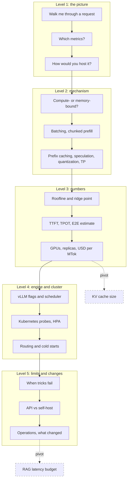

## 1. The question this idea answers

The friend's interviewer asked him to explain the KV cache "along with KV cache, RAG, cloud hosting, and inference", and he went "deep dive into a topic and into the architecture of it". For inference and hosting, the deep dive has a typical shape. It starts with one request. Then it asks why decode is slow. Then it asks for numbers: time to first token, tokens per second, GPUs, replicas and dollars. It ends with operations: what fails, what you page on, what changed this year.

Parts 04 and 05 teach each idea. This page trains the chain. The interviewer says "how would you serve this model?". The question of this page: **can you go from a one-line architecture to a fleet size and a cost per token, and defend each number?**

How to use this page:

1. Answer each question aloud before you open it. Give yourself 30 to 90 seconds.
2. Compute on paper. Most answers in this chain need one formula and one division.
3. Compare with the model answer. Write every missing step on the [mistakes page](/notes/ai/llm-systems/00-progress/mistakes).
4. On another day, run the chain again without notes, and state your assumptions before every number.

## 2. Mental model

> [!analogy] One truck that must carry the whole warehouse on every trip
> A decode step is a truck trip from the depot (HBM, the GPU memory) to the workshop (the compute units). On every trip, the truck must carry the whole warehouse: all 16 GB of weights of Llama-3.1-8B. On one trip it delivers one parcel (one token) to each customer in the batch. One customer per trip wastes the truck. Sixty-four customers per trip cost almost the same trip, so throughput rises. But each customer also needs a personal box on the truck (its KV cache), and long conversations make heavy boxes. The interview chain walks from this picture to numbers: the trip time, the number of customers, the price per parcel and the number of trucks.
>
> **Where it stops working:** prefill is not a truck problem. It pushes thousands of prompt tokens through each layer in one pass, so the workshop (compute), not the truck, is the limit. Also, a real truck trip does not get longer when the boxes get heavier, but a decode step does.

## 3. Terms

| Term | Plain meaning |
|---|---|
| TTFT | Time to first token: queue time plus prefill (plus network, if measured at the client). |
| TPOT | Time per output token after the first: $(\mathrm{E2E} - \mathrm{TTFT})/(n-1)$. |
| ITL | Inter-token latency: the gap between two streamed outputs. |
| goodput | The rate of requests that meet every latency target (SLO). |
| roofline | Attainable FLOP/s $= \min(\text{peak}, I \times \text{bandwidth})$. |
| ridge point | Peak FLOP/s divided by bandwidth: about 295 FLOPs per byte on an H100 SXM. |
| continuous batching | The batch is rebuilt at every step: finished requests leave, waiting requests join. |
| chunked prefill | A long prompt is split into chunks that share steps with running decodes. |
| preemption | The scheduler removes a running request when KV blocks are short, and resumes it later. |
| disaggregation | Prefill and decode run on different GPUs, and the KV cache moves between them. |
| prefix caching | Reuse of the KV blocks of an identical prompt prefix, found by block hashes. |
| speculative decoding | A draft proposes tokens, and the target model verifies them in one pass, exactly. |
| quantization | Storing numbers in 8 or 4 bits with a scale factor. |
| tensor parallelism | Every weight matrix is split over GPUs, with two all-reduces per layer. |
| `gpu_memory_utilization` | The share of total GPU memory that one vLLM instance may use: 0.92 by default in vLLM 0.31.0. |
| HPA | The Kubernetes Horizontal Pod Autoscaler: $\lceil \text{current} \times \text{metric}/\text{target} \rceil$ replicas. |
| Little's law | $L = \lambda W$: requests in the system equal the arrival rate times the time in the system. |

All terms are also in the [Glossary](/notes/ai/llm-systems/glossary).

## 4. How the chain works

### 4.1 The five levels in this chain

| Level | What the interviewer wants | Example in this chain |
|---|---|---|
| 1 | The picture: a request, the metrics, the hosting options | "Walk me through what happens to one request." |
| 2 | The mechanism and its reason | "Is inference compute-bound or memory-bound?" |
| 3 | A formula and a number computed live | "How many replicas for 10 requests per second?" |
| 4 | The engine, the flags, the cluster | "vLLM refuses to start on an L4. Why?" |
| 5 | Limits, failures and recent changes | "When does speculative decoding make things slower?" |

### 4.2 The shape of one good answer

Every answer has five parts: **definition, mechanism, numbers, trade-off, production**. Stop after the part that the question needs.

> [!example] Worked example: "What is continuous batching?" in five parts
> 1. **Definition.** The server rebuilds the batch at every decode step instead of once per batch.
> 2. **Mechanism.** After each forward pass, finished requests leave and waiting requests join. The tokens of all requests form one flat list. Linear layers run on that list, and attention runs per request (Orca's selective batching).
> 3. **Numbers.** In the lesson's trace with 4 requests and 2 slots, static batching needs 9 steps with 72% useful slot-steps. Continuous batching needs 7 steps with 93%. The mean latency falls from 5.5 to 4.25 steps. Orca reported 36.9 times the throughput of FasterTransformer at the same latency.
> 4. **Trade-off.** A new prompt's prefill shares a step with running decodes and stalls them, which chunked prefill fixes. Every running request holds a growing KV cache, which PagedAttention manages.
> 5. **Production.** vLLM V1 schedules each step within a token budget: `max_num_batched_tokens` is 8,192 and `max_num_seqs` is 1,024 by default on an H100.

> [!key] State the assumptions before the number
> Inference numbers depend on the model, the GPU, the precision, the batch size and the context length. Say them first: "Llama-3.1-8B in BF16, one H100 SXM, batch 64, 2,048 tokens of context." Then compute. An interviewer accepts a different assumption. He does not accept a number without one.

### 4.3 Traps and pivots

Traps in this chain: "inference is compute-bound", "scale on GPU utilization", "disaggregation raises throughput", "`gpu_memory_utilization` is the share for the KV cache", "1,979 TFLOPS", "E2E = TTFT + TPOT × n", "`--api-key` secures vLLM". They are marked "(Trap question.)". Pivots jump to the KV cache or to RAG and are marked "(Pivot.)".

## 5. The map of this chain



## 6. Common mistakes

1. **"LLM inference is compute-bound."** Decode at small and medium batch is memory-bound: one step reads all weights for about 2 FLOPs per weight per sequence. Only prefill and very large decode batches are compute-bound.
2. **"E2E = TTFT + TPOT × n."** The first token belongs to TTFT. The exact relation is $\mathrm{E2E} = \mathrm{TTFT} + \mathrm{TPOT} \times (n - 1)$.
3. **"Batching makes each request faster."** It raises total throughput. Each sequence gets slower: 205 tokens per second at batch 1 against about 102 at batch 64 in the lesson's model.
4. **"`gpu_memory_utilization` is the share of memory for the KV cache."** It is the share of total GPU memory for the whole vLLM instance. The cache gets what remains after weights, activations and CUDA graphs.
5. **"Scale on GPU utilization."** It is a duty cycle. Scale on `vllm:num_requests_waiting` and `vllm:num_requests_running`.
6. **"Disaggregation raises throughput."** The vLLM docs say it "DOES NOT improve throughput". It controls TTFT and tail inter-token latency.
7. **"Self-hosting is always cheaper."** A GPU is a fixed cost. At on-demand prices an 8-GPU H100 VM must sustain about 38,466 tokens per second to match an API at USD 0.71 per million tokens.
8. **"4-bit weights make everything 4 times faster."** Weight-only quantization accelerates memory-bound decode. Compute-bound prefill still runs its multiplies in BF16.

## 7. One-minute explanation

A request reaches the API server, which applies the chat template and tokenizes. The engine core schedules it within a token budget. The GPU workers run prefill and then one decode step per token. The API server detokenizes and streams with server-sent events. Users feel TTFT and TPOT, and $\mathrm{E2E} = \mathrm{TTFT} + \mathrm{TPOT}(n-1)$. Prefill is compute-bound. Decode is memory-bound, because each step reads all weights. For Llama-3.1-8B on an H100 that is about 4.8 ms per token, at most about 208 tokens per second. So servers batch continuously, chunk long prefills, reuse prefixes, speculate and quantize to put more tokens on each weight read. To host it, I size memory first: weights plus KV cache within `gpu_memory_utilization`. That gives about 456,000 cached tokens for the 8B model on an H100, and TP=4 for the 70B model in BF16. Then I size replicas with Little's law, $L = \lambda W$, at 70% target load. I convert the GPU price to cost per token: USD per hour divided by tokens per second times 3,600, times one million. In production I autoscale on queue depth, route by prefix, keep headroom for cold starts and page on error-budget burn rates.

## 8. Check questions

The questions follow the chain of section 5. Answer each one aloud before you open it.

### Level 1: the opening
```check
{
  "question": "Opening question: \"You mentioned inference. Walk me through what happens to one request in an LLM server.\"",
  "hint": "Three kinds of process in vLLM V1. Follow the token IDs from HTTP to GPU and back.",
  "answer": "**The path, for vLLM V1:**\n\n1. **API server process.** It receives the HTTP POST with JSON messages, validates it, applies the chat template and tokenizes. It sends the token IDs to the engine core.\n2. **Engine core process.** The request enters the waiting queue. Before every step, the scheduler chooses which requests run and how many tokens each processes, within a token budget and the free KV blocks.\n3. **GPU worker processes**, one per GPU. They run one forward pass over all scheduled tokens. The first pass for a request is **prefill**: the whole prompt, which fills the KV cache and gives the first token. Every later pass is a **decode step**: one token per request.\n4. **Sampler.** It turns the logits of the last position into one token.\n5. **Stop checks.** The engine core checks the end-of-sequence token, stop token IDs and length limits. The API server checks stop strings on the text.\n6. **Back in the API server.** Incremental detokenization, then one server-sent event per new piece of text. The end is the finish reason and `data: [DONE]`. The KV blocks return to the pool.\n\n**Where the time goes:** TTFT is network, tokenization, queue time and prefill. Decode usually takes most of the end-to-end time: hundreds of memory-bound steps.\n\nZeroMQ connects the processes, so text work overlaps with the GPU loop.\n\nSource lesson: [part 04 L1](/notes/ai/llm-systems/04-inference/l1-the-life-of-a-request)."
}
```

```check
{
  "question": "Interview follow-up: \"Which metrics describe an LLM service? Define them exactly.\"",
  "hint": "Two latencies per request, three kinds of throughput, one metric that counts only good requests.",
  "answer": "With send time $t_0$ and token arrival times $t_1, \\dots, t_n$:\n\n$$\n\\mathrm{TTFT} = t_1 - t_0, \\qquad \\mathrm{TPOT} = \\frac{t_n - t_1}{n - 1}, \\qquad \\mathrm{E2E} = \\mathrm{TTFT} + \\mathrm{TPOT} \\times (n - 1)\n$$\n\n- **ITL** is the gap between two streamed outputs. It equals TPOT only with one token per output. With speculative decoding several tokens arrive in one output, so compare by TPOT or E2E.\n- **Throughput:** requests per second, output tokens per second, or total tokens per second. Each needs its workload: input and output lengths, request rate, model, precision and hardware.\n- **Percentiles:** report P50 and P99, because latency has a long tail.\n- **Goodput:** the rate of requests that meet every SLO limit, for example TTFT ≤ 200 ms and TPOT ≤ 50 ms. In the lesson's example, 10 requests in 4 s give 2.5 req/s of throughput but 1.5 req/s of goodput.\n\nvLLM exposes `vllm:time_to_first_token_seconds`, `vllm:inter_token_latency_seconds` and `vllm:request_time_per_output_token_seconds` as histograms.\n\nSource lesson: [part 04 L2](/notes/ai/llm-systems/04-inference/l2-latency-and-throughput-metrics)."
}
```

```check
{
  "question": "Interview follow-up: \"How would you host an LLM in the cloud?\"",
  "hint": "Six options on a spectrum, then one architecture, then the criteria.",
  "answer": "**First the options, from most managed to most control:**\n\n| Option | You pay | Good when |\n|---|---|---|\n| A. Closed model API | tokens | strongest model, low or irregular traffic |\n| B. Model API inside your cloud | tokens or reserved units | identity, billing and residency already in that cloud |\n| C. Serverless open models | tokens | open weights, no GPU work, no idle cost |\n| D. Dedicated endpoint or managed compute | hours | stable latency at peak, or your own weights |\n| E. GPU virtual machines | VM hours | full control, one model |\n| F. Kubernetes platform | node hours | many replicas or models, autoscaling |\n\n**Then the self-hosted design that I would draw:** client → API gateway (authentication, tokens-per-minute limits, audit) → inference-aware router → vLLM replicas on GPU nodes. Around them: object storage for weights, Prometheus metrics feeding an autoscaler, logs and traces, and a fallback API for overflow.\n\n**Then the choice,** with eight questions: data control, residency, latency, cost at my real volume, customization, peak scale, team skills and lock-in. Cost decides less often than people think: a GPU is a fixed cost, so self-hosting wins only above a break-even utilization.\n\nSource lessons: [part 05 L1](/notes/ai/llm-systems/05-cloud-hosting/l1-ways-to-host-a-model) and [part 05 L6](/notes/ai/llm-systems/05-cloud-hosting/l6-managed-platforms)."
}
```

```check
{
  "question": "Interview follow-up: \"What is continuous batching, and why was it a breakthrough?\"",
  "hint": "Schedule per step, not per request.",
  "answer": "**Definition:** iteration-level scheduling, from Orca (OSDI 2022). The batch is rebuilt after every forward pass: finished requests leave, waiting requests join at once.\n\n**What it removes from static batching:**\n\n- slots that stay idle after an early finisher,\n- new requests that wait for the whole batch to end,\n- padding, because the tokens of all requests form one flat list.\n\n**Lesson trace (4 requests, 2 slots):** static batching 9 steps, 72% useful slot-steps, mean latency 5.5 steps. Continuous batching 7 steps, 93% useful, mean latency 4.25 steps.\n\n**What it needs:** selective batching (linear layers on the flat token list, attention per request) and a KV cache that grows per request. PagedAttention made the second part efficient.\n\n**What it leaves open:** a long prefill in a step stalls every decode in it. Chunked prefill addresses that.\n\nSource lessons: [part 04 L4](/notes/ai/llm-systems/04-inference/l4-batching-and-scheduling) and [paper page 02](/notes/papers/llm-serving/2023-pagedattention/02-background-llm-serving-before-vllm)."
}
```

```check
{
  "question": "Interview follow-up: \"What is quantization, and why does it make generation faster?\"",
  "hint": "A code and a scale. Then ask which phase reads bytes and which does arithmetic.",
  "answer": "**Definition:** store each number as a small integer code plus a shared scale, $\\hat{x} = s \\cdot q$. Symmetric INT8: $s = \\max \\lvert x \\rvert / 127$.\n\n**Why faster:** decode is memory-bound. Each step reads every weight, so fewer bytes per weight mean a shorter step. INT4 weights cut the bytes per weight by about 4.\n\n**Numbers for Llama-3.1-70B on one H100 (computed in the lesson, embeddings in BF16):**\n\n| Format | Weights | Ideal decode step at batch 1 |\n|---|---|---|\n| BF16 | about 141 GB | does not fit |\n| FP8 | about 72.7 GB | about 21.7 ms, almost no KV memory left |\n| INT4, group 128 | about 39.5 GB | about 11.8 ms, about 40 GB left |\n\n**What it does not do:** weight-only INT4 does not accelerate compute-bound prefill, because the multiply still runs in BF16. For that, W8A8 such as FP8 on H100 uses 8-bit Tensor Cores with about twice the BF16 peak.\n\n**Cost:** possible quality loss. One outlier in a group sets the step for the whole group, so per-channel or per-group scales are used.\n\nSource lesson: [part 04 L7](/notes/ai/llm-systems/04-inference/l7-quantization)."
}
```

### Level 2: why and how

```check
{
  "question": "Interview follow-up: \"Is LLM inference compute-bound?\" (Trap question.)",
  "hint": "Answer for prefill and for decode separately. Compare each intensity with the ridge point.",
  "answer": "**It depends on the phase and the batch size.**\n\n- **Prefill** is compute-bound above a few hundred tokens. A linear layer with $b$ tokens has intensity $I(b) = b/(1 + 2b/d)$, about $b$. For $d = 4096$ it crosses the H100 ridge at about 345 tokens.\n- **Decode at small batch** is memory-bound. Each step reads all weights to do about 2 FLOPs per weight per sequence. Intensity about $B$, far below the ridge of about 295.\n- **Decode attention** is always memory-bound on this GPU: intensity $H/H_{kv}$, 4 for Llama-3.1-8B, whatever the batch.\n\n**Numbers, Llama-3.1-8B, one H100, batch 1:** memory time $16.06\\text{ GB} / 3.35\\text{ TB/s} = 4.794$ ms, compute time $1.606 \\times 10^{10} / 989.5 \\times 10^{12} = 0.0162$ ms. Compute is busy about 0.34% of the time.\n\nSource lessons: [part 04 L3](/notes/ai/llm-systems/04-inference/l3-compute-bound-vs-memory-bound) and [part 03 L2](/notes/ai/llm-systems/03-kv-cache/l2-prefill-and-decode)."
}
```

```check
{
  "question": "Interview follow-up: \"Why does batching raise throughput but slow down each user?\"",
  "hint": "What is shared by the batch, and what is not?",
  "answer": "Every sequence in a decode step multiplies its new token by the same weights. The weights are read once per step, whatever the batch $B$. So tokens per step grow with $B$ while the weight bytes stay fixed.\n\nBut each sequence also reads its own KV cache, which batching cannot share:\n\n$$\nt_{step} \\approx \\frac{W + B \\cdot \\bar{C} \\cdot kv}{BW}\n$$\n\n**Llama-3.1-8B, one H100, 2,000 cached tokens per sequence (ideal bounds):**\n\n| Batch | Step | Per user | System |\n|---|---|---|---|\n| 1 | 4.87 ms | 205 tok/s | 205 tok/s |\n| 64 | 9.80 ms | 102 tok/s | 6,529 tok/s |\n| 128 | 14.81 ms | 68 tok/s | 8,643 tok/s |\n\nThe system gets about 32 times faster from batch 1 to 64, and each user about 2 times slower. With 2,000-token contexts, the KV reads equal the weight reads at about 61 sequences, so throughput saturates near 10,000 tokens per second.\n\nSource lessons: [part 04 L3](/notes/ai/llm-systems/04-inference/l3-compute-bound-vs-memory-bound) and [part 04 L2](/notes/ai/llm-systems/04-inference/l2-latency-and-throughput-metrics)."
}
```

```check
{
  "question": "Interview follow-up: \"What is chunked prefill, and what problem does it solve?\"",
  "hint": "A long prefill and many decodes share one step. What happens to the decodes?",
  "answer": "**Problem: generation stalls.** A long prompt makes its step long, and every decode in that step waits.\n\n**Solution (Sarathi-Serve):** split the prompt into chunks. Stall-free batching puts all running decodes into each step first, then fills the remaining token budget with one chunk.\n\n**Lesson example, Llama-3.1-8B on one H100:** a 1,500-token prompt joins 20 decoding requests with 2,000 cached tokens each.\n\n- A pure decode step: 6.36 ms (memory-bound).\n- No chunking: one step of 1,520 tokens takes 24.67 ms of compute. Every running request waits about 3.9 times its normal gap.\n- Budget 512: chunks of 492, 492, 492 and 24 tokens. Steps of at most 8.31 ms. The new request's prefill part of TTFT rises from 24.67 ms to $3 \\times 8.31 + 6.42 = 31.35$ ms.\n\n**Trade-off:** steadier ITL against a slightly higher TTFT and some chunk overhead. In vLLM V1 chunked prefill is on by default.\n\nSource lesson: [part 04 L4](/notes/ai/llm-systems/04-inference/l4-batching-and-scheduling)."
}
```

```check
{
  "question": "Interview follow-up: \"How does speculative decoding work, and why does it not change the output?\"",
  "hint": "Draft, verify in one pass, accept with a probability ratio.",
  "answer": "**Idea:** in memory-bound decode, the target model can score $\\gamma + 1$ positions for about the price of one. A cheap draft proposes $\\gamma$ tokens. The target checks all of them in one forward pass.\n\n**Accept rule for sampling:** accept draft token $x$ with probability $\\min(1, p(x)/q(x))$. At the first rejection, sample a correction from the normalized residual $\\max(0, p - q)$. If all pass, add a bonus token.\n\n**Proof that the output follows $p$ exactly:**\n\n1. Accepted path: $q(x)\\min(1, p(x)/q(x)) = \\min(p(x), q(x))$.\n2. Rejection probability: $1 - \\beta$ with $\\beta = \\sum_x \\min(p, q)$, and the residual normalizer is also $1 - \\beta$.\n3. Rejected path: $\\max(0, p(x) - q(x))$.\n4. Sum: $\\min(p, q) + p - \\min(p, q) = p(x)$.\n\nThe proof never uses the quality of the draft. A bad draft is never wrong, only slow.\n\n**Draft sources:** a small draft model, n-gram prompt lookup, Medusa heads, EAGLE heads, or MTP modules (DeepSeek-V3).\n\nSource lesson: [part 04 L6](/notes/ai/llm-systems/04-inference/l6-speculative-decoding)."
}
```

```check
{
  "question": "Interview follow-up: \"How does prefix caching work in vLLM?\"",
  "hint": "A hash chain over full blocks.",
  "answer": "**Why it is exact:** in a causal model the keys and values of a prefix depend only on that prefix. So requests with an identical prefix from token 0 can share them.\n\n**Mechanism (vLLM 0.31.0):**\n\n1. Each **full** 16-token block gets a hash: $h_k = H(h_{k-1},\\ \\text{tokens of block } k,\\ \\text{extra keys})$. Extra keys include the LoRA adapter, multimodal input hashes and a per-tenant `cache_salt`. The default hash is SHA-256.\n2. A new request walks its block hashes from the first one and stops at the first miss.\n3. The hit is capped at the prompt length minus one, because the last token must run to produce logits.\n4. Finished blocks keep their hashes in a free queue, so they stay hittable until LRU eviction reuses them, chain tails first.\n\n**Numbers:** a shared 6,000-token prefix on Llama-3.1-8B saves about 97 ms of prefill at peak and 750 MiB per copy. In the lesson's agent run with 10 calls, prefill falls from 83,500 to 3,756 tokens: a hit rate of about 95.5%.\n\nSource lesson: [part 04 L9](/notes/ai/llm-systems/04-inference/l9-prefix-caching-and-kv-reuse)."
}
```

```check
{
  "question": "Interview follow-up: \"Which metric would you autoscale on? CPU? GPU utilization?\" (Trap question.)",
  "hint": "Which signal grows before users feel pain, and falls when capacity is enough?",
  "answer": "**Neither.**\n\n- **CPU utilization** measures the HTTP process: tokenization, JSON, streaming. The queue can grow while the CPU idles.\n- **GPU memory used** is flat: vLLM reserves its share at start.\n- **GPU utilization** (`DCGM_FI_DEV_GPU_UTIL`) is a duty cycle. The GKE guide notes that it \"Does not measure how much work is being done while the GPU is active\".\n\n**Scale on the engine's own state:**\n\n- `vllm:num_requests_waiting`: the best **trigger**, because it grows the moment arrivals exceed service.\n- `vllm:num_requests_running`: stays high under steady load. Pair it with the queue, because the queue is zero at the right size, and a queue-only rule removes needed replicas and oscillates.\n- `vllm:kv_cache_usage_perc` and `vllm:num_preemptions`: memory pressure.\n\n**Trap inside the trap:** a counter is exposed with a `_total` suffix, for example `vllm:generation_tokens_total`.\n\nSource lesson: [part 05 L5](/notes/ai/llm-systems/05-cloud-hosting/l5-autoscaling-and-routing)."
}
```

```check
{
  "question": "Interview follow-up: \"How does tensor parallelism split a transformer layer?\"",
  "hint": "Column-parallel, then row-parallel. Count the all-reduces.",
  "answer": "**MLP:** the first matrix is split by **columns**, so each GPU holds complete output columns and applies the nonlinearity locally. The second matrix is split by **rows** with the same index range, so each GPU produces a partial sum of the output. One all-reduce finishes the MLP. The other order would need a sum before the nonlinearity, because $\\mathrm{GeLU}(a + b) \\ne \\mathrm{GeLU}(a) + \\mathrm{GeLU}(b)$.\n\n**Attention:** split by heads. Each GPU computes its own query heads and stores the KV cache of its own KV heads. One all-reduce after the output projection.\n\n**So two all-reduces per layer per forward pass.** Llama-3.1-70B with TP = 4 needs 160 all-reduces of 16 KiB per token. Each GPU sends about 3.75 MiB per token. That is why TP stays inside an NVLink server (900 GB/s on H100, against 128 GB/s total for PCIe Gen5 x16). Pipeline parallelism sends about 80 times less and crosses servers.\n\n**Intensity:** TP divides both FLOPs and bytes by the GPU count, so it does not change arithmetic intensity.\n\nSource lessons: [part 04 L8](/notes/ai/llm-systems/04-inference/l8-parallelism) and [part 01 L5](/notes/ai/llm-systems/01-math-and-hardware/l5-gpus-memory-and-bandwidth)."
}
```

### Level 3: the formula and the numbers

```check
{
  "question": "Interview follow-up: \"Write the roofline. Compute the ridge point of an H100 and an A100, and the batch where decode stops being memory-bound.\"",
  "hint": "Peak divided by bandwidth. Use the dense BF16 number.",
  "answer": "$$\n\\text{attainable FLOP/s} = \\min\\left(\\text{peak}, \\ I \\times \\text{bandwidth}\\right), \\qquad I_{ridge} = \\frac{\\text{peak}}{\\text{bandwidth}}\n$$\n\n- H100 SXM: $989.5 / 3.35 \\approx 295$ FLOPs per byte.\n- A100 80 GB SXM: $312 / 2.039 \\approx 153$ FLOPs per byte.\n\n**Use dense numbers.** The H100 page lists 1,979 TFLOPS \"with sparsity\". Dense LLM weights get half.\n\n**Linear layer with $b$ tokens** ($d_{in} = d_{out} = d$, BF16):\n\n$$\nI(b) = \\frac{b\\,d}{d + 2b}, \\qquad d = 4096: \\ I(345) \\approx 295\n$$\n\nSo in theory decode of the weights becomes compute-bound near batch 295 to 345. In practice, with long contexts, decode stays memory-bound at any batch that fits, because KV reads have intensity $H/H_{kv} = 4$.\n\nSource lessons: [part 04 L3](/notes/ai/llm-systems/04-inference/l3-compute-bound-vs-memory-bound) and [part 01 L5](/notes/ai/llm-systems/01-math-and-hardware/l5-gpus-memory-and-bandwidth)."
}
```

```check
{
  "question": "Interview follow-up: \"Estimate TTFT and end-to-end latency for a 2,000-token prompt and 500 output tokens, Llama-3.1-8B, one idle H100.\"",
  "hint": "Prefill: FLOPs divided by peak. Decode: bytes divided by bandwidth, 499 times.",
  "answer": "**Prefill (compute-bound):**\n\n$$\n2 \\times 6{,}979{,}584{,}000 \\times 2{,}000 + 4 \\times 32 \\times 4{,}096 \\times \\frac{2000 \\times 2001}{2} + 2 \\times 525{,}336{,}576 \\approx 2.897 \\times 10^{13} \\text{ FLOPs}\n$$\n\nAt about 989 TFLOP/s: **TTFT about 29.3 ms**, without network and queue. The rough rule $2 \\times 8 \\times 10^9 \\times 2{,}000$ gives about 32 ms.\n\n**Decode (memory-bound):** each step reads 16.06 GB of weights plus $2{,}000 \\times 131{,}072 \\approx 0.26$ GB of cache: about **4.87 ms**, rising to about 4.89 ms at context 2,499.\n\n**E2E:** $29.3 + 499 \\times 4.88 \\approx 2{,}466$ ms, about **2.47 s**. Decode is about 99% of the time, although prefill does far more arithmetic.\n\nReal engines are slower than these bounds.\n\nSource lessons: [part 03 L2](/notes/ai/llm-systems/03-kv-cache/l2-prefill-and-decode) and [part 04 L2](/notes/ai/llm-systems/04-inference/l2-latency-and-throughput-metrics)."
}
```

```check
{
  "question": "Interview follow-up: \"Your speculative decoding has acceptance rate $\\alpha$ and $\\gamma$ drafts. Derive the expected tokens per step and the speedup.\"",
  "hint": "A geometric series. The draft costs time too.",
  "answer": "A step adds token $k$ only if the first $k - 1$ drafts were accepted: $P(N \\ge k) = \\alpha^{k-1}$ for $k \\le \\gamma + 1$.\n\n$$\nE[N] = 1 + \\alpha + \\dots + \\alpha^{\\gamma} = \\frac{1 - \\alpha^{\\gamma+1}}{1 - \\alpha}, \\qquad \\text{speedup} \\approx \\frac{E[N]}{\\gamma c + 1}\n$$\n\n$c$ is the cost of one draft step relative to one target step.\n\n**Numbers:**\n\n- $\\alpha = 0.8$, $\\gamma = 4$: $E[N] = 3.36$. The limit for long drafts is $1/(1 - \\alpha) = 5$.\n- Leviathan et al. report 3.4 times at $\\gamma = 7$, $\\alpha = 0.75$: $E[N] \\approx 3.600$, so $7c + 1 \\approx 1.0587$ and $c \\approx 0.0084$.\n- DeepSeek-V3 MTP, $\\gamma = 1$, $\\alpha = 0.8$ to $0.9$: $E[N] = 1.8$ to $1.9$, consistent with the reported 1.8 times.\n\nThe formula assumes independent acceptances. Real acceptances are correlated.\n\nSource lesson: [part 04 L6](/notes/ai/llm-systems/04-inference/l6-speculative-decoding)."
}
```

```check
{
  "question": "Interview follow-up: \"Size the fleet: 10 requests per second at peak, 1,000 prompt tokens and 300 output tokens each. A benchmark shows TTFT 0.5 s and TPOT 30 ms at 64 concurrent requests per replica.\"",
  "hint": "Concurrency is arrival rate times time in the system. Then divide by the concurrency one replica can carry.",
  "answer": "**Little's law:** $L = \\lambda W$, for any arrival pattern in a stable system.\n\n1. Time in the system: $W = 0.5 + 0.030 \\times 299 = 9.47$ s.\n2. Concurrency: $L = 10 \\times 9.47 = 94.7$ requests.\n3. At 100% load: $94.7 / 64 = 1.48$, so 2 replicas.\n4. At a 70% target load for headroom: $94.7 / 44.8 = 2.11$, so **3 replicas**.\n5. Cross-check with tokens: demand $10 \\times 300 = 3{,}000$ output tokens per second. One replica decodes $64 / 0.030 \\approx 2{,}133$. That is 1.41 replicas at 100%.\n6. Memory check: $64 \\times 1{,}300 \\times 131{,}072 \\approx 10.9$ GB of KV cache beside 16 GB of weights. It fits on an 80 GB H100.\n\n**Trap:** $W$ depends on $L$. More concurrency makes each decode step slower. Little's law links averages at one operating point, so take $W$ from a benchmark at the planned concurrency.\n\nSource lessons: [part 05 L5](/notes/ai/llm-systems/05-cloud-hosting/l5-autoscaling-and-routing) and [part 04 L2](/notes/ai/llm-systems/04-inference/l2-latency-and-throughput-metrics)."
}
```

```check
{
  "question": "Interview follow-up: \"Llama-3.1-8B on one H100 80 GB. How many concurrent requests fit? Show the memory budget.\"",
  "hint": "Total times utilization, minus weights, minus overhead. Divide by 128 KiB per token.",
  "answer": "**Budget (vLLM):**\n\n$$\n\\text{KV cache} = \\text{total} \\times u - \\text{weights} - \\text{peak activations} - \\text{non-torch memory} - \\text{CUDA graphs}\n$$\n\n1. Requested: $80 \\times 0.92 = 73.6$ GiB.\n2. Weights: $16{,}060{,}522{,}496$ bytes $= 14.96$ GiB.\n3. Overhead (assumed): 3 GiB.\n4. KV cache: $73.6 - 14.96 - 3 = 55.64$ GiB, about 455,823 tokens at 128 KiB per token, about 28,488 blocks of 16.\n\n| Request length | Requests that fit |\n|---|---|\n| 4,096 | about 111 |\n| 32,768 | about 13 |\n| 131,072 (default `max_model_len`) | about 3.48 |\n| 1,500 on average | about 304 |\n\nThe `max_num_seqs` default of 1,024 on this GPU does not limit that. vLLM prints the real numbers at startup: \"Available KV cache memory\" and \"Maximum concurrency\".\n\nSource lessons: [part 05 L2](/notes/ai/llm-systems/05-cloud-hosting/l2-sizing-gpus) and [part 03 L3](/notes/ai/llm-systems/03-kv-cache/l3-the-kv-cache-size-formula)."
}
```

```check
{
  "question": "Interview follow-up: \"How many GPUs does Llama-3.1-70B need?\"",
  "hint": "131 GiB of weights. Then ask how much KV memory each setup leaves.",
  "answer": "Weights: $70{,}553{,}706{,}496 \\times 2$ bytes $= 131.42$ GiB in BF16. One H100 gives $80 \\times 0.92 = 73.6$ GiB, so one GPU is impossible.\n\n**Per GPU with 3 GiB of overhead (lesson's table):**\n\n| Setup | Weights per GPU | KV tokens | Full 4K requests |\n|---|---|---|---|\n| TP=2, 2 × H100 | 65.71 GiB | 32,058 | 7 |\n| TP=4, 4 × H100 | 32.85 GiB | 494,742 | 120 |\n| TP=8, 8 × H100 | 16.43 GiB | 1,420,110 | 346 |\n| FP8 weights, 1 × H200, BF16 cache | 67.67 GiB | 190,229 | 46 |\n\nTP=2 fits the weights but is a demo, not a service. **TP=4 is the practical minimum.** One H200 with FP8 weights holds the model that needs four H100s in BF16.\n\n**Why the FP8 checkpoint is 72.7 GB, not 70.6 GB:** the embedding and the head ($2 \\times 128{,}256 \\times 8{,}192$ parameters) stay in BF16.\n\n**TP=3 is impossible:** 64 query heads are not divisible by 3.\n\nSource lessons: [part 05 L2](/notes/ai/llm-systems/05-cloud-hosting/l2-sizing-gpus) and [part 04 L8](/notes/ai/llm-systems/04-inference/l8-parallelism)."
}
```

```check
{
  "question": "Interview follow-up: \"Convert a GPU price into a cost per million tokens.\"",
  "hint": "Tokens per hour is tokens per second times 3,600.",
  "answer": "$$\n\\text{USD per MTok} = \\frac{\\text{USD per hour}}{r \\times 3600} \\times 10^6\n$$\n\n$r$ is the sustained tokens per second.\n\n**Llama-3.1-8B, one H100 at USD 12.29 per GPU-hour**. That is one GPU of an Azure ND96isr H100 v5 VM at USD 98.32 per hour (eastus, checked on 2026-10-15). Bandwidth bound at 2,048 tokens of context:\n\n| Batch | TPOT | Tokens per second | USD per MTok |\n|---|---|---|---|\n| 1 | 4.87 ms | 205 | 16.64 |\n| 32 | 7.36 ms | 4,349 | 0.785 |\n| 64 | 9.92 ms | 6,450 | 0.529 |\n| 128 | 15.05 ms | 8,505 | 0.401 |\n\nAt 50% of the bound at batch 64 ($r = 3{,}225$): $12.29 / (3{,}225 \\times 3{,}600) \\times 10^6 \\approx$ **USD 1.06 per MTok**.\n\n**Utilization multiplies it:** effective cost $=$ cost at full load $/\\, u$. A daily curve with 44% average load gives about USD 2.40 instead of USD 1.06.\n\n**Input tokens are cheaper:** prefill at 50% MFU gives about 30,791 tokens per second, about USD 0.111 per MTok, about 9.5 times cheaper than output.\n\nSource lesson: [part 05 L7](/notes/ai/llm-systems/05-cloud-hosting/l7-cost-math)."
}
```

```check
{
  "question": "Interview follow-up: \"An agent makes 20 independent model calls per task. Why should it care about P99, not the mean?\"",
  "hint": "The probability that none of $N$ calls is slow.",
  "answer": "Latency has a long right tail: queue bursts, long prefills of other users and preemptions. The mean mixes the tail with the normal case and describes almost no real request.\n\n**Fan-out:** if each call is slower than its P99 with probability 0.01,\n\n$$\nP(\\text{at least one slow call}) = 1 - 0.99^{N}\n$$\n\n- $N = 20$: $1 - 0.8179 = 0.182$, so about 18% of tasks hit a P99 event.\n- $N = 100$: about 63%.\n\nReal calls are correlated during bursts, so the effect can be worse.\n\n**Measurement detail:** with 20 samples, P99 is almost the maximum. A stable P99 needs thousands of requests. A Prometheus `histogram_quantile` interpolates inside buckets, so wide buckets make it coarse.\n\nSource lessons: [part 04 L2](/notes/ai/llm-systems/04-inference/l2-latency-and-throughput-metrics) and [part 05 L5](/notes/ai/llm-systems/05-cloud-hosting/l5-autoscaling-and-routing)."
}
```

### Level 4: the engine and the cluster

```check
{
  "question": "Interview follow-up: \"Which vLLM flags do you set, and what does each one do?\"",
  "hint": "Memory, batch, budget, parallelism, cache, precision.",
  "answer": "| Flag | What it controls |\n|---|---|\n| `--max-model-len` | The longest sequence. The default is the value in the model config: 131,072 for Llama-3.1. |\n| `--gpu-memory-utilization` | The share of total GPU memory for the whole instance: 0.92 in vLLM 0.31.0. |\n| `--max-num-seqs` | The largest batch: 1,024 by default on an H100, 256 on an A100 or L4. |\n| `--max-num-batched-tokens` | The token budget per step: 8,192 on an H100, 2,048 on an A100. |\n| `--tensor-parallel-size` | GPUs per replica for tensor parallelism. |\n| `--enable-prefix-caching` | Automatic prefix caching, on by default in V1. |\n| `--kv-cache-dtype` | `auto` uses the model type. `fp8` halves the cache. |\n| `--quantization` | The weight format. In 0.31.0, plain `fp8` no longer quantizes a BF16 checkpoint online: use `fp8_per_tensor`. |\n\n**Trap:** \"Maximum concurrency 3.12x\" in the log counts requests at the **maximum** length. Short requests take only the blocks they use, so many more fit.\n\n**Rule:** pin the engine version. Defaults change between releases.\n\nSource lessons: [part 04 L10](/notes/ai/llm-systems/04-inference/l10-serving-engines) and [part 05 L2](/notes/ai/llm-systems/05-cloud-hosting/l2-sizing-gpus)."
}
```

```check
{
  "question": "Interview follow-up: \"You start `vllm serve meta-llama/Llama-3.1-8B-Instruct` on one L4 with default flags, and it stops at startup. Why?\"",
  "hint": "Compare the KV memory that is left with one request at the default maximum length.",
  "answer": "1. AWS lists 22 GiB of GPU memory for `g6.xlarge` (the datasheet says \"24GB\"). vLLM requests $22 \\times 0.92 = 20.24$ GiB.\n2. BF16 weights: 14.96 GiB. Overhead about 1.5 GiB (assumed). About 3.78 GiB remain: about 30,986 tokens.\n3. The default `max_model_len` is 131,072 tokens. One such request needs $131{,}072 \\times 131{,}072$ bytes $= 16$ GiB of cache.\n4. vLLM checks that at least one request of `max_model_len` fits. It does not, so it stops with \"To serve at least one request with the model's max seq len (131072), (16.00 GiB KV cache is needed ...\".\n\n**Fixes:**\n\n- `--max-model-len 8192`: then about 7 full-length requests fit.\n- Quantize the weights, and use an FP8 cache.\n- A bigger GPU, for example an L40S (`g6e.xlarge`, 44 GiB) or an H100.\n\nRaising the utilization to 0.95 adds only 0.66 GiB.\n\n**Speed on the L4 anyway:** $16.06\\text{ GB} / 300\\text{ GB/s} = 53.5$ ms per token at batch 1, at most 18.7 tokens per second.\n\nSource lesson: [part 05 L2](/notes/ai/llm-systems/05-cloud-hosting/l2-sizing-gpus)."
}
```

```check
{
  "question": "Interview follow-up: \"How does the vLLM V1 scheduler decide what runs in one step? What happens when KV blocks run short?\"",
  "hint": "A token budget per step. Decodes first. The newest request is the victim.",
  "answer": "**One unified rule:** each request has `num_computed_tokens`, and each step assigns tokens so that requests catch up. There is no separate prefill phase.\n\n1. Running requests first: one token each for decodes.\n2. Then waiting requests, with their prompts chunked to fit the remaining token budget (`max_num_batched_tokens`) and the free blocks.\n3. `max_num_seqs` caps the batch.\n\n**When a running request needs a block and none is free:** with the FCFS policy, the scheduler preempts `self.running[-1]`, the most recently admitted request. Its blocks are freed, its status becomes `PREEMPTED`, `num_computed_tokens` is set to 0, and it goes to the **front** of the waiting queue. Its output tokens are kept.\n\n**Resume:** one prefill over the prompt plus the generated tokens. The vLLM docs: \"In vLLM V1, the default preemption mode is `RECOMPUTE` rather than `SWAP`\". Prefix caching can reuse prompt blocks that are still cached.\n\n**Price of one preemption** (2,000-token prompt, 300 generated, Llama-3.1-8B): recompute about $3.83 \\times 10^{13}$ FLOPs, about 38.7 ms. Swap about 301 MB, about 6.0 ms each way at 50 GB/s.\n\nSource lesson: [part 04 L4](/notes/ai/llm-systems/04-inference/l4-batching-and-scheduling)."
}
```

```check
{
  "question": "Interview follow-up: \"Your vLLM pod on Kubernetes restarts every 30 to 40 seconds and never becomes ready. Why, and what do you fix?\"",
  "hint": "What does `/health` return while the weights load?",
  "answer": "**Mechanism:**\n\n1. A liveness probe on `/health` with defaults allows about $3 \\times 10 = 30$ s (`failureThreshold` 3, `periodSeconds` 10).\n2. During model loading, vLLM 0.31.0 does not run its HTTP server yet, so every probe gets a refused connection.\n3. After 3 failures the kubelet kills the container. vLLM converts `SIGTERM` during initialization into `KeyboardInterrupt(\"terminated\")`, the last log line.\n4. The load starts again from zero: an endless loop.\n\n**Fix:** a startup probe whose window `failureThreshold × periodSeconds` covers the worst cold start. For a measured cold start of about 169 s, use for example 60 × 10 s = 600 s. Liveness and readiness start after it succeeds.\n\n**Other GPU details on the same Deployment:**\n\n- `nvidia.com/gpu` in `limits`,\n- a toleration plus a node selector for the GPU pool,\n- a memory-backed `emptyDir` at `/dev/shm`,\n- `--shutdown-timeout` with a longer `terminationGracePeriodSeconds`, so that rolling updates drain streams.\n\n**Later**, a 503 from `/health` means the engine died (`EngineDeadError`), and the pod must restart.\n\nSource lessons: [part 05 L4](/notes/ai/llm-systems/05-cloud-hosting/l4-kubernetes-for-llm-serving) and [part 05 L3](/notes/ai/llm-systems/05-cloud-hosting/l3-containers-and-model-loading)."
}
```

```check
{
  "question": "Interview follow-up: \"Walk me through the HPA math. Three replicas, target 5 waiting requests per replica, 26 waiting in total.\"",
  "hint": "Current times metric over target, rounded up. Then the tolerance and the scale-up policy.",
  "answer": "$$\n\\text{desiredReplicas} = \\left\\lceil \\text{currentReplicas} \\times \\frac{\\text{currentMetricValue}}{\\text{desiredMetricValue}} \\right\\rceil\n$$\n\n1. Average: $26 / 3 = 8.67$. Ratio $8.67 / 5 = 1.73$, outside the tolerance band $[0.9, 1.1]$, so the HPA acts.\n2. Desired: $\\lceil 3 \\times 1.73 \\rceil = \\lceil 26/5 \\rceil = \\lceil 5.2 \\rceil = 6$.\n3. The default scale-up policy allows $\\max(3 + 100\\% \\times 3,\\ 3 + 4) = 7$ per 15 s period, so 6 is reached at once.\n\n**If one pod is still loading:** for external metrics the HPA counts Running and Ready pods, so $26/2 = 13$ and $\\lceil 2 \\times 13/5 \\rceil = 6$ again.\n\n**The real problem:** the loading pod serves nothing, so the queue keeps growing during its cold start, and the HPA keeps adding pods. That overshoots. The control loop takes seconds, the GPU node and the model load take minutes. Only headroom removes the cold-start queue.\n\nSource lesson: [part 05 L5](/notes/ai/llm-systems/05-cloud-hosting/l5-autoscaling-and-routing)."
}
```

```check
{
  "question": "Interview follow-up: \"Three replicas. Which one gets a 4,096-token prompt?\" Replica A has 60 of 64 prefix blocks cached, KV usage 0.85, 2 waiting. B has 0 blocks, 0.40, 1 waiting. C has 16 blocks, 0.55, 3 waiting. Weights 3, 2, 2.",
  "hint": "Compute the three scores per replica, then the weighted sum.",
  "answer": "**Endpoint Picker scorers:**\n\n- prefix: $\\text{matchBlocks}/\\text{totalBlocks}$,\n- KV utilization: $1 - \\text{kvCacheUsagePercent}$,\n- queue: $(\\text{maxQueue} - \\text{queue})/(\\text{maxQueue} - \\text{minQueue})$.\n\n| Replica | Prefix | KV | Queue | Total $3p + 2k + 2q$ |\n|---|---|---|---|---|\n| A | 0.9375 | 0.15 | 0.5 | 4.1125 |\n| B | 0 | 0.60 | 1.0 | 3.2 |\n| C | 0.25 | 0.45 | 0 | 1.65 |\n\n**A wins** and skips prefill for 3,840 tokens.\n\nIf A then has 6 waiting: queue scores A 0, B 1.0, C 0.6. Totals A 3.1125, B 3.2, C 2.85. **B wins.** The cache benefit no longer pays for A's queue.\n\n**Why not round robin:** it ignores request cost (a 30,000-token prompt counts like a 50-token one) and scatters shared prefixes over all replicas. Pure prefix affinity creates hot spots, so the score weights it against load.\n\nSource lessons: [part 05 L5](/notes/ai/llm-systems/05-cloud-hosting/l5-autoscaling-and-routing) and [part 04 L9](/notes/ai/llm-systems/04-inference/l9-prefix-caching-and-kv-reuse)."
}
```

```check
{
  "question": "Interview follow-up: \"Your autoscaler adds a replica, and it takes three minutes before it serves traffic. Make it 20 seconds.\"",
  "hint": "Split the cold start into steps. Each step has its own cache.",
  "answer": "**Cold-start model of the lesson (Llama-3.1-8B):** about 169 s in seven steps. Pull the image 60 s, download weights 32 s, engine start 5 s, read into GPU 16 s. Then compile 53 s, profiling 1 s, CUDA graphs 2 s.\n\n| Step | Fix | Result |\n|---|---|---|\n| Compile, 53 s | Persist the compile cache (`VLLM_CACHE_ROOT`) per GPU type, TP size, model and PyTorch version | about 6 s |\n| Image pull, 60 s | Pre-pull the pinned image on every GPU node | 0 s |\n| Download, 32 s | Weights on node-local NVMe or a shared volume, or a streaming loader | 0 s |\n| Read into GPU, 16 s | Read from NVMe (about 30 GB/s) instead of a network disk (about 1 GB/s) | about 1 s |\n\nResult: about $5 + 1 + 6 + 1 + 2 = 15$ s.\n\n**Not inside the 15 s:** creating a new GPU node. So keep spare node capacity and a minimum of warm replicas.\n\n**Do not** use `--enforce-eager` as a shortcut: it skips compilation and CUDA graphs, and the default mode gives about 5 to 30% more steady-state throughput.\n\nSource lessons: [part 05 L3](/notes/ai/llm-systems/05-cloud-hosting/l3-containers-and-model-loading) and [part 05 L5](/notes/ai/llm-systems/05-cloud-hosting/l5-autoscaling-and-routing)."
}
```

```check
{
  "question": "Interview follow-up: \"Llama-3.1-70B on 4 H100s with TP = 4 and 4,000-token contexts. What does one decode step read per GPU, and what is the batch-1 TPOT bound?\"",
  "hint": "Divide the weights by 4. Each GPU holds 2 KV heads.",
  "answer": "1. **Weights per GPU:** $70.55 \\times 10^9 \\times 2 / 4 \\approx 35.28$ GB.\n2. **KV per sequence per GPU:** each GPU holds 2 of the 8 KV heads, so $4{,}000 \\times 327{,}680 / 4 = 327{,}680{,}000$ bytes, about 328 MB.\n3. **Crossover:** KV reads equal weight reads at $35.28 \\times 10^9 / 327.68 \\times 10^6 \\approx 108$ sequences.\n4. **Batch-1 bound:** $(35.28 + 0.33) \\times 10^9 / 3.35 \\times 10^{12} \\approx 10.6$ ms, at most about 94 tokens per second for one user.\n\nThe real TPOT is higher, because each layer adds two all-reduces across the 4 GPUs.\n\n**Arithmetic intensity does not change with TP:** FLOPs and bytes are both divided by 4. The step is faster only because each GPU moves fewer bytes.\n\nSource lessons: [part 04 L3](/notes/ai/llm-systems/04-inference/l3-compute-bound-vs-memory-bound) and [part 04 L8](/notes/ai/llm-systems/04-inference/l8-parallelism)."
}
```

### Level 5: limits, failures and what changed

```check
{
  "question": "Interview follow-up: \"You turned on n-gram speculation ($\\gamma = 4$, $\\alpha = 0.7$) at batch 256 on one H100, and throughput dropped. Why?\"",
  "hint": "Count the positions per step after speculation, and compare with the ridge point.",
  "answer": "Speculation is nearly free only while the target is memory-bound.\n\n1. Without speculation a step processes 256 tokens, just below the H100 ridge of about 295. Still about memory-bound.\n2. With $\\gamma = 4$, each sequence sends $\\gamma + 1 = 5$ positions: $256 \\times 5 = 1{,}280$ tokens per step. Far above the ridge, so the step is compute-bound and costs about 5 times the arithmetic.\n3. Each step yields only $E[N] = (1 - 0.7^5)/0.3 \\approx 2.77$ tokens per sequence.\n4. In the idealized model, throughput becomes about $2.77 / 5 \\approx 0.55$ of a plain compute-bound step. The break-even batch is about $2.77 \\times 295 / 5 \\approx 164$.\n\n**Fixes:** lower $\\gamma$ at high load, or disable speculation above some batch size. vLLM offers `num_speculative_tokens_per_batch_size`.\n\n**Also:** speculation does not reduce TTFT. Prefill is unchanged.\n\nSource lesson: [part 04 L6](/notes/ai/llm-systems/04-inference/l6-speculative-decoding)."
}
```

```check
{
  "question": "Interview follow-up: \"Should we use prefill-decode disaggregation to raise throughput?\" (Trap question.)",
  "hint": "What do the vLLM docs say about throughput? What do the papers measure instead?",
  "answer": "**Disaggregation does not raise throughput.** The vLLM docs: \"Disaggregated prefill DOES NOT improve throughput\". It lets you tune TTFT and inter-token latency separately and controls tail ITL. The research papers report gains in **goodput**: DistServe \"7.4x more requests or 12.6x tighter SLO\".\n\n**Cost: the KV transfer.** Llama-3.1-70B, 8,000-token prompts: $8{,}000 \\times 327{,}680 = 2.62$ GB. Over 50 GB/s: about 52.4 ms if sent after the prefill. Splitwise sends each layer's KV as soon as the layer finishes, and reports overhead under 7% of the prompt computation and 0.8% of end-to-end latency.\n\n**When it pays:** large scale, strict TPOT or tail-ITL targets, long prompts. **When it does not:** small fleets, where fixed prefill and decode pools sit idle when the traffic mix shifts. There, chunked prefill gives most of the latency benefit with less complexity (interpretation of the lesson).\n\nSource lessons: [part 04 L4](/notes/ai/llm-systems/04-inference/l4-batching-and-scheduling) and [paper page 10](/notes/papers/llm-serving/2023-pagedattention/10-limits-and-later-work)."
}
```

```check
{
  "question": "Interview follow-up: \"A user sends the same prompt twice at temperature 0 and gets two different answers. Why?\"",
  "hint": "Floating-point addition, and a batch size that changes with load.",
  "answer": "**Greedy decoding is deterministic given the logits. The logits differed.**\n\n1. The two calls ran in batches of different sizes, because the server load differed.\n2. Kernels for matrix multiplication (split-K), attention (split-KV) and RMSNorm choose their reduction order by batch size.\n3. Floating-point addition is not associative, so sums differ in the last bits.\n4. When two top logits are close, the argmax flips, and every later token differs.\n\nThe Thinking Machines experiment got 80 unique answers in 1,000 runs at temperature 0, first diverging at token 103.\n\n**Fix:** batch-invariant kernels, `VLLM_BATCH_INVARIANT=1` in vLLM (beta). With temperature above 0, also a seed. **Cost:** lower throughput: 26 s for default vLLM against 42 s for the improved deterministic version in the blog's test. Determinism also needs the same GPU type, parallel layout, engine version and quantization.\n\nSource lesson: [part 04 L5](/notes/ai/llm-systems/04-inference/l5-sampling-and-structured-output)."
}
```

```check
{
  "question": "Interview follow-up: \"Self-host Llama 70B on H100s or call an API at USD 0.71 per million tokens? Show the numbers.\"",
  "hint": "Solve the cost formula for the throughput. Then compare with the decode bound.",
  "answer": "**Break-even throughput:**\n\n$$\nr_{break\\text{-}even} = \\frac{\\text{USD per hour}}{p \\times 3600} \\times 10^6 = \\frac{98.32}{0.71 \\times 3{,}600} \\times 10^6 \\approx 38{,}466 \\text{ tokens per second}\n$$\n\nThat is for an 8-GPU ND96isr H100 v5 VM on demand (eastus, checked on 2026-10-15). With a 3-year reservation (about USD 43.16 per hour) it is about 16,887.\n\n**What the VM can produce:** the decode bound for 70B with TP = 8, batch 256 and 2,048 tokens of context. It is about 21,920 tokens per second in BF16 and 28,304 with FP8 weights. Both are below 38,466, and real servers reach only part of the bound.\n\n**A real workload:** 50 million input and 10 million output tokens per day. The API costs $60 \\times 0.71 =$ USD 42.60 per day. One on-demand VM costs USD 2,359.68 per day: about 55 times more. The VM would be almost idle.\n\n**Conclusion:** at this operating point the API is cheaper on price. Self-hosting is justified by control, custom weights, data residency or latency isolation, or by very high steady volume with discounts.\n\nSource lessons: [part 05 L7](/notes/ai/llm-systems/05-cloud-hosting/l7-cost-math) and [part 05 L1](/notes/ai/llm-systems/05-cloud-hosting/l1-ways-to-host-a-model)."
}
```

```check
{
  "question": "Interview follow-up: \"Can you scale a GPU endpoint to zero? What happens to the first request?\"",
  "hint": "Every return from zero is a full cold start.",
  "answer": "Yes, on several platforms, with a latency price.\n\n| Platform | How | First request |\n|---|---|---|\n| Kubernetes 1.37 HPA | `minReplicas: 0` with object or external metrics, feature gate `HPAScaleToZero` (beta, on by default) | waits for a full cold start |\n| KEDA | `minReplicaCount: 0`, `activationThreshold`, `cooldownPeriod` | waits for a full cold start |\n| SageMaker AI inference components | `MinInstanceCount` 0 | \"any attempts to invoke the endpoint will produce an error\" during provisioning |\n| Databricks Model Serving | `scale_to_zero_enabled` | \"not recommended for production endpoints\" |\n| Bedrock Custom Model Import | automatic after 5 idle minutes | waits for the model to load |\n\n**Numbers:** an internal assistant runs 50 of 168 hours per week on one H100 at about USD 12.29 per GPU-hour. Scale to zero saves about $118 \\times 12.29 \\approx$ USD 1,450 per week. The price is a cold start every morning.\n\n**Rule:** scale to zero for development, rare batch jobs and internal tools warmed on a schedule. Never for a user-facing TTFT target of seconds.\n\nSource lessons: [part 05 L5](/notes/ai/llm-systems/05-cloud-hosting/l5-autoscaling-and-routing) and [part 05 L6](/notes/ai/llm-systems/05-cloud-hosting/l6-managed-platforms)."
}
```

```check
{
  "question": "Interview follow-up: \"You self-host vLLM and set `--api-key`. Is the endpoint secure?\" (Trap question.)",
  "hint": "Which paths does the API key protect, and which does it not?",
  "answer": "**No.** The vLLM security guide says `--api-key` protects only the `/v1`, `/v2`, `/inference` and `/cohere` prefixes. `/invocations` gives unauthenticated inference, and `/pause`, `/abort_requests` and `/update_weights` stay open. The help text: \"Do not rely on `--api-key` alone to secure vLLM\".\n\n**What to do:**\n\n1. **Network:** model servers in a private subnet, no public IP, one gateway that allowlists only the paths users need, for example `/v1/chat/completions`.\n2. **Internal ports:** PyTorch distributed traffic is unencrypted and unauthenticated, so it stays private. Never set `VLLM_SERVER_DEV_MODE=1`.\n3. **Identity:** short-lived OAuth or cloud identity tokens at the gateway, tokens-per-minute limits per tenant.\n4. **Secrets:** the Hugging Face token from a secret store at runtime, never in the image or the logs.\n5. **Supply chain:** safetensors only, `trust_remote_code` off unless reviewed, pinned model revision, images deployed by digest.\n6. **Prefix cache:** a per-tenant `cache_salt` on shared servers, because a cache hit is visible in latency.\n\nSource lessons: [part 05 L8](/notes/ai/llm-systems/05-cloud-hosting/l8-production-operations) and [part 04 L9](/notes/ai/llm-systems/04-inference/l9-prefix-caching-and-kv-reuse)."
}
```

```check
{
  "question": "Interview follow-up: \"Compute the error budget and the fastest paging alert for a 99.9% availability SLO.\"",
  "hint": "One minus the SLO, over 30 days. Then the burn rate that spends 2% in one hour.",
  "answer": "**Budget:** $1 - 0.999 = 0.1\\%$ of events. Over 30 days of outage time: $0.001 \\times 30 \\times 24 \\times 60 = 43.2$ minutes.\n\n**Burn rate** = observed error rate / allowed error rate.\n\n**Fastest page (SRE workbook):** burn rate 14.4 over a 1-hour window and a 5-minute window.\n\n- 14.4 means an error rate of $14.4 \\times 0.1\\% = 1.44\\%$.\n- One hour at that rate spends $14.4 / 720 = 2\\%$ of the 30-day budget.\n- The whole budget would last $30 / 14.4 \\approx 2.08$ days.\n- The long window makes the alert significant, the short window makes it current.\n\nSlower rules: 6 over 6 hours and 30 minutes (page), 1 over 3 days and 6 hours (ticket).\n\n**LLM-specific addition:** an LLM can fail with HTTP 200 and a worse answer. So add sampled quality evaluations as an SLI, next to availability, TTFT and inter-token latency.\n\nSource lesson: [part 05 L8](/notes/ai/llm-systems/05-cloud-hosting/l8-production-operations)."
}
```

```check
{
  "question": "Interview follow-up: \"One GPU in a TP=8 replica throws an Xid error. What happens, and how do you design for it?\"",
  "hint": "Tensor parallelism makes the GPUs of one replica one failure domain.",
  "answer": "With tensor parallelism every layer needs all 8 GPUs, so the **whole replica stops**. The engine crashes or hangs, `/health` fails, and the requests in progress on that replica are lost. A restart on a broken GPU fails again, so the node must be cordoned, drained and replaced.\n\n**Design:**\n\n1. N+1 replicas, so one loss does not breach the SLO.\n2. Spread replicas across nodes and zones.\n3. Alert on `DCGM_FI_DEV_XID_ERRORS` and on uncorrectable remapped rows.\n4. Clients retry lost requests on healthy replicas, with full jitter, at one layer only (3 tries at 5 layers is 243 times the load).\n5. Prefer small failure domains: eight TP=1 replicas of an 8B model lose one eighth of capacity per failure. One TP=8 replica loses all of it.\n\n**Evidence that it matters:** the Llama 3 paper reports 419 unexpected interruptions in 54 days of training, about 78% from hardware.\n\nSource lesson: [part 05 L8](/notes/ai/llm-systems/05-cloud-hosting/l8-production-operations)."
}
```

```check
{
  "question": "Interview follow-up: \"What changed recently in serving engines and LLM hosting?\"",
  "hint": "Engines, kernels, Kubernetes, cloud product names.",
  "answer": "Facts with dates, as the lessons state them (checked on 2026-10-15):\n\n**Engines**\n\n- vLLM V1 announced 2025-01-27: isolated engine core, one scheduler without phases, prefix caching and chunked prefill on by default. V0 removed in 0.11.0 (2025-10-04). Version 0.31.0 released 2026-10-05.\n- TensorRT-LLM removed the TensorRT engine backend: PyTorch is \"the sole execution backend\". Triton Inference Server is now called Dynamo-Triton.\n- Hugging Face TGI \"is now in maintenance mode\", and its docs recommend vLLM and SGLang.\n- FlashAttention-4 (March 2026) targets Blackwell, and vLLM defaults to FA4 on SM100+.\n\n**Hosting**\n\n- llm-d joined the CNCF as a Sandbox project (24 March 2026).\n- The Gateway API Inference Extension defines `InferencePool` in `inference.networking.k8s.io/v1`.\n- KServe added `LLMInferenceService` in v0.16.\n- Kubernetes 1.37 (2026-08-26): `HPAScaleToZero` beta and on by default.\n- Google renamed Vertex AI to Gemini Enterprise Agent Platform (22 April 2026). Databricks calls its gateway Unity Gateway.\n\nSource lessons: [part 04 L10](/notes/ai/llm-systems/04-inference/l10-serving-engines), [part 05 L1](/notes/ai/llm-systems/05-cloud-hosting/l1-ways-to-host-a-model) and [part 05 L6](/notes/ai/llm-systems/05-cloud-hosting/l6-managed-platforms)."
}
```

```check
{
  "question": "Interview follow-up: \"You said the KV cache limits the batch. How big is it on this deployment?\" (Pivot.)",
  "hint": "Return to the KV cache formula, then to the batch ceiling.",
  "answer": "Answer with the formula, then the deployment's numbers:\n\n$$\n\\text{bytes per token} = 2 \\times L \\times H_{kv} \\times d_h \\times s\n$$\n\n- Llama-3.1-8B in BF16: $2 \\times 32 \\times 8 \\times 128 \\times 2 = 131{,}072$ bytes, 128 KiB. 1 GiB per 8,192 tokens.\n- Llama-3.1-70B: 320 KiB per token. With TP = 4, each GPU stores 2 KV heads: 80 KiB per token per GPU.\n\n**Then connect it to the chain:** the H100 budget of about 55.6 GiB holds about 456,000 cached tokens of the 8B model. That number, divided by the average context, is the batch ceiling. The batch, through the step-time model, sets throughput and cost per token.\n\n**Ways to raise the ceiling:** an FP8 cache (`--kv-cache-dtype fp8`) halves the bytes. GQA or MLA models store fewer bytes per token. Prefix caching stores shared prefixes once.\n\nSource lessons: [part 03 L3](/notes/ai/llm-systems/03-kv-cache/l3-the-kv-cache-size-formula) and [part 05 L2](/notes/ai/llm-systems/05-cloud-hosting/l2-sizing-gpus)."
}
```

## 9. Links

- Previous: [L1: Drill: from attention to PagedAttention](/notes/ai/llm-systems/08-interview-drills/l1-chain-attention-to-pagedattention)
- Next: [L3: Drill: RAG](/notes/ai/llm-systems/08-interview-drills/l3-chain-rag)
- Inference: [part 04 L1](/notes/ai/llm-systems/04-inference/l1-the-life-of-a-request), [L2](/notes/ai/llm-systems/04-inference/l2-latency-and-throughput-metrics), [L3](/notes/ai/llm-systems/04-inference/l3-compute-bound-vs-memory-bound), [L4](/notes/ai/llm-systems/04-inference/l4-batching-and-scheduling), [L5](/notes/ai/llm-systems/04-inference/l5-sampling-and-structured-output), [L6](/notes/ai/llm-systems/04-inference/l6-speculative-decoding), [L7](/notes/ai/llm-systems/04-inference/l7-quantization), [L8](/notes/ai/llm-systems/04-inference/l8-parallelism), [L9](/notes/ai/llm-systems/04-inference/l9-prefix-caching-and-kv-reuse), [L10](/notes/ai/llm-systems/04-inference/l10-serving-engines)
- Cloud hosting: [part 05 L1](/notes/ai/llm-systems/05-cloud-hosting/l1-ways-to-host-a-model), [L2](/notes/ai/llm-systems/05-cloud-hosting/l2-sizing-gpus), [L3](/notes/ai/llm-systems/05-cloud-hosting/l3-containers-and-model-loading), [L4](/notes/ai/llm-systems/05-cloud-hosting/l4-kubernetes-for-llm-serving), [L5](/notes/ai/llm-systems/05-cloud-hosting/l5-autoscaling-and-routing), [L6](/notes/ai/llm-systems/05-cloud-hosting/l6-managed-platforms), [L7](/notes/ai/llm-systems/05-cloud-hosting/l7-cost-math), [L8](/notes/ai/llm-systems/05-cloud-hosting/l8-production-operations)
- The KV cache behind every number: [part 03 L2: Prefill and decode](/notes/ai/llm-systems/03-kv-cache/l2-prefill-and-decode) and [L3: The KV cache size formula](/notes/ai/llm-systems/03-kv-cache/l3-the-kv-cache-size-formula)
- What came after the paper: [10 Limits and later work](/notes/papers/llm-serving/2023-pagedattention/10-limits-and-later-work)
- Every formula of this chain on one page: [L5: Formula and numbers sheet](/notes/ai/llm-systems/08-interview-drills/l5-formula-sheet)

### Sources

Every answer on this page is based on the lessons that it links. The primary sources behind those lessons (checked on 2026-10-15):

- vLLM documentation: https://docs.vllm.ai/en/latest/ (engine arguments, optimization and tuning, metrics, prefix caching design, security guide)
- Yu et al., "Orca", OSDI 2022: https://www.usenix.org/conference/osdi22/presentation/yu
- Agrawal et al., "Sarathi-Serve", OSDI 2024: https://arxiv.org/abs/2403.02310
- Zhong et al., "DistServe", OSDI 2024: https://arxiv.org/abs/2401.09670, and Patel et al., "Splitwise", ISCA 2024: https://arxiv.org/abs/2311.18677
- Leviathan, Kalman and Matias, "Fast Inference from Transformers via Speculative Decoding", ICML 2023: https://arxiv.org/abs/2211.17192
- Kubernetes documentation, Horizontal Pod Autoscaling: https://kubernetes.io/docs/concepts/workloads/autoscaling/horizontal-pod-autoscale/
- Gateway API Inference Extension: https://gateway-api-inference-extension.sigs.k8s.io/
- Azure Retail Prices API: https://prices.azure.com/api/retail/prices
- NVIDIA H100: https://www.nvidia.com/en-us/data-center/h100/
- Google SRE workbook, "Alerting on SLOs": https://sre.google/workbook/alerting-on-slos/
