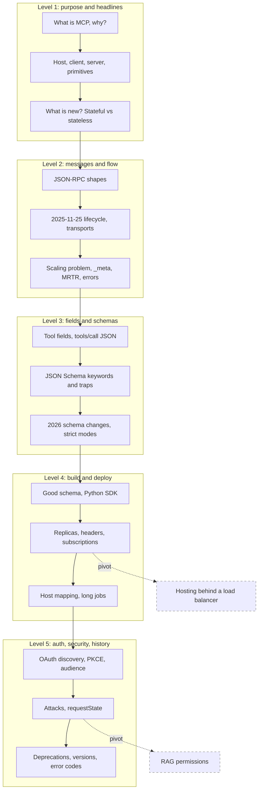

## 1. The question this idea answers

The friend's interviewer asked about MCP in three ways: "what's new", "the difference between stateful and stateless", and he "kept digging into the specifics of the arguments you pass when building MCP in its JSON schema". These three questions are the spine of this drill. Around them sit the questions that always follow: the message format, the transports, tool results and errors, authorization and security.

Part 07 teaches each piece. This page trains the chain, down to single JSON fields. The question of this page: **can you name the exact field, method or error code for any MCP question**? The answer must hold for both revisions, 2025-11-25 and 2026-07-28.

How to use this page:

1. Answer each question aloud before you open it. Give yourself 30 to 90 seconds.
2. For every answer, say which revision it is about. The current revision is 2026-07-28 (checked on 2026-10-15).
3. Write JSON on paper when the question asks for a message. Then compare field by field.
4. Write every missing field or rule on the [mistakes page](/notes/ai/llm-systems/00-progress/mistakes).

## 2. Mental model

> [!analogy] A hotel desk with check-in, and the same desk without it
> In revision 2025-11-25 you check in once at the desk (`initialize`). The desk notes your language and your preferences and gives you a room key (the session ID). Every later request is valid only at the desk that checked you in. In revision 2026-07-28 there is no check-in. Every request carries your passport and your preferences (the `_meta` of each request), so any clerk at any desk can serve it. When a clerk needs your signature, he does not phone your room. He hands you a sealed form and asks you to return with it signed (Multi Round-Trip Requests). The seal stops you from changing what he wrote (`requestState` integrity).
>
> **Where it stops working:** a passport proves identity, but `clientInfo` in `_meta` is self-reported and proves nothing. In MCP, an OAuth access token proves identity, and the server checks it on every HTTP request. Also, a hotel guest talks to the desk directly. The model never talks to an MCP server. The host does, through one client per server.

## 3. Terms

| Term | Plain meaning |
|---|---|
| host | The AI application. It holds one MCP client per server and talks to the model. |
| client | The connector inside the host for exactly one server. |
| server | The program that offers tools, resources and prompts. |
| JSON-RPC 2.0 | The message format: requests, results, errors and notifications as JSON. |
| `initialize` | The 2025-11-25 handshake that fixed the version and capabilities for a session. |
| session | The state that a 2025-11-25 server kept after `initialize`. On HTTP it has the `Mcp-Session-Id` header. |
| `_meta` | A metadata object on messages. In 2026-07-28 every request carries the protocol version and client capabilities in it. |
| `server/discover` | The 2026-07-28 method that returns supported versions, capabilities and server identity. |
| `resultType` | A required field of every 2026-07-28 result: `complete`, `input_required` or, with the tasks extension, `task`. |
| MRTR | Multi Round-Trip Requests: the server returns `input_required`, and the client retries with `inputResponses`. |
| `requestState` | An opaque string that the server returns and the client echoes. The server must protect its integrity. |
| `inputSchema` | The JSON Schema of a tool's arguments. Its root must be `"type": "object"`. |
| `structuredContent` | Typed result data that matches the tool's `outputSchema`. |
| `isError` | The flag of a tool result that reports a failure inside the tool, so the model can read it. |
| annotations | Hints about a tool's behavior, such as `readOnlyHint`. Untrusted unless the server is trusted. |
| Streamable HTTP | The HTTP transport: one endpoint, a POST per message, a JSON or SSE answer. |
| PRM | Protected Resource Metadata (RFC 9728): the document that names a server's authorization servers. |
| PKCE | A proof that the client which started an OAuth login is the one that redeems the code. |

All terms are also in the [Glossary](/notes/ai/llm-systems/glossary).

## 4. How the chain works

### 4.1 The five levels in this chain

| Level | What the interviewer wants | Example in this chain |
|---|---|---|
| 1 | The purpose, the roles, the headline changes | "What is new in MCP? Stateful or stateless?" |
| 2 | The message flow and its reasons | "Why is a session hard to scale? How does MRTR work?" |
| 3 | Exact fields and JSON Schema rules | "Is `3.0` an integer? What does `additionalProperties: false` miss?" |
| 4 | Building and deploying a server | "What must three replicas share?" |
| 5 | Authorization, security and history | "Why is token passthrough forbidden? When can Sampling be removed?" |

### 4.2 The shape of one good answer

Every answer has five parts: **definition, mechanism, numbers or fields, trade-off, production**. For MCP, "numbers" means exact field names, method names, error codes and revision dates.

> [!example] Worked example: "What is the difference between stateful and stateless MCP?" in five parts
> 1. **Definition.** Stateless means the protocol keeps no state between requests. Every request carries its version and capabilities, and any server instance can answer it.
> 2. **Mechanism.** 2025-11-25 had an `initialize` handshake and a session. 2026-07-28 puts `io.modelcontextprotocol/protocolVersion` and `io.modelcontextprotocol/clientCapabilities` in each request's `_meta`. Server-initiated requests became MRTR.
> 3. **Fields and numbers.** Take $k$ replicas and random routing. A session of $r$ requests after `initialize` stays on its replica with probability $(1/k)^r$: 1.6% for $k = 4$, $r = 3$. A stateless call costs about 190 more body bytes in the lesson's example.
> 4. **Trade-off.** No sticky sessions and no lost sessions. But application state needs explicit handles, MRTR may run tool code twice, and `requestState` needs a shared sealing key.
> 5. **Production.** Plain round robin works for 2026-07-28 clients. Legacy clients need a dual-era server.

> [!key] Always name the revision
> Most MCP questions have two correct answers: one for 2025-11-25 and one for 2026-07-28. Start with the current revision, then say what it replaced. An answer without a revision sounds like memory from an old blog post.

### 4.3 Traps and pivots

Traps in this chain: "the model connects to the server", "tool failures are JSON-RPC errors", "`default` fills missing arguments", "`3.0` is not an integer", "`format: date` rejects bad dates", "`additionalProperties: false` closes an `allOf` schema", "Sampling was removed", "a valid token is enough", "annotations make a tool safe". They are marked "(Trap question.)". Pivots jump to hosting and RAG and are marked "(Pivot.)".

## 5. The map of this chain



## 6. Common mistakes

1. **"The model connects to the MCP server."** The host connects through one client per server. The model sees only tool definitions and results that the host passes.
2. **"The current revision has `initialize`."** On 2026-10-15 the current revision is 2026-07-28, which has no handshake and no sessions.
3. **"A tool failure is a JSON-RPC error."** Failures inside the tool, including bad argument values, go into the result with `isError: true`, so the model can correct itself.
4. **"`default` fills in a missing argument."** `default` is an annotation. The server code applies it.
5. **"`additionalProperties: false` at the root closes the whole schema."** It sees only its own `properties`. Use `unevaluatedProperties: false` with `allOf` and `$ref`.
6. **"Sampling and Roots were removed in 2026."** They are deprecated and still work. The earliest removal is the first revision released on or after 2027-07-28.
7. **"A valid token is enough."** The server must also check the audience: the token must be issued for this server. It must never pass the token to another API.
8. **"Stateless MCP means the server keeps no data."** The protocol keeps no state. Applications keep state behind explicit handles, bound to the authenticated user.

## 7. One-minute explanation

MCP is an open protocol that turns N applications times M services into N plus M integrations. The host holds one client per server, and the model never talks to a server directly. A server offers tools, which the model controls, resources, which the application controls, and prompts, which the user picks. Messages are JSON-RPC 2.0 over stdio or Streamable HTTP. Up to revision 2025-11-25 the protocol was stateful. An `initialize` handshake fixed the version and capabilities, the server kept a session, and it could call the client mid-request for sampling, elicitation or roots. That pinned each session to one replica. Revision 2026-07-28 is stateless. Each request carries its version and capabilities in `_meta`, `server/discover` is optional, and a server that needs input returns `input_required`. The client then retries with `inputResponses` and a sealed `requestState`. A tool's `inputSchema` is a JSON Schema 2020-12 object schema. `required`, `enum`, `pattern` and `additionalProperties` constrain the arguments, while `default` and `description` only guide the model. Remote servers use OAuth 2.1 with PKCE, resource indicators and audience checks. Hosts still keep a human in the loop, because tool results, descriptions and annotations are untrusted.

## 8. Check questions

The questions follow the chain of section 5. Answer each one aloud before you open it.

### Level 1: the opening
```check
{
  "question": "Opening question: \"You mentioned MCP. What is it, and why does it exist?\"",
  "hint": "Count the integrations with and without a standard.",
  "answer": "**Definition:** the Model Context Protocol, an open protocol between AI applications and the services that they use.\n\n**The problem:** without a standard, every application writes its own integration for every service. $N$ applications and $M$ services need $N \\times M$ integrations. With MCP, each application implements a client once and each service ships one server: $N + M$. Example: 6 applications and 15 services need 90 integrations without a standard and 21 pieces with MCP.\n\n**What it standardizes:** the wire between the host and the service. That is:\n\n- JSON-RPC 2.0 messages over stdio or Streamable HTTP\n- three server primitives\n- discovery of tools with their JSON Schemas\n- an authorization model for HTTP, based on OAuth 2.1\n\n**What it leaves to the host:** the model, the agent loop and the safety decisions. The spec says MCP cannot enforce security at the protocol level.\n\n**History:** Anthropic open-sourced it in November 2024 (2024-11-25). Since 2025-12-09 it is a project of the Agentic AI Foundation under the Linux Foundation. MCP reused the idea of the Language Server Protocol.\n\nSource lessons: [part 07 L1](/notes/ai/llm-systems/07-mcp/l1-why-mcp) and [part 07 L12](/notes/ai/llm-systems/07-mcp/l12-whats-new-version-history)."
}
```

```check
{
  "question": "Interview follow-up: \"So the model connects to the MCP server and calls the tool?\" (Trap question.)",
  "hint": "Who holds the conversation, and who holds the connection?",
  "answer": "**No. The host connects, through one client per server.**\n\n- **Host:** the AI application, for example a desktop chat app or a LangGraph agent. It talks to the model through a model API.\n- **Client:** one connector per server, a 1:1 relationship.\n- **Server:** the program that offers tools, resources and prompts.\n\nThe model only produces a tool call in its provider's format. The host converts it into `tools/call` for the right server and gives the result back to the model as a tool result.\n\n**Why one client per server:** the spec principle is that servers \"should not be able to read the whole conversation, nor 'see into' other servers\". Each client also holds only its own server's credentials, fails on its own, and can speak its own protocol revision.\n\n**Example:** a LangGraph agent with a GitHub server over Streamable HTTP and a files server over stdio is one host with two clients.\n\nSource lesson: [part 07 L1](/notes/ai/llm-systems/07-mcp/l1-why-mcp)."
}
```

```check
{
  "question": "Interview follow-up: \"What can a server offer, and who decides when each thing is used?\"",
  "hint": "Three primitives, three controllers.",
  "answer": "| Primitive | Controlled by | Methods |\n|---|---|---|\n| Tools | the model | `tools/list`, `tools/call` |\n| Resources | the application | `resources/list`, `resources/templates/list`, `resources/read` |\n| Prompts | the user | `prompts/list`, `prompts/get` |\n\nThe control column is the whole idea. The prompts page: \"This refers to who decides when the prompt is used, not who authors its content.\"\n\n**Client features:** elicitation (asking the user), and the deprecated sampling (asking the client's model) and roots (the client's folders). In 2026-07-28 they travel inside MRTR results, not as server requests.\n\n**Choosing:** an action is a tool. Data that the host attaches is a resource, for example a 2 MB catalog with a small `search_products` tool next to it. A user-picked template, such as a slash command, is a prompt. `prompts/get` arguments are strings, and it returns `user` and `assistant` messages.\n\nSource lessons: [part 07 L1](/notes/ai/llm-systems/07-mcp/l1-why-mcp) and [part 07 L8](/notes/ai/llm-systems/07-mcp/l8-resources-and-prompts)."
}
```

```check
{
  "question": "Interview follow-up: \"What is new in MCP?\"",
  "hint": "Name the revision, the one big change, the reason, then three concrete fields or methods.",
  "answer": "**The 30-second answer:** the current revision is 2026-07-28, and its big change is a stateless core.\n\n1. The `initialize` handshake and the `Mcp-Session-Id` session are gone.\n2. Every request carries its protocol version and client capabilities in `_meta`, so any server instance behind a plain round-robin balancer can answer.\n3. Server-to-client requests became Multi Round-Trip Requests: the server returns `input_required`, and the client retries with the answers.\n4. Every result carries `resultType`. `server/discover` is new, and `subscriptions/listen` replaces the GET stream and `resources/subscribe`.\n5. HTTP requests carry `Mcp-Method` and `Mcp-Name` headers. List results carry `ttlMs` and `cacheScope`.\n6. Tasks moved into an extension. Auth added issuer validation (RFC 9207) and deprecated Dynamic Client Registration.\n7. Roots, Sampling and Logging are deprecated, with at least a twelve-month window.\n\n**Why:** \"Stateful connections force “sticky” routing that pins traffic to specific servers, preventing effective auto-scaling\" (Transports Working Group).\n\nSource lessons: [part 07 L12](/notes/ai/llm-systems/07-mcp/l12-whats-new-version-history) and [part 07 L5](/notes/ai/llm-systems/07-mcp/l5-stateful-vs-stateless)."
}
```

```check
{
  "question": "Interview follow-up: \"What is the difference between stateful and stateless MCP?\"",
  "hint": "Three kinds of state. Which one moved?",
  "answer": "**Separate three kinds of state first:**\n\n| Level | Example | 2025-11-25 | 2026-07-28 |\n|---|---|---|---|\n| Protocol state | version, capabilities, subscriptions, log level, a suspended elicitation | the replica that handled `initialize` | nobody between requests: each request carries it in `_meta` |\n| Application state | a shopping cart, a browser | the server, often keyed by the session | the server, named by an explicit handle passed on each request |\n| Conversation state | messages, tool results | the host | the host |\n\n**Stateful (2025-11-25):** a handshake fixed the version and capabilities, and the server kept a session (`Mcp-Session-Id` on HTTP). The server could send `sampling/createMessage`, `elicitation/create` or `roots/list` mid-call and hold the suspended call in memory. So a session lived in one replica, which needed sticky routing, a shared store or message routing.\n\n**Stateless (2026-07-28):** self-describing requests, optional `server/discover`, MRTR instead of server requests, `subscriptions/listen` for change notifications, cacheable lists.\n\n**The key sentence:** a stateless protocol does not mean a stateless application. State lives behind explicit handles, bound to the authenticated user.\n\nSource lesson: [part 07 L5](/notes/ai/llm-systems/07-mcp/l5-stateful-vs-stateless)."
}
```

### Level 2: messages and flow

```check
{
  "question": "Interview follow-up: \"What does an MCP message look like on the wire?\"",
  "hint": "Four shapes. Which one has no id?",
  "answer": "**JSON-RPC 2.0, four shapes:**\n\n| Shape | Fields |\n|---|---|\n| Request | `jsonrpc: \"2.0\"`, `id`, `method`, `params` |\n| Result | the same `id`, `result` |\n| Error | the same `id`, `error` with `code`, `message`, optional `data` |\n| Notification | `jsonrpc`, `method`, `params`, **no** `id`, never answered |\n\n**MCP rules on top:**\n\n- The id is a string or an integer, never `null`.\n- `params` is always an object.\n- 2025-11-25: an id \"MUST NOT have been previously used by the requestor within the same session\". 2026-07-28: it \"MUST NOT match the ID of any other request the sender has issued and not yet received a response for\", because sessions are gone (SEP-2567). An MRTR retry needs a new id.\n- Responses can arrive in any order: match them by id.\n- Batching existed only in 2025-03-26 and was removed in 2025-06-18.\n\n**Edge cases:** `\"id\": 1.0` passes the official schema (JSON Schema counts it as an integer) but is a bad idea. In Python, `isinstance(True, int)` is `True`, so an id check must exclude `bool`.\n\nSource lesson: [part 07 L2](/notes/ai/llm-systems/07-mcp/l2-json-rpc)."
}
```

```check
{
  "question": "Interview follow-up: \"Walk me through the 2025-11-25 lifecycle.\"",
  "hint": "Request fields, result fields, one round of negotiation, then a notification.",
  "answer": "**Three phases:** initialization, operation, shutdown.\n\n1. **`initialize` request params:** `protocolVersion` (required), `capabilities` (required, `{}` means none), `clientInfo` (required: `name`, `version`, optional `title`), optional `_meta`.\n2. **`InitializeResult`:** `protocolVersion` (required), `capabilities` (required), `serverInfo` (required), optional `instructions`, which the host may add to the system prompt.\n3. **Version negotiation, one round:** the server echoes the client's version if it supports it, else names its own latest. If the client cannot speak that, it disconnects. Version strings are names, not ordered values: do not compare them with `<`.\n4. **`notifications/initialized`:** the client confirms. Before it, the server SHOULD NOT send requests other than pings and logging.\n5. **Operation:** each side uses only features the other declared. Example: `elicitation/create` needs the client's `elicitation` capability. `\"elicitation\": {}` means form mode only.\n6. **Shutdown:** no message. Close stdin, close the HTTP connection, or send HTTP DELETE.\n\n**The session** remembers the version, the capabilities, the `initialized` flag, subscriptions, the log level, suspended server requests and open SSE streams.\n\nSource lesson: [part 07 L3](/notes/ai/llm-systems/07-mcp/l3-the-stateful-protocol)."
}
```

```check
{
  "question": "Interview follow-up: \"How do the two transports work, and what changed in 2026-07-28?\"",
  "hint": "stdio framing, then HTTP before and after 2026-07-28.",
  "answer": "**stdio:** the host starts the server as a subprocess. One JSON-RPC message per line on stdin and stdout, no embedded newlines. Logs go to stderr: a `print()` to stdout corrupts the protocol.\n\n**Streamable HTTP (2025-11-25):**\n\n- One endpoint. Every client message is its own POST with `Accept: application/json, text/event-stream`.\n- The server answers a request with one JSON body or an SSE stream (notifications, then the response). A POSTed notification or response gets `202 Accepted`.\n- `Mcp-Session-Id` from the `initialize` response, a GET stream for server messages, resumability with `Last-Event-ID`, DELETE to end a session, the `MCP-Protocol-Version` header.\n\n**2026-07-28 changes:**\n\n- No session header, no GET stream (use `subscriptions/listen`), no resumability: a lost stream means re-issuing the request with a new id.\n- New headers `Mcp-Method` and, for tool calls, resource reads and prompts, `Mcp-Name`. A mismatch with the body is `400` with -32020 HeaderMismatch.\n- Closing a request's SSE stream is its cancellation. On stdio, the client sends `notifications/cancelled`.\n\n**Security:** validate `Origin`, and bind local servers to 127.0.0.1. HTTP+SSE (2024-11-05) is deprecated.\n\nSource lesson: [part 07 L4](/notes/ai/llm-systems/07-mcp/l4-transports)."
}
```

```check
{
  "question": "Interview follow-up: \"Why is a stateful session hard to run behind a load balancer? Give a number.\"",
  "hint": "A session is a memory in one process. Count the chance that every request finds it.",
  "answer": "**The session lives in one replica's memory.** A request that reaches another replica gets `404 Not Found`. The 2025-11-25 client must then send a new `initialize` without a session ID.\n\n**Probability with random routing:** $k$ replicas, $r$ requests after `initialize`:\n\n$$\nP(\\text{all on the right replica}) = \\left(\\frac{1}{k}\\right)^{r}\n$$\n\n- $k = 2$, $r = 3$: 12.5%.\n- $k = 4$, $r = 3$: about 1.6%.\n- $k = 4$, $r = 10$: about $9.5 \\times 10^{-7}$.\n\n**The hardest part:** server-initiated requests. The server sends `elicitation/create` and holds the suspended tool call. The client's answer arrives as a new POST, which may reach another replica. SEP-2322: \"Server A must somehow discover the elicitation response delivered to server B.\"\n\n**Workarounds before 2026:**\n\n| Pattern | Cost |\n|---|---|\n| Sticky sessions by `Mcp-Session-Id` | L7 balancer, uneven load, a crash loses all its sessions |\n| Persistent session store | a database on the hot path |\n| Message routing with pub/sub | a broker and an ownership registry |\n\nSDK \"stateless HTTP\" modes dropped the session ID but could not fix server-initiated requests or per-request capabilities.\n\nSource lessons: [part 07 L5](/notes/ai/llm-systems/07-mcp/l5-stateful-vs-stateless) and [part 07 L3](/notes/ai/llm-systems/07-mcp/l3-the-stateful-protocol)."
}
```

```check
{
  "question": "Interview follow-up: \"Without `initialize`, how does a 2026-07-28 server know the version and the client's capabilities?\"",
  "hint": "Read the `_meta` of a request.",
  "answer": "**Every request carries them in `_meta`:**\n\n| Key | Required |\n|---|---|\n| `io.modelcontextprotocol/protocolVersion` | yes |\n| `io.modelcontextprotocol/clientCapabilities` | yes (`{}` means none) |\n| `io.modelcontextprotocol/clientInfo` | SHOULD |\n| `io.modelcontextprotocol/logLevel` | optional, deprecated with Logging |\n\nOn HTTP the version also travels in the `MCP-Protocol-Version` header, and the two must match. Servers SHOULD put `io.modelcontextprotocol/serverInfo` in every result's `_meta`.\n\n**Errors:**\n\n- A missing required key: -32602 Invalid params, HTTP 400.\n- A needed capability that the client did not declare: -32021 MissingRequiredClientCapability with `data.requiredCapabilities`, HTTP 400.\n- An unsupported version: -32022 UnsupportedProtocolVersion with `data.supported`. The client retries with a common version.\n\n**`server/discover`:** servers MUST implement it, clients MAY call it. It returns `supportedVersions`, `capabilities`, optional `instructions`, `ttlMs` and `cacheScope`. On stdio it is the probe that detects a legacy server.\n\n**Trap:** `clientInfo` is self-reported. Never use it for security decisions.\n\nSource lessons: [part 07 L5](/notes/ai/llm-systems/07-mcp/l5-stateful-vs-stateless) and [part 07 L10](/notes/ai/llm-systems/07-mcp/l10-utilities-and-errors)."
}
```

```check
{
  "question": "Interview follow-up: \"In 2026-07-28 the server can no longer call the client. So how does a tool ask the user 'Are you sure?'\"",
  "hint": "The server returns instead of calling. The client retries.",
  "answer": "**Multi Round-Trip Requests (SEP-2322).**\n\n1. **Round 1:** the client sends `tools/call`. The server returns a result with `resultType: \"input_required\"`, an `inputRequests` map and an opaque `requestState`. In the map, a key such as `confirm` holds an `elicitation/create` request object without `jsonrpc` and `id`.\n2. **The client** asks the user and builds every requested input. Then it sends a **new** request with a **new id**. The request has the same `name` and `arguments`, plus `inputResponses: {\"confirm\": {\"action\": \"accept\", \"content\": {\"confirm\": true}}}` and the exact `requestState`.\n3. **Round 2:** any replica that can verify the state finishes the call with `resultType: \"complete\"`.\n\n**Rules:** at least one of `inputRequests` and `requestState` is present. The client echoes `requestState` exactly and never inspects it. Inputs are not reused for other requests.\n\n**Design rule for the tool:** ask first, act in the final round. Round 1 may run again, or never get a retry.\n\n**Compared with 2025-11-25:** there the server sent `elicitation/create` as its own request, with an id from its own id space. It waited in memory for the response on the same connection.\n\nSource lessons: [part 07 L9](/notes/ai/llm-systems/07-mcp/l9-mrtr-elicitation-sampling-and-roots) and [part 07 L5](/notes/ai/llm-systems/07-mcp/l5-stateful-vs-stateless)."
}
```

```check
{
  "question": "Interview follow-up: \"The model sent a date in the wrong format. Does the server return a JSON-RPC error -32602?\" (Trap question.)",
  "hint": "Who should read the error: the host code or the model?",
  "answer": "**No. It returns a normal result with `isError: true`** and a text that explains the problem, for example \"date must be YYYY-MM-DD, got 14/10/2026\".\n\nThe schema of `CallToolResult`: errors that originate from the tool \"SHOULD be reported inside the result object, with `isError` set to true, _not_ as an MCP protocol-level error response. Otherwise, the LLM would not be able to see that an error occurred and self-correct.\" Revision 2025-11-25 made this explicit for input validation errors (SEP-1303).\n\n| | Protocol error | Tool execution error |\n|---|---|---|\n| Wire form | JSON-RPC `error` with `code` and `message` | `result` with `isError: true` |\n| Causes | unknown tool, malformed request, server failure | API failure, invalid argument values, business rules |\n| To the model | clients MAY pass it | clients SHOULD pass it |\n\n**Discrepancy to mention:** the spec lists an unknown tool as a protocol error with -32602. But the Python SDK 2.3.0 returns `isError: true` with \"Unknown tool: nope\" (measured in the lesson). A client must handle both.\n\n**In the SDK:** raise `ToolError(\"...\")` for a readable message. Any other exception shows only \"Error executing tool ...\" to the model.\n\nSource lessons: [part 07 L6](/notes/ai/llm-systems/07-mcp/l6-tools-in-depth), [part 07 L2](/notes/ai/llm-systems/07-mcp/l2-json-rpc) and [part 07 L13](/notes/ai/llm-systems/07-mcp/l13-build-an-mcp-server)."
}
```

### Level 3: fields and the JSON Schema of arguments

```check
{
  "question": "Interview follow-up: \"List every field of a tool definition in 2026-07-28. Which are required?\"",
  "hint": "Two fields are required. Who reads each of the others?",
  "answer": "| Field | Required | Main reader |\n|---|---|---|\n| `name` | yes | model and client |\n| `title` | no | user interface |\n| `description` | no | model |\n| `inputSchema` | yes: root `\"type\": \"object\"` | model, client and server |\n| `outputSchema` | no: any 2020-12 schema | host validation |\n| `annotations` | no | host policy, as untrusted hints |\n| `icons` | no | user interface |\n| `_meta` | no | namespaced extra data |\n\n**Annotations and their defaults:** `readOnlyHint` false, `destructiveHint` true, `idempotentHint` false, `openWorldHint` true. A tool without annotations is the worst case: it may destroy data and is not safe to repeat.\n\n**Removed in 2026-07-28:** `execution.taskSupport` (tasks became an extension).\n\n**Name trap:** MCP allows a dot, as in `admin.tools.list`. The Anthropic API requires `^[a-zA-Z0-9_-]{1,128}$`, so the host maps names and keeps a route table back to `(server, original name)`.\n\nSource lesson: [part 07 L6](/notes/ai/llm-systems/07-mcp/l6-tools-in-depth)."
}
```

```check
{
  "question": "Interview follow-up: \"Write a 2026-07-28 `tools/call` request and its result.\"",
  "hint": "`params` has three main fields in 2026-07-28. The result has `content` and `resultType`.",
  "answer": "**Request:**\n\n```json\n{\n  \"jsonrpc\": \"2.0\",\n  \"id\": 7,\n  \"method\": \"tools/call\",\n  \"params\": {\n    \"name\": \"search_orders\",\n    \"arguments\": {\"customer_id\": \"CUS-0042\", \"status\": \"shipped\", \"limit\": 2},\n    \"_meta\": {\n      \"io.modelcontextprotocol/protocolVersion\": \"2026-07-28\",\n      \"io.modelcontextprotocol/clientCapabilities\": {\"elicitation\": {\"form\": {}}},\n      \"io.modelcontextprotocol/clientInfo\": {\"name\": \"orders-agent\", \"version\": \"1.4.0\"},\n      \"progressToken\": \"p-7\"\n    }\n  }\n}\n```\n\n**Result:**\n\n```json\n{\n  \"jsonrpc\": \"2.0\",\n  \"id\": 7,\n  \"result\": {\n    \"resultType\": \"complete\",\n    \"content\": [{\"type\": \"text\", \"text\": \"2 orders found: ORD-1001, ORD-0987.\"}],\n    \"structuredContent\": {\"orders\": [{\"order_id\": \"ORD-1001\"}, {\"order_id\": \"ORD-0987\"}]},\n    \"isError\": false,\n    \"_meta\": {\"io.modelcontextprotocol/serverInfo\": {\"name\": \"orders-server\", \"version\": \"2.0.1\"}}\n  }\n}\n```\n\n**Fields to name:** `params` has `name` (required), `arguments`, `_meta` (required in 2026-07-28), and on an MRTR retry `inputResponses` and `requestState`. The result has these fields:\n\n- `content`: required, may be empty\n- `structuredContent`: optional, any JSON value in 2026-07-28, an object in 2025-11-25\n- `isError`: false if absent\n- `resultType`: required in 2026-07-28\n\n**Content block types:** `text`, `image` (base64 `data` and `mimeType`), `audio`, `resource_link` (`uri`, `name`) and `resource` (embedded contents).\n\nSource lesson: [part 07 L6](/notes/ai/llm-systems/07-mcp/l6-tools-in-depth)."
}
```

```check
{
  "question": "Interview follow-up: \"A property has `\\\"limit\\\": {\\\"type\\\": \\\"integer\\\", \\\"default\\\": 20}`. The model sends `{}`. What does the server receive?\" (Trap question.)",
  "hint": "Is `default` an assertion or an annotation?",
  "answer": "**The server receives `{}`, with no `limit`.** The validator reports no error, because `limit` is not in `required`, and `default` is an annotation. Understanding JSON Schema: `default` \"is not used to fill in missing values during the validation process.\"\n\n**Who applies 20:** the server code, for example `args.get(\"limit\", 20)`. The Python SDK applies the function's default value, because it builds a Pydantic model from the signature.\n\n**Three facts that answer half of all schema questions:**\n\n1. Properties are optional unless they are listed in `required`.\n2. Extra properties are allowed unless `additionalProperties` (or `unevaluatedProperties`) is `false`.\n3. Annotations (`title`, `description`, `default`, `examples`) never make an instance invalid, and `format` is an annotation unless a format checker is enabled.\n\n**Related trap:** optional is not nullable. A key outside `required` may be absent. A key with `\"type\": [\"string\", \"null\"]` may be `null`. `{}` and `{\"status\": null}` are different instances.\n\nSource lesson: [part 07 L7](/notes/ai/llm-systems/07-mcp/l7-json-schema-for-tool-arguments)."
}
```

```check
{
  "question": "Interview follow-up: \"Which of these are valid for `{\\\"type\\\": \\\"integer\\\"}`: `3`, `3.0`, `3.5`, `\\\"3\\\"`, `true`? And what does the Python SDK accept for a parameter `a: int`?\"",
  "hint": "JSON Schema checks the value as it is. Pydantic lax mode converts.",
  "answer": "**JSON Schema 2020-12** (measured with `jsonschema` 4.26):\n\n| Instance | Result |\n|---|---|\n| `3` | valid |\n| `3.0` | valid: \"any number with a zero fractional part\" is an integer |\n| `3.5` | invalid: `3.5 is not of type 'integer'` |\n| `\"3\"` | invalid: a string |\n| `true` | invalid: a boolean |\n\n**Python SDK 2.3.0** validates with Pydantic in lax mode. It accepted `3`, `3.0`, `\"3\"` (as 3) and `true` (as 1). It rejected only `3.5`: \"Input should be a valid integer, got a number with a fractional part\".\n\n**Meaning:** the server accepts more than its published schema allows. If you need strict behavior, validate the arguments with a JSON Schema validator against the published schema, or use strict Pydantic types.\n\n**Related number trap:** `{\"type\": \"number\", \"multipleOf\": 0.01}` rejects 19.99 because of binary floating point. Use an integer of cents.\n\nSource lesson: [part 07 L7](/notes/ai/llm-systems/07-mcp/l7-json-schema-for-tool-arguments)."
}
```

```check
{
  "question": "Interview follow-up: \"Your schema combines a paging part and a query part with `allOf`, and has `additionalProperties: false` at the root. The call `{\\\"query\\\": \\\"x\\\", \\\"limit\\\": 5}` fails. Why?\" (Trap question.)",
  "hint": "Which `properties` keyword can `additionalProperties` see?",
  "answer": "**`additionalProperties` sees only the `properties` of its own schema object.** `limit` is declared inside an `allOf` branch. So for the root's `additionalProperties`, it is an extra key:\n\n```text\nAdditional properties are not allowed ('limit' was unexpected)\n```\n\n**The 2020-12 fix:** `\"unevaluatedProperties\": false` at the root, without `additionalProperties`. It counts every property that any subschema evaluated, including `allOf` branches and `$ref` targets. Then `{\"query\": \"x\", \"limit\": 5}` is valid, and a typo still fails: `Unevaluated properties are not allowed ('lmit' was unexpected)`.\n\n**Two more scope rules:**\n\n- `additionalProperties: false` at the root does not close **nested** objects. Close each one.\n- In draft-07, keywords next to `$ref` are ignored. In 2020-12 they apply. MCP's default dialect is 2020-12 (since 2025-11-25, SEP-1613).\n\n**Check the provider:** strict modes may not support `unevaluatedProperties`. Then flatten the schema.\n\nSource lesson: [part 07 L7](/notes/ai/llm-systems/07-mcp/l7-json-schema-for-tool-arguments)."
}
```

```check
{
  "question": "Interview follow-up: \"Does `\\\"format\\\": \\\"date\\\"` reject `\\\"last week\\\"` and `\\\"2026-02-30\\\"`?\" (Trap question.)",
  "hint": "Is `format` an assertion by default?",
  "answer": "**Not by default.** In 2020-12, `format` is an annotation unless the validator enables a format checker.\n\n| Schema and validator | `\"last week\"` | `\"2026-02-30\"` |\n|---|---|---|\n| `format: date`, no format checker | valid | valid |\n| `format: date` with a format checker | invalid | invalid: `'2026-02-30' is not a 'date'` |\n| `pattern: \"^[0-9]{4}-[0-9]{2}-[0-9]{2}$\"` | invalid | valid (the pattern cannot see February 30) |\n\n**The safe recipe:** `\"type\": \"string\"`, `\"format\": \"date\"`, the pattern above, \"ISO 8601 date YYYY-MM-DD\" in the description, and a format checker in your validator. The pattern catches \"last week\" in every validator. The format checker also catches February 30.\n\n**Pattern trap:** patterns are not anchored. `\"ORD-[0-9]{4}\"` accepts `\"xxORD-1001yy\"`. Write `\"^ORD-[0-9]{4}$\"`.\n\n**Elicitation forms** allow only the formats `email`, `uri`, `date` and `date-time` for strings.\n\nSource lessons: [part 07 L7](/notes/ai/llm-systems/07-mcp/l7-json-schema-for-tool-arguments) and [part 07 L9](/notes/ai/llm-systems/07-mcp/l9-mrtr-elicitation-sampling-and-roots)."
}
```

```check
{
  "question": "Interview follow-up: \"Write a schema where exactly one of `order_id` and `customer_id` must be present. Then tell me what the recommended schema of a tool with no parameters is.\"",
  "hint": "`oneOf` means exactly one branch matches.",
  "answer": "**Naive version:**\n\n```json\n{\"type\": \"object\", \"oneOf\": [{\"required\": [\"order_id\"]}, {\"required\": [\"customer_id\"]}]}\n```\n\nIt rejects `{}` (no branch matches) and both keys together (both branches match, and `oneOf` needs **exactly** one). Correct here, but the error message is hard to read (\"is valid under each of ...\"). If the branches overlap by accident, for example branches without `required`, valid input fails.\n\n**Clearer version:**\n\n```json\n{\n  \"type\": \"object\",\n  \"anyOf\": [{\"required\": [\"order_id\"]}, {\"required\": [\"customer_id\"]}],\n  \"not\": {\"required\": [\"order_id\", \"customer_id\"]}\n}\n```\n\n**Simplest for a model:** two tools, `get_order(order_id)` and `list_customer_orders(customer_id)`.\n\n**No parameters:** the spec recommends `{\"type\": \"object\", \"additionalProperties\": false}`, which \"explicitly accepts only empty objects\". `{\"type\": \"object\"}` accepts any object. The Python SDK generates the open form: `{\"type\": \"object\", \"properties\": {}, \"title\": \"get_timeArguments\"}`.\n\nSource lesson: [part 07 L7](/notes/ai/llm-systems/07-mcp/l7-json-schema-for-tool-arguments)."
}
```

```check
{
  "question": "Interview follow-up: \"What exactly did 2026-07-28 change for `inputSchema`, `outputSchema` and `$ref`?\"",
  "hint": "One SEP loosened two schemas and one result field.",
  "answer": "**SEP-2106:** \"Loosen `inputSchema` and `outputSchema` to allow any JSON Schema 2020-12 keywords, and `structuredContent` to allow any JSON value.\"\n\n| Tool definition | 2025-11-25 | 2026-07-28 |\n|---|---|---|\n| `inputSchema` without `\"type\": \"object\"` | invalid | invalid |\n| `inputSchema` with `oneOf` and `additionalProperties` at the root | valid (tolerated, not promised) | valid |\n| `outputSchema` with `\"type\": \"array\"` | invalid | valid |\n| `structuredContent: [1, 2, 3]` | invalid | valid |\n\nThe root of `inputSchema` stays `\"type\": \"object\"`, because \"Tool arguments are always JSON objects\".\n\n**`$ref` rules (2026-07-28):** implementations MUST NOT automatically dereference a `$ref` that resolves to a network URI. An opt-in fetch mode MAY exist but MUST be off by default, and SHOULD use an allowlist and block loopback, link-local and private addresses. An unresolved external `$ref` SHOULD make the schema fail. Reason: the server controls the schema, so a network `$ref` would be SSRF from the client. Local references such as `#/$defs/money` are fine. Bounds on composition depth and time protect the validator.\n\n**Dialect:** a schema without `$schema` uses 2020-12 (since 2025-11-25). Implementations MUST support 2020-12.\n\n**Backward compatibility:** also send the JSON as a text block, or wrap an array as `{\"result\": [...]}` for 2025-11-25 clients.\n\nSource lessons: [part 07 L7](/notes/ai/llm-systems/07-mcp/l7-json-schema-for-tool-arguments) and [part 07 L6](/notes/ai/llm-systems/07-mcp/l6-tools-in-depth)."
}
```

```check
{
  "question": "Interview follow-up: \"You send this property to a model provider in strict mode: `\\\"limit\\\": {\\\"type\\\": \\\"integer\\\", \\\"minimum\\\": 1, \\\"maximum\\\": 50, \\\"default\\\": 20}`, and `limit` is optional. What changes?\"",
  "hint": "The provider's strict subset is smaller than JSON Schema. Who still enforces the range?",
  "answer": "**Strict modes support a subset of JSON Schema.**\n\n- Anthropic `\"strict\": true` (checked on 2026-10-15): `additionalProperties` must be `false` on objects. Numerical constraints such as `minimum` and `maximum`, string length constraints and external `$ref` are not supported. Limits per request include 20 strict tools.\n- OpenAI strict mode (as quoted in the older lesson, checked on 2026-10-12): every property must be in `required`, and an optional field becomes nullable.\n\n**The strict copy:**\n\n```json\n{\n  \"limit\": {\n    \"type\": [\"integer\", \"null\"],\n    \"description\": \"Orders per page. Rules: minimum=1, maximum=50, default=20.\"\n  }\n}\n```\n\n`limit` joins `required`, and the parent object gets `additionalProperties: false`. The model now sends `\"limit\": null` when it has no value.\n\n**What the server must still do:** validate the **original** schema (1 to 50), because the strict copy no longer enforces the range. Map `null` to the default 20.\n\n**Rule:** keep the full schema on the server, and send a simplified strict copy to the model.\n\nSource lesson: [part 07 L7](/notes/ai/llm-systems/07-mcp/l7-json-schema-for-tool-arguments)."
}
```

```check
{
  "question": "Interview follow-up: \"What does statelessness cost on the wire? Compare one call and 100 calls.\"",
  "hint": "Count the handshake once in 2025-11-25. Count the metadata on every call in 2026-07-28.",
  "answer": "Lesson's count (JSON bodies and MCP-specific headers, computed with Python):\n\n- 2025-11-25: `initialize` body 158 bytes, `initialized` body 54 bytes plus 84 bytes of `Mcp-Session-Id` and `MCP-Protocol-Version` header lines. Each `tools/call` 125 bytes plus 84 bytes of headers.\n- 2026-07-28: each `tools/call` 314 bytes plus 82 bytes of `MCP-Protocol-Version`, `Mcp-Method` and `Mcp-Name`. Without the optional `clientInfo`, 238 bytes.\n\n| Tool calls | 2025-11-25 | 2026-07-28 |\n|---|---|---|\n| 1 | 505 bytes in 3 requests | 396 bytes in 1 request |\n| 10 | 2,386 bytes | 3,960 bytes |\n| 100 | 21,196 bytes | 39,600 bytes |\n\n**So:** about 190 more body bytes per call ($314 - 125 = 189$). In exchange, the first result needs one round trip instead of at least two, and no replica must remember anything. Next to a typical tool result, a couple hundred bytes is small.\n\n**Other costs:** MRTR may run tool code twice, application state needs handles, long work needs the tasks extension, and `requestState` needs a shared key.\n\nSource lesson: [part 07 L5](/notes/ai/llm-systems/07-mcp/l5-stateful-vs-stateless)."
}
```

### Level 4: building and deploying a server

```check
{
  "question": "Interview follow-up: \"Design the argument schema of a `search_orders` tool. What makes a schema good for a model?\"",
  "hint": "Make every wrong value that a model might write fail with a readable message.",
  "answer": "**Good schema (lesson L7):**\n\n```json\n{\n  \"type\": \"object\",\n  \"properties\": {\n    \"customer_id\": {\"type\": \"string\", \"pattern\": \"^CUS-[0-9]{4}$\", \"description\": \"Customer ID, format CUS-NNNN, for example CUS-0042.\"},\n    \"status\": {\"type\": \"string\", \"enum\": [\"pending\", \"shipped\", \"cancelled\"], \"description\": \"Only orders with this status. Omit for all statuses.\"},\n    \"created_from\": {\"type\": \"string\", \"format\": \"date\", \"pattern\": \"^[0-9]{4}-[0-9]{2}-[0-9]{2}$\", \"description\": \"First creation day, ISO 8601 date YYYY-MM-DD, inclusive, UTC.\"},\n    \"created_to\": {\"type\": \"string\", \"format\": \"date\", \"pattern\": \"^[0-9]{4}-[0-9]{2}-[0-9]{2}$\", \"description\": \"Last creation day, ISO 8601 date YYYY-MM-DD, inclusive, UTC.\"},\n    \"min_total_cents\": {\"type\": \"integer\", \"minimum\": 0, \"description\": \"Smallest order total in US cents. 2500 means USD 25.00.\"},\n    \"limit\": {\"type\": \"integer\", \"minimum\": 1, \"maximum\": 50, \"default\": 20, \"description\": \"Orders per page, 1 to 50. Default 20.\"},\n    \"page_token\": {\"type\": \"string\", \"description\": \"Opaque token from the previous result. Omit on the first call.\"}\n  },\n  \"required\": [\"customer_id\"],\n  \"dependentRequired\": {\"created_to\": [\"created_from\"]},\n  \"additionalProperties\": false\n}\n```\n\n**What it rejects (measured):**\n\n- a customer name instead of an ID\n- `\"Shipped\"` with a capital S\n- \"last week\" and \"2026-02-30\" (with a format checker)\n- `25.5` cents and `limit` 500\n- the typo `limt`\n- `created_to` without `created_from`\n\n**Design rules:**\n\n- enums for fixed choices, formats and units in descriptions\n- integers for money, ISO 8601 strings for dates\n- few and flat parameters, closed objects\n- anchored patterns, bounded numbers, opaque page tokens\n- two tools instead of a complex `oneOf`\n- defaults applied in code, local `$ref` only\n\nSource lesson: [part 07 L7](/notes/ai/llm-systems/07-mcp/l7-json-schema-for-tool-arguments)."
}
```

```check
{
  "question": "Interview follow-up: \"You build the server with the Python SDK. How does a function become a tool, and what does the schema look like?\"",
  "hint": "Name, docstring and type hints become name, description and schema.",
  "answer": "**SDK 2.3.0:** create an `MCPServer` (in v1 it was `FastMCP`, now a `ModuleNotFoundError`) and decorate functions with `@mcp.tool()` (with parentheses).\n\n| Python | Generated JSON Schema |\n|---|---|\n| `customer_id: str` with no default | `\"type\": \"string\"`, name in `required` |\n| `Annotated[str, Field(description=..., pattern=...)]` | `\"description\"`, `\"pattern\"` |\n| `Literal[\"pending\", ...]` | `\"enum\": [...]` |\n| `Field(ge=1, le=50)` | `\"minimum\": 1`, `\"maximum\": 50` |\n| `= 20` | `\"default\": 20`, not required |\n| `X \\| None = None` | `\"anyOf\": [..., {\"type\": \"null\"}]`, `\"default\": null` |\n| a `BaseModel` parameter | `\"$ref\": \"#/$defs/...\"` |\n| a `Context` parameter | nothing: the SDK injects it |\n| return type `int` | `outputSchema` with one required property `result`, and `structuredContent` `{\"result\": 2}` |\n\n**Errors:** raise `ToolError(\"...\")` so the model reads the reason. Other exceptions show only \"Error executing tool get_order\".\n\n**Transports:** `mcp.run()` serves stdio, `mcp.run(transport=\"streamable-http\")` serves one `/mcp` endpoint. The Inspector CLI tests it. For a host, put absolute paths into `claude_desktop_config.json`, or use `claude mcp add`.\n\n**Validation trap:** Pydantic lax mode accepts `\"2\"` for an `int`.\n\nSource lessons: [part 07 L13](/notes/ai/llm-systems/07-mcp/l13-build-an-mcp-server) and [part 07 L7](/notes/ai/llm-systems/07-mcp/l7-json-schema-for-tool-arguments)."
}
```

```check
{
  "question": "Interview follow-up: \"You run three replicas behind a plain round-robin load balancer. Which clients work, and what must the replicas still share?\" (Pivot.)",
  "hint": "The protocol keeps nothing. What does the application still keep?",
  "answer": "**Measured in the lesson with two replicas:**\n\n- **2026-07-28 clients work.** Every request carries its version and capabilities in `_meta`, so any replica answers. Three calls alternated between replicas and all succeeded.\n- **Legacy clients fail** without `stateless_http=True`: `initialize` creates a session in one replica's memory, and the next request got 404 \"Session not found\". With `stateless_http=True` they work, but lose server-to-client requests and resumability. The modern path ignores the flag.\n\n**What replicas must still share:**\n\n1. The `RequestStateSecurity` keys and the same server name, so replica B can open the `requestState` that replica A sealed. The SDK default key is per process: \"Multi-instance deployments must share a key via `keys=[...]`.\"\n2. A `SubscriptionBus` for `subscriptions/listen`.\n3. A database for application state behind server-minted handles.\n\n**Key rotation order:** `keys=[old, new]`, then `keys=[new, old]`, then `keys=[new]`.\n\n**Hosting link:** this is the same picture as LLM replicas: stateless requests, plain round robin, autoscaling on load, no sticky sessions.\n\nSource lessons: [part 07 L13](/notes/ai/llm-systems/07-mcp/l13-build-an-mcp-server), [part 07 L9](/notes/ai/llm-systems/07-mcp/l9-mrtr-elicitation-sampling-and-roots) and [part 05 L5](/notes/ai/llm-systems/05-cloud-hosting/l5-autoscaling-and-routing)."
}
```

```check
{
  "question": "Interview follow-up: \"A 2026-07-28 request has the header `Mcp-Name: get_weather`, but the body says `\\\"name\\\": \\\"delete_all\\\"`. What does the server do, and why do these headers exist?\"",
  "hint": "Two components may read two different sources of truth.",
  "answer": "**Reject it:** `400 Bad Request` with JSON-RPC error -32020 HeaderMismatch. The SDK 2.3.0 message was \"mcp-name header does not match the request body's 'name' parameter\".\n\n**Why the headers exist:** gateways, load balancers and rate limiters can route and enforce policy without parsing the JSON body. Examples: send `tools/call` of an expensive tool to its own pool, rate-limit per tool name, or route by a region argument through `Mcp-Param-Region`.\n\n**Why the check is required:** the spec warns about components that \"rely on different sources of truth (e.g., a load balancer routing on the header value while the MCP server executes based on the body value)\". Without the check, a gateway policy that allows `get_weather` would let `delete_all` run. The body stays the source of truth, and the server enforces agreement.\n\n**`x-mcp-header`** copies a tool argument into an `Mcp-Param-*` header. Only string, integer or boolean properties qualify, integers within $-(2^{53}-1)$ to $2^{53}-1$, reachable through `properties` keys only. Clients drop a tool whose annotation is invalid.\n\n**Real request line:** `POST /mcp HTTP/1.1` with `MCP-Protocol-Version: 2026-07-28`, `Mcp-Method: tools/call`, `Mcp-Name: get_order`.\n\nSource lessons: [part 07 L4](/notes/ai/llm-systems/07-mcp/l4-transports) and [part 07 L13](/notes/ai/llm-systems/07-mcp/l13-build-an-mcp-server)."
}
```

```check
{
  "question": "Interview follow-up: \"How does a client learn that the tool list or a resource changed, and how long may it cache a list?\"",
  "hint": "A request that stays open, and a TTL on every list.",
  "answer": "**2025-11-25:** `notifications/tools/list_changed` on the session, and `resources/subscribe` for one resource, with `notifications/resources/updated`.\n\n**2026-07-28:** a long-lived `subscriptions/listen` request with a filter, for example `params.notifications.resourceSubscriptions: [\"orders://schema\"]`.\n\n1. The server sends `notifications/subscriptions/acknowledged` with the subset it supports.\n2. Later notifications carry `_meta[\"io.modelcontextprotocol/subscriptionId\"]`, equal to the listen request's id.\n3. A notification has only the URI. The client reads the resource again.\n4. If the stream breaks, the client sends a new listen request. \"The server holds no subscription state across reconnections.\"\n\n**Caching:** list results carry `ttlMs` and `cacheScope`. A result is fresh while $\\text{now} < t_{received} + \\text{ttlMs}$. Example: received at 10:00:00 with `ttlMs: 300000`, fresh until 10:05:00. A change notification invalidates it at once. `cacheScope: \"private\"` forbids reuse by a shared gateway for another access token.\n\n**Order:** servers SHOULD return tools in a deterministic order, which also \"improves LLM prompt cache hit rates\".\n\nSource lessons: [part 07 L8](/notes/ai/llm-systems/07-mcp/l8-resources-and-prompts), [part 07 L6](/notes/ai/llm-systems/07-mcp/l6-tools-in-depth) and [part 07 L5](/notes/ai/llm-systems/07-mcp/l5-stateful-vs-stateless)."
}
```

```check
{
  "question": "Interview follow-up: \"Two servers both expose a tool named `search`, and one exposes `admin.tools.list`. How does the host give these tools to a model API?\"",
  "hint": "Names must be unique and valid for the provider. Keep a way back.",
  "answer": "**The host's job:** turn MCP tools into the model provider's tool format and keep a route table.\n\n1. Give each connection a stable ID from configuration. `serverInfo.name` is not guaranteed unique.\n2. Build `<server_id>__<tool_name>`, replace every character outside `[a-zA-Z0-9_-]` with `_` (so `admin.tools.list` becomes `admin_tools_list`), and cut to 128 characters.\n3. Raise an error when two different tools map to the same name.\n4. Keep the route table from the model-facing name to `(server_id, original name)`. On a model tool call, send `tools/call` with the original name to the right server.\n\n**Field mapping:**\n\n| MCP | Anthropic Messages | Sent to the model? |\n|---|---|---|\n| `name` | `name` | yes, after mapping |\n| `description` | `description` | yes |\n| `inputSchema` | `input_schema` | yes, maybe a strict copy |\n| `title`, `icons`, `annotations`, `outputSchema` | none | no |\n| result `isError: true` | `tool_result` with `is_error: true` | yes |\n\n`structuredContent` has no provider field: the host may add it as JSON text.\n\nSource lesson: [part 07 L6](/notes/ai/llm-systems/07-mcp/l6-tools-in-depth)."
}
```

```check
{
  "question": "Interview follow-up: \"A tool runs for ten minutes. How do you report progress, cancel it, and survive a broken connection?\"",
  "hint": "A token in `_meta`, a closed stream, and a durable handle.",
  "answer": "**Progress:** the client puts a `progressToken` in the request's `_meta`. The server sends `notifications/progress` with an increasing `progress`, an optional `total` and an optional `message`.\n\n**Timeouts:** a client MAY reset its idle timeout on progress, but SHOULD always enforce a maximum timeout. Otherwise a buggy tool that sends progress every 20 s against a 30 s idle timeout runs forever.\n\n**Cancellation:**\n\n- 2026-07-28 on Streamable HTTP: close the request's SSE stream. The server MUST treat it as cancellation.\n- On stdio: `notifications/cancelled` with the `requestId`.\n- 2025-11-25: `notifications/cancelled` on both transports, and a disconnect \"SHOULD NOT be interpreted as the client cancelling its request\".\n\n**Broken connection in 2026-07-28:** streams are not resumable, so the request is lost, and the client MUST re-issue it with a new id. A tool with side effects must be safe to repeat, or return a handle first.\n\n**Long work:** the tasks extension `io.modelcontextprotocol/tasks` (SEP-2663). The server returns `resultType: \"task\"` with `taskId`, `status`, `ttlMs` and `pollIntervalMs`. The client polls `tasks/get`, answers `input_required` with `tasks/update`, and may send `tasks/cancel`. `tasks/result` and `tasks/list` were removed.\n\nSource lesson: [part 07 L10](/notes/ai/llm-systems/07-mcp/l10-utilities-and-errors)."
}
```

### Level 5: authorization, security and history

```check
{
  "question": "Interview follow-up: \"How does authorization work for a remote MCP server? Walk me from the first 401 to the first successful call.\"",
  "hint": "From the 401 header to two metadata documents, then the browser, then the token.",
  "answer": "**Roles:** the user is the resource owner. The MCP client is the OAuth client. The MCP server is the resource server. A separate authorization server (AS) issues tokens. stdio servers SHOULD NOT use this flow: they take credentials from the environment.\n\n1. The server answers `401` with `WWW-Authenticate: Bearer resource_metadata=\"...\"` (and maybe `scope`). Without the header, the client tries the well-known PRM URLs, path first, then root.\n2. Fetch the **Protected Resource Metadata** (RFC 9728). Check `resource`. Read `authorization_servers`.\n3. Fetch the AS metadata (RFC 8414 or OpenID Connect Discovery). Its `issuer` MUST be identical to the one used. `code_challenge_methods_supported` must exist.\n4. Get a `client_id`: pre-registered, else a **Client ID Metadata Document** if supported, else Dynamic Client Registration (deprecated).\n5. Make a PKCE verifier and S256 challenge, a random `state`, and record the issuer.\n6. Browser: `response_type=code`, `client_id`, `redirect_uri`, `code_challenge`, `code_challenge_method=S256`, `scope`, `state`, `resource`.\n7. At the redirect, check `state` and `iss`.\n8. Token request with `code`, `code_verifier` and `resource`.\n9. Every request: `Authorization: Bearer <token>`.\n\n**Scopes grow by step-up:** a `403` with `error=\"insufficient_scope\", scope=\"files:write\"` while holding `files:read` leads to a new request for `files:read files:write`, the union.\n\nSource lesson: [part 07 L11](/notes/ai/llm-systems/07-mcp/l11-authorization-and-security)."
}
```

```check
{
  "question": "Interview follow-up: \"What is PKCE? Compute the challenge for the verifier `dBjftJeZ4CVP-mB92K27uhbUJU1p1r_wW1gFWFOEjXk`.\"",
  "hint": "Hash, then base64url without padding.",
  "answer": "**The attack it stops:** an attacker who intercepts the authorization code cannot redeem it, because only the client that started the flow knows the verifier.\n\n$$\n\\text{code\\_challenge} = \\operatorname{BASE64URL}\\big(\\operatorname{SHA256}(\\operatorname{ASCII}(\\text{code\\_verifier}))\\big)\n$$\n\n**RFC 7636 test vector:**\n\n1. SHA-256 of the 43 ASCII bytes: `13d31e961a1ad8ec2f16b10c4c982e0876a878ad6df144566ee1894acb70f9c3`, 32 bytes.\n2. Base64url without padding: `E9Melhoa2OwvFrEMTJguCHaoeK1t8URWbuGJSstw-cM`.\n\n**Why both are 43 characters:** both encode 32 bytes, 256 bits. Base64 carries 6 bits per character, so $\\lceil 256/6 \\rceil = 43$. With padding it would be 44, ending in `=`.\n\n**MCP rules:** clients MUST implement PKCE and MUST use `S256` when capable (not `plain`, where challenge equals verifier). If the AS metadata has no `code_challenge_methods_supported`, the client MUST refuse to proceed.\n\nSource lesson: [part 07 L11](/notes/ai/llm-systems/07-mcp/l11-authorization-and-security)."
}
```

```check
{
  "question": "Interview follow-up: \"The server receives a valid, unexpired token from its own authorization server. Can it accept it, and can it forward it to the upstream API?\" (Trap question.)",
  "hint": "For whom was the token issued?",
  "answer": "**Not without the audience check.** MCP servers MUST validate that a token was issued specifically for them (RFC 8707 resource indicators). They MUST accept only tokens valid for their own resources. A token with `aud: https://crm.example.com` sent to `https://mcp.example.com/mcp` gets `401`. Otherwise a token that the user gave the CRM could be replayed against the MCP server.\n\n**Never forward it: token passthrough is forbidden.** The server needs its own token for each upstream API. Passthrough breaks rate limits, audit trails and trust boundaries.\n\n**Also check** the signature, expiry and issuer on every request. Reject tokens in query strings.\n\n**Session and handle trap:** \"MCP Servers **MUST NOT** use sessions for authentication\" (2025-11-25), and servers \"**MUST NOT** treat possession of a state handle as authentication\" (2026-07-28). Bind handles to the token's user.\n\n**Confused deputy (proxy servers):**\n\n- a per-user registry of approved `client_id` values\n- a proxy-owned consent page\n- exact redirect URI matching\n- a single-use `state`, set only after approval\n\nSource lesson: [part 07 L11](/notes/ai/llm-systems/07-mcp/l11-authorization-and-security)."
}
```

```check
{
  "question": "Interview follow-up: \"What changed in MCP authorization in 2026-07-28?\"",
  "hint": "One response parameter, one registration field, one storage rule, one deprecation.",
  "answer": "| Change | Rule | Source |\n|---|---|---|\n| Issuer in the authorization response | The AS SHOULD include `iss` (RFC 9207). Clients MUST record the expected issuer before the redirect and MUST validate a present `iss` by exact string comparison before redeeming the code. | SEP-2468 |\n| `application_type` | Clients MUST send it during Dynamic Client Registration: `native` for desktop, CLI and localhost apps, `web` for remote browser apps. | SEP-837 |\n| Credentials bound to the issuer | Key persisted credentials by `issuer`. Never reuse them with another AS. Register again when the AS changes. | SEP-2352 |\n| Dynamic Client Registration deprecated | Use Client ID Metadata Documents. | PR #2858 |\n\n**The `iss` table:** if the AS advertises `authorization_response_iss_parameter_supported: true` and `iss` is absent, the client rejects the response. If `iss` is present, compare it. If neither, proceed. This stops mix-up attacks, where a malicious AS gets a code meant for another AS.\n\n**Extensions next to the core:** OAuth Client Credentials (`io.modelcontextprotocol/oauth-client-credentials`) for machine-to-machine access, and Enterprise-Managed Authorization with an ID-JAG, announced as stable on 2026-06-18.\n\nSource lessons: [part 07 L11](/notes/ai/llm-systems/07-mcp/l11-authorization-and-security) and [part 07 L12](/notes/ai/llm-systems/07-mcp/l12-whats-new-version-history)."
}
```

```check
{
  "question": "Interview follow-up: \"With MRTR, the server's state passes through the client. How do you keep it safe?\"",
  "hint": "Anything that travels through the client can be changed by the client.",
  "answer": "**`requestState` is attacker-controlled input.** It can affect authorization, resource access or business logic. Then the server MUST protect its integrity, for example with an HMAC or an AEAD cipher. It MUST reject state that fails verification.\n\n**Against replay,** the server SHOULD seal and check three items:\n\n1. the authenticated principal,\n2. a short expiry,\n3. an identifier of the original request: the method and a digest of its main parameters.\n\nThese do not make a state single-use. A one-time action needs a server-side record.\n\n**Python SDK 2.3.0:** seals every `requestState` with AES-256-GCM through `RequestStateSecurity`. The default lifetime is 600 seconds. The audience is the server name, and the principal is bound in. A forged state got `{\"code\": -32602, \"message\": \"Invalid or expired requestState\"}` (measured). Without configuration it uses `RequestStateSecurity.ephemeral()`, a key per process, so replicas need `RequestStateSecurity(keys=[...])`.\n\n**Elicitation safety:** form mode MUST NOT ask for passwords, API keys, tokens or payment data. Use URL mode for those.\n\nSource lessons: [part 07 L9](/notes/ai/llm-systems/07-mcp/l9-mrtr-elicitation-sampling-and-roots) and [part 07 L5](/notes/ai/llm-systems/07-mcp/l5-stateful-vs-stateless)."
}
```

```check
{
  "question": "Interview follow-up: \"OAuth is configured perfectly and the server marks its delete tool `readOnlyHint: true`. Is the host safe to call tools without asking the user?\" (Trap question.)",
  "hint": "Who chooses the call, and what does that chooser read?",
  "answer": "**No.** OAuth decides whether the client may call the server and with which scopes. It does not decide whether this particular call is what the user wants. The model chooses the call, and it reads untrusted text.\n\n| Attack | How it works | Defense |\n|---|---|---|\n| Indirect prompt injection | A tool result (web page, email, ticket) contains instructions. | Least privilege, human approval for destructive and outbound actions |\n| Tool poisoning | Instructions hidden in a tool name or description | Read descriptions before trusting a server, keep few servers |\n| Tool shadowing | A poisoned description steers another server's tools | Isolate high-value servers, prefix names |\n| Rug pull | Definitions change after approval | Clients that pin definitions and ask again |\n| Lying annotations | A destructive tool marked `readOnlyHint: true` | \"Clients MUST consider tool annotations to be untrusted unless they come from trusted servers.\" |\n\n**The spec:** there SHOULD always be a human in the loop with the ability to deny tool invocations, and applications SHOULD show confirmation prompts.\n\n**Local servers:** command injection in a stdio launch configuration. **Discovery:** SSRF, for example a `resource_metadata` URL at 169.254.169.254, so block private ranges and validate every redirect.\n\nSource lessons: [part 07 L11](/notes/ai/llm-systems/07-mcp/l11-authorization-and-security) and [part 07 L6](/notes/ai/llm-systems/07-mcp/l6-tools-in-depth)."
}
```

```check
{
  "question": "Interview follow-up: \"Sampling was removed in 2026, so we must delete our sampling code now?\" (Trap question.)",
  "hint": "Deprecated and removed are two different states.",
  "answer": "**No. Sampling was deprecated, not removed** (SEP-2577), together with Roots and Logging.\n\n**The feature lifecycle (SEP-2596):** a Deprecated feature stays in the specification and keeps working. New implementations should not adopt it, and existing ones should migrate. The minimum window is twelve months from the release of 2026-07-28, so the earliest removal is the **first revision released on or after 2027-07-28**. Removal is then a decision of the core maintainers and may happen later. Only an active security risk can shorten the window, never below ninety days.\n\n**Migrations from the changelog:**\n\n- Sampling: integrate directly with LLM provider APIs.\n- Roots: pass directories through tool parameters, resource URIs or server configuration.\n- Logging: log to stderr (stdio) or use OpenTelemetry.\n\n**What did change now:** in 2026-07-28 sampling, elicitation and roots requests travel inside an `InputRequiredResult` (MRTR), not as server-initiated requests. Elicitation is not deprecated.\n\n**Example:** if MCP publishes a revision on 2027-05-01, Sampling must still be in it.\n\nSource lessons: [part 07 L12](/notes/ai/llm-systems/07-mcp/l12-whats-new-version-history) and [part 07 L9](/notes/ai/llm-systems/07-mcp/l9-mrtr-elicitation-sampling-and-roots)."
}
```

```check
{
  "question": "Interview follow-up: \"Give me the version history of MCP in under two minutes.\"",
  "hint": "Five dates, one headline each.",
  "answer": "**Versions are dates:** \"the last date backwards incompatible changes were made\". Compatible changes go into the current revision without a new date.\n\n| Revision | Headline |\n|---|---|\n| 2024-11-05 | First: JSON-RPC, `initialize`, tools, resources, prompts, sampling, roots, stdio and HTTP+SSE |\n| 2025-03-26 | OAuth 2.1, Streamable HTTP, tool annotations, batching |\n| 2025-06-18 | Batching removed, structured tool output, server as OAuth resource server, RFC 8707, elicitation, resource links, `MCP-Protocol-Version` header |\n| 2025-11-25 | Experimental tasks, URL elicitation, sampling with tools, Client ID Metadata Documents, icons, JSON Schema 2020-12 by default, governance and SDK tiers |\n| 2026-07-28 | Stateless core: no `initialize`, no sessions, `_meta` on every request, `server/discover`, MRTR, `subscriptions/listen`, tasks extension, deprecations |\n\n**Governance:** every change needs a SEP. MCP joined the Agentic AI Foundation (Linux Foundation) on 2025-12-09. The 2026-07-28 release candidate was locked on 2026-05-21.\n\n**Extensions:** tasks, MCP Apps (`io.modelcontextprotocol/ui`), Skills, OAuth Client Credentials, Enterprise-Managed Authorization.\n\n**SDKs:** Python `mcp` 2.3.0 (released 2026-10-02, `FastMCP` became `MCPServer`), TypeScript v2 with split packages. All four Tier 1 SDKs (TypeScript, Python, Go, C#) spoke 2026-07-28 on release day.\n\nSource lesson: [part 07 L12](/notes/ai/llm-systems/07-mcp/l12-whats-new-version-history)."
}
```

```check
{
  "question": "Interview follow-up: \"Which error codes does MCP use, and what changed in 2026-07-28?\"",
  "hint": "Five standard codes, three new ones, and one code that moved.",
  "answer": "**JSON-RPC standard codes:**\n\n| Code | Name | MCP example |\n|---|---|---|\n| -32700 | Parse error | a line that is not valid JSON |\n| -32600 | Invalid Request | a batch array, `\"id\": null` |\n| -32601 | Method not found | `ping` to a 2026-07-28 server |\n| -32602 | Invalid params | missing `_meta` keys, an expired cursor, and since 2026-07-28 an unknown resource |\n| -32603 | Internal error | an unexpected crash |\n\n**MCP codes in 2026-07-28:** -32020 HeaderMismatch, -32021 MissingRequiredClientCapability, -32022 UnsupportedProtocolVersion.\n\n**The range policy:** -32000 to -32019 stays implementation-defined (the Python SDK uses -32000 for a closed connection and -32001 for a request timeout). -32020 to -32099 is reserved for codes that the spec defines. A draft had used -32001, -32003 and -32004 for the new errors, and the release renumbered them.\n\n**Resource not found:** -32002 up to 2025-11-25, -32602 in 2026-07-28 (SEP-2164). A 2026 server must not emit -32002, and clients SHOULD still accept it from older servers. An empty `contents` array is not allowed for a missing resource.\n\n**Parse error edge case:** the MCP schema makes the error `id` optional, so an MCP-conformant reply omits it rather than sending `null`.\n\nSource lessons: [part 07 L10](/notes/ai/llm-systems/07-mcp/l10-utilities-and-errors) and [part 07 L2](/notes/ai/llm-systems/07-mcp/l2-json-rpc)."
}
```

```check
{
  "question": "Interview follow-up: \"Your MCP server wraps a RAG index for several tenants. How do you keep tenants apart?\" (Pivot.)",
  "hint": "Which source sets the tenant: the token or the model?",
  "answer": "**The permission scope is never taken from tool arguments.** The application takes it from the authenticated request:\n\n1. The MCP server validates the OAuth access token on every request: signature, expiry, issuer and audience.\n2. It resolves the user's groups or tenant from the token's subject, not from `clientInfo` (self-reported) and not from an argument that the model writes.\n3. The search runs with the permission filter **inside** the query (a pre-filter), so restricted chunks never leave the index.\n4. Any handle that the server mints, such as a result-set ID, is bound to that user and checked on every call.\n\n**Why:** a prompt injection in a retrieved document could make the model pass another tenant's ID. Post-filtering after the search leaks chunks into code. It also returns too few results. A user who reads 2% of a corpus gets zero readable chunks out of a top 100 with probability $0.98^{100} = 0.133$.\n\n**Also:** `cacheScope: \"private\"` on list results that depend on the caller's authorization, and a tool result is untrusted text for the agent.\n\nSource lessons: [part 07 L11](/notes/ai/llm-systems/07-mcp/l11-authorization-and-security), [part 06 L9](/notes/ai/llm-systems/06-rag/l9-production-rag-architecture) and [part 06 L6](/notes/ai/llm-systems/06-rag/l6-query-side-techniques)."
}
```

## 9. Links

- Previous: [L3: Drill: RAG](/notes/ai/llm-systems/08-interview-drills/l3-chain-rag)
- Next: [L5: Formula and numbers sheet](/notes/ai/llm-systems/08-interview-drills/l5-formula-sheet)
- MCP: [part 07 L1](/notes/ai/llm-systems/07-mcp/l1-why-mcp), [L2](/notes/ai/llm-systems/07-mcp/l2-json-rpc), [L3](/notes/ai/llm-systems/07-mcp/l3-the-stateful-protocol), [L4](/notes/ai/llm-systems/07-mcp/l4-transports), [L5](/notes/ai/llm-systems/07-mcp/l5-stateful-vs-stateless), [L6](/notes/ai/llm-systems/07-mcp/l6-tools-in-depth), [L7](/notes/ai/llm-systems/07-mcp/l7-json-schema-for-tool-arguments), [L8](/notes/ai/llm-systems/07-mcp/l8-resources-and-prompts), [L9](/notes/ai/llm-systems/07-mcp/l9-mrtr-elicitation-sampling-and-roots), [L10](/notes/ai/llm-systems/07-mcp/l10-utilities-and-errors), [L11](/notes/ai/llm-systems/07-mcp/l11-authorization-and-security), [L12](/notes/ai/llm-systems/07-mcp/l12-whats-new-version-history), [L13](/notes/ai/llm-systems/07-mcp/l13-build-an-mcp-server)
- Earlier notes on MCP: [MCP, the protocol](/notes/ai/context-engineering/06-tools-and-mcp/l7-mcp-the-protocol) and [Build an MCP server](/notes/ai/context-engineering/06-tools-and-mcp/l8-build-an-mcp-server)
- Stateless serving in general: [part 05 L5: Autoscaling and routing](/notes/ai/llm-systems/05-cloud-hosting/l5-autoscaling-and-routing)
- The full mock interview: [L6: A full mock interview](/notes/ai/llm-systems/08-interview-drills/l6-mock-interview)

### Sources

Every answer on this page is based on the lessons that it links. The primary sources behind those lessons (checked on 2026-10-15):

- MCP specification 2026-07-28: https://modelcontextprotocol.io/specification/2026-07-28
- MCP changelog for 2026-07-28: https://modelcontextprotocol.io/specification/2026-07-28/changelog
- MCP specification 2025-11-25: https://modelcontextprotocol.io/specification/2025-11-25
- MCP blog post on the 2026-07-28 release: https://blog.modelcontextprotocol.io/posts/2026-07-28/
- JSON-RPC 2.0 specification: https://www.jsonrpc.org/specification
- JSON Schema 2020-12 core: https://json-schema.org/draft/2020-12/json-schema-core
- JSON Schema 2020-12 validation: https://json-schema.org/draft/2020-12/json-schema-validation
- MCP Python SDK: https://github.com/modelcontextprotocol/python-sdk
- RFC 7636 (PKCE): https://datatracker.ietf.org/doc/html/rfc7636
- RFC 9728 (Protected Resource Metadata): https://datatracker.ietf.org/doc/html/rfc9728
- RFC 8707 (Resource Indicators): https://datatracker.ietf.org/doc/html/rfc8707
- RFC 9207 (Issuer Identification): https://datatracker.ietf.org/doc/html/rfc9207
