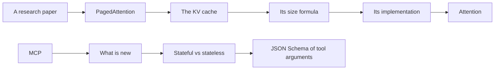

## Goal

Explain, derive and defend these topics at whiteboard depth:

- attention
- the KV cache: its formula and its implementation
- PagedAttention and vLLM
- inference and serving
- cloud hosting
- RAG
- MCP in both its stateful (2025-11-25) and stateless (2026-07-28) forms

Every lesson starts from zero background. Then it goes down to the exact formulas, shapes, byte counts, message fields and code.

## Why this subject exists

Some technical interviews are deep dives. The interviewer takes one topic that the candidate names. Then the interviewer asks 3 to 5 levels of "why" and "how" about it. Each answer opens the next question. Two example chains:



A list of memorized definitions does not survive this format. Each level needs the exact mechanism, a number that you can compute, and the reason behind it. So every lesson prepares 3 to 5 levels of follow-up questions, and its check questions marked "Interview follow-up" go one level deeper. Part 08 rehearses whole chains.

## Finish line

I master the subject when all 16 items are true, with no notes and no AI.

- [ ] **F1.** Write the attention formula with the shape of every matrix. Compute the toy example by hand to the output of "sat", $[1.716, 2.14]$.
- [ ] **F2.** Derive the $\sqrt{d_k}$ scale from the variance of a dot product. Say what breaks without it.
- [ ] **F3.** Draw one block of Llama-3.1-8B: RMSNorm, attention with RoPE, residual additions and SwiGLU. Count its 8,030,261,248 parameters from the config.
- [ ] **F4.** Prove that past keys and values never change in a causal model. Compute the decode step of "down" from the cached rows: $o_4 = [1.6034, 2.3302]$.
- [ ] **F5.** Compute the KV cache size of Llama-3.1-70B at 128K tokens and batch 8 from the config, with no notes.
- [ ] **F6.** Implement a KV cache in NumPy, dynamic and static, and show that it gives the same outputs as generation without a cache. Explain each axis of $[B, H_{kv}, T, d_h]$.
- [ ] **F7.** Explain MHA, MQA, GQA and MLA. Compute the saving factor $H / H_{kv}$ of Llama-3.1-70B, and say why GQA makes decode faster.
- [ ] **F8.** Place prefill and decode on the roofline. Compute the decode bound of Llama-3.1-8B on one H100 SXM and the decode attention intensity $H / H_{kv}$.
- [ ] **F9.** Present the PagedAttention paper in 2 minutes. Name the three kinds of waste, the 20.4% to 38.2% figure, block tables, sharing and the 2 to 4 times result.
- [ ] **F10.** Trace the block table of a 7-token prompt with block size 4 through decoding. Compute attention block by block and show that it equals dense attention.
- [ ] **F11.** Define TTFT, TPOT, ITL and goodput, and size a deployment with Little's law. Explain continuous batching, chunked prefill and prefix caching with block hashes.
- [ ] **F12.** Size GPUs for Llama-3.1-70B in BF16 and in FP8. Convert a GPU price per hour into USD per million tokens, and choose a hosting option with reasons.
- [ ] **F13.** Draw a production RAG system with ingestion, embeddings, hybrid search, reranking and permissions at query time. Compute nDCG@5 of a ranked list by hand.
- [ ] **F14.** Explain what changed from MCP 2025-11-25 to 2026-07-28. Name the removed handshake and header, the per-request `_meta` fields, and why any replica can serve a request.
- [ ] **F15.** Write the MCP tools/call request and result for a tool with an outputSchema, valid against the 2026-07-28 schema. Predict what a validator accepts for a given inputSchema.
- [ ] **F16.** Explain MCP authorization from the first 401 to a bearer call: Protected Resource Metadata, OAuth 2.1 with PKCE and the audience check. Say why token passthrough is forbidden.

## Folders

| Folder | Content |
|---|---|
| [00 Progress](/notes/ai/llm-systems/00-progress) | Session log, mistakes, weak areas, media queue |
| [Course plan](/notes/ai/llm-systems/course-plan) | The map of all parts, the 12-day study plan and how each session works |
| [Glossary](/notes/ai/llm-systems/glossary) | Every term, with a plain meaning |
| [01 Math and hardware](/notes/ai/llm-systems/01-math-and-hardware) | Vectors, matrices, tensors and shapes, number formats, GPUs and the roofline |
| [02 Attention and the transformer](/notes/ai/llm-systems/02-attention-and-the-transformer) | Tokens to vectors, attention step by step, masks, heads, the block, FlashAttention |
| [03 The KV cache](/notes/ai/llm-systems/03-kv-cache) | Why it exists, prefill and decode, the size formula, implementation, GQA and MLA, shrinking it |
| [04 Inference](/notes/ai/llm-systems/04-inference) | Request life, metrics, roofline, batching, sampling, speculative decoding, quantization, parallelism, prefix caching, engines |
| [05 Cloud hosting](/notes/ai/llm-systems/05-cloud-hosting) | Hosting options, GPU sizing, containers, Kubernetes, autoscaling, managed platforms, cost, operations |
| [06 RAG](/notes/ai/llm-systems/06-rag) | Why RAG, embeddings, chunking, vector indexes, hybrid search and reranking, query side, grounding, evaluation, production |
| [07 MCP](/notes/ai/llm-systems/07-mcp) | Why MCP, JSON-RPC, both protocol revisions, transports, tools, JSON Schema, resources and prompts, MRTR, utilities, auth, versions, a server |
| [08 Interview drills](/notes/ai/llm-systems/08-interview-drills) | Question chains, the formula sheet, a mock interview |
| [PagedAttention (2023)](/notes/papers/llm-serving/2023-pagedattention) | The paper behind vLLM, in the Papers area: where KV memory goes, blocks and block tables, sharing, scheduling, results |

## Conventions

### Color legend

Every figure, diagram and video in this subject uses these colors.

| Element | Color |
|---|---|
| Query vectors, the requesting side (user, MCP client, the query in RAG) | blue `#1E6091` |
| Key vectors, compute and hardware (GPU, provider), keys in an index | gold `#B8860B` |
| Value vectors, the serving side (MCP server, retrieved documents) | purple `#6A4C93` |
| Stored state: KV cache blocks, session state, an index, a checkpoint | green `#2D6A4F` |
| Waste, error, fragmentation, attack, a recomputation that costs time | red `#C81D25` |
| Free or unused memory, transient things, faded parts | gray `#8A8A8A`, dashed outlines |
| Ordinary text, tensors and arrows | ink `#100D12` |

The `plot` graphs can use only the site colors: red `#C81D25`, blue `#1E6091`, gold `#B8860B`, ink `#100D12` and purple `#6A4C93`. Green never appears in a plot. Each graph has no legend, so its title names its colors. A title says "approximate" when a value is read from a figure or estimated.

### Notation

Every lesson uses the same letters ([Tensors, shapes and batches](/notes/ai/llm-systems/01-math-and-hardware/l3-tensors-shapes-and-batches) introduces them).

| Symbol | Meaning | Llama-3.1-8B | Llama-3.1-70B |
|---|---|---|---|
| $B$ | Batch size: the number of sequences processed together | set by the server load | set by the server load |
| $T$ | Sequence length in tokens: the prompt plus the tokens generated so far | up to 131,072 | up to 131,072 |
| $d$ | Model width $d_{model}$: the size of one hidden state | 4,096 | 8,192 |
| $H$ | Query heads per layer | 32 | 64 |
| $H_{kv}$ | Key-value heads per layer | 8 | 8 |
| $d_h$ | Head dimension: the size of one query, key or value vector of one head | 128 | 128 |
| $L$ | Layers | 32 | 80 |
| $s$ | Bytes per element | 2 in BF16, 1 in FP8 | 2 in BF16, 1 in FP8 |
| $V$ | Vocabulary size | 128,256 | 128,256 |

$V$ also names the value matrix $V = XW_V$ of attention. The context tells which one a formula means.

The KV cache formula of [part 03](/notes/ai/llm-systems/03-kv-cache/l3-the-kv-cache-size-formula) uses these letters:

$$
\text{KV bytes} = 2 \times L \times H_{kv} \times d_h \times s \times T \times B
$$

### Units and numbers

1. **Sizes built from powers of 2** use KiB, MiB and GiB: 1 KiB = 1,024 bytes and 1 GiB = $2^{30}$ bytes. Example: the KV cache of Llama-3.1-8B is 131,072 bytes per token, exactly 128 KiB.
2. **Model weights** use GB: 1 GB = $10^9$ bytes. Example: Llama-3.1-8B in BF16 is 16,060,522,496 bytes, about 16.06 GB (about 14.96 GiB).
3. **Bandwidth** is decimal: 3.35 TB/s means $3.35 \times 10^{12}$ bytes per second.
4. **Tensor throughput** is dense. NVIDIA lists Tensor Core rates "with sparsity". These notes use half of that number, for example about 989 TFLOPS dense BF16 for the H100 SXM instead of 1,979.
5. A rounded or estimated number has "about" or $\approx$. Money is written as "USD 3.20".
6. Statements carry labels when it matters: what a source states, what these notes computed or measured, and "Interpretation of these notes".

### Shared running examples

**The toy attention example.** Four tokens "the", "cat", "sat", "down". $d_{model} = 4$, one head, $d_k = d_v = 2$. Row vectors.

```text
x_the  = [1, 0, 1, 0]
x_cat  = [0, 1, 0, 1]
x_sat  = [1, 1, 0, 0]
x_down = [0, 1, 1, 0]

W_Q = [[0,0],[0,1],[1,1],[0,0]]
W_K = [[0,0],[0,1],[1,0],[0,1]]
W_V = [[1,1],[0,1],[1,2],[2,1]]

Prefill of "the cat sat":
Q = [[1,1],[0,1],[0,1]]    K = [[1,0],[0,2],[0,1]]    V = [[2,3],[2,2],[1,2]]
causal softmax rows (4 decimals): the [1, 0, 0], cat [0.1956, 0.8044, 0], sat [0.1400, 0.5760, 0.2840]
outputs O = [[2, 3], [2, 2.1956], [1.716, 2.14]]

Decode step for "down": q_4 = [1, 2], k_4 = [1, 1], v_4 = [1, 3]
weights [0.0646, 0.5388, 0.1310, 0.2657], output o_4 = [1.6034, 2.3302]
```

The K and V rows of "the", "cat" and "sat" do not change when "down" arrives. That fact is the reason for the KV cache. The toy example appears in part 01 L1 to L3, part 02 L1 to L7 and part 03 L1 to L4. The paper pages [04 PagedAttention: the algorithm](/notes/papers/llm-serving/2023-pagedattention/04-pagedattention-the-algorithm) and [11 Reproduce it](/notes/papers/llm-serving/2023-pagedattention/11-reproduce-it) use it too.

Two extensions:

- [Multi-head attention](/notes/ai/llm-systems/02-attention-and-the-transformer/l5-multi-head-attention) adds a second toy head with $W_{Q2}$ = [[1,0],[1,0],[0,0],[0,0]], $W_{K2}$ = [[1,0],[0,0],[1,0],[0,1]], $W_{V2}$ = [[1,0],[0,1],[0,0],[0,1]], and the output projection $W_O$ = [[1,0,0,1],[0,1,1,0],[1,1,0,0],[0,0,1,1]].
- [The transformer block](/notes/ai/llm-systems/02-attention-and-the-transformer/l6-the-transformer-block) uses a toy RoPE with $\theta = 1$ radian per position, and the positions 0 to 3.

**Llama-3.1-8B.** Hidden size 4,096, 32 layers, 32 query heads, 8 KV heads (GQA) and head dimension 128. MLP intermediate size 14,336, vocabulary 128,256, and a separate embedding table and LM head. It has 8,030,261,248 parameters, about 16.06 GB in BF16. KV cache per token in BF16: $2 \times 32 \times 8 \times 128 \times 2 = 131{,}072$ bytes = 128 KiB.

**Llama-3.1-70B.** Hidden size 8,192, 80 layers, 64 query heads, 8 KV heads and head dimension 128. MLP intermediate size 28,672 and vocabulary 128,256. It has 70,553,706,496 parameters, about 141.1 GB in BF16. KV cache per token in BF16: $2 \times 80 \times 8 \times 128 \times 2 = 327{,}680$ bytes = 320 KiB.

The official `config.json` files of both models are gated: a download needs an access token. So the lessons take the config values from Table 3 of the Llama 3 paper and from Meta's reference code. The Hugging Face model API gives the parameter counts.

**The paper's model.** OPT-13B: 40 layers, hidden size 5,120, FP16. KV cache per token: $2 \times 5120 \times 40 \times 2 = 819{,}200$ bytes. The paper writes "800 KB", which is exactly 800 KiB.

**The GPU: H100 SXM 80 GB.** HBM3, about 3.35 TB/s, about 989 TFLOPS dense BF16. Ridge point of the roofline: about $989 / 3.35 \approx 295$ FLOPs per byte. One decode step of Llama-3.1-8B at batch 1 reads about 16.06 GB of weights. That takes about $16.06 / 3.35 \approx 4.8$ ms, so one sequence gets at most about 208 tokens per second.

### Versions

The lessons pin these versions, checked on 2026-10-15. Defaults and APIs change between releases, so read the release notes before you trust a default.

| Software or specification | Version | Note | Lesson |
|---|---|---|---|
| vLLM | 0.31.0, released 2026-10-05 | `gpu_memory_utilization` default 0.92 | [Serving engines](/notes/ai/llm-systems/04-inference/l10-serving-engines) |
| Hugging Face `transformers` | 5.20.0 | Cache classes such as `DynamicCache` and `StaticCache` | [Implementing a KV cache](/notes/ai/llm-systems/03-kv-cache/l4-implementing-a-kv-cache) |
| PyTorch | 2.14 | Tensors, number formats, `scaled_dot_product_attention` | [Numbers in memory](/notes/ai/llm-systems/01-math-and-hardware/l4-numbers-in-memory) |
| MCP specification | 2026-07-28 (current) | Stateless: no `initialize`, no sessions | [Stateful vs stateless MCP](/notes/ai/llm-systems/07-mcp/l5-stateful-vs-stateless) |
| MCP specification | 2025-11-25 (previous) | Stateful: `initialize` handshake and sessions | [The stateful protocol](/notes/ai/llm-systems/07-mcp/l3-the-stateful-protocol) |
| MCP Python SDK | 2.3.0 | The server class is `MCPServer` | [Build an MCP server and client](/notes/ai/llm-systems/07-mcp/l13-build-an-mcp-server) |
| MCP Inspector | 2.11.0 | The npm `latest` tag on 2026-10-15 | [Build an MCP server and client](/notes/ai/llm-systems/07-mcp/l13-build-an-mcp-server) |

### Product names that changed in 2026

Interviewers may use either name. Say both.

| Earlier name | Current name, checked on 2026-10-15 | Lesson |
|---|---|---|
| Vertex AI (Google Cloud) | Gemini Enterprise Agent Platform. Google renamed Vertex AI on 22 April 2026. "Vertex AI Model Garden" became "Model Garden". | [Managed platforms](/notes/ai/llm-systems/05-cloud-hosting/l6-managed-platforms) |
| Azure AI Foundry | Microsoft Foundry | [Managed platforms](/notes/ai/llm-systems/05-cloud-hosting/l6-managed-platforms) |
| Databricks Vector Search | Databricks AI Search ("formerly Databricks Vector Search") | [Production RAG architecture](/notes/ai/llm-systems/06-rag/l9-production-rag-architecture) |
| Databricks AI Gateway on serving endpoints | Marked legacy. The current governance layer is Unity Gateway. | [Managed platforms](/notes/ai/llm-systems/05-cloud-hosting/l6-managed-platforms) |

### Code

1. Every lesson has a `### Exercises` subsection. Each exercise has a task, an acceptance test and two hints.
2. The reference solution of each exercise is hidden in a check block. Open it only after a real attempt.
3. I write the exercise code myself. The lab folder is `C:\Users\ASohi\Downloads\AI\agent-harness-lab`, and the notebook folder of this subject is `llm-systems/`.

## Media

All media of this subject is in `/notes/media/llm-systems/`. The paper's media is in `/notes/media/papers/2023-pagedattention/`.

| Folder | What it holds |
|---|---|
| `figures/` | SVG diagrams. Each name starts with the part and the lesson, for example `03-3-kv-size-formula.svg`. |
| `manim/` | Short videos. Each video fixes one named misunderstanding. |

The [media queue](/notes/ai/llm-systems/00-progress/media-queue) tracks every file and its status.

## Sources

The main official sources. Each lesson lists its own sources in full.

Papers:

- Vaswani et al., "Attention Is All You Need", NIPS 2017, arXiv 1706.03762: https://arxiv.org/abs/1706.03762 (checked on 2026-10-15)
- Kwon et al., "Efficient Memory Management for Large Language Model Serving with PagedAttention", SOSP 2023, arXiv 2309.06180: https://arxiv.org/abs/2309.06180 (checked on 2026-10-15)
- Dao et al., "FlashAttention: Fast and Memory-Efficient Exact Attention with IO-Awareness", NeurIPS 2022, arXiv 2205.14135: https://arxiv.org/abs/2205.14135 (checked on 2026-10-15)
- Dao, "FlashAttention-2: Faster Attention with Better Parallelism and Work Partitioning", 2023, arXiv 2307.08691: https://arxiv.org/abs/2307.08691 (checked on 2026-10-15)
- Shazeer, "Fast Transformer Decoding: One Write-Head is All You Need", 2019, arXiv 1911.02150: https://arxiv.org/abs/1911.02150 (checked on 2026-10-15)
- Ainslie et al., "GQA: Training Generalized Multi-Query Transformer Models from Multi-Head Checkpoints", EMNLP 2023, arXiv 2305.13245: https://arxiv.org/abs/2305.13245 (checked on 2026-10-15)
- DeepSeek-AI, "DeepSeek-V2: A Strong, Economical, and Efficient Mixture-of-Experts Language Model", 2024, arXiv 2405.04434: https://arxiv.org/abs/2405.04434 (checked on 2026-10-15)
- Llama Team, "The Llama 3 Herd of Models", 2024, arXiv 2407.21783, Table 3: https://arxiv.org/abs/2407.21783 (checked on 2026-10-15)
- Leviathan, Kalman and Matias, "Fast Inference from Transformers via Speculative Decoding", ICML 2023, arXiv 2211.17192: https://arxiv.org/abs/2211.17192 (checked on 2026-10-15)
- Agrawal et al., "Taming Throughput-Latency Tradeoff in LLM Inference with Sarathi-Serve", OSDI 2024, arXiv 2403.02310: https://arxiv.org/abs/2403.02310 (checked on 2026-10-15)
- Zhong et al., "DistServe: Disaggregating Prefill and Decoding for Goodput-optimized Large Language Model Serving", OSDI 2024, arXiv 2401.09670: https://arxiv.org/abs/2401.09670 (checked on 2026-10-15)
- Lewis et al., "Retrieval-Augmented Generation for Knowledge-Intensive NLP Tasks", NeurIPS 2020, arXiv 2005.11401: https://arxiv.org/abs/2005.11401 (checked on 2026-10-15)
- Karpukhin et al., "Dense Passage Retrieval for Open-Domain Question Answering", 2020, arXiv 2004.04906: https://arxiv.org/abs/2004.04906 (checked on 2026-10-15)
- Malkov and Yashunin, "Efficient and robust approximate nearest neighbor search using Hierarchical Navigable Small World graphs", arXiv 1603.09320: https://arxiv.org/abs/1603.09320 (checked on 2026-10-15)

Documentation and specifications:

- vLLM documentation: https://docs.vllm.ai/en/latest/ (engine arguments, the PagedAttention design, prefix caching, metrics) and the 0.31.0 release: https://pypi.org/project/vllm/0.31.0/ (checked on 2026-10-15)
- MCP specification 2026-07-28: https://modelcontextprotocol.io/specification/2026-07-28 and its changelog: https://modelcontextprotocol.io/specification/2026-07-28/changelog (checked on 2026-10-15)
- MCP specification 2025-11-25: https://modelcontextprotocol.io/specification/2025-11-25 and its lifecycle page: https://modelcontextprotocol.io/specification/2025-11-25/basic/lifecycle (checked on 2026-10-15)
- MCP schema files: https://github.com/modelcontextprotocol/modelcontextprotocol/tree/main/schema and the MCP Python SDK: https://github.com/modelcontextprotocol/python-sdk (checked on 2026-10-15)
- JSON Schema 2020-12, core and validation: https://json-schema.org/draft/2020-12/json-schema-core and https://json-schema.org/draft/2020-12/json-schema-validation (checked on 2026-10-15)
- JSON-RPC 2.0 specification: https://www.jsonrpc.org/specification (checked on 2026-10-15)
- Hugging Face `transformers` 5.20.0 source: https://github.com/huggingface/transformers/tree/v5.20.0 (checked on 2026-10-15)
- PyTorch 2.14, `scaled_dot_product_attention`: https://docs.pytorch.org/docs/2.14/generated/torch.nn.functional.scaled_dot_product_attention.html (checked on 2026-10-15)
- Meta reference code for Llama 3: https://github.com/meta-llama/llama-models and the Hugging Face model API: https://huggingface.co/api/models/meta-llama/Llama-3.1-8B and https://huggingface.co/api/models/meta-llama/Llama-3.1-70B (checked on 2026-10-15)
- NVIDIA H100: https://www.nvidia.com/en-us/data-center/h100/ and the A100 datasheet: https://www.nvidia.com/content/dam/en-zz/Solutions/Data-Center/a100/pdf/nvidia-a100-datasheet-us-nvidia-1758950-r4-web.pdf (checked on 2026-10-15)
- Amazon Bedrock: https://docs.aws.amazon.com/bedrock/latest/userguide/what-is-bedrock.html and EC2 accelerated instance types: https://docs.aws.amazon.com/ec2/latest/instancetypes/ac.html (checked on 2026-10-15)
- Microsoft Foundry, deployments overview: https://learn.microsoft.com/en-us/azure/foundry/concepts/deployments-overview (checked on 2026-10-15)
- Google Cloud, Gemini Enterprise Agent Platform release notes: https://docs.cloud.google.com/gemini-enterprise-agent-platform/release-notes (checked on 2026-10-15)
- Databricks, AI governance with Unity Gateway: https://docs.databricks.com/aws/en/ai-gateway/index/ and Databricks AI Search: https://docs.databricks.com/aws/en/vector-search/vector-search (checked on 2026-10-15)
- Kubernetes, Horizontal Pod Autoscaling: https://kubernetes.io/docs/concepts/workloads/autoscaling/horizontal-pod-autoscale/ (checked on 2026-10-15)
