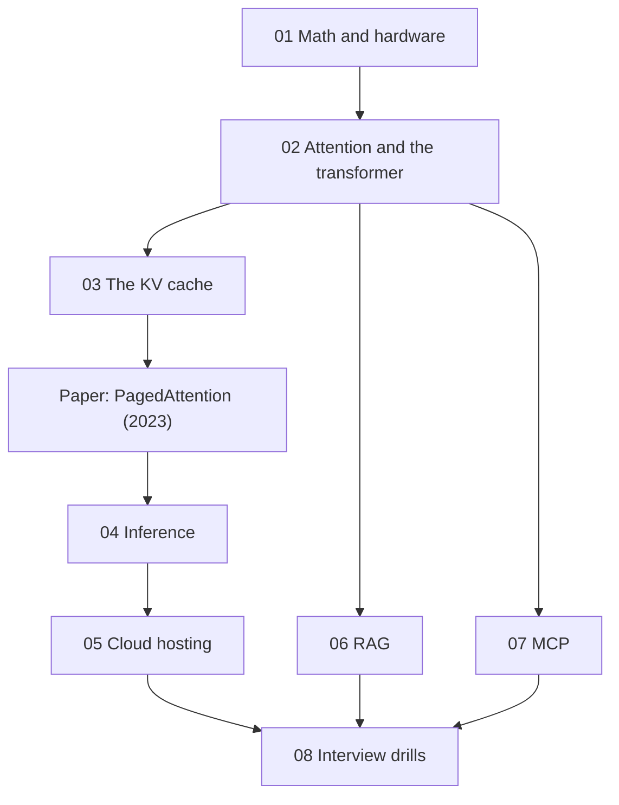

## The map

The main chain runs from the math to attention, the KV cache, the paper, inference and cloud hosting. Parts 06 and 07 form a parallel branch after part 02. Part 08 comes last, because its drills combine all parts.

## Parts

| Part | Folder | Lessons | Content |
|---|---|---|---|
| 01 | [01 Math and hardware](/notes/ai/llm-systems/01-math-and-hardware) | 5 | Vectors, matrices, tensors and shapes, number formats, GPUs and the roofline |
| 02 | [02 Attention and the transformer](/notes/ai/llm-systems/02-attention-and-the-transformer) | 7 | Tokens to vectors, why attention, scaled dot-product attention, the causal mask, heads, the block, FlashAttention |
| 03 | [03 The KV cache](/notes/ai/llm-systems/03-kv-cache) | 6 | Why it exists, prefill and decode, the size formula, implementation, MHA to MLA, shrinking it |
| Paper | [PagedAttention (2023)](/notes/papers/llm-serving/2023-pagedattention) | 12 pages (00 to 11) | Where KV memory goes, blocks and block tables, sharing, scheduling, implementation, results, later work |
| 04 | [04 Inference](/notes/ai/llm-systems/04-inference) | 10 | Request life, metrics, roofline, batching, sampling, speculative decoding, quantization, parallelism, prefix caching, engines |
| 05 | [05 Cloud hosting](/notes/ai/llm-systems/05-cloud-hosting) | 8 | Hosting options, GPU sizing, containers, Kubernetes, autoscaling and routing, managed platforms, cost, operations |
| 06 | [06 RAG](/notes/ai/llm-systems/06-rag) | 9 | Why RAG, embeddings, chunking, vector indexes, hybrid search and reranking, the query side, grounding, evaluation, production |
| 07 | [07 MCP](/notes/ai/llm-systems/07-mcp) | 13 | Why MCP, JSON-RPC, both protocol revisions, transports, tools, JSON Schema, resources and prompts, MRTR, utilities, auth, versions, a server |
| 08 | [08 Interview drills](/notes/ai/llm-systems/08-interview-drills) | 6 | Question chains, the formula sheet, a mock interview |

A **lesson** is one idea. A **session** is one sitting. A lesson page can exist before I study it. Its status stays `not-started` until I pass its gate.

Each lesson row in a part table has a **Priority**. **Core** means that the interviewer asked about the idea directly, or that a follow-up question needs it. **Support** means background that makes a Core lesson easier.

## A 12-day study plan

The plan fits an interview in 1 to 2 weeks. Days 1 to 5 cover the core interview chain: attention, the KV cache, the paper and the MCP changes. Days 6 to 12 cover the rest of the subject and the drills of part 08.

How to read a row:

- **Bold** lessons are Core. Study every section and do the exercises.
- The other lessons are Support. Read section 1, the mental model, the one-minute explanation and the check questions.
- `01 L3` is lesson L3 of part 01. `P04` is page 04 of the paper. `F5` is item 5 of the finish line on the [subject page](/notes/ai/llm-systems).

| Day | Study | Drill | Finish line |
|---|---|---|---|
| 1 | Math and hardware, a fast pass: [01 L1](/notes/ai/llm-systems/01-math-and-hardware/l1-vectors-and-dot-products), [01 L2](/notes/ai/llm-systems/01-math-and-hardware/l2-matrices-and-matrix-multiplication), **[01 L3](/notes/ai/llm-systems/01-math-and-hardware/l3-tensors-shapes-and-batches)**, **[01 L4](/notes/ai/llm-systems/01-math-and-hardware/l4-numbers-in-memory)**, **[01 L5](/notes/ai/llm-systems/01-math-and-hardware/l5-gpus-memory-and-bandwidth)**, [02 L1](/notes/ai/llm-systems/02-attention-and-the-transformer/l1-from-text-to-vectors), [02 L2](/notes/ai/llm-systems/02-attention-and-the-transformer/l2-why-attention) | Compute $Q = XW_Q$ of the toy tokens by hand. Compute the decode bound of Llama-3.1-8B on one H100 SXM: $16.06 / 3.35 \approx 4.8$ ms per token. Compute the ridge point, about 295 FLOPs per byte. | F8 |
| 2 | Attention: **[02 L3](/notes/ai/llm-systems/02-attention-and-the-transformer/l3-scaled-dot-product-attention)**, **[02 L4](/notes/ai/llm-systems/02-attention-and-the-transformer/l4-causal-masking-and-generation)**, **[02 L5](/notes/ai/llm-systems/02-attention-and-the-transformer/l5-multi-head-attention)**, **[02 L6](/notes/ai/llm-systems/02-attention-and-the-transformer/l6-the-transformer-block)** | On blank paper: the attention formula with every shape, and the toy example to the output of "sat". Then the variance argument for $\sqrt{d_k}$ and the causal mask. Then count the 8,030,261,248 parameters of Llama-3.1-8B. | F1, F2, F3 |
| 3 | The KV cache, and stateful vs stateless MCP: **[03 L1](/notes/ai/llm-systems/03-kv-cache/l1-why-the-kv-cache-exists)**, **[03 L2](/notes/ai/llm-systems/03-kv-cache/l2-prefill-and-decode)**, **[03 L3](/notes/ai/llm-systems/03-kv-cache/l3-the-kv-cache-size-formula)**, **[07 L3](/notes/ai/llm-systems/07-mcp/l3-the-stateful-protocol)**, **[07 L5](/notes/ai/llm-systems/07-mcp/l5-stateful-vs-stateless)** | Compute $o_4 = [1.6034, 2.3302]$ for "down" from the cached rows. Compute the KV cache of Llama-3.1-70B at 128K tokens and batch 8. Say the 2-minute answer to "stateful or stateless MCP?" out loud. | F4, F5, F8, F14 |
| 4 | KV cache implementation and the paper: **[03 L4](/notes/ai/llm-systems/03-kv-cache/l4-implementing-a-kv-cache)**, **[03 L5](/notes/ai/llm-systems/03-kv-cache/l5-mha-mqa-gqa-and-mla)**, **[P00](/notes/papers/llm-serving/2023-pagedattention/00-paper-on-one-page)**, [P01](/notes/papers/llm-serving/2023-pagedattention/01-background-virtual-memory-and-paging), **[P03](/notes/papers/llm-serving/2023-pagedattention/03-the-question)**, **[P04](/notes/papers/llm-serving/2023-pagedattention/04-pagedattention-the-algorithm)** | Write the two-line cache append from memory, and test generation with and without the cache. Give the 2-minute paper answer of page 00. Compute the attention of "down" block by block with block size 2. | F6, F7, F9, F10 |
| 5 | The block manager, sharing, and MCP tools: **[P05](/notes/papers/llm-serving/2023-pagedattention/05-the-kv-cache-manager)**, **[P06](/notes/papers/llm-serving/2023-pagedattention/06-decoding-scenarios-and-sharing)**, **[07 L6](/notes/ai/llm-systems/07-mcp/l6-tools-in-depth)**, **[07 L7](/notes/ai/llm-systems/07-mcp/l7-json-schema-for-tool-arguments)**, **[07 L12](/notes/ai/llm-systems/07-mcp/l12-whats-new-version-history)** | Trace the block table of the 7-token prompt with block size 4 until the ninth token. Write a tools/call request and its result for a tool with an outputSchema. Give the 30-second answer to "what is new in MCP?". | F10, F14, F15 |
| 6 | Close the chain from attention to PagedAttention: **[02 L7](/notes/ai/llm-systems/02-attention-and-the-transformer/l7-attention-cost-and-flashattention)**, [03 L6](/notes/ai/llm-systems/03-kv-cache/l6-shrinking-the-kv-cache), [P02](/notes/papers/llm-serving/2023-pagedattention/02-background-llm-serving-before-vllm), [P07](/notes/papers/llm-serving/2023-pagedattention/07-scheduling-and-preemption), [P08](/notes/papers/llm-serving/2023-pagedattention/08-implementation), [P09](/notes/papers/llm-serving/2023-pagedattention/09-results), **[P10](/notes/papers/llm-serving/2023-pagedattention/10-limits-and-later-work)** | Drill [08 L1](/notes/ai/llm-systems/08-interview-drills/l1-chain-attention-to-pagedattention) out loud. Start the formula sheet [08 L5](/notes/ai/llm-systems/08-interview-drills/l5-formula-sheet), and read it at the start of every later day. | F1 to F10 |
| 7 | The rest of MCP: **[07 L1](/notes/ai/llm-systems/07-mcp/l1-why-mcp)**, [07 L2](/notes/ai/llm-systems/07-mcp/l2-json-rpc), [07 L4](/notes/ai/llm-systems/07-mcp/l4-transports), [07 L8](/notes/ai/llm-systems/07-mcp/l8-resources-and-prompts), **[07 L9](/notes/ai/llm-systems/07-mcp/l9-mrtr-elicitation-sampling-and-roots)**, [07 L10](/notes/ai/llm-systems/07-mcp/l10-utilities-and-errors), **[07 L11](/notes/ai/llm-systems/07-mcp/l11-authorization-and-security)** | Write the four JSON-RPC message shapes from memory. Write one MRTR exchange: the result with `resultType` `input_required`, then the retry with `inputResponses`. Draw the authorization flow from the first 401 to the bearer call. | F14, F16 |
| 8 | Build an MCP server, then the first inference lessons: **[07 L13](/notes/ai/llm-systems/07-mcp/l13-build-an-mcp-server)**, [P11](/notes/papers/llm-serving/2023-pagedattention/11-reproduce-it), **[04 L1](/notes/ai/llm-systems/04-inference/l1-the-life-of-a-request)**, **[04 L2](/notes/ai/llm-systems/04-inference/l2-latency-and-throughput-metrics)**, **[04 L3](/notes/ai/llm-systems/04-inference/l3-compute-bound-vs-memory-bound)** | Build the orders server of 07 L13 in the lab folder and call it with the Inspector CLI. Do exercises E1 to E3 of page 11. Then drill [08 L4](/notes/ai/llm-systems/08-interview-drills/l4-chain-mcp) out loud. | F8, F11, F14, F15 |
| 9 | Inference: **[04 L4](/notes/ai/llm-systems/04-inference/l4-batching-and-scheduling)**, [04 L5](/notes/ai/llm-systems/04-inference/l5-sampling-and-structured-output), [04 L6](/notes/ai/llm-systems/04-inference/l6-speculative-decoding), [04 L7](/notes/ai/llm-systems/04-inference/l7-quantization), [04 L8](/notes/ai/llm-systems/04-inference/l8-parallelism), **[04 L9](/notes/ai/llm-systems/04-inference/l9-prefix-caching-and-kv-reuse)**, [04 L10](/notes/ai/llm-systems/04-inference/l10-serving-engines) | Run the example of 4 requests and 2 slots under static and continuous batching. Compute the expected tokens per step of speculative decoding for $\alpha = 0.8$ and $\gamma = 4$. Trace the block hashes of two requests with a shared prefix. | F11 |
| 10 | Cloud hosting: **[05 L1](/notes/ai/llm-systems/05-cloud-hosting/l1-ways-to-host-a-model)**, **[05 L2](/notes/ai/llm-systems/05-cloud-hosting/l2-sizing-gpus)**, [05 L3](/notes/ai/llm-systems/05-cloud-hosting/l3-containers-and-model-loading), [05 L4](/notes/ai/llm-systems/05-cloud-hosting/l4-kubernetes-for-llm-serving), **[05 L5](/notes/ai/llm-systems/05-cloud-hosting/l5-autoscaling-and-routing)**, [05 L6](/notes/ai/llm-systems/05-cloud-hosting/l6-managed-platforms), **[05 L7](/notes/ai/llm-systems/05-cloud-hosting/l7-cost-math)** | Size Llama-3.1-70B in BF16 and in FP8, and convert a GPU price per hour into USD per million tokens. Then drill [08 L2](/notes/ai/llm-systems/08-interview-drills/l2-chain-inference-and-cloud) out loud. | F11, F12 |
| 11 | Operations, and the first RAG lessons: [05 L8](/notes/ai/llm-systems/05-cloud-hosting/l8-production-operations), **[06 L1](/notes/ai/llm-systems/06-rag/l1-why-rag)**, **[06 L2](/notes/ai/llm-systems/06-rag/l2-embeddings-in-depth)**, [06 L3](/notes/ai/llm-systems/06-rag/l3-chunking-and-ingestion), **[06 L4](/notes/ai/llm-systems/06-rag/l4-vector-indexes)**, [06 L5](/notes/ai/llm-systems/06-rag/l5-hybrid-search-and-reranking) | Compute the InfoNCE loss of the worked example of 06 L2 by hand. Fuse two ranked lists with reciprocal rank fusion. Explain why a post-filter can return nothing. | F12, F13 |
| 12 | The rest of RAG, and the mock interview: [06 L6](/notes/ai/llm-systems/06-rag/l6-query-side-techniques), [06 L7](/notes/ai/llm-systems/06-rag/l7-generation-and-grounding), **[06 L8](/notes/ai/llm-systems/06-rag/l8-evaluating-rag)**, **[06 L9](/notes/ai/llm-systems/06-rag/l9-production-rag-architecture)** | Compute nDCG@5 of the list of 06 L8. Draw the production RAG diagram of 06 L9 in 5 minutes. Drill [08 L3](/notes/ai/llm-systems/08-interview-drills/l3-chain-rag), then run the mock interview [08 L6](/notes/ai/llm-systems/08-interview-drills/l6-mock-interview). | F13, then all 16 |

> [!note] If the interview comes after only one week
> Do days 1 to 5 without changes. On day 6, do drill 08 L1 and the formula sheet 08 L5. On day 7, study the Core lessons of parts 04, 05 and 06 only, then drill 08 L4. The Support lessons wait until after the interview.

## How each session works

1. **Recall.** One or two questions on lessons that are due. From day 6, also the formula sheet.
2. **Problem.** The question that the idea answers, and the interview question behind it.
3. **Intuition.** An analogy, and the point where the analogy stops working.
4. **Visual.** A figure, a diagram or a video.
5. **Mechanism.** The exact formula, field or algorithm. Every claim has a source.
6. **Calculation.** One number computed by hand, for example a byte count, a time or a score.
7. **Code.** I write the exercise myself. Then I compare it with the hidden reference solution.
8. **Check and explain back.** The check questions, then the one-minute explanation out loud, as in an interview.
9. **Close.** A short session report, then an update of the progress files.

> [!key] Gate rule
> A gate passes only when I answer the check questions correctly in my own words. "I understand" does not pass a gate. A correct answer with a wrong reason does not pass. In this subject, the "Interview follow-up" questions are part of every gate.
