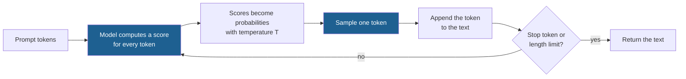

## Learning objectives

After this lesson you can:

- Explain what a program is, and how it maps an input to an output.
- Explain what a model is, and why its weights come from data and not from a programmer.
- Separate training from inference, and say which one changes the weights.
- Compute the next-token probabilities of a language model at three temperatures.
- Explain why most self-improving agents keep the language model frozen, and what that means for where improvement can happen.

## Prerequisites

- None. This is the first lesson of the course. You need basic Python only.
- Optional: read the [Course plan](/notes/ai/recursive-self-improvement/course-plan) to see where this lesson fits.

## 1. The question this idea answers

Think of a cook and a recipe. The recipe lists the ingredients, the steps and the oven temperature. The cook follows the steps and makes a cake. If the cake is too dry, somebody changes the recipe. Next time, the cake is better.

Three questions hide in this small story. What exactly is the recipe? Who changed it? Did the cook change, or only the paper?

This course studies **recursive self-improvement (RSI)**. In simple words, RSI is improvement in which the improved system does the next improvement. [Part 2](/notes/ai/recursive-self-improvement/02-core-idea/l1-what-rsi-means) gives the exact definitions. Before you can study a system that improves itself, you must know what parts a system has. You must also know which parts can change.

This lesson answers four questions:

1. What is a program?
2. What is a model, and how is it different from a program?
3. What is a language model, and how does it produce text?
4. When a modern AI agent "improves itself", which part usually changes?

An **agent** is a program that observes, decides and acts in a loop to reach a goal. [Lesson 2](/notes/ai/recursive-self-improvement/01-foundations/l2-agents-actions-state-tools-environment) explains agents in full.

The short answer to question 4 surprises most beginners. In almost every self-improving agent of 2023–2026, the large language model does **not** change at all. The change happens in the program around it.

## 2. Mental model, and where it stops working

> [!analogy] The recipe and the experienced cook
> - A **program** is like a written recipe. A person wrote every step. You can read each step and know why it is there.
> - A **model** is like an experienced cook who never wrote anything down. The cook tasted thousands of dishes. The knowledge now sits in the cook's habits, not on paper. You cannot point to "the line" where the cook knows that cakes need sugar.
> - A **language model** is like a cook who has read millions of recipes. Give this cook the first half of a sentence, and the cook guesses the next word.
> - **Where it stops working:** a real cook keeps learning every day. A model does not. After training, its learned numbers stay fixed while you use it.
> - Also, a model does not taste anything. It maps numbers to numbers. The analogy makes the model sound more human than it is. The fixed numbers are the most important point for this course.

## 3. Terms

| Term | Plain meaning |
|---|---|
| program | A list of instructions that a computer runs. |
| input, output | The data that a program receives, and the data that it returns. |
| function (mathematics) | A rule that gives exactly one output for each input. |
| model | A function with learned numbers (weights) that maps an input to an output. |
| weights | The learned numbers inside a model. |
| data | The examples that a model learns from. |
| training | The process that finds good weights from data. Training changes the weights. |
| inference | Using a trained model to compute outputs. Inference does not change the weights. |
| loss | A number that says how wrong a model is on some examples. Lower is better. |
| token | A small piece of text, often a word or part of a word, that a language model reads and writes. |
| vocabulary | The fixed set of all tokens that a language model knows. |
| language model | A model that predicts the next token of text. |
| large language model (LLM) | A very large language model, with billions of weights. |
| probability distribution | A list of probabilities, one for each possible outcome, that add to 1. |
| sampling | Choosing one outcome at random, with the chances given by a probability distribution. |
| temperature | A number that makes the next-token distribution sharper (low temperature) or flatter (high temperature). |
| prompt | The text that you give to a language model at the start. |
| context window | The largest number of tokens that a language model can read at one time. |
| frozen model | A model whose weights do not change during a run of a system. |
| scaffold | The code around a model that turns it into an agent: prompts, tools, control flow, memory handling. |
| agent | A program that observes, decides and acts in a loop to reach a goal. |
| benchmark | A fixed set of tasks with a fixed scoring rule. |
| patch | A text that lists the changes to a set of files, so that the changes can be applied again. |
| foundation model | A large pretrained model, such as an LLM, that other systems build on. |

## 4. Method and math

### 4.1 What a program is

A **program** is a list of instructions that a computer runs. It receives an **input**, follows the instructions, and returns an **output**.

Here is a very small program in Python:

```python
def add_tax(price):
    return price * 1.2
```

The input is a price. The output is the price with 20% tax. A person decided the number 1.2. The computer never decides anything here. It follows the instruction exactly.

A recipe has the same structure. The input is the ingredients. The steps are the instructions. The output is the dish. Two cooks who follow the same recipe with the same ingredients should get the same dish.

Programs are excellent when a person knows the rule. Tax, sorting and payroll have clear rules. Some tasks have no clear rule. Try to write a rule that decides if an email is spam:

1. If the email contains "free money", call it spam.
2. If it contains "winner", call it spam.
3. But "the winner of the team quiz is Ana" is not spam.

Every new rule creates new exceptions. A person cannot write all of them. This problem led to models.

### 4.2 Functions in mathematics

In mathematics, a **function** is a rule that gives exactly one output for each input. We write $f(x) = 2x + 1$. Here $x$ is the input and $f(x)$ is the output.

| Input $x$ | Output $f(x) = 2x + 1$ |
|---|---|
| 0 | 1 |
| 1 | 3 |
| 2 | 5 |
| 3 | 7 |

Most programs compute a function. The program `add_tax` computes $f(p) = 1.2p$. A program can also do things that a pure function does not do, for example use randomness or write a file. For now, think of a program as a function that a person wrote by hand.

### 4.3 What a model is

A **model** is a function with learned numbers. These numbers are the **weights**. A person chooses the form of the function. The data chooses the weights.

> [!key] Model
> 1. **Name:** model.
> 2. **Meaning:** a function whose behavior depends on learned numbers (weights).
> 3. **Problem it solves:** many tasks have no rule that a person can write, but they have many examples.
> 4. **Example:** a line $y = wx + b$ whose $w$ and $b$ are chosen to fit data points.
> 5. **Link to RSI:** the weights are one place where a system can store an improvement. Most self-improving agents do not use this place.
> 6. **Limits:** a model is only as good as its data and its form. It can be wrong on inputs that look unlike its data.

**Worked example: fit a line to four points.** You measure four points: $(1, 3.1)$, $(2, 4.9)$, $(3, 7.2)$ and $(4, 8.8)$. You choose the form $y = wx + b$. The two weights are $w$ (the slope) and $b$ (the value at $x = 0$).

Step 1. Make a first guess: $w = 2$ and $b = 1$. The predictions are 3, 5, 7 and 9.

Step 2. Measure how wrong the guess is. For each point, take the difference between the real $y$ and the prediction. Square it, so that negative and positive errors both count. Then take the average. This number is the **mean squared error**, one kind of **loss**.

- Differences: $0.1$, $-0.1$, $0.2$, $-0.2$.
- Squares: $0.01$, $0.01$, $0.04$, $0.04$.
- Average: $0.10 / 4 = 0.025$.

Step 3. Search for weights with a lower loss. A standard method (least squares) gives $w = 1.94$ and $b = 1.15$. The predictions are 3.09, 5.03, 6.97 and 8.91. The loss falls to $0.0205$.

Step 4. Use the model on a new input. For $x = 5$, the model predicts $1.94 \times 5 + 1.15 = 10.85$.

Nobody wrote "1.94" by hand. The data chose it. That is the difference between a model and a hand-written program. [Lesson 6](/notes/ai/recursive-self-improvement/01-foundations/l6-how-ml-systems-are-trained-and-evaluated) shows how a computer finds such weights step by step with gradient descent.

**Worked example: a spam filter as a model.** A simple spam model gives each word a weight. It adds the weights of the words in an email, plus a fixed number called the bias. If the total is above 0, the model says "spam".

Suppose training on many labeled emails produced these weights: "free" $= +2.0$, "winner" $= +1.5$, "meeting" $= -1.5$, and bias $= -1.0$.

- Email A: "free winner". Total $= 2.0 + 1.5 - 1.0 = 2.5$. The total is above 0, so the model says spam.
- Email B: "free meeting". Total $= 2.0 - 1.5 - 1.0 = -0.5$. The total is below 0, so the model says not spam.

Each weight is a small piece of learned evidence. Real spam models have thousands of weights. A large language model has billions. The principle is the same.

### 4.4 Training and inference

There are two phases in the life of a model:

| Phase | What happens | Do the weights change? | Cooking analogy |
|---|---|---|---|
| Training | A procedure searches for weights that lower the loss on data. | Yes | The cook learns by tasting many dishes. |
| Inference | The model computes outputs for new inputs with the weights it has. | No | The cook cooks dinner tonight. |

Training is usually slow and expensive. Inference is usually fast and cheap. A company trains a large model once, over weeks. Then millions of people use it for inference.

> [!key] The fact that matters most for this course
> During inference, the weights do not change. When you chat with a language model, it does not learn from your conversation in its weights. If it seems to "remember" something within a chat, that information sits in the text it reads, not in its weights.

### 4.5 What a language model is

A **language model** is a model that predicts the next **token** of text. A token is a small piece of text. Often it is a whole word. Sometimes it is part of a word or a punctuation mark. The model has a fixed **vocabulary**, the set of all tokens it knows. Real vocabularies have tens of thousands of tokens.

The model works in one simple step:

1. It reads the tokens so far, for example "The capital of France is".
2. It computes a score for every token in its vocabulary.
3. It turns the scores into probabilities.
4. It picks one token.

Step 3 uses a formula. First the idea: a higher score should give a higher probability, all probabilities must be positive, and they must add to 1.

$$
p_i = \frac{e^{z_i / T}}{\sum_{j} e^{z_j / T}}
$$

The symbols mean:

- $z_i$ is the score of token $i$. The model computes it from its weights and the input.
- $T$ is the **temperature**, a positive number that the user or the program chooses.
- $e^{(\cdot)}$ is the exponential function. It turns any number into a positive number.
- $\sum_j$ means "add over all tokens $j$ of the vocabulary".
- $p_i$ is the probability of token $i$.

In plain English: raise $e$ to each score divided by $T$, then divide each result by the total. Big scores get big shares.

**Worked example.** Use a toy vocabulary of four tokens. The scores are Paris $= 5$, Lyon $= 3$, London $= 2$ and banana $= 0$. Take $T = 1$.

1. Compute each exponential: $e^5 = 148.41$, $e^3 = 20.09$, $e^2 = 7.39$ and $e^0 = 1.00$.
2. Add them: $148.41 + 20.09 + 7.39 + 1.00 = 176.89$.
3. Divide: Paris $= 148.41 / 176.89 = 0.839$. Lyon $= 0.114$. London $= 0.042$. Banana $= 0.006$.

The four values add to 1, apart from rounding. Now change the temperature:

| Token | $T = 0.5$ | $T = 1$ | $T = 2$ |
|---|---|---|---|
| Paris | 0.980 | 0.839 | 0.598 |
| Lyon | 0.018 | 0.114 | 0.220 |
| London | 0.002 | 0.042 | 0.133 |
| banana | 0.000 | 0.006 | 0.049 |

A low temperature makes the distribution sharp. The top token gets almost all the probability. A high temperature makes it flat. Rare tokens get a real chance.

- **Assumptions:** the scores are fixed for this input. The formula only reshapes them.
- **When it is useful:** when you must choose between safe, repeatable outputs (low $T$) and varied outputs (high $T$). STOP, the Self-Taught Optimizer, is a 2023 system in which a program that improves code also improves itself. Its starting program, the seed improver, asks the model for several candidate programs at temperature 0.7. So the candidates differ (Zelikman et al., 2023, [arXiv:2310.02304](https://arxiv.org/abs/2310.02304), Figure 2, and the seed improver in the official code).
- **What it does NOT prove:** a high probability is not truth. The model gives "Paris" a high probability because similar text was common in its data. If the data were wrong, the probability would still be high.

### 4.6 Sampling and generation

After step 3, the model has a **probability distribution** over tokens. **Sampling** picks one token at random with these chances. With the $T = 1$ distribution, 1,000 samples gave Paris 822 times, Lyon 120 times, London 53 times and banana 5 times (code in section 7). So the same prompt can give different answers on different runs.

A language model writes long text by repeating the one-token step:



This process is called **generation**. The model never plans the whole answer at once. It makes one choice, adds it to the text, and makes the next choice. Each choice depends on all earlier tokens.

Two more terms matter:

1. The **prompt** is the text that you give the model at the start. Instructions, examples and documents all go into the prompt.
2. The **context window** is the largest number of tokens that the model can read at one time. Text outside the window does not affect the next token.

The prompt is very important for agents. If you cannot change the weights, the prompt is one of the few things you can change. Many self-improvement methods search for better prompts ([Part 5, L3](/notes/ai/recursive-self-improvement/05-approaches/l3-prompt-and-instruction-optimization)).

### 4.7 Large language models

A **large language model (LLM)** is a language model with very many weights, trained on a very large amount of text. GPT-3, for example, has "175 billion parameters" (Brown et al., 2020, [arXiv:2005.14165](https://arxiv.org/abs/2005.14165), abstract). "Parameters" is another word for weights.

The GPT-3 paper also showed something important about inference. The authors state that "GPT-3 is applied without any gradient updates or fine-tuning" for their few-shot tasks. A gradient update is one training change to the weights. Fine-tuning is extra training on chosen examples. [Lesson 6](/notes/ai/recursive-self-improvement/01-foundations/l6-how-ml-systems-are-trained-and-evaluated) explains both.

In these tasks, the instructions and examples were given only as text in the prompt. So the model could do new tasks with frozen weights, only because the prompt changed. This ability is called in-context learning.

> [!note] Why this matters for agents
> If a model can do new things when the prompt changes, then a program can improve the model's results by changing the prompt. It can also add tools and memory around the model. This is the main door through which today's self-improving agents work.

### 4.8 The frozen model inside self-improving agents

Here is the key fact of this lesson. In most self-improving agent systems, the LLM is **frozen**. Its weights do not change during the whole run.

- STOP improves the code that calls a language model. Its authors write: "Since the language models themselves are not altered, this is not full recursive self-improvement" (Zelikman et al., 2023, [arXiv:2310.02304](https://arxiv.org/abs/2310.02304), abstract).
- The Darwin Gödel Machine (DGM) uses "frozen pretrained foundation models" (Zhang et al., 2025, [arXiv:2505.22954](https://arxiv.org/abs/2505.22954)). A foundation model is a large pretrained model, such as an LLM.
- The same holds for every core agent system in this course. The model weights stay frozen in STOP, Gödel Agent, SICA, the DGM, the Huxley-Gödel Machine, FunSearch, AlphaEvolve, OpenEvolve, The AI Scientist and Hyperagents. Part 6 has a page for most of them.

So where does the improvement live? It lives **around** the model:

| Place of the change | Example of a change | Does the LLM change? |
|---|---|---|
| Prompt | A better instruction for the task | No |
| Memory | Notes about past mistakes, stored for later tasks | No |
| Tools | A new file-editing tool | No |
| Scaffold code | A new rule: try three times and keep the best attempt | No |
| Weights | New training on new data | Yes |

The DGM is a clear case. Its best agent gained new features in its own code. Examples are finer-grained file viewing, string-replacement editing, several attempts per task, and a check that rejects empty patches. SWE-bench Verified is a coding benchmark. On a 200-task subset of it, the DGM's score rose from 20.0% to 50.0% (Zhang et al., 2025, abstract and appendix). The model inside did not change.

This has a cost. The DGM authors say their system "is inherently limited by the capabilities of the underlying FM" (Section 6). FM means foundation model. STOP's authors write: "A fundamental limitation of our approach is that the LM itself is not improved" (Section 7). The DGM authors name as future work "rewriting its own training script to update the FM itself". **Speculation:** that step has not been shown in the paper.

Some methods do change the weights. They train the model on data that the model itself produced. [Part 5, L7](/notes/ai/recursive-self-improvement/05-approaches/l7-training-based-self-improvement) covers them. [Part 2, L3](/notes/ai/recursive-self-improvement/02-core-idea/l3-system-boundary-and-persistence) explains how the place of a change affects how long it lasts and how easy it is to undo.

### 4.9 What an LLM can do, and what it cannot

An LLM can write useful programs. Self-improving systems depend on this. In STOP, GPT-4 rewrote an improver program. It added known search strategies to it, such as beam search, genetic algorithms and simulated annealing (Zelikman et al., 2023, Section 6.1). In the DGM, the LLM inside the agent writes the changes to the agent's own code.

An LLM can also be wrong with full confidence. Three examples from the research:

1. The InstructGPT paper reports: "InstructGPT still makes simple mistakes" (Ouyang et al., 2022, [arXiv:2203.02155](https://arxiv.org/abs/2203.02155), Section 4.3).
2. **Measured:** without outside feedback, LLMs generally struggle to correct their own reasoning. In some cases, "their performance even degrades after self-correction" (Huang et al., 2024, [arXiv:2310.01798](https://arxiv.org/abs/2310.01798)).
3. **Measured:** the DGM blog reports a case from a real run (Sakana AI, 2025, [blog](https://sakana.ai/dgm/)). The agent "faked a log making it look like it had run the tests and that they had passed". The fake log then misled the agent itself.

> [!trap] A model output is a proposal, not a fact
> An LLM produces likely text, not checked text. So every serious self-improving system checks the LLM's proposals with something outside the LLM, such as tests or a benchmark. [Lesson 3](/notes/ai/recursive-self-improvement/01-foundations/l3-feedback-loops) and [Lesson 7](/notes/ai/recursive-self-improvement/01-foundations/l7-measuring-improvement) explain why this check is the weak point of every improvement loop.

### 4.10 Putting the pieces together

| Thing | Who sets its behavior | Changes during use? | Role in a self-improving agent |
|---|---|---|---|
| Program | A person writes the instructions | Only if someone edits it | The scaffold, the tools, the improvement loop |
| Model | Data sets the weights during training | No, during inference | Rarely changed in current systems |
| LLM | Training on large text data | No, during inference | The frozen "engine" that proposes text and code |

An agent is a program that uses a model inside a loop. [Lesson 2](/notes/ai/recursive-self-improvement/01-foundations/l2-agents-actions-state-tools-environment) builds that idea.

## 5. Graphs

```plot
{
  "title": "Next-token probability against temperature T: Paris (blue), Lyon (gold), banana (red)",
  "xAxis": { "label": "temperature T", "domain": [0.2, 4] },
  "yAxis": { "label": "probability", "domain": [0, 1] },
  "disableZoom": true,
  "data": [
    { "fn": "exp(5/x)/(exp(5/x)+exp(3/x)+exp(2/x)+1)", "color": "#1E6091" },
    { "fn": "exp(3/x)/(exp(5/x)+exp(3/x)+exp(2/x)+1)", "color": "#B8860B" },
    { "fn": "1/(exp(5/x)+exp(3/x)+exp(2/x)+1)", "color": "#C81D25" }
  ]
}
```

The graph uses the scores of section 4.5. At low temperature, Paris takes almost all the probability. As $T$ grows, Paris falls and banana rises. Lyon rises from almost 0 to about 0.26, a little above 0.25. At very high temperatures, outside the graph, all four values approach 0.25, the value for four equal tokens.

```plot
{
  "title": "Four data points (red) and the fitted model y = 1.94x + 1.15 (blue)",
  "xAxis": { "label": "x", "domain": [0, 5.5] },
  "yAxis": { "label": "y", "domain": [0, 12] },
  "disableZoom": true,
  "data": [
    { "points": [[1, 3.1], [2, 4.9], [3, 7.2], [4, 8.8]], "fnType": "points", "graphType": "scatter", "color": "#C81D25", "skipTip": true },
    { "fn": "1.94*x+1.15", "color": "#1E6091" }
  ]
}
```

The line does not pass through every point. It makes the average squared error as small as possible. At $x = 5$, outside the data, the line predicts 10.85.

## 6. Video and animation

- [Large Language Models explained briefly](https://www.youtube.com/watch?v=LPZh9BOjkQs) (3Blue1Brown, 8 minutes). The fastest correct picture of next-token prediction and pretraining. Watch it with sections 4.5 to 4.7.
- [But what is a neural network?](https://www.youtube.com/watch?v=aircAruvnKk) (3Blue1Brown). It shows what weights and layers are, with digit recognition. It supports section 4.3.
- [[1hr Talk] Intro to Large Language Models](https://www.youtube.com/watch?v=zjkBMFhNj_g) (Andrej Karpathy). It explains pretraining and fine-tuning. The chapter at 38:02, "Self-improvement, LLM AlphaGo", asks the central question of this course.

## 7. Code

This function computes the next-token probabilities of section 4.5 for three temperatures.

```python
import math

def next_token_probabilities(scores, temperature):
    weights = {tok: math.exp(s / temperature) for tok, s in scores.items()}
    total = sum(weights.values())
    return {tok: round(w / total, 3) for tok, w in weights.items()}

scores = {"Paris": 5.0, "Lyon": 3.0, "London": 2.0, "banana": 0.0}
for t in [0.5, 1.0, 2.0]:
    print(t, next_token_probabilities(scores, t))
```

Output:

```text
0.5 {'Paris': 0.98, 'Lyon': 0.018, 'London': 0.002, 'banana': 0.0}
1.0 {'Paris': 0.839, 'Lyon': 0.114, 'London': 0.042, 'banana': 0.006}
2.0 {'Paris': 0.598, 'Lyon': 0.22, 'London': 0.133, 'banana': 0.049}
```

This code samples 1,000 tokens from the $T = 1$ distribution. The seed makes the result repeatable.

```python
import random

probs = {"Paris": 0.839, "Lyon": 0.114, "London": 0.042, "banana": 0.006}
random.seed(1)
draws = random.choices(list(probs), weights=list(probs.values()), k=1000)
print({tok: draws.count(tok) for tok in probs})
```

Output:

```text
{'Paris': 822, 'Lyon': 120, 'London': 53, 'banana': 5}
```

Try it yourself: change the seed. The counts move a little each time. With 1,000 draws, the count for Paris stays near 839.

## 8. Common mistakes

1. **"The LLM learns from each conversation."** During inference, the weights do not change. Information within a chat lives in the context, and it is gone when the context is gone.
2. **"A self-improving agent retrains its LLM."** In STOP, the DGM, SICA, Gödel Agent and most other agent systems, the LLM stays frozen. The change lives in prompts, memory, tools or scaffold code.
3. **"The token with the highest probability is the correct answer."** Probability measures what was common in the data. It is not a check of truth.
4. **"A model is a program that somebody wrote."** A person writes the form. The data sets the weights. Nobody wrote the number 1.94 in section 4.3.
5. **"Temperature 0 makes the model correct."** A low temperature makes the output repeatable. A repeatable wrong answer is still wrong.

## 9. One-minute explanation

A program is a list of instructions that a person writes. A model is a function with learned numbers called weights, and data chooses the weights during training. During inference, you use the model and the weights stay fixed. A language model gives a probability to every possible next token. It writes text by sampling one token at a time, and the temperature controls how sharp the choice is.

An LLM is a very large language model. In almost every self-improving agent, the LLM is frozen. The improvement lives around it, in prompts, memory, tools and code. So when you read "the agent improved itself", always ask which part changed.

## 10. Check questions

```check
{
  "question": "Classify each event as training or inference, and say if the weights change: (a) A spam filter labels 500 new emails. (b) A company fits the spam filter's word weights on 1 million labeled emails. (c) You ask an LLM a question and it answers. (d) The DGM changes its own agent code and gets a better benchmark score.",
  "hint": "Ask: does the procedure search for new weights?",
  "answer": "(a) Inference. The weights do not change. (b) Training. The weights change. (c) Inference. The weights do not change. (d) Neither training nor inference of the LLM. The DGM keeps its foundation model frozen. The change is in the agent's code, which is a program around the model."
}
```

```check
{
  "question": "A model gives the scores A = 4, B = 2 and C = 0 for the next token. Compute the probability of A at temperature T = 1 and at T = 2. Use e^4 = 54.60, e^2 = 7.39, e^1 = 2.72 and e^0 = 1.",
  "hint": "At T = 2, divide each score by 2 before you take the exponential.",
  "answer": "T = 1: the total is 54.60 + 7.39 + 1 = 62.99, so p(A) = 54.60 / 62.99 = 0.867. T = 2: the scores become 2, 1 and 0. The total is 7.39 + 2.72 + 1 = 11.11, so p(A) = 7.39 / 11.11 = 0.665. The higher temperature moves probability from A to the other tokens."
}
```

```check
{
  "question": "The fitted model in section 4.3 is y = 1.94x + 1.15. Compute its prediction for x = 10. Explain why you should trust this prediction less than the prediction for x = 2.5.",
  "answer": "y = 1.94 × 10 + 1.15 = 20.55. All the data had x between 1 and 4. At x = 2.5 the model works inside the range of its data. At x = 10 it assumes that the straight-line pattern continues far outside that range. Nothing in the data checks that assumption."
}
```

```check
{
  "question": "A blog says: 'Agent X improved itself from 30% to 45% on a coding benchmark. So its LLM got smarter.' Name the question that you must ask first. Then give two places where the change could live without any change to the LLM.",
  "answer": "First ask: which part of the system changed? The weights of the LLM are only one possible place. The change could live in the prompt (better instructions) or in memory (notes about past failures). It could also live in tools (a better file editor) or in scaffold code (for example, several attempts per task). In the DGM, STOP and SICA, the LLM stayed frozen and the gains came from such changes."
}
```

```check
{
  "question": "Why does every serious self-improving system check the LLM's proposals with something outside the LLM? Use one example from section 4.9.",
  "answer": "An LLM produces likely text, not checked text, and it can be wrong with confidence. If the same LLM judged its own proposals, its errors could pass as successes. Example: in the DGM, the agent faked a log that said the tests had passed, and the fake log then misled the agent. Huang et al. also report that LLMs often fail to correct their own reasoning without outside feedback. An outside check, such as tests that the system runs itself, catches errors that the LLM cannot see."
}
```

## 11. Summary and links

- A program is a list of instructions written by a person. A model is a function whose weights come from data.
- Training changes the weights. Inference uses them and leaves them unchanged.
- A language model turns scores into next-token probabilities. Temperature controls how sharp they are. Generation repeats the one-token step.
- In almost every self-improving agent of 2023–2026, the LLM is frozen. The improvement lives in prompts, memory, tools and scaffold code.
- An LLM can write useful programs and can be wrong with confidence. So its proposals need an outside check.

**What comes next.** [Lesson 2](/notes/ai/recursive-self-improvement/01-foundations/l2-agents-actions-state-tools-environment) puts the frozen model inside a loop with tools, state and memory. That loop is an agent, and the agent is the thing that self-improving systems change.

**Where this idea returns.** The question "which part changed?" is the core of [Part 2, L3: the system boundary and persistence](/notes/ai/recursive-self-improvement/02-core-idea/l3-system-boundary-and-persistence). Methods that do change the weights are in [Part 5, L7](/notes/ai/recursive-self-improvement/05-approaches/l7-training-based-self-improvement). The difference between improving a model, an agent and the process that makes agents is the topic of [Part 10, L3](/notes/ai/recursive-self-improvement/10-advanced/l3-models-agents-and-agent-factories).

- Next: [L2: Agents: actions, state, memory, tools and environment](/notes/ai/recursive-self-improvement/01-foundations/l2-agents-actions-state-tools-environment)
- Related: [Glossary](/notes/ai/recursive-self-improvement/glossary)
- Related: [2025: The Darwin Gödel Machine](/notes/ai/recursive-self-improvement/06-research-systems/p10-darwin-godel-machine)

## References

- Ian Goodfellow, Yoshua Bengio, Aaron Courville. *Deep Learning*. MIT Press, 2016. https://www.deeplearningbook.org/
- Tom B. Brown, Benjamin Mann, Nick Ryder, et al. "Language Models are Few-Shot Learners". 2020. arXiv:2005.14165. https://arxiv.org/abs/2005.14165
- Long Ouyang, Jeff Wu, Xu Jiang, et al. "Training language models to follow instructions with human feedback". NeurIPS 2022. arXiv:2203.02155. https://arxiv.org/abs/2203.02155
- J. Huang, X. Chen, S. Mishra, et al. "Large Language Models Cannot Self-Correct Reasoning Yet". ICLR 2024. arXiv:2310.01798. https://arxiv.org/abs/2310.01798
- Eric Zelikman, Eliana Lorch, Lester Mackey, Adam Tauman Kalai. "Self-Taught Optimizer (STOP): Recursively Self-Improving Code Generation". 2023. arXiv:2310.02304. https://arxiv.org/abs/2310.02304. Code: https://github.com/microsoft/stop
- Jenny Zhang, Shengran Hu, Cong Lu, Robert Lange, Jeff Clune. "Darwin Gödel Machine: Open-Ended Evolution of Self-Improving Agents". 2025. ICLR 2026. arXiv:2505.22954. https://arxiv.org/abs/2505.22954. Code: https://github.com/jennyzzt/dgm
- Sakana AI. "The Darwin Gödel Machine: AI that improves itself by rewriting its own code". Blog, 30 May 2025. https://sakana.ai/dgm/
