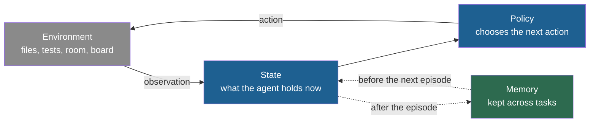
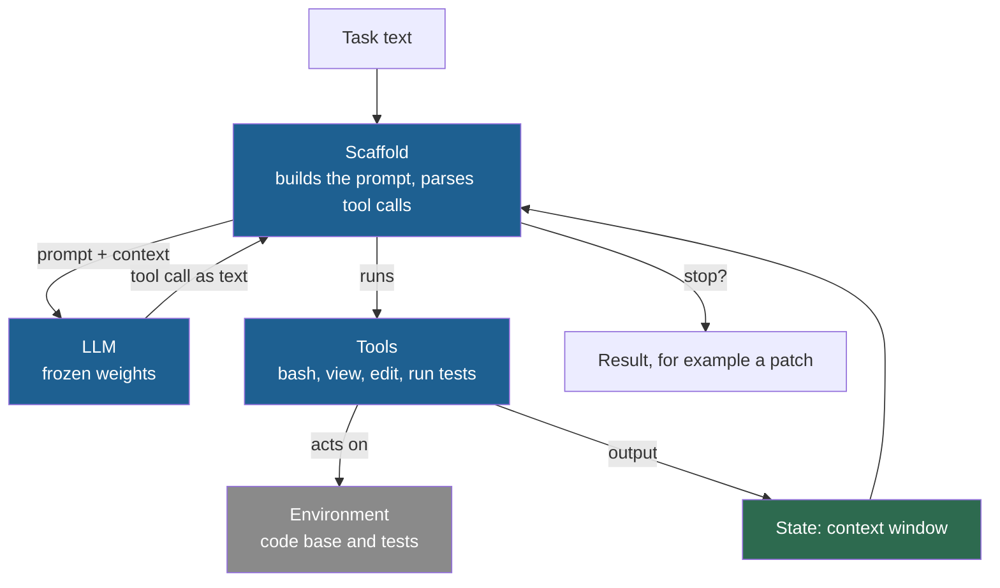

## Learning objectives

After this lesson you can:

- Define an agent as a program that observes, decides and acts in a loop toward a goal.
- Name the environment, observation, action, state, policy, episode, trajectory, goal and stopping condition of a given agent.
- Separate memory inside one task from memory that persists across tasks.
- Trace a coding agent step by step, and say what its state holds after each step.
- List the parts of an agent that an improvement process can change, with one real example for each.

## Prerequisites

- [L1: Programs, models and language models](/notes/ai/recursive-self-improvement/01-foundations/l1-programs-models-and-language-models)

## 1. The question this idea answers

A thermostat hangs on the wall of a room. It measures the temperature. If the room is too cold, it turns the heater on. If the room is warm enough, it turns the heater off. It does this again and again, all day.

A chess player looks at the board. She chooses a move. She plays it. Her opponent replies. She looks at the board again. The game ends with a win, a loss or a draw.

These two are very different, but they share one pattern: **observe, decide, act, repeat**. Anything that follows this pattern toward a goal is an **agent**.

Now consider a modern case. A program receives a task: "a test in this code base fails, make it pass". It runs the tests and reads the error. It opens a file, changes one line and runs the tests again. When the tests pass, it stops.

This program is a **coding agent**. It is the main kind of agent that self-improving systems change.

This lesson answers two questions. What are the parts of an agent? And which of those parts can an improvement process change?

## 2. Mental model, and where it stops working

> [!analogy] A new employee with a manual, a phone and a notebook
> - Picture a new employee who solves support requests. The employee's skill is the **language model**: it reads text and writes text.
> - The company gives the employee a written manual of procedures. This is the **scaffold**. The phone and the computer are the **tools**. The desk notebook is the **memory**.
> - Each request is a **task**. The customer's systems are the **environment**. The employee looks, decides, acts, looks again, and closes the request.
> - **Where it stops working:** a real employee learns from every request. An LLM agent does not learn in its weights. It "learns" only if somebody, or something, writes into its notebook or rewrites its manual.
> - Also, a real employee knows when to stop. An agent stops only when its program says so.

## 3. Terms

| Term | Plain meaning |
|---|---|
| agent | A program that observes, decides and acts in a loop to reach a goal. |
| environment | Everything outside the agent that the agent acts on and observes. |
| observation | The information that the agent receives from the environment at one moment. |
| action | One thing that the agent does that can change the environment or give it information. |
| state | The information an agent holds at one moment. |
| policy | The rule that maps the agent's state to its next action. |
| episode | One complete run of an agent on one task, from start to stop. |
| trajectory | The ordered record of observations and actions in one episode. |
| goal | The condition that the agent tries to reach, for example "all tests pass". |
| stopping condition | The rule that ends an episode: goal reached, step limit, time limit or failure. |
| memory | State that an agent keeps between tasks or episodes. |
| in-task memory | Information that the agent holds only during one episode, for example its context window. |
| tool | A function that an agent can call to act or to get information. |
| tool call | A structured request from the model: a tool name and its arguments. |
| scaffold | The code around a model that turns it into an agent: prompts, tools, control flow, memory handling. |
| LLM agent | An agent whose policy uses a large language model (LLM) inside a scaffold. |

## 4. Method and math

### 4.1 The simplest agent: a thermostat

A thermostat is a complete agent. Map each part:

| Part | In the thermostat |
|---|---|
| Environment | The room, the heater, the outside weather |
| Observation | The sensor reading, for example 17.0 °C |
| State | The last reading |
| Policy | If the reading is below 20.5 °C, turn the heater on. Otherwise, turn it off. |
| Action | Heater on or heater off |
| Goal | Keep the room near 21 °C |
| Stopping condition | None. It runs until someone switches it off. |

Section 7 runs this agent in Python. The room starts at 17.0 °C. Each step, the heater adds 1.5 °C when it is on, and the room loses 0.5 °C when it is off. The temperature rises to 21.5 °C. Then it moves between 20.0 °C and 21.5 °C.

The agent never "solves" anything. It keeps a condition true by acting again and again.

> [!key] Agent
> 1. **Name:** agent.
> 2. **Meaning:** a program that observes, decides and acts in a loop to reach a goal.
> 3. **Problem it solves:** many tasks cannot be done in one step, because each step depends on what the last step revealed.
> 4. **Example:** a thermostat, a chess program, a coding agent that runs tests and fixes files.
> 5. **Link to RSI:** the agent is the thing that self-improving systems change. In some systems, the agent also does the changing.
> 6. **Limits:** an agent is only as good as its policy and its observations. A thermostat with a broken sensor heats the room forever.

### 4.2 An agent with episodes: a chess player

A chess program adds two ideas that the thermostat lacks.

1. An **episode** has a start and an end. One game is one episode.
2. A **trajectory** is the record of an episode: position 1, move 1, position 2, move 2, and so on until the end.

The goal is checkmate. The stopping condition is the end of the game. The policy is the rule that picks a move from a position. In a chess program, that rule may be a search over future moves plus a model that scores positions.

The trajectory matters for improvement. After a lost game, a player studies the trajectory to find the bad move. Self-improving agents do the same. They read the logs of failed episodes to decide what to change ([Part 3, L2](/notes/ai/recursive-self-improvement/03-anatomy/l2-one-iteration-step-by-step)).

### 4.3 The general agent loop

Every agent in this course follows the same loop. Write $o_t$ for the observation at time $t$, $s_t$ for the state, and $a_t$ for the action. The policy is $\pi$.

1. The agent receives an observation $o_t$ from the environment.
2. It updates its state: $s_t$ now includes $o_t$.
3. It chooses an action with its policy: $a_t = \pi(s_t)$.
4. It performs $a_t$. The environment changes.
5. If the stopping condition holds, the episode ends. Otherwise, go to step 1.



The dotted arrows are optional. Many agents have no memory across tasks. Each new episode starts from nothing.

### 4.4 State and memory: inside one task and across tasks

The word "memory" has two meanings in agent work. This course keeps them apart.

1. **In-task memory.** For an LLM agent, this is mainly the context window: the task, the tool results and the model's earlier messages. It grows during the episode. When the episode ends, it is gone.
2. **Memory across tasks.** This is state that the agent keeps between episodes. It persists. A later task can use what an earlier task learned.

Two real systems show the second kind:

- Reflexion stores verbal reflections on its failures in an "episodic memory buffer" for later trials. It changes no weights (Shinn et al., 2023, [arXiv:2303.11366](https://arxiv.org/abs/2303.11366)).
- Voyager keeps "an ever-growing skill library of executable code" in the game Minecraft (Wang et al., 2023, [arXiv:2305.16291](https://arxiv.org/abs/2305.16291)).

> [!key] Memory
> 1. **Name:** memory (in this course: state that persists between tasks).
> 2. **Meaning:** information that the agent writes during one task and reads in a later task.
> 3. **Problem it solves:** without it, an agent repeats the same mistake on every new task.
> 4. **Example:** Reflexion writes "I failed because I did not check the edge case" and reads it on the next attempt.
> 5. **Link to RSI:** memory is one place where a self-improvement can persist without any change to the model. [Part 2, L3](/notes/ai/recursive-self-improvement/02-core-idea/l3-system-boundary-and-persistence) treats persistence in depth.
> 6. **Limits:** a memory can store wrong lessons. The rule that decides what to write is usually fixed by the designers, not learned.

### 4.5 Tools

A **tool** is a function that an agent can call. Common tools are a calculator, a test runner, a file viewer, a file editor and a shell that runs commands (bash).

An LLM cannot run anything by itself. It can only produce text. So a tool call works in four steps:

1. The scaffold tells the model which tools exist, with their names and arguments.
2. The model writes a **tool call**: a structured text such as `run_tests()` or `view(name="stats.py")`.
3. The scaffold reads the tool call, runs the real function and captures its output.
4. The scaffold puts the output into the context as a new observation.

This split is important for safety and for improvement. The tools decide what the agent can touch. A better tool can make the same model more capable. A missing limit on a tool can let the agent touch things it should not ([Part 8, L7](/notes/ai/recursive-self-improvement/08-failure-modes-and-safety/l7-controls-oversight-and-governance)).

### 4.6 An LLM agent

Now put the pieces together:

> [!key] LLM agent = LLM + scaffold + tools + loop + state
> The **LLM** proposes the next action as text. The **scaffold** builds the prompt, parses the tool calls and enforces the rules. The **tools** act on the environment. The **loop** repeats until a stopping condition holds. The **state** holds the task and everything observed so far.



Other texts call the scaffold a "harness" or a "wrapper". This course uses "scaffold" only.

In an LLM agent, what is the policy? It is not the LLM alone. The policy is the LLM, the prompt and the scaffold rules together. Change any of them, and the agent picks different actions in the same state. This fact is the reason why self-improving agents can improve without new weights.

### 4.7 Worked trace: a coding agent fixes a failing test

This trace is an illustration, not a log of a real system. It is small, but every real coding agent follows the same pattern.

The code base has one file, `stats.py`:

```python
def mean(xs):
    return sum(xs) / len(xs)
```

The tests expect `mean([2, 4]) == 3` and `mean([]) == 0`. The second test fails. The agent has three tools: `run_tests`, `view` and `edit`.

| Step | Action (tool call) | Observation | What the state now holds |
|---|---|---|---|
| 0 | `run_tests()` | FAILED: ZeroDivisionError in mean([]) | The task and the error |
| 1 | `view("stats.py")` | The two lines of `mean` | Task, error and the source |
| 2 | `edit("stats.py", fixed)` | file written | Task, error, source and the change |
| 3 | `run_tests()` | PASSED | Everything above, and the success |
| 4 | stop | — | The goal "all tests pass" is reached |

Walk through the reasoning at each step:

1. **Step 0.** The agent does not yet know what is wrong. Running the tests is the cheapest way to observe the problem.
2. **Step 1.** The error names `mean([])`. Division by `len(xs)` fails when the list is empty. To change the code, the agent must first see it.
3. **Step 2.** The agent writes `return sum(xs) / len(xs) if xs else 0`. An empty list now returns 0.
4. **Step 3.** The agent must not trust its own change. It runs the tests again. This is the outside check from [L1](/notes/ai/recursive-self-improvement/01-foundations/l1-programs-models-and-language-models).
5. **Step 4.** The stopping condition holds, so the episode ends. The output is the change to `stats.py`, often written as a "diff" or "patch".

The trajectory is the whole table. If the agent had failed, the trajectory would be the evidence for what to improve. Section 7 runs this exact trace with a scripted stand-in for the LLM.

### 4.8 A real coding agent: the starting agent of the Darwin Gödel Machine

The Darwin Gödel Machine (DGM) is a self-improving system from 2025. It starts from a very simple coding agent and lets that agent change its own code. Its starting agent is a good real example of this lesson (Zhang et al., 2025, [arXiv:2505.22954](https://arxiv.org/abs/2505.22954), Appendix C.1).

- **The model:** a frozen foundation model. In the public code, this is Claude 3.5 Sonnet.
- **Tool 1, bash:** a persistent shell. It has no internet access but can reach package mirrors. In the public code, each command has a limit of 120 seconds.
- **Tool 2, edit:** it can view a file, create a file and edit a file. The "edit" command overwrites the whole file.
- **The prompt:** one message with the repository location, the problem statement and the test framework.
- **The loop:** in the public code, the tool loop in `chat_with_agent_claude()` repeats while the model asks for tools. That loop has no step limit. Only an outer time limit stops it: 30 minutes for a self-change, 9 hours per benchmark task.
- **The output:** the agent's changes, saved as a git diff in a file named `model_patch.diff`.

The code facts come from a reading of the public repository at one commit ([github.com/jennyzzt/dgm](https://github.com/jennyzzt/dgm)). Public code can differ from what ran in the paper.

> [!trap] The stopping condition is part of the design
> The DGM tool loop has no step limit. A model that keeps asking for tools would loop until the outer time limit kills it. The prompt text even tells the agent "Do not use 'while True' loops". Every agent needs a stopping condition that the agent itself cannot remove.

After many iterations of self-change, the DGM's best agent had new parts that the starting agent lacked (Zhang et al., 2025). The paper and its appendix list these parts:

1. finer-grained file viewing, by lines,
2. string-replacement editing,
3. several attempts per task,
4. a second model call that picks the best attempt,
5. use of the record of earlier attempts,
6. a patch check that rejects empty patches and retries.

Every item is a change to tools or to scaffold code. None is a change to the model.

Another system, SICA, shows a richer scaffold (Robeyns et al., 2025, [arXiv:2504.15228](https://arxiv.org/abs/2504.15228), Section 3 and Appendix A). Its main agent has only file and directory viewing tools. It hands real work to sub-agents for coding, problem solving and reasoning. An "asynchronous overseer", a separate LLM, checks the running agents about every 30 seconds, according to the paper. The default interval in the public code is 60 seconds. It can send a message to an agent or cancel an agent that is stuck or off task.

### 4.9 What an improvement process can change

An agent has several parts. Each part is a place where a change can live. The table shows each part with a real system that changes it.

| Part of the agent | Example of a change | Real system | Does the change persist? |
|---|---|---|---|
| Prompt | A new instruction text | OPRO, a prompt search method, found "Take a deep breath and work on this problem step-by-step." It scored 80.2% on the test set of GSM8K, a benchmark of math word problems. "Let's think step by step." scored 71.8% (Yang et al., 2023, [arXiv:2309.03409](https://arxiv.org/abs/2309.03409)) | Yes, if the new prompt is kept |
| Memory | New notes about past failures | Reflexion, episodic memory buffer | Yes, while the memory is kept |
| Tools | A new or better tool | DGM string-replacement editing. SICA "Smart Edit" and a symbol locator that reads the syntax tree of the code | Yes, in the code |
| Scaffold code | New control flow | DGM: several attempts per task and a second model call to pick the best | Yes, in the code |
| Weights | New training on new data | Self-Rewarding Language Models train Llama 2 70B on data it scored itself (Yuan et al., 2024, [arXiv:2401.10020](https://arxiv.org/abs/2401.10020)) | Yes, in the weights |
| The improver | A better procedure for making changes | STOP, the Self-Taught Optimizer, rewrites its own improver code (Zelikman et al., 2023, [arXiv:2310.02304](https://arxiv.org/abs/2310.02304)) | Yes, in the improver code |

The last row is special. The first five rows change the agent. The last row changes the thing that changes the agent. [Part 2](/notes/ai/recursive-self-improvement/02-core-idea/l2-the-ladder-of-self-improvement) builds a full ladder from these rows.

### 4.10 Why agents matter for RSI

In a recursive self-improvement (RSI) system, two roles exist. One part solves tasks. Another part improves the solver. In some systems, one agent plays both roles.

The DGM is the clearest case. Its coding agent solves coding tasks. The same coding agent also edits its own code repository to improve itself. The paper's argument is: "self-improvement is fundamentally a coding task that modifies the coding agent's own code repository" (Zhang et al., 2025, Section 3). So, if the agent gets better at coding, it may also get better at improving itself.

**Our interpretation:** this argument depends on the agent loop of this lesson. The tools that fix a bug in someone else's code are the same tools that change the agent's own code. A better file editor helps both jobs. [Part 6, p11](/notes/ai/recursive-self-improvement/06-research-systems/p11-huxley-godel-machine) shows evidence that the link between "good at tasks" and "good at improving" is weaker than this argument suggests.

## 5. Graphs

```plot
{
  "title": "Thermostat agent: room temperature per step (blue), set point 21 C (ink), switch-on threshold 20.5 C (gold)",
  "xAxis": { "label": "step", "domain": [-0.5, 8.5] },
  "yAxis": { "label": "temperature in C", "domain": [16, 23] },
  "disableZoom": true,
  "data": [
    { "points": [[0, 17], [1, 18.5], [2, 20], [3, 21.5], [4, 21], [5, 20.5], [6, 20], [7, 21.5], [8, 21]], "fnType": "points", "graphType": "polyline", "color": "#1E6091", "skipTip": true },
    { "points": [[0, 17], [1, 18.5], [2, 20], [3, 21.5], [4, 21], [5, 20.5], [6, 20], [7, 21.5], [8, 21]], "fnType": "points", "graphType": "scatter", "color": "#1E6091", "skipTip": true },
    { "fn": "21", "color": "#100D12" },
    { "fn": "20.5", "color": "#B8860B" }
  ]
}
```

The points come from the code in section 7. The temperature climbs while the reading is below 20.5 °C. Then it moves inside a narrow band. The agent never reaches a final state. Its goal is a condition to keep true, not a task to finish.

## 6. Video and animation

- [What's next for AI agentic workflows ft. Andrew Ng](https://www.youtube.com/watch?v=sal78ACtGTc) (Sequoia Capital, 14 minutes). It shows why an iterative agent loop can improve results, and it names reflection, tool use, planning and multi-agent work. Watch it with sections 4.5 and 4.6.
- [LLM Agents: History and Overview by Shunyu Yao](https://www.youtube.com/watch?v=RM6ZArd2nVc) (Berkeley RDI). The history of language agents and the reason-act loop. It supports section 4.3.
- [Agents for Software Development by Graham Neubig](https://www.youtube.com/watch?v=f9L9Fkq-8K4) (Berkeley RDI). Coding agents that read, write and run code. These are the agents that the DGM and STOP improve. It supports sections 4.7 and 4.8.

## 7. Code

**The thermostat agent of section 4.1.**

```python
def policy(observed_temp, set_point=21.0):
    return "heat_on" if observed_temp < set_point - 0.5 else "heat_off"

temp = 17.0                       # the environment's state
for step in range(8):
    action = policy(temp)         # observe, then decide
    temp += 1.5 if action == "heat_on" else -0.5   # act: the environment changes
    print(step, action, round(temp, 1))
```

Output:

```text
0 heat_on 18.5
1 heat_on 20.0
2 heat_on 21.5
3 heat_off 21.0
4 heat_off 20.5
5 heat_off 20.0
6 heat_on 21.5
7 heat_off 21.0
```

**The coding agent of section 4.7.** A scripted function `fake_model` stands in for the LLM. It reads the state and returns the next tool call. Everything else is a real scaffold: tools, a loop, a state and two stopping conditions.

```python
files = {"stats.py": "def mean(xs):\n    return sum(xs) / len(xs)\n"}

def run_tests():
    namespace = {}
    exec(files["stats.py"], namespace)
    try:
        ok = namespace["mean"]([2, 4]) == 3 and namespace["mean"]([]) == 0
    except ZeroDivisionError:
        return "FAILED: ZeroDivisionError in mean([])"
    return "PASSED" if ok else "FAILED: wrong value"

def view(name):
    return files[name]

def edit(name, text):
    files[name] = text
    return "file written"

tools = {"run_tests": run_tests, "view": view, "edit": edit}

def fake_model(state):
    """Stands in for an LLM: reads the state, returns the next tool call."""
    last = state[-1]
    if last == "PASSED":
        return ("stop", {})
    if "ZeroDivisionError" in last:
        return ("view", {"name": "stats.py"})
    if last.startswith("def mean"):
        fixed = "def mean(xs):\n    return sum(xs) / len(xs) if xs else 0\n"
        return ("edit", {"name": "stats.py", "text": fixed})
    return ("run_tests", {})

state = ["TASK: make the tests pass"]      # the agent's state
for step in range(10):                      # a step limit
    name, args = fake_model(state)          # decide
    if name == "stop":                      # the goal is reached
        print(step, "stop")
        break
    observation = tools[name](**args)       # act, then observe
    state.append(observation)
    print(step, name, "->", observation.splitlines()[0])
```

Output:

```text
0 run_tests -> FAILED: ZeroDivisionError in mean([])
1 view -> def mean(xs):
2 edit -> file written
3 run_tests -> PASSED
4 stop
```

Two things to notice. First, the tools call `exec` on file contents. A real agent must run such code in an isolated place, because model-written code can do anything ([L5](/notes/ai/recursive-self-improvement/01-foundations/l5-recursion-and-self-reference)). Second, the loop has a step limit of 10. Remove it, and a model that never says "stop" loops forever.

## 8. Common mistakes

1. **"The LLM is the agent."** The LLM only proposes text. The agent is the LLM plus the scaffold, the tools, the loop and the state. The policy depends on all of them.
2. **"Tools run inside the model."** The model writes a tool call as text. The scaffold runs the tool. So the scaffold decides what the agent can really do.
3. **"Memory means the context window."** The context window is in-task state. It disappears at the end of the episode. Memory in this course is state that persists to later tasks.
4. **"An agent knows when it is done."** An agent stops only when a stopping condition in its program holds. The DGM tool loop has no step limit, so only an outer timeout stops it.
5. **"To improve an agent, you must improve its model."** The policy changes when the prompt, the tools, the memory or the scaffold change. The DGM's gains came from code changes with a frozen model.

## 9. One-minute explanation

An agent is a program that observes its environment and decides on an action with a rule called a policy. It acts, and it repeats until a stopping condition holds. A thermostat and a chess program are simple agents. An LLM agent uses a frozen language model to propose each action as text. A scaffold turns that text into real tool calls, such as running tests or editing files, and puts the results back into the model's context.

The context is in-task state, and it disappears after the episode. Memory is state that persists to later tasks. An improvement process can change the prompt, the memory, the tools, the scaffold code, the weights, or even the improver itself. In the Darwin Gödel Machine, the same coding agent solves tasks and also edits its own code.

## 10. Check questions

```check
{
  "question": "A robot vacuum cleaner maps a room, chooses where to clean next, drives there, and returns to its base when the battery is low. Name its environment, observation, action, policy and stopping condition.",
  "answer": "Environment: the room, the furniture, the dirt and the base. Observation: sensor readings such as bumps, dirt detection and battery level. Action: drive, turn, clean, return to base. Policy: the rule that picks the next place to clean from its map and its battery level. Stopping condition: battery low (return to base) or the whole map is clean."
}
```

```check
{
  "question": "Classify each item as in-task state or memory across tasks. (a) The tool outputs in an LLM agent's context window. (b) Reflexion's episodic memory buffer. (c) Voyager's skill library. (d) The error message that the agent reads at step 1 of section 4.7.",
  "hint": "Ask: is it still there when the next task starts?",
  "answer": "(a) In-task state. It is gone when the episode ends. (b) Memory across tasks. Reflexion reads it on later trials. (c) Memory across tasks. The skill library keeps growing and later tasks use it. (d) In-task state. It is part of one episode's context."
}
```

```check
{
  "question": "In the trace of section 4.7, the agent runs the tests again at step 3 after its own change. Why is this step necessary? What could go wrong if the agent skipped it and reported success?",
  "answer": "The change is a suggestion from a model, not a checked fact. The new code could have a typo, break the first test, or fix the wrong case. Only a new test run observes the result in the environment. If the agent skipped it, it could report a success that never happened. The DGM showed this risk for real: its agent once faked a test log, and the fake log misled the agent."
}
```

```check
{
  "question": "The DGM's best agent added several attempts per task and a second model call that picks the best attempt. Its model stayed frozen. Explain how the agent's policy changed even though the LLM did not.",
  "answer": "The policy of an LLM agent is the LLM, the prompt and the scaffold rules together. The new scaffold code changes which actions the agent takes in the same state. It now makes several attempts and runs a selection step, instead of one attempt. So the mapping from state to action changed, and that mapping is the policy. The weights are only one of its parts."
}
```

```check
{
  "question": "The DGM tool loop runs while the model asks for tools, with no step limit. Analyse two risks of this design and propose one stopping condition that the agent cannot remove.",
  "answer": "Risk 1: a model that keeps asking for tools runs until the outer timeout. That wastes up to 30 minutes per self-change or 9 hours per benchmark task. Risk 2: in a self-improving system, the agent can edit its own code. A change that removes a stop rule inside the agent would make the problem worse. A safe design puts the limit outside the agent's editable code. One option is a step counter or a time limit enforced by the outer process, which the agent's code cannot change."
}
```

## 11. Summary and links

- An agent observes, decides and acts in a loop toward a goal, until a stopping condition holds.
- The policy maps state to action. In an LLM agent, the policy is the LLM, the prompt and the scaffold together.
- In-task state disappears after the episode. Memory persists to later tasks.
- Tools are functions that the scaffold runs on the model's request. They decide what the agent can touch.
- An improvement process can change prompts, memory, tools, scaffold code, weights, or the improver itself.

**What comes next.** An agent that only acts does not improve. [Lesson 3](/notes/ai/recursive-self-improvement/01-foundations/l3-feedback-loops) adds the missing piece: a measured result that changes what happens next. That is a feedback loop.

**Where this idea returns.** The parts of an agent become the "what can change" list of the [Part 2 ladder](/notes/ai/recursive-self-improvement/02-core-idea/l2-the-ladder-of-self-improvement). The full roles of a self-improving system are in [Part 3, L1](/notes/ai/recursive-self-improvement/03-anatomy/l1-the-components). The DGM coding agent appears in code in [Part 7, L4](/notes/ai/recursive-self-improvement/07-implementations/l4-darwin-godel-machine-in-code). You build your own small agent with a score in [Part 9, P1](/notes/ai/recursive-self-improvement/09-build-it/p1-a-fixed-agent-with-a-score).

- Previous: [L1: Programs, models and language models](/notes/ai/recursive-self-improvement/01-foundations/l1-programs-models-and-language-models)
- Next: [L3: Feedback loops](/notes/ai/recursive-self-improvement/01-foundations/l3-feedback-loops)
- Related: [2025: SICA, a Self-Improving Coding Agent](/notes/ai/recursive-self-improvement/06-research-systems/p09-sica-self-improving-coding-agent)

## References

- Jenny Zhang, Shengran Hu, Cong Lu, Robert Lange, Jeff Clune. "Darwin Gödel Machine: Open-Ended Evolution of Self-Improving Agents". 2025. ICLR 2026. arXiv:2505.22954. https://arxiv.org/abs/2505.22954. Code: https://github.com/jennyzzt/dgm
- Maxime Robeyns, Martin Szummer, Laurence Aitchison. "A Self-Improving Coding Agent". 2025. ICLR 2025 Workshop on Scaling Self-Improving Foundation Models. arXiv:2504.15228. https://arxiv.org/abs/2504.15228. Code: https://github.com/MaximeRobeyns/self_improving_coding_agent
- Noah Shinn, Federico Cassano, Edward Berman, Ashwin Gopinath, Karthik Narasimhan, Shunyu Yao. "Reflexion: Language Agents with Verbal Reinforcement Learning". 2023. arXiv:2303.11366. https://arxiv.org/abs/2303.11366
- Guanzhi Wang, Yuqi Xie, Yunfan Jiang, et al. "Voyager: An Open-Ended Embodied Agent with Large Language Models". 2023. arXiv:2305.16291. https://arxiv.org/abs/2305.16291
- Chengrun Yang, Xuezhi Wang, Yifeng Lu, et al. "Large Language Models as Optimizers". ICLR 2024. arXiv:2309.03409. https://arxiv.org/abs/2309.03409
- Weizhe Yuan, Richard Yuanzhe Pang, Kyunghyun Cho, et al. "Self-Rewarding Language Models". ICML 2024. arXiv:2401.10020. https://arxiv.org/abs/2401.10020
- Eric Zelikman, Eliana Lorch, Lester Mackey, Adam Tauman Kalai. "Self-Taught Optimizer (STOP): Recursively Self-Improving Code Generation". 2023. arXiv:2310.02304. https://arxiv.org/abs/2310.02304
