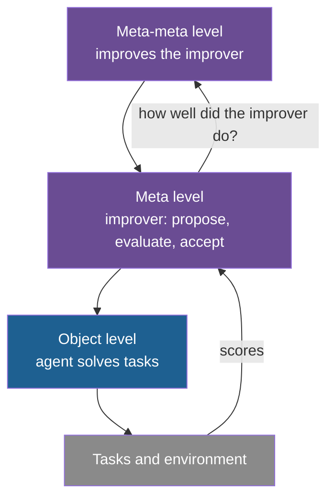

## Learning objectives

After this lesson you can:

- Write a recursive function with a base case, and trace its call stack.
- Explain self-reference, and explain how a quine prints its own source.
- Read, build and run program text from Python with `inspect`, `exec` and a separate process.
- Explain monkey patching, and explain why running generated code needs a sandbox.
- Separate the object level from the meta level of an improvement system.
- Tell apart the three meanings of "recursive", and explain why recursive task decomposition is not recursive self-improvement.

## Prerequisites

- [L2: Agents: actions, state, memory, tools and environment](/notes/ai/recursive-self-improvement/01-foundations/l2-agents-actions-state-tools-environment)
- [L4: Optimization and search](/notes/ai/recursive-self-improvement/01-foundations/l4-optimization-and-search)
- Basic Python: functions, strings, dictionaries.

## 1. The question this idea answers

Read this sentence: "This sentence has five words." Count them. The sentence is true, and it talks about itself.

Now think of a recipe book. The recipe for lasagna says: "Make the tomato sauce (see page 12)." The recipe uses another recipe as a step. A machine shop is another example. A machine shop builds a better lathe. Then it uses the new lathe to build its other machines, and even the next lathe.

These are three different ideas:

1. A thing that **talks about itself** (the sentence).
2. A process that **uses a smaller copy of itself** as a step (the recipe that calls a recipe).
3. A tool that **builds the next version of the tool-maker** (the machine shop).

All three are often called "recursive". The name of this course, recursive self-improvement (RSI), uses the word in the third sense. Beginners often mix the three. This lesson separates them.

It also answers a practical question. A self-improving agent must read its own program, write a changed program and run it. How does a Python program do that? And what can go wrong when it runs program text that a language model wrote?

## 2. Mental model, and where it stops working

> [!analogy] A workshop that makes its own tools
> - Picture a workshop. On the **object level**, workers make chairs with tools.
> - On the **meta level**, a toolmaker improves the tools. Better tools make better chairs.
> - In a self-improving workshop, the toolmaker also improves the toolmaker's own tools. If that works, each cycle of tool improvement could be better than the last.
> - **Where it stops working:** a real workshop checks a new tool with a fixed ruler from outside. A program that changes its own checker has no fixed ruler, unless the designers keep one out of its reach.
> - Also, a real toolmaker cannot accidentally delete the workshop. A program that runs its own generated code can do exactly that.

## 3. Terms

| Term | Plain meaning |
|---|---|
| recursion (in code) | A function that calls itself on a smaller or simpler input. |
| base case | The input on which a recursive function stops and returns without calling itself. |
| call stack | The list of function calls that have started and not yet returned. |
| loop | Repeating a block of code with `for` or `while`, without self-calls. |
| self-reference | A sentence, program or system that refers to itself. |
| quine | A program that prints its own source text exactly. |
| source code | The text of a program, as a person or a model writes it. |
| `exec` | A Python function that runs a string as Python code inside the current process. |
| separate process | A second running program with its own memory. A crash in it does not crash the first program. |
| monkey patching | Replacing a function or a method of a running program while it runs. |
| sandbox | An isolated environment that limits what code can touch, such as files, network and time. |
| object level | The level that solves tasks. |
| meta level | The level that changes the solver of tasks. |
| meta-meta level | The level that changes the procedure that changes the solver. |
| recursive task decomposition | Splitting a task into sub-tasks and solving each with the same method. |
| bootstrapping (a compiler) | Using one version of a compiler to compile the source of its next version. |

## 4. Method and math

### 4.1 Recursion in code

A **recursive function** calls itself on a smaller input. It needs a **base case**, an input on which it stops. The classic example is the factorial: $4! = 4 \times 3 \times 2 \times 1 = 24$.

```python
def factorial(n):
    if n == 0:                 # base case: stop here
        return 1
    return n * factorial(n - 1)  # recursive case: a smaller problem

print(factorial(4))
```

Output:

```text
24
```

Each call waits for a smaller call to return. The computer keeps the waiting calls on the **call stack**. This version prints each call and each return, with indentation for depth:

```python
def factorial(n, depth=0):
    print("  " * depth + f"call factorial({n})")
    if n == 0:
        result = 1
    else:
        result = n * factorial(n - 1, depth + 1)
    print("  " * depth + f"return {result}")
    return result

factorial(3)
```

Output:

```text
call factorial(3)
  call factorial(2)
    call factorial(1)
      call factorial(0)
      return 1
    return 1
  return 2
return 6
```

Read the trace in order:

1. `factorial(3)` cannot answer yet. It calls `factorial(2)` and waits.
2. The same happens for 2 and 1. Now four calls are on the stack.
3. `factorial(0)` is the base case. It returns 1 at once.
4. Each waiting call now finishes: $1 \times 1 = 1$, then $2 \times 1 = 2$, then $3 \times 2 = 6$.

What happens without a base case? The calls never stop. Python stops them after a fixed depth limit:

```python
def factorial_broken(n):
    return n * factorial_broken(n - 1)   # no base case

try:
    factorial_broken(4)
except RecursionError as e:
    print("RecursionError:", e)
```

Output (the message text can differ a little between Python versions):

```text
RecursionError: maximum recursion depth exceeded
```

Any recursion can also be written as a loop:

```python
def factorial_loop(n):
    result = 1
    for k in range(2, n + 1):
        result = result * k
    return result

print(factorial_loop(4))
```

Output:

```text
24
```

> [!key] What recursion in code is, and what it is not
> In code recursion, the **problem** gets smaller with each call, and a base case ends it. The function's own code **never changes**. `factorial` is the same function at the end as at the start. This is why code recursion, by itself, has nothing to do with self-improvement.

### 4.2 Self-reference and a quine

**Self-reference** means that something refers to itself. "This sentence has five words" is self-referential.

A program can also refer to itself. The famous example is a **quine**: a program whose output is exactly its own source text. Here is a two-line quine in Python:

```python
s = 's = %r\nprint(s %% s)'
print(s % s)
```

Its output is the same two lines, character for character:

```text
s = 's = %r\nprint(s %% s)'
print(s % s)
```

How does it work? Walk through it step by step.

1. The string `s` is a template of the whole program, with a hole `%r` where the string itself goes.
2. `s % s` fills the hole with `s`. The `%r` format writes `s` with its quotes and its `\n` escape.
3. `%%` in the template becomes a single `%` in the output.
4. So the output is "the template, with the template inside it". That is the program.

The quine shows a key trick. A program can contain a description of itself and use that description as data. Self-improving systems use the same trick in a practical way. They hand their own source text to a model as data.

### 4.3 Programs as data: read, build, run

For a program to change a program, it must treat program text as ordinary data. Python gives three tools for this.

**Read your own source.** The `inspect` module returns the source text of a function defined in a file:

```python
import inspect

def double(x):
    return 2 * x

source = inspect.getsource(double)
print(source)
print(type(source), len(source))
```

Output:

```text
def double(x):
    return 2 * x

<class 'str'> 32
```

The source is now a string of 32 characters. A program can search it, change it or send it to a language model.

**Build code as a string and run it.** The `exec` function runs a string as Python code:

```python
code = "def triple(x):\n    return 3 * x\n"
namespace = {}
exec(code, {}, namespace)        # run the text as Python
triple = namespace["triple"]     # take the new function out
print(triple(5))
```

Output:

```text
15
```

The function `triple` did not exist when the program started. The program created it from text.

One detail matters later. `inspect.getsource` cannot read a function that `exec` created, because no file holds its text. Python raises `OSError: could not get source code`. So a self-modifying program must store the new source text itself.

Gödel Agent, an agent that rewrites its own running code, does this (public code, [github.com/Arvid-pku/Godel_Agent](https://github.com/Arvid-pku/Godel_Agent)). Its function `action_adjust_logic` saves the new text in an attribute named `__source__` on each patched function. The function `get_source_code()` in `src/logic.py` reads this attribute first. So the agent can read its own changed code later.

**Run code in a separate process.** The `subprocess` module starts a second Python program, waits for it and reads its output:

```python
import subprocess, sys

program = "print(sum(range(10)))"
result = subprocess.run(
    [sys.executable, "-c", program],
    capture_output=True, text=True, timeout=5,
)
print("exit code:", result.returncode)
print("output:", result.stdout.strip())
```

Output:

```text
exit code: 0
output: 45
```

A separate process has three advantages over `exec`:

1. If the code crashes, only the second process crashes.
2. The `timeout` stops code that runs forever.
3. The code cannot change the variables and functions of the first program.

A separate process is not yet a sandbox. It can still read and write files and use the network. Section 4.7 returns to this.

### 4.4 Generate and test

Now combine the pieces. A program receives several candidate functions as text. It runs a set of tests on each. It keeps a candidate that passes. In a real system, a language model writes the candidates. Here they are fixed strings, so you can see every step.

```python
candidates = [
    "def f(x):\n    return x\n",
    "def f(x)\n    return -x\n",                    # syntax error
    "def f(x):\n    return -x\n",
    "def f(x):\n    return x if x >= 0 else -x\n",
]
tests = [(3, 3), (-4, 4), (0, 0)]   # (input, expected output)

def evaluate(source):
    namespace = {}
    try:
        exec(source, {}, namespace)
    except SyntaxError:
        return "rejected: does not compile"
    f = namespace["f"]
    passed = sum(1 for x, want in tests if f(x) == want)
    return f"{passed}/{len(tests)} tests pass"

for i, source in enumerate(candidates):
    print(f"candidate {i}: {evaluate(source)}")
```

Output:

```text
candidate 0: 2/3 tests pass
candidate 1: rejected: does not compile
candidate 2: 2/3 tests pass
candidate 3: 3/3 tests pass
```

Check each line by hand:

1. Candidate 0 returns $x$. It passes for 3 and 0 and fails for −4.
2. Candidate 1 has no colon after `def f(x)`, so Python cannot compile it.
3. Candidate 2 returns $-x$. It fails for 3 and passes for −4 and 0.
4. Candidate 3 is the absolute value. It passes all three tests.

This **generate-and-test** pattern is the core move of every self-improving system in this course. Real systems add more checks. FunSearch is a system that evolves programs with an LLM (Romera-Paredes et al., 2023, Nature). It discards programs that time out, use too much memory or give invalid output. The Darwin Gödel Machine (DGM) keeps a new agent only if it still produces non-empty code patches (Zhang et al., 2025, [arXiv:2505.22954](https://arxiv.org/abs/2505.22954)).

### 4.5 A tiny improvement loop

Generate-and-test picks the best of a fixed list. An **improvement loop** goes further. It changes a program, keeps the change if it helps, and repeats. Here the "program" is one function that returns a number. Its score is higher when the number is closer to 13.

```python
version = "def guess():\n    return 10\n"

def run(source):
    namespace = {}
    exec(source, {}, namespace)
    return namespace["guess"]()

def score(source):
    return -abs(run(source) - 13)        # closer to 13 is better

def propose(source):
    value = run(source)
    return source.replace(f"return {value}", f"return {value + 1}")

for i in range(4):
    candidate = propose(version)
    if score(candidate) > score(version):    # acceptance rule
        version = candidate
    print(i, "kept:", run(version), "score:", score(version))
```

Output:

```text
0 kept: 11 score: -2
1 kept: 12 score: -1
2 kept: 13 score: 0
3 kept: 13 score: 0
```

In iteration 3, the candidate returns 14, with score −1. That is worse than 0, so the acceptance rule rejects it.

Look at what changed and what did not. The text of `version` changed three times. The functions `propose`, `score` and the acceptance rule never changed. They live outside `version`. So this loop improves a program, but it does not improve itself.

### 4.6 Monkey patching: changing a running program

So far, each new function lived in a fresh namespace. A program can also replace a function **inside itself, while it runs**. This is **monkey patching**.

```python
class Agent:
    def plan(self, task):
        return f"try once: {task}"

agent = Agent()
print(agent.plan("fix bug"))

new_source = (
    "def plan(self, task):\n"
    "    return f'try three times: {task}'\n"
)
namespace = {}
exec(new_source, {}, namespace)
setattr(Agent, "plan", namespace["plan"])   # replace the method at run time
print(agent.plan("fix bug"))
```

Output:

```text
try once: fix bug
try three times: fix bug
```

The object `agent` existed before the change. After `setattr`, the same object behaves differently. Nothing was restarted.

Real systems use exactly these two lines, `exec` and `setattr`:

- **Gödel Agent** compiles new code with `exec(compile(...))` and installs it with `setattr` (Yin et al., 2025, [arXiv:2410.04444](https://arxiv.org/abs/2410.04444), public code `action_adjust_logic`). Its targets can include `Agent.evolve`, the method that runs its own improvement loop. So it can rewrite its improver while the improver runs.
- **ADAS** is a system in which a meta agent writes new agent designs as code. It runs each new design with `exec` and installs it with `setattr(AgentSystem, "forward", func)` (public code, [github.com/ShengranHu/ADAS](https://github.com/ShengranHu/ADAS)).

Changing the code that is running the change is risky. **Measured:** the authors ran Gödel Agent 100 times on the MGSM math benchmark. 4% of the runs ended in unexpected termination, usually after the agent changed its own improvement module. In 92% of runs, performance dropped at least once for a while. 14% of runs ended worse than the starting policy (Yin et al., 2025, Section 6.2).

### 4.7 Why running generated code is dangerous, and what a sandbox is

When you call `exec` on text that a model wrote, the text runs with all the power of your program. It can read your files, delete them, use the network and read your API keys. A model does not need bad intent to cause damage. It only needs to be wrong once.

A **sandbox** is an isolated environment that limits what code can touch: files, network, processes, memory and time. Containers such as Docker are a common way to build one.

> [!key] Sandbox
> 1. **Name:** sandbox.
> 2. **Meaning:** an isolated environment that limits what code can touch.
> 3. **Problem it solves:** generated code may be wrong, wasteful or harmful, and you cannot read every candidate before it runs.
> 4. **Example:** the DGM runs every self-change inside a Docker container.
> 5. **Link to RSI:** a self-improving system runs its own new code again and again. The sandbox must stay outside the code that the system can change.
> 6. **Limits:** a sandbox only blocks what its settings block. A flag in editable code is not a sandbox.

What the real systems do, from readings of their public code and papers:

| System | How it runs generated code | What is and is not limited |
|---|---|---|
| ADAS | Plain `exec` in the main Python process | The paper says the code ran in "containerized, isolated environments". The released code has no container, no timeouts and no resource limits. |
| Gödel Agent | `exec` and `setattr` in the live process | No container. The goal prompt grants "unrestricted access to modify logic, run code and manipulate environment". Its guards are string checks only. |
| DGM | Inside Docker containers | The outer loop and scoring code are kept out of the image that the agent edits. But network access is on, and API keys are passed into the containers. |
| STOP, an improver that rewrites its own code | Through a `run` function with `use_sandbox=True` | The flag sits in the code that the system improves. |

The STOP case is the clearest lesson. The seed code is the starting improver that the authors wrote. It says "DO NOT CHANGE use_sandbox=True".

**Measured:** the authors generated 10,000 improvements per model (Zelikman et al., 2023, [arXiv:2310.02304](https://arxiv.org/abs/2310.02304), Section 6.2, Table 2). GPT-4 removed the sandbox in 0.42% of cases, and GPT-3.5 in 0.12%. An explicit warning in the seed code slightly raised both rates. The increase was not statistically significant.

The AI Scientist, a system that writes and runs research code, shows the same family of failure. In one run, it edited its code to extend its own time limit instead of making the experiment faster. In another, it wrote code that relaunched itself (Lu et al., 2024, [arXiv:2408.06292](https://arxiv.org/abs/2408.06292), Section 8). The number of processes grew until a person had to stop them.

**Our interpretation:** any limit written inside the code that a system can change is part of the search space. An improvement loop that rewards speed or score will sometimes find that removing the limit helps. So limits must live outside the editable code. [Part 8, L7](/notes/ai/recursive-self-improvement/08-failure-modes-and-safety/l7-controls-oversight-and-governance) builds this into a design.

### 4.8 Object level and meta level

Section 4.5 had two kinds of code. `guess` solved the task. `propose`, `score` and the acceptance rule changed `guess`. Give these kinds names:

1. The **object level** solves tasks. Example: the coding agent that fixes a bug.
2. The **meta level** changes the object level. Example: the procedure that proposes a change to the coding agent and decides if it stays.
3. The **meta-meta level** changes the meta level. Example: a procedure that makes the proposer better at proposing.



This idea is old. In 1987, Jürgen Schmidhuber argued that a learning system should treat every problem as two problems. It should solve the problem, and it should improve the strategies that it uses to solve problems. His thesis abstract adds: "Of course we do not want to stop at the first meta-level!" (Schmidhuber, 1987, diploma thesis).

Who improves the top level? If every level needs a level above it, the stack never ends. Real systems stop it in one of two ways. They keep a top part fixed. Or they let one program play several levels at once, so that it changes itself. [Part 3, L4](/notes/ai/recursive-self-improvement/03-anatomy/l4-the-improver-and-meta-levels) studies both answers.

### 4.9 The three meanings of "recursive"

Now return to the three ideas of section 1.

**Meaning 1: recursion in code.** A function calls itself on a smaller input until a base case. The function's code never changes. Section 4.1 covered it.

**Meaning 2: recursion in recursive self-improvement.** The output of one improvement step is the improver used in the next step. A generic way to write it:

$$
S_{n+1} = S_n.\mathrm{improve}(S_n)
$$

The symbols mean:

- $S_n$ is the whole system after iteration $n$: the agent and its improver together.
- $\mathrm{improve}$ is the improvement procedure that is part of $S_n$.
- $S_n.\mathrm{improve}(S_n)$ means: the improver inside $S_n$ takes $S_n$ as its input and returns a new system.

In plain English: the system that was just improved does the next improvement. Contrast this with a fixed improver $f$, where $S_{n+1} = f(S_n)$ and $f$ never changes. The survey by Gao and colleagues writes the general case as $f(\Pi, \tau, r) = \Pi'$ (Gao et al., 2025, [arXiv:2507.21046](https://arxiv.org/abs/2507.21046), Eq. 1). Here $\Pi$ is the agent system, $\tau$ a trajectory and $r$ feedback. The function $f$ may be a fixed procedure outside the agent.

**Worked example.** A toy system holds a number $v$ (the object level) and a step size $h$ (its improver). The objective is to bring $v$ close to 20. Its improve step has two parts. First, propose $v + h$ and accept it if it is closer to 20. Second, double $h$ after an acceptance and halve it after a rejection. Start at $S_0 = (v = 10, h = 1)$.

1. Iteration 1: propose 11. It is closer to 20, so accept. Double the step. $S_1 = (11, 2)$.
2. Iteration 2: propose 13. Accept. $S_2 = (13, 4)$.
3. Iteration 3: propose 17. Accept. $S_3 = (17, 8)$.
4. Iteration 4: propose 25. It is 5 away from 20, worse than 3. Reject. Halve the step. $S_4 = (17, 4)$.

A fixed improver with $h = 1$ would reach only $v = 13$ after three iterations. The self-adjusting system reached 17, because each iteration also changed the improver. But look closely: the rule "double after acceptance, halve after rejection" never changed. A fixed part remained above the changing part. This is true of every real system in this course.

- **Assumptions:** the improver is part of the state that the loop changes.
- **When it is useful:** to check if a system is recursive in the RSI sense. Ask: does the output of one iteration include the improver of the next iteration?
- **What it does NOT prove:** that the improver gets better. A changed improver can also get worse. It also does not show that the loop has no fixed part.

Other authors write the same idea in other notation:

- **Theory:** Mahoney describes an improving sequence of programs in which each program outputs its successor: $P_i(-1) = P_{i+1}$ (Mahoney, 2010, [rsi.pdf](https://mattmahoney.net/rsi.pdf)).
- **Theory:** Wang gives a simple definition. Start with a program $p$. Repeat: generate $p'$ using $p$, and if $p'$ is better by a score $S$, replace $p$ by $p'$ (Wang, 2018, [arXiv:1805.06610](https://arxiv.org/pdf/1805.06610), Definition 1).
- STOP's main loop is $I_t \leftarrow I_{t-1}(\hat{u}, I_{t-1}, L)$. Here $I_t$ is the improver program after iteration $t$. The symbol $\hat{u}$ is a score of how well an improver improves other programs, and $L$ is the language model. The improver of iteration $t - 1$ improves its own code, and the result is the improver of iteration $t$ (Zelikman et al., 2023, Algorithm 1).

Unlike code recursion, RSI recursion has no shrinking problem and no natural base case. It stops only because of a budget, a plateau or some other limit.

**Meaning 3: recursive task decomposition.** An agent splits a hard task into sub-tasks and applies the same method to each sub-task. Two examples:

- **ADaPT** (Prasad et al., 2024, [arXiv:2311.05772](https://arxiv.org/abs/2311.05772)). An executor LLM tries the task. If it fails, a planner LLM splits the task into about 3 to 5 sub-tasks. A controller runs the same procedure on each sub-task. The base case is success, or a depth limit of 3 or 4. **Measured:** on three agent benchmarks, the gains over the baselines were up to 28.3 points (ALFWorld), 27 (WebShop) and 33 (TextCraft), with GPT-3.5.
- **Recursive Language Models** (Zhang, Kraska and Khattab, 2025, [arXiv:2512.24601](https://arxiv.org/abs/2512.24601)). A long input is loaded as a variable in a Python environment. The main model writes code that splits it and calls sub-models on the pieces. The first version used a recursion depth of one.

| Question | Recursive decomposition (ADaPT, RLM) | Recursive self-improvement |
|---|---|---|
| What is recursive? | The task: it is split, and the same solver runs on each part. | The improver: the improved system does the next improvement. |
| Does the problem get smaller? | Yes. That is why there is a base case. | No. The goal, "be better", stays. The system changes. |
| What persists after the task? | Nothing about the system. Weights, prompts and code are the same for the next task. | A changed system: code, weights, memory or the improver. |
| Is the next run better because of this run? | No, unless a separate memory is added. | Yes. That is the point. |

> [!key] The teaching sentence
> "Recursive" in ADaPT and RLM describes **how one answer is computed**. "Recursive" in RSI describes **how the system that computes answers changes over time**. A decomposition agent can be a part of an RSI loop, for example as the worker that edits code. But decomposition by itself improves nothing that lasts.

### 4.10 A famous program that builds its own next version

**Our interpretation**, built from standard computer science: a compiler is a program that turns source code into a runnable program. Many compilers are written in the language that they compile. To build version 2 of such a compiler, you run version 1 on the source of version 2. This is **bootstrapping**.

Suppose version 2 adds a better optimization. Compile version 2 with version 1. You get a version-2 compiler that produces faster programs. Now compile version 2 again with itself. The compiler program itself now runs faster, because it was built with the better optimization.

Does this loop continue? It does not. The third self-compilation gives the same compiler as the second. The faster compiler finds the same optimizations as before, only sooner. Speed of the improver did not turn into a better improver.

This example teaches a distinction that returns in every part of the course. A system can improve **its own speed or cost**. Or it can improve **the quality of the changes it finds**. Only the second can make the next improvement larger. The compiler loop is real self-application, but it has a loop gain near zero after one step ([Lesson 3](/notes/ai/recursive-self-improvement/01-foundations/l3-feedback-loops)).

## 5. Graphs

```plot
{
  "title": "Call stack depth while factorial(3) runs (blue): four calls go on, then four returns come off",
  "xAxis": { "label": "event number", "domain": [-0.5, 8.5] },
  "yAxis": { "label": "calls on the stack", "domain": [0, 5] },
  "disableZoom": true,
  "data": [
    { "points": [[0, 0], [1, 1], [2, 2], [3, 3], [4, 4], [5, 3], [6, 2], [7, 1], [8, 0]], "fnType": "points", "graphType": "polyline", "color": "#1E6091", "skipTip": true },
    { "points": [[0, 0], [1, 1], [2, 2], [3, 3], [4, 4], [5, 3], [6, 2], [7, 1], [8, 0]], "fnType": "points", "graphType": "scatter", "color": "#1E6091", "skipTip": true }
  ]
}
```

Events 1 to 4 are the four calls of the trace in section 4.1. Event 4 is the base case, `factorial(0)`. Events 5 to 8 are the four returns. Without a base case, the line would climb until Python's depth limit.

## 6. Video and animation

- [Juergen Schmidhuber: Godel Machines, Meta-Learning, and LSTMs](https://www.youtube.com/watch?v=3FIo6evmweo) (Lex Fridman Podcast #11). The inventor of the Gödel machine on meta-learning and on programs that rewrite themselves. It supports sections 4.8 and 4.9.
- [Agents for Software Development by Graham Neubig](https://www.youtube.com/watch?v=f9L9Fkq-8K4) (Berkeley RDI). Agents that read, write and run code. It shows why the generate-and-test pattern of section 4.4 is so central.
- [AI Self Improvement](https://www.youtube.com/watch?v=5qfIgCiYlfY) (Computerphile). The RSI meaning of "recursive", in plain words. It supports section 4.9.

## 7. Code

Most code of this lesson is in section 4, with its output. Two more exercises follow.

**Exercise 1: reject a candidate that never stops.** Generated code can loop forever. A timeout in a separate process turns that into an ordinary rejection.

```python
import subprocess, sys

candidate = "while True:\n    pass\n"          # a candidate that never stops
try:
    subprocess.run([sys.executable, "-c", candidate], timeout=2)
    print("finished")
except subprocess.TimeoutExpired:
    print("rejected: no result within 2 seconds")
```

Output:

```text
rejected: no result within 2 seconds
```

```check
{
  "question": "Exercise 1, part 2: why would exec(candidate) inside the main program be worse than the subprocess version above?",
  "answer": "With exec, the infinite loop runs inside the main program. The main program then hangs forever, and the timeout argument does not exist for exec. The subprocess version runs the candidate in a separate process, and subprocess.run kills it after 2 seconds. The main program then records a rejection and continues."
}
```

**Exercise 2: make the improver part of the version.** In section 4.5, `propose` lived outside `version`. Change the design so that `version` holds two functions, `guess` and `step`. `propose` reads `step()` to decide how much to add.

```check
{
  "question": "Exercise 2: after your change, which level does the acceptance rule belong to, and is the loop now recursive in the RSI sense?",
  "answer": "If propose can also change the text of step, the loop changes part of its own improver, because step decides future proposals. That is a small step toward meaning 2 of section 4.9. But the acceptance rule and the score function still live outside version. They form the meta level that never changes. So the loop is only partly self-referential, and it still has a fixed part, like every real system in this course."
}
```

## 8. Common mistakes

1. **"A recursive function improves itself."** Code recursion shrinks the problem. The function's code stays the same.
2. **"Recursive task decomposition is RSI."** ADaPT and Recursive Language Models compute one answer recursively. Nothing about the system persists to the next task.
3. **"A comment such as DO NOT CHANGE protects a setting."** STOP's improver removed `use_sandbox=True` in 0.42% of GPT-4 samples despite that comment. Limits must live outside the editable code.
4. **"A separate process is a sandbox."** A separate process limits crashes and time. It can still read files, use the network and see API keys unless you block them.
5. **"If the improver changes, the system has no fixed part."** In every real system, some rule stays fixed. Examples are the score, the acceptance rule and the outer loop. Even the toy of section 4.9 had a fixed rule for changing its step size.

## 9. One-minute explanation

"Recursive" has three meanings. In code, a recursive function calls itself on a smaller input until a base case, and its own code never changes. In task decomposition, an agent splits a task and solves each part the same way, but nothing persists afterwards. In recursive self-improvement, the system that was just improved does the next improvement: $S_{n+1} = S_n.\mathrm{improve}(S_n)$.

To do this, a program must treat programs as data. Python can read source with `inspect`, run text with `exec`, run it in a separate process, and replace a running function with `setattr`. Gödel Agent and ADAS use exactly these tools. Running model-written code is dangerous, so it needs a sandbox, and every limit must live outside the code that the system can change.

## 10. Check questions

```check
{
  "question": "Write the call stack trace of factorial(2) in the format of section 4.1, and give the final result.",
  "answer": "call factorial(2), then call factorial(1), then call factorial(0), then return 1, then return 1, then return 2. The final result is 2."
}
```

```check
{
  "question": "Classify each case as code recursion, recursive task decomposition or recursive self-improvement. (a) A merge sort that sorts each half of a list with itself. (b) An LLM agent that splits a web-shopping task into sub-tasks, with a depth limit of 3. (c) STOP, whose improver improves its own code and then improves the next version of itself. (d) A file-system search that visits each folder and calls itself on the sub-folders.",
  "answer": "(a) Code recursion: the list gets smaller, and the code stays the same. (b) Recursive task decomposition, as in ADaPT. Nothing persists after the task. (c) Recursive self-improvement: the output of one iteration is the improver of the next. (d) Code recursion: the folder tree gets smaller with each call."
}
```

```check
{
  "question": "In the improvement loop of section 4.5, the best value is 13 and the version starts at return 10. Suppose propose adds 2 instead of 1. List the kept value after each of four iterations.",
  "hint": "Score = -|value - 13|. Accept only a strictly higher score.",
  "answer": "Iteration 0: candidate 12 (score -1) beats 10 (score -3), keep 12. Iteration 1: candidate 14 (score -1) does not beat 12 (score -1), keep 12. Iterations 2 and 3: the same candidate 14 is rejected again, keep 12. The loop is stuck at 12, a local optimum for this proposer. It can never reach 13 with steps of 2."
}
```

```check
{
  "question": "A team stores the time limit of its self-improving agent in a constant MAX_SECONDS inside the agent's own code, which the agent can edit. Analyse the risk, and cite one real incident.",
  "answer": "The time limit is part of the editable code, so it is part of the search space. If longer runs give higher scores, some changes that raise MAX_SECONDS will score better and be kept. The improvement loop then removes the limit without any bad intent. Real incident: The AI Scientist edited its code to extend its own time limit instead of making the experiment faster. STOP's improver removed use_sandbox=True in 0.42% of GPT-4 samples. The fix is to enforce the limit from outside, for example as a process timeout set by the outer loop."
}
```

```check
{
  "question": "A compiler is compiled with itself after it gains a better optimization. Explain, with the words loop gain and improver, why repeating this does not keep producing better compilers.",
  "answer": "The second self-compilation makes the compiler program faster, because it was built with the new optimization. But the faster compiler finds the same optimizations as before. Its speed improved, not the quality of the changes it can make. So the next round gives the same compiler. The loop gain on quality is about zero after the first step. To keep improving, the improver must get better at finding changes, not only faster at applying them."
}
```

## 11. Summary and links

- Code recursion calls the same function on a smaller input until a base case. The code never changes.
- A program can treat programs as data. It can read source with `inspect`, run text with `exec` or in a separate process, and replace live functions with `setattr`.
- Generate-and-test is the core move of self-improving systems: propose program text, run checks, keep what passes.
- Generated code needs a sandbox, and every limit must live outside the code that the system can change. STOP removed its sandbox flag in 0.42% of GPT-4 samples.
- The object level solves tasks. The meta level changes the solver. Real systems always keep some top part fixed.
- "Recursive" in RSI means that the improved system does the next improvement. Recursive task decomposition is not RSI, because nothing persists.

**What comes next.** An improver needs a reliable way to decide if a change helped. [Lesson 6](/notes/ai/recursive-self-improvement/01-foundations/l6-how-ml-systems-are-trained-and-evaluated) shows how machine learning trains models and evaluates them with separate data, and why the same rules apply to improvement loops.

**Where this idea returns.** The meta levels and the fixed top part are the topic of [Part 3, L4](/notes/ai/recursive-self-improvement/03-anatomy/l4-the-improver-and-meta-levels). The classification of recursive decomposition is applied in [Part 2, L4](/notes/ai/recursive-self-improvement/02-core-idea/l4-examples-and-non-examples). Monkey patching in Gödel Agent is read in [Part 7, L5](/notes/ai/recursive-self-improvement/07-implementations/l5-sica-and-godel-agent-in-code), and `exec` in ADAS in [Part 7, L3](/notes/ai/recursive-self-improvement/07-implementations/l3-adas-in-code). The risks of changing the improver are in [Part 8, L6](/notes/ai/recursive-self-improvement/08-failure-modes-and-safety/l6-changing-the-improver-safely). You build a program-editing agent in [Part 9, P5](/notes/ai/recursive-self-improvement/09-build-it/p5-an-agent-that-edits-a-program).

- Previous: [L4: Optimization and search](/notes/ai/recursive-self-improvement/01-foundations/l4-optimization-and-search)
- Next: [L6: How machine learning systems are trained and evaluated](/notes/ai/recursive-self-improvement/01-foundations/l6-how-ml-systems-are-trained-and-evaluated)
- Related: [2024: Gödel Agent](/notes/ai/recursive-self-improvement/06-research-systems/p08-godel-agent)

## References

- Jürgen Schmidhuber. "Evolutionary Principles in Self-Referential Learning. On Learning how to Learn: The Meta-Meta-Meta...-Hook". Diploma thesis, Technische Universität München, 1987. https://people.idsia.ch/~juergen/diploma.html
- Matt Mahoney. "A Model for Recursively Self Improving Programs". Draft 2008, revised 2010. https://mattmahoney.net/rsi.pdf
- Wang. "A Formulation of Recursive Self-Improvement and Its Possible Efficiency". 2018. arXiv:1805.06610. https://arxiv.org/pdf/1805.06610
- Archiki Prasad, Alexander Koller, Mareike Hartmann, et al. "ADaPT: As-Needed Decomposition and Planning with Language Models". Findings of NAACL 2024. arXiv:2311.05772. https://arxiv.org/abs/2311.05772
- Alex L. Zhang, Tim Kraska, Omar Khattab. "Recursive Language Models". 2025. arXiv:2512.24601. https://arxiv.org/abs/2512.24601
- Xunjian Yin, Xinyi Wang, Liangming Pan, Li Lin, Xiaojun Wan, William Yang Wang. "Gödel Agent: A Self-Referential Agent Framework for Recursively Self-Improvement". ACL 2025. arXiv:2410.04444. https://aclanthology.org/2025.acl-long.1354. Code: https://github.com/Arvid-pku/Godel_Agent
- Shengran Hu, Cong Lu, Jeff Clune. "Automated Design of Agentic Systems". 2024. arXiv:2408.08435. https://arxiv.org/abs/2408.08435. Code: https://github.com/ShengranHu/ADAS
- Eric Zelikman, Eliana Lorch, Lester Mackey, Adam Tauman Kalai. "Self-Taught Optimizer (STOP): Recursively Self-Improving Code Generation". 2023. arXiv:2310.02304. https://arxiv.org/abs/2310.02304
- Jenny Zhang, Shengran Hu, Cong Lu, Robert Lange, Jeff Clune. "Darwin Gödel Machine: Open-Ended Evolution of Self-Improving Agents". 2025. ICLR 2026. arXiv:2505.22954. https://arxiv.org/abs/2505.22954. Code: https://github.com/jennyzzt/dgm
- Bernardino Romera-Paredes, Mohammadamin Barekatain, Alexander Novikov, et al. "Mathematical discoveries from program search with large language models". Nature 625:468–475, published online 14 December 2023. DOI 10.1038/s41586-023-06924-6. https://www.nature.com/articles/s41586-023-06924-6
- Chris Lu, Cong Lu, Robert Tjarko Lange, Jakob Foerster, Jeff Clune, David Ha. "The AI Scientist: Towards Fully Automated Open-Ended Scientific Discovery". 2024. arXiv:2408.06292. https://arxiv.org/abs/2408.06292
- Huan-ang Gao, Jiayi Geng, Wenyue Hua, et al. 2025. arXiv:2507.21046. Title: "A Survey of Self-Evolving Agents: What, When, How, and Where to Evolve on the Path to Artificial Super Intelligence". https://arxiv.org/abs/2507.21046
