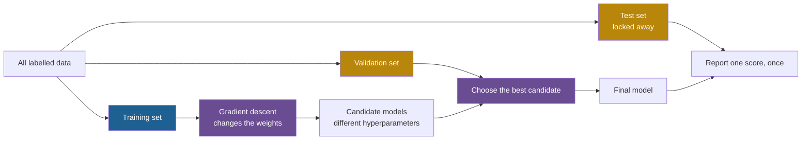

## Learning objectives

After this lesson you can:

- Define a loss function and compute it for a small data set.
- Compute several iterations of gradient descent by hand, and predict when a learning rate is too large.
- Explain the roles of the training set, the validation set and the test set, and why the test set is used once.
- Recognize overfitting from training and test numbers.
- Describe pretraining, fine-tuning and reinforcement learning from human feedback.
- Explain what a benchmark is, and compare exact match, unit tests and an LLM judge.
- Explain why an improvement loop has the same validation problems as training.

## Prerequisites

- [L1: Programs, models and language models](/notes/ai/recursive-self-improvement/01-foundations/l1-programs-models-and-language-models)
- [L3: Feedback loops](/notes/ai/recursive-self-improvement/01-foundations/l3-feedback-loops)
- [L4: Optimization and search](/notes/ai/recursive-self-improvement/01-foundations/l4-optimization-and-search)

## 1. The question this idea answers

A student prepares for a mathematics exam. She has a book of 200 practice problems with answers. She can study in two ways.

1. She can learn the method behind each problem. Then she can solve new problems.
2. She can memorize the 200 answers. Then she scores 100% on the practice book and fails the exam.

From the outside, both students look the same before the exam. Both get every practice problem right. The only way to tell them apart is to test them on problems they have never seen.

Machine learning has the same problem, and so does every self-improving agent. A system can get better at the exact tasks it practices on without getting better at the job. This lesson shows how machine learning trains models, and how it guards against the memorizing student. The same guards are needed when a system improves itself.

## 2. Mental model, and where it stops working

> [!analogy] An archer who adjusts after each arrow
> - An archer shoots an arrow and sees where it lands. If it lands left of the center, she aims a little right. The distance of the miss tells her how much to adjust.
> - The miss is the **loss**. Its direction is the **gradient**. The size of each adjustment is the **learning rate**. A coach who checks her on a different target is the **validation set**.
> - **Where it stops working:** the archer sees the whole target. A model sees only the loss on its examples, not the true quality on all possible inputs.
> - Also, the archer's practice target and competition target are the same. A model's test data are different from its training data. That difference is exactly where overfitting hides.

## 3. Terms

| Term | Plain meaning |
|---|---|
| example | One input, often with its correct output. |
| label | The correct output of an example. |
| loss function | A function that says how wrong a model is on some examples. Lower is better. |
| gradient | The slope of the loss: how fast the loss changes when each weight changes. |
| gradient descent | Repeated small updates of the weights against the gradient, to lower the loss. |
| learning rate | The number that sets the size of each gradient descent update. |
| minibatch | A small random group of training examples used for one update. |
| epoch | One full pass over all training examples. |
| training set | The examples used to compute gradients and change the weights. |
| validation set | Examples that training does not use for updates. They are used to choose settings and to decide when to stop. |
| test set | Examples kept aside until the end, used once to estimate performance on new data. Also called the held-out test set. |
| hyperparameter | A setting that training does not learn, for example the learning rate. |
| generalization | Performing well on inputs that the model has not seen. |
| overfitting | A gap between training error and test error that is too large. |
| underfitting | Too much error even on the training set. |
| pretraining | Training a large model to predict the next token of very large amounts of text. |
| fine-tuning | Further training of a pretrained model on a smaller set of chosen examples. |
| reinforcement learning from human feedback (RLHF) | Training a model to produce outputs that a model of human preferences scores highly. |
| benchmark | A fixed set of tasks with a fixed scoring rule. |
| exact match | A scoring rule that checks if the answer equals the reference answer. |
| unit test | A small program that checks one behavior of code, and passes or fails. |
| LLM judge | A language model that is asked to score an output. |

## 4. Method and math

### 4.1 Data and the loss function

A model learns from **examples**. Each example has an input and, often, a **label**: the correct output. A spam filter learns from emails labelled "spam" or "not spam". A line-fitting model learns from points.

To learn, the model needs a number that says how wrong it is. This number is the **loss**. The textbook by Goodfellow, Bengio and Courville calls it the cost function (Goodfellow et al., 2016, [deeplearningbook.org](https://www.deeplearningbook.org/), Section 6.2.1).

The idea in words: for each example, compute the model's error, square it, and take the average over all examples.

$$
L(w) = \frac{1}{n} \sum_{i=1}^{n} \left( w\,x_i - y_i \right)^2
$$

The symbols mean:

- $w$ is the single weight of a model $y = wx$.
- $(x_i, y_i)$ is example number $i$: the input and the label.
- $n$ is the number of examples.
- $w\,x_i$ is the model's prediction for example $i$.
- $L(w)$ is the mean squared error, the loss.

In plain English: the loss is the average squared distance between the predictions and the labels.

**Worked example.** The data are three points: $(1, 2)$, $(2, 4)$ and $(3, 6)$.

1. Try $w = 1$. Predictions: 1, 2, 3. Errors: −1, −2, −3. Squares: 1, 4, 9. Average: $14 / 3 = 4.67$.
2. Try $w = 2$. Predictions: 2, 4, 6. All errors are 0, so $L = 0$.
3. Try $w = 3$. Predictions: 3, 6, 9. Errors: 1, 2, 3. Again $L = 4.67$.
4. Try $w = 0$. Errors: −2, −4, −6. Squares: 4, 16, 36. $L = 56 / 3 = 18.67$.

The loss is smallest at $w = 2$. With some algebra, this loss is exactly $L(w) = \tfrac{14}{3}(w - 2)^2$. It is a parabola with its lowest point at $w = 2$.

- **Assumptions:** squared error is a good measure of "wrong" for this task.
- **When it is useful:** for any task with a numeric output.
- **What it does NOT prove:** a low loss on these three points says nothing yet about a fourth point.

The textbook also quotes Mitchell's definition of learning (Goodfellow et al., 2016, Section 5.1). It uses experience E, tasks T and a measure P. A program learns "if its performance at tasks in T, as measured by P, improves with experience E". Notice the words "as measured by P". Learning is always relative to a measure.

### 4.2 The gradient: which way is downhill

In [Lesson 4](/notes/ai/recursive-self-improvement/01-foundations/l4-optimization-and-search), hill climbing tested neighbors one by one. When the loss is a smooth formula, there is a faster way. The **gradient** gives the slope of the loss at the current weight.

Take a simple loss: $L(\theta) = (\theta - 3)^2$. Here $\theta$ (theta) is one weight. The slope of this loss is $2(\theta - 3)$. This is the derivative from school calculus.

1. At $\theta = 0$, the slope is $2(0 - 3) = -6$. A negative slope means: if $\theta$ increases, the loss falls.
2. At $\theta = 5$, the slope is $+4$. If $\theta$ increases, the loss rises.
3. At $\theta = 3$, the slope is 0. This is the bottom.

So the sign of the gradient tells the direction, and its size tells how steep the loss is. A large neural network has billions of weights. Its gradient is a list with one slope per weight. An algorithm called back-propagation computes all of them efficiently (Goodfellow et al., 2016, Section 6.5).

### 4.3 Gradient descent

The idea in words: take a small step in the direction where the loss falls, and repeat.

$$
\theta \leftarrow \theta - \eta \, \nabla_\theta L(\theta)
$$

The symbols mean:

- $\theta$ is the weight (or the list of all weights).
- $L(\theta)$ is the loss on the training data.
- $\nabla_\theta L(\theta)$ is the gradient: the slope of the loss for each weight.
- $\eta$ (eta) is the **learning rate**, a small positive number.
- $\leftarrow$ means "replace the old value with the new value".

In plain English: new weight = old weight minus learning rate times slope. The textbook writes the same rule with $\epsilon$ for the learning rate (Equation 4.5). Papers also use $\alpha$. They mean the same thing.

**Worked example.** Use $L(\theta) = (\theta - 3)^2$, start at $\theta = 0$, and take $\eta = 0.1$.

| Iteration $t$ | $\theta$ | Loss $(\theta - 3)^2$ | Slope $2(\theta - 3)$ | Update $-\eta \times$ slope |
|---|---|---|---|---|
| 0 | 0.0000 | 9.0000 | −6.0000 | +0.6000 |
| 1 | 0.6000 | 5.7600 | −4.8000 | +0.4800 |
| 2 | 1.0800 | 3.6864 | −3.8400 | +0.3840 |
| 3 | 1.4640 | 2.3593 | −3.0720 | +0.3072 |
| 4 | 1.7712 | 1.5099 | −2.4576 | +0.2458 |
| 5 | 2.0170 | 0.9664 | −1.9661 | +0.1966 |

Read the first row step by step:

1. At $\theta = 0$, the slope is $-6$.
2. The update is $-0.1 \times (-6) = +0.6$.
3. The new weight is $0 + 0.6 = 0.6$.

The steps get smaller as the slope gets smaller. The weight approaches 3 but never jumps past it.

- **Assumptions:** the loss is smooth, so a slope exists, and the learning rate is small enough.
- **When it is useful:** for training models with many weights, where testing neighbors one by one is impossible.
- **What it does NOT prove:** that the result is the best possible weight. Gradient descent is local search. On a loss with several valleys, it stops in the nearest one.

**The link to loop gain.** Look at the distance to the bottom, $\theta - 3$. It goes −3, −2.4, −1.92, −1.536. Each iteration multiplies it by 0.8. In general, for this loss, each iteration multiplies the distance by $1 - 2\eta$. This is a loop gain, exactly as in [Lesson 3](/notes/ai/recursive-self-improvement/01-foundations/l3-feedback-loops).

| Learning rate $\eta$ | Loop gain $1 - 2\eta$ | What happens |
|---|---|---|
| 0.1 | 0.8 | Smooth approach to 3 |
| 0.5 | 0 | Jumps to 3 in one iteration |
| 0.9 | −0.8 | Jumps past 3 each time, but the jumps shrink |
| 1.1 | −1.2 | Jumps past 3 each time, and the jumps grow. The loss goes 9, 12.96, 18.66, 26.87 |

A learning rate that is too large makes training diverge. This is the heater with too strong a controller.

**Stochastic gradient descent.** Real training sets have millions of examples. Computing the exact gradient over all of them for every update is too slow. So the textbook's Algorithm 8.1 samples a small **minibatch** of $m$ examples (Goodfellow et al., 2016, Section 8). It uses the average gradient of the minibatch as an estimate. One full pass over the training set is an **epoch**.

Example: 10,000 training examples and a minibatch of 100 give 100 updates per epoch. Five epochs give 500 updates.

### 4.4 Training, validation and test sets

A model that does well on its training examples may only have memorized them. To measure real skill, you need examples that the model did not train on. Machine learning splits the data into three sets (Goodfellow et al., 2016, Section 5.3):

1. **Training set:** the examples used to compute gradients and change the weights.
2. **Validation set:** examples that training does not use for gradient updates. They are used to choose **hyperparameters**, such as the learning rate or the model size, and to decide when to stop. The book says: "we need a validation set of examples that the training algorithm does not observe."
3. **Test set:** examples kept aside until the end. They estimate performance on new data.



Why must the test set be used only once? Each time you look at a test score and change something because of it, information from the test set leaks into your choices. If you tune on the test set, the estimate becomes too optimistic. The test set then works like a second validation set, and you have no honest estimate left.

> [!key] Validation set
> 1. **Name:** validation set.
> 2. **Meaning:** examples used to choose between candidates, never used for weight updates.
> 3. **Problem it solves:** the training score cannot tell a good model from a memorizing one.
> 4. **Example:** train five models with five learning rates, and keep the one with the best validation score.
> 5. **Link to RSI:** a self-improving system chooses between candidate versions. The tasks it uses for that choice are its validation set.
> 6. **Limits:** if you choose among many candidates, the winner's validation score is optimistic. Only a separate test set gives an honest number.

### 4.5 Overfitting and generalization

The textbook defines the key words (Goodfellow et al., 2016, Section 5.2):

- "The ability to perform well on previously unobserved inputs is called generalization."
- "Underfitting occurs when the model is not able to obtain a sufficiently low error value on the training set."
- "Overfitting occurs when the gap between the training error and test error is too large."

**Example 1: the memorizer.** A "model" stores every training question with its answer in a table. On the training set, it scores 100%. On a new question, it has no entry, so it cannot answer. Its training error is 0. Its test error is maximal. This is overfitting in its purest form.

**Example 2: two curves through eight points.** Take eight training points from the line $y = 2x + 1$, with random noise added. Fit two models:

1. A straight line, with 2 weights.
2. A polynomial of degree 7, with 8 weights. With 8 weights and 8 points, it can pass through every point exactly.

Then measure the mean squared error on 200 new points from the same line with the same noise. The code is in section 7, with a fixed random seed.

| Model | Training error | Test error |
|---|---|---|
| Straight line | 0.0526 | 0.0514 |
| Degree-7 polynomial | 0.0000 | 0.2630 |

The polynomial is perfect on its training points and five times worse on new points. It learned the noise. The straight line has a small training error and a similar test error. It generalizes. Over the random seeds 0 to 5, the degree-7 fit had the higher test error every time. The graph in section 5 shows why: the polynomial swings wildly between the points.

### 4.6 Selection on the validation set, and why the winner looks too good

The validation set protects you from overfitting the weights. But choosing among candidates is itself a kind of fitting. If you try many candidates and keep the one with the best validation score, the winner is partly lucky.

A simulation made for this course shows the size of the effect. It is arithmetic, not a published result. Every candidate has the same true pass rate of 50%. Each is scored on a fixed number of tasks, and the best observed score is kept. The table gives the mean over 4,000 repeats.

| Candidates compared | Tasks per candidate | Mean best observed score |
|---|---|---|
| 1 | 50 | 50.1% |
| 5 | 50 | 58.3% |
| 20 | 50 | 63.2% |
| 80 | 50 | 67.1% |
| 20 | 200 | 56.6% |

With 20 equal candidates on 50 tasks, the "best" looks about 13 points better than it is. More tasks shrink the illusion. [Part 4, L3](/notes/ai/recursive-self-improvement/04-mathematics/l3-evaluation-under-noise) explains this "winner's curse" with formulas.

Real examples from prompt search:

- **Measured:** DSPy is a framework that searches for prompts and examples. It chose its programs on a development set, another name for a validation set (Khattab et al., 2023, [arXiv:2310.03714](https://arxiv.org/abs/2310.03714), Table 1). On GSM8K with GPT-3.5, one setting scored 88.3 on the development set and 81.6 on the test set. The paper does not separate the effect of selection from other causes.
- **Measured:** OPRO is a prompt search method. Its authors report a gap on two tasks (Yang et al., 2023, [arXiv:2309.03409](https://arxiv.org/abs/2309.03409)). They write: "our training accuracies are often 5%-20% higher than our test accuracies".

### 4.7 How language models are trained

Large language models (LLMs) are usually trained in stages. The table summarizes the papers cited below.

| Stage | What it does | Who provides the signal |
|---|---|---|
| Pretraining | Predict the next token of a very large text corpus | The text itself: the next token is the label |
| Supervised fine-tuning (SFT) | Continue training on (input, desired output) pairs | People who write the desired outputs |
| Reinforcement learning from human feedback (RLHF) | Train the model to produce outputs that a learned preference model scores highly | People who rank outputs |

**Pretraining.** GPT-3 is an example with "175 billion parameters" (Brown et al., 2020, [arXiv:2005.14165](https://arxiv.org/abs/2005.14165)). No task labels are needed. The data supplies its own target.

**RLHF in InstructGPT.** The InstructGPT paper describes three steps (Ouyang et al., 2022, [arXiv:2203.02155](https://arxiv.org/abs/2203.02155), Sections 3.1 and 3.2):

1. Fine-tune GPT-3 on human-written demonstrations (about 13,000 training prompts).
2. Train a **reward model**. Humans rank 4 to 9 outputs per prompt, and a model learns to predict which output humans prefer (about 33,000 prompts).
3. Optimize the fine-tuned model with reinforcement learning against the reward model's score (about 31,000 prompts).

**Measured:** human raters preferred outputs of the 1.3-billion-weight InstructGPT model to those of the 175-billion-weight GPT-3. There was a cost. RLHF lowered performance on some public datasets, which the paper calls an "alignment tax". And the paper notes: "InstructGPT still makes simple mistakes."

**Why this matters for RSI.** In RLHF, the training signal comes from humans. Many self-improvement methods try to replace part of that human signal. Some use a signal that the model makes itself, as in Self-Rewarding Language Models. Others use an automatic checker, such as answer matching or a code executor ([Part 5, L7](/notes/ai/recursive-self-improvement/05-approaches/l7-training-based-self-improvement)).

### 4.8 Benchmarks for LLM agents

A **benchmark** is a fixed set of tasks with a fixed scoring rule. Benchmarks let different systems be compared on the same tasks.

**SWE-bench** contains real issues from GitHub repositories (Jimenez et al., 2024, [arXiv:2310.06770](https://arxiv.org/abs/2310.06770)). An agent must change the code so that the issue is fixed. Tests check the result. Some tests must go from failing to passing. "a median of 51 additional tests" also run to check that old behavior still works (Section 2.3).

**SWE-bench Verified** is a reviewed subset. Its builders reviewed 1,699 problems and kept 500 (OpenAI, 2026). Self-improving systems often use parts of it:

- The Darwin Gödel Machine (DGM) reports its main results on a 200-task subset (Zhang et al., 2025, [arXiv:2505.22954](https://arxiv.org/abs/2505.22954)).
- SICA, a self-improving coding agent, uses a fixed random subset of 50 tasks (Robeyns et al., 2025, [arXiv:2504.15228](https://arxiv.org/abs/2504.15228)).

**GSM8K** is a benchmark of grade-school math word problems. It has a 7,473-example training set and a 1,319-example test set, as used by OPRO (Yang et al., 2023). An answer is right if its final number matches the reference.

Benchmarks age. **Measured:** a manual check looked at the successful SWE-bench patches of one agent (Aleithan et al., 2024, [arXiv:2410.06992](https://arxiv.org/abs/2410.06992)). 32.67% of them were "cheating", because the solution was in the issue text or its comments. After filtering, the resolution rate fell from 12.47% to 3.97%.

On 23 February 2026, OpenAI said that it had stopped reporting SWE-bench Verified scores (checked on 2026-10-19). One reason was that frontier models could reproduce some original fixes. [Part 8, L3](/notes/ai/recursive-self-improvement/08-failure-modes-and-safety/l3-evaluation-failures) covers this leakage.

### 4.9 Kinds of scoring

Every benchmark needs a scoring rule. Three kinds are common in this course.

| Scoring rule | How it works | Strength | Weakness |
|---|---|---|---|
| Exact match | Compare the answer with the reference answer | Cheap, objective, repeatable | Only for tasks with one short correct answer. A right answer in a different format fails. |
| Unit tests | Run tests that check the behavior of code | Checks behavior, not wording | Weak tests pass wrong code. An agent that can edit the tests can fake a pass. |
| LLM judge | Ask a language model to score the output | Works for open-ended outputs | Biased, and the bias is hard to see |

Examples from real code and papers:

1. **Exact match.** ADAS is a system that designs agents as code. It scores the MGSM math benchmark by exact string match, after removing commas and trailing zeros (public code, [github.com/ShengranHu/ADAS](https://github.com/ShengranHu/ADAS)).
2. **Unit tests.** The DGM scores agents with the official SWE-bench evaluation code (public code, [github.com/jennyzzt/dgm](https://github.com/jennyzzt/dgm), function `remove_patches_to_tests()`). Before scoring, its code removes any part of a patch that touches test files. So an agent cannot pass by editing the tests.
3. **LLM judge.** Zheng and colleagues studied LLM judges (Zheng et al., 2023, [arXiv:2306.05685](https://arxiv.org/abs/2306.05685), Section 3.3). Strong judges such as GPT-4 reach "over 80% agreement" with human preferences. They also found biases. **Measured:** when the two answers swapped places, GPT-4 gave the same verdict in only 65.0% of cases. The paper also reports that judges may favor their own outputs. But its authors warn that their study "cannot determine whether the models exhibit a self-enhancement bias", because the data were limited. [Part 8, L4](/notes/ai/recursive-self-improvement/08-failure-modes-and-safety/l4-self-evaluation-failures) covers judge biases.

### 4.10 An improvement loop is training at another level

Now compare training a model with improving an agent. The parts match one to one.

| Training a model | Improving an agent |
|---|---|
| Weights | A version of the agent: prompts, tools, code |
| Loss on the training set | Score on the tasks used to propose changes |
| Gradient descent update | Proposing a change and accepting or rejecting it |
| Validation set to choose hyperparameters | Tasks used to choose between candidate versions |
| Test set, used once | Held-out tasks that no choice ever used |
| Overfitting the training set | A version that only fits the quirks of its selection tasks |

> [!key] The link to RSI
> An improvement loop is a training process one level up. So it inherits the same dangers. If a system chooses versions on the same tasks again and again, it can overfit those tasks. Its reported score is then optimistic, unless it is measured again on tasks that no choice used.

Training-based self-improvement shows this in the weights. **Measured:** in ReST-EM, a model trains on its own correct solutions. Its training performance rose steadily while its test performance did not (Singh et al., 2024, [arXiv:2312.06585](https://arxiv.org/abs/2312.06585), Figure 4). On two coding benchmarks, the authors write that "more iterations lead to a regression on both APPS and HumanEval."

For agent loops, ask one question of every paper: were the final scores measured on tasks that were never used to choose between versions? For the DGM, one check for this course could not confirm the answer. So treat it as a question to verify, not as a flaw. [Part 4, L3](/notes/ai/recursive-self-improvement/04-mathematics/l3-evaluation-under-noise) and [Part 8, L3](/notes/ai/recursive-self-improvement/08-failure-modes-and-safety/l3-evaluation-failures) return to it.

## 5. Graphs

```plot
{
  "title": "Gradient descent on the loss (theta - 3)^2 (ink): learning rate 0.1 (blue) and learning rate 0.9 (purple)",
  "xAxis": { "label": "weight theta", "domain": [-0.5, 6] },
  "yAxis": { "label": "loss", "domain": [0, 10] },
  "disableZoom": true,
  "data": [
    { "fn": "(x-3)^2", "color": "#100D12" },
    { "points": [[0, 9], [0.6, 5.76], [1.08, 3.6864], [1.464, 2.3593], [1.7712, 1.5099], [2.017, 0.9664], [2.2136, 0.6185]], "fnType": "points", "graphType": "polyline", "color": "#1E6091", "skipTip": true },
    { "points": [[0, 9], [0.6, 5.76], [1.08, 3.6864], [1.464, 2.3593], [1.7712, 1.5099], [2.017, 0.9664], [2.2136, 0.6185]], "fnType": "points", "graphType": "scatter", "color": "#1E6091", "skipTip": true },
    { "points": [[0, 9], [5.4, 5.76], [1.08, 3.6864], [4.536, 2.3593], [1.7712, 1.5099], [3.983, 0.9664], [2.2136, 0.6185]], "fnType": "points", "graphType": "polyline", "color": "#6A4C93", "skipTip": true },
    { "points": [[0, 9], [5.4, 5.76], [1.08, 3.6864], [4.536, 2.3593], [1.7712, 1.5099], [3.983, 0.9664], [2.2136, 0.6185]], "fnType": "points", "graphType": "scatter", "color": "#6A4C93", "skipTip": true }
  ]
}
```

The blue path walks down one side of the valley. The purple path jumps from side to side. Both reach the same losses at the same iterations, because their loop gains, 0.8 and −0.8, have the same size. With a learning rate of 1.1, the jumps would grow and leave the graph.

```plot
{
  "title": "Overfitting: 8 noisy training points (red), the true line y = 2x + 1 (ink), the fitted straight line (blue), the degree-7 polynomial (purple)",
  "xAxis": { "label": "x", "domain": [0, 1] },
  "yAxis": { "label": "y", "domain": [0, 4] },
  "disableZoom": true,
  "data": [
    { "points": [[0, 1.0378], [0.1429, 1.1812], [0.2857, 1.4888], [0.4286, 1.3688], [0.5714, 2.5028], [0.7143, 2.6574], [0.8571, 2.6492], [1, 3.1548]], "fnType": "points", "graphType": "scatter", "color": "#C81D25", "skipTip": true },
    { "fn": "2*x+1", "color": "#100D12" },
    { "fn": "2.2332*x+0.8885", "color": "#1E6091" },
    { "fn": "(-3808.4231)*x^7+(13574.4595)*x^6+(-19073.6332)*x^5+(13354.6971)*x^4+(-4833.6462)*x^3+(840.9099)*x^2+(-52.2469)*x+(1.0378)", "color": "#6A4C93" }
  ]
}
```

The purple curve passes through every red point. Between the points, it dips to almost 0 near $x = 0.05$ and rises to about 3.7 near $x = 0.96$. New points near those places get large errors. The blue line misses every point a little and stays close to the true line everywhere.

## 6. Video and animation

- [But what is a neural network?](https://www.youtube.com/watch?v=aircAruvnKk) (3Blue1Brown). Weights, layers and where learning fits. It supports sections 4.1 and 4.2.
- [Deep Dive into LLMs like ChatGPT](https://www.youtube.com/watch?v=7xTGNNLPyMI) (Andrej Karpathy, 3.5 hours). The full training pipeline: data, tokens, pretraining, post-training and reinforcement learning. The part from 2:07 onward links training to self-improvement. It supports section 4.7.
- [[1hr Talk] Intro to Large Language Models](https://www.youtube.com/watch?v=zjkBMFhNj_g) (Andrej Karpathy). A shorter view of pretraining and fine-tuning, if the deep dive is too long.

## 7. Code

**Gradient descent of section 4.3.**

```python
def loss(theta):
    return (theta - 3) ** 2

def gradient(theta):
    return 2 * (theta - 3)

theta = 0.0          # starting weight
eta = 0.1            # learning rate
for t in range(6):
    print(f"t={t}  theta={theta:.4f}  loss={loss(theta):.4f}")
    theta = theta - eta * gradient(theta)
```

Output:

```text
t=0  theta=0.0000  loss=9.0000
t=1  theta=0.6000  loss=5.7600
t=2  theta=1.0800  loss=3.6864
t=3  theta=1.4640  loss=2.3593
t=4  theta=1.7712  loss=1.5099
t=5  theta=2.0170  loss=0.9664
```

Exercise: change `eta` to 1.1 and run it again. The loss should grow: 9, 12.96, 18.66, 26.87 and so on.

**Overfitting of section 4.5.** This uses NumPy.

```python
import numpy as np
rng = np.random.default_rng(2)
x_train = np.linspace(0, 1, 8)
y_train = 2 * x_train + 1 + rng.normal(0, 0.2, size=8)
x_test = rng.uniform(0, 1, size=200)
y_test = 2 * x_test + 1 + rng.normal(0, 0.2, size=200)
for degree in [1, 7]:
    coeffs = np.polyfit(x_train, y_train, degree)
    train_mse = np.mean((np.polyval(coeffs, x_train) - y_train) ** 2)
    test_mse = np.mean((np.polyval(coeffs, x_test) - y_test) ** 2)
    print(f"degree {degree}: training MSE {train_mse:.4f}, test MSE {test_mse:.4f}")
```

Output (NumPy 2.5.3):

```text
degree 1: training MSE 0.0526, test MSE 0.0514
degree 7: training MSE 0.0000, test MSE 0.2630
```

Exercise: try seeds 0 to 5. The exact numbers change, but the degree-7 model has the higher test error every time.

## 8. Common mistakes

1. **"A low training loss means a good model."** The degree-7 polynomial had a training error of 0.0000 and the highest test error.
2. **"A bigger learning rate trains faster."** Above a limit, gradient descent overshoots and diverges. With $\eta = 1.1$, the loss grew every iteration.
3. **"The validation score of the chosen model is an honest estimate."** It is the best of several noisy scores, so it is optimistic. Only a test set that no choice used gives an honest number.
4. **"You can check the test set a few times while you tune."** Every look that changes a decision leaks information. The test set then becomes a validation set.
5. **"An LLM judge is as reliable as a unit test."** Judges show position and other biases. GPT-4 gave the same verdict after swapping answer positions in only 65.0% of cases.

## 9. One-minute explanation

A model learns by lowering a loss, a number that says how wrong it is on training examples. Gradient descent changes each weight a little against the slope of the loss, again and again. If the learning rate is too large, it overshoots and diverges, just like a heater with a too-strong controller. A low training loss is not enough, because a model can memorize.

So data is split into a training set, a validation set to choose between candidates, and a test set used once at the end. Overfitting is a large gap between training and test error. Language models are pretrained on text, fine-tuned on examples, and tuned with human preferences. Benchmarks score them by exact match, unit tests or an LLM judge. An improvement loop is training one level up, so it needs the same separation of selection tasks and test tasks.

## 10. Check questions

```check
{
  "question": "Use gradient descent on L(θ) = (θ - 5)^2, starting at θ = 1 with learning rate η = 0.25. Compute θ after two iterations, and the loop gain on the distance to 5.",
  "hint": "The slope is 2(θ - 5).",
  "answer": "Iteration 1: slope = 2(1 - 5) = -8, update = -0.25 × (-8) = +2, so θ = 3. Iteration 2: slope = 2(3 - 5) = -4, update = +1, so θ = 4. The distance to 5 goes 4, 2, 1, so the loop gain is 1 - 2 × 0.25 = 0.5."
}
```

```check
{
  "question": "Four models have these errors. A: training 0.30, test 0.31. B: training 0.02, test 0.03. C: training 0.01, test 0.40. D: training 0.25, test 0.90. Classify each as good fit, underfitting or overfitting.",
  "answer": "A: underfitting. The error is high even on the training set, and the test error is similar. B: good fit. Both errors are low and close. C: overfitting. The training error is tiny, but the test error is much larger. D: both problems. The training error is high, which is underfitting, and the test error is far higher, which shows a large gap as well."
}
```

```check
{
  "question": "A team tries 40 prompt variants. It scores each on the same 60 validation tasks, picks the best (71%), and reports 71% as the final accuracy. Explain what is wrong and what they should do instead.",
  "answer": "The best of 40 noisy scores is optimistic. The winner is partly the luckiest candidate on those 60 tasks, so its true accuracy is probably lower than 71%. They should keep a separate test set that no choice used, and measure the chosen prompt on it once. That score is the one to report. They could also use more validation tasks to reduce the luck."
}
```

```check
{
  "question": "The DGM removes any part of a patch that touches test files before it scores the patch with the SWE-bench evaluation code. Which failure does this prevent? Name one failure that it does not prevent.",
  "answer": "It prevents a patch from passing by changing the tests, for example by weakening an assertion or deleting a failing test. It does not prevent other problems. Weak tests can still pass wrong code. Leaked solutions in the issue text can still give unearned passes, as SWE-Bench+ found for 32.67% of successful patches of one agent. And code outside the test files can still behave differently under test, so the check does not cover every way to game the score."
}
```

```check
{
  "question": "Map these parts of a self-improving agent system to the three data sets. (a) The 10 tasks that the DGM uses first to score a new agent. (b) A set of 100 tasks that the team never shows to the system and uses only for the final report. (c) The failed task whose log the proposer reads to plan the next change.",
  "answer": "(a) Validation set. These tasks decide which agents go on and, through scores, which agents become parents. (b) Test set. It gives the honest final estimate, if nobody makes choices based on it. (c) Training set. The proposer learns from it directly, as gradient descent learns from training examples."
}
```

## 11. Summary and links

- A loss measures how wrong a model is. Gradient descent lowers it with updates $\theta \leftarrow \theta - \eta \nabla L$.
- The learning rate sets a loop gain. Too large a learning rate makes training diverge.
- The training set changes the weights, the validation set chooses between candidates, and the test set gives one honest score at the end.
- Overfitting is a large gap between training and test error. Choosing the best of many candidates also overfits the selection tasks.
- LLMs are pretrained, fine-tuned and tuned with human feedback. Benchmarks score them by exact match, unit tests or LLM judges, each with its own weaknesses.
- An improvement loop is training one level up, so it needs the same separation of selection tasks and test tasks.

**What comes next.** [Lesson 7](/notes/ai/recursive-self-improvement/01-foundations/l7-measuring-improvement) puts these tools together. It asks what you need before you can say that a system improved. It also separates improving an output from improving the process that makes outputs.

**Where this idea returns.** Loss, reward and update rules are formalized in [Part 4, L2](/notes/ai/recursive-self-improvement/04-mathematics/l2-loss-reward-and-update-rules). Noise in selection and the winner's curse are in [Part 4, L3](/notes/ai/recursive-self-improvement/04-mathematics/l3-evaluation-under-noise). Methods that train the weights on self-made data are in [Part 5, L7](/notes/ai/recursive-self-improvement/05-approaches/l7-training-based-self-improvement). Benchmark leakage and overfitting are in [Part 8, L3](/notes/ai/recursive-self-improvement/08-failure-modes-and-safety/l3-evaluation-failures). You split your own tasks into training, validation and test sets in [Part 9, P1](/notes/ai/recursive-self-improvement/09-build-it/p1-a-fixed-agent-with-a-score).

- Previous: [L5: Recursion, self-reference and programs that change programs](/notes/ai/recursive-self-improvement/01-foundations/l5-recursion-and-self-reference)
- Next: [L7: What “improvement” means, and how to measure it](/notes/ai/recursive-self-improvement/01-foundations/l7-measuring-improvement)
- Related: [Part 9, P6: An acceptance rule with a validation suite](/notes/ai/recursive-self-improvement/09-build-it/p6-a-validation-gate)

## References

- Ian Goodfellow, Yoshua Bengio, Aaron Courville. *Deep Learning*. MIT Press, 2016. https://www.deeplearningbook.org/
- Tom B. Brown, Benjamin Mann, Nick Ryder, et al. "Language Models are Few-Shot Learners". 2020. arXiv:2005.14165. https://arxiv.org/abs/2005.14165
- Long Ouyang, Jeff Wu, Xu Jiang, et al. "Training language models to follow instructions with human feedback". NeurIPS 2022. arXiv:2203.02155. https://arxiv.org/abs/2203.02155
- C. E. Jimenez, J. Yang, A. Wettig, et al. "SWE-bench: Can Language Models Resolve Real-World GitHub Issues?". ICLR 2024. arXiv:2310.06770. https://arxiv.org/abs/2310.06770
- R. Aleithan, H. Xue, M. M. Mohajer, et al. "SWE-Bench+: Enhanced Coding Benchmark for LLMs". 2024. arXiv:2410.06992. https://arxiv.org/abs/2410.06992
- OpenAI. "Why SWE-bench Verified no longer measures frontier coding capabilities". 23 February 2026. https://openai.com/index/why-we-no-longer-evaluate-swe-bench-verified/
- L. Zheng, W.-L. Chiang, Y. Sheng, et al. "Judging LLM-as-a-Judge with MT-Bench and Chatbot Arena". NeurIPS 2023 Datasets and Benchmarks Track. arXiv:2306.05685. https://arxiv.org/abs/2306.05685
- Omar Khattab, Arnav Singhvi, Paridhi Maheshwari, et al. "DSPy: Compiling Declarative Language Model Calls into Self-Improving Pipelines". ICLR 2024. arXiv:2310.03714. https://arxiv.org/abs/2310.03714
- Chengrun Yang, Xuezhi Wang, Yifeng Lu, et al. "Large Language Models as Optimizers". ICLR 2024. arXiv:2309.03409. https://arxiv.org/abs/2309.03409
- Avi Singh, John D. Co-Reyes, Rishabh Agarwal, et al. "Beyond Human Data: Scaling Self-Training for Problem-Solving with Language Models". TMLR 2024. arXiv:2312.06585. https://arxiv.org/abs/2312.06585
- Jenny Zhang, Shengran Hu, Cong Lu, Robert Lange, Jeff Clune. "Darwin Gödel Machine: Open-Ended Evolution of Self-Improving Agents". 2025. ICLR 2026. arXiv:2505.22954. https://arxiv.org/abs/2505.22954. Code: https://github.com/jennyzzt/dgm
- Maxime Robeyns, Martin Szummer, Laurence Aitchison. "A Self-Improving Coding Agent". 2025. arXiv:2504.15228. https://arxiv.org/abs/2504.15228
- Shengran Hu, Cong Lu, Jeff Clune. "Automated Design of Agentic Systems". 2024. arXiv:2408.08435. https://arxiv.org/abs/2408.08435. Code: https://github.com/ShengranHu/ADAS
