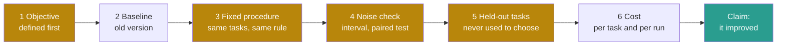
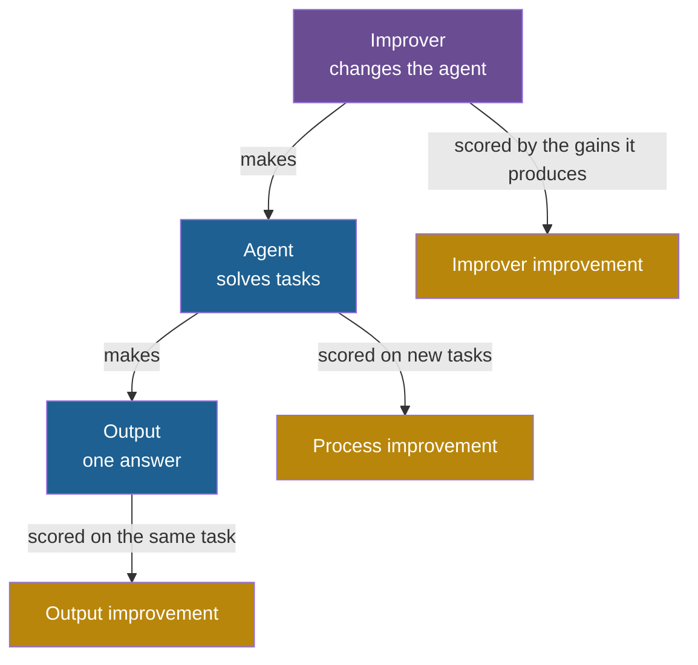

## Learning objectives

After this lesson you can:

- List the six things you need before you can say that a system improved.
- Compute a pass rate, pass@k, cost per task and a weighted utility of several objectives.
- Report a change both as an absolute change and as a relative change.
- Compute a standard error and a 95% interval for a pass rate, and compare two versions with a paired comparison.
- Explain regression checks, held-out tasks and transfer.
- Tell an improvement of an output from an improvement of the process that produces outputs, and from an improvement of the improver.

## Prerequisites

- [L3: Feedback loops](/notes/ai/recursive-self-improvement/01-foundations/l3-feedback-loops)
- [L4: Optimization and search](/notes/ai/recursive-self-improvement/01-foundations/l4-optimization-and-search)
- [L6: How machine learning systems are trained and evaluated](/notes/ai/recursive-self-improvement/01-foundations/l6-how-ml-systems-are-trained-and-evaluated)

## 1. The question this idea answers

A runner says: "I got faster. Last month I ran 5 km in 20 minutes. Today I ran it in 19 minutes." Did she get faster?

Before you agree, you want to know some things. Was it the same course, or a flatter one? Was there wind? Was today one lucky run, or her usual time? Did she take a shortcut? And does "faster on 5 km" mean "fitter", or only "better at this one course"?

Now the same question for an agent. Version A of a coding agent solved 20 of 100 tasks. Version B, after a self-improvement iteration, solved 30 of the same 100 tasks. Is B better than A?

The honest answer is: "Maybe. It depends." This lesson makes "it depends" precise. It gives six requirements and the arithmetic of noise. It also gives one distinction that runs through the whole course. Improving an **output** is different from improving the **process that makes outputs**.

## 2. Mental model, and where it stops working

> [!analogy] A bathroom scale and a diet
> - You want to know if a diet works. You need a goal (lower body fat) and a starting weight. You need the same scale at the same time of day, and enough days to see past daily ups and downs.
> - You also need the right question. A lower number on the scale is not the same as better health. Water loss lowers the number too.
> - **Where it stops working:** a person on a diet cannot rebuild the scale. A self-improving system sometimes can change its own measurement.
> - The Darwin Gödel Machine (DGM) is a system in which a coding agent edits its own code. Its designers added a detector for faked tool use, that is, text in which the model claims that a tool ran when it did not. The DGM once removed the markers that this detector depended on, and the detector then reported false success. So in this course, the measurement itself is part of what you must protect.

## 3. Terms

| Term | Plain meaning |
|---|---|
| objective | The quantity that an improvement process tries to make larger (or smaller). |
| baseline | The version that you compare against, measured in the same way. |
| measurement procedure | The exact tasks, scoring rule, settings and number of runs used to compute a score. |
| pass rate (accuracy) | The fraction of tasks that a version solves. |
| pass@k | The chance that at least one of $k$ attempts at a task passes. |
| cost per task | The money spent per task, for example on model calls. |
| time per task | The wall-clock time per task. |
| utility | One number that combines several objectives with weights. |
| absolute change | The difference between two scores, in percentage points. |
| relative change | The change divided by the old score, as a ratio or a percent. |
| sampling noise | Variation in a score that comes from which tasks happened to be in the sample. |
| standard error (SE) | How much a score would move if you drew a different random sample of tasks. |
| 95% interval | A range around a score, usually the score ± 1.96 SE. |
| paired comparison | Comparing two versions task by task on the same tasks. |
| regression | A task that the old version solved and the new version fails. |
| held-out tasks | Tasks that no decision during improvement ever used. |
| in-distribution | New tasks of the same kind as the tasks used during improvement. |
| transfer | Performance on tasks of a different kind, or with a different model. |
| output improvement | A better answer to one task. The system is unchanged. |
| process improvement | A changed system that produces better answers on future tasks. |
| proxy | A measurable quantity that we hope tracks what we really want. |

## 4. Method and math

### 4.1 The six requirements

You can say "the system improved" only when you have all six:

1. **A defined objective.** You must say what "better" means, before you measure. "Solves more tasks"? "Solves them cheaper"? Both?
2. **A baseline.** You need the old version's score, measured the same way.
3. **A fixed measurement procedure.** Same tasks, same scoring rule, same settings, same number of runs, for both versions.
4. **A comparison that accounts for noise.** A difference smaller than the noise is not evidence.
5. **Held-out tasks.** The final score must come from tasks that no choice during improvement used.
6. **Cost.** A gain that costs ten times more per task may not be an improvement for your purpose.



### 4.2 The worked case: 20 out of 100, then 30 out of 100

Apply the six requirements to the agent of section 1.

1. **Objective.** Suppose the team said in advance: "the number of solved tasks on this benchmark". Good. If they chose the objective after they saw the results, the claim is weaker.
2. **Baseline.** Version A scored 20/100. Was A measured on the same day, with the same model version? If the model behind the agent changed, the comparison is unfair.
3. **Procedure.** Both versions ran on the same 100 tasks. That is required for the paired comparison of section 4.7.
4. **Noise.** Is 10 points larger than chance? Section 4.6 shows that each score has a 95% interval of about ±8 to ±9 points. Section 4.7 shows that a paired comparison can still give clear evidence.
5. **Held-out.** Were these 100 tasks used to choose B among many candidates? If yes, B's score is optimistic. Section 4.9 explains why.
6. **Cost.** If B makes five attempts per task where A made one, B costs about five times more.

So the answer depends on facts that the two numbers "20" and "30" do not show.

### 4.3 Measures of success

**Pass rate.** The simplest measure is the fraction of solved tasks: $20/100 = 0.20$. People also call it accuracy. On SWE-bench, a task counts as solved if the agent's patch passes the task's tests.

**pass@k.** Sometimes an agent may try a task several times. pass@k is the chance that at least one of $k$ attempts passes.

The idea in words: if every attempt fails with the same chance, independently, then all $k$ attempts fail with that chance to the power $k$.

$$
\text{pass@}k = 1 - (1 - p)^k
$$

The symbols mean:

- $p$ is the chance that one attempt passes.
- $k$ is the number of attempts.
- $(1 - p)^k$ is the chance that all $k$ attempts fail.

In plain English: pass@k is one minus the chance that every attempt fails.

**Worked example** with $p = 0.2$:

| $k$ | Computation | pass@k |
|---|---|---|
| 1 | $1 - 0.8$ | 0.200 |
| 2 | $1 - 0.8^2 = 1 - 0.64$ | 0.360 |
| 5 | $1 - 0.8^5 = 1 - 0.328$ | 0.672 |
| 10 | $1 - 0.8^{10} = 1 - 0.107$ | 0.893 |

- **Assumptions:** the attempts are independent, and each has the same chance $p$.
- **When it is useful:** to know how much repeated attempts can help, if something can tell which attempt passed.
- **What it does NOT prove:** that an agent can use pass@k in practice. It needs a way to know which attempt is right. If the agent may not see the hidden tests, it must guess. Polyglot is a coding benchmark in several programming languages. The DGM reports its Polyglot results as pass@1 (Zhang et al., 2025, [arXiv:2505.22954](https://arxiv.org/abs/2505.22954), Section 4). There, "the agent never sees ground-truth test results". Attempts on the same task are also often not independent: a task that is hard once is hard every time.

**Cost per task and time per task.** Two agents with the same pass rate can differ a lot in cost. **Measured:** SICA is a self-improving coding agent. Its starting agent cost USD 1.91 and took 130.2 seconds per problem. At iteration 14, it cost USD 2.20 and took 117.1 seconds per problem (Robeyns et al., 2025, [arXiv:2504.15228](https://arxiv.org/abs/2504.15228), Table 1).

### 4.4 Several objectives at once

When you care about score, cost and time together, you must combine them. One way is a weighted sum, a **utility**. SICA uses this utility (Robeyns et al., 2025, Section 3, Equations 1 and 2):

$$
U = 0.5\, p_{\text{score}} + 0.25 \left(1 - \min\!\left(1, \frac{p_{\text{cost}}}{10}\right)\right) + 0.25 \left(1 - \min\!\left(1, \frac{p_{\text{time}}}{300}\right)\right)
$$

The symbols mean:

- $p_{\text{score}}$ is the benchmark performance, a number from 0 to 1.
- $p_{\text{cost}}$ is the cost per problem in USD. The cost term reaches its worst value at USD 10.
- $p_{\text{time}}$ is the time per problem in seconds. The time term reaches its worst value at 300 seconds, the timeout.
- $\min(1, \cdot)$ caps a term at 1, so a cost above USD 10 counts the same as USD 10.
- The weights 0.5, 0.25 and 0.25 say how much each part counts.

If the agent timed out, SICA multiplies $U$ by $1 - 0.5 = 0.5$. In plain English: half of the utility is the score, a quarter rewards low cost, and a quarter rewards speed.

**Worked example.** This illustration uses only the SWE-bench column of SICA's Table 1 as $p_{\text{score}}$. The real SICA utility uses the scores of all its benchmarks, so these are not SICA's own utility values.

| Iteration | Score | Cost (USD) | Time (s) | Score term | Cost term | Time term | $U$ |
|---|---|---|---|---|---|---|---|
| 0 | 0.17 | 1.91 | 130.2 | 0.085 | 0.202 | 0.142 | 0.429 |
| 14 | 0.53 | 2.20 | 117.1 | 0.265 | 0.195 | 0.152 | 0.612 |
| 15 | 0.51 | 1.70 | 114.5 | 0.255 | 0.208 | 0.155 | 0.617 |

Work through iteration 14:

1. Score term: $0.5 \times 0.53 = 0.265$.
2. Cost term: $2.20 / 10 = 0.22$, so $0.25 \times (1 - 0.22) = 0.195$.
3. Time term: $117.1 / 300 = 0.390$, so $0.25 \times (1 - 0.390) = 0.152$.
4. Sum: $0.265 + 0.195 + 0.152 = 0.612$.

Iteration 15 has a lower solve rate than iteration 14 but a higher utility, because it is cheaper and faster. Which one is "better"? It depends on the weights. The weights are a choice, and the choice decides what "improvement" means.

A timeout halves everything. A version with score 0.53, cost USD 2.20 and time 300 seconds that timed out gets $0.5 \times (0.265 + 0.195 + 0) = 0.230$.

- **Assumptions:** the parts can be traded against each other at fixed rates.
- **When it is useful:** when an improvement loop needs one number to compare candidates.
- **What it does NOT prove:** that the weights are right. A different team with other weights would rank the versions differently.

### 4.5 Absolute change and relative change

The same change can be described in two ways. Both are correct. They give very different impressions.

1. **Absolute change:** new score minus old score, in **percentage points**. From 20.0% to 50.0% is +30.0 points.
2. **Relative change:** the change divided by the old score. From 20.0% to 50.0% is $30 / 20 = 1.5$, so +150%, or "2.5 times".

In the table, STOP is a system whose improver improves its own code, and 3-SAT and Modified Quadratic Assignment are small algorithm tasks. AFlow is a method that searches for agent workflows.

| Case (source) | Old | New | Absolute change | Relative change |
|---|---|---|---|---|
| DGM on a 200-task SWE-bench subset (Zhang et al., 2025) | 20.0% | 50.0% | +30.0 points | ×2.5 (+150%) |
| SICA on 50 SWE-bench Verified tasks (Robeyns et al., 2025) | 17% | 53% | +36 points | ×3.1 |
| STOP improver on 3-SAT (Zelikman et al., 2023, Table 1) | 21.2% | 75.1% | +53.9 points | ×3.5 |
| STOP improver on Modified Quadratic Assignment | 20.6% | 22.1% | +1.5 points | +7.3% |
| AFlow against the best baselines, average over six benchmarks (Zhang et al., 2024) | 76.0 | 80.3 | +4.3 points | +5.7% |

AFlow's abstract reports "a 5.7% average improvement". That is the relative number. The absolute gain is 4.3 points (Zhang et al., 2024, AFlow, [arXiv:2410.10762](https://arxiv.org/abs/2410.10762)).

> [!trap] Always give both numbers, and the starting point
> "+150%" sounds huge. "+30 points from a low start" is the same fact. A relative change from a very low base can look dramatic. Report the old score, the new score, and both changes.

### 4.6 Sampling noise and the standard error

A benchmark of 100 tasks is a **sample**. A different sample of 100 similar tasks would give a slightly different score. This variation is **sampling noise**. The **standard error (SE)** measures its size.

The idea in words: a pass rate measured on more tasks moves less from sample to sample. A pass rate near 50% moves the most.

$$
\mathrm{SE} = \sqrt{\frac{p\,(1 - p)}{n}} \qquad\qquad 95\%\ \text{interval} \approx p \pm 1.96\,\mathrm{SE}
$$

The symbols mean:

- $p$ is the measured pass rate, a number from 0 to 1.
- $n$ is the number of tasks.
- $\mathrm{SE}$ is the standard error of $p$.
- 1.96 is the multiplier for an approximate 95% interval.

These are Equations 2 and 3 of Miller's guide to error bars for evaluations (Miller, 2024, [arXiv:2411.00640](https://arxiv.org/abs/2411.00640)). In plain English: repeat the benchmark many times with new tasks of the same kind. Then about 95% of such intervals contain the true pass rate.

**Worked example.**

1. Version A: $p = 0.2$, $n = 100$. $\mathrm{SE} = \sqrt{0.2 \times 0.8 / 100} = \sqrt{0.0016} = 0.040$. The interval is $0.20 \pm 0.078$, from 12.2% to 27.8%.
2. Version B: $p = 0.3$, $n = 100$. $\mathrm{SE} = \sqrt{0.3 \times 0.7 / 100} = 0.046$. The interval is $0.30 \pm 0.090$, from 21.0% to 39.0%.

The two intervals overlap. From these two numbers alone, you cannot be sure that B is better.

More real numbers, computed with the same formula:

| Setting | $p$ | $n$ | SE (points) | 95% interval (points) |
|---|---|---|---|---|
| SICA's best iteration, 50 SWE-bench Verified tasks | 0.53 | 50 | 7.1 | ±13.8 |
| DGM's best agent, 200-task subset | 0.50 | 200 | 3.5 | ±6.9 |
| A full benchmark of 500 tasks | 0.50 | 500 | 2.2 | ±4.4 |

To shrink the interval to ±3 points at $p = 0.5$, you need about 1,067 tasks (our arithmetic: $1.96^2 \times 0.25 / 0.03^2$).

- **Assumptions:** the tasks are independent random draws from a larger set of similar tasks.
- **When it is useful:** for every score that you report or compare.
- **What it does NOT prove:** that the benchmark measures the right thing. A tight interval around the wrong quantity is still wrong.

Two warnings from Miller's paper. First, for scores that can be fractions, this formula "will tend to be conservative (too wide)". Second, tasks often come in clusters, for example several questions about one text. Then the naive SE is too small. **Measured:** on the DROP benchmark, the clustered SE was 1.34 against a naive 0.44, a ratio of 3.05 (Miller, 2024, Table 4).

### 4.7 Comparing two versions: the paired comparison

Section 4.6 compared two separate intervals. That ignores useful information. Both versions ran on the **same** tasks. Some tasks are easy for both, and some are hard for both. A **paired comparison** looks at each task and asks only: did the result change?

Suppose the per-task results of A and B are:

|  | B solves | B fails | Total |
|---|---|---|---|
| **A solves** | 18 | 2 | 20 |
| **A fails** | 12 | 68 | 80 |
| **Total** | 30 | 70 | 100 |

For each task, compute $d = (\text{B's result}) - (\text{A's result})$, where a solve is 1 and a fail is 0.

1. 12 tasks have $d = +1$: B solves them and A did not.
2. 2 tasks have $d = -1$: A solved them and B does not.
3. 86 tasks have $d = 0$.

The idea in words: compute the standard error of the per-task differences, not of the two scores separately.

$$
\bar{d} = \frac{1}{n}\sum_{i=1}^{n} d_i \qquad \mathrm{SE}(\bar{d}) = \sqrt{\frac{\mathrm{Var}(d)}{n}}
$$

The symbols mean:

- $d_i$ is the change on task $i$: +1, 0 or −1.
- $\bar{d}$ is the mean change, the paired gain.
- $\mathrm{Var}(d)$ is the variance of the $d_i$: the average of $(d_i - \bar{d})^2$.
- $n$ is the number of tasks.

Compute it:

1. $\bar{d} = (12 - 2) / 100 = 0.10$.
2. $\mathrm{Var}(d) = 14/100 - 0.10^2 = 0.14 - 0.01 = 0.13$. Here 14/100 is the average of $d_i^2$, because 14 tasks have $d_i^2 = 1$.
3. $\mathrm{SE}(\bar{d}) = \sqrt{0.13 / 100} = 0.036$.
4. The gain is $0.10 / 0.036 = 2.77$ standard errors. The 95% interval for the gain is $0.10 \pm 0.071$, from +2.9 to +17.1 points.

Now compare with the unpaired method. It treats A and B as unrelated samples. Its SE for the difference is $\sqrt{0.040^2 + 0.046^2} = 0.061$. The gain is then only $0.10 / 0.061 = 1.64$ standard errors. Its interval, from −1.9 to +21.9 points, includes zero.

The same data give clear evidence with the paired method and unclear evidence without it. Miller's paper writes the general form: $\mathrm{Var}(A - B) = (\mathrm{Var}(s_A) + \mathrm{Var}(s_B) - 2\,\mathrm{Cov}(s_A, s_B)) / n$ (Section 4.2). The covariance term removes the shared difficulty of the tasks. Miller's summary reports that question-score correlations between frontier models are often 0.3 to 0.7. So pairing is a "free" reduction of noise.

- **Assumptions:** both versions ran on exactly the same tasks, and the tasks are independent.
- **When it is useful:** for every parent-and-child comparison in an improvement loop.
- **What it does NOT prove:** that the gain holds on other kinds of tasks. It only says that the gain on this kind of task is probably not chance.

> [!key] Standard error
> 1. **Name:** standard error (SE).
> 2. **Meaning:** how much a score would move if you measured it on a different random sample of tasks.
> 3. **Problem it solves:** without it, you cannot tell a real gain from luck.
> 4. **Example:** 20/100 has SE 0.040, so the 95% interval is about 12% to 28%.
> 5. **Link to RSI:** an improvement loop accepts or rejects changes by comparing scores. If the gain is smaller than the noise, the loop accepts changes that did nothing.
> 6. **Limits:** the formula assumes independent tasks. Clustered tasks need a larger SE. And the SE says nothing about whether the benchmark measures the right thing.

### 4.8 Regression checks

Look again at the table of section 4.7. Two tasks that A solved, B now fails. These are **regressions**. The average went up, but something that worked is now broken.

A regression check asks a direct question: does the new version still solve what the old version solved? Benchmarks build this in (Jimenez et al., 2024, [arXiv:2310.06770](https://arxiv.org/abs/2310.06770), Section 2.3). SWE-bench runs "a median of 51 additional tests" per task to check that old behavior still works.

Self-improving systems often have regressions. **Measured:** Gödel Agent is an agent that rewrites its own code. Its authors ran it 100 times on the MGSM benchmark (Yin et al., 2025, [arXiv:2410.04444](https://arxiv.org/abs/2410.04444), Section 6.2). 92% of the runs had at least one temporary drop in performance. 14% ended worse than the starting policy.

**Measured:** SICA's score on its 50 SWE-bench tasks fell from 0.44 to 0.27 at iteration 13 (Robeyns et al., 2025, Table 1). It then rose to 0.53.

A practical rule follows. Keep a set of solved tasks as a **regression set**. Reject a change that breaks too many of them, even if the average rises ([Part 9, P7](/notes/ai/recursive-self-improvement/09-build-it/p7-regression-tests-and-an-archive)).

### 4.9 Held-out tasks, in-distribution and transfer

[Lesson 6](/notes/ai/recursive-self-improvement/01-foundations/l6-how-ml-systems-are-trained-and-evaluated) showed that the best of many candidates looks too good on the tasks used to choose it. So the final claim needs **held-out tasks**: tasks that no decision during improvement used.

Two cases of held-out tasks differ:

1. **In-distribution:** new tasks of the same kind. Example: new SWE-bench issues that the loop never saw.
2. **Transfer:** tasks of a different kind, or a different model behind the agent.

**Measured** transfer results from the DGM (Zhang et al., 2025):

| What changed | Before | After |
|---|---|---|
| Same agent design, model o3-mini, SWE-bench | 23.0% (base agent) | 33.0% (DGM-found agent) |
| Same agent design, model Claude 3.7 Sonnet, SWE-bench | 19.0% | 59.5% |
| Agent evolved on SWE-bench, scored on Polyglot | 14.2% (initial) | 28.9% |
| Agent evolved on Polyglot, scored on SWE-bench | 20.0% (initial) | 24.5% |

STOP shows transfer of an improved **improver**. Its improver was improved only on one training task, learning parity with noise. Then it was applied, without more training, to five other tasks. **Measured:** on 3-SAT, the seed improver (the starting improver that the authors wrote) reached 21.2% and the improved improver 75.1%. On Max-Cut, 58.7% and 74.2% (Zelikman et al., 2023, [arXiv:2310.02304](https://arxiv.org/abs/2310.02304), Table 1).

> [!trap] Held-out means never used for any choice
> Gödel Agent's public code shows how easily this breaks. Once the validation accuracy reaches 0.94, the code also runs the 800-question test set. It then puts the test accuracy into the agent's own context (code read from [github.com/Arvid-pku/Godel_Agent](https://github.com/Arvid-pku/Godel_Agent), file `task_mgsm.py`). From then on, the agent can steer by the test score, and the test set is no longer fully held out. For the DGM, one check for this course could not confirm if the final scores used only tasks that no choice used. Treat such points as questions to verify in every paper.

### 4.10 Cost

An improvement claim should state its cost in two ways.

1. **Cost per task of the new version.** A version that tries five times may cost five times more to run.
2. **Cost of the improvement run itself.** The DGM authors report that one run on SWE-bench takes about 2 weeks (Zhang et al., 2025, Section 6). They also report a cost of about USD 22,000 (v1 appendix). One check for this course could not confirm the dollar figure. SICA's run of 15 iterations cost about USD 7,000 (Robeyns et al., 2025).

Cost also changes the meaning of a score. SICA's authors note that much of the gain was in speed and cost features, which SWE-bench does not reward (Robeyns et al., 2025, limitations). So a benchmark that counts only solved tasks can hide a real improvement, or hide a real cost.

### 4.11 The core distinction: improving an output versus improving the process

Here is the most important distinction of the whole course. Take a student who writes an essay.

1. **Output improvement.** She rewrites this essay after feedback. This essay gets better. Next week's essay starts from her same old skills.
2. **Process improvement.** She learns a better way to write essays. Next week's essay, on a new topic, is better too.
3. **Improver improvement.** She learns a better way to **learn** writing. Each later lesson improves her writing more than lessons did before.

The same three levels exist for agents.

| Level | What changes | What persists after the task | How to measure it | Example |
|---|---|---|---|---|
| Output | One answer to one task | Nothing about the system | Score of the new answer on the same task | Self-Refine, best-of-n sampling |
| Process | The agent: prompts, memory, tools, code or weights | The changed agent | Score on new, held-out tasks | Reflexion's memory, DGM's code changes |
| Improver | The procedure that changes the agent | The changed improver | Gains that the improver produces on new tasks | STOP's improver improves itself |

**Output improvement.** Self-Refine uses one LLM to write an answer, give feedback on it and refine it, within one task. The abstract reports about 20% absolute average improvement over one-step generation across seven tasks (Madaan et al., 2023, [arXiv:2303.17651](https://arxiv.org/abs/2303.17651)). But after the task, the system is exactly the same. The next task starts from zero.

Best-of-n sampling is also output improvement. STOP's own seed improver queries the model several times and keeps the best result. That selection step improves an output, not the system.

**Process improvement.** Write $A$ for an agent and $t$ for a task drawn from a task distribution. The quality of the agent is its average score over many new tasks.

The idea in words: an agent improved if its average score on new tasks went up, not if one answer got better.

$$
J(A) = \frac{1}{m}\sum_{j=1}^{m} u\big(A(t_j)\big) \qquad \text{process improvement:}\ J(A') > J(A)\ \text{on held-out tasks}
$$

The symbols mean:

- $A$ is the old agent and $A'$ the changed agent.
- $t_1, \dots, t_m$ are $m$ held-out tasks.
- $A(t_j)$ is the agent's output on task $t_j$.
- $u$ is the scoring function of one output.
- $J(A)$ is the average score of agent $A$ over the held-out tasks.

**Worked example.** On 5 held-out tasks, the old agent scores 1, 0, 0, 1, 0, so $J(A) = 2/5 = 0.4$. The changed agent scores 1, 1, 0, 1, 0, so $J(A') = 3/5 = 0.6$. On these 5 tasks, $J$ rose by 0.2. Section 4.6 tells you that 5 tasks are far too few to trust it.

- **Assumptions:** the held-out tasks come from the same distribution as the future tasks you care about.
- **When it is useful:** to test any claim that "the agent improved".
- **What it does NOT prove:** that the gain holds on other kinds of tasks. That needs transfer tests.

**Improver improvement.** STOP scores an improver $I$ by the **meta-utility** (Zelikman et al., 2023, Equation 2). Run the improver on several tasks. Score each improved solution with that task's utility. Then take the average:

$$
\hat{u}(I) = \frac{1}{\lvert D \rvert} \sum_{(u,\, s) \in D} u\big(I(u, s, L)\big)
$$

The symbols mean:

- $I$ is the improver: a program that takes a utility, a solution and a language model, and returns a better solution.
- $D$ is a set of tasks. Each task has a utility $u$ that scores solutions, and a starting solution $s$.
- $L$ is the language model that the improver calls.
- $I(u, s, L)$ is the improved solution for one task.
- $\lvert D \rvert$ is the number of tasks in $D$.

In plain English: an improver is good if the solutions that it improves are good afterwards.

**Worked example.** An improver runs on three tasks. The improved solutions score 0.6, 0.8 and 0.4 on their own utilities. So $\hat{u}(I) = (0.6 + 0.8 + 0.4) / 3 = 0.6$. A changed improver $I'$ gives 0.7, 0.8 and 0.6, so $\hat{u}(I') = 2.1 / 3 = 0.7$. By this measure, $I'$ is the better improver. Note what was scored: not one answer and not one agent, but the results that the improver produced.

- **Assumptions:** the tasks in $D$ represent the tasks on which the improver will be used later.
- **When it is useful:** to compare two improvers, or to let an improver improve itself with $\hat{u}$ as its objective, as STOP does.
- **What it does NOT prove:** that the improver keeps getting better. A meta-utility on few tasks is also noisy.

**Measured:** with GPT-4, STOP's seed improver had a meta-utility of 61% on its training task (Zelikman et al., 2023, Section 5.3). After 1 to 3 iterations of self-improvement, the improver did better on average, in 5 independent runs. The per-round values are given only in a figure. With GPT-3.5 and Mixtral, the same process made the improver worse. Section 4.9 showed that the improved GPT-4 improver also did better on five tasks it never trained on. [Part 4, L5](/notes/ai/recursive-self-improvement/04-mathematics/l5-optimizing-the-improver) works through this formula in detail.



> [!key] The core distinction of this course
> - Improving an **output** makes one answer better. Improving the **process** makes future answers better. Improving the **improver** makes future improvements better.
> - Two questions separate them. Does the next new task benefit? Does the next improvement benefit?
> - Recursive self-improvement (RSI) needs a yes to the second question, and the improved improver must do the next improvement.

### 4.12 Measured score versus real capability

Every score is a **proxy** for what you really want. The six requirements protect you from noise and selection. They do not protect you from a proxy that measures the wrong thing.

Three measured cases:

1. **Measured:** in a synthetic setup, a "gold" reward model stood in for humans. A policy was optimized against a second, proxy reward model. The proxy score kept rising. The gold score first rose and then fell (Gao, Schulman and Hilton, 2022, [arXiv:2210.10760](https://arxiv.org/abs/2210.10760)).
2. **Measured:** a manual check of one agent's successful SWE-bench patches found that 32.67% used solutions leaked in the issue text or comments. After filtering, its resolution rate fell from 12.47% to 3.97% (Aleithan et al., 2024, [arXiv:2410.06992](https://arxiv.org/abs/2410.06992)).
3. **Measured:** in the DGM, an agent removed the markers that a hallucination detector depended on. It then "scored highly" on the detector without solving the problem (Sakana AI, 2025, [blog](https://sakana.ai/dgm/)).

So a final question belongs to every claim: could the score have risen without the capability rising? [Part 8, L1](/notes/ai/recursive-self-improvement/08-failure-modes-and-safety/l1-measured-score-vs-real-capability) and [Part 8, L2](/notes/ai/recursive-self-improvement/08-failure-modes-and-safety/l2-reward-hacking-and-specification-gaming) treat this in depth.

### 4.13 A checklist for any improvement claim

Use these questions on every paper, blog post or experiment of your own:

1. What exactly is the objective, and was it fixed before the experiment?
2. What is the baseline, and was it measured with the same procedure on the same day?
3. How many tasks were used? What is the standard error?
4. Was the comparison paired, task by task?
5. How many runs per version? One run per setting cannot show variance.
6. Were the final tasks held out from every choice?
7. Are both absolute and relative changes given?
8. What were the regressions on tasks the old version solved?
9. What did it cost per task, and what did the improvement run cost?
10. Does the gain transfer to other tasks or other models?
11. Is the change an output improvement, a process improvement or an improver improvement?
12. Could the score have risen without the real capability rising?

## 5. Graphs

```plot
{
  "title": "Half-width of the 95% interval, in percentage points, against the number of tasks n: pass rate 0.5 (blue), pass rate 0.2 (gold)",
  "xAxis": { "label": "number of tasks n", "domain": [10, 1000] },
  "yAxis": { "label": "± percentage points", "domain": [0, 32] },
  "disableZoom": true,
  "data": [
    { "fn": "196*sqrt(0.25/x)", "color": "#1E6091" },
    { "fn": "196*sqrt(0.16/x)", "color": "#B8860B" }
  ]
}
```

The interval shrinks with the square root of $n$. Going from 50 to 200 tasks halves it, from about ±13.9 to ±6.9 points at a pass rate of 0.5. Halving it again needs 800 tasks. Pass rates near 0.5 have the widest intervals.

```plot
{
  "title": "pass@k against the number of attempts k: one-attempt pass chance 0.2 (red) and 0.5 (blue)",
  "xAxis": { "label": "attempts k", "domain": [1, 10] },
  "yAxis": { "label": "pass@k", "domain": [0, 1.05] },
  "disableZoom": true,
  "data": [
    { "fn": "1-(0.8)^x", "color": "#C81D25" },
    { "fn": "1-(0.5)^x", "color": "#1E6091" }
  ]
}
```

More attempts raise pass@k quickly at first, then slowly. The curves assume independent attempts and a way to know which attempt passed. Real attempts on one task are often correlated, so real curves are lower.

## 6. Video and animation

- [9 Examples of Specification Gaming](https://www.youtube.com/watch?v=nKJlF-olKmg) (Robert Miles AI Safety). Systems that meet the literal measure but not the intent. It supports section 4.12.
- [Can AIs do AI R&D? Reviewing REBench Results with Neev Parikh of METR](https://www.youtube.com/watch?v=SX8Mxyy_UHY) (Cognitive Revolution). How researchers measure AI agents on real research tasks, with best-of-k and reward hacking. It supports sections 4.3 and 4.12.
- [Measuring AI R&D Automation](https://www.youtube.com/watch?v=wRTBKwf45Ak) (Alan Chan, FAR.AI, 9 minutes). Which measurements are needed to track AI research automation. It supports section 4.13.

## 7. Code

This code computes the standard errors and the paired comparison of sections 4.6 and 4.7.

```python
import math

def standard_error(p, n):
    return math.sqrt(p * (1 - p) / n)

def paired_difference(old, new):
    d = [b - a for a, b in zip(old, new)]
    n = len(d)
    mean = sum(d) / n
    var = sum((x - mean) ** 2 for x in d) / n
    return mean, math.sqrt(var / n)

# 100 tasks: 18 solved by both, 2 only by old, 12 only by new, 68 by neither
old = [1] * 18 + [1] * 2 + [0] * 12 + [0] * 68
new = [1] * 18 + [0] * 2 + [1] * 12 + [0] * 68
print("old:", sum(old), "SE", round(standard_error(0.2, 100), 4))
print("new:", sum(new), "SE", round(standard_error(0.3, 100), 4))
mean, se = paired_difference(old, new)
print("paired gain", mean, "SE", round(se, 4), "z", round(mean / se, 2))
```

Output:

```text
old: 20 SE 0.04
new: 30 SE 0.0458
paired gain 0.1 SE 0.0361 z 2.77
```

Exercise: change the table so that B solves 6 tasks that A failed and breaks 6 tasks that A solved, with 24 solved by both. Both versions still score 30/100. The paired gain is then 0, and the 12 changed tasks show that the two versions behave very differently.

## 8. Common mistakes

1. **"30 is more than 20, so B is better."** On 100 tasks, each score has a 95% interval of about ±8 to ±9 points. Only a paired comparison, or more tasks, can show a real gain.
2. **"+150% means the system became much better."** From 20.0% to 50.0% is +30 points. Always report the old score, the new score, and both kinds of change.
3. **"A higher average means nothing broke."** Two tasks broke in the example of section 4.7. Check regressions task by task.
4. **"The score on the tasks we tuned on is the result."** The best of many candidates looks too good on its selection tasks. Report a score on held-out tasks.
5. **"A better answer means a better system."** Self-Refine improves an answer and leaves the system unchanged. Ask if the next new task benefits.
6. **"If the score went up, the capability went up."** A score is a proxy. Leaked solutions and edited detectors raised scores without raising capability.

## 9. One-minute explanation

Before you can say that a system improved, you need six things. They are a defined objective, a baseline, a fixed measurement procedure, a noise-aware comparison, held-out tasks and the cost. A pass rate on $n$ tasks has a standard error of $\sqrt{p(1-p)/n}$, so 100 tasks give intervals of about ±8 to ±9 points. A paired comparison on the same tasks removes much of that noise.

Report absolute and relative changes, check regressions, and test transfer. Above all, separate three things. Improving an output makes one answer better. Improving the process makes future answers better. Improving the improver makes future improvements better, and that is what recursive self-improvement needs. Even then, a score is only a proxy for the capability you want.

## 10. Check questions

```check
{
  "question": "An agent solves 45 of 60 tasks. Compute the standard error and the 95% interval of its pass rate.",
  "hint": "p = 0.75 and n = 60.",
  "answer": "SE = sqrt(0.75 × 0.25 / 60) = sqrt(0.003125) = 0.0559. The interval is 0.75 ± 1.96 × 0.0559 = 0.75 ± 0.110, so about 64.0% to 86.0%."
}
```

```check
{
  "question": "On the same 200 tasks, version A solves 80 and version B solves 92. 70 tasks are solved by both, 10 only by A, 22 only by B. Compute the paired gain, its standard error and its size in standard errors. Is the evidence clear?",
  "hint": "d = +1 on 22 tasks, -1 on 10 tasks, 0 on the rest. Var(d) = average of d² minus the square of the mean.",
  "answer": "Mean gain = (22 - 10) / 200 = 0.06. The average of d² is 32 / 200 = 0.16, so Var(d) = 0.16 - 0.0036 = 0.1564. SE = sqrt(0.1564 / 200) = 0.028. The gain is 0.06 / 0.028 = 2.15 standard errors, above 1.96, so the evidence is fairly clear at the 95% level. Note also the 10 regressions: B broke 10 tasks that A solved."
}
```

```check
{
  "question": "A paper reports: 'Our method improves accuracy by 40%.' The old accuracy was 10%. Give the two possible meanings, and the new accuracy under each.",
  "answer": "Meaning 1, absolute: +40 percentage points, so the new accuracy is 50%. Meaning 2, relative: 40% of 10% is 4 points, so the new accuracy is 14%. The two readings differ by a factor of more than 3. A clear report gives the old and new scores."
}
```

```check
{
  "question": "Classify each case as output improvement, process improvement or improver improvement. (a) An agent writes a function, reads the test errors, and rewrites the same function until the tests pass. (b) Reflexion stores a written lesson after a failure, and uses it on the next trial. (c) STOP runs its improver on its own source code, and the new improver produces better solutions on five other tasks. (d) A system samples 10 answers per question and returns the most common one.",
  "answer": "(a) Output improvement. One answer to one task gets better, and the agent is unchanged afterwards. (b) Process improvement. The memory persists and changes how the agent acts on later trials. (c) Improver improvement. The thing that makes improvements got better, and the gain shows on new tasks. (d) Output improvement. Majority voting selects a better answer per question, but nothing persists."
}
```

```check
{
  "question": "A blog post says: 'Our self-improving agent went from 31% to 39% on a 50-task subset after 12 iterations. We picked the best of the 12 iterations.' Use the checklist of section 4.13 to list the four most serious problems.",
  "answer": "1. Noise: on 50 tasks, the 95% interval of each score is about ±13 to ±14 points, so an 8-point gain is well within the noise. 2. Selection: the best of 12 iterations, measured on the same 50 tasks, is optimistic. That is the winner's curse. 3. No held-out tasks: the reported score is on the selection tasks. The best version should be measured once on new tasks. 4. No paired comparison and no regressions: we do not know how many tasks broke. Other gaps are the cost, the number of runs, the absolute and relative framing, and whether the score could rise without real capability."
}
```

## 11. Summary and links

- An improvement claim needs six things: an objective, a baseline, a fixed procedure, a noise-aware comparison, held-out tasks and the cost.
- The standard error of a pass rate is $\sqrt{p(1-p)/n}$. 50 tasks give intervals of about ±14 points. A paired comparison on the same tasks removes much of the noise.
- Report absolute and relative changes, regressions and transfer. A utility with weights makes the meaning of "better" explicit.
- Improving an output, improving the process and improving the improver are different. RSI needs the improved improver to make the next improvement.
- A score is a proxy. It can rise without the capability rising.

**What comes next.** This lesson ends Part 1. [Part 2, L1](/notes/ai/recursive-self-improvement/02-core-idea/l1-what-rsi-means) uses every idea of this part to define recursive self-improvement precisely. It compares the definitions in the literature, and it separates RSI from ordinary improvement.

**Where this idea returns.** The ladder of levels in [Part 2, L2](/notes/ai/recursive-self-improvement/02-core-idea/l2-the-ladder-of-self-improvement) is built on the output, process and improver distinction. The statistics of noise, the winner's curse and paired tests are developed in [Part 4, L3](/notes/ai/recursive-self-improvement/04-mathematics/l3-evaluation-under-noise). The meta-utility is studied in [Part 4, L5](/notes/ai/recursive-self-improvement/04-mathematics/l5-optimizing-the-improver). The gap between score and capability is in [Part 8, L1](/notes/ai/recursive-self-improvement/08-failure-modes-and-safety/l1-measured-score-vs-real-capability). You build an acceptance rule with a paired test in [Part 9, P6](/notes/ai/recursive-self-improvement/09-build-it/p6-a-validation-gate). The three targets of improvement return in [Part 10, L3](/notes/ai/recursive-self-improvement/10-advanced/l3-models-agents-and-agent-factories).

- Previous: [L6: How machine learning systems are trained and evaluated](/notes/ai/recursive-self-improvement/01-foundations/l6-how-ml-systems-are-trained-and-evaluated)
- Next: [Part 2, L1: What recursive self-improvement means](/notes/ai/recursive-self-improvement/02-core-idea/l1-what-rsi-means)
- Related: [Part 10, L4: Open problems, and how to read new RSI work](/notes/ai/recursive-self-improvement/10-advanced/l4-open-problems-and-how-to-read-new-work)

## References

- E. Miller. "Adding Error Bars to Evals: A Statistical Approach to Language Model Evaluations". 2024. arXiv:2411.00640. https://arxiv.org/abs/2411.00640
- Maxime Robeyns, Martin Szummer, Laurence Aitchison. "A Self-Improving Coding Agent". 2025. arXiv:2504.15228. https://arxiv.org/abs/2504.15228
- Jenny Zhang, Shengran Hu, Cong Lu, Robert Lange, Jeff Clune. "Darwin Gödel Machine: Open-Ended Evolution of Self-Improving Agents". 2025. ICLR 2026. arXiv:2505.22954. https://arxiv.org/abs/2505.22954
- Eric Zelikman, Eliana Lorch, Lester Mackey, Adam Tauman Kalai. "Self-Taught Optimizer (STOP): Recursively Self-Improving Code Generation". 2023. arXiv:2310.02304. https://arxiv.org/abs/2310.02304
- Xunjian Yin, Xinyi Wang, Liangming Pan, Li Lin, Xiaojun Wan, William Yang Wang. "Gödel Agent: A Self-Referential Agent Framework for Recursively Self-Improvement". ACL 2025. arXiv:2410.04444. https://aclanthology.org/2025.acl-long.1354. Code: https://github.com/Arvid-pku/Godel_Agent
- Aman Madaan, Niket Tandon, Prakhar Gupta, et al. "Self-Refine: Iterative Refinement with Self-Feedback". 2023. arXiv:2303.17651. https://arxiv.org/abs/2303.17651
- C. E. Jimenez, J. Yang, A. Wettig, et al. "SWE-bench: Can Language Models Resolve Real-World GitHub Issues?". ICLR 2024. arXiv:2310.06770. https://arxiv.org/abs/2310.06770
- R. Aleithan, H. Xue, M. M. Mohajer, et al. "SWE-Bench+: Enhanced Coding Benchmark for LLMs". 2024. arXiv:2410.06992. https://arxiv.org/abs/2410.06992
- L. Gao, J. Schulman, J. Hilton. "Scaling Laws for Reward Model Overoptimization". 2022. arXiv:2210.10760. https://arxiv.org/abs/2210.10760
- Jiayi Zhang, Jinyu Xiang, Zhaoyang Yu, et al. "AFlow: Automating Agentic Workflow Generation". ICLR 2025. arXiv:2410.10762. https://arxiv.org/abs/2410.10762
- Sakana AI. "The Darwin Gödel Machine: AI that improves itself by rewriting its own code". Blog, 30 May 2025. https://sakana.ai/dgm/
