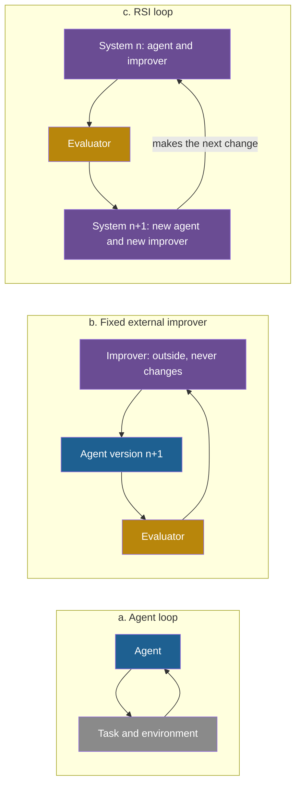

## Learning objectives

After this lesson you can:

- Explain in plain words what makes an improvement process "recursive".
- Write the update rule of a fixed external improver and the update rule of a recursive improver, and say how they differ.
- Compare thirteen published definitions of recursive self-improvement (RSI) by what each one requires to change.
- Name the seven main questions on which researchers disagree.
- State the two working definitions of this course and apply them to simple systems.
- State what has been demonstrated and what has not been demonstrated as of October 2026.

## Prerequisites

- [L3: Feedback loops](/notes/ai/recursive-self-improvement/01-foundations/l3-feedback-loops)
- [L5: Recursion, self-reference and programs that change programs](/notes/ai/recursive-self-improvement/01-foundations/l5-recursion-and-self-reference)
- [L7: What "improvement" means, and how to measure it](/notes/ai/recursive-self-improvement/01-foundations/l7-measuring-improvement)

## 1. The question this idea answers

Think of three students who prepare for the same exams.

1. **Ana** studies one chapter each week. Her test scores rise from 50 to 70. Her study method never changes.
2. **Ben** studies too. After each test, he examines his mistakes and changes his method. He replaces rereading with practice problems. His scores rise faster than Ana's.
3. **Cara** does what Ben does. She also keeps a log of every method change and its effect on her next score. She uses the log to choose better changes. So her method changes become better over time.

Ana improves her knowledge. Ben improves the process that produces knowledge. Cara improves the process that improves the process. Each student adds one level.

Now ask a sharper question. Which student shows "recursive self-improvement"? Ana does not change herself, so she does not. Ben changes himself, but his way of choosing changes stays fixed. Cara changes the way she changes. Most researchers would call Cara the closest case.

There is also a fourth possibility. A student writes a better student, and that new student writes a still better one. This is the original meaning of the idea. No student and no machine does it today.

This lesson answers four questions. What exactly is RSI? Why does the word "recursive" matter? Why is ordinary improvement not always RSI? And where do researchers disagree?

## 2. Mental model, and where it stops working

> [!analogy] A smith who forges better hammers with hammers
> A smith makes a hammer with an old hammer. The new hammer is harder and better balanced. So the smith uses it to forge the next hammer, which is better again. The product of one step becomes the tool of the next step. **The thing that is improved does the next improvement.**
>
> **Where it stops working:**
>
> 1. The smith decides every change, and the hammer proposes nothing. In RSI, the system must propose its own changes.
> 2. A better hammer does not make the smith more skilled. In RSI, the improver itself must become better at improving.
> 3. A hammer has no score. An RSI system needs an evaluator that measures each new version.
> 4. Better hammers soon stop helping, because the smith's skill and the iron set a limit. Real improvement loops also meet limits.

## 3. Terms

| Term | Plain meaning |
|---|---|
| agent | A program that observes, decides and acts in a loop to reach a goal. |
| large language model (LLM) | A very large model that predicts the next token of text. |
| scaffold | The code around a model that turns it into an agent: prompts, tools, control flow and memory handling. |
| frozen | Not changed. A frozen model keeps the same weights for the whole experiment. |
| foundation model (FM) | A large pretrained model, such as an LLM, that other systems use as a part. |
| version | One complete state of the improved thing at one time. |
| candidate | A proposed new version that is not yet accepted. |
| objective | The quantity that an improvement process tries to make larger or smaller. |
| evaluator | The component that computes a score for a version or an output. |
| improver | The procedure that takes a version and returns a candidate that it expects to be better. |
| fixed external improver | An improver that is outside the improved system and never changes. |
| persistent change | A change that stays for future tasks. |
| recursive self-improvement (RSI) | Improvement in which the improved system does the next improvement. This lesson gives the exact definitions. |
| intelligence explosion | I. J. Good's term: better machines design still better machines, so intelligence grows very fast. |
| meta level | One level above the task. The meta level improves the thing that solves the task. |
| self-evolving agent | A survey term for an agent whose model, memory, prompts, tools or structure are updated from experience. It is broader than RSI. |
| bounded self-refinement | Improvement against a fixed, external evaluator (Chen et al., 2026). |
| open-ended RSI | Improvement that also changes the criteria or the machinery of improvement (Chen et al., 2026). |
| AL0 to AL5 | A scale of AI automation of work. AL5 means fully autonomous, with no human in the loop. |

## 4. Method and math

### 4.1 Where the idea comes from: Good's argument

The idea starts with a short passage by the statistician I. J. Good. It is in Section 2 of "Speculations Concerning the First Ultraintelligent Machine" (Good, 1965, [reprint](https://www.Gwern.net/doc/ai/1966-good.pdf), p. 33). The volume is dated 1965, but many bibliographies cite 1966.

Good first defines his machine. It is "a machine that can far surpass all the intellectual activities" … "of any man however clever." Then he makes one step: "Since the design of machines is one of these intellectual activities, an ultraintelligent machine could design even better machines". From this he concludes: "there would then unquestionably be an 'intelligence explosion,' and the intelligence of man would be left far behind."

The argument has five steps:

1. Define a machine that is better than every human at every intellectual task.
2. Designing machines is an intellectual task.
3. So the machine designs better machines than humans can.
4. Each better machine designs a still better machine.
5. So intelligence grows very fast, and humans fall far behind.

**Speculation:** This is an informal chain, not a proof. Step 4 is the recursive step, and Good gives no model of it. He does not say how fast each step happens. He does not say if each step gets harder. Later work tries to fill this gap (Chalmers, 2010, Bostrom, 2014, Yudkowsky, 2013). Lesson [L5](/notes/ai/recursive-self-improvement/02-core-idea/l5-history-from-good-to-agents) follows that history.

> [!trap] The condition that popular quotes drop
> Good's famous sentence has a condition. The machine is "the last invention that man need ever make," … "provided that the machine is docile enough to tell us how to keep it under control." Popular quotes often drop the condition. Good himself tied the idea to control from the start.

Note what Good's passage requires. The machine must design a **successor**, not only fix its own outputs. And each successor must be a better **designer**. So two things improve at each step: the machine's general ability and its ability to design machines. Keep this pair in mind. The modern definitions in section 4.5 differ mainly in how much of this pair they require.

### 4.2 The core structure: who does the next improvement?

Every improvement loop has the same skeleton. A current version exists. Something proposes a candidate. An evaluator scores the candidate. An acceptance rule decides if the candidate replaces the current version.

Part 3 studies these parts in detail. Here we ask one question only: **who is the improver, and does the improver change?**

**Equation 1: a fixed improver.** A survey by Gao et al. gives an update rule for self-evolving agents (2025, [arXiv:2507.21046](https://arxiv.org/abs/2507.21046), Section 2.1). In words: a fixed procedure looks at the agent, at what the agent did, and at the feedback. Then it returns a new agent.

$$
\Pi_{j+1} = f(\Pi_j, \tau_j, r_j)
$$

The symbols mean:

- $\Pi_j$ is the agent system at iteration $j$: its model, its context (prompts and memory), its tools and its control flow.
- $\tau_j$ is the trajectory: the record of what the agent did on its tasks in iteration $j$.
- $r_j$ is the feedback, for example a score or an error message.
- $f$ is the update procedure. The survey calls it the "self-evolving strategy".
- $j$ counts iterations: 0, 1, 2, and so on.

In plain English: the agent changes, but the rule $f$ that changes it is the same at every iteration. The survey does not require $f$ to be part of $\Pi$. So a human-written memory update rule counts.

**Equation 2: a recursive improver.** Now let the improver be part of the system. The improved system then performs the next improvement. A compact way to write this, in our own notation:

$$
S_{n+1} = S_n.\mathrm{improve}(S_n)
$$

The symbols mean:

- $S_n$ is the whole system at iteration $n$. It includes the part that solves tasks and the part that makes improvements.
- $S_n.\mathrm{improve}$ is the improvement procedure **of version $n$**.
- $S_{n+1}$ is the result. It is a new system with a new improvement procedure.

In plain English: the procedure that makes the change at step $n+1$ is the one that step $n$ produced. If step $n$ made the improver better, then step $n+1$ uses a better improver. Matt Mahoney wrote the same idea for programs: each program outputs its own successor, $P_i(-1) = P_{i+1}$ (Mahoney, 2010, [PDF](https://mattmahoney.net/rsi.pdf)).

> [!example] Worked example: a toy with numbers
> This is a toy. It is our illustration, not data from any paper.
>
> Let the score be a number from 0 to 100. Version 0 scores 20. An improver with skill $k$ closes the fraction $k$ of the remaining gap to 100 in one iteration: $s_{n+1} = s_n + k\,(100 - s_n)$.
>
> **Fixed improver**, $k = 0.3$ at every iteration:
>
> 1. $s_1 = 20 + 0.3 \times 80 = 44$
> 2. $s_2 = 44 + 0.3 \times 56 = 60.8$
> 3. $s_3 = 60.8 + 0.3 \times 39.2 = 72.56$
>
> **Recursive improver**: each new version is also a better improver, so $k$ rises by 0.1 at each iteration.
>
> 1. $s_1 = 20 + 0.3 \times 80 = 44$
> 2. $s_2 = 44 + 0.4 \times 56 = 66.4$
> 3. $s_3 = 66.4 + 0.5 \times 33.6 = 83.2$
>
> After three iterations, the fixed improver reaches 72.56 and the recursive improver reaches 83.2. In the second loop the system "gets better at getting better", the phrase of Yampolskiy (2015). Both loops still stop at 100, because the score has a ceiling.

**Assumptions of the toy.** The evaluator measures the score without noise. The improver's skill can rise, and it rises by a fixed amount. The score has a hard ceiling of 100.

**When the equations are useful.** They let you ask one clear question of any system. Is the procedure that makes iteration $n+1$ the same one that made iteration $n$? If yes, the loop is Equation 1. If the procedure changed, and the change came from the loop itself, the loop is Equation 2.

**What the equations do not prove.** They do not show that a real improver gets better when its task score rises. That is an empirical question.

The Huxley-Gödel Machine (HGM) paper measured it for two coding-agent systems. An agent's own benchmark score predicted the later success of its descendants only weakly. The correlations were 0.274 to 0.444 (Wang et al., 2025, [arXiv:2510.21614](https://arxiv.org/abs/2510.21614), Table 1). So "better at the task" and "better at improving" are not the same property. Part 3 L3 returns to this.

### 4.3 Why the word "recursive" matters

The word "recursive" has three meanings in this field. Lesson [Part 1 L5](/notes/ai/recursive-self-improvement/01-foundations/l5-recursion-and-self-reference) introduced them. The table states them side by side.

| Meaning | What is recursive | Does the problem get smaller? | What changes after the run? |
|---|---|---|---|
| Recursion in code | A function calls itself on a smaller input, for example factorial | Yes, until a base case | Nothing. The function's code never changes. |
| Recursion in RSI | The improved system performs the next improvement | No. The goal, a better system, stays. | The system, and in the strong sense its improver |
| Recursive task decomposition | A task splits into sub-tasks, and the same solver runs on each | Yes, until success or a depth limit | Nothing about the system |

Here is the key distinction. "Recursive" in task decomposition describes how one answer is computed. "Recursive" in RSI describes how the system that computes answers changes over time. Lesson [L4](/notes/ai/recursive-self-improvement/02-core-idea/l4-examples-and-non-examples) shows two decomposition systems, ADaPT and Recursive Language Models, and explains in detail why they are not RSI.

Recursion in RSI also has no natural base case. A recursive function stops because its input shrinks. An improvement loop stops only because of a budget, a plateau or a limit. This is why every real system in this course has a fixed number of iterations or a fixed budget.

### 4.4 Why ordinary improvement is not necessarily RSI

Many processes improve an AI system. Most of them are not RSI. The difference is almost always the same: the improver is outside the system, or the improver never changes.

| Example | What improves | Who is the improver | Is the improver inside the system? | Does the improver change? |
|---|---|---|---|---|
| An engineer edits an agent's prompt after reading its logs | The agent | A human | No | The engineer may learn, but the agent does not improve the engineer |
| Random search over hyperparameters (Bergstra and Bengio, 2012) | A model | A fixed search algorithm | No | No |
| Population Based Training (Jaderberg et al., 2017, [arXiv:1711.09846](https://arxiv.org/abs/1711.09846)) | Model weights and hyperparameter schedules | Fixed rules: copy the top 20%, multiply settings by 0.8 or 1.2 | No | No |
| A thermostat | The room temperature | The thermostat's fixed rule | Yes | No. The rule never changes. |
| A model fine-tuned on human data by a fixed training pipeline | The weights | The pipeline and its engineers | No | No |

Look at the thermostat. It is a feedback loop, and the loop is inside the device. But only the heater's action changes. The rule that decides the action stays the same. A feedback loop is necessary for RSI, but it is not enough.

Look at the engineer. The agent clearly improves. But the agent proposes nothing. This is "external optimization" of the agent. The same loop can look like self-improvement if you draw the system boundary around the agent **and** the engineer. Lesson [L3](/notes/ai/recursive-self-improvement/02-core-idea/l3-system-boundary-and-persistence) studies this choice of boundary.

### 4.5 The definitions in the literature

There is no single agreed definition of RSI in 2026. The table gives thirteen definitions in four groups. Read the last two columns carefully. "What must change" says which part of the system the definition requires to change. "Must the improver change?" says if the process that makes improvements must itself improve.

Three names in the table are new. The **Gödel machine** is a theoretical design from 2003. It may rewrite any part of its own program $p$, including the part that searches for proofs. But it rewrites only after it proves that the rewrite is useful ([Part 6, p01](/notes/ai/recursive-self-improvement/06-research-systems/p01-good-and-the-godel-machine)).

**Duan et al.** define five levels of their own, L1 to L5. Do not confuse them with the lesson numbers of this course. [L2](/notes/ai/recursive-self-improvement/02-core-idea/l2-the-ladder-of-self-improvement) compares them with the ladder of this course. **ADAS** is a system in which a separate meta agent writes new agents as code.

| Source | Definition (short quote or close paraphrase) | What must change | Must the improver change? |
|---|---|---|---|
| Good, 1965 | The machine "could design even better machines" | The machine, through a better successor | Yes, implicitly: each better machine is a better designer |
| Schmidhuber, 1987 | Solve the problem and improve the strategies: "we do not want to stop at the first meta-level!" | Strategies at every meta level | Yes, at every level |
| Gödel machine, 2003 | A rewrite program "may completely rewrite p, including the proof searcher", after a proof | Any code, including the proof searcher | Allowed, if provably useful |
| Yudkowsky, 2013 | "sustained returns on reinvesting cognitive improvements into further improving cognition" | Cognition: compute, speed, algorithms | Yes |
| Yampolskiy, 2015 | The system "gets better at getting better" | The algorithm or source code | Yes. This is the defining feature. |
| Gao et al., 2025 | $f(\Pi, \tau, r) = \Pi'$: evolve the model, context, tools or structure | Any of these parts | No. $f$ may be fixed and external. |
| Fang et al., 2025 | Agents that "continuously and systematically optimise their internal components" | Agent components | No. The optimiser can be external. |
| Workshop at the International Conference on Learning Representations (ICLR) 2026 | "loops that update weights, rewrite prompts, or adapt controllers" | Weights, prompts, controllers, memory, tools | No. The meaning is broad. |
| Self-Taught Optimizer (STOP), 2023 | The improver runs on itself, but this "is not full recursive self-improvement" | The improver's scaffold code. Full RSI also needs the weights. | Yes, for the improver code |
| Darwin Gödel Machine (DGM), 2025 | "a coding task that involves modifying the design of an agent’s own components" | The agent's code base, with the model frozen | Yes: the coding agent edits itself |
| Anthropic, 2026 | "fully autonomously designing and developing its own successor" | A successor model | Yes, and with no human in the loop |
| Duan et al., 2026 | Turn "experience and feedback into persistent changes" | Persistent state. At level L5: the improvement mechanism. | Only at L5 |
| Chen et al., 2026 | Open-ended RSI "modifies the system and the criteria or machinery of improvement itself" | System, criteria and improvement machinery | Yes for open-ended RSI. No for bounded self-refinement. |

Sources of the table, in order:

- Good (1965), Section 2.
- Schmidhuber (1987, [thesis page](https://people.idsia.ch/~juergen/diploma.html)), abstract.
- Schmidhuber (2003, [arXiv:cs/0309048](https://arxiv.org/abs/cs/0309048), Section 2.2).
- Yudkowsky (2013, [MIRI report](https://intelligence.org/2013/04/29/intelligence-explosion-microeconomics-released/), Section 1).
- Yampolskiy (2015, [arXiv:1502.06512](https://arxiv.org/abs/1502.06512), Section 1).
- Gao et al. (2025, Section 2.1) and Fang et al. (2025, [arXiv:2508.07407](https://arxiv.org/abs/2508.07407v2), Section 1).
- The ICLR 2026 workshop call for papers ([workshop site](https://recursive-workshop.github.io/)).
- Zelikman et al. (2023, [arXiv:2310.02304](https://arxiv.org/abs/2310.02304), abstract).
- Zhang et al. (2025, [arXiv:2505.22954](https://arxiv.org/abs/2505.22954), Section 3).
- Favaro and Clark (2026, [Anthropic Institute](https://www.anthropic.com/institute/recursive-self-improvement)).
- Duan et al. (2026, [arXiv:2609.11873](https://arxiv.org/abs/2609.11873), abstract).
- Chen et al. (2026, [arXiv:2607.07663](https://arxiv.org/pdf/2607.07663), §2.1).

The definitions fall into four groups:

1. **Successor definitions** (Good, Anthropic). The system builds a better successor. The bar is the highest.
2. **Improver definitions** (Schmidhuber, Yampolskiy, Duan level L5, Chen's open-ended RSI). The process of improvement must itself improve.
3. **Component definitions** (Gao, Fang, the ICLR 2026 workshop). Any persistent change to the agent's parts counts, even by a fixed procedure. The bar is the lowest.
4. **Code definitions** (STOP, DGM). The system edits its own code, and that code is also what makes the next edit.

One more source states the condition that all groups need. Zenil et al. (2026, [arXiv:2601.05280](https://arxiv.org/abs/2601.05280)) write that "improvement must feed back into the process that produces further improvement." They add: "A positive-feedback theory therefore needs more than recursion. It needs a directional criterion."

**Theory:** recursion alone gives change, not improvement. Something must decide which direction is better. Lesson [L4](/notes/ai/recursive-self-improvement/02-core-idea/l4-examples-and-non-examples) shows a loop that has recursion and no such criterion: model collapse.

### 4.6 Where researchers disagree

The definitions differ because researchers disagree on seven questions. The table gives both sides with their sources.

| Disputed question | Position A | Position B |
|---|---|---|
| Must the model weights change? | Yes, for full RSI: STOP 2023, Anthropic 2026 | No: Gödel Agent, the DGM and the Self-Improving Coding Agent (SICA) use frozen models and still say self-improvement. The ICLR workshop includes prompt rewriting. |
| Must the improver itself improve? | Yes: Schmidhuber, Yampolskiy, Duan L5, Chen's open-ended RSI | No: the self-evolving surveys of Gao and Fang accept fixed external optimisers |
| Is self-refinement inside one task self-improvement? | Yes, as "intra-test-time self-evolution": Gao 2025 | No: Duan 2026, because nothing persists. Chen 2026 calls it "bounded self-refinement". |
| Should the evaluator be external? | Yes: Zenil 2026, DGM's benchmarks, Duan's "independent assessment" | Strong RSI changes "the criteria or machinery of improvement itself": Chen's description |
| Must there be no human in the loop? | Yes: Anthropic's AL5 | No: Duan's L1 to L3 and Chen's human-in-the-loop axis count partial autonomy |
| One system or a community? | One system: Good, the Gödel machine | A community: Hall 2007. Yampolskiy names "indirect RSI", for example human and AI teams. |
| What counts as the "self"? | The same system | Yampolskiy proposes the name "Recursive Source-code Improvement". ADAS uses a separate meta agent. |

Three points help you read this table.

First, most disagreements are about the **bar**, not about the facts. Everyone agrees that the DGM edits its own code with a frozen model. They disagree on whether that is enough to say "RSI".

Second, the questions are independent. A system can change its weights and keep a fixed improver: Self-Rewarding Language Models do this. A system can change its improver and keep frozen weights: STOP does this. So you cannot rank all systems on one line. Lesson [L2](/notes/ai/recursive-self-improvement/02-core-idea/l2-the-ladder-of-self-improvement) builds a ladder and then shows where one line is not enough.

Third, the evaluator question is the deepest. If the system can change its own evaluator, what stops it from changing the evaluator to report success? Part 8 studies this risk. Here, note only that every working system in 2026 keeps its evaluator fixed (Robeyns et al., 2025, Zhang et al., 2025).

### 4.7 The working definitions of this course

Because the literature does not agree, this course uses two definitions. One is broad and one is strong. We always say which one we mean.

> [!key] Self-improvement (broad)
> 1. **Name:** self-improvement.
> 2. **Meaning:** a system makes persistent changes to itself that raise a measured objective.
> 3. **Problem it solves:** it separates a system that gets better from a system that only produces one better answer.
> 4. **Example:** Voyager writes verified code skills into a library and uses them in later tasks (Wang et al., 2023, [arXiv:2305.16291](https://arxiv.org/abs/2305.16291)).
> 5. **Link to RSI:** it is the base level. RSI in the strong sense is a special case.
> 6. **Limits:** the update procedure may be fixed and human-written. So the system improves, but its way of improving does not.

> [!key] Recursive self-improvement (strong sense)
> 1. **Name:** RSI in the strong sense.
> 2. **Meaning:** the system improves itself, the improvement includes the improver, and the improved improver makes the next improvement.
> 3. **Problem it solves:** it names the property that Good, Schmidhuber and Yampolskiy cared about: getting better at getting better.
> 4. **Example:** in STOP, a starting improver program, the seed improver, improves its own source code. The improved improver then runs again on itself (Zelikman et al., 2023).
> 5. **Link to RSI:** this is the core idea of the course.
> 6. **Limits:** every demonstrated case keeps a frozen core. In STOP the language model and the scoring function never change. So "strong" here means strong in kind, not unlimited.

Use these six checks to apply the definitions:

1. **Target.** Does the change apply to the system, not only to one output?
2. **Proposer.** Does the system itself propose the change?
3. **Persistence.** Does the change stay for future tasks?
4. **Measurement.** Does a measured objective rise, with the care of [Part 1 L7](/notes/ai/recursive-self-improvement/01-foundations/l7-measuring-improvement)?
5. **Improver.** Does the change improve the procedure that makes changes?
6. **Use.** Does the improved procedure make the next change?

Checks 1 to 4 define broad self-improvement. Checks 5 and 6 add the strong sense. Lesson [L4](/notes/ai/recursive-self-improvement/02-core-idea/l4-examples-and-non-examples) turns these checks into a five-question method and applies it to sixteen real cases.

### 4.8 The figure: three loops

The figure compares three loops.


The same idea as a diagram:



In loop (a), nothing about the agent changes. In loop (b), the agent changes, but the purple improver is the same at every iteration. In loop (c), the purple box is both the improved thing and the improver. In all three, the gold evaluator stays outside the change. That is true of every real system in this course.

### 4.9 The status in October 2026

What has been shown, and what has not? The sources in this course were checked on 2026-10-19.

**Measured:** systems with a frozen model can improve their own scaffold code on benchmarks. SWE-bench Verified is a coding benchmark of real software issues, checked by tests. On a 200-task subset of it, the DGM rose from 20.0% to 50.0% (Zhang et al., 2025, abstract). One such run took about two weeks. The v1 appendix reports a cost of about USD 22,000, but one check for this course could not confirm this figure.

SICA rose from 17% to 53% on 50 tasks of the same benchmark. Its run cost about USD 7,000 (Robeyns et al., 2025, [arXiv:2504.15228](https://arxiv.org/abs/2504.15228), Table 1).

**Measured:** loops that change model weights exist too, with a fixed training procedure. Lesson L2 gives the numbers.

**Measured (self-reported):** no system builds its own successor fully autonomously. Anthropic uses Epoch AI's six-step scale of automation, from AL0 to AL5. In August 2026, Claude "leads" 26% of Anthropic's AI research and development work, up from under 1% in February 2026. The share of work at AL5, fully autonomous with no human in the loop, was 0% (Favaro and Wright, 2026, [Anthropic Institute](https://www.anthropic.com/institute/measuring-pace-of-ai-development)). The page shows no date. Secondary coverage dates it 17 September 2026.

**Claimed:** Anthropic describes three scenarios: the trend stalls, efficiency gains compound while humans set the direction, or full RSI arrives. The authors say the evidence points to the second scenario (Favaro and Clark, 2026).

**Our interpretation:** RSI in the strong sense exists today only in a bounded form. The improver code improves, but a frozen core always remains: the model weights, the evaluator, the outer loop and the budget. No published system improves all of these by itself. The rest of the course explains why each frozen part is hard to free, and why some parts should stay frozen.

## 5. Graphs

```plot
{
  "title": "Toy model, illustration not data: fixed improver k = 0.3 (blue) and improver that improves, k rising by 0.1 per iteration (purple), ceiling 100 (ink)",
  "xAxis": { "label": "iteration n", "domain": [0, 6] },
  "yAxis": { "label": "score", "domain": [0, 105] },
  "disableZoom": true,
  "data": [
    { "points": [[0, 20], [1, 44], [2, 60.8], [3, 72.56], [4, 80.79], [5, 86.55], [6, 90.59]], "fnType": "points", "graphType": "polyline", "color": "#1E6091" },
    { "points": [[0, 20], [1, 44], [2, 60.8], [3, 72.56], [4, 80.79], [5, 86.55], [6, 90.59]], "fnType": "points", "graphType": "scatter", "color": "#1E6091", "skipTip": true },
    { "points": [[0, 20], [1, 44], [2, 66.4], [3, 83.2], [4, 93.28], [5, 97.98], [6, 99.6]], "fnType": "points", "graphType": "polyline", "color": "#6A4C93" },
    { "points": [[0, 20], [1, 44], [2, 66.4], [3, 83.2], [4, 93.28], [5, 97.98], [6, 99.6]], "fnType": "points", "graphType": "scatter", "color": "#6A4C93", "skipTip": true },
    { "fn": "100", "color": "#100D12" }
  ]
}
```

The two lines are the toy of section 4.2. The purple line rises faster because its improver also improves. Both lines bend toward the same ceiling. The toy shows the difference in kind between the two loops. It does not predict any real system.

## 6. Video and animation

- [AI Self Improvement - Computerphile](https://www.youtube.com/watch?v=5qfIgCiYlfY) (Robert Miles, 2015). The core argument in plain words: an AI that is better at AI design than we are could build a better successor. Watch it with section 4.1. Note that it describes the successor definition, the highest bar of section 4.5.
- [Why Would AI Want to do Bad Things? Instrumental Convergence](https://www.youtube.com/watch?v=ZeecOKBus3Q) (Robert Miles, 2018). Explains Omohundro's argument that many goal-seeking systems would want to improve themselves. It supports section 4.1 and lesson L5.
- [[1hr Talk] Intro to Large Language Models](https://www.youtube.com/watch?v=zjkBMFhNj_g) (Andrej Karpathy, 2023). The chapter at 38:02, "Self-improvement, LLM AlphaGo", asks the central question of this course for language models.

## 7. Code

The sketch below writes the three loops of section 4.8 as Python. It is our illustration, not code from a paper. The objects `agent`, `task`, `improver` and `system` stand for any implementation.

```python
# Toy sketch of the three loops. Illustration only.

def agent_loop(agent, task, max_steps=10):
    """Loop (a): the agent acts until the task ends. The agent never changes."""
    state = task.reset()
    for _ in range(max_steps):
        action = agent.act(state)
        state, done = task.step(action)
        if done:
            break
    return state


def external_improvement(agent, improver, evaluate, iterations=5):
    """Loop (b): Pi_{j+1} = f(Pi_j, ...). The improver f is outside and fixed."""
    for _ in range(iterations):
        candidate = improver(agent)                # proposer: outside the agent
        if evaluate(candidate) > evaluate(agent):  # acceptance rule
            agent = candidate
    return agent


def recursive_improvement(system, evaluate, iterations=5):
    """Loop (c): S_{n+1} = S_n.improve(S_n). The improver is part of the system."""
    for _ in range(iterations):
        candidate = system.improve(system)         # proposer: the current system
        if evaluate(candidate) > evaluate(system):
            system = candidate                     # the NEXT iteration calls the NEW improve()
    return system
```

Read the last function slowly. The line `candidate = system.improve(system)` calls the improver of the current version. After an accepted change, `system` is the new version, so the next call uses the new improver.

Now look at `evaluate`. It is a plain function argument in both improvement loops. No iteration can change it. This is the frozen evaluator of section 4.9, written as code.

## 8. Common mistakes

1. **"Any loop that improves an AI system is RSI."** An engineer who edits a prompt improves a system from outside. So does a fixed search over hyperparameters. In RSI the system proposes the change, and in the strong sense the improver itself improves.
2. **"Recursive means the function calls itself."** That is recursion in code. In RSI, recursive means that the improved system performs the next improvement. The problem does not shrink, and there is no base case.
3. **"There is one standard definition."** This lesson alone lists thirteen. They range from "any persistent change to an agent's parts" (Gao, Fang) to "a fully autonomous successor" (Anthropic). Always say which one you use.
4. **"A better task score means a better improver."** In the HGM paper, the two correlated at only 0.274 to 0.444. Task skill and improvement skill are different properties.
5. **"Good proved that an intelligence explosion will happen."** Good wrote an informal argument. Its key step is unproven: each better machine designs a still better one at a useful speed. He also attached a condition about control.
6. **"Today's self-improving agents build their successors."** They edit scaffold code around a frozen model, under a fixed evaluator. Anthropic measured 0% of its research work at full autonomy in August 2026.

## 9. One-minute explanation

Recursive self-improvement means that a system improves itself and that the improved system makes the next improvement. The idea comes from Irving John Good in 1965. A machine better than humans at design could design a better machine, which could design a better one again. The word "recursive" is the key. A fixed improver that tunes an agent is ordinary optimization, because the improver never changes. In RSI the improver is part of the system, so a better system can also be a better improver.

Researchers disagree on the bar. Broad definitions accept any persistent change to an agent's parts. Strong definitions require the improver itself to improve, or even a fully autonomous successor model. In 2026, systems such as the Darwin Gödel Machine edit their own code and raise benchmark scores. But they keep the model, the evaluator and the outer loop frozen. No system builds its own successor without humans.

## 10. Check questions

```check
{
  "question": "A company runs a nightly job. The job reads the day's failed customer chats and adds three new rules to its support agent's prompt file. A human wrote the job once and never changes it. Apply the six checks of section 4.7. Is this self-improvement in the broad sense? Is it RSI in the strong sense?",
  "hint": "Ask who proposes the change, whether it persists, and whether the job itself ever changes.",
  "answer": "1. Target: yes, the prompt file is part of the agent. 2. Proposer: partly. The job uses the agent's own chats, but the job is a fixed procedure written by a human. 3. Persistence: yes, the rules stay for future chats. 4. Measurement: unknown. Nothing in the description measures an objective, so we cannot say the agent improved. 5 and 6: no. The job never changes. So at best it is broad self-improvement in the sense of Gao et al., if a measured score rises. It is not RSI in the strong sense, because the improver is fixed."
}
```

```check
{
  "question": "Use the toy of section 4.2. A fixed improver has k = 0.5. A recursive improver starts at k = 0.2 and adds 0.2 per iteration. Both start at a score of 20, with a ceiling of 100. Compute the scores after three iterations. Which loop is ahead?",
  "hint": "Use s_{n+1} = s_n + k (100 - s_n). For the recursive improver, k is 0.2, then 0.4, then 0.6.",
  "answer": "Fixed, k = 0.5: s1 = 20 + 0.5 × 80 = 60. s2 = 60 + 0.5 × 40 = 80. s3 = 80 + 0.5 × 20 = 90. Recursive: s1 = 20 + 0.2 × 80 = 36. s2 = 36 + 0.4 × 64 = 61.6. s3 = 61.6 + 0.6 × 38.4 = 84.64. The fixed improver is ahead after three iterations (90 against 84.64). A recursive improver is not automatically ahead. Its advantage depends on its starting skill and on how fast the skill rises. A ceiling also limits both."
}
```

```check
{
  "question": "The STOP authors write that their system 'is not full recursive self-improvement'. The DGM authors call their system self-improving. Both use frozen language models. Explain why the two statements do not contradict each other, with reference to the disagreements of section 4.6.",
  "answer": "They use different bars. STOP's authors use a bar on which full RSI also requires the model weights to change. Their improver code improves itself, but the language model does not. DGM's authors define self-improvement as editing the agent's own code, so a frozen model is enough for their claim. This is the first disputed question of section 4.6: must the weights change? Both papers agree on the facts. Code changes, weights stay frozen. They disagree on the name."
}
```

```check
{
  "question": "Classify each definition as a successor, improver, component or code definition. Then say if it requires the improver to change. (a) Yampolskiy 2015. (b) Fang et al. 2025. (c) Anthropic 2026. (d) Darwin Gödel Machine 2025.",
  "answer": "(a) Improver definition. Yes: the system 'gets better at getting better', and this is the defining feature. (b) Component definition. No: agents optimise their internal components, and the optimiser can be external. (c) Successor definition. Yes, and with no human in the loop: the system designs and develops its own successor. (d) Code definition. Yes in practice: the coding agent edits its own code base, and that code also performs the next edit."
}
```

```check
{
  "question": "Zenil et al. write that a positive-feedback theory 'needs more than recursion. It needs a directional criterion.' Give one loop that has recursion but no directional criterion, and say what happens to it.",
  "hint": "Think of a model that trains on its own outputs with nothing that filters them.",
  "answer": "A generative model that is trained, generation after generation, on data produced by the previous generation, with no real data kept and no filter. The loop is recursive, because each model produces the training data of the next. But nothing decides which outputs are better. Shumailov et al. measured that such models lose the rare parts of the original distribution and degrade. This is model collapse. Recursion gave change, not improvement."
}
```

```check
{
  "question": "AlphaEvolve is a system that uses Gemini language models to evolve programs, scored by fixed automatic evaluators. It found a faster version of a small, heavily used program (a kernel) in Gemini's training code. This cut Gemini's training time by about 1%. Engineers deployed the change, and the authors say that the feedback loops are 'on the order of months'. A news article claims that recursive self-improvement is here, because AlphaEvolve sped up the training of its own model. Use the definitions of section 4.5 and the status of section 4.9 to judge the claim in three or four sentences.",
  "answer": "AlphaEvolve did find a kernel speedup that cut Gemini's training time by about 1%. But AlphaEvolve does not modify its own code. Humans deploy the change and run the training, and the authors say the feedback loop is 'on the order of months'. Under successor definitions, such as Anthropic's, this is not RSI, because the process is not autonomous. Under component definitions it is still not self-improvement of AlphaEvolve itself. It is evidence that AI can contribute to its own infrastructure, which is a weaker claim."
}
```

## 11. Summary and links

- RSI means that the improved system performs the next improvement. In the strong sense, the improver itself improves.
- A fixed external improver, $\Pi_{j+1} = f(\Pi_j, \tau_j, r_j)$, is ordinary optimization. The recursive form is $S_{n+1} = S_n.\mathrm{improve}(S_n)$.
- The literature has many definitions. This lesson compares thirteen in four groups: successor, improver, component and code definitions.
- Researchers disagree on seven questions, including weights, the improver, persistence, the evaluator, humans and the "self".
- This course uses a broad definition, self-improvement, and a strong one, RSI. Six checks separate them.
- In October 2026, scaffold-level self-improvement with frozen models is measured. A fully autonomous successor is not.

The next lesson orders these ideas into a ladder of seven levels. It shows what changes at each level, who proposes and who evaluates, with a real example and a number for each level.

- Previous: [L7: What "improvement" means, and how to measure it](/notes/ai/recursive-self-improvement/01-foundations/l7-measuring-improvement)
- Next: [L2: The ladder: from repeating a task to improving the improver](/notes/ai/recursive-self-improvement/02-core-idea/l2-the-ladder-of-self-improvement)
- Related: [L5: A short history](/notes/ai/recursive-self-improvement/02-core-idea/l5-history-from-good-to-agents), [Part 3 L4: The improver, meta-levels and the frozen core](/notes/ai/recursive-self-improvement/03-anatomy/l4-the-improver-and-meta-levels), [Glossary](/notes/ai/recursive-self-improvement/glossary)

## References

- I. J. Good. "Speculations Concerning the First Ultraintelligent Machine". In *Advances in Computers*, Volume 6, pp. 31–88. Academic Press. 1965 (often cited as 1966). https://www.Gwern.net/doc/ai/1966-good.pdf
- Jürgen Schmidhuber. "Evolutionary Principles in Self-Referential Learning. On Learning how to Learn: The Meta-Meta-Meta...-Hook". Diploma thesis, Technische Universität München. 1987. https://people.idsia.ch/~juergen/diploma.html
- Jürgen Schmidhuber. "Goedel Machines: Self-Referential Universal Problem Solvers Making Provably Optimal Self-Improvements". 2003 (v5 2006). arXiv:cs/0309048. https://arxiv.org/abs/cs/0309048
- Eliezer Yudkowsky. "Intelligence Explosion Microeconomics". Technical report 2013-1, Machine Intelligence Research Institute. 2013. https://intelligence.org/2013/04/29/intelligence-explosion-microeconomics-released/
- Matt Mahoney. "A Model for Recursively Self Improving Programs". 2008, revised 2010. https://mattmahoney.net/rsi.pdf
- Roman V. Yampolskiy. "From Seed AI to Technological Singularity via Recursively Self-Improving Software". 2015. arXiv:1502.06512. https://arxiv.org/abs/1502.06512
- David J. Chalmers. "The Singularity: A Philosophical Analysis". *Journal of Consciousness Studies* 17:7–65. 2010. https://consc.net/papers/singularity.pdf
- Nick Bostrom. *Superintelligence: Paths, Dangers, Strategies*. Oxford University Press. 2014.
- James Bergstra, Yoshua Bengio. "Random Search for Hyper-Parameter Optimization". *Journal of Machine Learning Research* 13:281–305. 2012.
- Max Jaderberg, Valentin Dalibard, Simon Osindero, et al. "Population Based Training of Neural Networks". 2017. arXiv:1711.09846. https://arxiv.org/abs/1711.09846
- Eric Zelikman, Eliana Lorch, Lester Mackey, Adam Tauman Kalai. "Self-Taught Optimizer (STOP): Recursively Self-Improving Code Generation". 2023. COLM 2024. arXiv:2310.02304. https://arxiv.org/abs/2310.02304
- Guanzhi Wang, Yuqi Xie, Yunfan Jiang, et al. "Voyager: An Open-Ended Embodied Agent with Large Language Models". 2023. TMLR 2024. arXiv:2305.16291. https://arxiv.org/abs/2305.16291
- Huan-ang Gao, Jiayi Geng, Wenyue Hua, et al. "A Survey of Self-Evolving Agents: What, When, How, and Where to Evolve on the Path to Artificial Super Intelligence". 2025. arXiv:2507.21046. https://arxiv.org/abs/2507.21046
- Jinyuan Fang, Yanwen Peng, Xi Zhang, et al. "A Comprehensive Survey of Self-Evolving AI Agents: A New Paradigm Bridging Foundation Models and Lifelong Agentic Systems". 2025. arXiv:2508.07407. https://arxiv.org/abs/2508.07407v2
- Maxime Robeyns, Martin Szummer, Laurence Aitchison. "A Self-Improving Coding Agent". 2025. ICLR 2025 Workshop on Scaling Self-Improving Foundation Models. arXiv:2504.15228. https://arxiv.org/abs/2504.15228
- Jenny Zhang, Shengran Hu, Cong Lu, Robert Lange, Jeff Clune. "Darwin Gödel Machine: Open-Ended Evolution of Self-Improving Agents". 2025. ICLR 2026. arXiv:2505.22954. https://arxiv.org/abs/2505.22954
- Wenyi Wang, Piotr Piękos, Li Nanbo, et al. "Huxley-Gödel Machine: Human-Level Coding Agent Development by an Approximation of the Optimal Self-Improving Machine". 2025. ICLR 2026. arXiv:2510.21614. https://arxiv.org/abs/2510.21614
- Weizhe Yuan, Richard Yuanzhe Pang, Kyunghyun Cho, et al. "Self-Rewarding Language Models". 2024. ICML 2024. arXiv:2401.10020. https://arxiv.org/abs/2401.10020
- Ilia Shumailov, Zakhar Shumaylov, Yiren Zhao, Nicolas Papernot, Ross Anderson, Yarin Gal. "AI models collapse when trained on recursively generated data". *Nature* 631:755–759. 2024. DOI 10.1038/s41586-024-07566-y. Preprint: arXiv:2305.17493. https://arxiv.org/abs/2305.17493
- Alexander Novikov, Ngân Vũ, Marvin Eisenberger, et al. "AlphaEvolve: A coding agent for scientific and algorithmic discovery". 2025. arXiv:2506.13131. https://arxiv.org/abs/2506.13131
- ICLR 2026 Workshop on AI with Recursive Self-Improvement. Rio de Janeiro, 26 April 2026. https://recursive-workshop.github.io/
- Hector Zenil, Abicumaran Uthamacumaran, Luan Ozelim. "Large Language Models are Shannon Lossy Compressors Not Solomonoff Induction Estimators: Self-improvement and Singularity Are Not Near Without Symbolic Model Synthesis". 2026. arXiv:2601.05280 (v6. The title changed across versions). https://arxiv.org/abs/2601.05280
- Mingguang Chen, Licheng Wang, Bo Qu. "Recursive Self-Improvement in AI: From Bounded Self-Refinement to Autonomous Research Loops". 2026. arXiv:2607.07663. https://arxiv.org/pdf/2607.07663
- Yi Duan, Ying Liu, Zirui Tang, et al. "The Last AI Built by Humans: Toward Genuine Recursive Self-Improvement". 2026. arXiv:2609.11873. https://arxiv.org/abs/2609.11873
- Marina Favaro, Jack Clark. "When AI builds itself". The Anthropic Institute. 2026. https://www.anthropic.com/institute/recursive-self-improvement
- Marina Favaro, Phillie Wright. "Measurements for understanding the pace of AI development inside frontier labs". The Anthropic Institute. 2026. https://www.anthropic.com/institute/measuring-pace-of-ai-development
