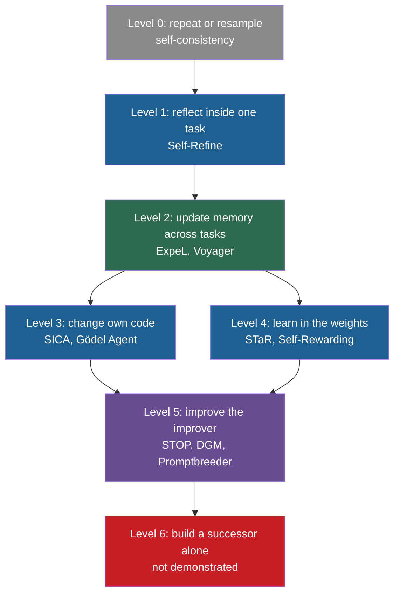

## Learning objectives

After this lesson you can:

- Name the seven levels of the ladder and the property that each level adds.
- For each level, state what changes, what persists, who proposes the change and who evaluates it.
- Give one real system and one measured number for each level that has been demonstrated.
- Explain why Level 3 and Level 4 differ in where the change lives, not only in how strong it is.
- Compare the ladder with the autonomy levels of Duan et al. (2026) and with the bounded and open-ended RSI of Chen et al. (2026).
- Place a described system on the ladder and defend the choice.

## Prerequisites

- [L1: What recursive self-improvement means](/notes/ai/recursive-self-improvement/02-core-idea/l1-what-rsi-means)
- [Part 1 L2: Agents: actions, state, memory, tools and environment](/notes/ai/recursive-self-improvement/01-foundations/l2-agents-actions-state-tools-environment)
- [Part 1 L6: How machine learning systems are trained and evaluated](/notes/ai/recursive-self-improvement/01-foundations/l6-how-ml-systems-are-trained-and-evaluated)

## 1. The question this idea answers

A cook wants better soup. Here are seven things she can do.

1. **Repeat.** She cooks five pots and serves the best one. Tomorrow she starts again with the same recipe.
2. **Reflect.** She tastes the pot, decides it needs salt, and adds salt. The recipe does not change.
3. **Update a strategy.** She writes "use less salt" in her recipe book. Next week she reads the note.
4. **Change her own tools.** She buys a better knife and rearranges her kitchen. Every later dish uses the new kitchen.
5. **Learn in herself.** Over years of cooking, her sense of taste improves. No note records this. It is part of her.
6. **Improve how she improves.** She starts to test each recipe change on three tasters and keeps a log of which kinds of changes helped. Her changes now get better faster.
7. **Build a successor.** She trains an apprentice who becomes a better cook than she is. The apprentice then trains a still better cook.

All seven make the soup better. But they differ in what changes, in what stays for next time, and in who makes the change. Papers on AI use one word, "self-improvement", for all of them. This lesson separates them into a ladder of seven levels. Then it compares the ladder with two published schemes.

## 2. Mental model, and where it stops working

> [!analogy] A ladder of what can change
> Think of a ladder. Each rung adds one property. At the bottom, nothing about the system changes: it only tries again. Higher up, the system keeps lessons, then changes its own parts, then changes the procedure that changes its parts. At the top, it builds its own successor.
>
> **Where it stops working:**
>
> 1. Level 3 (code) and Level 4 (weights) are not one above the other. They are two places where a change can live. We number them 3 and 4 only for convenience.
> 2. Real systems often span several rungs. The Darwin Gödel Machine (DGM) changes code (Level 3) and argues that this also improves its improver (Level 5).
> 3. A rung says what changes, not how much the score rises. A Level 0 method can raise a score more than a Level 5 method.

**Our interpretation:** this ladder is a teaching device that we built from the literature, mainly from the definitions of [L1](/notes/ai/recursive-self-improvement/02-core-idea/l1-what-rsi-means). It is not a standard taxonomy. Other courses and surveys use other ladders. Section 4.10 compares it with two published schemes.

## 3. Terms

| Term | Plain meaning |
|---|---|
| recursive self-improvement (RSI) | Improvement in which the improved system does the next improvement. |
| large language model (LLM) | A very large model that predicts the next token of text. |
| best-of-n | Generate n candidate answers and keep the best one by some rule. |
| chain-of-thought (CoT) | A prompt that makes the model write its reasoning step by step before the answer. |
| greedy decoding | Generation that always takes the most likely next token, so one prompt gives one fixed answer. |
| self-consistency | Sample many reasoning paths and take the majority answer (Wang et al., 2022). |
| self-refinement | One model writes an answer, criticizes it and rewrites it, inside one task. |
| intrinsic feedback | Feedback that the model writes about its own output, with no outside source of truth. |
| oracle label | The true answer, used to decide when a loop stops. It is not available in real use. |
| episodic memory | Notes that an agent stores after an attempt and reads in a later attempt. |
| skill library | A store of verified programs that an agent wrote and can call again later. |
| scaffold | The code around a model that turns it into an agent: prompts, tools, control flow and memory handling. |
| fine-tuning | More training of a pretrained model on a smaller set of data. It changes the weights. |
| Direct Preference Optimization (DPO) | A training method that changes weights so that the model prefers chosen answers over rejected ones. |
| meta-utility | A score for an improver: the average score of the solutions that the improver produces on several tasks (STOP). |
| mutation-prompt | In Promptbreeder, an instruction that tells the LLM how to change a task prompt. |
| archive | The stored set of kept versions, with their scores, from which later parents are chosen. |
| successor model | A new model that a system designs and trains, to replace or follow itself. |
| autonomy level | How much of a process runs without a human decision. |

## 4. Method and math

### 4.1 Six questions for every rung

For each level, we answer the same six questions:

1. **What changes?** An output, a memory, code, weights, the improver, or a whole new model.
2. **What persists?** What is still there when the next task starts.
3. **Who proposes?** Which component makes the candidate change.
4. **Who evaluates?** Which component decides if the change is good.
5. **Example and number.** One real system and one measured result.
6. **Who counts it as RSI?** Which definitions of [L1](/notes/ai/recursive-self-improvement/02-core-idea/l1-what-rsi-means) accept it.

The lesson first walks up the ladder one level at a time. Section 4.9 then collects all answers in one table.

### 4.2 Level 0: repeat or resample

**What happens.** The system answers several times and keeps one answer. It may vote, or a verifier may pick. Nothing about the system changes.

**Example and number.** Self-consistency samples 40 reasoning paths and takes the majority answer. On the GSM8K math word problems, PaLM-540B rose from 56.5% to 74.4% (Wang et al., 2022, [arXiv:2203.11171](https://arxiv.org/abs/2203.11171), Table 2). The baseline used one answer from greedy decoding. The authors note that "a small number of paths (e.g., 5 or 10) … realize most of the gains". The cost is that each question now needs many model calls.

The Self-Taught Optimizer (STOP) has the same step inside it. Its seed improver asks the language model for several candidate programs. It returns the best one by the utility function (Zelikman et al., 2023, [arXiv:2310.02304](https://arxiv.org/abs/2310.02304), Figure 2). That selection step by itself improves no part of the system.

**The answers to the six questions:**

- **What changes:** Only which answer is shown.
- **What persists:** Nothing. The next question needs 40 samples again.
- **Who proposes:** The model, by random sampling.
- **Who evaluates:** A vote, a verifier or a utility function.
- **Who counts it as RSI:** No definition calls this self-improvement.

**Why it matters anyway.** Level 0 is the fair baseline for every level above it. Two critical papers make this point: Huang et al. (2023, [arXiv:2310.01798](https://arxiv.org/abs/2310.01798)) and the survey of Kamoi et al. (2024). A self-correction method must beat self-consistency at **equal cost**. A method that uses six model calls must beat six samples and a vote, not one sample.

### 4.3 Level 1: reflect on an output inside one task

**What happens.** The model writes an answer, writes feedback on it, and rewrites the answer. The loop repeats a few times. When the task ends, everything is forgotten.

**Example and number.** Self-Refine uses one LLM as "the generator, refiner, and feedback provider" (Madaan et al., 2023, [arXiv:2303.17651](https://arxiv.org/abs/2303.17651)). It runs up to 4 iterations (Section 3.1). Constrained generation asks for a sentence that uses every concept in a given list. With ChatGPT, the share of concepts covered rose from 44.0% to 67.0%.

On GSM8K math, ChatGPT went from 74.8 to 75.0, almost no change (Table 1). Most of the gain came in the first rewrite. Averaged over three models, code optimization went 22.0, 27.0, 27.9, 28.8 over the refinement steps (Figure 4).

**The critique.** Huang et al. (2023, Tables 3 and 4) tested self-correction with no outside feedback. GPT-3.5 fell from 75.8% to 38.1% on CommonSenseQA after one round of "review and improve". They also found that some earlier methods used the true answer to decide when to stop. Such results "can only be regarded as indicative of an oracle's performance."

**A grounded variant.** CRITIC lets the model check its answer with tools, such as a Python interpreter (Gou et al., 2023, [arXiv:2305.11738](https://arxiv.org/abs/2305.11738)). With ChatGPT on the TabMWP table math problems, accuracy rose from 75.0 to 89.0 (Table 2). The lesson is general. **Measured:** inside-task loops work best when the feedback has a source of truth outside the model's own opinion.

**The answers to the six questions:**

- **What changes:** The output.
- **What persists:** Nothing.
- **Who proposes:** The model.
- **Who evaluates:** The same model, or tools, or the environment.
- **Who counts it as RSI:** Gao et al. count it as "intra-test-time self-evolution". Duan et al. exclude it, because it "leaves persistent system state unchanged". Chen et al. call such loops "bounded self-refinement".

### 4.4 Level 2: update a strategy or memory across tasks

**What happens.** After an attempt, the agent writes something down: a lesson, a rule or a working program. A later attempt reads it. The model weights do not change. The context that the model sees changes.

**Example 1: Reflexion.** After a failed attempt, the agent writes a short verbal reflection. It stores it in an episodic memory of 1 to 3 items (Shinn et al., 2023, [arXiv:2303.11366](https://arxiv.org/abs/2303.11366)). On the HumanEval coding benchmark in Python, it reached 91.0% pass@1, against 80.1 for GPT-4 in the same table (Table 1). The paper's text gives 82% for GPT-4 elsewhere, so treat the baseline with care. On the MBPP coding benchmark in Python, Reflexion did worse: 80.1 fell to 77.1. The authors link the drop to wrong self-written tests that pass wrong code.

> [!note] Reflexion sits on the edge of Level 2
> Reflexion's reflections carry across **retries of the same task**. In the main design, nothing carries over to a different task. So it is closer to "retry with notes" than to learning across tasks. The follow-up system ExpeL keeps lessons across tasks.

**Example 2: ExpeL.** ExpeL collects experience on training tasks and writes natural-language "insights", a list of rules (Zhao et al., 2023, [arXiv:2308.10144](https://arxiv.org/abs/2308.10144)). On the ALFWorld household tasks, success rose from 40.0% for the ReAct agent to 59.0% (Table 3). ReAct is a standard agent that alternates reasoning steps and actions. Note who wrote the insights: gpt-4-0613, a stronger model than the acting model, gpt-3.5-turbo-0613.

**Example 3: Voyager.** Voyager is a Minecraft agent. It writes programs for tasks and checks them in the game. It stores each successful program in a skill library (Wang et al., 2023, [arXiv:2305.16291](https://arxiv.org/abs/2305.16291)). It discovered 63 unique items in 160 prompting iterations, 3.3 times more than the baselines. Without self-verification, it found 73% fewer items.

**The answers to the six questions:**

- **What changes:** Memory, rules or skill code.
- **What persists:** The stored files, for all later tasks.
- **Who proposes:** The agent's LLM.
- **Who evaluates:** Environment signals, tests, and sometimes an LLM critic that reads the game state.
- **Who counts it as RSI:** Gao et al. and Fang et al. count it as self-evolution. It matches Duan et al.'s requirement of a persistent change. Anthropic and Yampolskiy do not count it, because the improver does not get better at improving. The procedure that writes the memory stays fixed and human-designed.

### 4.5 Level 3: change the agent's own implementation

**What happens.** The agent edits its own code: its tools, its prompts in the code, its control flow. The model weights stay frozen. The new code is used for later tasks.

**Example 1: SICA.** The Self-Improving Coding Agent (SICA) edits its whole Python code base (Robeyns et al., 2025, [arXiv:2504.15228](https://arxiv.org/abs/2504.15228)). It ran 15 iterations with Claude 3.5 Sonnet. SWE-bench Verified is a coding benchmark of real software issues, checked by tests. On a fixed set of 50 of its tasks, SICA's solve rate rose from 17% to 53% at iteration 14. It was 51% at iteration 15 (Table 1).

The agent built tools such as a "Smart Edit" tool and an abstract-syntax-tree symbol locator. The run cost about USD 7,000. One task equals 2 percentage points, so the series is noisy. Section 5 plots it.

**Example 2: Gödel Agent.** Gödel Agent reads and rewrites its own running Python code (Yin et al., 2024, [arXiv:2410.04444](https://arxiv.org/abs/2410.04444)). This includes the routine that does the rewriting. On the MGSM multilingual math benchmark, its constrained version scored 64.2%, against 28.0% for chain-of-thought prompting and 53.4% for ADAS (Table 1). In the constrained version, GPT-3.5 does every task, as in the baselines.

In 100 trials, 4% ended in unexpected termination, usually after the agent modified its own improvement module. In 14% of trials, the final policy was worse than the start (Section 6.2). Because its rewrites can reach its own improvement routine, Gödel Agent also has a Level 5 property. [L4](/notes/ai/recursive-self-improvement/02-core-idea/l4-examples-and-non-examples) classifies it as partial RSI for this reason.

**A contrast: ADAS.** In Automated Design of Agentic Systems (ADAS), a **separate** meta agent writes new agents as code (Hu et al., 2024). On the DROP reading benchmark, the best discovered agent reached F1 79.4, against 65.8 for the best hand-designed agent (Table 1). F1 is a score from 0 to 100 that measures the word overlap between the answer and the reference answer. The meta agent itself never changes. So the agent's code changes, but not by itself. SICA's authors describe ADAS as "not self-improving" for this reason.

**The answers to the six questions:**

- **What changes:** The scaffold code.
- **What persists:** The code, in files or in an archive.
- **Who proposes:** The agent itself (SICA, Gödel Agent), or a fixed meta agent (ADAS).
- **Who evaluates:** A fixed benchmark.
- **Who counts it as RSI:** The code definitions accept it when the agent edits itself. STOP's authors would not call it full RSI, because the model is not altered. Gao et al. count it as architecture and tool evolution.

### 4.6 Level 4: persistent learning in the weights

**What happens.** The model produces its own training data. A fixed training procedure then changes the weights. The change applies to every future input.

**Example 1: STaR.** The Self-Taught Reasoner (STaR) lets a model write step-by-step rationales for questions. It keeps only rationales that reach the correct answer, then fine-tunes on them, and repeats (Zelikman et al., 2022, [arXiv:2203.14465](https://arxiv.org/abs/2203.14465)). If the model fails a question, it gets the correct answer as a hint and writes a rationale for it. This is "rationalization".

On CommonsenseQA, GPT-J rose from 36.6% with few-shot chain-of-thought to 72.5% with STaR (Table 1). A fine-tuned GPT-3, about 30 times larger, scored 73.0%. The filter uses the **true answers**, so the evaluator is external and fixed.

**Example 2: Self-Rewarding Language Models.** Here the model also judges its own answers (Yuan et al., 2024, [arXiv:2401.10020](https://arxiv.org/abs/2401.10020)). Each iteration, Llama 2 70B writes four answers per prompt. It scores them with a 5-point rubric and builds pairs of best and worst answers. DPO then trains the next model on these pairs.

AlpacaEval 2.0 is a benchmark in which an LLM judge compares the model's answers with the answers of GPT-4 Turbo. The win rate is the share of prompts on which the judge prefers the model. It rose over three iterations: 9.94%, 15.38%, 20.44% (Table 1). The judging skill improved too. Agreement with human rankings went from 78.7% to 80.4% to 81.7% (Table 4). The authors ran only three iterations, and they observed longer answers over time.

> [!key] Level 3 and Level 4 differ in where the change lives
> 1. **Name:** location of a change.
> 2. **Meaning:** Level 3 changes code that a person can read. Level 4 changes millions or billions of learned numbers.
> 3. **Problem it solves:** it stops you from ranking a weight update as "more advanced" than a code edit just because weights sound deeper.
> 4. **Example:** SICA rewrote its own editing tools, a large and visible change. A STaR iteration fine-tunes the same base model on a filtered set of its own rationales. Neither change is "higher" than the other.
> 5. **Link to RSI:** STOP's authors say full RSI needs the model to change. The DGM authors call code-only change self-improvement. The disagreement is about location.
> 6. **Limits:** location also decides cost, reversibility and auditability. A code change can be read and undone with version control. A weight change is hard to inspect and needs a stored checkpoint to undo. Lesson [L3](/notes/ai/recursive-self-improvement/02-core-idea/l3-system-boundary-and-persistence) studies these trade-offs.

**The answers to the six questions:**

- **What changes:** The weights.
- **What persists:** The new weights, for every later input.
- **Who proposes:** The model generates the data, but a fixed pipeline that humans run does the training.
- **Who evaluates:** True answers (STaR) or the model itself (Self-Rewarding).
- **Who counts it as RSI:** Gao et al. count it as model evolution. STOP's authors would say that weight change is the missing part of full RSI. Anthropic would not count it, because humans run the training.

### 4.7 Level 5: improve the process that makes improvements

**What happens.** The improver itself is changed, and the changed improver makes the next change. This is RSI in the strong sense of L1. In every published case, a frozen core remains.

**Example 1: STOP.** STOP starts with a seed improver, a short Python program. The improver asks a language model for better versions of a program and returns the best one by a utility function. Then the improver is given **its own source code** to improve (Zelikman et al., 2023, Algorithm 1). Its score is a **meta-utility**: the average score of the solutions it produces on training tasks. With GPT-4, the seed improver had a meta-utility of 61%. The improved improver also transferred to new tasks it had not trained on (Table 1):

| Task | Seed improver | Improved improver |
|---|---|---|
| 3-SAT | 21.2% | 75.1% |
| Max-Cut | 58.7% | 74.2% |
| Parity without noise | 59.3% | 81.7% |

**Measured:** with weaker models, the loop failed. With GPT-3.5, only 12% of 25 runs gained at least 3%, and performance degraded (Section 5.3). The language model, the meta-utility and the outer loop never changed.

**Example 2: the Darwin Gödel Machine.** The DGM keeps an archive of coding agents. A chosen parent agent edits its own code base, and every valid child joins the archive (Zhang et al., 2025, [arXiv:2505.22954](https://arxiv.org/abs/2505.22954)). Over 80 iterations, the best agent rose from 20.0% to 50.0% on a 200-task subset of SWE-bench Verified. The argument for Level 5 is that self-improvement here "is fundamentally a coding task". A better coder is also a better editor of itself.

The DGM has an ablation that tests this argument. In "DGM w/o self-improve", the base agent stays fixed as the agent that makes all changes. That run reached 39.0%, against 50.0% for the full DGM (Section 4). **Measured:** letting improved agents make the next changes added 11 points, in one run per setting. **Our interpretation:** this is direct, if thin, evidence for a Level 5 effect.

Two caveats keep the DGM below "full" Level 5. In the public code, the step that proposes **what** to change is a fixed call to a separate model, o1, outside the editable agent. The parent selection rule, the archive rule and the evaluation are also fixed (Zhang et al., 2025, Section 3, and the public code `jennyzzt/dgm`).

**Example 3: Promptbreeder.** Promptbreeder evolves task prompts and also the **mutation-prompts** that change them (Fernando et al., 2023, [arXiv:2309.16797](https://arxiv.org/abs/2309.16797)). So part of the improver evolves. With PaLM 2-L on GSM8K, its zero-shot prompts scored 83.9% (Table 1, values as extracted). Two fixed prompt optimizers, Optimization by PROmpting (OPRO) and Automatic Prompt Engineer (APE), scored 80.2% and 77.9% with the same model. The self-reference stops at one level. A fixed "hyper-mutation prompt" changes the mutation-prompts, and nothing changes it.

**Example 4: a small neural case.** Kirsch and Schmidhuber describe a neural network that modifies itself and improves its own self-modifications (2022, [arXiv:2212.14392](https://arxiv.org/abs/2212.14392)). It needs no explicit meta optimization, in the authors' words "without the need for explicit meta optimization". **Measured:** it works on bandit and classic control tasks, at small scale.

**A partial case from Level 4.** Self-Rewarding Language Models improve their judge, which is their source of reward. So a part of their improver improves. The training procedure, DPO and the rubric stay fixed.

**The answers to the six questions:**

- **What changes:** The improver, as code, prompts or operators.
- **What persists:** The new improver.
- **Who proposes:** The current improver.
- **Who evaluates:** A fixed meta-utility, benchmark or fitness function.
- **Who counts it as RSI:** Schmidhuber, Yampolskiy and Duan's L5 accept it. Chen et al. would still call these systems **bounded**, because the evaluator stays fixed. Their "open-ended RSI" also changes "the criteria or machinery of improvement itself".

### 4.8 Level 6: build a successor model fully autonomously

**What happens.** The system designs and develops a new model that replaces it, with no human decision in the loop. This is Anthropic's definition of RSI: "an AI system capable of fully autonomously designing and developing its own successor" (Favaro and Clark, 2026, [Anthropic Institute](https://www.anthropic.com/institute/recursive-self-improvement)). Good's argument of 1965 describes this level too.

**Status.** This level is empty. **Measured (self-reported):** in August 2026, 0% of Anthropic's measured AI research work was at full autonomy. This is level AL5 of its automation scale (Favaro and Wright, 2026, [Anthropic Institute](https://www.anthropic.com/institute/measuring-pace-of-ai-development)).

**The closest evidence, and why it falls short:**

1. **AlphaEvolve** found an average kernel speedup of 23%. This cut the training time of Gemini by 1%. Gemini is the model family that powers AlphaEvolve (Novikov et al., 2025, [arXiv:2506.13131](https://arxiv.org/abs/2506.13131), Section 3.3.2). But humans deploy the change and run the training. The authors say the feedback loops are "on the order of months".
2. **Anthropic's weak-to-strong study.** Weak-to-strong supervision is a research problem in which a weaker model supervises the training of a stronger model. On this problem, agents recovered 97% of a performance gap in 800 cumulative hours, for about USD 18,000 of compute. Two humans recovered about 23% in a week. But humans chose the problem and the scoring rubric (Favaro and Clark, 2026).
3. **The DGM** names "rewriting its own training script to update the FM itself" as future work. **Speculation:** nothing in the paper tests it.

### 4.9 The whole ladder in one table

| Level | Name | What changes | What persists | Who proposes | Who evaluates | Example and number | Counted as RSI by |
|---|---|---|---|---|---|---|---|
| 0 | Repeat or resample | Which answer is shown | Nothing | The model, by sampling | Vote, verifier or utility | Self-consistency: GSM8K 56.5% to 74.4% | No definition |
| 1 | Reflect inside a task | The output | Nothing | The same model | The same model, tools or the environment | Self-Refine: 44.0 to 67.0 on constrained generation | Gao: yes. Duan: no. Chen: bounded. |
| 2 | Update strategy or memory | Memory, rules, skills | Stored files | The agent's LLM | Environment, tests, LLM critic | ExpeL: ALFWorld 40.0% to 59.0% | Gao, Fang: yes. Anthropic, Yampolskiy: no. |
| 3 | Change own implementation | Scaffold code | Code | The agent itself, or a fixed meta agent | Fixed benchmark | SICA: 17% to 53% on 50 tasks | Code definitions: yes. STOP: not full RSI. |
| 4 | Learn in the weights | Weights | Weights | Model makes data, fixed pipeline trains | True answers or the model itself | STaR: 36.6% to 72.5% | Gao: yes. Anthropic: no. |
| 5 | Improve the improver | The improver | The new improver | The current improver | Fixed meta-utility or benchmark | STOP: 3-SAT 21.2% to 75.1% | Yampolskiy, Duan L5: yes. Chen: still bounded. |
| 6 | Build a successor | A new model | The successor | The system, alone | The system, with no fixed anchor | Not demonstrated: AL5 = 0% | All definitions |

Read the "Who evaluates" column from top to bottom. Up to Level 5, every demonstrated system keeps an evaluator that it cannot change. Only Level 6 has no fixed anchor, and Level 6 is empty. **Our interpretation:** the evaluator is the last part that real systems free, and for good reasons. Part 8 explains them.

### 4.10 The figure: the ladder


The same ladder as a diagram. Level 3 and Level 4 sit side by side, because they differ in location, not in height.



### 4.11 Two published schemes compared

Two 2026 papers give their own structure. Neither one is the same as our ladder, because each one measures a different thing.

**Duan et al. (2026): autonomy levels L1 to L5.** Duan et al. ([arXiv:2609.11873](https://arxiv.org/abs/2609.11873)) build RSI on persistence. For them, RSI is the capability "to transform acquired experience and feedback into persistent changes". Their levels describe **who decides**, not where the change lives:

| Duan level | Name | Meaning |
|---|---|---|
| L1 | Autonomy over Improvement Execution | The system executes improvements that humans prescribe. |
| L2 | Autonomy over Improvement Strategies | The system chooses the interventions. Objectives and acceptance criteria stay external. |
| L3 | Autonomy over Future Learning Experience | The system helps decide what experience to gather next. |
| L4 | Autonomy in Deployment and Environmental Adaptation | The system adapts its persistent state from deployment feedback. |
| L5 | From Environmental Adaptation to Meta-Improvement | The system changes "the mechanism that governs later improvement". |

The level descriptions come from a summary of the paper on alphaXiv. The names come from the paper's own headings.

Two points of Duan et al. matter here. First, in-task self-refinement "leaves persistent system state unchanged", so it is not RSI for them. Our Levels 0 and 1 fall outside their scheme. Second, they require more for "genuine" recursion: stronger successors under comparable resources, and **independent assessment**.

**Chen et al. (2026): bounded against open-ended.** Chen et al. surveyed 1,250 papers from 2024 to 2026 ([arXiv:2607.07663](https://arxiv.org/pdf/2607.07663), §2.1). Their central cut has two classes:

- **Bounded self-refinement** "improves a system against a fixed, external evaluator". The authors add that it is "convergent and evaluable".
- **Open-ended RSI** "modifies the system and the criteria or machinery of improvement itself, with no fixed external anchor".

They add a second axis, loop closure: human in the loop, human on the loop, or a closed loop.

**How the three schemes relate.** Each scheme answers a different question:

| Scheme | Question it answers | Example: the DGM |
|---|---|---|
| Our ladder | Where does the change live, and does it reach the improver? | Level 5 in a partial form: the change lives in code (Level 3), and an ablation measures a Level 5 effect |
| Duan et al. L1 to L5 | How much of the improvement does the system decide? | Partly L5, because the code that makes changes is changed. But the proposal step and the selection rule are fixed. |
| Chen et al. | Is the evaluator a fixed external anchor? | Bounded: a fixed benchmark scores every agent |
| Anthropic AL0 to AL5 | How much of the work runs without humans? | Humans start, monitor and stop the run. Not AL5. |

**Our interpretation:** the placements of the DGM in Duan's and Chen's schemes in this table are ours, not the papers'. The main lesson is that "how self-improving is this system?" has at least three separate answers. It depends on what changes, on who decides, and on whether the evaluator is fixed. A single number hides these differences.

### 4.12 Exercises: place eight systems on the ladder

For each system, choose a level from 0 to 6. Then name the one property that decided your choice. Open the answer after you try.

**Exercise 1.** A chatbot answers a math question 10 times and returns the most common answer.

```check
{
  "question": "Exercise 1: the chatbot that answers 10 times and returns the most common answer. Which level?",
  "answer": "Level 0. Only the choice of answer changes, by a vote. Nothing persists, and the next question needs 10 samples again. This is self-consistency."
}
```

**Exercise 2.** A coding agent runs the unit tests of one issue, reads the error, edits its patch, and runs the tests again. When the issue is closed, it keeps no notes.

```check
{
  "question": "Exercise 2: the coding agent that edits its patch after each test run inside one issue, and keeps no notes. Which level?",
  "answer": "Level 1. The output, the patch, improves inside one task. The feedback is external and grounded, because the tests are real. But nothing persists, so it is not a persistent change. It resembles CRITIC with tools."
}
```

**Exercise 3.** A support agent writes a short lesson into a memory file after each failed ticket. A fixed retrieval step adds relevant lessons to later tickets.

```check
{
  "question": "Exercise 3: the support agent that writes lessons into a memory file used in later tickets. Which level?",
  "answer": "Level 2. The memory persists and later tasks read it. The weights and the code stay the same. The procedure that writes and retrieves lessons is fixed, so the improver does not improve."
}
```

**Exercise 4.** A meta agent with a fixed prompt writes new agent programs. Each program is scored on a validation set and stored in an archive. The meta agent never changes.

```check
{
  "question": "Exercise 4: the fixed meta agent that writes new agent programs and stores them in an archive. Which level, and is it self-improvement?",
  "answer": "Level 3 by location, because agent code changes. But the proposer is a separate, fixed meta agent, so the agent does not improve itself. This is ADAS. It is automated design by an external improver, not self-modification."
}
```

**Exercise 5.** An agent edits its own tool code. The edited agent is benchmarked, and the best agent so far makes the next edit.

```check
{
  "question": "Exercise 5: the agent that edits its own tool code, where the best agent so far makes the next edit. Which level?",
  "answer": "Level 3, with a possible Level 5 effect. The agent changes its own implementation, as SICA does. Because the best agent makes the next edit, better tools may also make better edits. To claim Level 5, you need evidence such as the DGM ablation, where a fixed editor reached 39.0% against 50.0%."
}
```

**Exercise 6.** A model generates solutions to math problems, keeps those that match the answer key, and is fine-tuned on them. This repeats three times.

```check
{
  "question": "Exercise 6: the model fine-tuned on its own correct solutions, three times. Which level?",
  "answer": "Level 4. The change lives in the weights and persists for all inputs. The answer key is a fixed external evaluator, and the training pipeline is fixed. This is the pattern of STaR and ReST-EM."
}
```

**Exercise 7.** A Python program improves other programs with a language model. Its score is the average quality of the programs it improves on five tasks. It is then given its own source code to improve, and the result is used in the next round.

```check
{
  "question": "Exercise 7: the improver program that improves its own source code, scored by the average quality of what it improves. Which level?",
  "answer": "Level 5. The improver itself changes, and the changed improver makes the next change. This is STOP. The language model and the meta-utility stay frozen, so it is bounded, not open-ended."
}
```

**Exercise 8.** A coding system finds a faster kernel. Engineers deploy it, and the next version of the company's model trains 1% faster. That model later powers the coding system.

```check
{
  "question": "Exercise 8: the coding system whose kernel makes the next model train 1% faster. Is this Level 6?",
  "answer": "No. It is an indirect loop through humans, as with AlphaEvolve. The system does not design or train the successor. Humans deploy the change and run the training, and the loop takes months. The system's own operation is closer to Level 0 to 1: it evolves task programs, and it does not change itself."
}
```

## 5. Graphs

```plot
{
  "title": "SICA solve rate on 50 SWE-bench Verified tasks by iteration (blue). One task = 2 points.",
  "xAxis": { "label": "iteration", "domain": [0, 15] },
  "yAxis": { "label": "solve rate, %", "domain": [0, 60] },
  "disableZoom": true,
  "data": [
    { "points": [[0, 17], [1, 14], [2, 17], [3, 22], [4, 38], [5, 30], [6, 37], [7, 33], [8, 27], [9, 47], [10, 46], [11, 44], [12, 44], [13, 27], [14, 53], [15, 51]], "fnType": "points", "graphType": "polyline", "color": "#1E6091" },
    { "points": [[0, 17], [1, 14], [2, 17], [3, 22], [4, 38], [5, 30], [6, 37], [7, 33], [8, 27], [9, 47], [10, 46], [11, 44], [12, 44], [13, 27], [14, 53], [15, 51]], "fnType": "points", "graphType": "scatter", "color": "#1E6091", "skipTip": true }
  ]
}
```

The values come from Table 1 of Robeyns et al. (2025). The trend rises, but the line jumps up and down. At iteration 13 the rate fell to 27%, then it rose to 53% at iteration 14. With 50 tasks and a rate near 50%, the standard error is $\sqrt{0.5 \times 0.5 / 50} \approx 0.071$, about 7 points. So a change of one or two tasks between two iterations is not evidence of a better agent. [Part 4 L3](/notes/ai/recursive-self-improvement/04-mathematics/l3-evaluation-under-noise) studies this noise.

## 6. Video and animation

- [CMU LLM Inference (8): Self-Refine and Self-Correction Methods](https://www.youtube.com/watch?v=uaxf9yssDy4) (Graham Neubig, 2025). Self-Refine, Reflexion and the limits of self-correction. Supports sections 4.3 and 4.4.
- [Learning to Reason with LLMs](https://www.youtube.com/watch?v=_MNlLhU33H0) (Jason Weston, Berkeley, 2025). Self-Rewarding Language Models and Meta-Rewarding, where the model judges its own judgments. Supports sections 4.6 and 4.7.
- [Promptbreeder: Self-Referential Self-Improvement Via Prompt Evolution (Paper Explained)](https://www.youtube.com/watch?v=tkX0EfNl4Fc) (Yannic Kilcher, 2023). How mutation-prompts evolve, and where the self-reference stops. Supports section 4.7.
- [Adam Kalai - Recursive Self-improving Code Generation](https://www.youtube.com/watch?v=RovcBFlfXpQ) (2023). A talk by a STOP co-author on the improver that improves itself. Supports section 4.7.
- [Darwin Gödel Machine Explained: Self-Improving AI Agents](https://www.youtube.com/watch?v=KptCerr9D5I) (AI Papers Academy, 2025). A short explainer of the DGM archive and results. Supports section 4.7.

## 7. Common mistakes

1. **"A higher level always gives a bigger gain."** Self-consistency, at Level 0, raised GSM8K by 17.9 points for PaLM-540B. Some Level 5 runs of STOP with GPT-3.5 made things worse. A level says what changes, not how much the score rises.
2. **"Weights are a higher level than code."** Level 3 and Level 4 differ in where the change lives. A large code change can matter more than a small fine-tune. Each place has its own costs and risks.
3. **"Self-Refine makes the agent better."** It makes one answer better. When the task ends, nothing remains. On math without an oracle, its gains were 0 to 0.2 points.
4. **"Any agent with memory improves its improver."** Memory systems such as Voyager and ExpeL change what the agent knows. The procedure that writes the memory is fixed. That is Level 2, not Level 5.
5. **"ADAS is a self-improving agent."** ADAS uses a separate meta agent that never changes. The designed agents improve, but they do not improve themselves.
6. **"Level 5 systems have no fixed parts."** STOP keeps the model and the meta-utility fixed. The DGM keeps the model, the proposal call, the selection rule and the benchmark fixed. Promptbreeder keeps the hyper-mutation prompt fixed.
7. **"AlphaEvolve reached Level 6."** It made Gemini's training 1% faster through humans, over months. It does not design or train a successor.

## 8. One-minute explanation

"Self-improvement" covers seven different things, and the ladder separates them. At Level 0, a system only tries again and picks the best answer. At Level 1, it criticizes and rewrites one answer, and then forgets. At Level 2, it keeps notes, rules or skills for later tasks. At Level 3, it edits its own code. At Level 4, it trains its own weights on data it made.

Level 3 and Level 4 differ in where the change lives, not in height. At Level 5, the procedure that makes improvements improves, and the improved procedure makes the next change. STOP and the Darwin Gödel Machine show this at small scale, with a frozen model and a fixed evaluator. Level 6, a system that builds its successor without humans, is not demonstrated. Other schemes measure different things: Duan et al. measure who decides, and Chen et al. ask if the evaluator is fixed.

## 9. Check questions

```check
{
  "question": "Why does this lesson place Level 3 and Level 4 side by side in the diagram, instead of one above the other? Give one property in which code changes are better and one in which weight changes are better.",
  "answer": "Because they differ in where the change lives, not in how much they change the improver. Code changes are easier to inspect and to undo: you can read a diff and revert it with version control. Weight changes apply to every future input of the model and can change abilities that no scaffold can add. Neither is a higher rung by itself."
}
```

```check
{
  "question": "In the DGM ablation 'w/o self-improve', the base agent stays fixed as the agent that makes all changes. It reached 39.0%. The full DGM reached 50.0%. What does this comparison test, and what are two reasons to be careful with it?",
  "hint": "Think about what differs between the two runs, and about how many runs there were.",
  "answer": "It tests the Level 5 claim: that letting improved agents make the next change helps, compared with a fixed editor. The 11-point gap supports the claim. Two reasons for care: there was one main run per setting, so noise could explain part of the gap. And in the public code the proposal of what to change comes from a fixed model call, so only the implementation of changes is improved."
}
```

```check
{
  "question": "A team adds a memory file to their agent and reports that the agent 'recursively self-improves'. Using the ladder and the definitions of Chen et al. and Yampolskiy, what would you ask them before you accept the claim?",
  "answer": "First, does the memory persist and help on new tasks, measured against a baseline at equal cost? That would show Level 2. Second, does anything change the procedure that writes the memory? If the procedure is fixed, the improver does not improve, so Yampolskiy's 'gets better at getting better' fails and it is not Level 5. Third, is the evaluator fixed and external? If yes, Chen et al. would call it bounded self-refinement, not open-ended RSI."
}
```

```check
{
  "question": "Self-Rewarding Language Models raised the AlpacaEval 2.0 win rate from 9.94% to 20.44% over three iterations. The judge's agreement with human rankings rose from 78.7% to 81.7%. Place the system on the ladder and explain why it has a partial Level 5 property.",
  "answer": "It is Level 4, because the change lives in the weights and persists. It has a partial Level 5 property because the same model is the judge, and the judge is the source of reward. So the judging part of the improver improves with each iteration, and the improved judge labels the next round's data. The training method, DPO, the rubric and the prompt generator stay fixed, so the improvement of the improver is partial."
}
```

```check
{
  "question": "Compute the standard error of SICA's solve rate at 53% on 50 tasks. Is the rise from 44% at iteration 12 to 53% at iteration 14 clearly larger than the noise of one measurement?",
  "hint": "Use SE = sqrt(p(1 - p)/n).",
  "answer": "SE = sqrt(0.53 × 0.47 / 50) = sqrt(0.004982) ≈ 0.0706, about 7.1 points. The rise is 9 points, which is about 1.3 standard errors of one measurement. The difference of two independent measurements has a larger error, about sqrt(2) × 7.1 ≈ 10 points. So the rise is not clearly larger than the noise. The fall to 27% at iteration 13 shows how much the series moves."
}
```

## 10. Summary and links

- The ladder has seven levels: repeat, reflect inside a task, update memory, change own code, learn in weights, improve the improver, and build a successor.
- For each level, ask what changes, what persists, who proposes and who evaluates.
- Level 3 and Level 4 differ in location. They are not one above the other.
- Level 5 is demonstrated at small scale with a frozen core: STOP, the DGM and Promptbreeder. Level 6 is empty.
- Every demonstrated system keeps a fixed evaluator. So in Chen et al.'s terms, all of them are bounded.
- Duan et al. measure autonomy, Chen et al. measure the anchor, and the ladder measures location and reach. Use all three.

The next lesson asks a question that the ladder took for granted: what exactly is the "self"? It shows how to draw a system boundary and how the same loop can be self-improvement or external optimization. It also shows where a change lives, in time and in the system.

- Previous: [L1: What recursive self-improvement means](/notes/ai/recursive-self-improvement/02-core-idea/l1-what-rsi-means)
- Next: [L3: The system boundary, the “self” and persistence](/notes/ai/recursive-self-improvement/02-core-idea/l3-system-boundary-and-persistence)
- Related: [L4: Examples and non-examples](/notes/ai/recursive-self-improvement/02-core-idea/l4-examples-and-non-examples), [Part 5 L10: The approaches compared](/notes/ai/recursive-self-improvement/05-approaches/l10-approaches-compared), [Part 5 L8: Meta-learning and improving the improver](/notes/ai/recursive-self-improvement/05-approaches/l8-meta-learning-and-improving-the-improver)

## References

- Xuezhi Wang, Jason Wei, Dale Schuurmans, et al. "Self-Consistency Improves Chain of Thought Reasoning in Language Models". 2022. ICLR 2023. arXiv:2203.11171. https://arxiv.org/abs/2203.11171
- Aman Madaan, Niket Tandon, Prakhar Gupta, et al. "Self-Refine: Iterative Refinement with Self-Feedback". 2023. NeurIPS 2023. arXiv:2303.17651. https://arxiv.org/abs/2303.17651
- Jie Huang, Xinyun Chen, Swaroop Mishra, et al. "Large Language Models Cannot Self-Correct Reasoning Yet". 2023. ICLR 2024. arXiv:2310.01798. https://arxiv.org/abs/2310.01798
- Ryo Kamoi, Yusen Zhang, Nan Zhang, Jiawei Han, Rui Zhang. "When Can LLMs Actually Correct Their Own Mistakes? A Critical Survey of Self-Correction of LLMs". *Transactions of the Association for Computational Linguistics* 12:1417–1440. 2024. arXiv:2406.01297. https://arxiv.org/abs/2406.01297
- Zhibin Gou, Zhihong Shao, Yeyun Gong, et al. "CRITIC: Large Language Models Can Self-Correct with Tool-Interactive Critiquing". 2023. ICLR 2024. arXiv:2305.11738. https://arxiv.org/abs/2305.11738
- Noah Shinn, Federico Cassano, Edward Berman, Ashwin Gopinath, Karthik Narasimhan, Shunyu Yao. "Reflexion: Language Agents with Verbal Reinforcement Learning". 2023. NeurIPS 2023. arXiv:2303.11366. https://arxiv.org/abs/2303.11366
- Andrew Zhao, Daniel Huang, Quentin Xu, Matthieu Lin, Yong-Jin Liu, Gao Huang. "ExpeL: LLM Agents Are Experiential Learners". 2023. AAAI 2024. arXiv:2308.10144. https://arxiv.org/abs/2308.10144
- Guanzhi Wang, Yuqi Xie, Yunfan Jiang, et al. "Voyager: An Open-Ended Embodied Agent with Large Language Models". 2023. TMLR 2024. arXiv:2305.16291. https://arxiv.org/abs/2305.16291
- Maxime Robeyns, Martin Szummer, Laurence Aitchison. "A Self-Improving Coding Agent". 2025. ICLR 2025 Workshop on Scaling Self-Improving Foundation Models. arXiv:2504.15228. https://arxiv.org/abs/2504.15228. Code: https://github.com/MaximeRobeyns/self_improving_coding_agent
- Xunjian Yin, Xinyi Wang, Liangming Pan, Li Lin, Xiaojun Wan, William Yang Wang. "Gödel Agent: A Self-Referential Agent Framework for Recursively Self-Improvement". ACL 2025. arXiv:2410.04444. https://arxiv.org/abs/2410.04444
- Shengran Hu, Cong Lu, Jeff Clune. "Automated Design of Agentic Systems". 2024. ICLR 2025. arXiv:2408.08435. https://arxiv.org/abs/2408.08435
- Eric Zelikman, Yuhuai Wu, Jesse Mu, Noah D. Goodman. "STaR: Bootstrapping Reasoning With Reasoning". NeurIPS 2022. arXiv:2203.14465. https://arxiv.org/abs/2203.14465
- Weizhe Yuan, Richard Yuanzhe Pang, Kyunghyun Cho, et al. "Self-Rewarding Language Models". 2024. ICML 2024. arXiv:2401.10020. https://arxiv.org/abs/2401.10020
- Eric Zelikman, Eliana Lorch, Lester Mackey, Adam Tauman Kalai. "Self-Taught Optimizer (STOP): Recursively Self-Improving Code Generation". 2023. COLM 2024. arXiv:2310.02304. https://arxiv.org/abs/2310.02304. Code: https://github.com/microsoft/stop
- Jenny Zhang, Shengran Hu, Cong Lu, Robert Lange, Jeff Clune. "Darwin Gödel Machine: Open-Ended Evolution of Self-Improving Agents". 2025. ICLR 2026. arXiv:2505.22954. https://arxiv.org/abs/2505.22954. Code: https://github.com/jennyzzt/dgm
- Chrisantha Fernando, Dylan Banarse, Henryk Michalewski, Simon Osindero, Tim Rocktäschel. "Promptbreeder: Self-Referential Self-Improvement Via Prompt Evolution". 2023. ICML 2024. arXiv:2309.16797. https://arxiv.org/abs/2309.16797
- Kirsch, Schmidhuber. "Eliminating Meta Optimization Through Self-Referential Meta Learning". 2022. arXiv:2212.14392. https://arxiv.org/abs/2212.14392
- Alexander Novikov, Ngân Vũ, Marvin Eisenberger, et al. "AlphaEvolve: A coding agent for scientific and algorithmic discovery". 2025. arXiv:2506.13131. https://arxiv.org/abs/2506.13131
- Marina Favaro, Jack Clark. "When AI builds itself". The Anthropic Institute. 2026. https://www.anthropic.com/institute/recursive-self-improvement
- Marina Favaro, Phillie Wright. "Measurements for understanding the pace of AI development inside frontier labs". The Anthropic Institute. 2026. https://www.anthropic.com/institute/measuring-pace-of-ai-development
- Yi Duan, Ying Liu, Zirui Tang, et al. "The Last AI Built by Humans: Toward Genuine Recursive Self-Improvement". 2026. arXiv:2609.11873. https://arxiv.org/abs/2609.11873
- Mingguang Chen, Licheng Wang, Bo Qu. "Recursive Self-Improvement in AI: From Bounded Self-Refinement to Autonomous Research Loops". 2026. arXiv:2607.07663. https://arxiv.org/pdf/2607.07663
- Huan-ang Gao, Jiayi Geng, Wenyue Hua, et al. "A Survey of Self-Evolving Agents: What, When, How, and Where to Evolve on the Path to Artificial Super Intelligence". 2025. arXiv:2507.21046. https://arxiv.org/abs/2507.21046
