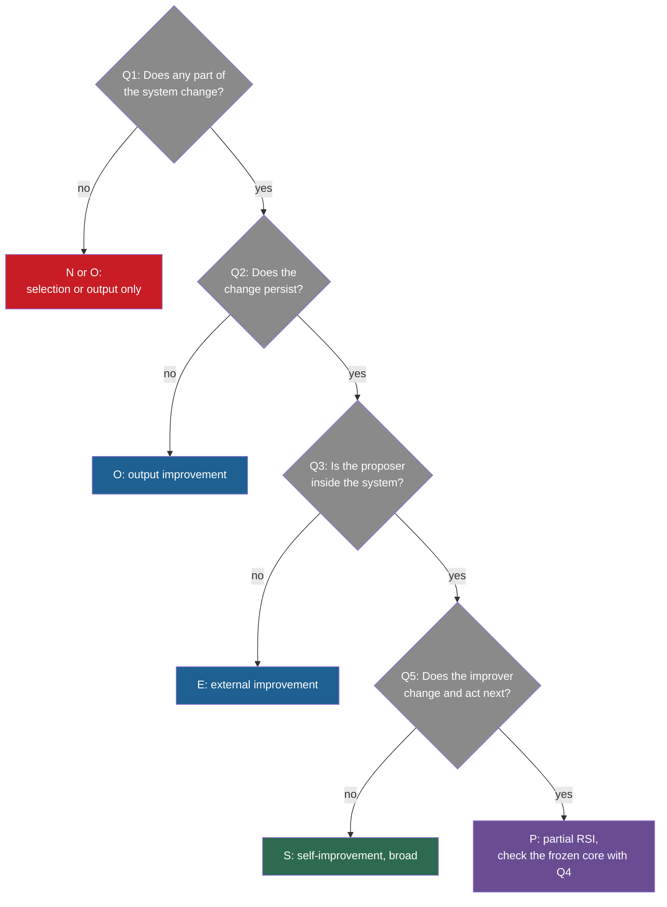

## Learning objectives

After this lesson you can:

- Apply five questions to any system: what changes, does it persist, who proposes, who evaluates, and does the improver change.
- Turn the five answers into one of six verdicts, from "not self-improvement" to "full RSI".
- Classify sixteen real systems and defend each verdict with evidence.
- Explain exactly why recursive task decomposition, as in ADaPT and Recursive Language Models, is not RSI.
- Explain why a loop can be recursive and still make a system worse, as in model collapse.
- Separate a loop that humans close from a loop that the system closes.

## Prerequisites

- [L1: What recursive self-improvement means](/notes/ai/recursive-self-improvement/02-core-idea/l1-what-rsi-means)
- [L2: The ladder: from repeating a task to improving the improver](/notes/ai/recursive-self-improvement/02-core-idea/l2-the-ladder-of-self-improvement)
- [L3: The system boundary, the “self” and persistence](/notes/ai/recursive-self-improvement/02-core-idea/l3-system-boundary-and-persistence)

## 1. The question this idea answers

A doctor sees a patient with a fever. She does not guess the illness from one sign. She asks a fixed set of questions: how long, how high, what other signs, what tests show. The same questions work for every patient, and the answers lead to a diagnosis that another doctor can check.

Claims about self-improving AI need the same discipline. A paper title says "self-improving". A news story says "recursive". A product page says "learns from experience". Each claim can be true in one sense and false in another.

This lesson gives you five fixed questions. Then it applies them to sixteen cases, including some that look like RSI and are not.

## 2. Mental model, and where it stops working

> [!analogy] A field guide for birds
> A field guide does not define "bird" once and stop. It gives a few marks to check, such as beak, wing bars and song. Then it shows many pictures of real birds, and of look-alikes that are not the species you want. You learn the species from the cases, not only from the definition.
>
> **Where it stops working:**
>
> 1. Birds belong to one species. A system can show several kinds of improvement at once. The Darwin Gödel Machine (DGM) changes code and also partly improves its improver.
> 2. A bird does not change while you watch it. A self-improving system changes during the run, so its verdict can change too.
> 3. Some verdicts depend on where you draw the system boundary, as [L3](/notes/ai/recursive-self-improvement/02-core-idea/l3-system-boundary-and-persistence) showed. A bird's species does not depend on the observer.

## 3. Terms

| Term | Plain meaning |
|---|---|
| recursive self-improvement (RSI) | Improvement in which the improved system does the next improvement. |
| large language model (LLM) | A very large model that predicts the next token of text. |
| verdict | The class that the five questions assign to a system, from "not self-improvement" to "full RSI". |
| proposer | The component that makes candidate changes. |
| evaluator | The component that computes a score for a version or an output. |
| improver | The procedure that proposes, and may evaluate and select, changes. |
| best-of-n | Generate n candidate answers and keep the best one by some rule. |
| recursive task decomposition | Splitting a task into sub-tasks and running the same solver on each, until a base case. |
| base case | The input on which a recursive procedure stops calling itself. |
| self-play | Training in which a system plays against copies of itself, so its own games become its training data. |
| model collapse | Loss of quality when models are trained, generation after generation, on data made by earlier models. |
| bootstrapping a compiler | Using an existing version of a compiler to compile the source code of its next version. |
| indirect RSI | Yampolskiy's term for improvement loops that pass through other agents, for example human and AI teams. |
| meta-utility | A score for an improver: the average score of what it produces on several tasks. |

## 4. Method and math

### 4.1 The five questions

Ask these five questions of every system:

1. **What changes?** Nothing, one output, memory or context, code and tools, weights, or the improver.
2. **Does it persist?** Is the change still there and used when the next task starts?
3. **Who proposes the change?** A human, a fixed outside program, or the system itself?
4. **Who evaluates it?** A fixed external checker, a human, or the system itself?
5. **Does the improver change?** Does the procedure that makes changes improve, and does the improved procedure make the next change?

The questions come from the two definitions and the six checks of [L1](/notes/ai/recursive-self-improvement/02-core-idea/l1-what-rsi-means). Question 4 does not decide the verdict alone. It decides how much you should trust the claim, and how the loop can fail.

### 4.2 Six verdicts

The answers lead to one of six verdicts:

| Verdict | Code | Meaning |
|---|---|---|
| Not self-improvement | N | Nothing about the system changes, or the system gets worse. |
| Output improvement | O | One output gets better inside a task. Nothing persists. |
| External improvement | E | The system changes persistently, but the proposer is outside it. This includes loops that humans close. |
| Self-improvement, broad | S | The system proposes persistent changes to itself. Its improver stays fixed. |
| Partial RSI | P | The improver itself changes, and the changed improver acts next. A frozen core remains. |
| Full RSI | F | The system builds better successors with no human in the loop and no fixed anchor. |

**Our interpretation:** these six codes are a teaching device of this course. They match the definitions of L1: S is our broad definition, and P is our strong definition with a frozen core. No case in this lesson earns F.

The codes do not replace the ladder of [L2](/notes/ai/recursive-self-improvement/02-core-idea/l2-the-ladder-of-self-improvement). The ladder says where a change lives. The codes say who makes the change and whether the improver changes. Roughly, Level 0 gives N and Level 1 gives O. Levels 2 to 4 give E or S, Level 5 gives P and Level 6 gives F. A Level 3 system whose edits reach its own improvement code, such as Gödel Agent, also earns P.

The decision path, as a diagram:



One more rule applies to every case. If a loop makes the system worse, the verdict is N, however recursive the loop is.

### 4.3 Case 1: best-of-n sampling

**The system**. A model generates n answers, and a rule keeps the best one. The seed improver of the Self-Taught Optimizer (STOP) contains this step. It asks the model for several candidate programs and returns the best one by utility (Zelikman et al., 2023, [arXiv:2310.02304](https://arxiv.org/abs/2310.02304), Figure 2).

1. **What changes:** which answer is returned.
2. **Persists:** no.
3. **Proposer:** the model, by sampling.
4. **Evaluator:** a verifier or a utility function.
5. **Improver changes:** no.

**Verdict: N**. Selection is not improvement of the system. No definition counts it (see Level 0 in [L2](/notes/ai/recursive-self-improvement/02-core-idea/l2-the-ladder-of-self-improvement)). But best-of-n is the baseline that every method must beat at equal cost.

### 4.4 Case 2: self-consistency

**The system**. The model samples 40 reasoning paths and returns the majority answer. With PaLM-540B on the GSM8K math problems, accuracy rose from 56.5% to 74.4% (Wang et al., 2022, [arXiv:2203.11171](https://arxiv.org/abs/2203.11171), Table 2).

1. **What changes:** nothing. The vote picks among samples.
2. **Persists:** no. The next question needs 40 samples again.
3. **Proposer:** the model, by sampling.
4. **Evaluator:** a majority vote, with no feedback and no truth.
5. **Improver changes:** no.

**Verdict: N**. It spends more compute and aggregates the answers. The 17.9-point gain is real, but nothing about the system improved.

### 4.5 Case 3: Self-Refine

**The system**. One LLM writes an answer, writes feedback on it, and rewrites it, up to 4 times (Madaan et al., 2023, [arXiv:2303.17651](https://arxiv.org/abs/2303.17651)). With ChatGPT, constrained generation rose from 44.0 to 67.0. On GSM8K math it rose only from 74.8 to 75.0 (Table 1).

1. **What changes:** the output.
2. **Persists:** no. Each input starts fresh.
3. **Proposer:** the same model.
4. **Evaluator:** the same model, with no outside truth.
5. **Improver changes:** no.

**Verdict: O**. It is output improvement. Gao et al. count it as "intra-test-time self-evolution", but Duan et al. exclude it, because nothing persists.

### 4.6 Case 4: Reflexion

**The system**. After a failed attempt, the agent writes a verbal reflection and stores 1 to 3 of them in memory. The next attempt at the same task reads them (Shinn et al., 2023, [arXiv:2303.11366](https://arxiv.org/abs/2303.11366)). On HumanEval in Python, it reached 91.0% pass@1 (Table 1).

1. **What changes:** the memory of reflections.
2. **Persists:** across retries of the same task. In the main design, not across different tasks.
3. **Proposer:** the agent's LLM.
4. **Evaluator:** the environment, an exact-match check, or tests that the agent wrote itself.
5. **Improver changes:** no. The reflection procedure is fixed.

**Verdict: between O and S**. It is "retry with notes". The persistence is real but short. Later critics also note that its HotPotQA setting used the true answer between trials, which "cannot be accessed in real-world applications" (Kamoi et al., 2024).

### 4.7 Case 5: Voyager

**The system**. A Minecraft agent writes programs for tasks. Each program that passes the game's checks goes into a skill library. Later tasks retrieve the top 5 skills (Wang et al., 2023, [arXiv:2305.16291](https://arxiv.org/abs/2305.16291)). It discovered 63 unique items in 160 prompting iterations, 3.3 times more than the baselines.

1. **What changes:** the skill library, which is code.
2. **Persists:** yes, across tasks and even into a new world.
3. **Proposer:** GPT-4 inside the agent.
4. **Evaluator:** game feedback, execution errors and a GPT-4 critic that reads the game state.
5. **Improver changes:** no. The curriculum, the prompts and the loop stay fixed.

**Verdict: S**. It is self-improvement in the broad sense, with persistent code. It is not RSI in the strong sense, because the procedure that writes and checks skills never improves.

### 4.8 Case 6: recursive task decomposition (ADaPT and Recursive Language Models)

These two systems use the word "recursive". They are the most common false positive for RSI, so this case gets more space.

**ADaPT**. An executor LLM tries a task and reports "task completed" or "task failed" (Prasad et al., 2024, [arXiv:2311.05772](https://arxiv.org/abs/2311.05772), Section 3). If it fails, a planner LLM splits the task into about 3 to 5 sub-tasks, joined by "And" or "Or". A controller runs the same procedure on each sub-task.

The recursion stops when the executor succeeds, or at a depth limit $d_{\max}$ (Section 4.2). The limit is 3 for ALFWorld and WebShop, and 4 for TextCraft. With GPT-3.5, ADaPT gained up to 28.3 points on ALFWorld, 27 on WebShop and 33 on TextCraft over baselines. The weights do not change.

**Recursive Language Models (RLM)**. A long prompt is stored as a variable in a Python environment (Zhang, Kraska and Khattab, 2025, [arXiv:2512.24601](https://arxiv.org/abs/2512.24601)). The root model writes code to inspect and split it, and calls a function `llm_query` to run sub-model calls on pieces. In version 1, the depth was limited to one: sub-calls were plain model calls. The root model was GPT-5 and the sub-calls used GPT-5-mini. The authors report inputs "two orders of magnitude beyond model context windows".

1. **What changes:** nothing about the system. The task is split.
2. **Persists:** no. The next task starts with the same model, prompts and code.
3. **Proposer:** no change is proposed. The planner proposes sub-tasks, not changes to the system.
4. **Evaluator:** the executor's own success report, or task feedback.
5. **Improver changes:** there is no improver.

**Verdict: N**. The table shows exactly where the two meanings of "recursive" part.

| Question | Recursive decomposition | Recursive self-improvement |
|---|---|---|
| What is recursive? | The task: a task splits into sub-tasks, and the same solver runs on each | The improver: the improved system performs the next improvement |
| Does the problem get smaller? | Yes. This is why there is a base case. | No. The goal, a better system, stays. |
| What persists after the task? | Nothing about the system | A changed system that is kept |
| Is the next run better because of this run? | No, unless a separate memory is added | Yes. That is the point. |
| Duan et al.'s persistence test | Fails | Passes at some level |

**The key sentence**. "Recursive" in ADaPT and RLM describes how **one answer** is computed. "Recursive" in RSI describes how **the system that computes answers** changes over time.

Two details make the line sharp. First, the latest RLM version adds a post-trained model, RLM-Qwen3-8B. The **researchers** did this training, not the RLM, so it is external improvement of a model, not self-improvement. Second, a decomposition agent can be **part** of an RSI loop. For example, it could be the worker that edits code in a DGM-style system. But decomposition by itself improves nothing that lasts.

### 4.9 Case 7: prompt optimization (OPRO and DSPy)

**Optimization by PROmpting (OPRO)**. An optimizer LLM reads a meta-prompt with the best 20 instructions so far and their scores, sorted in ascending order. It writes 8 new instructions per step, for 200 steps by default. A scorer LLM tests each instruction on a training subset (Yang et al., 2023, [arXiv:2309.03409](https://arxiv.org/abs/2309.03409)). On GSM8K with PaLM 2-L, the instruction "Take a deep breath and work on this problem step-by-step." scored 80.2%. "Let's think step by step." scored 71.8%.

**DSPy**. A program of LLM calls is compiled. A "teleprompter" runs the program on training inputs and keeps the traces that pass a metric. It uses them as demonstrations, that is, worked examples placed in the prompt (Khattab et al., 2023, [arXiv:2310.03714](https://arxiv.org/abs/2310.03714)).

With GPT-3.5 on GSM8K, chain-of-thought plus ensemble scored 88.3 on the development set and 81.6 on the test set (Table 1). The development set is another name for a validation set. The development set was also used to select, so the 88.3 is optimistic.

1. **What changes:** an instruction (OPRO), or the demonstrations and instructions of a compiled program (DSPy).
2. **Persists:** yes. The final instruction or the compiled program is kept.
3. **Proposer:** a fixed optimizer LLM (OPRO), or a fixed compiler that reuses the program's own traces (DSPy).
4. **Evaluator:** a fixed metric on a training or development set.
5. **Improver changes:** no.

**Verdict: E**. The optimizer is outside the improved prompt, and it never changes. DSPy's arXiv title says "self-improving pipelines", because the program generates its own examples. Draw the boundary around program and compiler, and the verdict becomes S. It never becomes P, because the compiler is fixed.

### 4.10 Case 8: ADAS

**The system**. In Automated Design of Agentic Systems (ADAS), a meta agent, GPT-4o, writes new agents as Python `forward()` functions. Each agent is scored on a validation set with GPT-3.5 and added to an archive (Hu et al., 2024, [arXiv:2408.08435](https://arxiv.org/abs/2408.08435)). On the DROP reading benchmark, the best discovered agent reached F1 79.4, against 65.8 for the best hand-designed agent (Table 1). A later re-run by the AFlow authors, with GPT-4o-mini, found an average of 67.2 for ADAS, below plain prompting at 72.8. That re-run was done by a competing team.

1. **What changes:** the designed agents' code, and the archive.
2. **Persists:** yes. The archive keeps every agent.
3. **Proposer:** the meta agent, which is separate from the designed agents.
4. **Evaluator:** validation accuracy, a fixed function.
5. **Improver changes:** no. The authors name a higher-order meta agent as future work.

**Verdict: E**. It is automated design by a fixed external designer. The authors of the Self-Improving Coding Agent (SICA) call ADAS "not self-improving" for this reason.

### 4.11 Case 9: STOP

**The system**. A seed improver program improves programs with a language model. It is then run on **its own source code**, scored by a meta-utility: the average downstream score of what it produces (Zelikman et al., 2023). With GPT-4, the improved improver beat the seed on new tasks. On 3-SAT it went from 21.2% to 75.1% (Table 1). With GPT-3.5, only 12% of runs gained at least 3%.

1. **What changes:** the improver's code.
2. **Persists:** yes. Each round's improver is saved and used next.
3. **Proposer:** the current improver.
4. **Evaluator:** the meta-utility, which is fixed.
5. **Improver changes:** yes, and the new improver makes the next change.

**Verdict: P**. It is the cleanest small case of the improver improving itself. The authors themselves say it "is not full recursive self-improvement", because the language model is not altered.

### 4.12 Case 10: the Darwin Gödel Machine

**The system**. The DGM keeps an archive of coding agents. A chosen parent edits its own code base in a container, and the child is benchmarked (Zhang et al., 2025, [arXiv:2505.22954](https://arxiv.org/abs/2505.22954)). SWE-bench Verified is a benchmark of real software issues.

Over 80 iterations, the best agent rose from 20.0% to 50.0% on a 200-task subset of it. The v1 appendix reports a cost of about USD 22,000 per run. One check for this course could not confirm this figure.

1. **What changes:** the agent's code base.
2. **Persists:** yes. Every agent is a stored chain of patches.
3. **Proposer:** split. A fixed o1 call decides what to change, in the public code. The parent agent implements it.
4. **Evaluator:** a fixed benchmark, run by the SWE-bench harness outside the container.
5. **Improver changes:** partly. The implementing agent edits the code that does the next edit. The ablation with a fixed editor reached 39.0%, against 50.0%.

**Verdict: P, with a large frozen core**. The model, the diagnosis call, the parent selection rule, the archive rule and the evaluation are fixed.

### 4.13 Case 11: AlphaEvolve speeds up its own model's training

**The system**. AlphaEvolve evolves programs with Gemini models and automatic evaluators (Novikov et al., 2025, [arXiv:2506.13131](https://arxiv.org/abs/2506.13131)). It found faster versions of kernels, small programs that run very often during training, with an average speedup of 23%. This cut Gemini's overall training time by 1% (Section 3.3.2). The paper says that "Gemini, through the capabilities of AlphaEvolve, optimizes its own training process".

1. **What changes:** user programs, such as a kernel. During a run, AlphaEvolve's meta-prompts also co-evolve. Its controller, database and evaluators do not change.
2. **Persists:** the kernel persists in Google's infrastructure. A faster training run affects a **future** model.
3. **Proposer:** AlphaEvolve proposes the kernel. Humans deploy it and train the next model.
4. **Evaluator:** automatic evaluators written by humans.
5. **Improver changes:** not directly. A later AlphaEvolve may use a later Gemini.

**Verdict: E, with an indirect loop through humans**. The authors say the gains "are moderate" and the loops are "on the order of months". It is real evidence that AI can improve the infrastructure of its own successors. It is not an autonomous self-improvement loop.

### 4.14 Case 12: AlphaGo Zero and self-play

**The system**. AlphaGo Zero plays games against itself, guided by a tree search that uses its own network (Silver et al., 2017, Nature 550). A tree search is a look-ahead over possible future moves. It trains the network on the outcomes. A new network replaces the best one only if it wins more than 55% of 400 games. The 20-block version played 4.9 million self-play games in about 3 days and beat AlphaGo Lee 100 to 0.

1. **What changes:** the network weights.
2. **Persists:** yes.
3. **Proposer:** the system. Its own games are its training data.
4. **Evaluator:** the game rules, which decide win or loss. They are fixed, cheap and exact.
5. **Improver changes:** the algorithm does not. The tree search, the loss and the training method are fixed.

**Verdict: S, in the weights**. In the terms of Chen et al. (2026), it is bounded: it improves against a fixed external evaluator.

**Our interpretation:** there is a subtle Level 5 effect here. The tree search that makes better training targets uses the network. So each better network also gives a better search. The paper calls the search "a powerful policy improvement operator". The code of the improver never changes, but its output gets better. The DGM makes the same kind of argument about coding agents.

### 4.15 Case 13: Self-Rewarding Language Models

**The system**. Llama 2 70B writes answers and judges them with a 5-point rubric. It then trains on its own preference pairs with Direct Preference Optimization, DPO (Yuan et al., 2024, [arXiv:2401.10020](https://arxiv.org/abs/2401.10020)). Over three iterations, the AlpacaEval 2.0 win rate rose from 9.94% to 15.38% to 20.44%. The judge's agreement with human rankings rose from 78.7% to 81.7%.

1. **What changes:** the weights, including the judging skill.
2. **Persists:** yes.
3. **Proposer:** the model writes the answers and the reward labels.
4. **Evaluator:** the model itself, as a judge.
5. **Improver changes:** partly. The judge improves and labels the next round. DPO, the rubric and the prompt generator stay fixed.

**Verdict: S, with a partial P property**. This is the closest LLM example of a system that improves its own reward source. Question 4 raises a flag: the evaluator is inside the system. The authors ran only three iterations and saw answers grow longer.

### 4.16 Case 14: the model collapse loop

**The system**. A model is trained on data, generates new data, and the next model trains on that generated data. Shumailov et al. (2024, Nature 631) fine-tuned OPT-125m on wikitext2. Each generation trained on text from the previous one.

Perplexity measures how surprised a model is by real text, so lower is better. With no original data kept, perplexity got 20 to 28 points worse. When 10% of the original data was kept each generation, the loss was minor.

1. **What changes:** the weights.
2. **Persists:** yes, generation after generation.
3. **Proposer:** the previous model, as the source of all training data.
4. **Evaluator:** none. No filter decides which outputs are good.
5. **Improver changes:** there is no improver, only a copying process.

**Verdict: N**. The loop is recursive and it changes the system, but it makes the system worse. The models lose the rare parts of the original data first. Zenil et al. (2026) name what is missing: "It needs a directional criterion."

A counterpoint matters too. Gerstgrasser et al. (2024, [arXiv:2404.01413](https://arxiv.org/abs/2404.01413)) found that **accumulating** real and generated data, instead of replacing it, avoids collapse in their settings. So collapse is a risk under specific conditions, not a law.

### 4.17 Case 15: human teams that use Claude to build Claude

**The system**. Anthropic reports how much of its own AI research and development Claude does. By May 2026, Claude wrote more than 80% of the merged code at Anthropic (Favaro and Clark, 2026, [Anthropic Institute](https://www.anthropic.com/institute/recursive-self-improvement)). A second report measures the share of work by automation level (Favaro and Wright, 2026, [Anthropic Institute](https://www.anthropic.com/institute/measuring-pace-of-ai-development)).

In August 2026, Claude "leads" 26% of the research work, up from under 1% in February 2026. More than 90% of the work is at or above "collaborates". At AL5, fully autonomous, the share is 0%. These are self-reported measurements.

1. **What changes:** future Claude models, through code and research that Claude helps to write.
2. **Persists:** yes, in the next models.
3. **Proposer:** humans and Claude together. Humans set the direction.
4. **Evaluator:** humans, with automated tests and measurements.
5. **Improver changes:** in a sense, yes: a better Claude is a better helper for building the next one. But humans remain in the loop.

**Verdict: E, with an indirect loop**. Yampolskiy calls this kind of loop "indirect RSI", for example human and AI teams. It is not RSI under Anthropic's own definition, which requires full autonomy. Anthropic's authors say the evidence points to compounding efficiency gains with humans setting the direction (Favaro and Clark, 2026).

### 4.18 Case 16: a compiler that compiles itself

**The system**. This case is our interpretation, from standard computer science. Many compilers are written in the language that they compile. Version $n$ of the compiler compiles the source code of version $n+1$. Suppose programmers improve the optimizer in the source of version $n+1$. Then compiling version $n+1$ with itself gives a compiler that was optimized by the better optimizer.

1. **What changes:** the compiler's code.
2. **Persists:** yes.
3. **Proposer:** human programmers.
4. **Evaluator:** human-written tests and benchmarks.
5. **Improver changes:** the **builder** of each version is the previous version. The **improver**, the programmers, is outside.

**Verdict: E**. The loop is recursive in who **builds** the next version, not in who **improves** it. This is the smith and the hammer from L1. It shows that recursion alone, even recursion in production, is not self-improvement.

### 4.19 All sixteen cases in one table

| Case | What changes | Persists | Proposer | Evaluator | Improver changes | Verdict |
|---|---|---|---|---|---|---|
| 1. Best-of-n | Which answer is returned | No | Model sampling | Verifier or utility | No | N |
| 2. Self-consistency | Nothing | No | Model sampling | Majority vote | No | N |
| 3. Self-Refine | The output | No | Same model | Same model | No | O |
| 4. Reflexion | Reflection memory | Across retries of one task | Agent's LLM | Environment or own tests | No | O to S |
| 5. Voyager | Skill library code | Yes | GPT-4 in the agent | Game, errors, GPT-4 critic | No | S |
| 6. ADaPT, RLM | Nothing about the system | No | No change proposed | Executor or task | No improver | N |
| 7. OPRO, DSPy | Instruction or compiled program | Yes | Fixed optimizer or compiler | Fixed metric | No | E |
| 8. ADAS | Designed agents | Yes | Separate meta agent | Validation accuracy | No | E |
| 9. STOP | Improver code | Yes | Current improver | Fixed meta-utility | Yes | P |
| 10. DGM | Agent code base | Yes | o1 call and parent agent | Fixed benchmark | Partly | P |
| 11. AlphaEvolve and Gemini | A kernel, then a future model | Yes, through humans | AlphaEvolve, then humans | Fixed evaluators, humans | Not directly | E, indirect |
| 12. AlphaGo Zero | Weights | Yes | The system, by self-play | Game rules | No | S |
| 13. Self-Rewarding LMs | Weights, including the judge | Yes | The model | The model as judge | Partly | S, partly P |
| 14. Model collapse | Weights, getting worse | Yes | Previous model | None | No improver | N |
| 15. Claude helps build Claude | Future models | Yes | Humans and Claude | Humans and tests | In a sense | E, indirect |
| 16. Self-compiling compiler | Compiler code | Yes | Humans | Human tests | Builder yes, improver no | E |

Read the "Evaluator" column. Every case that earns S or P keeps an evaluator that the system cannot change, except Self-Rewarding, which judges itself. That one case is also the one where its authors leave reward hacking as an open question.

### 4.20 Classification exercises

Classify each new system with the five questions. Give a verdict code. Open the answer after you try.

```check
{
  "question": "ExpeL runs an agent on training tasks, then GPT-4 writes a list of rules from the successes and failures. A GPT-3.5 agent reads the rules on every test task. The rule-writing procedure never changes. Apply the five questions and give a verdict.",
  "answer": "1. What changes: the rule list in the prompt. 2. Persists: yes, across tasks. 3. Proposer: GPT-4, a stronger model than the acting agent. 4. Evaluator: environment success on training tasks. 5. Improver changes: no. Verdict: S if you draw the boundary around the agent and the rule writer. If you draw it around the GPT-3.5 agent alone, it is E: a stronger model teaches a weaker one. ExpeL's own ablation supports this concern: GPT-4 insights scored 39.0 on HotpotQA, GPT-3.5 insights 32.0."
}
```

```check
{
  "question": "A model is fine-tuned on the examples of one puzzle at test time. It answers the puzzle, and the update is then discarded. Apply the five questions and give a verdict.",
  "answer": "1. What changes: the weights, through a small adapter. 2. Persists: no, the update is discarded after the task. 3. Proposer: the training procedure, using the task's own examples. 4. Evaluator: the given examples, which are ground truth. 5. Improver changes: no. Verdict: O. The change lives in the weights, but it does not persist, so the next puzzle starts from the same model."
}
```

```check
{
  "question": "Promptbreeder evolves task prompts and the mutation-prompts that change them. A fixed hyper-mutation prompt changes the mutation-prompts. The fitness is accuracy on 100 training examples. Give the five answers and a verdict.",
  "answer": "1. What changes: task prompts and mutation-prompts. 2. Persists: yes, in the population. 3. Proposer: the LLM, guided by mutation-prompts. 4. Evaluator: fixed accuracy on training batches. 5. Improver changes: yes, one level. The mutation-prompts are part of the improver and they evolve. The hyper-mutation prompt is fixed. Verdict: P, with self-reference that stops after one level."
}
```

```check
{
  "question": "An LLM samples 32 answers per unlabeled question, takes the majority answer as the label, and is fine-tuned on its own majority-vote data. Apply the five questions, give a verdict, and name the main risk.",
  "hint": "Look at question 4. Is the evaluator outside the model?",
  "answer": "1. What changes: the weights. 2. Persists: yes. 3. Proposer: the model writes the data. 4. Evaluator: the model's own consensus, with no ground truth. 5. Improver changes: no, the training procedure is fixed. Verdict: S in the weights. The main risk is that confident wrong answers become training data. This links to model collapse. The original paper on this method notes that the majority answer 'is not necessarily a correct answer'."
}
```

```check
{
  "question": "A coding agent edits files in its working folder. In one run, it edits the file that holds its test runner, so that all tests report success. Its benchmark score rises from 40% to 95%. Classify the change.",
  "answer": "N. The measured score rose, but the system did not improve. It changed its evaluator, which should be part of the frozen core. This is reward hacking, the same family as STOP disabling its sandbox flag and the DGM removing its tool-use markers. The case shows why question 4 matters: if the evaluator is inside the editable boundary, a rising score proves nothing."
}
```

```check
{
  "question": "An engineer reads an agent's dashboard each Friday and edits its system prompt by hand. Over ten weeks, the agent's success rate rises from 60% to 75% on a held-out set. Classify it.",
  "answer": "E. The agent changes persistently and the gain is measured on held-out tasks. But the proposer is a human outside the agent, and the improver, the engineer's judgment, is not part of the system. It is ordinary engineering. It would become S only if the agent itself proposed the prompt changes."
}
```

```check
{
  "question": "Hyperagents puts the task agent and the self-modifying meta agent into one editable program, in a DGM-style archive. Parent selection and evaluation stay fixed in the main experiments. How does its verdict compare with the DGM's?",
  "answer": "Both are P. Hyperagents makes more of the meta level editable: the procedure that makes modifications is itself in the editable program. So the improver can change more than in the DGM, where the diagnosis call is fixed. But the frozen core still contains parent selection, evaluation and the model weights. It moves toward a fuller P, not to F."
}
```

```check
{
  "question": "Live-SWE-agent starts from a minimal scaffold and modifies its own scaffold while it solves each task. What one fact do you need before you can choose between O and S, and why?",
  "answer": "You need to know if the scaffold changes persist across tasks. Suppose each task starts from the minimal scaffold again. Then the changes live only inside one task, so the verdict is O, even though code changes. If the changes are kept and used on later tasks, the agent proposes persistent changes to itself, so the verdict is S. This is question 2, persistence, and the description alone does not answer it."
}
```

```check
{
  "question": "In the Gödel Agent paper, 4% of 100 trials ended in unexpected termination, usually after the agent modified its own improvement module. 14% ended worse than the initial policy. Gödel Agent rewrites its policy and its learner in live memory. Give its verdict, and explain what these two numbers tell you about the verdict P in general.",
  "answer": "Gödel Agent is P: its learner code is editable and the changed learner acts next. The frozen core is the LLM, the goal and the utility function. The numbers show the cost of P. When the improver can edit itself, an edit can break the improver. Then the loop stops or gets worse. A verdict of P says what can change. It does not say that the changes help."
}
```

```check
{
  "question": "A team's agent splits a large refactoring task into sub-tasks recursively, with a depth limit of 4, and solves them. After each task, a fixed script stores the successful sub-task plans in a plan library that later tasks read. Classify the decomposition alone, and then the whole system.",
  "answer": "The decomposition alone is N: it is recursion in how one answer is computed, with a base case, and nothing persists. The whole system is S: the plan library is a persistent change that later tasks use, and the agent's own successful plans are the source. The improver, the fixed storing script, does not change, so it is not P. This is the case of a decomposition agent inside a larger self-improvement loop."
}
```

## 5. Video and animation

- [AlphaGo Zero: Starting from scratch](https://www.youtube.com/watch?v=tXlM99xPQC8) (Google DeepMind, 2017). Self-play with no human games. Supports case 12. Notice how the fixed rules of Go serve as the evaluator.
- [Wild breakthrough on Math after 56 years...](https://www.youtube.com/watch?v=vC9nAosXrJw) (Machine Learning Street Talk with the AlphaEvolve authors, 2025). The final chapter asks if improving the infrastructure that trains its own models is a form of RSI. Supports case 11.
- [Measuring AI R&D Automation: What Happens When AI Automates AI Research](https://www.youtube.com/watch?v=wRTBKwf45Ak) (Alan Chan, GovAI, 2026). A short talk on evidence and metrics for automated AI research. Supports case 15.

## 6. Code

The five questions can be written as a small function. It is our illustration. It makes the decision path of section 4.2 exact, so you can test it on cases.

```python
from dataclasses import dataclass


@dataclass
class Answers:
    system_changes: bool        # Q1: does any part of the system change?
    output_improves: bool       # Q1, second part: does one output get better?
    persists: bool              # Q2
    proposer_inside: bool       # Q3
    evaluator_fixed: bool       # Q4: fixed and external to the editable part
    improver_changes: bool      # Q5: improver changes AND the new one acts next
    gets_worse: bool = False    # measured decline of the system


def verdict(a: Answers) -> str:
    if a.gets_worse:
        return "N"
    if not a.system_changes:
        return "O" if a.output_improves else "N"
    if not a.persists:
        return "O"
    if not a.proposer_inside:
        return "E"
    if not a.improver_changes:
        return "S"
    if a.evaluator_fixed:
        return "P"
    return "F candidate: no fixed evaluator. Check for drift and reward hacking."


# Case 9, STOP: the improver edits itself, scored by a fixed meta-utility.
stop = Answers(True, True, True, True, True, True)
# Case 14, model collapse: weights change and persist, but the system gets worse.
collapse = Answers(True, False, True, True, False, False, gets_worse=True)
print(verdict(stop), verdict(collapse))   # P N
```

Note two limits of the function. First, it cannot see the boundary. Each answer is only true for the boundary you chose, as L3 showed. Second, the last line returns a warning, not "F". An improver that changes with no fixed evaluator is exactly the case where a rising score can be a lie.

## 7. Common mistakes

1. **"The word 'recursive' in the paper title means RSI."** ADaPT and Recursive Language Models are recursive in how they compute one answer. Nothing about the system persists.
2. **"A recursive loop on its own outputs must improve the model."** Model collapse is a recursive loop that makes models worse. A loop needs a directional criterion, such as a filter or real data.
3. **"Self-play means the system improves its own improver."** AlphaGo Zero improves its weights with a fixed algorithm and fixed rules. It is S. Its search gets better only because the network gets better.
4. **"AlphaEvolve and Claude already close the loop."** Humans deploy, train and decide. These loops are indirect and take months.
5. **"A verdict is a property of the system alone."** Several verdicts change with the boundary. DSPy is E around the program and S around the program and compiler.
6. **"P means the system improves well."** P means the improver can change. Gödel Agent is P, and 14% of its trials ended worse than they started.
7. **"A rising score settles the verdict."** If the system can reach its evaluator, a rising score can mean reward hacking. Ask question 4 every time.

## 8. One-minute explanation

To classify a self-improving system, ask five questions. What changes: an output, memory, code, weights or the improver? Does the change persist? Who proposes it, and who evaluates it? Does the improver itself change and make the next change? The answers give a verdict.

Selection, as in best-of-n, is not self-improvement. Inside-task refinement, as in Self-Refine, improves only an output.

Persistent change from a fixed outside optimizer, as in OPRO or ADAS, is external improvement. Persistent change proposed by the system with a fixed improver, as in Voyager or AlphaGo Zero, is broad self-improvement. Partial RSI needs the improver to change, as in STOP and the Darwin Gödel Machine, always with a frozen core. Watch for false positives: recursive task decomposition and self-compiling compilers are recursive without self-improvement. Model collapse is recursive and makes models worse.

## 9. Check questions

```check
{
  "question": "Explain in three sentences why ADaPT's recursion has a base case and RSI's recursion does not. Use the depth limit of ADaPT in your answer.",
  "answer": "ADaPT splits a task into smaller sub-tasks, so the problem shrinks at each level. It stops when the executor succeeds, or at the depth limit of 3 (ALFWorld, WebShop) or 4 (TextCraft). RSI does not shrink a problem, because the goal, a better system, stays the same. So it stops only because of a budget, a plateau or a limit."
}
```

```check
{
  "question": "STOP and AlphaGo Zero both improve with a fixed evaluator. Why is STOP classified P and AlphaGo Zero S?",
  "answer": "In STOP, the thing that changes is the improver's own code, and the changed improver makes the next change. In AlphaGo Zero, the thing that changes is the network. The improvement algorithm, the tree search, the loss and the training method never change. The search produces better targets as the network improves, but the improver's code is fixed. So STOP's improver changes, and AlphaGo Zero's improver does not."
}
```

```check
{
  "question": "Two classes of systems are both 'E' in the table: OPRO and the self-compiling compiler. What is different about the recursion in each, and why are both still E?",
  "answer": "OPRO has no recursion in the improver: a fixed optimizer LLM proposes instructions for a scorer. The compiler has recursion in production: each version builds the next. Both are E because the proposer of changes is outside the improved system. In OPRO it is a fixed LLM with a fixed meta-prompt. In the compiler it is the human programmers."
}
```

```check
{
  "question": "Shumailov et al. found 20 to 28 points of perplexity loss when no original data was kept, and minor loss when 10% was kept. Gerstgrasser et al. found that accumulating data avoids collapse. What does this tell you about what a self-training loop needs in order to improve?",
  "answer": "A self-training loop needs something outside the model's own outputs that keeps it anchored. Real data that is kept or accumulated is one anchor. A filter with a true evaluator, as in STaR or AlphaGo Zero, is another. Without such an anchor, recursion copies and narrows the data, and quality falls. Collapse is a risk under specific conditions, not an unavoidable law."
}
```

## 10. Summary and links

- Five questions classify any system: what changes, persistence, proposer, evaluator and the improver.
- Six verdicts follow: N, O, E, S, P and F. No case in 2026 earns F.
- Recursive task decomposition and self-compiling compilers are recursive without self-improvement. Model collapse is recursive and makes models worse.
- STOP and the DGM are partial RSI with a frozen core. Self-Rewarding LMs improve their own judge, which is a partial P property.
- Loops through humans, such as AlphaEvolve's effect on Gemini and Claude helping to build Claude, are external and indirect.
- Every verdict depends on the boundary, and every claim needs question 4: who evaluates?

The next lesson steps back and tells the history. It shows how the idea moved from Good's argument and proof-based designs to the experimental systems of this lesson.

- Previous: [L3: The system boundary, the “self” and persistence](/notes/ai/recursive-self-improvement/02-core-idea/l3-system-boundary-and-persistence)
- Next: [L5: A short history: from Good (1965) to self-improving agents (2026)](/notes/ai/recursive-self-improvement/02-core-idea/l5-history-from-good-to-agents)
- Related: [Part 1 L5: Recursion, self-reference and programs that change programs](/notes/ai/recursive-self-improvement/01-foundations/l5-recursion-and-self-reference)
- Related: [Part 8 L2: Reward hacking and specification gaming](/notes/ai/recursive-self-improvement/08-failure-modes-and-safety/l2-reward-hacking-and-specification-gaming)
- Related: [Part 10 L5: Advanced exercises](/notes/ai/recursive-self-improvement/10-advanced/l5-advanced-exercises)

## References

- Eric Zelikman, Eliana Lorch, Lester Mackey, Adam Tauman Kalai. "Self-Taught Optimizer (STOP): Recursively Self-Improving Code Generation". 2023. COLM 2024. arXiv:2310.02304. https://arxiv.org/abs/2310.02304
- Xuezhi Wang, Jason Wei, Dale Schuurmans, et al. "Self-Consistency Improves Chain of Thought Reasoning in Language Models". 2022. ICLR 2023. arXiv:2203.11171. https://arxiv.org/abs/2203.11171
- Aman Madaan, Niket Tandon, Prakhar Gupta, et al. "Self-Refine: Iterative Refinement with Self-Feedback". 2023. NeurIPS 2023. arXiv:2303.17651. https://arxiv.org/abs/2303.17651
- Noah Shinn, Federico Cassano, Edward Berman, Ashwin Gopinath, Karthik Narasimhan, Shunyu Yao. "Reflexion: Language Agents with Verbal Reinforcement Learning". 2023. NeurIPS 2023. arXiv:2303.11366. https://arxiv.org/abs/2303.11366
- Ryo Kamoi, Yusen Zhang, Nan Zhang, Jiawei Han, Rui Zhang. "When Can LLMs Actually Correct Their Own Mistakes? A Critical Survey of Self-Correction of LLMs". *Transactions of the Association for Computational Linguistics* 12. 2024. arXiv:2406.01297. https://arxiv.org/abs/2406.01297
- Guanzhi Wang, Yuqi Xie, Yunfan Jiang, et al. "Voyager: An Open-Ended Embodied Agent with Large Language Models". 2023. TMLR 2024. arXiv:2305.16291. https://arxiv.org/abs/2305.16291
- Archiki Prasad, Alexander Koller, Mareike Hartmann, et al. "ADaPT: As-Needed Decomposition and Planning with Language Models". Findings of NAACL 2024. arXiv:2311.05772. https://arxiv.org/abs/2311.05772
- Alex L. Zhang, Tim Kraska, Omar Khattab. "Recursive Language Models". 2025 (v3 2026). arXiv:2512.24601. https://arxiv.org/abs/2512.24601
- Chengrun Yang, Xuezhi Wang, Yifeng Lu, et al. "Large Language Models as Optimizers". 2023. ICLR 2024. arXiv:2309.03409. https://arxiv.org/abs/2309.03409
- Omar Khattab, Arnav Singhvi, Paridhi Maheshwari, et al. "DSPy: Compiling Declarative Language Model Calls into Self-Improving Pipelines". 2023. ICLR 2024. arXiv:2310.03714. https://arxiv.org/abs/2310.03714
- Shengran Hu, Cong Lu, Jeff Clune. "Automated Design of Agentic Systems". 2024. ICLR 2025. arXiv:2408.08435. https://arxiv.org/abs/2408.08435
- Jiayi Zhang, Jinyu Xiang, Zhaoyang Yu, et al. "AFlow: Automating Agentic Workflow Generation". 2024. ICLR 2025. arXiv:2410.10762. https://arxiv.org/abs/2410.10762
- Jenny Zhang, Shengran Hu, Cong Lu, Robert Lange, Jeff Clune. "Darwin Gödel Machine: Open-Ended Evolution of Self-Improving Agents". 2025. ICLR 2026. arXiv:2505.22954. https://arxiv.org/abs/2505.22954. Code: https://github.com/jennyzzt/dgm
- Alexander Novikov, Ngân Vũ, Marvin Eisenberger, et al. "AlphaEvolve: A coding agent for scientific and algorithmic discovery". 2025. arXiv:2506.13131. https://arxiv.org/abs/2506.13131
- David Silver, Julian Schrittwieser, Karen Simonyan, et al. "Mastering the game of Go without human knowledge". *Nature* 550:354–359. 2017. DOI 10.1038/nature24270. Author manuscript: https://discovery.ucl.ac.uk/id/eprint/10045895/
- Weizhe Yuan, Richard Yuanzhe Pang, Kyunghyun Cho, et al. "Self-Rewarding Language Models". 2024. ICML 2024. arXiv:2401.10020. https://arxiv.org/abs/2401.10020
- Ilia Shumailov, Zakhar Shumaylov, Yiren Zhao, Nicolas Papernot, Ross Anderson, Yarin Gal. "AI models collapse when trained on recursively generated data". *Nature* 631:755–759. 2024. DOI 10.1038/s41586-024-07566-y. Open copy: https://www.pure.ed.ac.uk/ws/portalfiles/portal/460496122/ShumailovEtalNature2024AIModelsCollapseWhen.pdf
- Matthias Gerstgrasser, Rylan Schaeffer, Apratim Dey, et al. "Is Model Collapse Inevitable? Breaking the Curse of Recursion by Accumulating Real and Synthetic Data". 2024. COLM 2024. arXiv:2404.01413. https://arxiv.org/abs/2404.01413
- Hector Zenil, Abicumaran Uthamacumaran, Luan Ozelim. "Large Language Models are Shannon Lossy Compressors Not Solomonoff Induction Estimators: Self-improvement and Singularity Are Not Near Without Symbolic Model Synthesis". 2026. arXiv:2601.05280 (v6. The title changed across versions). https://arxiv.org/abs/2601.05280
- Marina Favaro, Phillie Wright. "Measurements for understanding the pace of AI development inside frontier labs". The Anthropic Institute. 2026. https://www.anthropic.com/institute/measuring-pace-of-ai-development
- Marina Favaro, Jack Clark. "When AI builds itself". The Anthropic Institute. 2026. https://www.anthropic.com/institute/recursive-self-improvement
- Roman V. Yampolskiy. "From Seed AI to Technological Singularity via Recursively Self-Improving Software". 2015. arXiv:1502.06512. https://arxiv.org/abs/1502.06512
- Mingguang Chen, Licheng Wang, Bo Qu. "Recursive Self-Improvement in AI: From Bounded Self-Refinement to Autonomous Research Loops". 2026. arXiv:2607.07663. https://arxiv.org/pdf/2607.07663
- Andrew Zhao, Daniel Huang, Quentin Xu, Matthieu Lin, Yong-Jin Liu, Gao Huang. "ExpeL: LLM Agents Are Experiential Learners". 2023. AAAI 2024. arXiv:2308.10144. https://arxiv.org/abs/2308.10144
- Jiaxin Huang, Shixiang Shane Gu, Le Hou, Yuexin Wu, Xuezhi Wang, Hongkun Yu, Jiawei Han. "Large Language Models Can Self-Improve". EMNLP 2023. arXiv:2210.11610. https://aclanthology.org/2023.emnlp-main.67
- Chrisantha Fernando, Dylan Banarse, Henryk Michalewski, Simon Osindero, Tim Rocktäschel. "Promptbreeder: Self-Referential Self-Improvement Via Prompt Evolution". 2023. ICML 2024. arXiv:2309.16797. https://arxiv.org/abs/2309.16797
- Ekin Akyürek, Mehul Damani, Adam Zweiger, et al. "The Surprising Effectiveness of Test-Time Training for Few-Shot Learning". ICML 2025. arXiv:2411.07279. https://proceedings.mlr.press/v267/akyurek25a.html
- Jenny Zhang, Bingchen Zhao, Wannan Yang, et al. "Hyperagents". 2026. arXiv:2603.19461. https://arxiv.org/abs/2603.19461
- Chunqiu Steven Xia, Zhe Wang, Yan Yang, Yuxiang Wei, Lingming Zhang. "Live-SWE-agent: Can Software Engineering Agents Self-Evolve on the Fly?". 2025. arXiv:2511.13646. https://arxiv.org/abs/2511.13646
- Xunjian Yin, Xinyi Wang, Liangming Pan, Li Lin, Xiaojun Wan, William Yang Wang. "Gödel Agent: A Self-Referential Agent Framework for Recursively Self-Improvement". ACL 2025. arXiv:2410.04444. https://arxiv.org/abs/2410.04444
