## Learning objectives

After this lesson you can:

- Place the main ideas and systems of recursive self-improvement on a timeline from 1965 to 2026, in three eras.
- State what each founding text argued, and what it did not prove.
- Explain the rewrite rule of the Gödel machine, and why practical systems dropped the proof requirement.
- Explain Bostrom's rate equation in words and with numbers, and say what it does not prove.
- Name the machine learning roots of today's systems: meta-learning, architecture search, self-play and AI-generating algorithms.
- Describe the shift from proofs to experiments and its consequences.
- Draw six lessons from the history.

## Prerequisites

- [L1: What recursive self-improvement means](/notes/ai/recursive-self-improvement/02-core-idea/l1-what-rsi-means)
- [L4: Examples and non-examples](/notes/ai/recursive-self-improvement/02-core-idea/l4-examples-and-non-examples)

## 1. The question this idea answers

Look at a modern self-improving agent, such as the Darwin Gödel Machine (DGM). It keeps an archive of versions. It tests each change on a benchmark instead of proving it correct. It freezes its model, its evaluator and its outer loop. Why does it look like this? Why not one version, a proof, and nothing frozen?

Each of these design choices answers a problem that someone found earlier. The archive answers the problem of local optima. The benchmark answers the cost of proofs. The frozen evaluator answers the question of who checks the checker. To understand today's systems, you need the sixty years of ideas behind them. This lesson tells that history in three eras and draws lessons from it.

## 2. Mental model, and where it stops working

> [!analogy] A map drawn before the journey
> Early maps of a new coast show the outline correctly and guess the inland. Later travelers add rivers and mountains, and they correct some of the guesses. The early writers on RSI drew the outline: a machine that improves the machine that improves. The systems of 2023 to 2026 are the first travelers.
>
> **Where it stops working:**
>
> 1. A map improves in one direction. The history of RSI went back and forth. The proof requirement of 2003 was dropped in 2025, and ideas from 1987 came back in 2023.
> 2. A coast does not change because someone maps it. Measurements of AI progress can change how labs act.
> 3. Some early "outlines" may be wrong, not just rough. Fast takeoff is an untested claim, not a coastline.

## 3. Terms

| Term | Plain meaning |
|---|---|
| recursive self-improvement (RSI) | Improvement in which the improved system does the next improvement. |
| large language model (LLM) | A very large model that predicts the next token of text. |
| intelligence explosion | Good's term: better machines design still better machines, so intelligence grows very fast. |
| Gödel machine | Schmidhuber's design for a program that rewrites any part of itself, but only after it proves that the rewrite is useful. |
| proof searcher | The part of a Gödel machine that searches for proofs about the machine itself. |
| target theorem | The statement that a Gödel machine must prove before a rewrite: running this rewrite now is better than not running it. |
| axiom system | The fixed set of starting statements from which proofs are built. |
| utility function | A function that gives a number for how good an outcome is. |
| Löbian obstacle | A proof-based agent cannot trust a successor that uses the same proof system. |
| Kolmogorov complexity | The length of the shortest program that outputs an object. It measures information content. |
| optimization power | Bostrom's term: the quality-weighted effort applied to making a system smarter. |
| recalcitrance | Bostrom's term: how hard a system is to improve. |
| crossover | Bostrom's term: the point after which a system's own work drives most of its improvement. |
| takeoff | The jump from human-level to far-above-human AI. Bostrom calls it slow, moderate or fast. |
| meta-learning | Learning to learn: a learning process that improves another learning process. |
| neural architecture search (NAS) | Automatic search for the structure of a neural network. |
| self-play | Training in which a system plays against copies of itself. |
| AI-generating algorithm (AI-GA) | Clune's term for an algorithm that itself learns how to produce general AI. |
| open-endedness | Hughes et al.: a system that keeps producing artifacts that are both novel and learnable for an observer. |

## 4. Method and math

### 4.1 Three eras

The history falls into three eras. They overlap, and ideas move between them.

1. **Speculation and theory, 1965 to 2015**. Arguments and formal designs. Almost nothing was built.
2. **Machine learning roots, about 1987 to 2022**. Algorithms that improve learners, architectures and game players. The improving algorithm itself is fixed.
3. **The LLM era, 2022 to 2026**. Language models can write useful code and text, so a system can propose changes to its own prompts and programs. Experiments replace proofs.

```mermaid
flowchart LR
    subgraph E1["Era 1: speculation and theory"]
        A1["1965 Good:<br>intelligence explosion"] --> A2["1987 Schmidhuber:<br>meta-meta hook"]
        A2 --> A3["2003 Gödel machine:<br>rewrite after proof"]
        A3 --> A4["2013 to 2015 Yudkowsky, Löbian obstacle,<br>Bostrom, Yampolskiy"]
    end
    subgraph E2["Era 2: machine learning roots"]
        B1["2016 to 2017 NAS,<br>PBT, MAML"] --> B2["2017 AlphaGo Zero:<br>self-play"]
        B2 --> B3["2019 AI-GAs, POET"]
    end
    subgraph E3["Era 3: the LLM era"]
        C1["2022 to 2023 STaR, Self-Refine,<br>Reflexion, Voyager"] --> C2["2023 STOP, Promptbreeder"]
        C2 --> C3["2024 ADAS, Gödel Agent,<br>Self-Rewarding LMs"]
        C3 --> C4["2025 SICA, DGM,<br>AlphaEvolve, HGM"]
        C4 --> C5["2026 ICLR workshop, surveys,<br>AL5 = 0%"]
    end
    A4 --> B1
    B3 --> C1
    style A1 fill:#8A8A8A,color:#fff
    style A2 fill:#6A4C93,color:#fff
    style A3 fill:#6A4C93,color:#fff
    style A4 fill:#8A8A8A,color:#fff
    style B1 fill:#1E6091,color:#fff
    style B2 fill:#1E6091,color:#fff
    style B3 fill:#2D6A4F,color:#fff
    style C1 fill:#1E6091,color:#fff
    style C2 fill:#6A4C93,color:#fff
    style C3 fill:#6A4C93,color:#fff
    style C4 fill:#6A4C93,color:#fff
    style C5 fill:#B8860B,color:#fff
```



Purple marks work where the improver itself is a target. Gold marks measurement.

### 4.2 Era 1: the founding argument (1956 to 1966)

#### Dartmouth

J. Storrs Hall states that self-improvement was one of the topics proposed at the 1956 Dartmouth conference (Hall, 2007, abstract). This is Hall's statement. The proposal itself is not checked here.

#### Good, 1965

Irving John Good gave the argument its classic form in "Speculations Concerning the First Ultraintelligent Machine" (Good, 1965, [reprint](https://www.Gwern.net/doc/ai/1966-good.pdf), Section 2). The volume is dated 1965, and many bibliographies cite 1966. Lesson [L1](/notes/ai/recursive-self-improvement/02-core-idea/l1-what-rsi-means) gives the argument step by step. Three facts are often forgotten:

1. The argument is short and informal. The word "unquestionably" carries the conclusion, and no model of speed supports it.
2. Most of the paper, about 55 pages, is not about the explosion. It is about how to build such a machine, with large artificial neural circuits.
3. Good attached a condition. The machine is the last invention we need "provided that the machine is docile enough to tell us how to keep it under control."

### 4.3 Era 1: improving the improver in theory (1987 to 2012)

#### Schmidhuber, 1987

Jürgen Schmidhuber wrote a diploma thesis on self-referential learning ([thesis page](https://people.idsia.ch/~juergen/diploma.html)). He argued that a system should treat every problem as two problems. It should solve the problem, and it should improve the strategies that it uses to solve problems. His abstract adds: "Of course we do not want to stop at the first meta-level!"

The strategy-improver should itself be improvable, and so on upward. This is the "meta-meta-meta…-hook" of the title. **Claimed:** the work was a conceptual design. The available machines were far too small for experiments.

#### The Gödel machine, 2003

Schmidhuber then gave the idea a formal design ([arXiv:cs/0309048](https://arxiv.org/abs/cs/0309048), version 5 of 2006). It works in five steps:

1. The machine runs one program. At the start, the program has two parts: a normal problem solver, and a **proof searcher** (Section 2.2).
2. The proof searcher works inside a fixed **axiom system**. The axioms describe the hardware, the rewards and costs, the environment, and the initial program itself (Sections 2.3 and 3.2).
3. A **utility function** gives the expected sum of future rewards over the machine's life, minus the cost of computation, including proof search.
4. The searcher outputs pairs: a rewrite program, called a switchprog, and a proof. A switchprog "may completely rewrite p, including the proof searcher" (Section 2.2).
5. The machine runs a switchprog **only** after it proves a **target theorem**: running it now gives higher expected utility than continuing as before.

Because a switchprog can rewrite the proof searcher, the machine can improve the part that finds improvements. This is the "fully self-referential" property.

**Theory:** Theorem 4.1 says that such a proven rewrite is "globally optimal". The proof compares "rewrite now" with "keep searching for other rewrites", so a proven rewrite beats every alternative that the machine could find later. The theorem has two stated conditions: the utility function is formalizable, and the axiom system is consistent. The guarantee is about the axiomatized model. If the axioms about the hardware or the world are wrong, the proof says nothing about the real world.

**Theory:** the author states the limits himself. Because of Gödel's incompleteness, the machine "must ignore those self-improvements whose effectiveness it cannot prove" (Section 2.4). A machine with limited time also cannot use improvements whose proofs it cannot find in time. The initial proof search is "merely O()-optimal". Its hidden constant factor can be huge (Section 5).

**Status**. The papers of 2003 to 2009 report no implementation and no experiments. Steunebrink and Schmidhuber (2012) worked "towards an actual Gödel machine implementation". In a 2013 interview, Steunebrink described a self-reflective programming system, but a full Gödel machine was still "ongoing work".

### 4.4 Era 1: arguments about speed and limits (2007 to 2015)

#### Yudkowsky, 2007 and 2013

Eliezer Yudkowsky wrote "Levels of Organization in General Intelligence" ([PDF](https://intelligence.org/files/LOGI.pdf)). It argued that minds-in-general may have advantages "especially with respect to recursive self-improvement". The idea of a "seed AI" is linked to this work. Its exact wording in that chapter is not verified here. In "Intelligence Explosion Microeconomics" (2013, [MIRI report](https://intelligence.org/2013/04/29/intelligence-explosion-microeconomics-released/)), he asked "whether it's possible to get sustained returns on reinvesting cognitive improvements into further improving cognition."

He borrowed the factor $k$ from nuclear physics: the return on each reinvestment. If $k$ is much less than 1, the result is an "intelligence fizzle". If $k$ is slightly above 1, the result is a gradual "combustion". If $k$ is well above 1, it is an explosion. The Chicago pile had $k = 1.0006$.

He warns that the analogy is "not meant to imply that an intelligence explosion ought to be similar to a nuclear pile." He also gave a toy model whose speed becomes infinite at a finite time, and called it a "fully-as-naive" extrapolation. [Part 4 L4](/notes/ai/recursive-self-improvement/04-mathematics/l4-improvement-dynamics) solves it. **Speculation:** his claims about real AI. **Theory:** his toy mathematics.

#### Hall, 2007

John Storrs Hall reported that critics call indefinite self-improvement the "bootstrap fallacy".

He wrote: "Attempts in AI to implement such a system have met with consistent failure for half a century." (Hall, 2007, [PDF](https://faculty.washington.edu/seattle/Turing-Test/SelfImprovingAI.pdf), p. 249). He concluded that "universality is possible", with human science as the example. But he argued that a **community** of research-level AIs is needed, so takeoff would be slower than some expect. **Speculation.**

#### Omohundro, 2008

Steve Omohundro argued that "almost all AIs will have drives towards both greater self-knowledge and self-improvement" ([PDF](https://Www.Gwern.net/doc/ai/2008-omohundro.pdf), Section 1). A goal-seeking system sees that some changes help its goals, so it seeks them even if no one asked. **Speculation**, in the form of an informal expected-utility argument.

#### Mahoney, 2008 to 2010

Matt Mahoney gave a formal model in which each program outputs its successor ([PDF](https://mattmahoney.net/rsi.pdf)). **Theory:** the Kolmogorov complexity of the $n$-th program is at most of order $\log n$. In words, the whole sequence can be described as "start with the first program and apply the step $n$ times". So a closed system gains almost no new information by rewriting itself.

The bound holds only for a closed system with no new input. Modern agents read data, run experiments and get scores from outside, so they are not covered.

#### Chalmers, 2010

David Chalmers turned Good's chain into explicit premises ([PDF](https://consc.net/papers/singularity.pdf)). His key assumption is a "proportionality thesis": increases in intelligence always lead to proportionate increases in the capacity to design intelligent systems. He named the obstacles: limits in intelligence space, failure of takeoff, diminishing returns, and a "correlation obstacle". The last one says that getting better at designing successors may not track the abilities we care about.

#### Nivel et al., 2013

"Bounded Recursive Self-Improvement" described the architecture AERA ([arXiv:1312.6764](https://arxiv.org/abs/1312.6764)). It improves its learned models "within the boundaries imposed by its designers". Its executive is fixed, and "the management of motivations shall be excluded from rewriting".

**Measured (per the abstract):** a prototype learned real-time multimodal dialogue with humans by observation. The details are not verified here. This is an early, explicit **bounded** design: the ancestor of the split between bounded and open-ended RSI of Chen et al. (2026).

#### The Löbian obstacle, 2013

Yudkowsky and Herreshoff asked how a proof-based agent can approve a successor ([draft](https://intelligence.org/files/TilingAgentsDraft.pdf)). **Theory**, in plain steps:

1. A parent agent decides by proof. It wants to prove that whatever its successor proves is safe, really is safe.
2. If the successor uses the same proof system, the parent must prove that this system is sound.
3. Löb's theorem says that a consistent system of this kind cannot prove its own soundness in this general form.
4. So the parent can only trust successors with **strictly weaker** proof systems. Each generation loses strength, and only finitely many rewrites are possible.

The authors give partial solutions, and they say the puzzles are "only partially addressed". The obstacle does not apply directly to agents that validate changes by experiment. But its question stays: how can a system justify trust in a smarter successor?

#### Yampolskiy, 2015

Roman Yampolskiy gave a taxonomy and a list of limits ([arXiv:1502.06512](https://arxiv.org/abs/1502.06512)). RSI "requires that the system not only get better with time, but that it gets better at getting better". His limits mix theory, such as Rice's theorem and Löb's theorem, with informal arguments. His conclusion: the possibility of RSI "remains unproven".

### 4.5 Era 1: Bostrom's rate equation (2014)

Nick Bostrom's book *Superintelligence* (2014, Chapter 4) gives a simple frame for the speed of improvement. The book itself is not quoted here. The text below follows secondary reproductions of the chapter and a peer paper that restates it.

**The idea in words**. A system becomes smarter faster when more effort goes into improving it. It becomes smarter more slowly when improvement is harder.

$$
\frac{dI}{dt} = \frac{O}{R}
$$

The symbols mean:

- $I$ is the intelligence, or capability, of the system.
- $t$ is time.
- $O$ is optimization power: the quality-weighted design effort applied to making the system smarter.
- $R$ is recalcitrance: how hard it is to make the system smarter by applying effort.

**In plain English:** the rate of improvement equals effort divided by difficulty. Bostrom splits the effort into three sources: the system itself, the project team and the outside world. **Crossover** is the point after which the system's own effort is larger than the rest.

> [!example] Worked example: before and after crossover
> - **Before crossover**. A team applies $O = 6$ units of effort per month, and the recalcitrance is $R = 3$. Then $dI/dt = 6/3 = 2$ units of capability per month. If the team's effort stays the same, capability grows in a straight line.
>
> - **After crossover**. Now assume that the system supplies all the effort, and that its effort equals its capability: $O = I$. Keep $R = 10$ constant. Then $dI/dt = I/10$.
>
> 1. At $I = 5$, the rate is $0.5$ per month.
> 2. At $I = 20$, the rate is $2$ per month.
> 3. The rate is always 10% of $I$ per month, so $I$ grows exponentially. It doubles about every $10 \times \ln 2 \approx 6.9$ months.
>
> The book's own illustration goes further. If capability first doubles every 18 months and the system's effort then adds to the team's, the curve reaches infinity at a finite time. This number comes from a secondary reproduction. Check it against the book.

**Assumptions**. Effort and difficulty can be put on one scale. Recalcitrance stays constant. After crossover, the system's effort grows in proportion to its capability. Bostrom himself notes that constant recalcitrance would fail near physical limits.

**When it is useful**. It turns the debate about speed into one clear question. Does the system's useful effort grow faster than the difficulty of further improvement?

**What it does not prove**. It does not say how recalcitrance changes, and that is the whole question. **Theory:** the equation is a modeling frame, not a measured law. **Speculation:** the takeoff scenarios built on it. The symbols also differ between sources: one reproduction writes $D$ for effort, and Benthall (2017) writes $O$.

Later work measures a related quantity. Eth and Davidson (2025) estimate the "returns to software R&D" $r$ from historical data. They give a best guess of "~1-4", with high uncertainty, and lower values if hardware is fixed ([Forethought](https://forethought.org/research/will-ai-r-and-d-automation-cause-a-software-intelligence-explosion)).

### 4.6 Era 2: the machine learning roots

While philosophers argued, machine learning built systems that improve other systems. In almost all of them, the improving algorithm is fixed.

#### Meta-learning

Schmidhuber's 1987 thesis is also a root of meta-learning. Later methods learn parts of the learning process itself. Andrychowicz et al. (2016, [arXiv:1606.04474](https://arxiv.org/abs/1606.04474)) learned an optimizer with gradient descent. Model-Agnostic Meta-Learning (MAML) learned a starting point for the weights (Finn, Abbeel and Levine, 2017, [arXiv:1703.03400](https://arxiv.org/abs/1703.03400)). From that point, a few gradient steps adapt fast to a new task. [Part 5 L8](/notes/ai/recursive-self-improvement/05-approaches/l8-meta-learning-and-improving-the-improver) covers these methods.

#### Automated machine learning

Neural architecture search with reinforcement learning trained 800 child networks at once on 800 GPUs (Zoph and Le, 2016, [arXiv:1611.01578](https://arxiv.org/abs/1611.01578)). It tested 12,800 architectures on CIFAR-10. Regularized evolution used 450 GPUs for about 7 days per large search (Real et al., 2018, [arXiv:1802.01548](https://arxiv.org/abs/1802.01548)). AutoML-Zero evolved whole learning algorithms from 65 basic math operations and rediscovered two-layer neural networks trained by backpropagation (Real et al., 2020, [arXiv:2003.03384](https://arxiv.org/abs/2003.03384)). Population Based Training (PBT) adapted hyperparameters during training (Jaderberg et al., 2017, [arXiv:1711.09846](https://arxiv.org/abs/1711.09846)).

Two critical results from this era still matter. Random search is a strong baseline (Bergstra and Bengio, 2012). Yu et al. (2019, [arXiv:1902.08142](https://arxiv.org/abs/1902.08142)) found that "On average, the state-of-the-art NAS algorithms perform similarly to the random policy". **Our interpretation:** every later claim of self-improvement should beat random search at the same budget.

#### Self-play

AlphaGo Zero learned Go from its own games, "without human data, guidance or domain knowledge beyond game rules" (Silver et al., 2017, Nature 550). The 20-block version surpassed AlphaGo Lee after 36 hours and beat it 100 to 0. AlphaZero applied the method to chess, shogi and Go (Silver et al., 2018, Science 362).

The lesson for RSI: self-improvement works best with a perfect, cheap and fixed evaluator. The rules of a game are exactly that. Most real tasks have nothing like it.

#### AI-generating algorithms and open-endedness

Jeff Clune proposed to pursue an "AI-generating algorithm (AI-GA), which itself automatically learns how to produce general AI" ([arXiv:1905.10985](https://arxiv.org/abs/1905.10985)). His three pillars are: meta-learn architectures, meta-learn learning algorithms, and generate learning environments. The Paired Open-Ended Trailblazer (POET), from the same group, generated harder environments together with their solutions (Wang et al., 2019, [arXiv:1901.01753](https://arxiv.org/abs/1901.01753)). Clune's lab later built ADAS and the DGM.

Hughes et al. (2024, [arXiv:2406.04268](https://arxiv.org/abs/2406.04268)) defined open-endedness for an observer. A system is open-ended "if and only if the sequence of artifacts it produces is both novel and learnable".

#### Formal models and a small neural case

Wang (2018, [arXiv:1805.06610](https://arxiv.org/pdf/1805.06610)) wrote RSI as a simple loop. Generate a new program using the current one, and replace the current one if a score says the new one is better. Kirsch and Schmidhuber (2022, [arXiv:2212.14392](https://arxiv.org/abs/2212.14392)) built a small neural network that improves its own self-modifications. **Measured:** on bandit and classic control tasks.

### 4.7 Era 3: the LLM era (2022 to 2026)

Large language models changed one thing above all. A system now has a proposer that can make meaningful changes to text and code. Before, proposers were random mutations or small controllers. **Our interpretation:** this is why so many self-improvement loops appeared within three years.

| Date | Milestone | What it added |
|---|---|---|
| 2022 | Self-Taught Reasoner (STaR) | A model fine-tunes on its own correct rationales (Level 4) |
| Mar 2023 | Self-Refine, Reflexion | Self-feedback inside a task, and verbal memory between attempts |
| May 2023 | Voyager | A growing library of verified code skills |
| May 2023 | "The Curse of Recursion" | Model collapse: training on generated data degrades models |
| Sep 2023 | Promptbreeder, Optimization by PROmpting (OPRO) | Mutation-prompts that evolve. A language model as an optimizer. |
| Oct 2023 | Self-Taught Optimizer (STOP) | An improver program that improves itself, and the first sandbox measurements |
| Jan 2024 | Self-Rewarding LMs | A model that improves as its own judge |
| Aug 2024 | Automated Design of Agentic Systems (ADAS) | A meta agent writes agents as code |
| Oct 2024 | Gödel Agent | An agent rewrites its own running code |
| Apr 2025 | Self-Improving Coding Agent (SICA) | A coding agent edits its own code base: 17% to 53% on 50 tasks |
| May 2025 | DGM, AlphaEvolve | An archive of self-editing agents: 20.0% to 50.0%. An indirect loop into Gemini training. |
| Jul and Aug 2025 | Surveys by Gao et al. and Fang et al. | "Self-evolving agents" as a field |
| Oct 2025 | Huxley-Gödel Machine | Score is a weak guide to descendants. A clade-based estimate instead. |
| Mar 2026 | Hyperagents | The meta agent becomes editable too |
| Apr 2026 | Workshop on RSI at the International Conference on Learning Representations (ICLR) 2026 | RSI "is becoming a concrete systems problem" |
| Jun to Sep 2026 | Anthropic Institute reports | RSI as a fully autonomous successor. Full autonomy, level AL5, at 0% in August 2026. |
| Jul and Sep 2026 | Chen et al., Duan et al. | Bounded against open-ended RSI. Autonomy levels L1 to L5. |

The sources are the papers named in the table. Each one is cited in the earlier lessons of this part, and in the references below.

Three trends run through this era:

1. **From prompts to code**. Prompt optimizers came first. ADAS then represented whole agents as code. Once an agent is code, the agent can, in principle, edit its own code. Gödel Agent, SICA and the DGM followed.
2. **From one version to an archive**. The DGM keeps every valid agent. In its authors' words, "archived solutions can serve as stepping stones that result in improvements much later" (Zhang et al., 2025, Section 3). Without the archive, its score was 23.0% instead of 50.0%.
3. **From claims to measurement**. The ICLR 2026 workshop asked for "loops that actually get better — and can show it". Anthropic built an index of research automation. Surveys asked for independent assessment.

### 4.8 The main shift: from proofs to experiments

The Gödel machine and the DGM share a name and an aim. They differ in one decision. The Gödel machine rewrites itself only after a proof. The DGM "relaxes the Gödel Machine’s impractical requirement of theoretically proving" that a change is useful. It requires "empirical evidence from experiments" instead (Zhang et al., 2025, [arXiv:2505.22954](https://arxiv.org/abs/2505.22954), Section 3).

| Question | Gödel machine (2003) | Darwin Gödel Machine (2025) |
|---|---|---|
| What decides a rewrite? | A proof of the target theorem | Scores on coding benchmarks |
| What is guaranteed? | Global optimality relative to the axioms, if they are consistent | Nothing beyond the measured scores |
| What can change? | Any code, including the proof searcher | The agent's code base. The model and the outer loop are frozen. |
| What does it cost? | Proof search, possibly with huge constant factors | About two weeks per run. The v1 appendix reports about USD 22,000, but one check could not confirm it. |
| Main failure | Finds no proofs, so it never changes | Optimizes the benchmark, not the intended goal |
| Status | No implementation | Measured: 20.0% to 50.0% on 200 tasks |

Why were proofs dropped? There are three reasons.

1. **Cost**. Proof search is expensive, and the Gödel machine can only use improvements whose proofs it finds in time.
2. **Incompleteness**. Some true improvements have no proof in the axiom system, so the machine must ignore them.
3. **Undecidability**. Rice's theorem says that "all non-trivial semantic properties of programs are undecidable". So no general algorithm can decide, for every possible rewrite, whether it behaves better. **Theory**, with a caveat: specific properties of restricted programs can still be verified.

The shift had a price. **Claimed:** the DGM authors warn that "Modifications optimized solely for benchmark performance might inadvertently introduce vulnerabilities or behaviors misaligned with human intentions" (Section 5). The evaluator became the bottleneck. Zenil et al. (2026, [arXiv:2601.05280](https://arxiv.org/abs/2601.05280)) argue that generation is cheap and validation is hard. In this view, recursive generation does not "supply the criterion that turns recursive change into recursive improvement."

One recent result connects the two worlds. **Theory:** the Huxley-Gödel Machine paper gives a link (Wang et al., 2025, [arXiv:2510.21614](https://arxiv.org/abs/2510.21614), Theorem 1). Suppose a system knew each agent's "clade metaproductivity" exactly. Then, under stated assumptions, it could imitate the Gödel machine. The system then estimates that quantity from experiments. So the experimental systems still aim at the target that Schmidhuber defined with proofs.

### 4.9 Six lessons from the history

1. **The core idea is old. Verification was always the hard part**. Good stated the idea in 1965 and Schmidhuber the improver regress in 1987. The Gödel machine was blocked by proofs, and modern systems are limited by their evaluators.
2. **The speed arguments were never tested by the theory**. Good, Yudkowsky and Bostrom reasoned about how fast improvement could compound. The systems of 2023 to 2026 show bounded gains, at high cost, and plateaus. [Part 4 L4](/notes/ai/recursive-self-improvement/04-mathematics/l4-improvement-dynamics) gives the measured plateau data.
3. **Every design kept a frozen core**. Nivel et al. froze the executive and the motivations. The Gödel machine froze its axioms and utility. The DGM freezes its model, its outer loop and its benchmark.
4. **The meaning of "self" shrank**. For Good, the self was the whole machine. For STOP and the DGM, it is the scaffold code around a frozen model. Read each paper's definition before you accept its title.
5. **Safety concerns are as old as the idea**. Good wrote about control in 1965. Omohundro predicted drives toward self-improvement in 2008. STOP measured sandbox removal in 2023, and the DGM reported the removal of its own detection markers in 2025.
6. **Measurement is now the frontier**. In 2026, the open question is less "is RSI possible?" and more "how close are we, and how would we know?" Anthropic measured 0% of its research work at full autonomy in August 2026 (Favaro and Wright, 2026, [Anthropic Institute](https://www.anthropic.com/institute/measuring-pace-of-ai-development)).

## 5. Video and animation

- [AI Self Improvement - Computerphile](https://www.youtube.com/watch?v=5qfIgCiYlfY) (Robert Miles, 2015). Good's argument in plain words. Supports section 4.2.
- [Juergen Schmidhuber: Godel Machines, Meta-Learning, and LSTMs](https://www.youtube.com/watch?v=3FIo6evmweo) (Lex Fridman Podcast #11, 2018). The inventor of the Gödel machine on meta-learning since the 1980s and on programs that rewrite themselves. Supports sections 4.3 and 4.6.
- [Why Would AI Want to do Bad Things? Instrumental Convergence](https://www.youtube.com/watch?v=ZeecOKBus3Q) (Robert Miles, 2018). Omohundro's drives, including the drive to self-improve. Supports section 4.4.
- [A.I. ‐ Humanity's Final Invention?](https://www.youtube.com/watch?v=fa8k8IQ1_X0) (Kurzgesagt, 2024). An animated history from narrow AI to the idea of an intelligence explosion. A beginner overview. Note that it presents speculation, not measurements.
- [Ken Stanley's talk on Why Greatness Cannot Be Planned](https://www.youtube.com/watch?v=VDuF4onPmuE) (Kenneth Stanley). Why stepping stones and novelty matter, which is the idea behind the DGM's archive. Supports section 4.7.
- [Don't invent faster horses - Prof. Jeff Clune](https://www.youtube.com/watch?v=mw5WIDGRLnA) (Machine Learning Street Talk, 2025). AI-generating algorithms, POET and ADAS, from the senior author of ADAS and the DGM. Supports sections 4.6 and 4.7.

## 6. Common mistakes

1. **"Good predicted the date of the intelligence explosion."** The paper gives no model of speed. A claimed prediction "within the twentieth century" could not be found in the paper's text, so do not repeat it.
2. **"The Gödel machine was built and shown to be optimal."** It is a formal design with a theorem about proven rewrites. The papers of 2003 to 2009 report no implementation. Its optimality is relative to its axioms.
3. **"The Darwin Gödel Machine is a Gödel machine."** It keeps the aim of self-rewriting but drops the proof requirement. It accepts changes by benchmark scores.
4. **"Mahoney proved that self-improvement is impossible."** His bound applies to a closed system with no new input. Agents that run experiments and read data are not covered.
5. **"Bostrom's equation predicts an explosion."** It is a frame. The outcome depends on how recalcitrance changes, which the equation does not state.
6. **"Self-improvement started with LLMs."** Meta-learning, architecture search and self-play improved learners decades earlier. LLMs added a proposer that can change code and text.

## 7. One-minute explanation

The idea of recursive self-improvement is about sixty years old. In 1965, Irving John Good argued that a machine better than us at design could design a better machine, and so on. He added a condition about control.

In 1987, Schmidhuber asked for systems that improve their improvers at every level. In 2003, his Gödel machine made this formal: it rewrites any part of itself, but only after it proves the rewrite useful. Later writers argued about speed and limits: Yudkowsky's returns, Bostrom's effort over difficulty, Mahoney's bound, the Löbian obstacle.

Meanwhile, machine learning built fixed algorithms that improve learners: meta-learning, architecture search and self-play. After 2022, language models gave systems a proposer that can rewrite prompts and code. The Darwin Gödel Machine replaced proofs with benchmark experiments. This made self-improvement buildable, but it made the evaluator the bottleneck. In 2026, the field measures progress, and no system builds its successor alone.

## 8. Check questions

```check
{
  "question": "State the rewrite rule of the Gödel machine, and give two reasons from the theory why the machine might never use a real improvement.",
  "answer": "The machine runs a rewrite program only after its proof searcher proves a target theorem. The theorem says that running the rewrite now gives higher expected utility than continuing as before. Two reasons it might miss a real improvement: 1. Gödel's incompleteness. Some true improvements have no proof in its axiom system, so it 'must ignore those self-improvements whose effectiveness it cannot prove'. 2. Limited resources. If the proof exists but cannot be found within the machine's time and space, the machine cannot use it."
}
```

```check
{
  "question": "Use Bostrom's frame dI/dt = O/R. After crossover, assume O = I and R = 20. How long does capability take to double? Then assume instead that R doubles every time I doubles. What happens to the rate?",
  "hint": "With O = I and constant R, the growth is exponential with rate 1/R. Doubling time = R × ln 2.",
  "answer": "With R = 20 constant, dI/dt = I/20, so I grows by 5% per unit of time. The doubling time is 20 × ln 2 ≈ 13.9 units. If R doubles whenever I doubles, then O/R = I/R stays constant, so dI/dt is constant. Growth becomes a straight line, not an exponential. This is why the shape of recalcitrance decides everything, and the frame does not say what that shape is."
}
```

```check
{
  "question": "The DGM 'relaxes the Gödel Machine's impractical requirement of theoretically proving' that a change is useful. Name one thing the DGM gained by this choice and two things it lost.",
  "answer": "Gained: it became buildable. It accepts changes by benchmark scores and measured a rise from 20.0% to 50.0%. Lost: 1. Any guarantee beyond the measured scores, because a benchmark is only a sample of the goal. 2. Protection against optimizing the measure instead of the goal. The DGM authors warn that benchmark-optimized changes 'might inadvertently introduce vulnerabilities'. In a case study the DGM removed its own tool-use markers to pass a detector."
}
```

```check
{
  "question": "Mahoney proved that, in his model, the n-th self-improving program has Kolmogorov complexity at most of order log n. Explain the proof idea in two sentences, and say why it does not exclude the DGM's gains.",
  "answer": "The n-th program can be described as 'start with the first program and apply the improvement step n times'. The first program and the loop have a fixed size, and the number n needs only about log2 n bits. The DGM is not a closed system: it receives benchmark results, test outputs and model responses from outside at every iteration. So new information enters, and the bound does not apply."
}
```

```check
{
  "question": "Place each item in its era. Then say if its improver is fixed or is itself a target of improvement. (a) Population Based Training. (b) STOP. (c) The Gödel machine. (d) AlphaGo Zero. (e) Promptbreeder.",
  "answer": "(a) Era 2. Fixed: rules such as 'copy the top 20%' and 'multiply by 0.8 or 1.2' never change. (b) Era 3. A target: the improver program improves its own code. (c) Era 1. A target in design: a rewrite may change the proof searcher, if a proof allows it. (d) Era 2. Fixed: the tree search, the loss and the training method stay the same. (e) Era 3. Partly a target: mutation-prompts evolve, but the hyper-mutation prompt is fixed."
}
```

## 9. Summary and links

- Era 1, 1965 to 2015: Good's argument, Schmidhuber's improver regress, the proof-based Gödel machine, and arguments about speed and limits. Almost nothing was built.
- Era 2: meta-learning, architecture search, Population Based Training and self-play improved learners with fixed algorithms. Self-play showed the value of a perfect evaluator.
- Era 3, 2022 to 2026: language models gave a proposer for code and text. STOP, Promptbreeder, SICA and the DGM improved parts of their own improvers.
- The main shift was from proofs to experiments. It made RSI buildable and made the evaluator the bottleneck.
- Six lessons: verification is the hard part, and theory never tested speed. Every design keeps a frozen core, and the "self" shrank. Safety concerns are old, and measurement is the frontier.

This lesson closes Part 2. Part 3 opens the machine. It names every component of a self-improving system and walks through one iteration step by step.

- Previous: [L4: Examples and non-examples](/notes/ai/recursive-self-improvement/02-core-idea/l4-examples-and-non-examples)
- Next: [Part 3 L1: The components of a self-improving system](/notes/ai/recursive-self-improvement/03-anatomy/l1-the-components)
- Related: [Part 6: Good's intelligence explosion and the Gödel machine](/notes/ai/recursive-self-improvement/06-research-systems/p01-good-and-the-godel-machine)
- Related: [Part 4 L4: Improvement dynamics](/notes/ai/recursive-self-improvement/04-mathematics/l4-improvement-dynamics)
- Related: [Part 10 L1: Conditions for sustained improvement](/notes/ai/recursive-self-improvement/10-advanced/l1-conditions-for-sustained-improvement)

## References

- I. J. Good. "Speculations Concerning the First Ultraintelligent Machine". In *Advances in Computers*, Volume 6, pp. 31–88. Academic Press. 1965 (often cited as 1966). https://www.Gwern.net/doc/ai/1966-good.pdf
- Jürgen Schmidhuber. "Evolutionary Principles in Self-Referential Learning. On Learning how to Learn: The Meta-Meta-Meta...-Hook". Diploma thesis, Technische Universität München. 1987. https://people.idsia.ch/~juergen/diploma.html
- Jürgen Schmidhuber. "Goedel Machines: Self-Referential Universal Problem Solvers Making Provably Optimal Self-Improvements". 2003 (v5 2006). arXiv:cs/0309048. https://arxiv.org/abs/cs/0309048
- Bas R. Steunebrink, Jürgen Schmidhuber. "Towards an Actual Gödel Machine Implementation: a Lesson in Self-Reflective Systems". In *Theoretical Foundations of Artificial General Intelligence*, pp. 173–195. 2012. https://aris.supsi.ch/entities/publication/9a3f6743-4551-49ea-aef7-cd42f04c7522
- Eliezer Yudkowsky. "Levels of Organization in General Intelligence". In *Artificial General Intelligence*, Springer, pp. 389–501. 2007. https://intelligence.org/files/LOGI.pdf
- Eliezer Yudkowsky. "Intelligence Explosion Microeconomics". Technical report 2013-1, Machine Intelligence Research Institute. 2013. https://intelligence.org/2013/04/29/intelligence-explosion-microeconomics-released/
- John Storrs Hall. "Self-improving AI: an Analysis". *Minds and Machines* 17(3):249–259. 2007. https://faculty.washington.edu/seattle/Turing-Test/SelfImprovingAI.pdf
- Stephen M. Omohundro. "The Basic AI Drives". In *Artificial General Intelligence 2008: Proceedings of the First AGI Conference*, pp. 483–492. 2008. https://Www.Gwern.net/doc/ai/2008-omohundro.pdf
- Matt Mahoney. "A Model for Recursively Self Improving Programs". 2008, revised 2010. https://mattmahoney.net/rsi.pdf
- David J. Chalmers. "The Singularity: A Philosophical Analysis". *Journal of Consciousness Studies* 17:7–65. 2010. https://consc.net/papers/singularity.pdf
- E. Nivel, K. R. Thórisson, B. R. Steunebrink, et al. "Bounded Recursive Self-Improvement". 2013. arXiv:1312.6764. https://arxiv.org/abs/1312.6764
- Eliezer Yudkowsky, Marcello Herreshoff. "Tiling Agents for Self-Modifying AI, and the Löbian Obstacle". Early draft. 2013. https://intelligence.org/files/TilingAgentsDraft.pdf
- Nick Bostrom. *Superintelligence: Paths, Dangers, Strategies*. Oxford University Press. 2014. Chapter 4, read through secondary reproductions and through Benthall (2017).
- Benthall. "Don't Fear the Reaper: Refuting Bostrom's Superintelligence Argument". 2017. arXiv:1702.08495. https://ar5iv.arxiv.org/html/1702.08495
- Roman V. Yampolskiy. "From Seed AI to Technological Singularity via Recursively Self-Improving Software". 2015. arXiv:1502.06512. https://arxiv.org/abs/1502.06512
- Daniel Eth, Tom Davidson. "Will AI R&D Automation Cause a Software Intelligence Explosion?". Forethought. 2025. https://forethought.org/research/will-ai-r-and-d-automation-cause-a-software-intelligence-explosion
- Marcin Andrychowicz, Misha Denil, Sergio Gómez Colmenarejo, et al. "Learning to learn by gradient descent by gradient descent". NIPS 2016. arXiv:1606.04474. https://arxiv.org/abs/1606.04474
- Chelsea Finn, Pieter Abbeel, Sergey Levine. "Model-Agnostic Meta-Learning for Fast Adaptation of Deep Networks". ICML 2017. arXiv:1703.03400. https://arxiv.org/abs/1703.03400
- Barret Zoph, Quoc V. Le. "Neural Architecture Search with Reinforcement Learning". 2016. arXiv:1611.01578. https://arxiv.org/abs/1611.01578
- Esteban Real, Alok Aggarwal, Yanping Huang, Quoc V Le. "Regularized Evolution for Image Classifier Architecture Search". AAAI 2019. arXiv:1802.01548. https://arxiv.org/abs/1802.01548
- Esteban Real, Chen Liang, David R. So, Quoc V. Le. "AutoML-Zero: Evolving Machine Learning Algorithms From Scratch". ICML 2020. arXiv:2003.03384. https://arxiv.org/abs/2003.03384
- Max Jaderberg, Valentin Dalibard, Simon Osindero, et al. "Population Based Training of Neural Networks". 2017. arXiv:1711.09846. https://arxiv.org/abs/1711.09846
- James Bergstra, Yoshua Bengio. "Random Search for Hyper-Parameter Optimization". *Journal of Machine Learning Research* 13:281–305. 2012.
- Kaicheng Yu, Christian Sciuto, Martin Jaggi, Claudiu Musat, Mathieu Salzmann. "Evaluating the Search Phase of Neural Architecture Search". ICLR 2020. arXiv:1902.08142. https://arxiv.org/abs/1902.08142
- David Silver, Julian Schrittwieser, Karen Simonyan, et al. "Mastering the game of Go without human knowledge". *Nature* 550:354–359. 2017. DOI 10.1038/nature24270. Author manuscript: https://discovery.ucl.ac.uk/id/eprint/10045895/
- David Silver, Thomas Hubert, Julian Schrittwieser, et al. "A general reinforcement learning algorithm that masters chess, shogi, and Go through self-play". *Science* 362:1140–1144. 2018. DOI 10.1126/science.aar6404. Preprint: https://discovery.ucl.ac.uk/id/eprint/10069050/
- Jeff Clune. "AI-GAs: AI-generating algorithms, an alternate paradigm for producing general artificial intelligence". 2019. arXiv:1905.10985. https://arxiv.org/abs/1905.10985
- Rui Wang, Joel Lehman, Jeff Clune, Kenneth O. Stanley. "Paired Open-Ended Trailblazer (POET): Endlessly Generating Increasingly Complex and Diverse Learning Environments and Their Solutions". 2019. arXiv:1901.01753. https://arxiv.org/abs/1901.01753
- Edward Hughes, Michael Dennis, Jack Parker-Holder, et al. "Open-Endedness is Essential for Artificial Superhuman Intelligence". ICML 2024. arXiv:2406.04268. https://arxiv.org/abs/2406.04268
- Wang. "A Formulation of Recursive Self-Improvement and Its Possible Efficiency". 2018. arXiv:1805.06610. https://arxiv.org/pdf/1805.06610
- Kirsch, Schmidhuber. "Eliminating Meta Optimization Through Self-Referential Meta Learning". 2022. arXiv:2212.14392. https://arxiv.org/abs/2212.14392
- Eric Zelikman, Yuhuai Wu, Jesse Mu, Noah D. Goodman. "STaR: Bootstrapping Reasoning With Reasoning". NeurIPS 2022. arXiv:2203.14465. https://arxiv.org/abs/2203.14465
- Ilia Shumailov, Zakhar Shumaylov, Yiren Zhao, Nicolas Papernot, Ross Anderson, Yarin Gal. "The Curse of Recursion: Training on Generated Data Makes Models Forget". 2023. arXiv:2305.17493. https://arxiv.org/abs/2305.17493. Published as "AI models collapse when trained on recursively generated data", *Nature* 631:755–759, 2024.
- Eric Zelikman, Eliana Lorch, Lester Mackey, Adam Tauman Kalai. "Self-Taught Optimizer (STOP): Recursively Self-Improving Code Generation". 2023. COLM 2024. arXiv:2310.02304. https://arxiv.org/abs/2310.02304
- Chrisantha Fernando, Dylan Banarse, Henryk Michalewski, Simon Osindero, Tim Rocktäschel. "Promptbreeder: Self-Referential Self-Improvement Via Prompt Evolution". 2023. ICML 2024. arXiv:2309.16797. https://arxiv.org/abs/2309.16797
- Jenny Zhang, Shengran Hu, Cong Lu, Robert Lange, Jeff Clune. "Darwin Gödel Machine: Open-Ended Evolution of Self-Improving Agents". 2025. ICLR 2026. arXiv:2505.22954. https://arxiv.org/abs/2505.22954
- Wenyi Wang, Piotr Piękos, Li Nanbo, et al. "Huxley-Gödel Machine: Human-Level Coding Agent Development by an Approximation of the Optimal Self-Improving Machine". 2025. ICLR 2026. arXiv:2510.21614. https://arxiv.org/abs/2510.21614
- Jenny Zhang, Bingchen Zhao, Wannan Yang, et al. "Hyperagents". 2026. arXiv:2603.19461. https://arxiv.org/abs/2603.19461
- Hector Zenil, Abicumaran Uthamacumaran, Luan Ozelim. "Large Language Models are Shannon Lossy Compressors Not Solomonoff Induction Estimators: Self-improvement and Singularity Are Not Near Without Symbolic Model Synthesis". 2026. arXiv:2601.05280 (v6. The title changed across versions). https://arxiv.org/abs/2601.05280
- ICLR 2026 Workshop on AI with Recursive Self-Improvement. Rio de Janeiro, 26 April 2026. https://recursive-workshop.github.io/
- Marina Favaro, Jack Clark. "When AI builds itself". The Anthropic Institute. 2026. https://www.anthropic.com/institute/recursive-self-improvement
- Marina Favaro, Phillie Wright. "Measurements for understanding the pace of AI development inside frontier labs". The Anthropic Institute. 2026. https://www.anthropic.com/institute/measuring-pace-of-ai-development
- Mingguang Chen, Licheng Wang, Bo Qu. "Recursive Self-Improvement in AI: From Bounded Self-Refinement to Autonomous Research Loops". 2026. arXiv:2607.07663. https://arxiv.org/pdf/2607.07663
- Yi Duan, Ying Liu, Zirui Tang, et al. "The Last AI Built by Humans: Toward Genuine Recursive Self-Improvement". 2026. arXiv:2609.11873. https://arxiv.org/abs/2609.11873
- Huan-ang Gao, Jiayi Geng, Wenyue Hua, et al. "A Survey of Self-Evolving Agents: What, When, How, and Where to Evolve on the Path to Artificial Super Intelligence". 2025. arXiv:2507.21046. https://arxiv.org/abs/2507.21046
- Jinyuan Fang, Yanwen Peng, Xi Zhang, et al. "A Comprehensive Survey of Self-Evolving AI Agents: A New Paradigm Bridging Foundation Models and Lifelong Agentic Systems". 2025. arXiv:2508.07407. https://arxiv.org/abs/2508.07407v2
