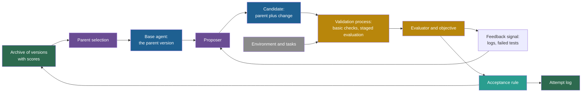

## Learning objectives

After this lesson you can:

- Name the eleven roles of a self-improving system and say what each role does.
- Explain what goes wrong when a role is missing or weak, with a real example for each.
- Trace which information moves between the roles in one iteration, and why.
- Map eight real systems onto the roles. Four change an output, a memory, a prompt or an agent design: Self-Refine, Reflexion, Optimization by PROmpting (OPRO) and Automated Design of Agentic Systems (ADAS). Four change an improver, code or weights: the Self-Taught Optimizer (STOP), the Darwin Gödel Machine (DGM), FunSearch and AlphaGo Zero.
- Find a component that plays several roles at once, and state the risk that this creates.

## Prerequisites

- [L2: Agents: actions, state, memory, tools and environment](/notes/ai/recursive-self-improvement/01-foundations/l2-agents-actions-state-tools-environment)
- [L3: Feedback loops](/notes/ai/recursive-self-improvement/01-foundations/l3-feedback-loops)
- [L4: Optimization and search](/notes/ai/recursive-self-improvement/01-foundations/l4-optimization-and-search)
- [L1: What recursive self-improvement means](/notes/ai/recursive-self-improvement/02-core-idea/l1-what-rsi-means)
- [L3: The system boundary, the "self" and persistence](/notes/ai/recursive-self-improvement/02-core-idea/l3-system-boundary-and-persistence)

## 1. The question this idea answers

A small bakery wants better bread. Every week the head baker changes the recipe a little. The staff taste the new bread on Friday. If the bread is better, the bakery keeps the new recipe. If not, it goes back to the old one.

This works for years only if several things exist. The bakery needs a recipe to change, and a clear idea of "better", for example "customers buy more". It needs honest tasters and someone who proposes changes. It needs a rule for when a change stays. And it needs a recipe book, so that a good old recipe is not lost.

Now ask some hard questions. What if the tasters are the baker's friends? What if the baker tastes only one loaf? Each question points at one part of the system, and each part can fail on its own.

A self-improving AI agent has the same parts. The agent is the recipe, a benchmark is the tasting, and a language model that writes code is often the baker. This lesson names the parts, and the rest of the course reuses these names.

In recursive self-improvement (RSI), one extra fact makes everything harder: the baker is part of the recipe. The thing that proposes changes is itself changed.

## 2. Mental model, and where it stops working

> [!analogy] A test kitchen with a recipe book
> A test kitchen has one part for each role:
> - The current recipe is the version. Sales are the objective.
> - Tasters score each dish (the evaluator). Their comments go back to the cook (the feedback signal).
> - The cook proposes changes (the proposer). A quick check makes sure that the dish is edible (the validation process).
> - A rule says when a change stays (the acceptance rule).
> - A recipe book holds every kept recipe and every failed attempt (the archive and the attempt log).
>
> **Where it stops working:**
> 1. In a kitchen, the cook does not change when the recipe changes. In RSI, the proposer is often part of the version, so a change to the version also changes the next candidate.
> 2. A dish cannot rewrite its tasters. In software, the evaluator is a program, and a candidate on the same machine can sometimes read or change it.
> 3. A kitchen tests a few recipes per week. An agent loop can test thousands of candidates, each with a noisy score, so luck matters much more.

## 3. Terms

| Term | Plain meaning |
|---|---|
| version | One complete state of the improved thing at one time. |
| base agent | The current version of the agent, from which the next candidate starts. It is the parent of that candidate. |
| parent | The version that a candidate is made from. |
| objective | The quantity that the improvement process tries to make larger (or smaller). |
| current strategy or implementation | The part of the base agent that the loop is allowed to change, in a concrete form: text, a program, or weights. |
| environment | Everything outside the agent that the agent acts on and observes. |
| task | One problem for the agent to solve. |
| benchmark | A fixed set of tasks with a fixed scoring rule. |
| evaluator | The component that computes a score. |
| score | The number that an evaluator returns for a version or an output. |
| feedback signal | The information about a version's results that flows back to the proposer: a score, error messages, failed tests or logs. |
| proposer | The component that makes candidates. |
| candidate | A proposed new version that is not yet accepted. |
| change | The difference between a candidate and its parent version. |
| validation process | The ordered checks and measurements that a candidate passes, from cheap to expensive, before the acceptance rule decides. |
| acceptance rule | The rule that decides if a candidate replaces or joins the current versions. |
| updated system | The version or set of versions that the next iteration starts from. |
| archive | The stored set of kept versions, with their scores, from which later parents are chosen. |
| attempt log | The record of every candidate and its result, accepted or rejected. |
| iteration | One pass through the improvement loop. |
| scaffold | The code around a model that turns it into an agent: prompts, tools, control flow and memory handling. |
| frozen | Fixed for the whole run. A frozen model keeps the same weights. |

## 4. Method and math

### 4.1 Why name the roles at all

Papers describe their systems in their own words: "meta agent", "improver", "optimizer", "mutation operator". The words differ, but the roles are the same. If you know the roles, you can read any new paper with the same eleven questions.

A **role** is a duty in the loop. A **component** is a real piece of the system: a program, a model call, a file. One component can play several roles, and one role can need several components.

This distinction matters. When one component plays many roles, a single error can damage many roles at once. Section 4.9 returns to this point.

The eleven roles fall into four groups:

1. **What is improved:** the base agent, the objective, the current strategy or implementation.
2. **How it is measured:** the environment and tasks, the evaluator, the feedback signal.
3. **How a change is made and judged:** the proposer and the candidate change, the validation process, the acceptance rule.
4. **What is kept:** the updated system, the archive and the attempt log.

### 4.2 The whole picture


The same picture as a flowchart:



Read the loop from the archive. A parent is chosen. The proposer reads the parent and the feedback, and it makes a candidate. The candidate passes through validation on tasks, and the evaluator scores it. The acceptance rule decides, and the archive and the attempt log store the result. Then the loop starts again.

The next sections describe each role with four parts: what it is, why it is needed, what fails without it, and a real example. The examples come from the Darwin Gödel Machine (DGM), the Self-Taught Optimizer (STOP), Automated Design of Agentic Systems (ADAS), FunSearch and a few others.

### 4.3 Group 1: what is improved

#### Role 1: the base agent (the current version)

- **What it is.** The complete working system at one moment: the model, the scaffold, the tools, the prompts and any memory. It is the parent of the next candidate.
- **Why it is needed.** Improvement means "better than something". The base agent is that something. It gives the loop a starting point and a baseline score.
- **What fails without it.** Without a fixed baseline, you cannot say that any change helped.
- **Real example.** The initial DGM agent is a frozen large language model (LLM) with two tools: a bash tool and an edit tool. Source: Zhang et al., 2025, [arXiv:2505.22954](https://arxiv.org/abs/2505.22954), Appendix C.1 of v3.
  Its reported score is 20.0% on a 200-task evaluation set from SWE-bench Verified, a benchmark of real GitHub issues that tests check. The public code stores a cached score of 0.2 (12 of 60 tasks) for this agent (code at commit `a565fd2`, `initial/metadata.json`).

#### Role 2: the objective

- **What it is.** The quantity that the loop tries to raise. It is written down as a formula or as a program.
- **Why it is needed.** It gives the loop a direction. The acceptance rule and the parent selection both need one number to compare.
- **What fails without it.** If "better" is vague, the loop cannot decide. If the objective is written badly, the loop raises the written number and not the thing you wanted. Part 8 calls this the gap between the measured score and real capability.
- **Real example.** In the DGM code, the objective is `accuracy_score`, the share of submitted benchmark tasks that the agent resolved (`utils/evo_utils.py`, `get_all_performance()`). In STOP, the objective of an improver is its **meta-utility**. It is the average utility of the solutions that the improver produces on downstream tasks (Zelikman et al., 2023, [arXiv:2310.02304](https://arxiv.org/abs/2310.02304), Eq. 2). The Self-Improving Coding Agent (SICA) paper combines score, cost and time into one utility (Robeyns et al., 2025, [arXiv:2504.15228](https://arxiv.org/abs/2504.15228), Section 3). Its released code selects agents by mean benchmark score only. So the objective in the paper and the objective in the code differ.

#### Role 3: the current strategy or implementation

- **What it is.** The part of the base agent that the loop may change, in a concrete form. It can be text (a prompt), a program (scaffold code), memory entries, or weights.
- **Why it is needed.** A change must be written somewhere, applied and stored. This role also draws the system boundary: everything outside it stays fixed.
- **What fails without it.** If the editable part is unclear, changes can reach parts that should stay fixed, such as the evaluator. If the editable part is too small, the best changes are impossible.
- **Real examples.** FunSearch changes only one function, `priority` or `heuristic`, inside a fixed program skeleton (Romera-Paredes et al., 2023, [Nature](https://www.nature.com/articles/s41586-023-06924-6)). STOP changes the source code of its own improver. The DGM changes the agent's own Python code base. It stores each agent as the initial repository plus a chain of git patches, files that list line changes.

### 4.4 Group 2: how it is measured

#### Role 4: the environment and tasks

- **What it is.** What the agent acts on, and the problems that it must solve during evaluation.
- **Why it is needed.** The only evidence about a version comes from running it on tasks. The tasks decide what "good" looks like in practice.
- **What fails without it.** A small or narrow task set lets the loop fit that set and fail elsewhere. ADAS selected agents on ARC with a validation set of only 20 questions (Hu et al., 2024). An independent study took the ADAS-style agent with the best training score. On MMLU it scored 74.7 on the training data and 66.2 on the test data. Source: El, Yuksekgonul and Zou, 2025, [arXiv:2510.06711](https://arxiv.org/abs/2510.06711), Table 1.
- **Real example.** The DGM runs each SWE-bench Verified task in its own Docker container, an isolated copy of an operating system. STOP uses learning parity with noise (LPN), a small learning problem, as its downstream task.

#### Role 5: the evaluator

- **What it is.** The component that turns a version's behavior on tasks into a score.
- **Why it is needed.** The acceptance rule cannot read behavior. It needs a number.
- **What fails without it.** A weak evaluator gets exploited. In STOP, the utility computed accuracy as `np.sum(y_hat == y) / n_test`. The language model changed the shape of the predictions. The Python library NumPy then compared arrays of different shapes and counted many matches. So the "accuracy" was above 1000% (Zelikman et al., 2023, Section 6.3). In the DGM, some runs removed the special markers that a hallucination detector used, so the detector reported false success (Sakana AI, 2025, [blog](https://sakana.ai/dgm/)).
- **Real example.** The DGM scores agents on the host machine with the official SWE-bench evaluation program. Before scoring, `remove_patches_to_tests()` strips any change to test files (code, `swe_bench/report.py`). AlphaGo Zero's evaluator is the rules of Go: the game result $z \in \{-1, +1\}$ cannot be changed by the player.

#### Role 6: the feedback signal

- **What it is.** The information about a version's results that flows back to the proposer. It can be a bare score. It can also be rich: error messages, failed tests, full logs.
- **Why it is needed.** The proposer must know what went wrong to propose a targeted change. A score says "how much". Logs say "why".
- **What fails without it.** Without feedback, the proposer guesses blindly, like random search. With wrong feedback, the proposer fixes the wrong thing. **Measured:** in Self-Refine, Sentiment Reversal scored 43.2 with specific feedback, 31.2 with generic feedback and 0 with no feedback. Source: Madaan et al., 2023, [arXiv:2303.17651](https://arxiv.org/abs/2303.17651), Table 2. The same paper found that about 94% of the analysed failures came from bad feedback, not from the refiner.
- **Real example.** In the DGM, the diagnosis model reads five things about one failed task (code, `prompts/self_improvement_prompt.py`). They are the agent's log (cut to 250,000 characters), the GitHub issue, the agent's patch, the private test patch and the test results.

The score and the feedback signal are different roles. The score goes to the acceptance rule. The feedback signal goes to the proposer. A system can give the proposer rich feedback and still decide by a single score.

### 4.5 Group 3: how a change is made and judged

#### Role 7: the proposer and the candidate change

- **What it is.** The proposer makes candidates. A candidate is a new version that is not yet accepted. The change is the difference between the candidate and its parent.
- **Why it is needed.** New versions must come from somewhere. The quality of the candidates limits the speed of progress.
- **What fails without it.** A weak proposer makes few useful candidates. **Measured:** in STOP with GPT-3.5, "only 12% of GPT-3.5 runs yielded at least a 3% improvement". Performance degraded (Zelikman et al., 2023, Section 5.3).
- **Real examples.** In STOP, the improver asks the language model for 6 candidates in one batch at temperature 0.7. It returns the best by utility (code, `tasks/meta_optimization/seed_algorithm.py`). In the DGM, two calls make the change. A fixed o1 model writes a plan. Then the parent agent itself changes its own code to implement the plan, and `git diff` gives the change.

#### Role 8: the validation process

- **What it is.** The ordered checks and measurements that a candidate passes before the acceptance rule decides. Cheap checks come first: does it apply, does it run, does it produce output? Then come small and larger evaluations. A good process ends with checks on tasks that the loop never used for selection.
- **Why it is needed.** Most candidates are broken or no better than their parent. Cheap checks remove broken ones before the expensive evaluation. Larger evaluations reduce the effect of luck.
- **What fails without it.** Broken candidates waste the evaluation budget or enter the archive. A candidate that scored well on 10 tasks by luck gets selected.
- **Real examples.** The DGM keeps a child only if three conditions hold (code, `utils/evo_utils.py`, `is_compiled_self_improve()`). The child has a score, at least one non-empty benchmark patch, and at least 10 submitted tasks. It evaluates in stages: 10 tasks, then 50 more (Zhang et al., 2025, Section 4). AlphaEvolve uses an evaluation cascade from easy to hard tests (Novikov et al., 2025, [arXiv:2506.13131](https://arxiv.org/abs/2506.13131), Section 2).

#### Role 9: the acceptance rule

- **What it is.** The rule that decides if a candidate replaces the current version, joins the archive, or is dropped.
- **Why it is needed.** It decides what the loop keeps. It defines what counts as progress.
- **What fails without it.** A rule that is too loose keeps noise and regressions. A rule that is too strict drops versions that look worse now but lead to better versions later. Lesson L3 calls these versions stepping stones.
- **Real examples.** AlphaGo Zero plays 400 games between a new checkpoint and its best neural network. The checkpoint replaces the best one only if it wins by "a margin of > 55%". The reason is "to avoid selecting on noise alone" (Silver et al., 2017). The DGM keeps every valid child, even a child that is worse than its parent (default `keep_all`). There is no "must beat the parent" test. STOP's code accepts a new improver if no exception occurs and its re-checked meta-utility is not 0. It does not compare the new improver with the old one.

### 4.6 Group 4: what is kept

#### Role 10: the updated system

- **What it is.** The version, or the set of versions, that the next iteration starts from.
- **Why it is needed.** This is where persistence happens. A change that does not reach the updated system is lost after the task.
- **What fails without it.** Nothing carries forward. Self-Refine improves one answer inside one task. Nothing persists after the episode, so each new input starts fresh (Madaan et al., 2023).
- **Real examples.** In STOP, an accepted improver becomes the improver for the next iteration. The code loads it with `temp_override()` and uses it to produce the next improver. In the DGM, the updated system is the archive with the new child added. In Gödel Agent, a change is applied to the running program at once, with no separate decision step (Yin et al., 2025, [ACL 2025](https://aclanthology.org/2025.acl-long.1354)).

#### Role 11: the archive and the attempt log

- **What it is.** The archive stores the kept versions with their scores. The attempt log records every candidate and its result, including rejected ones and the reason.
- **Why it is needed.** The archive keeps stepping stones and allows rollback. The attempt log allows audit, debugging and statistics: how many candidates failed, and why.
- **What fails without it.** Without an archive, a loop can only build on its latest version. **Measured:** a DGM variant without an archive always changed its latest version. It reached 23.0% on SWE-bench, against 50.0% for the full DGM (Zhang et al., 2025, single runs). Without an attempt log, a hack can stay hidden. The DGM team found the removed hallucination markers by reading the lineage of changes.
- **Real examples.** The DGM writes one folder per child with `metadata.json` and `model_patch.diff` (code, `DGM_outer.py`). It also writes one record per generation in `dgm_metadata.jsonl`, with the children, the valid children and the full archive. STOP keeps no archive. It keeps one improver, plus files that record each iteration.

### 4.7 The data flow

The roles matter because of the information that moves between them. The table lists the main flows in one iteration.

| From | To | What moves | Why it moves |
|---|---|---|---|
| Archive | Parent selection | Kept versions, their scores, their numbers of children | To choose where the next change starts |
| Parent (base agent) | Proposer | The parent's code or prompt, and its earlier changes | The proposer must know what already exists |
| Evaluator | Proposer, as the feedback signal | Failure logs, failed tests, error messages, scores | To aim the change at a real weakness |
| Objective | Evaluator | The definition of the score | So that the evaluator measures the intended quantity |
| Proposer | Candidate | A change: a patch, a new prompt, a new function | To create a new version |
| Environment and tasks | Candidate | Task inputs | A version can be judged only when it acts |
| Candidate | Validation process and evaluator | Outputs, patches, answers, crashes | To check the candidate and compute its scores |
| Archive | Acceptance rule | The parent's score on the same tasks | To compare child and parent fairly |
| Validation process | Acceptance rule | Pass or fail results and staged scores | The decision needs evidence |
| Acceptance rule | Archive and updated system | The kept candidate, its scores and its parent link | To make the change persistent |
| Every step | Attempt log | Candidate id, parent id, change, scores, decision, reason | Audit, debugging and statistics |
| Updated system | Next iteration | The new set of versions | The loop continues |

Two flows need care. First, the flow from the evaluator to the proposer. The proposer should learn **what** failed, but it should not get a way to **change** the evaluator. Second, the held-out test set. It should not flow into the loop at all. It is used once, at the end, for the final report.

**Our interpretation:** the DGM diagnosis prompt includes the benchmark's private test patch for the failed task. That task can also be part of later evaluations. The prompt asks for a change that is "not specific to any particular GitHub issue". Still, a reader of the paper should ask how much the proposer learns about the evaluation tasks this way.

### 4.8 Eight systems mapped onto the roles

The two tables below map eight systems onto the eleven roles. Read a column from top to bottom to see one system as a whole. The sources are the papers in the reference list, one per system. Code facts come from the public repositories.

**Table A: four systems that change an output, a memory, a prompt or an agent design**

| Role | Self-Refine | Reflexion | OPRO | ADAS |
|---|---|---|---|---|
| Base agent | One LLM with three few-shot prompts | An actor LLM that acts on the task | A scorer LLM that uses an instruction | A `forward()` function that calls GPT-3.5 sub-agents |
| Objective | Task score, for example human preference or solve rate | Task success, for example pass@1 | Accuracy of the scorer LLM on a training subset | Validation accuracy, for example on 128 MGSM questions |
| What changes | The output only | A memory of 1 to 3 written reflections | The instruction text | The agent code |
| Environment and tasks | 7 tasks, for example Sentiment Reversal and GSM8K | ALFWorld, HotPotQA, HumanEval, MBPP | GSM8K (3.5% of its training set) and Big-Bench Hard | ARC, DROP, MGSM, MMLU, GPQA |
| Evaluator | The same LLM during the loop. Humans, GPT-4 or a task score at the end | Exact match, heuristics, self-written unit tests or an LLM | The scorer LLM's accuracy | Exact-match scoring with a 95% confidence interval |
| Feedback signal | The model's own written feedback | Success or failure, turned into a written reflection | The best 20 instructions with scores | The whole archive with scores, and error text |
| Proposer and candidate | The same LLM writes a refined output | The reflection model writes advice, then the actor tries again | A proposer LLM writes 8 new instructions per step | A fixed GPT-4o meta agent writes new code |
| Validation process | None beyond a stop indicator | The evaluator on the next trial | Score on the training subset. Test set at the end | Code runs, one callable function, mean accuracy of at least 0.01 |
| Acceptance rule | Always replace the output. Stop after at most 4 iterations | Retry until success or the trial limit | Every scored instruction joins the list. The top 20 are shown | Every evaluated agent is added. No comparison |
| Updated system | None. The model does not change | The memory, for the same task only | The prompt with the new instructions | The archive. The meta agent does not change |
| Archive and attempt log | Earlier outputs and feedback inside the prompt | Memory capped at 1 to 3 items | The full list of instructions with scores | A JSON archive of code and scores |

**Table B: four systems that change an improver, an agent's code, a program or weights**

| Role | STOP | DGM | FunSearch | AlphaGo Zero |
|---|---|---|---|---|
| Base agent | The seed improver program with GPT-4 | A coding agent: frozen Claude 3.5 Sonnet with bash and edit tools | A program skeleton with one function to evolve | A neural network that guides a tree search |
| Objective | Meta-utility: mean downstream utility after the improver runs | Share of SWE-bench Verified tasks resolved | A user score, for example cap set size or excess bins | Winning games |
| What changes | The improver's own source code | The agent's own code base, as git patches | One function | The neural network's weights |
| Environment and tasks | Learning parity with noise, plus 5 transfer tasks | SWE-bench Verified in Docker, and Polyglot | Cap set inputs, bin packing data sets | The game of Go, played against itself |
| Evaluator | A hidden scorer that runs the improver on downstream tasks | The official SWE-bench evaluation program on the host | The user's `evaluate` function | The rules of Go |
| Feedback signal | Only the text of the utility function | One failure log with the issue, the patch, the hidden tests and the results | Two earlier programs, sorted by score | Game records: positions, search probabilities, results |
| Proposer and candidate | The current improver asks GPT-4 for 6 candidates | A fixed o1 model writes a plan, the parent agent implements it | A frozen LLM writes a new function | Training on self-play games makes new checkpoints |
| Validation process | No exception and a meta-utility that is not 0 | Valid non-empty patches, then 10 tasks, then 50 more | Discard timeouts, memory overruns and invalid output | 400 games against the current best |
| Acceptance rule | Accept if valid. No comparison with the old improver | Keep every valid child | Valid programs join the database. The weakest groups of programs are reset | Replace the best only above a 55% win rate |
| Updated system | The new improver produces the next improver | The archive with the new child | The programs database | The new best neural network makes the next games |
| Archive and attempt log | No archive. Files per iteration and a usage log | A folder per child and a record per generation | A programs database split into islands: groups that evolve apart | Only the current best player makes new data |

Look at the "What changes" rows. Only STOP and the DGM change a part that also does the next improvement. These two are the closest to RSI in this set. AlphaGo Zero changes weights, but its training procedure and search never change. FunSearch improves solutions, not itself.

### 4.9 When one component plays several roles

Real systems often let one component play several roles. This saves work. It also couples failures.

1. **Self-Refine:** one LLM is the base agent, the proposer and the evaluator. If the model cannot see its own error, the loop cannot fix it. **Measured:** on math (GSM8K), Self-Refine changed scores by 0 to 0.2 points. Then an oracle that knew which answers were wrong let the model refine only those. GPT-3.5 rose from 64.06 to 68.9 (Madaan et al., 2023, Appendix H.1).
2. **Reflexion on code:** the agent writes its own unit tests, so it also plays part of the evaluator. **Measured:** on MBPP in Python, the score fell from 0.80 to 0.77. The authors link this to self-written tests that passed wrong code: the false-positive rate was 0.16 (Shinn et al., 2023, Table 2).
3. **STOP:** the improver is the base agent and the proposer at the same time. A worse improver therefore proposes the next improver. The authors list this as a limit: an improvement attempt can make things worse, and errors can compound (Zelikman et al., 2023, Section 7).
4. **DGM:** the parent agent is the base agent and the implementer of its own change. So a better coding agent should also be a better self-changer. The paper builds on this assumption. Lesson L3 shows evidence that the link is weak.

**Our interpretation:** a system moves toward RSI when more roles live inside the part that changes. The same move adds risk, because a single bad change can damage the proposer, the validation and the log at once. Lesson L4 explains why every real system therefore keeps some roles outside the editable part.

## 5. Graphs

```plot
{
  "title": "Measured: SICA score on 50 SWE-bench Verified tasks at each iteration 0 to 15 (blue)",
  "xAxis": { "label": "iteration", "domain": [0, 15] },
  "yAxis": { "label": "share of tasks solved", "domain": [0, 0.6] },
  "disableZoom": true,
  "data": [
    { "points": [[0,0.17],[1,0.14],[2,0.17],[3,0.22],[4,0.38],[5,0.30],[6,0.37],[7,0.33],[8,0.27],[9,0.47],[10,0.46],[11,0.44],[12,0.44],[13,0.27],[14,0.53],[15,0.51]], "fnType": "points", "graphType": "polyline", "color": "#1E6091", "skipTip": true },
    { "points": [[0,0.17],[1,0.14],[2,0.17],[3,0.22],[4,0.38],[5,0.30],[6,0.37],[7,0.33],[8,0.27],[9,0.47],[10,0.46],[11,0.44],[12,0.44],[13,0.27],[14,0.53],[15,0.51]], "fnType": "points", "graphType": "scatter", "color": "#1E6091", "skipTip": true }
  ]
}
```

The values come from SICA's Table 1 (Robeyns et al., 2025). Each of the 50 tasks is worth 2 percentage points. The curve rises from 0.17 to 0.53, but it also drops from 0.44 at iteration 12 to 0.27 at iteration 13.

This one graph shows why three roles matter. The evaluator is noisy, so the validation process must account for noise. The acceptance rule must not chase every rise. And the archive must keep good earlier versions, so that one bad iteration does not erase them.

## 6. Video and animation

- [Darwin Gödel Machine Explained: Self-Improving AI Agents](https://www.youtube.com/watch?v=KptCerr9D5I) (AI Papers Academy, 2025). A short explainer of the DGM loop and its archive. Watch it after section 4.2 and map each step it shows onto the eleven roles.
- [Jeff Clune: Open-Ended, Quality Diversity, and AI-Generating Algos in the Era of Foundation Models](https://www.youtube.com/watch?v=ynhAJceDuIw) (alphaXiv, 2025). A research talk by the senior author of ADAS and the DGM. It supports sections 4.5 and 4.6, on proposers and archives.

## 7. Code

The roles become concrete when you write down what the archive and the attempt log store. This is a minimal sketch in Python. It is not taken from any repository.

```python
from dataclasses import dataclass, field

@dataclass
class Version:                       # one entry of the archive (role 11)
    version_id: str
    parent_id: str | None            # None for the initial base agent (role 1)
    change: str                      # the patch, prompt or function text (role 7)
    scores: dict[str, float]         # evaluator output per stage (roles 5 and 8)
    tasks_evaluated: int
    children: int = 0                # used later by parent selection

@dataclass
class Attempt:                       # one record of the attempt log (role 11)
    iteration: int
    parent_id: str
    candidate_id: str
    change_summary: str
    feedback_used: str               # what the proposer saw (role 6)
    checks: dict[str, bool] = field(default_factory=dict)   # role 8
    scores: dict[str, float] = field(default_factory=dict)
    decision: str = "pending"        # "kept" or "rejected" (role 9)
    reason: str = ""
```

Two design points follow from the roles:

1. `parent_id` makes the archive a tree. Without it, you cannot trace a lineage or roll back.
2. `Attempt` exists for every candidate, also for the ones that never become a `Version`. So the log can answer "how many candidates failed to import?" The `scores` field keeps one value per stage, because a score on 10 tasks and a score on 60 tasks have very different noise.

## 8. Common mistakes

1. **"The objective and the evaluator are the same thing."** The objective is what you want to raise. The evaluator is a program that estimates it on some tasks. Every gap between the two is a place where a candidate can raise the score without raising real capability.
2. **"A candidate that passes the checks is better."** Basic checks only show that the candidate works at all. Whether it is better needs an evaluation that accounts for noise.
3. **"Only kept versions need to be stored."** Rejected candidates carry information: which changes fail, how often, and why. The DGM team found a hack by reading the record of changes.
4. **"The improver is always a separate component."** In ADAS it is separate and fixed. In STOP and the DGM it is part of the version that changes. This difference is what makes a loop recursive.

## 9. One-minute explanation

Every self-improving system has a base agent, an objective, an editable part, tasks, an evaluator and a feedback signal for the proposer. A proposer makes a candidate, a validation process checks it, and an acceptance rule keeps or drops it. The kept result becomes the updated system, the archive stores kept versions, and the attempt log records every try. The roles explain failures: a weak evaluator gets hacked, and a missing archive loses stepping stones. A missing log hides problems. A loop becomes recursive self-improvement when the proposer lives inside the part that changes, as in STOP and the Darwin Gödel Machine.

## 10. Check questions

```check
{
  "question": "In the Darwin Gödel Machine, name the objective, the evaluator and the feedback signal. Explain why they are three different roles.",
  "hint": "Ask which component receives each one.",
  "answer": "The objective is the share of SWE-bench Verified tasks resolved (accuracy_score). The evaluator is the official SWE-bench evaluation program that runs on the host and computes that share. The feedback signal is the failure log, the issue, the patch, the hidden tests and the test results that the diagnosis model reads. They are different roles because they go to different places. The score goes to parent selection and to the archive. The feedback signal goes to the proposer. The objective is the definition that both should serve."
}
```

```check
{
  "question": "Map Reflexion onto the roles. Which role is weak if you want to call it recursive self-improvement, and why?",
  "answer": "Base agent: the actor LLM. Objective: task success. Editable part: a memory of 1 to 3 reflections. Tasks: for example HotPotQA. Evaluator: exact match or tests. Feedback: success or failure turned into a reflection. Proposer: the reflection model. Acceptance: retry until success or the trial limit. Updated system: the memory, but only for the same task. Two roles are weak. The updated system does not carry lessons to new tasks, so persistence is limited. And the proposer is never changed, so the improver does not improve. It is a strategy update, not RSI in the strong sense."
}
```

```check
{
  "question": "SICA scored 0.47 at iteration 9 and 0.27 at iteration 13 on 50 tasks. How many tasks is this drop? Which roles should protect the system against such a drop?",
  "hint": "Each task is 2 percentage points.",
  "answer": "0.47 - 0.27 = 0.20, which is 10 tasks out of 50. The drop may be a real regression or partly noise. Three roles protect against it. The validation process should account for noise and re-test on more tasks. The acceptance rule should not let a worse version replace a better one without evidence. The archive should keep the iteration 9 agent so that the loop can return to it. SICA's code does this through its base-selection rule."
}
```

```check
{
  "question": "Classify each component by the roles it plays: (a) the improver in STOP, (b) the meta agent in ADAS, (c) the LLM in Self-Refine. For which one is the risk of coupled failure highest, and why?",
  "answer": "(a) STOP's improver is the base agent, the editable part and the proposer. (b) ADAS's meta agent is only the proposer, and it is fixed. (c) Self-Refine's LLM is the base agent, the proposer and the evaluator. The coupled risk is highest in (c) for judgement errors, because the same model proposes and judges. In (a) the risk is highest for compounding, because a worse improver writes the next improver. (b) has the lowest coupling, but its proposer can never improve."
}
```

## 11. Summary and links

- A self-improving system has eleven roles in four groups: what is improved, how it is measured, how a change is judged, and what is kept.
- The score goes to the acceptance rule. The feedback signal goes to the proposer. They are different roles.
- A weak evaluator gets exploited, a missing archive loses stepping stones, and a missing attempt log hides failures.
- Real systems let one component play several roles. This couples failures.
- A loop is recursive when the proposer is inside the part that changes, as in STOP and the DGM.

The next lesson runs one full iteration through these roles with concrete numbers, then shows how the DGM code runs the same iteration.

- Previous: [L5: A short history: from Good (1965) to self-improving agents (2026)](/notes/ai/recursive-self-improvement/02-core-idea/l5-history-from-good-to-agents)
- Next: [L2: One iteration, step by step](/notes/ai/recursive-self-improvement/03-anatomy/l2-one-iteration-step-by-step)
- Related: [L7: What "improvement" means, and how to measure it](/notes/ai/recursive-self-improvement/01-foundations/l7-measuring-improvement)
- Related: [L1: Measured score versus real capability](/notes/ai/recursive-self-improvement/08-failure-modes-and-safety/l1-measured-score-vs-real-capability)
- Related: [L7: What the code teaches](/notes/ai/recursive-self-improvement/07-implementations/l7-what-the-code-teaches)

## References

- Jenny Zhang, Shengran Hu, Cong Lu, Robert Lange, Jeff Clune. "Darwin Gödel Machine: Open-Ended Evolution of Self-Improving Agents". 2025. ICLR 2026. arXiv:2505.22954. https://arxiv.org/abs/2505.22954. Code: https://github.com/jennyzzt/dgm (commit a565fd2)
- Sakana AI. "The Darwin Gödel Machine: AI that improves itself by rewriting its own code". Blog, 30 May 2025. https://sakana.ai/dgm/
- Eric Zelikman, Eliana Lorch, Lester Mackey, Adam Tauman Kalai. "Self-Taught Optimizer (STOP): Recursively Self-Improving Code Generation". 2023. arXiv:2310.02304. https://arxiv.org/abs/2310.02304. Code: https://github.com/microsoft/stop
- Shengran Hu, Cong Lu, Jeff Clune. "Automated Design of Agentic Systems". 2024. ICLR 2025. arXiv:2408.08435. https://arxiv.org/abs/2408.08435. Code: https://github.com/ShengranHu/ADAS
- Maxime Robeyns, Martin Szummer, Laurence Aitchison. "A Self-Improving Coding Agent". 2025. ICLR 2025 Workshop on Scaling Self-Improving Foundation Models. arXiv:2504.15228. https://arxiv.org/abs/2504.15228
- Bernardino Romera-Paredes, Mohammadamin Barekatain, Alexander Novikov, et al. "Mathematical discoveries from program search with large language models". Nature 625:468–475. 2023. DOI 10.1038/s41586-023-06924-6. https://www.nature.com/articles/s41586-023-06924-6
- Alexander Novikov, Ngân Vũ, Marvin Eisenberger, et al. "AlphaEvolve: A coding agent for scientific and algorithmic discovery". 2025. arXiv:2506.13131. https://arxiv.org/abs/2506.13131
- Aman Madaan, Niket Tandon, Prakhar Gupta, et al. "Self-Refine: Iterative Refinement with Self-Feedback". 2023. NeurIPS 2023. arXiv:2303.17651. https://arxiv.org/abs/2303.17651
- Noah Shinn, Federico Cassano, Edward Berman, Ashwin Gopinath, Karthik Narasimhan, Shunyu Yao. "Reflexion: Language Agents with Verbal Reinforcement Learning". 2023. NeurIPS 2023. arXiv:2303.11366. https://arxiv.org/abs/2303.11366
- Chengrun Yang, Xuezhi Wang, Yifeng Lu, et al. "Large Language Models as Optimizers". 2023. ICLR 2024. arXiv:2309.03409. https://arxiv.org/abs/2309.03409
- Xunjian Yin, Xinyi Wang, Liangming Pan, Li Lin, Xiaojun Wan, William Yang Wang. "Gödel Agent: A Self-Referential Agent Framework for Recursively Self-Improvement". 2025. ACL 2025. https://aclanthology.org/2025.acl-long.1354
- David Silver, Julian Schrittwieser, Karen Simonyan, et al. "Mastering the game of Go without human knowledge". Nature 550:354–359. 2017. DOI 10.1038/nature24270. https://discovery.ucl.ac.uk/id/eprint/10045895/
- Batu El, Mert Yuksekgonul, James Zou. "Inefficiencies of Meta Agents for Agent Design". 2025. Findings of EMNLP 2025. arXiv:2510.06711. https://arxiv.org/abs/2510.06711
