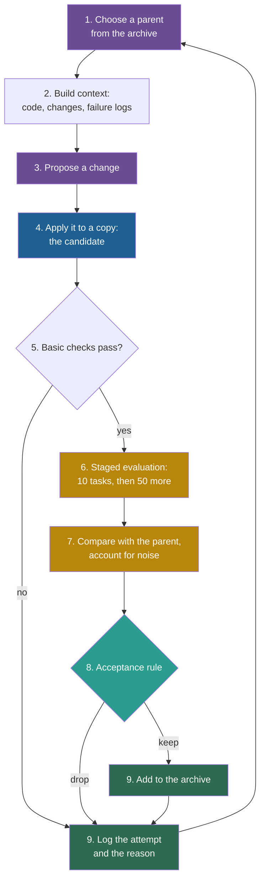

## Learning objectives

After this lesson you can:

- Trace the ten steps of one improvement iteration, with concrete numbers at each step.
- Compute the standard error of a pass rate and of a paired difference, and decide if a gain is larger than the noise.
- Explain how the Darwin Gödel Machine (DGM) code runs one iteration: files, functions, thresholds, and the places where code and paper differ.
- Write generic pseudocode for an improvement loop.
- Explain what changes when the improver itself is the candidate, as in the Self-Taught Optimizer (STOP).

## Prerequisites

- [L1: The components of a self-improving system](/notes/ai/recursive-self-improvement/03-anatomy/l1-the-components)
- [L7: What "improvement" means, and how to measure it](/notes/ai/recursive-self-improvement/01-foundations/l7-measuring-improvement)
- [L4: Optimization and search](/notes/ai/recursive-self-improvement/01-foundations/l4-optimization-and-search)

## 1. The question this idea answers

A runner buys new shoes. In the first race with them, she is 30 seconds faster. Did the shoes help? Maybe. Maybe the wind was different, or she slept better.

A careful runner checks in stages. First she jogs for ten minutes to see if the shoes fit. Then she runs a few short timed runs. Then she runs her usual course in similar weather and compares the times. She writes every result in a diary, also the bad runs. Each stage answers a different question: "does it work?", "is it promising?", "is it really better?", "what did I try?"

One iteration of a self-improving system has the same stages. This lesson follows one iteration from start to end with concrete numbers. Then it shows how the DGM code runs the same iteration. At the end, it asks what changes when the thing being improved is the improver itself.

## 2. Mental model, and where it stops working

> [!analogy] Trials for a new medicine
> A new medicine passes through phases. A small first trial checks that it is safe, and a second small trial checks if it seems to work. A large third trial compares it with the current treatment on many patients. Every trial is registered, so failed trials are not hidden. One improvement iteration has the same order: basic checks, a small evaluation, a larger comparison with the parent, and a log of every attempt.
>
> **Where it stops working:**
> 1. A medical trial uses new patients. An agent loop often reuses the same tasks in every iteration, so information about those tasks leaks into the choices.
> 2. A medicine cannot rewrite the trial protocol. A candidate agent that runs code can sometimes reach the program that scores it.
> 3. A trial usually tests one medicine. An agent loop tests hundreds of candidates, so the best-looking one is often lucky.

## 3. Terms

| Term | Plain meaning |
|---|---|
| iteration | One pass through the improvement loop. |
| parent | The version that a candidate is made from. |
| context | The text and data that the proposer reads before it proposes a change. |
| diagnosis | A short analysis of why a version failed, written to guide the next change. |
| patch | A text file that lists line changes to a program. Applying the patch makes the change. |
| basic checks | Cheap tests that a candidate works at all: the change applies, the program imports, it produces output. |
| staged evaluation | Evaluation in steps of growing size and cost, where a candidate continues only if it passes a threshold. |
| threshold | The minimum result that a candidate needs to pass a stage. |
| pass rate | The share of tasks that a version solves. |
| standard error (SE) | A measure of how much a measured average would vary if you repeated the measurement on new tasks. |
| paired comparison | A comparison of two versions on the same tasks, task by task. |
| discordant task | A task that one version solves and the other does not. |
| held-out test set | Tasks that the loop never uses to make a decision. They are used once, for the final report. |
| meta-utility | In STOP: the score of an improver, equal to the average utility of the solutions that it produces on downstream tasks. |
| budget | The limit on cost, time or model calls for a run. |

## 4. Method and math

### 4.1 The ten steps at a glance

One iteration has ten steps:

1. **Choose a parent** from the archive.
2. **Build the context** for the proposer: the parent's code, earlier changes, and logs of failed tasks.
3. **Propose a change.**
4. **Apply the change** to a copy of the parent. The result is the candidate.
5. **Run basic checks.** Does the candidate apply, import and produce output?
6. **Run a staged evaluation:** a small task set first, then a larger one.
7. **Compare with the parent,** and account for noise.
8. **Accept or reject** the candidate with the acceptance rule.
9. **Store** the result in the archive and the attempt log.
10. **Repeat** until the budget ends. Then test the final choice on held-out tasks.



### 4.2 The toy setting

> [!example] Toy example: all numbers in sections 4.2 to 4.12 are invented
> - The agent is **ToyFix**, a coding agent. It is a frozen large language model (LLM) with a small scaffold and two tools: `run` (a shell) and `write_file` (it overwrites a whole file).
> - Its tasks are small bug fixes in Python repositories. Hidden tests check each fix.
> - Three task sets are fixed before the run: 10 stage-1 tasks, 50 stage-2 tasks, and 200 held-out tasks that the loop never sees.
> - The run is at iteration 3. The archive holds three versions, each scored on the same 60 tasks.

| Version | Parent | Solved (of 60) | Pass rate | Children in the archive |
|---|---|---|---|---|
| v0 | none (initial agent) | 12 | 0.20 | 2 |
| v1 | v0 | 24 | 0.40 | 0 |
| v2 | v0 | 21 | 0.35 | 0 |

The toy follows the structure of the DGM on purpose. The numbers do not come from any paper.

### 4.3 Step 1: choose a parent

The loop needs a rule to pick the next parent. Lesson L3 explains the DGM rule in full. In short, the rule gives each version a weight. The weight grows with the score and shrinks with the number of children. Then the rule picks a parent at random, in proportion to the weights.

For this archive, the DGM rule gives these probabilities. The weight of a version is $1/(1 + e^{-10(\text{pass rate} - 0.5)})$, divided by $1 + \text{children}$. So v0 gets $0.047 / 3 = 0.016$, v1 gets $0.269$ and v2 gets $0.182$. The sum is $0.467$. Each probability is the weight divided by the sum. L3 explains this formula step by step.

| Version | Probability of being chosen |
|---|---|
| v0 | 0.034 |
| v1 | 0.576 |
| v2 | 0.390 |

The loop draws a random number $u = 0.41$. Stack the probabilities as ranges: v0 covers 0 to 0.034, v1 covers 0.034 to 0.610, and v2 covers 0.610 to 1. The number 0.41 falls in the range of v1, so **v1 is the parent**. Like the DGM, the toy makes two draws per iteration. The second draw picks v2, and section 4.7 shows what happens to that child.

Why random, and not always the best? A loop that always picks the best version can get stuck. Lesson L3 shows the evidence.

### 4.4 Step 2: build the context

The proposer can only use what it reads. The loop builds a context with three parts:

1. **The parent's own code.** For ToyFix v1: `agent.py` (120 lines), `tools/run.py` (60 lines) and `tools/write_file.py` (40 lines).
2. **The parent's earlier changes.** One patch, from v0 to v1: "retry once when the tests fail" (45 lines).
3. **One failed task, with its log.** The loop picks task T-17 from the tasks that v1 failed.

The log of T-17 shows the problem:

```text
step 6: write_file("utils.py", <410 lines>)     # the original file had 640 lines
step 7: run("pytest")  ->  12 failed: NameError: name 'parse_header' is not defined
step 8: agent: "All tests should now pass."     # the agent stops
```

The model rewrote a long file from memory, and three functions were lost. The tool forced this, because `write_file` can only replace a whole file.

Some things stay **out** of the context. The held-out test set stays out. The code of the evaluator stays out. Lesson L4 explains why.

### 4.5 Step 3: propose a change

A strong LLM reads the context and writes a plan in a fixed format. Toy output:

```text
log_summary:       The agent rewrote utils.py from memory and dropped 3 functions.
improvement:       Add a "replace" mode to write_file. It replaces one exact string.
                   It refuses if the string occurs 0 times or more than 1 time.
problem_statement: Implement the replace mode, add unit tests for it, and tell the
                   agent in its system prompt to prefer replace for files over 200 lines.
```

The plan is general. It does not mention task T-17. A plan that only fixes T-17 would not help the other tasks, and it could fit the evaluation tasks instead of improving the agent.

### 4.6 Step 4: apply the change

The loop makes the candidate in a fresh container, an isolated copy of an operating system:

1. Copy the initial code of v0.
2. Apply the v0-to-v1 patch, so the copy equals v1.
3. Save this state, so that the next patch shows only the new change.
4. Run the **parent agent itself** on its own code, with the plan as its task, for at most 30 minutes.
5. Record the difference as a new patch.

The new patch changes 47 lines in `tools/write_file.py`, its tests and the system prompt. The candidate is called **v3**. Note step 4: the agent that improves the code is the parent agent. A better coding agent should therefore make better changes to itself. This is the DGM's central bet.

### 4.7 Step 5: basic checks

Basic checks are cheap and catch broken candidates early. v3 passes four checks:

| Check | Result for v3 |
|---|---|
| The patch is not empty | Pass: 47 changed lines |
| The agent imports without error | Pass |
| The new unit tests of the tool pass | Pass: 6 of 6 |
| The agent produces a non-empty fix on one quick trial task | Pass |

In the same iteration, the second candidate came from v2. That candidate renamed a function that `agent.py` still calls. Its import check failed with an `ImportError`. It never reaches the evaluation. It goes only into the attempt log, with the reason.

### 4.8 Step 6: staged evaluation

Evaluation is the most expensive step. So the loop evaluates in stages:

1. **Stage 1:** the 10 stage-1 tasks. v3 solves 5. The threshold is 4 of 10, so v3 continues.
2. **Stage 2:** the 50 stage-2 tasks. v3 solves 22.
3. **Total:** 27 of 60 tasks, a pass rate of 0.45.

A broken or weak candidate stops after stage 1 and costs only 10 task runs. A promising one gets 60. The price is noise. A 10-task score is a rough guess: each task moves the score by 10 points. Section 5 shows how often a candidate passes stage 1 by luck.

### 4.9 Step 7: compare with the parent, and account for noise

The parent v1 solved 24 of 60 (0.40). The candidate v3 solved 27 of 60 (0.45). The difference is 3 tasks, or 5 points. Is this real?

**The idea.** A pass rate on $n$ tasks is an estimate. Another set of $n$ tasks would give a slightly different number. The standard error says how large that variation is. A gain that is small compared with the standard error can be luck.

**The equation for one pass rate:**

$$
\mathrm{SE}(\hat{p}) = \sqrt{\frac{\hat{p}\,(1-\hat{p})}{n}}
$$

**The equation for a paired difference:**

$$
\bar{d} = \frac{1}{n}\sum_{i=1}^{n} d_i, \qquad \mathrm{SE}(\bar{d}) = \frac{s_d}{\sqrt{n}}
$$

The symbols mean:

- $\hat{p}$ is the measured pass rate, a number from 0 to 1.
- $n$ is the number of tasks.
- $d_i = c_i - a_i$ is the difference on task $i$. Here $c_i$ is 1 if the child solved task $i$, else 0. And $a_i$ is the same for the parent. So $d_i$ is $+1$, $0$ or $-1$.
- $\bar{d}$ is the mean difference, which equals the difference of the two pass rates.
- $s_d$ is the sample standard deviation of the $d_i$.

**In plain English.** The first equation says: the noise of a pass rate shrinks with the square root of the number of tasks. The second says: compare the two versions on the same tasks, task by task. Then the noise depends only on the tasks where the two versions disagree.

**Worked example.** First, each pass rate alone:

1. Child: $\mathrm{SE} = \sqrt{0.45 \times 0.55 / 60} = \sqrt{0.004125} = 0.064$, or 6.4 points.
2. Parent: $\mathrm{SE} = \sqrt{0.40 \times 0.60 / 60} = 0.063$, or 6.3 points.
3. If you ignore the pairing, the SE of the difference is $\sqrt{0.064^2 + 0.063^2} = 0.090$, or 9.0 points. The gain of 5 points is about half of this.

Now the paired comparison on the same 60 tasks:

| | Parent solved | Parent failed |
|---|---|---|
| **Child solved** | 21 | 6 |
| **Child failed** | 3 | 30 |

4. Six tasks give $d_i = +1$. Three give $d_i = -1$. The other 51 give $0$.
5. $\bar{d} = (6 - 3)/60 = 0.05$.
6. $s_d = \sqrt{\sum_i (d_i - \bar{d})^2 / (n - 1)}$. The nine nonzero tasks give $\sum_i d_i^2 = 9$, so $\sum_i (d_i - \bar{d})^2 = 9 - 60 \times 0.05^2 = 8.85$. Then $s_d = \sqrt{8.85 / 59} = \sqrt{0.150} = 0.387$, so $\mathrm{SE}(\bar{d}) = 0.387 / \sqrt{60} = 0.050$. Part 1 L7 divided by $n$ instead of $n - 1$. For 60 tasks, the two results differ only a little.
7. The gain is $0.05 / 0.050 = 1.0$ standard errors.

The pairing helped: the SE fell from 9.0 to 5.0 points. But the gain is still only one standard error.

A second view gives the same message. Of the 9 discordant tasks, the child won 6 and the parent won 3. Suppose the two versions were equally good. Then a split at least this uneven would happen in about half of all cases. A two-sided sign test, which only counts wins and losses, gives $p \approx 0.51$.

**Assumptions.** The tasks are independent and come from the same distribution. Each task is run once, and its result is fixed. And the tasks were not used to choose this candidate among many others. The third assumption is false in most loops, which makes the real uncertainty larger.

**When it is useful.** Use it to set an acceptance threshold, for example "the paired gain must exceed 2 SE". Use it to decide how many tasks a stage needs.

**What it does not prove.** A gain above 2 SE does not prove that the change is good in general. With many candidates, some pass by luck. The tasks may also differ from the tasks that matter. [L3: Evaluation under noise](/notes/ai/recursive-self-improvement/04-mathematics/l3-evaluation-under-noise) treats these problems in depth.

### 4.10 Step 8: accept or reject

The decision depends on the acceptance rule. Two rules give two different answers for v3:

| Rule | Condition | Decision for v3 |
|---|---|---|
| A: keep every valid child (as the DGM code does) | Passes the basic checks and produces a score | **Keep.** v3 joins the archive. |
| B: keep only clear gains | Paired gain larger than 2 SE, here 10 points | **Do not promote.** The gain is 5 points, about 1 SE. |

Rule A keeps v3 even if it is not better. The archive then holds a possible stepping stone. Selection pressure comes later, from the parent choice. Rule B protects the current best version against noise. But it can drop a version that would have led somewhere good. Lesson L3 discusses this trade-off with the DGM evidence.

A middle path exists. Keep v3 in the archive, but report it as the new best only after a re-test on fresh tasks confirms the gain.

### 4.11 Step 9: store the result

The archive gets one new entry. The attempt log gets one record per candidate, kept or not. Toy records:

```json
{"version": "v3", "parent": "v1", "patch": "v3/patch.diff",
 "stage1": {"solved": 5, "tasks": 10}, "stage2": {"solved": 22, "tasks": 50},
 "pass_rate": 0.45, "children": 0}
```

```text
iter=3 parent=v1 cand=v3 change="write_file replace mode" checks=4/4 stage1=5/10 stage2=22/50 paired=+6/-3 decision=kept(rule A) reason="valid child"
iter=3 parent=v2 cand=c7 change="rename helpers" checks=1/4 decision=rejected reason="ImportError in agent.py"
```

The second log line matters. Without it, nobody would know that one of two candidates in this iteration was broken. Over a long run, such counts show whether the proposer or the checks need work.

### 4.12 Step 10: repeat

The archive has changed, so the selection probabilities change. Version v1 now has one child, so its weight halves. Version v3 enters with a pass rate of 0.45 and no children. The rejected candidate does not count as a child of v2, because it never entered the archive.

| Version | Pass rate | Children | New probability |
|---|---|---|---|
| v0 | 0.20 | 2 | 0.022 |
| v1 | 0.40 | 1 | 0.189 |
| v2 | 0.35 | 0 | 0.257 |
| v3 | 0.45 | 0 | 0.532 |

The loop repeats until the budget ends. Then it chooses a final version and runs it once on the 200 held-out tasks. Only that number is a fair estimate of the final agent, because no decision used those tasks.

### 4.13 The same iteration in the DGM code

The DGM repository runs the same ten steps (Zhang et al., 2025, [arXiv:2505.22954](https://arxiv.org/abs/2505.22954)). Its tasks come from SWE-bench Verified, a benchmark of real GitHub issues that tests check. The table maps each step to the code. Paths and names are from the public repository at commit `a565fd2` (13 August 2025).

| Step | File and function | What the code does |
|---|---|---|
| 1. Choose parents | `DGM_outer.py`, `choose_selfimproves()`, method `score_child_prop` | Weight = sigmoid of the score times 1/(1 + children). Draw `selfimprove_size` parents (default 2) with replacement. |
| 1b. Choose a failure | `DGM_outer.py`, lines 111 to 148 | In turn, each with probability 0.25: a special task for empty patches, one for random behavior, one for context-length errors. The first and third apply only if the parent shows that problem. Else a random unresolved task. |
| 2. Build the context | `self_improve_step.py`, `diagnose_problem()`, and `prompts/self_improvement_prompt.py`, `get_current_code()` | The agent's own source, minus an exclude list, plus every ancestor patch as text. Then the failure log (up to 250,000 characters), the issue, the agent's patch, the private test patch and the test results. |
| 3. Propose | `diagnose_problem()` with the model `o1-2024-12-17` | A JSON reply with fields such as `improvement_proposal` and `implementation_suggestion`. Up to 3 attempts if the reply cannot be parsed. |
| 4. Apply | `self_improve_step.py` | A container from the image `dgm`. Ancestor patches applied with `patch -p1`, then a commit. Then `coding_agent.py --self_improve` runs on `/dgm/` with `timeout 1800`. The `git diff` becomes `model_patch.diff`. |
| 5. Basic checks | `self_improve_step.py` lines 367 to 379, and `utils/evo_utils.py`, `is_compiled_self_improve()` | An empty patch stops the step. Later, a child needs a score, at least one non-empty benchmark patch and at least 10 submitted tasks. |
| 6. Staged evaluation | `self_improve_step.py`, `run_harness_swe()` | 10 tasks from `swe_bench/subsets/small.json`. If at least 4 are resolved (`test_more_threshold = 0.4`), 50 more from `medium.json`. The score is recomputed over all results. |
| 7. Compare | none | The code does not compare a child with its parent. |
| 8. Accept | `DGM_outer.py`, `filter_compiled()` and `update_archive()` | Default `keep_all`: every valid child joins the archive. Option `keep_better`: keep a child only if its score is at least the initial agent's score minus 0.1. |
| 9. Store | `self_improve_step.py` and `DGM_outer.py` | Per child: `metadata.json`, `model_patch.diff`, `self_evo.md`. Per generation: one record in `dgm_metadata.jsonl`. |
| 10. Repeat | `DGM_outer.py`, `main()` | 80 generations by default (`--max_generation`). |

Each benchmark task also runs in its own container. The official SWE-bench evaluation program scores the results on the host machine. Before scoring, `remove_patches_to_tests()` removes any change to test files.

**Code versus paper.** The public code and the paper differ in six places. Keep these in mind when you read the DGM results:

1. **Stage 3 is not run in the code.** The paper evaluates top agents on 200 tasks (the 60 plus 140 more). The code computes the threshold for this stage and loads the 140 task IDs, but never uses them.
2. **The stage-1 rule.** The paper describes the first 10 tasks as a check of basic code-editing ability. The code adds a threshold: at least 4 of the 10 tasks resolved.
3. **Eligible parents.** The paper excludes agents with a perfect score from parent selection. The code does not.
4. **Parallel children.** The paper makes 2 children per iteration for SWE-bench and 4 for Polyglot. The code default is 2 for both.
5. **Model roles on Polyglot.** The paper says Claude 3.5 Sonnet (New) does the self-changes and o3-mini does the Polyglot evaluation. The code appears to use them the other way round. It is not clear which version produced the reported runs.
6. **Who proposes.** The paper says the parent "analyzes its own benchmark evaluation logs, proposes the next feature". In the code, a fixed o1 call writes the plan, outside the agent's editable code. The parent agent only implements it.

> [!note] A question to ask about the reported scores
> In the paper, an agent reaches the 200-task evaluation only if it scores above 40% on the first 60 tasks. It must also rank in the top two. So the 60 tasks that were used for selection are also part of the 200-task score. This is not proof of a flaw. It is a question to check: how much of the final number comes from tasks that never influenced a decision?

### 4.14 Generic pseudocode

The ten steps fit in a short program. This is pseudocode in Python style, not a runnable system.

```python
archive = [evaluate_staged(initial_version)]     # roles 1 and 11
attempt_log = []

for iteration in range(MAX_ITERATIONS):
    parents = select_parents(archive, k=2)                    # step 1
    for parent in parents:
        context = build_context(parent, failures(parent))     # step 2
        change = proposer(context)                            # step 3
        candidate = apply_change(parent, change)              # step 4
        ok, reason = basic_checks(candidate)                  # step 5
        if not ok:
            attempt_log.append(record(parent, change, "rejected", reason))
            continue
        scores = evaluate_staged(candidate, stages=[10, 50])  # step 6
        verdict = paired_compare(candidate, parent, scores)   # step 7
        keep = acceptance_rule(scores, verdict)               # step 8
        if keep:
            archive.append(new_entry(candidate, parent, scores))   # step 9
        attempt_log.append(record(parent, change, keep, scores, verdict))
    if budget_spent(attempt_log):                             # step 10
        break

final = choose_final(archive)
report(evaluate(final, HELD_OUT_TEST_SET))   # used once, never inside the loop
```

Three lines carry most of the risk. `proposer` decides what can be tried. `evaluate_staged` decides what counts as better. `acceptance_rule` decides what is kept. In a recursive system, some of these functions live inside `candidate`. The next section shows what that means.

### 4.15 When the improver is itself the candidate: STOP

In ToyFix, the candidate was a coding agent. In STOP, the candidate is an **improver** (Zelikman et al., 2023, [arXiv:2310.02304](https://arxiv.org/abs/2310.02304)). An improver is a program that takes a solution, a utility function and a language model, and returns a better solution. STOP gives the improver its own source code as the solution to improve.

**The idea.** The current improver improves a copy of itself. The new improver then does the next improvement.

$$
I_t = I_{t-1}\big(\hat{u},\; I_{t-1},\; L\big)
$$

The symbols mean:

- $I_t$ is the improver after iteration $t$. $I_0$ is the hand-written seed improver.
- $\hat{u}$ is the meta-utility. It runs a candidate improver on downstream tasks and averages the utilities of the solutions that it returns.
- $L$ is the language model, here GPT-4. It is frozen.

**In plain English.** Take the current improver. Call it with three inputs: the meta-utility as the score, its own code as the solution, and the language model. The output is the next improver.

**Worked example: the cost of one step.** Use the public configuration of the STOP code. The improver asks the language model for $n = 6$ candidates in one call. Each meta-utility evaluation runs the candidate improver on 5 downstream copies, with at most 4 language-model calls each. So:

1. One meta-utility evaluation uses at most $5 \times 4 = 20$ language-model calls.
2. The seed improver scores 6 candidates: $6 \times 20 = 120$ calls.
3. The loop re-checks the chosen improver once: 20 more calls.
4. With the proposing call, one iteration uses at most $1 + 120 + 20 = 141$ calls.

**Our interpretation:** this is an upper bound from the code settings, not a measured count. Compare an iteration on a downstream solution. It needs 1 model call plus 6 runs of a utility that calls no model. The difference comes from nesting: each score of an improver is itself a run of an improver.

The authors state the cost as $O((\text{budget}_u + \text{budget}_L)\cdot\text{budget}_{\hat{u}})$ (Section 4). The notation $O(\cdot)$ gives how the cost grows, without constant factors. The three budgets are the allowed calls to the utility, the language model and the meta-utility.

**Assumptions.** The meta-utility on a few downstream tasks reflects how good an improver is in general. The language model stays the same.

**What it does not prove.** A higher meta-utility on the training task does not prove a better improver everywhere. STOP checked transfer on five other tasks. The measured results below show what it found.

Each of the ten steps changes when the improver is the candidate:

| Step | ToyFix (agent is the candidate) | STOP (improver is the candidate) |
|---|---|---|
| 1. Parent | Chosen from an archive | The current improver. No archive. |
| 2. Context | Code, earlier patches, a failure log | The improver's own code and the text of the utility. The model never sees the downstream task while it improves the improver. |
| 3. Propose | A strong LLM writes a plan | The current improver itself proposes. |
| 6. Evaluate | Run the agent on tasks | Run the candidate improver on downstream tasks. The evaluation is nested and costly. |
| 8. Accept | A rule on scores | In the code: accept if no error occurs and the meta-utility is not 0. No comparison with the old improver. |
| Risk | A bad change hurts the agent | A bad change hurts the next proposer, so errors can compound. |

**Measured:** with GPT-4, the seed improver's meta-utility was 61%, and it improved over one to three iterations (values are shown only in a figure). The improver from iteration 4 transferred to other tasks. On 3-SAT, a classic logic problem, the score rose from 21.2% with the seed improver to 75.1% (Zelikman et al., 2023, Table 1).

**Measured:** with GPT-3.5 and Mixtral, performance degraded. GPT-3.5 started higher (65% against 61%), so the drop was not caused by a low start (Section 5.3).

**Measured:** the candidate improvers sometimes removed the safety setting `use_sandbox=True`. This happened in 0.42% of 10,000 attempts with GPT-4 and 0.12% with GPT-3.5 (Section 6.2, Table 2). A recursive candidate can change the code that limits it.

### 4.16 What one iteration costs

Evaluation dominates the cost of every loop. These are the figures that the papers report:

| System | Reported cost | Per iteration (our arithmetic) |
|---|---|---|
| DGM, one SWE-bench run | About USD 22,000 and about 2 weeks (v1 Appendix B.1, v3 Section 6) | About USD 275 for 80 iterations, about USD 137 per child |
| Self-Improving Coding Agent (SICA), main run | About USD 7,000 for 15 iterations (Robeyns et al., 2025) | About USD 467 |
| Huxley-Gödel Machine (HGM), all three compared methods | About USD 5,000 in total (Wang et al., 2025) | Not reported |
| Gödel Agent | About USD 15 for one full evolution of 30 steps over four benchmarks, against USD 300 for Meta Agent Search (Yin et al., 2025) | Not computed, because the split across benchmarks is not stated |
| STOP | Not reported in USD | Not reported |

Treat these numbers with care. The DGM total comes from one appendix of the first paper version, and one check for this course could not confirm it. The same appendix estimates about USD 350 for one evaluation on 60 SWE-bench tasks with Claude 3.5 Sonnet. These figures do not add up in a simple way, because the total covers about 80 iterations of changes and evaluations. And the systems differ in task size, so their costs are not comparable one to one.

**Our interpretation:** staged evaluation exists because of these costs. A broken child that stops after 10 tasks costs a sixth of a child that runs all 60.

## 5. Graphs

```plot
{
  "title": "Probability that a candidate passes stage 1 (at least 4 of 10 tasks) as a function of its true pass rate (blue)",
  "xAxis": { "label": "true pass rate", "domain": [0, 1] },
  "yAxis": { "label": "probability of passing stage 1", "domain": [0, 1] },
  "disableZoom": true,
  "data": [
    { "fn": "1 - ((1-x)^10 + 10*x*(1-x)^9 + 45*x^2*(1-x)^8 + 120*x^3*(1-x)^7)", "color": "#1E6091" }
  ]
}
```

The curve models stage 1 as 10 independent tasks with the same chance of success. This is a simplification. Some values:

| True pass rate | Probability of passing stage 1 |
|---|---|
| 0.20 | 0.12 |
| 0.30 | 0.35 |
| 0.40 | 0.62 |
| 0.50 | 0.83 |
| 0.60 | 0.95 |

So the gate is soft. A candidate with a true rate of 0.30 passes about a third of the time. A candidate with a true rate of 0.40 fails about 4 times in 10. Stage 1 saves money, but it does not sort candidates precisely.

## 6. Video and animation

```video
{
  "src": "/notes/media/recursive-self-improvement/manim/m01-improvement-loop.mp4",
  "caption": "One iteration: propose a change, evaluate it, accept or reject it, store it and repeat, and then the improver itself becomes the candidate."
}
```

Watch the animation after section 4.1 and again after section 4.15, where the improver is the candidate.

- [Darwin Gödel Machine Explained: Self-Improving AI Agents](https://www.youtube.com/watch?v=KptCerr9D5I) (AI Papers Academy, 2025). A short explainer of the DGM loop. Compare what it says with the code table in section 4.13.
- [Adam Kalai - Recursive Self-improving Code Generation](https://www.youtube.com/watch?v=RovcBFlfXpQ) (DIMACS, 2023). A talk on STOP by one of its authors. It supports section 4.15, including the safety concerns.

## 7. Code

Two short excerpts from the DGM repository (commit `a565fd2`) show steps 4 and 5.

**Step 4, the parent agent changes itself** (`self_improve_step.py`, lines 347 to 358):

```python
    cmd = [
        "timeout", "1800",  # 30min timeout
        "python", "/dgm/coding_agent.py",
        "--problem_statement", problem_statement,
        "--git_dir", "/dgm/",
        "--chat_history_file", chat_history_file_container,
        "--base_commit", commit_hash,
        "--outdir", "/dgm/",
        "--test_description", test_description,
        "--self_improve",
    ]
    exec_result = container.exec_run(cmd, environment=env_vars, workdir='/')
```

`--git_dir /dgm/` points the agent at its **own** source code, not at a benchmark repository. `--problem_statement` carries the o1 plan, and `timeout 1800` stops the run after 30 minutes.

**Step 5, the validity check** (`utils/evo_utils.py`, lines 114 to 125):

```python
    # 2. Must have at least one non-empty patch
    num_resolved = len(overall_perf['total_resolved_ids'])
    num_unresolved = len(overall_perf['total_unresolved_ids'])
    if (num_resolved + num_unresolved) == 0:
        logger.info(f"no non-empty patch")
        return False

    # 3. If specified, total evaluated must match num_swe_issues, else it means that some didn't compile
    total_evaluated = overall_perf['total_submitted_instances']
    if total_evaluated < num_swe_issues[0]:
        logger.info(f"not match num_issues")
        return False
```

This is the whole quality gate before a child joins the archive. It asks "does the child still work?", not "is the child better?" A child that resolves fewer tasks than its parent still passes.

## 8. Common mistakes

1. **"A higher score on 60 tasks means a better agent."** In the toy example, a gain of 3 tasks is about one standard error. Check the paired difference first.
2. **"Staged evaluation sorts candidates precisely."** A 10-task stage is a cheap, rough filter. The graph in section 5 shows how often it lets weak candidates through and stops good ones.
3. **"Rejected candidates are not worth logging."** They show where the proposer and the checks fail. The attempt log is the only record of them.
4. **"Improving an improver costs about as much as improving an agent."** Scoring an improver means running it on downstream tasks, so the evaluation is nested. In STOP's settings, one iteration on the improver can use up to 141 model calls. An iteration on a solution uses 1.
5. **"The final archive score is a fair estimate."** Any task that helped choose a version is no longer neutral. Only a held-out test set, used once, gives a fair estimate.

## 9. One-minute explanation

In one iteration, the loop picks a parent, shows the proposer its code and a failed task, and applies the proposed change to a copy. Cheap checks and a staged evaluation, first small and then larger, score the candidate. The loop compares the candidate with its parent on the same tasks, because a small gain is often noise. An acceptance rule keeps or drops the candidate, and the archive and attempt log store the result. The DGM code runs these steps with a fixed o1 proposer, 10 then 50 tasks, and no "must beat the parent" test. When the improver itself is the candidate, as in STOP, evaluation becomes nested and errors can compound.

## 10. Check questions

```check
{
  "question": "A candidate solves 23 of 50 tasks (0.46). Its parent solved 20 of the same 50 (0.40). Compute the standard error of each pass rate, and say if the gain is convincing without a paired analysis.",
  "hint": "Use SE = sqrt(p(1-p)/n) for each, then combine the two for the difference.",
  "answer": "Candidate: sqrt(0.46 × 0.54 / 50) = sqrt(0.004968) ≈ 0.070, or 7.0 points. Parent: sqrt(0.40 × 0.60 / 50) ≈ 0.069, or 6.9 points. Unpaired SE of the difference: sqrt(0.070² + 0.069²) ≈ 0.098, or about 10 points. The gain is 6 points, about 0.6 SE. It is not convincing. A paired analysis could reduce the SE, but it cannot turn 3 tasks out of 50 into strong evidence."
}
```

```check
{
  "question": "On 60 shared tasks, a child solves 8 tasks that its parent failed, and the parent solves 2 tasks that the child failed. The other 50 tasks give the same result. Compute the mean paired difference and its standard error. Does the gain pass a rule of 2 SE?",
  "hint": "The d_i values are eight times +1, two times -1 and fifty times 0. The sample standard deviation is about 0.399.",
  "answer": "Mean difference: (8 - 2) / 60 = 0.10. SE: 0.399 / sqrt(60) ≈ 0.0515. The gain is 0.10 / 0.0515 ≈ 1.94 SE. It narrowly fails a strict 2 SE rule. A sensible next step is a re-test on fresh tasks, not an immediate decision either way."
}
```

```check
{
  "question": "Which step of the ten catches each failure? (a) A candidate deleted the import of its main tool. (b) A weak candidate solved 6 of 10 easy tasks by luck. (c) A candidate's change only fixes the one task in its context. (d) A candidate raises the score by editing the test files.",
  "answer": "(a) Step 5, the basic checks: the agent does not import. (b) Step 6 and step 7: the second stage on 50 more tasks and the paired comparison expose a lucky start. (c) Step 3 should prevent it with a prompt that asks for a general change. Steps 6 and 7 should catch it, because one task barely moves a 60-task score. (d) The evaluator must be outside the candidate's reach: the DGM removes changes to test files before scoring, and scores on the host."
}
```

```check
{
  "question": "STOP's code accepts a new improver if no error occurs and its meta-utility is not 0. Explain how this rule can make the improver worse over iterations, and propose a better rule.",
  "answer": "The rule never compares the new improver with the old one. Inside one step, the improver picks the best of its new candidates, but the old improver is not among them. So a step can lower the meta-utility, and the worse improver then makes the next proposal, so errors can compound. A better rule: score the old and the new improver on the same fresh downstream tasks. Accept the new one only if it wins by more than the noise, for example by 2 standard errors of a paired comparison. Otherwise keep the old improver."
}
```

## 11. Summary and links

- One iteration has ten steps, from choosing a parent to storing the result. Basic checks and a staged evaluation come before the decision.
- A pass rate on 60 tasks has a standard error of about 6 points. A paired comparison reduces the noise, but small gains stay uncertain.
- The DGM code keeps every valid child and has no "must beat the parent" test. Its proposer is a fixed o1 call, and its 200-task stage is not in the public code.
- When the improver is the candidate, as in STOP, evaluation is nested and costly, and a bad change damages the next proposer.
- Evaluation dominates cost, which is why loops evaluate in stages.

The next lesson looks at steps 1 and 9 together. Why does the DGM keep an archive of many versions, and how does it choose parents from it?

- Previous: [L1: The components of a self-improving system](/notes/ai/recursive-self-improvement/03-anatomy/l1-the-components)
- Next: [L3: Archives: why keep more than the best version](/notes/ai/recursive-self-improvement/03-anatomy/l3-archives-and-search-over-versions)
- Related: [L3: Evaluation under noise](/notes/ai/recursive-self-improvement/04-mathematics/l3-evaluation-under-noise)
- Related: [L4: The Darwin Gödel Machine in code](/notes/ai/recursive-self-improvement/07-implementations/l4-darwin-godel-machine-in-code)
- Related: [L2: STOP in code](/notes/ai/recursive-self-improvement/07-implementations/l2-stop-in-code)
- Related: [P6: An acceptance rule with a validation suite](/notes/ai/recursive-self-improvement/09-build-it/p6-a-validation-gate)

## References

- Jenny Zhang, Shengran Hu, Cong Lu, Robert Lange, Jeff Clune. "Darwin Gödel Machine: Open-Ended Evolution of Self-Improving Agents". 2025. ICLR 2026. arXiv:2505.22954. https://arxiv.org/abs/2505.22954. Code: https://github.com/jennyzzt/dgm (commit a565fd2)
- Eric Zelikman, Eliana Lorch, Lester Mackey, Adam Tauman Kalai. "Self-Taught Optimizer (STOP): Recursively Self-Improving Code Generation". 2023. arXiv:2310.02304. https://arxiv.org/abs/2310.02304. Code: https://github.com/microsoft/stop
- Maxime Robeyns, Martin Szummer, Laurence Aitchison. "A Self-Improving Coding Agent". 2025. ICLR 2025 Workshop on Scaling Self-Improving Foundation Models. arXiv:2504.15228. https://arxiv.org/abs/2504.15228
- Wenyi Wang, Piotr Piękos, Li Nanbo, et al. "Huxley-Gödel Machine: Human-Level Coding Agent Development by an Approximation of the Optimal Self-Improving Machine". 2025. ICLR 2026. arXiv:2510.21614. https://arxiv.org/abs/2510.21614
- Xunjian Yin, Xinyi Wang, Liangming Pan, Li Lin, Xiaojun Wan, William Yang Wang. "Gödel Agent: A Self-Referential Agent Framework for Recursively Self-Improvement". 2025. ACL 2025. https://aclanthology.org/2025.acl-long.1354
- E. Miller. "Adding Error Bars to Evals: A Statistical Approach to Language Model Evaluations". 2024. arXiv:2411.00640. https://arxiv.org/abs/2411.00640
