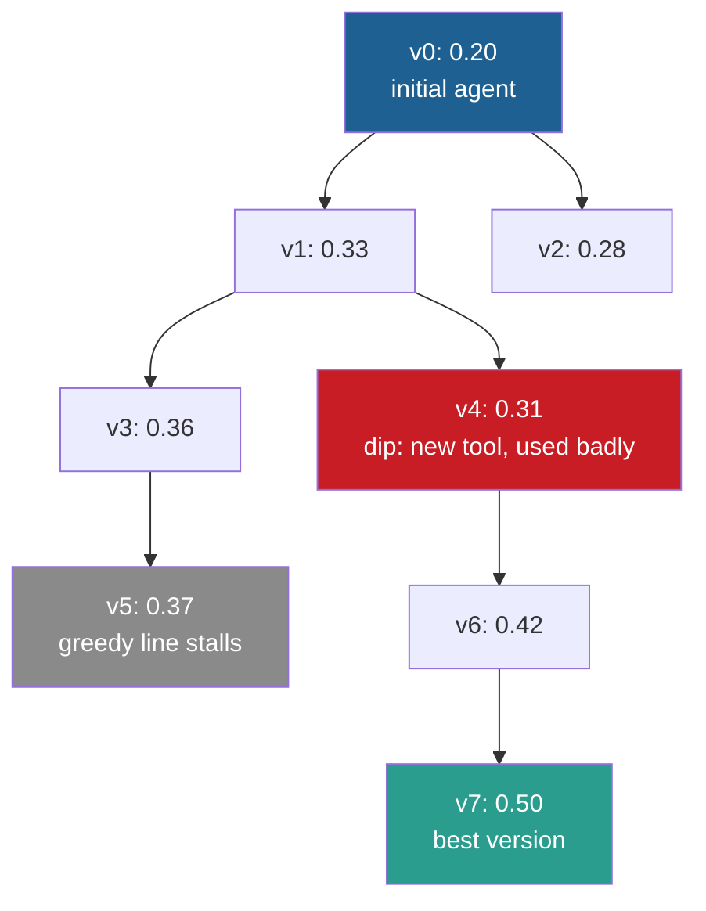

## Learning objectives

After this lesson you can:

- Explain why a loop that always builds on its best or latest version can get stuck.
- Define a stepping stone, and give the evidence for stepping stones from the Darwin Gödel Machine (DGM).
- Compute the DGM parent-selection probabilities for a small archive, step by step.
- Read the DGM ablation results, and state what they show and what they do not show.
- Explain the metaproductivity–performance mismatch, and compute a clade metaproductivity estimate.
- Compare three archive designs: a tree of versions, a quality-diversity grid, and islands.

## Prerequisites

- [L2: One iteration, step by step](/notes/ai/recursive-self-improvement/03-anatomy/l2-one-iteration-step-by-step)
- [L4: Optimization and search](/notes/ai/recursive-self-improvement/01-foundations/l4-optimization-and-search)

## 1. The question this idea answers

A hiker wants to reach the highest point of a mountain range. Thick fog hides everything beyond a few meters. She follows a simple rule: always step uphill. After an hour she stands on a hilltop. Every step from here goes down. But the real summit is across a valley, much higher.

Her rule was not stupid. It was greedy. It only accepted steps that looked better now. To reach the summit, she would have to walk down first. A step down looks like a mistake when you measure only height.

Now imagine she had marked several camps on her way, also some low ones. From any camp, she can start a new route. One low camp may sit at the foot of the path to the summit. This is the idea of an **archive**. Keep many versions, not only the best one, because the way to the best version may pass through a worse one.

## 2. Mental model, and where it stops working

> [!analogy] Base camps on a mountain range
> A climbing team keeps base camps at many places, not only at the highest point that it has reached. Each day, the team picks a camp and tries a new route from it. It picks high camps more often. It also picks camps that few routes have started from, so that no area stays unexplored.
>
> **Where it stops working:**
> 1. A camp does not change the climber. In recursive self-improvement (RSI), each version is also the agent that makes the next change. A lower camp may hold a better climber.
> 2. Height is measured exactly. A version's score is measured on a few tasks, with noise.
> 3. A mountain map shows where paths lead. A version's future value is unknown. Section 4.7 shows that a version's own score predicts its descendants' success only weakly.

## 3. Terms

| Term | Plain meaning |
|---|---|
| greedy single lineage | A loop that keeps one current version and builds every new candidate on it. |
| hill climbing | Greedy search that accepts a candidate only if its score is higher. |
| local optimum | A version that is better than all its close neighbors, but not the best overall. |
| deceptive objective | An objective whose rises point away from the best solution. |
| stepping stone | A version that is not good itself, but leads to good versions later. |
| archive | The stored set of kept versions, with their scores, from which later parents are chosen. |
| lineage | The chain of versions from the initial version to a given version. |
| parent selection | The rule that picks which archived version the next candidate is made from. |
| exploration | Trying versions or regions that are not yet well known. |
| exploitation | Building on versions that already score well. |
| sigmoid | An S-shaped function that maps any number to a value between 0 and 1. |
| open-ended exploration | Search that keeps a growing archive and keeps branching from many versions, not only the best. |
| quality-diversity | Search that wants good versions of many different kinds, not one best version. |
| island | A separate part of an archive that evolves on its own most of the time. |
| clade | A version together with all its descendants in the archive tree. |
| metaproductivity | A version's potential to lead to useful further improvements. |
| clade metaproductivity (CMP) | The expected quality of the best final version that will come from a version's clade. |
| Pearson correlation | A number from −1 to 1 that measures how well two quantities rise and fall together along a straight line. |

## 4. Method and math

### 4.1 The greedy single lineage

The simplest improvement loop keeps one version. Each iteration makes a candidate from it. If the candidate scores higher, it replaces the current version. If not, the loop drops the candidate.

```python
current = initial_version
for iteration in range(N):
    candidate = propose_and_apply(current)
    if score(candidate) > score(current):   # greedy acceptance
        current = candidate
```

This is hill climbing over versions. It has two good properties. It is simple, and the current version never gets worse by its measured score. It also has two problems:

1. **It stops at local optima.** When no single change raises the score, the loop is stuck. A better version may exist two changes away, behind a change that first lowers the score.
2. **Noise can fool it.** A candidate that scored higher by luck replaces a truly better version. Lesson L2 showed how large this noise is on 60 tasks.

A variant always builds on the **latest** version, even if it is worse. This avoids being stuck on one version. But it forgets good versions, so one bad change can erase all earlier progress.

### 4.2 Deceptive objectives

Some objectives are worse than bumpy. They point the wrong way. Joel Lehman and Kenneth Stanley define this idea (Lehman and Stanley, 2011, Section 2.1.1). In their words: "A deceptive objective function will deceive search by actively pointing the wrong way".

Picture a maze in which a robot's score is its distance to the goal. If a dead end lies close to the goal, the score pulls robots into the dead end. The authors tested such mazes. **Measured:** in a hard deceptive maze, search that ignored the objective and rewarded only new behavior solved 39 of 40 runs. Search that followed the distance score solved 3 of 40 (Lehman and Stanley, 2011).

**Our interpretation:** a benchmark score for a coding agent can be deceptive in the same way. A change such as "build a new editing tool" may first lower the score, because the agent uses the new tool badly. A later change may then make it a large gain. A greedy loop drops the first change, so the later gain never happens.

### 4.3 Archives and stepping stones

An **archive** keeps many versions with their scores. Parents are chosen from the whole archive. Worse versions stay available. The DGM paper states the reason (Zhang et al., 2025, [arXiv:2505.22954](https://arxiv.org/abs/2505.22954), Section 3). In its words, "archived solutions can serve as stepping stones that result in improvements much later".


The same idea as a flowchart, with invented scores:



A greedy loop at v1 would accept v3 and reject v4, because 0.31 is less than 0.33. It would then stall near v5, while v4 stays in the archive. Version v4 leads to v7, the best version, so v4 is the stepping stone of this toy tree.

**Measured:** the DGM paper reports this pattern in a real run. At iterations 4 and 56, the agent's score "temporarily fell below that of its parent". Yet the best agent's lineage "includes two performance dips" (Zhang et al., 2025, Figure 3). This is the paper's main evidence for keeping worse agents.

A related result comes from open-ended learning. Paired Open-Ended Trailblazer (POET) creates new environments and trains agents in them. It also tries each agent in other environments. **Measured:** POET solved environments that direct training could not solve. There, the best direct scores were between 13.6 and 39.6, against a "solved" mark of 230. Without the transfer between environments, POET solved none of the "extremely challenging" environments (Wang et al., 2019, [arXiv:1901.01753](https://arxiv.org/abs/1901.01753)).

### 4.4 The DGM parent-selection rule

An archive raises a new question: which version should be the next parent? Two forces pull against each other. Good versions are likely good parents (exploitation). But versions that nobody has tried to improve may hide stepping stones (exploration).

**The idea.** The DGM gives each archived agent a weight. The weight grows with the agent's score, through a sigmoid. It shrinks with the agent's number of children. Then the loop draws parents at random in proportion to the weights.

**The equations** (Zhang et al., 2025, v1 Appendix A.2 and v3 Appendix C.2):

$$
s_i = \frac{1}{1 + e^{-\lambda(\alpha_i - \alpha_0)}}, \qquad h_i = \frac{1}{1 + n_i}, \qquad w_i = s_i \, h_i, \qquad p_i = \frac{w_i}{\sum_j w_j}
$$

The symbols mean:

- $\alpha_i$ is the score of agent $i$, a pass rate from 0 to 1.
- $\lambda = 10$ sets how steep the sigmoid is.
- $\alpha_0 = 0.5$ is the score at which $s_i = 0.5$.
- $s_i$ is the sigmoid-scaled score, between 0 and 1.
- $n_i$ is the number of children of agent $i$ in the archive. Only valid children count, because only they enter the archive.
- $h_i$ is the novelty bonus. It is 1 for an agent with no children, and it halves with one child.
- $w_i$ is the weight. $p_i$ is the probability that one draw picks agent $i$.

The loop then draws $k$ parents with replacement: $k = 2$ for SWE-bench and $k = 4$ for Polyglot in the paper. The paper also excludes agents with a perfect score ($\alpha_i = 1$). The public code does not apply that exclusion.

**In plain English.** Good agents get picked more often, but an agent with many children gets picked less. So under-explored branches keep getting chances. Every agent keeps a probability above zero.

**Worked example.** An archive holds three agents:

| Agent | Score $\alpha$ | Children $n$ |
|---|---|---|
| A (the initial agent) | 0.20 | 2 |
| B | 0.45 | 0 |
| C | 0.55 | 3 |

Step 1, the sigmoid scores. The exponent is $-10(\alpha - 0.5)$:

1. A: exponent $= -10 \times (0.20 - 0.5) = 3.0$. Then $e^{3.0} = 20.09$, and $s_A = 1 / (1 + 20.09) = 0.0474$.
2. B: exponent $= 0.5$. Then $e^{0.5} = 1.649$, and $s_B = 1 / 2.649 = 0.3775$.
3. C: exponent $= -0.5$. Then $e^{-0.5} = 0.607$, and $s_C = 1 / 1.607 = 0.6225$.

Step 2, the novelty bonuses: $h_A = 1/3 = 0.333$, $h_B = 1/1 = 1$, $h_C = 1/4 = 0.25$.

Step 3, the weights:

1. $w_A = 0.0474 \times 0.333 = 0.0158$
2. $w_B = 0.3775 \times 1 = 0.3775$
3. $w_C = 0.6225 \times 0.25 = 0.1556$

Step 4, normalize. The sum is $0.0158 + 0.3775 + 0.1556 = 0.5489$. So:

1. $p_A = 0.0158 / 0.5489 = 0.029$
2. $p_B = 0.3775 / 0.5489 = 0.688$
3. $p_C = 0.1556 / 0.5489 = 0.283$

Step 5, two draws with replacement. The probability that an agent is picked at least once is $1 - (1 - p)^2$:

1. A: $1 - 0.971^2 = 0.057$
2. B: $1 - 0.312^2 = 0.902$
3. C: $1 - 0.717^2 = 0.487$

C has the best score, but B is picked far more often. B has no children yet, so its novelty bonus is 1. C already has three children, so its bonus is 0.25. The rule spends effort on B's untested branch. The initial agent A, weak and already explored, is almost never picked.

**Assumptions.** The score of each agent reflects its value as a parent. The children count is a fair measure of how much a branch has been explored. The constants $\lambda = 10$ and $\alpha_0 = 0.5$ suit the score range of the run.

**When it is useful.** It is a cheap, transparent rule for an archive of a few dozen to a few hundred agents. It needs only the scores and the parent links.

**What it does not prove.** The formula is a design choice. The paper does not show that it is optimal. Its first assumption is weak: Section 4.7 shows that an agent's own score predicts its descendants' success poorly.

**Exercise 1.** An archive holds four agents:

| Agent | Score | Children |
|---|---|---|
| P | 0.30 | 0 |
| Q | 0.50 | 2 |
| R | 0.60 | 1 |
| S | 0.70 | 4 |

Compute each agent's selection probability for one draw. Which agent is picked most often, and why is it not S?

```check
{
  "question": "Exercise 1: compute the DGM selection probabilities for P, Q, R and S.",
  "hint": "s = 1 / (1 + exp(-10 × (score - 0.5))), h = 1 / (1 + children), w = s × h, then divide each w by the sum.",
  "answer": "Sigmoid scores: P = 1/(1 + e^2) = 0.119 and Q = 0.500. R = 1/(1 + e^-1) = 0.731 and S = 1/(1 + e^-2) = 0.881. Bonuses: P = 1, Q = 1/3, R = 1/2, S = 1/5. Weights: P = 0.119, Q = 0.167, R = 0.366, S = 0.176. Sum = 0.828. Probabilities: P = 0.144, Q = 0.201, R = 0.442, S = 0.213. R is picked most often. S has the best score, but its four children cut its bonus to 0.2. R has a good score and only one child."
}
```

### 4.5 What the DGM ablation shows

The DGM paper compares the full system with variants that remove one part (Zhang et al., 2025, Section 4). All SWE-bench numbers are on the paper's 200-task evaluation set. The Polyglot numbers are on a 50-task subset.

| Variant | What it removes | SWE-bench | Polyglot (50 tasks) |
|---|---|---|---|
| Initial agent | Everything | 20.0% | 14.0% |
| Without open-ended exploration | The archive. The loop always changes the latest version | 23.0% | 14.0% |
| Greedy | Parent choice. The loop always picks the best agent | 39.7% | 30.0% |
| Without self-improvement | The initial agent stays fixed as the agent that makes changes | 39.0% | 28.0% |
| Full DGM | Nothing | 50.0% | 38.0% |

**Measured:** without the archive, the loop gained almost nothing on SWE-bench (20.0% to 23.0%) and nothing on Polyglot. Always picking the best agent did better, but less well than the full rule.

**What this shows.** In these runs, keeping an archive and choosing parents broadly mattered a lot. The gap between 23.0% and 50.0% is large. The noise of one 200-task score is only about 3.5 points at 50%.

**What this does not show.**

1. Each condition ran once. The paper reports repeats only for the full DGM on Polyglot. Its 3 runs gave a mean of 40.7% with a standard deviation of 2.3 points (v3 Appendix A.4).
2. The gap between "greedy" (39.7%) and the full DGM (50.0%) is about 10 points from single runs. It is likely real, but its exact size is uncertain.
3. The results come from one domain (coding benchmarks) and one model family. They do not show that archives help in every self-improving system.

### 4.6 Other archive designs

The DGM archive is a tree with one rule for parents. Other systems organize the archive differently.

**A quality-diversity grid: MAP-Elites.** MAP-Elites does not seek one best solution. It divides the space of solutions into cells by chosen features, for example "code length" and "style". Each cell keeps only its best solution. The steps (Mouret and Clune, 2015, [arXiv:1504.04909](https://arxiv.org/abs/1504.04909)):

1. Choose a performance function and a few feature dimensions.
2. Make a candidate: a random one at first, later a mutation of a random elite.
3. Find the candidate's cell from its features.
4. If the cell is empty or the candidate scores higher than the cell's elite, the candidate takes the cell.

The grid keeps diversity by design. A weak solution of a rare kind survives, because it competes only within its cell. The limit is that the features are fixed in advance.

**Islands.** FunSearch splits its programs database into islands that evolve apart. Every 4 hours, it wipes the half of the islands whose best programs score lowest. It reseeds each one with the best program of a surviving island (Romera-Paredes et al., 2023, [Nature](https://www.nature.com/articles/s41586-023-06924-6)).

OpenEvolve, an open-source system in the same family, combines both ideas (code at commit `74c7cb0`, `openevolve/config.py` and `openevolve/database.py`). Its defaults are 5 islands, each with its own MAP-Elites grid. A parent comes from three sources: uniformly from the island (20%), from the island's elites (70%), or by fitness (10%). Every 50 island generations, the top 10% of each island are copied to its two neighbors.

**The whole archive in the prompt.** Automated Design of Agentic Systems (ADAS) does not select parents at all. It puts every archived agent, with its code and score, into the proposer's prompt (Hu et al., 2024). **Measured:** an independent study found that this cumulative context "performs worse than ignoring prior designs entirely". A context with only the top 7 parents did better (El, Yuksekgonul and Zou, 2025, [arXiv:2510.06711](https://arxiv.org/abs/2510.06711)). So an archive helps only if the loop uses it well.

### 4.7 The metaproductivity problem

The DGM rule assumes that a high-scoring agent is a good parent. The DGM paper also bets that a better coding agent is a better self-improver. The Huxley-Gödel Machine (HGM) paper tests this assumption (Wang et al., 2025, [arXiv:2510.21614](https://arxiv.org/abs/2510.21614)).

**The mismatch.** An agent's score measures how well it solves tasks now. What a parent should have is **metaproductivity**: the potential to produce useful further improvements. A high-scoring agent may have weak descendants. A lower-scoring one may start a strong lineage. The paper calls this the "Metaproductivity-Performance Mismatch".

**Measured:** the HGM authors computed how well each method's selection signal predicts the real outcome of each agent's clade. They used Pearson correlation (Table 1). The table compares the selection signals of the Self-Improving Coding Agent (SICA), the DGM and HGM.

| Selection signal | SWE-Verified-60 (weighted / unweighted) | Polyglot (weighted / unweighted) |
|---|---|---|
| SICA: the agent's benchmark score | 0.444 / 0.444 | 0.274 / 0.274 |
| DGM: the agent's benchmark score | 0.285 / 0.406 | 0.383 / 0.357 |
| HGM: the clade estimate | 0.778 / 0.512 | 0.626 / 0.873 |

The agent's own score correlates with its clade's success at only 0.27 to 0.44. The clade estimate does better. (The paper's text gives 0.8783 for the last cell, the table 0.873.)

**The idea of CMP.** Judge a version by its whole family, not by itself. A **clade** is a version plus all its descendants. **Clade metaproductivity** is the expected quality of the best final agent that will come from that clade. The exact definition needs the future of the search, so the HGM estimates it from the clade's evaluations so far.

**The estimator** (Wang et al., 2025, Section 3):

$$
\widehat{\mathrm{CMP}}(a) = \frac{n^{C}_{\text{success}}(a)}{n^{C}_{\text{success}}(a) + n^{C}_{\text{failure}}(a)}
$$

The symbols mean:

- $a$ is an agent in the archive.
- $n^{C}_{\text{success}}(a)$ is the number of passed task evaluations, summed over $a$ and all its descendants.
- $n^{C}_{\text{failure}}(a)$ is the same sum for failed task evaluations.

**In plain English.** Pool every task result of the whole family, and compute one pass rate. Family members that were evaluated more often count more.

**Worked example (toy numbers).** Two agents, X and Y, each have two children:

| Agent | Own passes / failures | Own pass rate | Children's passes / failures |
|---|---|---|---|
| X | 12 / 8 | 0.60 | X1: 4 / 16, X2: 5 / 15 |
| Y | 9 / 11 | 0.45 | Y1: 13 / 7, Y2: 14 / 6 |

1. X's clade: passes $= 12 + 4 + 5 = 21$. Failures $= 8 + 16 + 15 = 39$. So $\widehat{\mathrm{CMP}}(X) = 21 / 60 = 0.35$.
2. Y's clade: passes $= 9 + 13 + 14 = 36$. Failures $= 11 + 7 + 6 = 24$. So $\widehat{\mathrm{CMP}}(Y) = 36 / 60 = 0.60$.

By its own score, X looks better (0.60 against 0.45). By its clade, Y looks better (0.60 against 0.35). The DGM rule would favor X. A clade-based rule would favor Y, whose children did well.

**Assumptions.** Task results are comparable across family members. The family's past results predict its future. Pooling ignores which member is the best one.

**What it does not prove.** $\widehat{\mathrm{CMP}}$ is an estimate from few evaluations, so it is noisy for small clades. A young agent with no children has a clade of one, and its estimate equals its own score.

**How HGM uses it.** HGM decides at each step between two actions: make a new child (expansion) or run one agent on one task (evaluation). It expands when the archive size is at most $N^{0.6}$, where $N$ is the number of evaluations so far. For example, after 100 evaluations, $100^{0.6} \approx 15.8$, so it expands only while the archive holds 15 agents or fewer. It picks the parent by Thompson sampling.

For each agent, it draws one random value from a distribution built from the clade counts. Then it expands the agent with the highest draw. The distribution also has a scaling term that changes over time. These notes do not give its exact form.

**Measured:** each method had a budget of 800 task evaluations on a 60-task subset of SWE-bench Verified. HGM reached 56.7%, the DGM 53.3%, and SICA 50.0%. HGM used 517 CPU-hours, against 1,231 for the DGM (Wang et al., 2025, Table 2). On Polyglot the results were 30.5%, 27.1% and 25.4%.

**Limits.** Each method ran once per benchmark. On 60 tasks, one task is 1.67 points, so 56.7% against 53.3% is a difference of 2 tasks. The cost result is clearer than the score result.

### 4.8 The cost of an archive

An archive is not free. Its costs come from four places:

1. **Evaluation.** A version is only selectable if it has a score. The DGM keeps every valid child, so every child gets at least 10 task runs. HGM saves cost by evaluating one agent on one task at a time and stopping early on weak agents.
2. **Noise in selection.** In the DGM, weak agents are scored on 10 tasks only. Their scores are rough, and the parent rule uses them anyway.
3. **Context.** If the archive goes into the prompt, as in ADAS, the prompt grows with every iteration. The El et al. result above shows that more context can hurt.
4. **Spread of effort.** A large archive spreads the budget over many branches. The novelty bonus does this on purpose, but each branch then gets fewer children.

Storage is cheap by comparison. The DGM stores each agent as a chain of small git patches.

## 5. Graphs

```plot
{
  "title": "DGM sigmoid-scaled score s as a function of the agent's score, with lambda 10 and alpha_0 0.5 (blue)",
  "xAxis": { "label": "agent score alpha", "domain": [0, 1] },
  "yAxis": { "label": "s", "domain": [0, 1] },
  "disableZoom": true,
  "data": [
    { "fn": "1/(1+exp(-10*(x-0.5)))", "color": "#1E6091" }
  ]
}
```

The curve is flat near 0 and near 1, and steep between about 0.3 and 0.7. An agent at 0.20 gets $s = 0.047$, and an agent at 0.30 gets $s = 0.119$. So among weak agents, a 10-point gain in score raises the weight about 2.5 times.

```plot
{
  "title": "DGM novelty bonus h = 1/(1+n) as a function of the number of children n (purple)",
  "xAxis": { "label": "number of children n", "domain": [0, 10] },
  "yAxis": { "label": "h", "domain": [0, 1] },
  "disableZoom": true,
  "data": [
    { "fn": "1/(1+x)", "color": "#6A4C93" }
  ]
}
```

The first child halves the bonus. The next children reduce it more slowly. An agent with 9 children keeps a bonus of 0.1, so it is never excluded.

## 6. Video and animation

- [Ken Stanley's talk on Why Greatness Cannot Be Planned](https://www.youtube.com/watch?v=VDuF4onPmuE) (Kenneth Stanley, 2024). It explains why direct pursuit of an objective often fails and why stepping stones matter. It supports sections 4.2 and 4.3.
- [Don't invent faster horses - Prof. Jeff Clune](https://www.youtube.com/watch?v=mw5WIDGRLnA) (Machine Learning Street Talk, 2025). A long interview on open-ended algorithms, novelty search, POET and ADAS. It gives the research background of the DGM archive.

## 7. Code

The DGM selection rule in the public code (`DGM_outer.py`, lines 91 to 100, commit `a565fd2`):

```python
    elif method == 'score_child_prop':
        # Choose parents based on score and the number of children
        commits = list(candidates.keys())
        scores = [candidates[commit]['accuracy_score'] for commit in commits]
        scores = [1 / (1 + math.exp(-10*(score-0.5))) for score in scores]
        children_counts = [candidates[commit]['children_count'] for commit in commits]
        children_counts = [1 / (1 + count) for count in children_counts]
        probabilities = [score * count for score, count in zip(scores, children_counts)]
        probabilities = [prob / sum(probabilities) for prob in probabilities]
        parent_commits = random.choices(commits, probabilities, k=selfimprove_size)
```

Each line matches one symbol of section 4.4. Line 4 is $\alpha_i$. Line 5 is $s_i$. Lines 6 and 7 are $n_i$ and $h_i$. Line 8 is $w_i$, line 9 is $p_i$, and line 10 draws $k$ parents with replacement. The children count comes from how many archive members name this agent as their parent.

Two observations from reading the code, not confirmed by running it:

1. Another method, `best`, sorts the scores in ascending order and takes the first $k$. So it would pick the **lowest**-scoring agents.
2. The list of allowed method names on line 228 misses a comma, so two names join into one string. The default still works, but naming `score_child_prop` on the command line would be rejected.

A small, tested version of the same rule that you can use for the exercises:

```python
import math, random

def dgm_parent_probabilities(archive):
    """archive: list of (name, score, n_children). Returns {name: probability}."""
    weights = {}
    for name, score, n_children in archive:
        s = 1 / (1 + math.exp(-10 * (score - 0.5)))   # sigmoid-scaled score
        h = 1 / (1 + n_children)                       # novelty bonus
        weights[name] = s * h
    total = sum(weights.values())
    return {name: w / total for name, w in weights.items()}

probs = dgm_parent_probabilities([("A", 0.20, 2), ("B", 0.45, 0), ("C", 0.55, 3)])
print({k: round(v, 3) for k, v in probs.items()})   # {'A': 0.029, 'B': 0.688, 'C': 0.283}
parents = random.choices(list(probs), weights=list(probs.values()), k=2)
```

## 8. Common mistakes

1. **"Keeping only the best version is always safest."** It is safe for the current score, but it stops at local optima. In the DGM, the archive-free variant reached 23.0% against 50.0%.
2. **"A worse child is a failed attempt."** It can be a stepping stone. The best DGM agent's lineage contains two dips.
3. **"The best-scoring agent is the best parent."** HGM measured correlations of only 0.27 to 0.44 between an agent's score and its clade's success.
4. **"Parent selection in the DGM picks the best agents."** It picks in proportion to a weight that also falls with the number of children. A medium agent with no children can beat the best agent.
5. **"A bigger archive is always better."** Every kept version costs evaluation, and an archive in the prompt can hurt the proposer.
6. **"The ablation proves the exact size of the archive effect."** Each condition ran once, so the gaps are estimates with uncertainty.

## 9. One-minute explanation

A loop that always builds on its best version is hill climbing, so it stops at local optima, and noise can fool it. An archive keeps many versions, also worse ones, because the path to the best version can pass through a stepping stone. The DGM picks parents at random, with weights from a sigmoid of the score times one over one plus the number of children. So good agents and unexplored agents both get chances, and without its archive the DGM reached 23.0% instead of 50.0%. But an agent's own score predicts its descendants' success only weakly. The Huxley-Gödel Machine therefore scores whole families of agents and chooses parents from that.

## 10. Check questions

```check
{
  "question": "An archive holds two agents. E scores 0.40 with 0 children. F scores 0.60 with 1 child. Compute the DGM selection probability of each for one draw.",
  "hint": "e^1 ≈ 2.718 and e^-1 ≈ 0.368.",
  "answer": "For E: s = 1/(1 + e^1) = 1/3.718 = 0.269, h = 1, so w = 0.269. For F: s = 1/(1 + e^-1) = 1/1.368 = 0.731, h = 1/2, so w = 0.366. Sum = 0.635. p_E = 0.269/0.635 = 0.424, p_F = 0.366/0.635 = 0.576. F is still favored, but E gets more than 40% of the draws because it has no children."
}
```

```check
{
  "question": "Explain in your own words why a greedy single lineage can miss the best version, and give the DGM evidence.",
  "answer": "A greedy loop accepts only changes that raise the measured score now. Some useful changes first lower the score, for example a new tool that the agent uses badly at first. The greedy loop drops them, so the later gains they enable never happen. The DGM paper reports that its best agent's lineage includes two dips below a parent's score, at iterations 4 and 56. A variant that always changed the latest version, with no archive, reached 23.0% on SWE-bench against 50.0% for the full DGM."
}
```

```check
{
  "question": "Agent G has an own pass rate of 0.55 and two children with 3 passes / 17 failures and 6 / 14. G's own counts are 11 / 9. Agent H has 8 / 12 own counts and one child with 16 / 4. Compute the clade estimate for each. Which would a clade-based rule prefer?",
  "answer": "G's clade: passes 11 + 3 + 6 = 20, failures 9 + 17 + 14 = 40, estimate 20/60 = 0.33. H's clade: passes 8 + 16 = 24, failures 12 + 4 = 16, estimate 24/40 = 0.60. A clade-based rule prefers H, although H's own pass rate (0.40) is lower than G's (0.55). H's child shows that H's line is productive."
}
```

```check
{
  "question": "The DGM ablations ran once each. The full DGM scored 50.0% and the greedy variant 39.7% on 200 tasks. Is the gap convincing? Name what you would need to be sure.",
  "answer": "The noise of one 200-task score at about 50% is about 3.5 points (sqrt(0.5 × 0.5 / 200) ≈ 0.035). A 10-point gap is about 2 to 3 times the combined noise of two scores, so it is suggestive. But run-to-run variation also matters: the Polyglot repeats had a standard deviation of 2.3 points across 3 runs. To be sure, you need several runs per condition and a paired comparison on the same tasks. You also need a held-out set that played no role in selection."
}
```

## 11. Summary and links

- A greedy single lineage is hill climbing over versions. It stops at local optima and can be fooled by noise or by deceptive objectives.
- An archive keeps worse versions as possible stepping stones. The best DGM agent's lineage had two dips.
- The DGM picks parents in proportion to a sigmoid of the score times $1/(1 + n)$. Unexplored agents get a large bonus.
- Without its archive, the DGM gained 3 points instead of 30 on SWE-bench, in single runs.
- An agent's own score predicts its descendants' success only weakly. HGM scores clades instead.

The next lesson moves up one level. It asks who improves the improver, and why every real system keeps a frozen core that no level may change.

- Previous: [L2: One iteration, step by step](/notes/ai/recursive-self-improvement/03-anatomy/l2-one-iteration-step-by-step)
- Next: [L4: The improver, meta-levels and the frozen core](/notes/ai/recursive-self-improvement/03-anatomy/l4-the-improver-and-meta-levels)
- Related: [L6: Evolutionary search, populations and open-endedness](/notes/ai/recursive-self-improvement/05-approaches/l6-evolutionary-and-population-methods)
- Related: [2025: The Huxley-Gödel Machine](/notes/ai/recursive-self-improvement/06-research-systems/p11-huxley-godel-machine)
- Related: [P7: Regression tests and an archive](/notes/ai/recursive-self-improvement/09-build-it/p7-regression-tests-and-an-archive)

## References

- Jenny Zhang, Shengran Hu, Cong Lu, Robert Lange, Jeff Clune. "Darwin Gödel Machine: Open-Ended Evolution of Self-Improving Agents". 2025. ICLR 2026. arXiv:2505.22954. https://arxiv.org/abs/2505.22954. Code: https://github.com/jennyzzt/dgm (commit a565fd2)
- Wenyi Wang, Piotr Piękos, Li Nanbo, et al. "Huxley-Gödel Machine: Human-Level Coding Agent Development by an Approximation of the Optimal Self-Improving Machine". 2025. ICLR 2026. arXiv:2510.21614. https://arxiv.org/abs/2510.21614. Code: https://github.com/metauto-ai/HGM
- Joel Lehman, Kenneth O. Stanley. "Abandoning Objectives: Evolution through the Search for Novelty Alone". Evolutionary Computation 19(2):189–223. 2011. DOI 10.1162/EVCO_a_00025
- Rui Wang, Joel Lehman, Jeff Clune, Kenneth O. Stanley. "Paired Open-Ended Trailblazer (POET): Endlessly Generating Increasingly Complex and Diverse Learning Environments and Their Solutions". 2019. arXiv:1901.01753. https://arxiv.org/abs/1901.01753
- Jean-Baptiste Mouret, Jeff Clune. "Illuminating search spaces by mapping elites". 2015. arXiv:1504.04909. https://arxiv.org/abs/1504.04909
- Bernardino Romera-Paredes, Mohammadamin Barekatain, Alexander Novikov, et al. "Mathematical discoveries from program search with large language models". Nature 625:468–475. 2023. DOI 10.1038/s41586-023-06924-6. https://www.nature.com/articles/s41586-023-06924-6
- Asankhaya Sharma. "OpenEvolve: an open-source evolutionary coding agent". Software, 2025. https://github.com/codelion/openevolve (commit 74c7cb0)
- Shengran Hu, Cong Lu, Jeff Clune. "Automated Design of Agentic Systems". 2024. ICLR 2025. arXiv:2408.08435. https://arxiv.org/abs/2408.08435
- Batu El, Mert Yuksekgonul, James Zou. "Inefficiencies of Meta Agents for Agent Design". 2025. Findings of EMNLP 2025. arXiv:2510.06711. https://arxiv.org/abs/2510.06711
