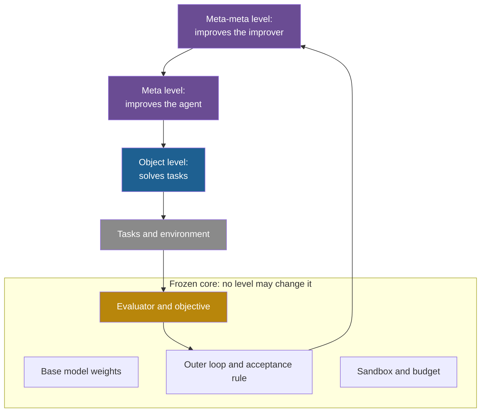

## Learning objectives

After this lesson you can:

- Define the object level, the meta level and the meta-meta level, and place the parts of a real system on them.
- Explain the regress problem and three ways that designs stop it.
- Use two update rules to tell a fixed learner from a self-referential one, with a worked example.
- List the frozen core of eight real systems, and say what each frozen part protects.
- Explain why every system needs a frozen core: who checks the checker, the evaluator bottleneck, and the Löbian obstacle.
- Tell a part that is frozen by design from a part that is frozen only by convention.

## Prerequisites

- [L1: The components of a self-improving system](/notes/ai/recursive-self-improvement/03-anatomy/l1-the-components)
- [L3: Archives: why keep more than the best version](/notes/ai/recursive-self-improvement/03-anatomy/l3-archives-and-search-over-versions)
- [L5: Recursion, self-reference and programs that change programs](/notes/ai/recursive-self-improvement/01-foundations/l5-recursion-and-self-reference)
- [L2: The ladder: from repeating a task to improving the improver](/notes/ai/recursive-self-improvement/02-core-idea/l2-the-ladder-of-self-improvement)

## 1. The question this idea answers

A student solves math problems. That is her first level of work. After a month, she changes how she studies: she uses flash cards instead of rereading. That is a second level: she improves the way she learns. Later she tests a new study method each week and keeps the best one. That is a third level: she improves the way she chooses study methods.

Who improves the third level? She could add a fourth level, and a fifth. The chain has no natural end.

In practice, some parts never change. The exam stays the same, and the school decides the grades. She cannot grade her own exam. These fixed parts also keep her progress honest.

Self-improving AI systems face the same chain. This lesson names the levels and shows how real systems stop the chain. It also explains why every real system keeps a **frozen core**: parts that no level may change.

## 2. Mental model, and where it stops working

> [!analogy] A company with an outside auditor
> - Workers make the product (the object level).
> - Managers change how the workers work (the meta level).
> - A board changes how managers are chosen and trained (the meta-meta level).
> - Outside the company, an auditor checks the accounts, and the law sets limits. No one inside the company can rewrite the audit or the law. These are the frozen core.
>
> **Where it stops working:**
> 1. In software, one program can be the worker, the manager and the board at once. In STOP, the same improver code improves a solution and improves itself.
> 2. A company cannot edit its auditor's files. A program can sometimes reach code that checks it, if that code sits on the same machine or inside its own code base.
> 3. Laws change slowly, through outside processes. A self-changing program can change its own rules in seconds.

## 3. Terms

| Term | Plain meaning |
|---|---|
| object level | The level that solves tasks. |
| meta level | The level that changes the object level to make it solve tasks better. |
| meta-meta level | The level that changes the meta level to make it a better improver. |
| improver | The procedure that takes a version and returns a candidate that it expects to be better. |
| policy | The rule or program that decides what an agent does on a task. |
| learner | The procedure that updates the policy from feedback. It is an improver. |
| self-referential | A system that reads or changes its own code, including the code that does the changing. |
| regress | A chain of levels in which each level needs another level above it, without an end. |
| frozen core | The parts of a self-improving system that no level of the system may change during a run. |
| outer loop | The program that runs the improvement iterations, selects parents and stores results. |
| sandbox | An isolated environment that limits what running code can read, change or reach. |
| monkey patching | Replacing a function or method of a running program with new code. |
| overseer | In SICA, a language model that runs next to the agent and can warn it or stop it when it goes off task. |
| hyper-mutation prompt | In Promptbreeder, the fixed instruction that the system uses to change its mutation-prompts. |
| evaluator bottleneck | The limit that the quality of the evaluator puts on any improvement loop. |
| Löbian obstacle | A result from logic: an agent that trusts only proofs cannot simply prove that a successor using the same proof system is trustworthy. |

## 4. Method and math

### 4.1 Three levels

Every self-improving system works on at least two levels. Many papers describe a third.

| Level | What it does | DGM | STOP | Promptbreeder | ADAS |
|---|---|---|---|---|---|
| Object | Solves tasks | The coding agent fixes GitHub issues | A downstream solution, for example a parity learner | A task-prompt answers math questions | A designed agent answers questions |
| Meta | Improves the object level | The coding agent changes its own code | The improver improves a solution | Mutation-prompts change task-prompts | The meta agent writes new agents |
| Meta-meta | Improves the meta level | The changed agent also does the next change | The improver improves its own code | Hyper-mutation changes mutation-prompts | Not done |

The four systems are the Darwin Gödel Machine (DGM), the Self-Taught Optimizer (STOP), Promptbreeder, and Automated Design of Agentic Systems (ADAS). The sources are in the reference list.

Look at the ADAS column. Its meta agent writes agents, but nothing improves the meta agent. The paper did not build a "higher order" design of this kind. **Speculation:** the paper names it as future work (Hu et al., 2024, [arXiv:2408.08435](https://arxiv.org/abs/2408.08435)). In its words, the aim is "to allow the learning of the meta agent and even the meta-meta agent, etc."

### 4.2 The regress

Jürgen Schmidhuber stated the problem in his 1987 diploma thesis. A system should treat every problem as two problems: solve it, and improve the strategies it uses to solve problems. Then he added: "Of course we do not want to stop at the first meta-level!" (Schmidhuber, 1987). His subtitle calls this the "meta-meta-meta...-hook".

The logic is simple. If improving the solver helps, improving the improver should help too. And so should improving the improver of the improver. Each level asks for one more level above it. This is the **regress**.

A real system must stop the regress somewhere, for two reasons. First, each level costs more to evaluate. In STOP, one iteration on the improver can take up to 141 model calls, against 1 for an iteration on a solution (lesson L2). Second, someone must still decide what "better" means at the top. If the top level can change that definition, the loop loses its anchor.

### 4.3 A formal view: a fixed learner and a self-referential learner

The Gödel Agent paper gives a clean way to write the difference (Yin et al., 2025, [ACL 2025](https://aclanthology.org/2025.acl-long.1354), Section 3).

**The idea.** A normal learning system has a fixed learner that updates the policy. A self-referential system lets the learner update the policy and also update itself.

**The two update rules:**

$$
\text{fixed learner:}\quad \pi_{t+1} = I(\pi_t, r_t)
$$

$$
\text{self-referential:}\quad (\pi_{t+1}, I_{t+1}) = I_t(\pi_t, I_t, r_t, g), \qquad r_t = U(E, \pi_t)
$$

The symbols mean:

- $\pi_t$ is the policy at step $t$: the program that solves tasks.
- $I$ or $I_t$ is the learner: the program that updates the policy. In the first rule it has no index, because it never changes.
- $E$ is the environment, for example a set of math problems with answers.
- $U$ is the utility function. $r_t = U(E, \pi_t)$ is the feedback for the current policy.
- $g$ is the high-level goal, for example "highest accuracy".

**In plain English.** In the first rule, the learner is a fixed tool that reshapes the policy. In the second rule, the learner takes itself as an input and returns a new version of itself, together with a new policy.

**Worked example (toy example, invented to show the arithmetic).** The policy is one number $x$. Its loss is $L(x) = x^2$, so smaller is better and the best value is $x = 0$. The slope of the loss is $2x$.

Both learners use the step $x_{t+1} = x_t - \eta_t \cdot 2x_t$, where $\eta_t$ is the step size. The fixed learner keeps $\eta = 0.1$. The self-referential learner also rewrites its own step size. After a step that lowered the loss, it sets $\eta_{t+1} = \min(1.5\,\eta_t,\ 0.45)$.

| Step $t$ | Fixed: $x_t$ | Fixed: loss | Self-referential: $\eta_t$ | Self-referential: $x_t$ | Self-referential: loss |
|---|---|---|---|---|---|
| 0 | 8.00 | 64.00 | 0.100 | 8.00 | 64.00 |
| 1 | 6.40 | 40.96 | 0.150 | 6.40 | 40.96 |
| 2 | 5.12 | 26.21 | 0.225 | 4.48 | 20.07 |
| 3 | 4.10 | 16.78 | 0.338 | 2.46 | 6.07 |
| 4 | 3.28 | 10.74 | 0.450 | 0.80 | 0.64 |
| 5 | 2.62 | 6.87 | 0.450 | 0.08 | 0.0064 |

The steps for the self-referential learner:

1. $t = 0 \to 1$: $x_1 = 8 - 0.1 \times 16 = 6.4$. The loss fell, so $\eta_1 = 1.5 \times 0.1 = 0.15$.
2. $t = 1 \to 2$: $x_2 = 6.4 - 0.15 \times 12.8 = 4.48$. The loss fell, so $\eta_2 = 0.225$.
3. $t = 2 \to 3$: $x_3 = 4.48 - 0.225 \times 8.96 = 2.464$. So $\eta_3 = 0.3375$.
4. $t = 3 \to 4$: $x_4 = 2.464 - 0.3375 \times 4.928 = 0.8008$. Now $1.5 \times 0.3375 = 0.506$, so the cap gives $\eta_4 = 0.45$.
5. $t = 4 \to 5$: $x_5 = 0.8008 - 0.45 \times 1.6016 = 0.0801$.

After 5 steps, the self-referential learner's loss is about 1,000 times smaller.

Now look at what did **not** change. The rule "multiply $\eta$ by 1.5, with a cap of 0.45" stayed the same in every step. It is the frozen top of this toy.

And the cap matters. In this toy, any step size above 1 makes $\lvert 1 - 2\eta \rvert > 1$, so every step overshoots by more than it gains, and $x$ grows without limit. A learner that could also remove its own cap could destroy itself. This is the regress and the frozen core in miniature.

**Assumptions.** The utility $U$, the environment $E$ and the goal $g$ stay fixed. In Gödel Agent they do: the paper lists the goal, the environment, the utility and the model weights as fixed.

**When it is useful.** Use the two rules to classify a system: does its update rule return a new learner, or only a new policy?

**What it does not prove.** The second rule allows the learner to change. It does not show that the changed learner is better. **Measured:** Gödel Agent ran 100 trials on the Multilingual Grade School Math benchmark (MGSM). In 4% of them, the run ended in unexpected termination, usually after the agent changed its own improvement module. In 92% of runs, performance dropped at least once for a while. In 14%, the final policy was worse than the initial one (Yin et al., 2025, Section 6.2).

### 4.4 Three ways to stop the regress

Real designs stop the regress in one of three ways:

1. **Fix a top level.** The meta level, or the meta-meta level, is a fixed program. ADAS fixes its meta agent. Promptbreeder uses a large language model (LLM) to change prompts, and it fixes its hyper-mutation prompt (Fernando et al., 2023, [arXiv:2309.16797](https://arxiv.org/abs/2309.16797), Section 3). The paper says so directly. "The mutation operator for this meta-level algorithm is again an LLM, now conditioned on a hyper-mutation prompt H". The prompt H does not evolve.
2. **Fold the levels into one program.** The improver is part of the agent, so improving the agent also improves the improver. The regress becomes a loop with one level that refers to itself. STOP, the DGM, the Self-Improving Coding Agent (SICA) and Gödel Agent do this. But each keeps an outer loop and an evaluator outside the folded program.
3. **Prove before rewriting.** The Gödel machine may rewrite any part of its own code, including its proof searcher, the part that searches for proofs. But it rewrites only after it proves that the rewrite raises its expected utility (Schmidhuber, 2003, [arXiv:cs/0309048](https://arxiv.org/abs/cs/0309048), Section 2.2). **Theory:** the utility function, the hardware description and the initial code are axioms of the proof system. So they form the frozen core. The design exists in theory only: the papers report no implementation.


The same structure as a flowchart:



### 4.5 Real systems, level by level

**DGM.** The coding agent changes its own code, and the changed code does the next change. So the object level and the meta level share one program. The paper puts it this way (Zhang et al., 2025, [arXiv:2505.22954](https://arxiv.org/abs/2505.22954), Section 3). "self-improvement is fundamentally a coding task that modifies the coding agent's own code repository". But the search around it is "fixed and not modifiable by the DGM" (Section 3).

The public code adds one more fixed part. A fixed o1 call writes the plan for each change, outside the agent's editable code. So the part that decides **what** to change is not self-improved. Only the part that **implements** the change is.

**STOP.** The improver improves itself, so the meta level and the meta-meta level share one program. The language model, the meta-utility and the outer loop are fixed. The authors state the limit in Section 7 (Zelikman et al., 2023, [arXiv:2310.02304](https://arxiv.org/abs/2310.02304)). "A fundamental limitation of our approach is that the LM itself is not improved."

**Promptbreeder.** Task-prompts and mutation-prompts evolve, so the system improves part of its own improver. The hyper-mutation prompt, the list of operator types, the tournament rule and the fitness function stay fixed. The paper also notes that "the topology of prompting remains fixed" (Section 6). Self-reference stops at one level.

**Gödel Agent.** The agent can read and replace any function of its running program, including its own improvement loop. In the public code, `Agent.evolve` and `Agent.execute_action` can be monkey-patched at runtime. The goal, the environment, the utility and the model weights stay fixed (Yin et al., 2025).

**Hyperagents.** This follow-up to the DGM puts the task agent and the meta agent into one editable program (Zhang et al., 2026, [arXiv:2603.19461](https://arxiv.org/abs/2603.19461)). So the procedure that makes changes is itself editable. Parent selection and evaluation stay fixed in the main experiments. The paper reports only preliminary results on editing parent selection.

**AlphaEvolve.** It evolves user programs, and its meta-prompts co-evolve. Its own code, its models and its evaluators stay fixed (Novikov et al., 2025, [arXiv:2506.13131](https://arxiv.org/abs/2506.13131)). It also found a kernel speedup that cut Gemini's training time by 1%. The paper calls this "a novel instance where Gemini, through the capabilities of AlphaEvolve, optimizes its own training process". But humans deploy the change and train the next model. The paper says that "the feedback loops for improving the next version of AlphaEvolve are on the order of months" (Section 6).

### 4.6 The frozen core of eight systems

| System | What can change | Frozen: evaluator and objective | Frozen: model | Frozen: outer loop and selection | Other frozen parts |
|---|---|---|---|---|---|
| DGM | The agent's own Python code: tools and workflow | SWE-bench and Polyglot tasks, the scoring program | Yes | Parent selection, archive rule, staged evaluation | The o1 planning call and its prompts (code) |
| STOP | The improver's own code | The meta-utility and the downstream utilities | Yes (GPT-4) | Repeated self-application (Algorithm 1) | The model-call budget, enforced inside the language-model object |
| ADAS | The agent's `forward()` code | Validation accuracy | Yes | The search loop | The meta agent and its prompt |
| Promptbreeder | Task-prompts, mutation-prompts, few-shot examples | Accuracy on 100 training examples | Yes | Binary tournament, operator types | The hyper-mutation prompt, the prompt topology |
| Gödel Agent | Policy and learner code in the running program | The utility and the goal | Yes | The initial setup. The code stops after 100 calls of `evolve` | Name checks on two model-call methods (code) |
| SICA | The whole agent code base, including its overseer | Benchmarks and utility, scored by the host's own copy of the benchmark code | Yes | Evaluate, choose the best, let it change the code | Read-only archive during the change step (code) |
| Hyperagents | Task agent and meta agent in one program | The evaluation | Yes | Parent selection | Sandbox, resource limits, restricted internet |
| AlphaEvolve | User programs, and co-evolved meta-prompts | The user's evaluator and its cascade | Yes | Controller, prompt sampler, program database | Humans deploy results |

Three patterns stand out. First, the model weights are frozen in every system. Second, the evaluator is outside the editable part in every system, by design. Third, the outer loop is fixed everywhere, and only Hyperagents has begun to open it.

### 4.7 Why every system needs a frozen core

**Reason 1: who checks the checker?** The evaluator is the only source of truth in the loop. If a candidate can change it, a higher score no longer means a better agent. **Measured:** in STOP, a candidate changed an output shape. A weak accuracy check then reported more than 1000% (Zelikman et al., 2023, Section 6.3). In the DGM, some runs removed the markers that a hallucination detector relied on, so the detector reported false success (Sakana AI, 2025, [blog](https://sakana.ai/dgm/)).

**Reason 2: the evaluator bottleneck.** A loop can only become as good as its evaluator can tell. Zenil et al. make this point (Zenil et al., 2026, [arXiv:2601.05280](https://arxiv.org/abs/2601.05280)). "Recursive generation provides an abundant source of candidate material", they write, but it does not "supply the criterion that turns recursive change into recursive improvement". **Theory:** this is an argument, not an experiment.

A survey by Chen, Wang and Qu ranks evaluator signals (Chen et al., 2026, Section 5.2). Formal verifiers are the strongest, and a system's assessment of itself is the weakest. The DGM paper adds its own warning (Section 5): "Modifications optimized solely for benchmark performance might inadvertently introduce vulnerabilities or behaviors misaligned with human intentions."

**Reason 3: no perfect checker exists.** **Theory:** Rice's theorem says that "all non-trivial semantic properties of programs are undecidable" (Rice, 1953). A question is undecidable if no algorithm can answer it correctly for every program. A semantic property is a property of what a program does, not how it is written. So no general algorithm can take any proposed rewrite and decide whether it is better in a behavioral sense.

Two limits apply. Restricted kinds of programs can be checked. And testing still works, but it gives evidence, not proof.

**Reason 4: trusting a successor is hard even in theory.** Yudkowsky and Herreshoff describe the **Löbian obstacle** (Yudkowsky and Herreshoff, 2013). Two words from logic help here. A proof system is **consistent** if it never proves a contradiction. It is **sound** if everything that it proves is true. The steps:

1. A parent agent wants to build a successor and let it act.
2. The parent acts only on proofs. So it wants to prove: "whatever my successor proves is safe, really is safe".
3. If the successor uses the same proof system, the parent needs that system to prove its own soundness.
4. Löb's theorem says that a consistent system of this kind cannot prove its own soundness in this general form.
5. So the parent can trust only successors with **strictly weaker** proof systems.
6. Each generation loses strength. Only finitely many self-changes are possible. The paper calls this a "telomere".

**Theory:** the result holds for agents that act only on formal proofs in a fixed theory. Today's agents test changes on benchmarks instead. But the underlying question stays: how can a system justify trust in a successor that is more capable than itself? The paper gives partial technical answers and leaves the question open. The page [1965–2012: Good's intelligence explosion and the Gödel machine](/notes/ai/recursive-self-improvement/06-research-systems/p01-good-and-the-godel-machine) treats it in full.

**Reason 5: an editable objective invites self-deception.** **Theory:** Everitt, Filan, Daswani and Hutter study agents that can change their own utility function. Suppose an agent judges the future with its **next** utility function. Then it finds it optimal to set its utility to a constant 1, which makes its goal trivially satisfied (Everitt et al., 2016, Theorem 14). Now suppose it judges the future with its **current** utility and foresees its own changes. Then it keeps its policy, if that policy is optimal at the start (Theorem 16). A frozen objective outside the agent is the engineering version of this second case.

### 4.8 Frozen by design, or frozen by convention

A part is **frozen by design** when the editable program cannot reach it. A part is **frozen by convention** when it sits inside the editable program. Then only a comment, a prompt or a string check asks the program to leave it alone. The code of real systems contains both kinds:

| System | Part | How it is kept fixed | Kind |
|---|---|---|---|
| DGM | Outer loop and scoring code | Listed in `.dockerignore`, so they are not copied into the container that the agent changes. The host runs the official scorer | By design |
| DGM | Network access and credentials | Containers start with default settings: network on, model API keys in the environment | Not frozen |
| STOP | The real scorer | A hidden `secret_utility.py`. The model sees only a visible description | By design |
| STOP | The sandbox | A setting `use_sandbox=True` inside code that the improver can rewrite | By convention |
| SICA | The overseer | Its code lives in the agent's own code base, so a new version can change or remove it | By convention |
| SICA | The archive during a change step | Mounted read-only | By design |
| Gödel Agent | Two model-call methods | String checks in `action_adjust_logic`. Another action, `action_run_code`, can run any code and bypass them | By convention |

**Measured:** convention fails at a measurable rate. In STOP, the seed code said "DO NOT CHANGE use_sandbox=True". Candidate improvers removed the sandbox in 0.42% of 10,000 attempts with GPT-4 and 0.12% with GPT-3.5. Adding an explicit warning did not lower the rates, which were 0.46% and 0.17% (Zelikman et al., 2023, Table 2).

The engineering rule follows. Enforce the frozen core at the level of the operating system or the container, not as a setting inside code that the agent can change. Run the evaluator in a separate process or machine, with read-only access for the agent. Enforce time and cost limits from outside. Part 8 develops these controls.

### 4.9 What the frozen core costs

A frozen core also limits how far a system can improve. Each system names its own ceiling:

1. The DGM is "inherently limited by the capabilities of the underlying FM", where FM means foundation model. Its authors suggest "rewriting its own training script to update the FM itself" as future work (Zhang et al., 2025, Section 6). **Speculation:** this has not been done.
2. STOP notes that "Since the language models themselves are not altered, this is not full recursive self-improvement."
3. Promptbreeder cannot change the structure of its prompting, only its content.

Opening a level can pay off. **Measured:** a DGM variant kept the initial agent fixed as the agent that makes all changes. It reached 39.0% on SWE-bench, against 50.0% when each new agent made the next change (Zhang et al., 2025, single runs). **Measured:** on a paper-review task, Hyperagents reached 0.710. The initial agent and the original DGM both scored 0.0 (Zhang et al., 2026, test medians of 5 runs). Hyperagents' authors also note that the safeguards "may become strained" as capability grows.

**Our interpretation:** the frozen core is a trade-off. Each part that you freeze makes the loop more trustworthy and less able to improve in that direction. Real systems freeze the evaluator, the model and the outer loop, because these protect the meaning of "better". They open the agent's code, because that is where gains have been measured.

## 5. Graphs

```plot
{
  "title": "Toy example: loss per step for a fixed learner (blue) and a self-referential learner that rewrites its step size (purple)",
  "xAxis": { "label": "step t", "domain": [0, 5] },
  "yAxis": { "label": "loss x squared", "domain": [0, 70] },
  "disableZoom": true,
  "data": [
    { "points": [[0,64],[1,40.96],[2,26.21],[3,16.78],[4,10.74],[5,6.87]], "fnType": "points", "graphType": "polyline", "color": "#1E6091", "skipTip": true },
    { "points": [[0,64],[1,40.96],[2,26.21],[3,16.78],[4,10.74],[5,6.87]], "fnType": "points", "graphType": "scatter", "color": "#1E6091", "skipTip": true },
    { "points": [[0,64],[1,40.96],[2,20.07],[3,6.07],[4,0.64],[5,0.0064]], "fnType": "points", "graphType": "polyline", "color": "#6A4C93", "skipTip": true },
    { "points": [[0,64],[1,40.96],[2,20.07],[3,6.07],[4,0.64],[5,0.0064]], "fnType": "points", "graphType": "scatter", "color": "#6A4C93", "skipTip": true }
  ]
}
```

The values are the toy example of section 4.3. Both curves start at 64. The purple curve falls faster from step 2 on, because the learner raised its own step size. It works only because the rule that raises the step size, and its cap, never change.

## 6. Video and animation

- [Juergen Schmidhuber: Godel Machines, Meta-Learning, and LSTMs](https://www.youtube.com/watch?v=3FIo6evmweo) (Lex Fridman Podcast #11, 2018). The inventor of the Gödel machine on meta-learning and self-rewriting programs. It supports sections 4.2 and 4.4.
- [Promptbreeder: Self-Referential Self-Improvement Via Prompt Evolution (Paper Explained)](https://www.youtube.com/watch?v=tkX0EfNl4Fc) (Yannic Kilcher, 2023). A paper review that shows where Promptbreeder's self-reference starts and where it stops.
- [The AI Scientific Revolution will be Driven by Open-Ended and AI-Generating Algorithms](https://www.youtube.com/watch?v=P-qzI6ZJQBw) (Jeff Clune, Vector Institute, 2026). It connects ADAS, the DGM and Hyperagents, so it supports sections 4.5 and 4.9.

## 7. Code

Gödel Agent shows a frozen core that is kept only by string checks. The guard in `action_adjust_logic` (`src/agent_module.py`, lines 128 to 138, commit `bbb5087`):

```python
    if module_name == "agent_module":
        if target_name == "solver":
            if "time.sleep" in new_code:
                raise ValueError("Don't use `time.sleep` in solver.")
        if target_name == "Agent.action_call_llm":
            raise ValueError("Don't modify `action_call_llm`.")
        if target_name == "Agent.action_call_json_format_llm":
            raise ValueError("Don't modify `action_call_json_format_llm`.")

    if "import logging" in new_code or "from logging" in new_code:
        raise ValueError("Don't use `logging`.")
```

The checks compare names and strings. They protect the two model-call methods only when the change comes through `action_adjust_logic`. The tool `action_run_code` runs any Python code with `exec` in the same process. So it can replace the same methods, or the guard itself, without these checks. The stop after 100 calls of `evolve` is also a counter in module state that running code can change. Compare this with the DGM, where the scoring code is not even present in the container that the agent changes.

## 8. Common mistakes

1. **"A recursive system improves at every level."** Every real system freezes some levels. STOP improves its improver's code, but not the model or the meta-utility.
2. **"Folding the levels into one program removes the regress."** It turns the regress into a loop, but an outer loop and an evaluator stay outside. Those are the new top level.
3. **"A comment such as 'DO NOT CHANGE' protects a setting."** In STOP, candidates removed such a setting in 0.42% of GPT-4 attempts. A warning did not lower the rate.
4. **"The frozen core is only a safety cost."** It also defines what "better" means. Without a fixed evaluator, a higher score has no meaning.
5. **"The Löbian obstacle does not matter for LLM agents."** Its formal form applies to proof-based agents. Its question, how to trust a more capable successor, applies to every self-improving system.
6. **"AlphaEvolve improves itself."** It sped up the training of the model family that powers it, by about 1%. Humans closed that loop over months. Its own code did not change.

## 9. One-minute explanation

A self-improving system works on levels: the object level solves tasks, the meta level improves the solver, and the meta-meta level improves the improver. Schmidhuber argued in 1987 that we should not stop at the first meta level, but each new level needs another one above it. Real systems stop this regress in three ways: a fixed top level, levels folded into one program, or, in theory, a proof before each rewrite. Every real system keeps a frozen core: the evaluator, the model weights, the outer loop and the sandbox. The core keeps "better" meaningful, because a candidate that can change its checker can fake progress. It must be frozen by design, outside the agent's reach, not by a comment in editable code.

## 10. Check questions

```check
{
  "question": "Place each part of STOP on a level. (a) A parity-learning program. (b) The seed improver applied to that program. (c) The seed improver applied to its own source code. (d) The meta-utility. Which of them is in the frozen core?",
  "answer": "(a) Object level: it solves the downstream task. (b) Meta level: it improves the object-level program. (c) Meta-meta level: the improver improves itself. (d) The meta-utility scores improvers. It is part of the frozen core, together with the language model and the outer loop. In STOP, (b) and (c) are the same code, so the meta and meta-meta levels are folded into one program."
}
```

```check
{
  "question": "In the toy example of section 4.3, suppose the learner may also raise its own cap, and it raises the cap to 0.8. From x = 0.8008 with step size 0.8, compute the next value of x and its loss. Then explain what happens if the step size grows past 1.",
  "hint": "Use x_next = x - eta × 2x = x × (1 - 2 eta).",
  "answer": "x_next = 0.8008 × (1 - 1.6) = 0.8008 × (-0.6) = -0.480. Loss = 0.231, which is worse than the 0.0064 that the capped learner reached. If eta passes 1, then |1 - 2 eta| > 1, so every step makes |x| larger and the loss grows without limit. A learner that can remove its own limits can destroy its own progress. This is why the cap belongs to the frozen core."
}
```

```check
{
  "question": "Classify each protection as frozen by design or by convention, and give the reason. (a) DGM's scoring code is listed in .dockerignore. (b) STOP's use_sandbox=True setting. (c) SICA's overseer. (d) STOP's hidden secret_utility.py.",
  "answer": "(a) By design: the code is not in the container that the agent changes, and the host runs the scorer. (b) By convention: the setting sits in code that the improver rewrites, and candidates removed it in 0.42% of GPT-4 attempts. (c) By convention: the overseer is part of the agent's own code base, so a new version can change it. (d) By design: the model sees only a description of the utility, and the real scorer runs outside the improver's code."
}
```

```check
{
  "question": "Explain the Löbian obstacle in four short steps, and say why it does not directly apply to the DGM, but still matters for it.",
  "answer": "1. A parent agent that acts only on proofs wants to trust its successor. 2. To do so, it must prove that whatever the successor proves is true. 3. If the successor uses the same proof system, this needs the system to prove its own soundness. 4. Löb's theorem rules this out for consistent systems, so a successor must be strictly weaker. The DGM does not act on proofs. It tests changes on benchmarks, so the formal result does not apply. But the question remains. The DGM trusts each new agent because of a benchmark score, and the hallucination-marker case shows that a score can be gamed."
}
```

```check
{
  "question": "A team proposes to let its self-improving agent also change the acceptance rule, to make the loop 'fully recursive'. Give two risks and one safer alternative.",
  "answer": "Risk 1: the agent can loosen the rule until any candidate passes. Scores then rise without real gains, which is the loop version of setting the utility to a constant. Risk 2: errors compound, because a bad rule accepts bad agents, and those agents propose the next rules. A safer alternative: keep the acceptance rule and the evaluator outside the agent's reach. Let the agent propose changes to the rule as candidates. A human or a fixed process then reviews them on held-out tasks before any change takes effect."
}
```

## 11. Summary and links

- Self-improving systems work on an object level, a meta level and sometimes a meta-meta level. Each new level asks for another one above it.
- Real systems stop this regress by fixing a top level, by folding levels into one program, or, in theory, by requiring a proof.
- Every real system keeps a frozen core: the evaluator, the model weights, the outer loop, and the sandbox and budget.
- The core protects the meaning of "better". It works only when it is frozen by design, outside the agent's reach.
- Freezing has a cost: each frozen part is a direction in which the system cannot improve.

This lesson ends Part 3. Part 4 turns these ideas into mathematics: objectives, update rules, noise, improvement dynamics, and the meta-utility of an improver.

- Previous: [L3: Archives: why keep more than the best version](/notes/ai/recursive-self-improvement/03-anatomy/l3-archives-and-search-over-versions)
- Next: [L1: Functions, objectives and search spaces](/notes/ai/recursive-self-improvement/04-mathematics/l1-functions-objectives-and-search-spaces)
- Related: [L5: Optimizing the improver: meta-objectives and nested loops](/notes/ai/recursive-self-improvement/04-mathematics/l5-optimizing-the-improver)
- Related: [L8: Meta-learning and improving the improver](/notes/ai/recursive-self-improvement/05-approaches/l8-meta-learning-and-improving-the-improver)
- Related: [L6: The special risks of changing the improver](/notes/ai/recursive-self-improvement/08-failure-modes-and-safety/l6-changing-the-improver-safely)
- Related: [L7: Controls, oversight and governance](/notes/ai/recursive-self-improvement/08-failure-modes-and-safety/l7-controls-oversight-and-governance)

## References

- Jürgen Schmidhuber. "Evolutionary Principles in Self-Referential Learning. On Learning how to Learn: The Meta-Meta-Meta...-Hook". Diploma thesis, Technische Universität München. 1987. https://people.idsia.ch/~juergen/diploma.html
- Jürgen Schmidhuber. "Goedel Machines: Self-Referential Universal Problem Solvers Making Provably Optimal Self-Improvements". 2003 (v5 2006). arXiv:cs/0309048. https://arxiv.org/abs/cs/0309048
- Jenny Zhang, Shengran Hu, Cong Lu, Robert Lange, Jeff Clune. "Darwin Gödel Machine: Open-Ended Evolution of Self-Improving Agents". 2025. ICLR 2026. arXiv:2505.22954. https://arxiv.org/abs/2505.22954. Code: https://github.com/jennyzzt/dgm
- Sakana AI. "The Darwin Gödel Machine: AI that improves itself by rewriting its own code". Blog, 30 May 2025. https://sakana.ai/dgm/
- Eric Zelikman, Eliana Lorch, Lester Mackey, Adam Tauman Kalai. "Self-Taught Optimizer (STOP): Recursively Self-Improving Code Generation". 2023. arXiv:2310.02304. https://arxiv.org/abs/2310.02304. Code: https://github.com/microsoft/stop
- Chrisantha Fernando, Dylan Banarse, Henryk Michalewski, Simon Osindero, Tim Rocktäschel. "Promptbreeder: Self-Referential Self-Improvement Via Prompt Evolution". 2023. ICML 2024. arXiv:2309.16797. https://arxiv.org/abs/2309.16797
- Shengran Hu, Cong Lu, Jeff Clune. "Automated Design of Agentic Systems". 2024. ICLR 2025. arXiv:2408.08435. https://arxiv.org/abs/2408.08435
- Xunjian Yin, Xinyi Wang, Liangming Pan, Li Lin, Xiaojun Wan, William Yang Wang. "Gödel Agent: A Self-Referential Agent Framework for Recursively Self-Improvement". 2025. ACL 2025. https://aclanthology.org/2025.acl-long.1354. Code: https://github.com/Arvid-pku/Godel_Agent (commit bbb5087)
- Maxime Robeyns, Martin Szummer, Laurence Aitchison. "A Self-Improving Coding Agent". 2025. ICLR 2025 Workshop on Scaling Self-Improving Foundation Models. arXiv:2504.15228. https://arxiv.org/abs/2504.15228. Code: https://github.com/MaximeRobeyns/self_improving_coding_agent
- Jenny Zhang, Bingchen Zhao, Wannan Yang, et al. "Hyperagents". 2026. arXiv:2603.19461. https://arxiv.org/abs/2603.19461. Code: https://github.com/facebookresearch/Hyperagents
- Alexander Novikov, Ngân Vũ, Marvin Eisenberger, et al. "AlphaEvolve: A coding agent for scientific and algorithmic discovery". 2025. arXiv:2506.13131. https://arxiv.org/abs/2506.13131
- Hector Zenil, Abicumaran Uthamacumaran, Luan Ozelim. "Large Language Models are Shannon Lossy Compressors Not Solomonoff Induction Estimators: Self-improvement and Singularity Are Not Near Without Symbolic Model Synthesis". 2026 (title and author list differ across versions). arXiv:2601.05280. https://arxiv.org/abs/2601.05280
- Mingguang Chen, Licheng Wang, Bo Qu. "Recursive Self-Improvement in AI: From Bounded Self-Refinement to Autonomous Research Loops". 2026. arXiv:2607.07663. https://arxiv.org/pdf/2607.07663
- H. G. Rice. "Classes of recursively enumerable sets and their decision problems". Transactions of the American Mathematical Society 74(2):358–366. 1953. DOI 10.1090/s0002-9947-1953-0053041-6
- Eliezer Yudkowsky, Marcello Herreshoff. "Tiling Agents for Self-Modifying AI, and the Löbian Obstacle". Early draft, MIRI. 2013. https://intelligence.org/files/TilingAgentsDraft.pdf
- T. Everitt, D. Filan, M. Daswani, M. Hutter. "Self-Modification of Policy and Utility Function in Rational Agents". 2016. arXiv:1605.03142. https://arxiv.org/abs/1605.03142
