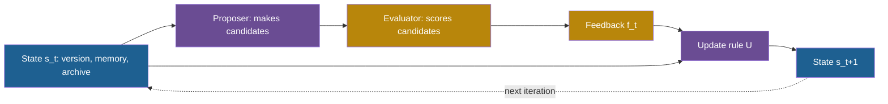

## Learning objectives

After this lesson you can:

- Convert a loss into a reward and say which direction is better for each.
- Write any improvement method in the form $s_{t+1} = U(s_t, f_t)$ and name its parts.
- Run gradient descent, greedy hill climbing, simulated annealing and tournament selection by hand for several iterations.
- Explain the meta-prompt of OPRO (Optimization by PROmpting), Reflexion's memory and the archive of the Darwin Gödel Machine (DGM) as update rules.
- Prove that greedy acceptance on a finite space stops, and compute how noise breaks the proof.

## Prerequisites

- [L1: Functions, objectives and search spaces](/notes/ai/recursive-self-improvement/04-mathematics/l1-functions-objectives-and-search-spaces)
- [L6: How machine learning systems are trained and evaluated](/notes/ai/recursive-self-improvement/01-foundations/l6-how-ml-systems-are-trained-and-evaluated)
- [L2: One iteration, step by step](/notes/ai/recursive-self-improvement/03-anatomy/l2-one-iteration-step-by-step)

## 1. The question this idea answers

Two students practice free throws. Both see the same result after each throw: in or out. The first student changes the stance a little after every miss and keeps the change only if the next throws go better. The second student keeps a notebook and writes one sentence after each session about what went wrong. After a month, the two students have improved by different amounts.

The feedback was the same. The difference is the **rule** that turns feedback into the next attempt. This lesson calls that rule the **update rule**.

Every improvement method in this course has an update rule. Gradient descent has one. An evolutionary search has one. A language model that reads its past scores and writes a new prompt has one. Recursive self-improvement (RSI) adds one more idea: the update rule is itself part of the system that improves. To study that idea, you first need to see many update rules side by side.

## 2. Mental model, and where it stops working

> [!analogy] Seven hikers in fog
> Return to the foggy hills of L1. Each hiker has an altimeter and a different rule for the next move:
>
> - One feels the slope and steps downhill on a "loss" map.
> - One tries a random step and keeps it only if it goes up.
> - One sometimes accepts a step down, less often as the day goes on.
> - A group copies its best members.
> - One reads a notebook of past positions and heights, and one writes advice for tomorrow.
> - A camp keeps every position it ever reached.
>
>
> - **Where it stops working (1):** the altimeter is noisy and can be fooled. A rule that trusts it fully can climb onto noise. Section 4.10 computes this.
> - **Where it stops working (2):** in RSI, a hiker can rebuild its own rule for walking. The analogy has no part for that. Lesson L5 adds it.

## 3. Terms

| Term | Plain meaning |
|---|---|
| loss | A number that measures how bad a result is. Lower is better. |
| reward | A number that measures how good a result is. Higher is better. |
| score | The number that an evaluator returns for a version or an output. |
| reward signal | The number that an update rule uses during learning. It can differ from the score that you report. |
| feedback | All information that the update rule receives after an iteration: scores, errors, logs or text. |
| update rule | The function $U$ that maps the current state and the feedback to the next state. |
| gradient | The vector of slopes of a loss with respect to each weight. It points in the direction of fastest increase. |
| learning rate | The step size $\eta$ of gradient descent, a small positive number. |
| greedy hill climbing | Accept a candidate only if its measured score is higher than the current one. |
| simulated annealing | Accept a worse candidate with a probability that falls as the "temperature" falls. |
| temperature | The number $T$ that sets how often simulated annealing accepts a worse candidate. |
| cooling schedule | The rule that lowers the temperature over iterations. |
| population | In evolutionary methods, the set of versions that the search keeps at one time. |
| tournament selection | Pick a few versions at random, and let the best of them become a parent. |
| meta-prompt | A prompt that asks a language model to propose a better solution. It usually includes past solutions and their scores. |
| trajectory | In OPRO, the list of past solutions with their scores, shown inside the meta-prompt. |
| verbal reinforcement | Reflexion's name for learning through written feedback in memory, with no change to the weights. |
| episodic memory | A store of short texts from earlier attempts that the agent reads in later attempts. |
| monotone sequence | A sequence that never goes down (or never goes up). |
| bounded sequence | A sequence whose values stay below some fixed number. |

## 4. Method and math

### 4.1 Loss and reward

A **loss** says how bad a result is, so you minimize it. A **reward** says how good a result is, so you maximize it. A **score** is the evaluator's number for a version. Training papers usually speak of loss. Agent papers usually speak of score or reward. They describe the same thing with opposite signs.

**The idea.** Any loss becomes a reward when you flip its sign. The best version stays the same.

$$
R(s) = -L(s) \quad \Rightarrow \quad \operatorname{argmax}_{s} R(s) = \operatorname{argmin}_{s} L(s)
$$

**Symbols.**

- $L(s)$ is the loss of version $s$.
- $R(s)$ is the reward of version $s$.
- $\Rightarrow$ reads "implies".

**In plain English.** The version with the smallest loss is the version with the largest reward.

**Worked example.** Three versions have accuracies 0.62, 0.68 and 0.55. Define the loss as $L = 1 - \text{accuracy}$.

1. The losses are 0.38, 0.32 and 0.45.
2. The smallest loss is 0.32, which belongs to the second version.
3. The largest accuracy is 0.68, which also belongs to the second version.

The transform $1 - \text{accuracy}$ is a sign flip plus a constant. Any strictly decreasing transform keeps the same best version.

**Assumptions.** Loss and reward measure the same thing. Only the direction differs.

**When it is useful.** Use it to translate between training papers, which minimize a loss, and agent papers, which maximize a score.

**What it does not prove.** It does not say that the **reward signal** used during learning equals the **score** you care about. They can differ. In ReST, a self-training method, rewards from a learned reward model kept rising with more Grow steps. Human evaluation was best after one Grow step (Gulcehre et al., 2023, [arXiv:2308.08998](https://arxiv.org/abs/2308.08998), Section 6). **Measured:** the authors warn that "the risk of overfitting to the reward model increases with the repeated iterations".

### 4.2 The general form of an update rule

> [!key] Term: update rule
> - **Name:** update rule, written $U$.
> - **Meaning:** the function that turns the current state and the latest feedback into the next state.
> - **Problem it solves:** it makes "how the system learns from a result" explicit and comparable across methods.
> - **Example:** "keep the candidate if its measured score is higher" is the update rule of greedy hill climbing.
> - **Link to RSI:** in RSI, the update rule is itself part of the state, so it can change.
> - **Limits:** a good rule cannot fix bad feedback. If the score is noisy or wrong, every rule follows it.

**The idea.** Each iteration takes the current state and the feedback from this iteration, and returns the next state.

$$
s_{t+1} = U(s_t, f_t)
$$

**Symbols.**

- $t$ is the iteration number: $t = 0, 1, 2, \dots$
- $s_t$ is the state after iteration $t$. It can be one version, or a version plus memory or an archive.
- $f_t$ is the feedback of iteration $t$: scores, test results, error messages or text.
- $U$ is the update rule.

**In plain English.** The next version depends only on the current version and on what you just learned.

**Worked example.** A thermostat-style rule for one number: $s_{t+1} = s_t + 0.5 \times (20 - f_t)$, where $f_t$ is the measured temperature.

1. Start with $s_0 = 10$. The measurement is $f_0 = 16$.
2. $s_1 = 10 + 0.5 \times (20 - 16) = 12$.
3. The next measurement is $f_1 = 19$, so $s_2 = 12 + 0.5 \times 1 = 12.5$.

**Assumptions.** All useful history is stored inside $s_t$. If a method uses an archive or a memory, then $s_t$ must include it.

**When it is useful.** It gives one template for every method in this lesson. For each method, ask three questions: what is $s_t$, what is $f_t$, and what does $U$ do?

**What it does not prove.** The form says nothing about whether the sequence $s_0, s_1, \dots$ gets better. That depends on $U$ and on the quality of $f_t$.

**Where RSI enters.** In ordinary improvement, $U$ is fixed. In RSI, $U$ is part of the state, and the current $U$ produces the next $U$. STOP, the Self-Taught Optimizer, writes this as $I_t = I_{t-1}(\hat{u}, I_{t-1}, L)$: the improver $I_{t-1}$ improves its own code (Zelikman et al., 2023, [arXiv:2310.02304](https://arxiv.org/abs/2310.02304), Algorithm 1). Lesson L5 studies this equation.



### 4.3 Rule 1: gradient descent

Gradient descent works when the state is a vector of real numbers and the loss is smooth. Then the gradient tells you the direction in which the loss rises fastest. You step the other way (Goodfellow, Bengio and Courville, 2016, Section 4.3).

$$
w_{t+1} = w_t - \eta \, \nabla_w L(w_t)
$$

**Symbols.**

- $w_t$ is the weight vector after iteration $t$.
- $L(w)$ is the loss on the training data.
- $\nabla_w L(w_t)$ is the gradient of the loss at $w_t$.
- $\eta$ is the learning rate, a small positive number.

**In plain English.** Move the weights a small step downhill on the loss.

**Worked example.** One weight $w$, loss $L(w) = (w - 3)^2$, start $w_0 = 0$, learning rate $\eta = 0.1$. The derivative is $L'(w) = 2(w - 3)$.

| $t$ | $w_t$ | $L(w_t)$ | $L'(w_t)$ | $w_{t+1} = w_t - 0.1\,L'(w_t)$ |
|---|---|---|---|---|
| 0 | 0.0000 | 9.0000 | −6.0000 | 0.6000 |
| 1 | 0.6000 | 5.7600 | −4.8000 | 1.0800 |
| 2 | 1.0800 | 3.6864 | −3.8400 | 1.4640 |
| 3 | 1.4640 | 2.3593 | −3.0720 | 1.7712 |
| 4 | 1.7712 | 1.5099 | −2.4576 | 2.0170 |

The distance to the best weight 3 shrinks by a factor of $1 - 2\eta = 0.8$ in each update. So $w_t = 3 - 3 \times 0.8^t$, and after 20 updates $w_{20} \approx 2.965$.

The learning rate matters. With $\eta = 0.5$, the first update lands exactly on 3. With $\eta = 1.0$, the weight jumps between 0 and 6 forever. With $\eta = 1.1$, it moves 0, 6.6, −1.32, 8.184 and diverges.

**Assumptions.** The loss is differentiable, the weights are real numbers, and the gradient is computed on the same loss you want to lower.

**When it is useful.** It trains the weights of models, including the training-based self-improvement of [L7: Training-based self-improvement and synthetic data](/notes/ai/recursive-self-improvement/05-approaches/l7-training-based-self-improvement).

**What it does not prove.** It finds a point where the slope is zero. On a loss with many valleys, that point can be a local minimum. It also needs a gradient, and prompts and programs have none. So most self-improving agents use the black-box rules below.

### 4.4 Rule 2: greedy hill climbing

**The idea.** Propose one candidate. Keep it only if its measured score is higher than the score of the current version.

$$
s_{t+1} = \begin{cases} c_t & \text{if } \hat{J}(c_t) > \hat{J}(s_t) \\ s_t & \text{otherwise} \end{cases}
$$

**Symbols.**

- $c_t$ is the candidate of iteration $t$.
- $\hat{J}(\cdot)$ is the measured score, an estimate of the objective $J$ from L1.

**In plain English.** Only accept a change that measures better.

**Worked example.** Use the landscape of L1 on the integer points, $f(x) = 3e^{-(x-2)^2/1.5} + 5e^{-(x-7)^2/2}$. The proposer picks a random neighbor, $x - 1$ or $x + 1$. Start at $x = 5$.

| Iteration | Current $x$, $f(x)$ | Candidate, $f$ | Decision |
|---|---|---|---|
| 1 | 5, 0.684 | 4, 0.264 | reject |
| 2 | 5, 0.684 | 6, 3.033 | accept |
| 3 | 6, 3.033 | 7, 5.000 | accept |
| 4 | 7, 5.000 | 8, 3.033 | reject |
| 5 | 7, 5.000 | 6, 3.033 | reject |

After iteration 3, every proposal is rejected. The search has stopped at $x = 7$.

**Assumptions.** The measured score equals the true score. Section 4.10 removes this assumption.

**When it is useful.** It is simple and cheap. TextGrad, which rewrites prompts from text feedback, accepts a new prompt only if the validation performance improves (Yuksekgonul et al., 2024, [arXiv:2406.07496](https://arxiv.org/abs/2406.07496)). GEPA, a prompt optimizer, adds a child only if it beats its parent on a minibatch (Agrawal et al., 2025, [arXiv:2507.19457](https://arxiv.org/abs/2507.19457), Algorithm 1).

**What it does not prove.** It does not reach the global optimum from a bad start. **Measured:** in the DGM paper, a variant that always self-modifies the latest version reached 23.0% on SWE-bench. A "Greedy" variant that always picks the best agent reached 39.7%. The full DGM with an archive reached 50.0% (Zhang et al., 2025, [arXiv:2505.22954](https://arxiv.org/abs/2505.22954), single run per setting).

### 4.5 Rule 3: simulated annealing

**The idea.** Sometimes accept a worse candidate, so that the search can leave a local optimum. Accept small losses often and large losses rarely. Over time, become stricter.

$$
P(\text{accept } c_t) = \begin{cases} 1 & \text{if } \Delta \ge 0 \\ e^{\Delta / T} & \text{if } \Delta < 0 \end{cases} \qquad \Delta = \hat{J}(c_t) - \hat{J}(s_t)
$$

**Symbols.**

- $\Delta$ is the change in measured score. A negative $\Delta$ means that the candidate is worse.
- $T > 0$ is the temperature.
- $e^{\Delta/T}$ is a number between 0 and 1 when $\Delta < 0$.

**In plain English.** Always accept a better candidate. Accept a worse one with a probability that shrinks as the loss grows and as the temperature falls.

**Worked example 1: the effect of $T$.** Take $\Delta = -0.05$, a candidate 5 points worse on a 0-to-1 scale.

1. With $T = 0.5$: $e^{-0.05/0.5} = e^{-0.1} = 0.905$.
2. With $T = 0.1$: $e^{-0.5} = 0.607$.
3. With $T = 0.01$: $e^{-5} = 0.0067$.

**Worked example 2: a cooling schedule.** Let $T_k = 0.5 \times 0.9^k$. For $\Delta = -0.1$, the acceptance probability falls as $k$ grows:

| $k$ | 0 | 5 | 10 | 20 | 30 |
|---|---|---|---|---|---|
| $T_k$ | 0.500 | 0.295 | 0.174 | 0.061 | 0.021 |
| $e^{-0.1/T_k}$ | 0.819 | 0.713 | 0.563 | 0.193 | 0.009 |

**Worked example 3: a trace.** Fix $T = 0.1$ and start with a current score of 0.60. To decide, draw a random number $u$ between 0 and 1, and accept if $u < P$.

| Candidate score | $\Delta$ | $P$ | $u$ | Decision | Current after |
|---|---|---|---|---|---|
| 0.58 | −0.02 | 0.819 | 0.50 | accept | 0.58 |
| 0.65 | +0.07 | 1 | 0.90 | accept | 0.65 |
| 0.55 | −0.10 | 0.368 | 0.70 | reject | 0.65 |
| 0.57 | −0.08 | 0.449 | 0.20 | accept | 0.57 |
| 0.70 | +0.13 | 1 | 0.99 | accept | 0.70 |

The search accepted two worse candidates, and it still reached 0.70.

**Assumptions.** Score differences are on a known scale, so that $T$ means something. The search runs long enough for the temperature to fall.

**When it is useful.** It helps on landscapes with many local optima. **Measured:** in STOP, GPT-4 wrote simulated annealing into the improver's code when it improved its own improver. The paper shows this as an example and gives no frequency count (Zelikman et al., 2023, Section 6.1, Fig. A.15).

**What it does not prove.** Classic theory gives a guarantee of a global optimum only for extremely slow cooling. Real budgets are far too small for it. Annealing also does not protect against a noisy score. It can accept a lucky candidate as easily as a good one.

### 4.6 Rule 4: tournament selection

Evolutionary methods keep a **population** of versions. In each iteration, a few members compete, and the winner becomes a parent.

**The idea.** In a binary tournament, pick two members at random. The better one is the winner. A mutated copy of the winner replaces the loser. Promptbreeder, which evolves prompts, uses this rule with a population of 50 units (Fernando et al., 2023, [arXiv:2309.16797](https://arxiv.org/abs/2309.16797), Section 3).

$$
P(\text{rank } i \text{ wins}) = \frac{2(N - i)}{N(N - 1)}
$$

**Symbols.**

- $N$ is the population size.
- $i$ is the rank of a member by measured score: $i = 1$ is the best and $i = N$ is the worst.
- The formula assumes that the two members are distinct and drawn uniformly.

**In plain English.** A member wins when it meets someone ranked below it. The better its rank, the more members rank below it.

**Worked example.** $N = 4$.

1. There are $\binom{4}{2} = 6$ possible pairs.
2. Rank 1 wins all 3 pairs that contain it: $3/6 = 0.5$. The formula gives $2 \times 3/12 = 0.5$.
3. Rank 2 wins 2 of its pairs: $2/6 = 0.333$.
4. Rank 3 wins 1 pair: $0.167$. Rank 4 never wins: 0.
5. Rank 4 loses in 3 of 6 pairs, so it is overwritten with probability 0.5.

Regularized evolution uses a larger tournament. It samples $S = 25$ of $P = 100$ members and takes the best of the sample as parent. Then it removes the **oldest** member (Real et al., 2019, [arXiv:1802.01548](https://arxiv.org/abs/1802.01548)). The best member enters a sample with probability $25/100 = 0.25$. A sample contains at least one of the top 10 members with probability $1 - \binom{90}{25}/\binom{100}{25} \approx 0.952$.

**Assumptions.** Measured scores rank the members correctly. With noise, a lucky member can win several tournaments.

**When it is useful.** It keeps selection pressure mild and tunable. It never needs an exact scale of scores, only an order. **Claimed:** the regularized evolution authors argue that aging helps against noisy evaluation, because a lucky model cannot stay forever.

**What it does not prove.** It does not show that the population improves on a held-out set. Promptbreeder measures fitness on random batches of 100 training examples. So its winners are chosen on noisy training scores.

### 4.7 Rule 5: OPRO's meta-prompt, an update rule in text

OPRO (Optimization by PROmpting) uses a language model as the update rule (Yang et al., 2023, [arXiv:2309.03409](https://arxiv.org/abs/2309.03409)). The state is a list of past instructions with their scores. The language model reads the list and writes new instructions.

$$
\mathcal{T}_{t+1} = \operatorname{top}_{20}\Big(\mathcal{T}_t \cup \big\{ (c, \hat{J}(c)) : c \in \text{LLM}\big(\text{meta}(\mathcal{T}_t)\big) \big\}\Big)
$$

**Symbols.**

- $\mathcal{T}_t$ is the trajectory: the best instructions so far with their training-subset scores.
- $\text{meta}(\mathcal{T}_t)$ is the meta-prompt. It holds a problem description, the top 20 pairs sorted ascending (best last), and about 3 training examples.
- $\text{LLM}(\cdot)$ is the large language model (LLM) that proposes. It returns 8 new instructions at temperature 1.0.
- $\hat{J}(c)$ is the accuracy of the scorer model with instruction $c$ on the training subset.
- $\operatorname{top}_{20}$ keeps the 20 highest-scoring pairs.

**In plain English.** Show the model the best attempts and their scores. Ask for instructions that score higher. Score them and keep the best 20.

**Worked example.**

1. The default run has 200 iterations with 8 instructions each, so it scores $8 \times 200 = 1{,}600$ instructions.
2. On GSM8K, the best instruction found was "Take a deep breath and work on this problem step-by-step."
3. It reached 80.2% test accuracy with a PaLM 2-L scorer, against 71.8% for "Let's think step by step." (**Measured.**)
4. Only 3.5% of the GSM8K training set was used for the scores, about 261 examples.

**Assumptions.** The language model can read scores and infer which changes help. The training subset represents the test set.

**When it is useful.** It works when there is no gradient and the solution is text. The scored history acts as the memory of the search.

**What it does not prove.** It does not improve the update rule: the optimizer model and the meta-prompt template stay fixed. **Measured:** "our training accuracies are often 5%-20% higher than our test accuracies" on two BBH tasks. The paper also reports "optimization instability and large variance".

### 4.8 Rule 6: Reflexion's memory update

Reflexion keeps the weights frozen and changes only a short memory of written reflections (Shinn et al., 2023, [arXiv:2303.11366](https://arxiv.org/abs/2303.11366)). The paper calls this "verbal reinforcement". The agent learns "not by updating weights, but instead through linguistic feedback".

$$
\text{sr}_t = M_{\text{sr}}(\tau_t, r_t, \mathcal{M}_t), \qquad \mathcal{M}_{t+1} = \operatorname{last}_{\Omega}\big(\mathcal{M}_t \oplus \text{sr}_t\big)
$$

**Symbols.**

- $\tau_t$ is the trajectory of trial $t$: the agent's actions and outputs.
- $r_t$ is the evaluator's result, often only success or failure.
- $M_{\text{sr}}$ is the self-reflection model, a language model that writes advice.
- $\text{sr}_t$ is the reflection text of trial $t$.
- $\mathcal{M}_t$ is the episodic memory, and $\oplus$ appends an item.
- $\operatorname{last}_{\Omega}$ keeps the newest $\Omega$ items. $\Omega$ is "usually set to 1-3".

**In plain English.** After a failed trial, write one short lesson. Keep only the most recent few lessons, and read them before the next trial of the same task.

**Worked example.** $\Omega = 3$, five trials.

| Trial | Memory after the trial |
|---|---|
| 0 | sr0 |
| 1 | sr0, sr1 |
| 2 | sr0, sr1, sr2 |
| 3 | sr1, sr2, sr3 |
| 4 | sr2, sr3, sr4 |

At trial 3 the oldest lesson drops out.

**Assumptions.** A reliable success signal exists, and the language model can turn it into useful advice.

**When it is useful.** **Measured:** on HumanEval in Python, pass@1 rose from 80.1 to 91.0 with GPT-4. On MBPP in Python, it fell from 80.1 to 77.1. The authors link the drop to self-written tests that wrongly pass wrong code.

**What it does not prove.** Reflections persist only across trials of the same task. They do not transfer to new tasks in the main design. On HotPotQA the success signal came from ground-truth answers, which later critiques call an oracle label.

### 4.9 A rule for a set of versions: the DGM archive

The six rules above change one current state. The DGM keeps a growing **archive** of agents instead (Zhang et al., 2025, [arXiv:2505.22954](https://arxiv.org/abs/2505.22954), Section 3 and Appendix). Its update has two parts: add the children, then choose the next parents.

$$
A_{t+1} = A_t \cup \{\, c \in C_t : \text{valid}(c) \,\}, \qquad p_i = \frac{w_i}{\sum_j w_j}, \quad w_i = \frac{1}{1 + e^{-10(\alpha_i - 0.5)}} \cdot \frac{1}{1 + n_i}
$$

**Symbols.**

- $A_t$ is the archive after iteration $t$, and $C_t$ is the set of children made in iteration $t$.
- $\text{valid}(c)$ is true if the child compiles and still produces non-empty patches.
- $\alpha_i \in [0, 1]$ is the benchmark score of agent $i$.
- $n_i$ is the number of children of agent $i$ in the archive.
- $p_i$ is the probability that agent $i$ is drawn as a parent. The DGM draws 2 parents per iteration on SWE-bench, with replacement.

**In plain English.** Keep every child that still works, even a worse one. Then prefer parents with high scores and few children.

**Worked example.** The archive holds A0 (score 0.20, children A1 and A2), A1 (0.35, child A3), A2 (0.50) and A3 (0.45).

| Agent | Sigmoid term | $1/(1 + n_i)$ | $w_i$ | $p_i$ |
|---|---|---|---|---|
| A0 | 0.0474 | 1/3 | 0.0158 | 0.016 |
| A1 | 0.1824 | 1/2 | 0.0912 | 0.093 |
| A2 | 0.5000 | 1 | 0.5000 | 0.508 |
| A3 | 0.3775 | 1 | 0.3775 | 0.383 |

1. The sigmoid of A2 is $1/(1 + e^{0}) = 0.5$.
2. The weights sum to $0.0158 + 0.0912 + 0.5 + 0.3775 = 0.9845$.
3. So $p_{A2} = 0.5 / 0.9845 = 0.508$.

**Assumptions.** A high score today predicts good children tomorrow. Lesson L5 shows that the Huxley-Gödel Machine measured this link to be weak.

**When it is useful.** It keeps stepping stones. **Measured:** the best DGM agent's lineage had score dips at iterations 4 and 56. A strict "must beat the parent" rule would have cut this lineage.

**What it does not prove.** The rule itself is fixed. The paper says that parent selection and the archive are "fixed and not modifiable by the DGM". The public code also has no "must beat parent" check, so quality pressure comes only from parent selection.

### 4.10 Why greedy acceptance stops, and why noise breaks the proof

**Theory.** On a finite search space with exact scores, greedy hill climbing makes only finitely many changes.

1. Each accepted candidate has a strictly higher score than the current version. So the sequence of current scores is **monotone**: it never goes down.
2. Because the score strictly rises at each acceptance, no version can be accepted twice.
3. The space has $\lvert S \rvert$ versions, so there are at most $\lvert S \rvert - 1$ acceptances.
4. The scores are also **bounded** by the best score in $S$. After the last acceptance, the state never changes again.

The proof needs one quiet assumption: the measured score is the true score. Now remove it. Suppose that every candidate has the **same** true score, and each measurement adds independent noise. The rule compares a new noisy measurement with the best noisy measurement so far. Each acceptance is a new record of a noisy sequence.

**The idea.** In $n + 1$ independent draws from one continuous distribution, draw number $k$ is a record with probability $1/k$. So the expected number of records is a harmonic sum.

$$
\mathbb{E}[\text{acceptances}] = \sum_{k=2}^{n+1} \frac{1}{k} = H_{n+1} - 1
$$

**Symbols.**

- $n$ is the number of candidates after the first version.
- $H_m = 1 + \tfrac{1}{2} + \dots + \tfrac{1}{m}$ is the $m$-th harmonic number.
- The first draw, the starting version, is always a record, so we subtract 1.

**In plain English.** Even when no candidate is really better, a greedy rule on noisy scores keeps accepting "improvements", but more and more rarely.

**Worked example.**

1. $n = 10$: $H_{11} - 1 = 2.02$ expected acceptances.
2. $n = 100$: $H_{101} - 1 = 4.20$.
3. $n = 1{,}000$: $H_{1001} - 1 = 6.49$.
4. A seeded simulation with 20,000 repeats gave 2.018 for $n = 10$ and 4.199 for $n = 100$.

Each of these acceptances is a change with zero real gain. Part 8 calls repeated changes without real gain "churn" ([L5: Churn, bloat, lost behavior, drift and runaway cost](/notes/ai/recursive-self-improvement/08-failure-modes-and-safety/l5-churn-bloat-and-drift)).

**Assumptions.** The noise is independent and continuous, and the current version is never measured again.

**When it is useful.** It gives a baseline. If your loop accepts about $\ln n$ changes in $n$ candidates, the acceptances may be noise.

**What it does not prove.** It does not say that your changes are noise. It says that acceptance alone is no evidence of improvement. Lesson L3 gives the tools to tell the two apart.

> [!example] Exercise 1: run two update rules by hand
> (a) Run gradient descent on $L(w) = (w - 1)^2$ from $w_0 = 5$ with $\eta = 0.25$ for three updates. Give each $w_t$ and $L(w_t)$.
> (b) Simulated annealing at $T = 0.2$: the current score is 0.70 and a candidate scores 0.64. What is the probability of acceptance? Is the candidate accepted if $u = 0.80$?

```check
{
  "question": "Give the answers to Exercise 1 (a) and (b).",
  "hint": "In (a), $w_{t+1} = w_t - 0.25 \\times 2(w_t - 1) = 0.5\\,w_t + 0.5$. In (b), $\\Delta = -0.06$.",
  "answer": "(a) $w_0 = 5$ with $L = 16$. $w_1 = 3$ with $L = 4$. $w_2 = 2$ with $L = 1$. $w_3 = 1.5$ with $L = 0.25$. The distance to 1 halves each time, because $1 - 2\\eta = 0.5$.\n\n(b) $P = e^{-0.06/0.2} = e^{-0.3} \\approx 0.741$. Since $u = 0.80$ is not below 0.741, the candidate is rejected."
}
```

## 5. Graphs

The acceptance probability of simulated annealing for a worse candidate, at two temperatures. At $T = 0.1$, a loss of 0.3 points is accepted only about 5% of the time.

```plot
{
  "title": "Acceptance probability exp(delta/T) for a worse candidate: T = 0.5 in blue, T = 0.1 in red",
  "xAxis": {"domain": [-1, 0], "label": "score change delta"},
  "yAxis": {"domain": [0, 1.05], "label": "probability of acceptance"},
  "disableZoom": true,
  "data": [
    {"fn": "exp(x/0.5)", "color": "#1E6091"},
    {"fn": "exp(x/0.1)", "color": "#C81D25"}
  ]
}
```

The expected number of greedy acceptances when all candidates are equally good and the scores are noisy, from section 4.10. The count grows only like the logarithm of $n$.

```plot
{
  "title": "Expected acceptances of pure noise under greedy acceptance, H(n+1) - 1, in gold",
  "xAxis": {"domain": [0, 210], "label": "number of candidates n"},
  "yAxis": {"domain": [0, 6], "label": "expected acceptances"},
  "disableZoom": true,
  "data": [
    {"points": [[1, 0.5], [2, 0.833], [5, 1.45], [10, 2.02], [20, 2.645], [50, 3.519], [100, 4.197], [200, 4.883]], "fnType": "points", "graphType": "polyline", "color": "#B8860B", "skipTip": true},
    {"points": [[1, 0.5], [2, 0.833], [5, 1.45], [10, 2.02], [20, 2.645], [50, 3.519], [100, 4.197], [200, 4.883]], "fnType": "points", "graphType": "scatter", "color": "#B8860B", "skipTip": true}
  ]
}
```

## 6. Video and animation

- [Adv. LLM Agents MOOC: Inference-Time Techniques for LLM Reasoning by Xinyun Chen](https://www.youtube.com/watch?v=g0Dwtf3BH-0) (Berkeley RDI). An OPRO co-author covers language models as prompt optimizers in Part 1, and Reflexion in Part 3. It supports sections 4.7 and 4.8.
- [Reflection Agents](https://www.youtube.com/watch?v=v5ymBTXNqtk) (LangChain). A hands-on build of Reflexion starts at 04:59. It supports section 4.8.
- [Adam Kalai: Recursive Self-improving Code Generation](https://www.youtube.com/watch?v=RovcBFlfXpQ) (DIMACS CCICADA). A STOP co-author shows how an improver can improve itself. It supports section 4.2 and the annealing example of section 4.5.

## 7. Code

The acceptance rules of this lesson as small Python functions. Each takes the current measured score and the candidate's measured score.

```python
import math
import random

def accept_greedy(current, candidate):
    return candidate > current

def accept_annealing(current, candidate, temperature, rng=random):
    delta = candidate - current
    if delta >= 0:
        return True
    return rng.random() < math.exp(delta / temperature)

def binary_tournament(population, score, rng=random):
    a, b = rng.sample(population, 2)
    return (a, b) if score[a] >= score[b] else (b, a)   # (winner, loser)

print(round(math.exp(-0.05 / 0.1), 3))   # 0.607
```

## 8. Common mistakes

1. **"Loss and reward are different objectives."** They differ only in sign. The best version is the same.
2. **"An accepted change is an improvement."** Under noise, greedy acceptance accepts about $H_{n+1} - 1$ changes even when nothing is better.
3. **"Simulated annealing fixes noisy evaluation."** It escapes local optima. It cannot tell luck from quality.
4. **"OPRO improves itself."** The optimizer model and the meta-prompt stay fixed. Only the instruction text changes.
5. **"Reflexion learns."** Its weights never change. Its memory holds 1–3 reflections about one task.
6. **"The DGM accepts only children that beat their parents."** It keeps every child that compiles and still makes patches. Selection pressure comes from parent choice.
7. **"A larger learning rate is always faster."** In section 4.3, $\eta = 1.0$ oscillates forever and $\eta = 1.1$ diverges.

## 9. One-minute explanation

Every improvement method is an update rule: the next state is a function of the current state and the feedback. Gradient descent steps downhill on a loss, but it needs weights and a gradient. Black-box rules accept or reject candidates: greedy hill climbing accepts only measured gains, simulated annealing sometimes accepts losses, and tournaments copy winners. Language-model rules write the update in text: OPRO reads scored attempts, Reflexion writes short lessons, and the DGM keeps an archive. Greedy acceptance on exact scores must stop, but on noisy scores it keeps accepting changes with zero real gain. In RSI, the update rule itself becomes part of what changes.

## 10. Check questions

```check
{
  "question": "For each method, name the state $s_t$, the feedback $f_t$ and what the update rule changes: (a) OPRO, (b) Reflexion, (c) the DGM.",
  "hint": "Look at what persists from one iteration to the next.",
  "answer": "(a) OPRO: the state is the trajectory of the best 20 instructions with scores. The feedback is the training-subset accuracy of each new instruction. The rule adds new instructions and keeps the top 20.\n\n(b) Reflexion: the state is the episodic memory of 1 to 3 reflections for one task. The feedback is the evaluator's result, often success or failure. The rule appends a new reflection and drops the oldest.\n\n(c) DGM: the state is the archive of agents with scores and child counts. The feedback is the staged benchmark score of each child. The rule adds valid children and recomputes the parent probabilities."
}
```

```check
{
  "question": "A loop proposes 50 candidates, all with the same true score, and uses greedy acceptance on noisy scores. How many acceptances do you expect? A team reports 4 accepted improvements in 50 candidates. What can you conclude?",
  "hint": "Use $H_{n+1} - 1$ with $n = 50$.",
  "answer": "$H_{51} - 1 \\approx 3.52$, as the plot in section 5 shows for $n = 50$. Four acceptances is close to what pure noise gives. So the count of acceptances alone is no evidence of real improvement. The team must re-evaluate the accepted versions on fresh tasks, or compare them with the parent by a paired test, as L3 explains."
}
```

```check
{
  "question": "In a binary tournament with a population of 10, what is the probability that the third-best member wins a given tournament? What is the probability that the worst member is overwritten?",
  "hint": "Use $\\frac{2(N-i)}{N(N-1)}$ and count the pairs in which a member loses.",
  "answer": "Win: $\\frac{2(10-3)}{10 \\times 9} = \\frac{14}{90} \\approx 0.156$.\n\nThe worst member loses every pair that contains it. It appears in 9 of the 45 pairs, so it is overwritten with probability $9/45 = 0.2$."
}
```

```check
{
  "question": "A team runs simulated annealing on a benchmark score with 50 tasks. Their temperature schedule ends at $T = 0.001$. A colleague says this makes the final phase safe from noise. Analyze the claim.",
  "hint": "What does a very low temperature do to a candidate that measures higher by luck?",
  "answer": "At $T = 0.001$ the rule almost never accepts a worse measured score. But it still always accepts a candidate whose measured score is higher. With 50 tasks, one task changes the score by 2 points. So a candidate can measure higher by luck and be accepted. The low temperature turns annealing into greedy acceptance, which still climbs onto noise as in section 4.10. Noise needs larger samples, paired comparisons or re-evaluation, not a lower temperature."
}
```

## 11. Summary and links

- Loss and reward differ in sign. The reward signal used for learning can differ from the score you care about.
- Every method fits $s_{t+1} = U(s_t, f_t)$. Ask what the state, the feedback and the rule are.
- Gradient descent needs a gradient. Black-box rules (greedy, annealing, tournaments) need only scores.
- Language models can act as update rules in text: OPRO's meta-prompt, Reflexion's memory and the DGM's archive.
- Greedy acceptance stops on exact scores, but on noisy scores it accepts changes with zero real gain.

Next, lesson L3 measures that noise. It computes standard errors, paired comparisons and the optimism of the best of many candidates.

- Previous: [L1: Functions, objectives and search spaces](/notes/ai/recursive-self-improvement/04-mathematics/l1-functions-objectives-and-search-spaces)
- Next: [L3: Evaluation under noise](/notes/ai/recursive-self-improvement/04-mathematics/l3-evaluation-under-noise)
- Related: [L3: Archives: why keep more than the best version](/notes/ai/recursive-self-improvement/03-anatomy/l3-archives-and-search-over-versions), [L6: Evolutionary search, populations and open-endedness](/notes/ai/recursive-self-improvement/05-approaches/l6-evolutionary-and-population-methods), [2023: Self-Refine and Reflexion](/notes/ai/recursive-self-improvement/06-research-systems/p02-self-refine-and-reflexion)

## References

- Ian Goodfellow, Yoshua Bengio, Aaron Courville. *Deep Learning*. MIT Press, 2016. https://www.deeplearningbook.org/
- Caglar Gulcehre, Tom Le Paine, Srivatsan Srinivasan, et al. "Reinforced Self-Training (ReST) for Language Modeling". 2023. arXiv:2308.08998. https://arxiv.org/abs/2308.08998
- Eric Zelikman, Eliana Lorch, Lester Mackey, Adam Tauman Kalai. "Self-Taught Optimizer (STOP): Recursively Self-Improving Code Generation". 2023. arXiv:2310.02304. https://arxiv.org/abs/2310.02304. Code: https://github.com/microsoft/stop
- Chrisantha Fernando, Dylan Banarse, Henryk Michalewski, Simon Osindero, Tim Rocktäschel. "Promptbreeder: Self-Referential Self-Improvement Via Prompt Evolution". 2023. ICML 2024. arXiv:2309.16797. https://arxiv.org/abs/2309.16797
- Esteban Real, Alok Aggarwal, Yanping Huang, Quoc V Le. "Regularized Evolution for Image Classifier Architecture Search". AAAI 2019. arXiv:1802.01548. https://arxiv.org/abs/1802.01548
- Chengrun Yang, Xuezhi Wang, Yifeng Lu, et al. "Large Language Models as Optimizers". 2023. ICLR 2024. arXiv:2309.03409. https://arxiv.org/abs/2309.03409
- Noah Shinn, Federico Cassano, Edward Berman, Ashwin Gopinath, Karthik Narasimhan, Shunyu Yao. "Reflexion: Language Agents with Verbal Reinforcement Learning". 2023. NeurIPS 2023. arXiv:2303.11366. https://arxiv.org/abs/2303.11366
- Mert Yuksekgonul, Federico Bianchi, Joseph Boen, et al. "TextGrad: Automatic 'Differentiation' via Text". 2024. arXiv:2406.07496. https://arxiv.org/abs/2406.07496
- Lakshya A Agrawal, Shangyin Tan, Dilara Soylu, et al. "GEPA: Reflective Prompt Evolution Can Outperform Reinforcement Learning". 2025. ICLR 2026. arXiv:2507.19457. https://arxiv.org/abs/2507.19457
- Jenny Zhang, Shengran Hu, Cong Lu, Robert Lange, Jeff Clune. "Darwin Gödel Machine: Open-Ended Evolution of Self-Improving Agents". 2025. ICLR 2026. arXiv:2505.22954. https://arxiv.org/abs/2505.22954. Code: https://github.com/jennyzzt/dgm
