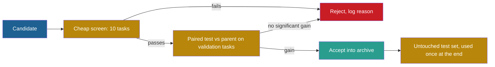

## Learning objectives

After this lesson you can:

- Write a measured score as a true score plus noise, and name the sources of the noise.
- Compute the standard error and the 95% confidence interval of a pass rate.
- Compare two versions with a paired analysis, and explain why it detects smaller differences than an unpaired one.
- Compute the expected optimism of the best of $k$ equally good candidates.
- Explain multiple comparisons, adaptive overfitting of a reused validation set, and the Recht et al. caveat.
- Choose remedies for each problem and justify them with numbers.

## Prerequisites

- [L7: What "improvement" means, and how to measure it](/notes/ai/recursive-self-improvement/01-foundations/l7-measuring-improvement)
- [L1: Functions, objectives and search spaces](/notes/ai/recursive-self-improvement/04-mathematics/l1-functions-objectives-and-search-spaces)
- [L2: Loss, reward and update rules](/notes/ai/recursive-self-improvement/04-mathematics/l2-loss-reward-and-update-rules)

## 1. The question this idea answers

A basketball player makes 5 of 10 free throws on Monday and 7 of 10 on Tuesday. Did the player get better? Most coaches would say "maybe". Ten throws are few. A player who makes 60% of throws in the long run often gets 5 or 7 out of 10 by chance.

Now look at a real result. SICA, a self-improving coding agent, went from 17% to 53% on part of SWE-bench Verified (Robeyns, Szummer and Aitchison, 2025, [arXiv:2504.15228](https://arxiv.org/abs/2504.15228), Table 1). The subset had 50 tasks. Each task moves the score by 2 percentage points. How sure can we be that the agent improved, and by how much?

A self-improving loop asks this question at every iteration. It must decide whether a candidate beats its parent. If it decides on noise, it keeps lucky changes and discards good ones. This lesson gives the tools to make that decision with numbers.

## 2. Mental model, and where it stops working

> [!analogy] A cheap bathroom scale
> A cheap scale shows your weight plus a random error of about one kilogram. One reading tells you little. The average of ten readings tells you much more. Now twenty people of the same weight each step on once. The highest reading is above their true weight, because you picked the largest error. If you then weigh that person again, the new reading is lower on average.
>
> - **Where it stops working (1):** tasks are not identical repeated weighings. They differ in difficulty, and some tasks come in related groups.
> - **Where it stops working (2):** a scale can also be biased, not only noisy. Averages do not remove bias.
> - **Where it stops working (3):** a person cannot learn the quirks of the scale. A self-improving agent that is selected again and again on the same tasks can.

## 3. Terms

| Term | Plain meaning |
|---|---|
| true score | The score a version would get on average over the whole task distribution and over its own randomness. |
| measured score | The score on the tasks and runs that you actually used. |
| noise | The difference between the measured score and the true score. |
| random variable | A quantity whose value depends on chance, such as the score of one random task. |
| variance | The average squared distance of a random variable from its mean. |
| standard deviation | The square root of the variance. |
| standard error (SE) | The standard deviation of an estimate, such as a mean over $n$ tasks. |
| 95% confidence interval | A range built so that, over many repeats, it contains the true value 95% of the time. |
| central limit theorem | The rule that a mean of many independent values is close to normally distributed. |
| paired comparison | A comparison of two versions on the same tasks, task by task. |
| covariance, correlation | Measures of how two random variables move together. Correlation is scaled to lie between −1 and 1. |
| clustered standard error | A standard error that accounts for groups of related tasks. |
| z score | A difference divided by its standard error. |
| p-value | The probability of a difference at least this large if the two versions were truly equal. |
| significance level ($\alpha$) | The p-value below which you call a difference significant, often 0.05. |
| power | The probability that a test detects a real difference of a given size. |
| winner's curse | The upward bias of the best measured score among several candidates. Smith and Winkler call it the optimizer's curse. |
| regression to the mean | The tendency of an extreme measurement to be followed by a less extreme one. |
| multiple comparisons | Many tests at once, which raise the chance of at least one false positive. |
| Bonferroni correction | Divide the significance level by the number of tests. |
| holdout set | Tasks kept apart from all choices, to check a result at the end. |
| adaptive overfitting | Overfitting that comes from reusing the same holdout set for many choices. |
| distribution shift | A change in the kind of tasks between two sets, which changes scores even without overfitting. |

## 4. Method and math

### 4.1 Measured score = true score + noise

**The idea.** A measured score has two parts: the part that belongs to the version, and the part that belongs to chance.

$$
\hat{S} = S + \varepsilon, \qquad \mathbb{E}[\varepsilon] = 0
$$

**Symbols.**

- $\hat{S}$ is the measured score.
- $S$ is the true score of the version.
- $\varepsilon$ is the noise. Its average over many repeats is 0.

**In plain English.** Each measurement is the truth plus a random error that is zero on average.

**Sources of noise in agent evaluation.**

1. **Task sampling.** The benchmark is one sample of tasks. Another sample gives another score.
2. **Agent randomness.** A language model samples tokens. The same agent on the same task can pass once and fail once.
3. **Evaluator randomness.** A large language model (LLM) used as a judge can give different scores to the same output.
4. **Environment randomness.** Timeouts, network errors and flaky tests change results.

**Worked example.** **Measured:** three runs of the Darwin Gödel Machine (DGM) on the Polyglot benchmark gave a mean of 40.7%. The standard deviation was 2.3 points (Zhang et al., 2025, [arXiv:2505.22954](https://arxiv.org/abs/2505.22954), Appendix A.4). The task subset was the same, so the 2.3 points do not come from task sampling. **Our interpretation:** they come from randomness inside each run. This includes sources 2 to 4. It also includes which agents each full self-improvement run happened to find.

**Assumptions.** The noise has mean zero. This rules out bias, for example an evaluator that always favors long answers.

**When it is useful.** It is the starting point of every formula in this lesson.

**What it does not prove.** It says nothing about bias. A contaminated benchmark gives a high measured score with no noise at all, and the score is still wrong.

### 4.2 The standard error of a pass rate

**The idea.** Each task gives 1 (pass) or 0 (fail). The mean of $n$ such values varies less when $n$ is larger. Miller gives the formula for evaluations of language models (Miller, 2024, [arXiv:2411.00640](https://arxiv.org/abs/2411.00640), Eqs. 1–2).

$$
\text{SE} = \sqrt{\frac{\operatorname{Var}(s)}{n}}, \qquad \text{for pass or fail scores: } \text{SE} = \sqrt{\frac{\bar{s}\,(1 - \bar{s})}{n}}
$$

**Symbols.**

- $s$ is the per-task score, and $\operatorname{Var}(s)$ is its variance.
- $n$ is the number of tasks.
- $\bar{s}$ is the pass rate, the mean of the per-task scores.

**In plain English.** The uncertainty of a pass rate shrinks with the square root of the number of tasks. Four times as many tasks halve the uncertainty.

**Worked example 1: SICA at iteration 14.** $\bar{s} = 0.53$, $n = 50$.

1. $\bar{s}(1 - \bar{s}) = 0.53 \times 0.47 = 0.2491$.
2. Divide by $n$: $0.2491 / 50 = 0.004982$.
3. Take the square root: $\text{SE} = 0.0706$, about 7.1 percentage points.

**Worked example 2: the DGM's best agent.** $\bar{s} = 0.50$, $n = 200$.

1. $0.5 \times 0.5 / 200 = 0.00125$.
2. $\text{SE} = \sqrt{0.00125} = 0.0354$, about 3.5 points.

**Assumptions.**

1. The tasks are independent draws from the task distribution.
2. Each task gives 0 or 1. For fractional scores, Miller notes that the second formula "will tend to be conservative (too wide)".
3. $n$ is large enough for the central limit theorem. With 10 tasks, the normal shape is rough.

**When it is useful.** Report it next to every pass rate. A score without a standard error cannot be compared with another score.

**What it does not prove.** It covers only task sampling. It does not include the spread between runs of a random agent, unless you average several runs per task. It also ignores groups of related tasks (section 4.4).

### 4.3 The 95% confidence interval

**The idea.** About 95% of a normal distribution lies within 1.96 standard deviations of its mean. So a range of 1.96 standard errors around the estimate usually covers the true value (Miller, 2024, Eq. 3).

$$
\text{95\% interval} = \bar{s} \pm 1.96 \times \text{SE}
$$

**Symbols.**

- $\bar{s}$ is the measured pass rate.
- $1.96$ is the number of standard deviations that holds 95% of a normal distribution.
- $\pm$ gives the lower and upper ends.

**In plain English.** The true pass rate is probably within about two standard errors of the measured one.

**Worked example.**

1. SICA at iteration 14: $0.53 \pm 1.96 \times 0.0706 = 0.53 \pm 0.138$. The interval is 39.2% to 66.8%.
2. SICA at iteration 0: $\bar{s} = 0.17$ and $\text{SE} = 0.0531$. The interval is 6.6% to 27.4%.
3. The DGM's best agent: $0.50 \pm 1.96 \times 0.0354 = 0.50 \pm 0.069$. The interval is 43.1% to 56.9%.

The two SICA intervals do not overlap. That is good evidence that iteration 14 is better than iteration 0 on this kind of task. But the width is large: the true gain could be about 12 points or about 60 points. Also, iteration 14 is the best of 16 iterations, so its score carries the winner's curse of section 4.6.

The DGM interval also explains a comparison in the paper. OpenHands with CodeAct scored 51.0% on the same 200-task subset (Zhang et al., 2025, Appendix B.4). The gap to the DGM's 50.0% is 1 point, far inside the noise.

**How wide is the interval for a given $n$?** At $\bar{s} = 0.5$, the half-width in percentage points is $98 / \sqrt{n}$.

| Tasks $n$ | 10 | 50 | 100 | 200 | 500 | 1,000 |
|---|---|---|---|---|---|---|
| Half-width (points) | 31.0 | 13.9 | 9.8 | 6.9 | 4.4 | 3.1 |

To get a half-width of 5 points at $\bar{s} = 0.5$, you need $n = (1.96 \times 0.5 / 0.05)^2 \approx 385$ tasks.

**Assumptions.** The same as section 4.2. The interval is about the task distribution from which the tasks were drawn.

**When it is useful.** Use it to decide how many tasks an evaluation needs before you run it.

**What it does not prove.** A 95% interval does not mean that the true value is inside with 95% probability for this one interval. It means that the method covers the truth in 95% of repeats. It also says nothing about tasks from another distribution.

### 4.4 Clustered errors

Some benchmarks group several questions around one shared item. DROP asks several questions about one passage. If a model misreads the passage, it fails several questions together. Then the tasks are not independent, and the formula of section 4.2 is too optimistic.

**Measured:** Miller's clustered standard error on DROP was 1.34, against a naive 0.44, a ratio of 3.05 (Miller, 2024, Table 4). For MGSM it was 1.62% against 0.86%. Anthropic's summary says clustered errors "can be over three times as large as naive standard errors".

**Our interpretation:** agent benchmarks also have groups. Several SWE-bench tasks can come from the same code repository. We found no measurement of the cluster effect there, so treat it as a question to check.

### 4.5 Comparing two versions: unpaired and paired

A self-improving loop compares a candidate with its parent. Both are scored on the same tasks. This allows a much sharper comparison.

**The idea.** Look at the difference task by task. Hard tasks are hard for both versions. In the per-task difference, the difficulty cancels.

$$
\operatorname{Var}(\bar{s}_A - \bar{s}_B) = \frac{\operatorname{Var}(s_A) + \operatorname{Var}(s_B) - 2\operatorname{Cov}(s_A, s_B)}{n}
$$

**Symbols.**

- $s_A$ and $s_B$ are the per-task scores of versions A and B on the same tasks.
- $\operatorname{Cov}(s_A, s_B)$ is their covariance. It is positive when the two versions pass and fail the same tasks.
- $n$ is the number of shared tasks.

**In plain English.** If two versions agree on most tasks, the uncertainty of their difference is small, even when each score alone is uncertain.

This is Miller's Section 4.2 formula. An unpaired comparison ignores the covariance term, as if the tasks were different.

**Worked example.** A parent A and a candidate B run on the same 200 tasks.

| Outcome | Tasks |
|---|---|
| Both pass | 92 |
| Only A passes | 8 |
| Only B passes | 20 |
| Both fail | 80 |

So A passes 100 tasks (50%), and B passes 112 tasks (56%). The difference is 6 points.

**Unpaired analysis.**

1. $\text{SE}_A^2 = 0.5 \times 0.5 / 200 = 0.00125$.
2. $\text{SE}_B^2 = 0.56 \times 0.44 / 200 = 0.001232$.
3. $\text{SE}_{\text{diff}} = \sqrt{0.00125 + 0.001232} = 0.0498$, about 5.0 points.
4. $z = 6.0 / 5.0 = 1.20$. The two-sided p-value is about 0.23. Not significant.

**Paired analysis.** Define $d_i = s_B - s_A$ for each task. It is +1 on 20 tasks, −1 on 8 tasks and 0 on 172 tasks.

1. Mean: $\bar{d} = (20 - 8)/200 = 0.06$.
2. Mean of squares: $(20 + 8)/200 = 0.14$.
3. Variance: $0.14 - 0.06^2 = 0.1364$.
4. $\text{SE} = \sqrt{0.1364/200} = 0.0261$, about 2.6 points.
5. $z = 0.06 / 0.0261 = 2.30$. The two-sided p-value is about 0.022. Significant at the 5% level.

The same data give opposite conclusions. The per-task correlation in this example is 0.73. **Measured:** Miller reports that per-question correlations between frontier models are often 0.3 to 0.7, so pairing is a "free" reduction of variance.

**Assumptions.** Both versions run on exactly the same tasks. The tasks are independent.

**When it is useful.** Use a paired test for every candidate-against-parent decision.

**What it does not prove.** A significant difference on these tasks does not prove a gain on other tasks. And if you test many candidates, some will pass by chance (section 4.7).

**Two more tools from Miller.**

1. **Resampling.** Run each task $K$ times and average. In Miller's worked example, $K = 2$ removes 1/3 of the variance, $K = 4$ removes 1/2 and $K = 6$ removes 5/9. The limit is 2/3, because only the within-task part of the variance shrinks.
2. **Power analysis.** Decide $n$ before you evaluate. **Measured:** Miller's example needs $n \approx 969$ questions to detect a 3-point difference. It uses $\omega^2 = 1/9$, a 5% significance level and 80% power. **Our check:** the standard formula $n = (z_{0.975} + z_{0.80})^2\,\omega^2 / \delta^2 = (1.960 + 0.842)^2 \times (1/9) / 0.03^2$ gives 969. We read $\omega^2$ as the variance of one paired difference.

### 4.6 The winner's curse

> [!key] Term: winner's curse
> - **Name:** winner's curse, also optimizer's curse.
> - **Meaning:** the best measured score among several candidates is, on average, higher than that candidate's true score.
> - **Problem it solves:** it explains why chosen versions disappoint when you measure them again.
> - **Example:** the best of 20 equal candidates on 50 tasks looks about 13 points better than it is.
> - **Link to RSI:** every iteration of a self-improving loop selects a winner, so every accepted version carries this bias.
> - **Limits:** it shrinks with less noise and disappears only when the winner is re-evaluated on fresh tasks.

Smith and Winkler state the problem in one sentence (Smith and Winkler, 2006, Management Science 52(3)):

> "we should expect the value of the chosen alternative to be less than its estimate, even if the value estimates are unbiased"

They call it the **optimizer's curse**. It causes "postdecision surprise".

**The idea.** When you choose the highest of several noisy scores, you tend to choose the score with the most positive noise. So the winner's score is biased upward, even if each score alone is fair.

$$
\mathbb{E}\Big[\max_{i=1..k} \hat{S}_i\Big] = S + \sigma \, m_k, \qquad m_k = \mathbb{E}\Big[\max_{i=1..k} Z_i\Big] = \int_{-\infty}^{\infty} x \, k \, \varphi(x)\, \Phi(x)^{k-1} \, dx
$$

**Symbols.**

- $k$ is the number of candidates.
- $\hat{S}_i = S + \sigma Z_i$ is the measured score of candidate $i$. All candidates have the same true score $S$.
- $\sigma$ is the standard error of each measurement.
- $Z_1, \dots, Z_k$ are independent standard normal variables.
- $m_k$ is the expected maximum of $k$ standard normals.
- $\varphi$ and $\Phi$ are the density and the cumulative distribution of the standard normal.

**In plain English.** The best of $k$ equal candidates looks better than it is by about $m_k$ standard errors.

We computed $m_k$ by numerical integration and confirmed it with a seeded simulation of 200,000 draws per $k$:

| $k$ | 1 | 2 | 5 | 10 | 20 | 50 |
|---|---|---|---|---|---|---|
| $m_k$ | 0.000 | 0.564 | 1.163 | 1.539 | 1.867 | 2.249 |

**Worked example.** Twenty candidates, each with a true pass rate of 50%, are scored on 50 tasks.

1. $\sigma = \sqrt{0.5 \times 0.5 / 50} = 0.0707$, about 7.07 points.
2. $m_{20} = 1.867$.
3. Expected optimism: $1.867 \times 7.07 \approx 13.2$ points.
4. So the winner looks like 63.2% on average, while every candidate is truly at 50%.

Our seeded simulation with binomial scores gave 63.1%. With 200 tasks instead of 50, $\sigma = 3.54$ points and the optimism shrinks to 6.6 points, a winner at about 56.6%.

**Re-evaluation.** Score the winner again on 50 fresh tasks. Its new score is 50.0% on average in our simulation. The drop from 63% to 50% is **regression to the mean**. It is not a sign that the winner broke. It shows that the first score was partly luck.

**When candidates really differ.** Take 20 candidates with true scores spread evenly from 40% to 60%, scored on 50 tasks. In our seeded simulation of 20,000 repeats, the winner measured 67.1% on average, but its true score was 56.4%. The truly best candidate (60%) won only 18.8% of the time.

**Assumptions.** Normal noise of equal size and independent candidates. With real candidates that share tasks, the noise is correlated, and the curse is somewhat smaller.

**When it is useful.** Before you trust "the best of $k$", subtract about $m_k \sigma$, or better, re-evaluate on fresh tasks. Real loops use small task sets, so their winners carry a large curse. **Measured:** on 50 tasks, SICA scored 0.44 at iteration 12, 0.27 at iteration 13 and 0.53 at iteration 14. The Huxley-Gödel Machine (HGM) evaluates on 60 tasks, where one task is 1.67 points.

**What it does not prove.** It does not say that the winner is bad. It says that its measured score overstates it. **Theory:** Manheim and Garrabrant call this "regressional Goodhart". They say that it "cannot be avoided". Less noise only makes it smaller (Manheim and Garrabrant, 2018, [arXiv:1803.04585](https://arxiv.org/abs/1803.04585)).

### 4.7 Multiple comparisons

**The idea.** Test each of $k$ candidates against the parent at significance level $\alpha$. If no candidate is truly better, each test still gives a false positive with probability $\alpha$.

$$
P(\text{at least one false positive}) = 1 - (1 - \alpha)^k
$$

**Symbols.**

- $\alpha$ is the significance level of one test, often 0.05.
- $k$ is the number of tests.
- The formula assumes independent tests.

**In plain English.** With many tests, a "significant" result appears by chance almost surely.

**Worked example.**

1. $k = 1$: 0.05.
2. $k = 5$: $1 - 0.95^5 = 0.226$.
3. $k = 20$: $1 - 0.95^{20} = 0.642$.
4. $k = 100$: 0.994.

The **Bonferroni correction** tests each candidate at $\alpha/k$. For $k = 20$, that is 0.0025, which needs $z > 3.02$ in a two-sided test instead of 1.96.

**Assumptions.** Independent tests. With dependent tests, Bonferroni is conservative but still valid.

**When it is useful.** Count every candidate that a loop tested, not only the ones it reports.

**What it does not prove.** A strict correction protects against false positives, but it also misses small real gains. **Speculation:** a strict acceptance rule can also slow real progress.

### 4.8 Adaptive overfitting of a reused validation set

Standard statistics assume that you fix the analysis before you look at the data. A self-improving loop does the opposite. Each new candidate depends on the scores of earlier candidates on the same validation tasks. So each look leaks a little information about those tasks (Dwork et al., 2015, Science 349(6248):636).

**Measured: the Thresholdout experiment.** Dwork et al. made a data set with random labels, so no method could beat 50% accuracy. An analyst picked the 500 variables most correlated with the label and used the holdout set to filter them. With a standard holdout, the reported accuracy was over 63% on both the training and the holdout sets. Fresh data showed the true accuracy near 50%. With their method, Thresholdout, the reported accuracy tracked the true accuracy (Dwork et al., NIPS 2015 companion paper, [Google Research blog](https://www.research.google/blog/the-reusable-holdout-preserving-validity-in-adaptive-data-analysis/)).

**Thresholdout in plain words.**

1. Compute a candidate's score on the training data and on the holdout set.
2. If the two agree within a noisy threshold, report the training score. The holdout then reveals almost nothing.
3. If they disagree, report the holdout score plus fresh noise, and spend one unit of an "overfitting budget".
4. Stop when the budget is gone.

The Google blog says that the number of safe reuses grows roughly with the square of the holdout size.

**The Recht et al. caveat.** Recht et al. built new test sets for CIFAR-10 and ImageNet. They copied the original collection process (Recht et al., 2019, [ICML](https://proceedings.mlr.press/v97/recht19a.html)). **Measured:** accuracy dropped by 3% to 15% on CIFAR-10 and by 11% to 14% on ImageNet. But gains on the old test sets gave even larger gains on the new ones.

**Claimed:** the authors say that the drops are "not caused by adaptivity". The models fail on slightly harder images. So a drop on a new test set can come from distribution shift, not only from adaptive overfitting. You must check which.

**In self-improving systems.** **Measured:** OPRO, a prompt optimizer, reports training accuracies "often 5%-20% higher" than test accuracies. DSPy, which compiles prompt pipelines, dropped from 88.3 on its development set to 81.6 on test (GSM8K, GPT-3.5). Its development set was also used for selection. The DGM evaluates every child on 10 tasks, then 50 more, then 140 more for the best ones, and selects on these scores. Whether its final scores use tasks never used for selection was not verified, so treat it as a question to check. The public DGM code also does not run the third stage of 200 tasks, although the paper describes it.

### 4.9 Remedies

Each remedy below answers one problem of this lesson.

1. **Report intervals.** Give $\text{SE}$ and the 95% interval with every score (section 4.3).
2. **Pair the comparison.** Compare a candidate with its parent on the same tasks (section 4.5).
3. **Resample hard tasks.** Run each task several times to remove within-task variance.
4. **Plan $n$ in advance.** Use a power analysis. To detect 3 points you may need about 1,000 tasks.
5. **Re-evaluate winners on fresh tasks.** This removes the winner's curse from the reported number.
6. **Correct for multiple comparisons.** Count all candidates, and use a stricter level.
7. **Keep an untouched test set.** Use it once at the end. Never select on it.
8. **Use staged evaluation with care.** A cheap first stage saves money but rejects good candidates by chance.
9. **Shrink estimates.** Smith and Winkler "propose the use of Bayesian methods to adjust value estimates".

Remedy 8 needs numbers. The DGM's first stage passes a child to the next stage if it solves at least 4 of 10 tasks. A child with a true pass rate of 50% passes this stage with probability $P(X \ge 4) = 0.828$, where $X$ follows a binomial distribution with $n = 10$, $p = 0.5$. So it is discarded 17% of the time. A child with a true rate of 30% still passes 35% of the time.



> [!example] Exercise 1: two numerical checks
> (a) A version solves 36 of 60 tasks. Compute the standard error and the 95% interval.
> (b) A loop scores 50 candidates on 100 tasks. All candidates have a true pass rate of 40%. What do you expect the best measured score to be? Use $m_{50} = 2.249$.

```check
{
  "question": "Give the answers to Exercise 1 (a) and (b).",
  "hint": "(a) $\\bar{s} = 0.6$ and $n = 60$. (b) First compute $\\sigma = \\sqrt{0.4 \\times 0.6 / 100}$.",
  "answer": "(a) $\\text{SE} = \\sqrt{0.6 \\times 0.4 / 60} = \\sqrt{0.004} = 0.0632$, about 6.3 points. The 95% interval is $0.6 \\pm 1.96 \\times 0.0632 = 0.6 \\pm 0.124$, so 47.6% to 72.4%.\n\n(b) $\\sigma = \\sqrt{0.0024} = 0.049$. The expected best is $0.40 + 2.249 \\times 0.049 = 0.510$, about 51%. A seeded binomial simulation gives 51.1%. So the best of 50 equal candidates looks 11 points better than all of them are."
}
```

## 5. Graphs

The half-width of the 95% interval falls with the square root of the number of tasks. The curve is flat on the right: going from 500 to 1,000 tasks gains only 1.3 points.

```plot
{
  "title": "Half-width of the 95% interval in percentage points against the number of tasks: pass rate 0.5 in blue, pass rate 0.2 in red",
  "xAxis": {"domain": [10, 1000], "label": "number of tasks n"},
  "yAxis": {"domain": [0, 35], "label": "half-width (points)"},
  "disableZoom": true,
  "data": [
    {"fn": "98/sqrt(x)", "color": "#1E6091"},
    {"fn": "78.4/sqrt(x)", "color": "#C81D25"}
  ]
}
```

The expected maximum of $k$ standard normals, $m_k$, grows slowly with $k$. The red curve, $\sqrt{2 \ln k}$, is a classic upper bound.

```plot
{
  "title": "Expected maximum noise m_k, in standard errors, of the best of k equal candidates: exact values in gold, upper bound sqrt(2 ln k) in red",
  "xAxis": {"domain": [0, 210], "label": "number of candidates k"},
  "yAxis": {"domain": [0, 3.5], "label": "expected maximum (standard errors)"},
  "disableZoom": true,
  "data": [
    {"points": [[1, 0], [2, 0.564], [3, 0.846], [5, 1.163], [10, 1.539], [20, 1.867], [50, 2.249], [100, 2.508], [200, 2.746]], "fnType": "points", "graphType": "polyline", "color": "#B8860B", "skipTip": true},
    {"points": [[1, 0], [2, 0.564], [3, 0.846], [5, 1.163], [10, 1.539], [20, 1.867], [50, 2.249], [100, 2.508], [200, 2.746]], "fnType": "points", "graphType": "scatter", "color": "#B8860B", "skipTip": true},
    {"fn": "sqrt(2*log(x))", "range": [1, 210], "color": "#C81D25"}
  ]
}
```

## 6. Video and animation

```video
{
  "src": "/notes/media/recursive-self-improvement/manim/m02-winners-curse.mp4",
  "caption": "Twenty candidates with the same real quality get noisy scores, and the best measured one drops to the real quality when it is evaluated again."
}
```

- [Can AIs do AI R&D? Reviewing REBench Results with Neev Parikh of METR](https://www.youtube.com/watch?v=SX8Mxyy_UHY) (Cognitive Revolution). It discusses best-of-k evaluation of agents. **Measured:** the RE-Bench paper traced one performance spike to "an anomalous lucky guess" in one run. It supports section 4.6.
- [How METR measures Long Tasks and Experienced Open Source Dev Productivity](https://www.youtube.com/watch?v=k1t2xyWMUdY) (AI Engineer, Joel Becker). It shows why long tasks give few samples and wide intervals. It supports section 4.3.

## 7. Code

A paired comparison and the winner's curse in a few lines of Python.

```python
import numpy as np

def paired_z(scores_a, scores_b):
    d = np.asarray(scores_b, float) - np.asarray(scores_a, float)
    se = np.sqrt(d.var() / len(d))      # Var(s)/n, as in Miller Eq. 1
    return d.mean() / se

a = [1]*92 + [1]*8 + [0]*20 + [0]*80
b = [1]*92 + [0]*8 + [1]*20 + [0]*80
print(round(paired_z(a, b), 2))           # 2.3

rng = np.random.default_rng(0)
best = (rng.binomial(50, 0.5, size=(100_000, 20)).max(axis=1) / 50).mean()
print(round(best, 3))                     # about 0.631
```

## 8. Common mistakes

1. **"53% on 50 tasks means 53%."** The 95% interval is 39% to 67%. One task moves the score by 2 points.
2. **"Two scores with overlapping intervals are equal."** An unpaired view can hide a real difference. The paired test of section 4.5 found it.
3. **"The best candidate's score is its real score."** The best of 20 equal candidates on 50 tasks looks about 13 points too good.
4. **"A drop on re-evaluation means the change broke something."** Regression to the mean produces this drop with no change at all.
5. **"One significant test in twenty proves an improvement."** With 20 tests at 0.05, at least one false positive has a probability of 64%.
6. **"Every drop on a new test set is overfitting."** Recht et al. found drops caused by slightly harder images, not by adaptivity.
7. **"A cheap first stage only removes bad candidates."** A truly 50% candidate fails the DGM's 4-of-10 stage 17% of the time.

## 9. One-minute explanation

A measured score is the true score plus noise from task sampling, agent randomness and the evaluator. For a pass rate, the standard error is $\sqrt{p(1-p)/n}$, so 50 tasks give an interval of about plus or minus 14 points. Compare a candidate with its parent on the same tasks, because a paired test cancels task difficulty. The best of $k$ noisy candidates looks better than it is by about $m_k$ standard errors, about 1.87 for $k = 20$. Reusing the same validation tasks for many choices leaks information and inflates scores, but a drop on new tasks can also come from distribution shift. So re-evaluate winners on fresh tasks, and keep a test set that no choice ever touches.

## 10. Check questions

```check
{
  "question": "A self-improving loop compares 10 candidates with the parent on the same 100 tasks. One candidate gains 7 points with a paired z of 2.1. Should the loop accept it? Explain with numbers.",
  "hint": "Think about the number of tests and about the winner's curse.",
  "answer": "Probably not yet. With 10 tests at $\\alpha = 0.05$, the chance of at least one false positive is $1 - 0.95^{10} \\approx 0.40$. A Bonferroni level of $0.005$ needs $z > 2.81$ in a two-sided test, and 2.1 does not reach it. The 7-point gain is also the best of 10, so it carries the winner's curse. The loop should re-evaluate this candidate on fresh tasks before it accepts it."
}
```

```check
{
  "question": "How many tasks do you need for a 95% interval with a half-width of 3 points, at a pass rate near 50%? And at a pass rate near 20%?",
  "hint": "Solve $1.96\\sqrt{p(1-p)/n} = 0.03$ for $n$.",
  "answer": "At $p = 0.5$: $n = (1.96 \\times 0.5 / 0.03)^2 \\approx 1{,}067.1$, so 1,068 tasks.\n\nAt $p = 0.2$: $n = 1.96^2 \\times 0.16 / 0.03^2 \\approx 683$ tasks.\n\nScores near 50% need the most tasks, because $p(1-p)$ is largest there."
}
```

```check
{
  "question": "In section 4.5, the paired test gave $z = 2.30$ and the unpaired test gave $z = 1.20$ on the same data. Which tasks carry the information about the difference, and why does pairing help?",
  "hint": "Look at the table of outcomes.",
  "answer": "Only the 28 discordant tasks carry information: 20 where only B passes and 8 where only A passes. The 92 tasks that both pass and the 80 that both fail say nothing about the difference. The unpaired formula treats all variance as if it came from different tasks, so it includes the difficulty variance of all 200 tasks. Pairing removes it, because the two versions agree on 172 tasks. The correlation of 0.73 is what makes the covariance term large."
}
```

```check
{
  "question": "A team selects the best of 30 prompt variants on a 200-question validation set and reports its validation score as the final result. Name two separate biases in this number and one remedy for each.",
  "hint": "One comes from choosing the maximum. One comes from reusing the same questions.",
  "answer": "First, the winner's curse: the maximum of 30 noisy scores is biased upward by about $m_{30}$ standard errors, roughly 2 standard errors. Remedy: re-evaluate the winner on fresh questions, or shrink the estimate.\n\nSecond, adaptive overfitting: if the 30 variants were proposed with knowledge of earlier validation scores, the variants fit quirks of these 200 questions. Remedy: report the final score on an untouched test set, used once. A third remedy for both is to report an interval, not only a point."
}
```

## 11. Summary and links

- A measured score is the true score plus noise. The standard error of a pass rate is $\sqrt{p(1-p)/n}$.
- With 50 tasks, the 95% interval is about plus or minus 14 points. With 200 tasks, about plus or minus 7.
- Compare a candidate with its parent on the same tasks. A paired test can detect what an unpaired test misses.
- The best of $k$ equal candidates looks better by about $m_k$ standard errors. Re-evaluation on fresh tasks shows the regression to the mean.
- Many tests and a reused validation set inflate results. Count all tests, and keep an untouched test set.

Next, lesson L4 looks at whole curves of scores over many iterations. It asks which growth models fit them and what the models can prove.

- Previous: [L2: Loss, reward and update rules](/notes/ai/recursive-self-improvement/04-mathematics/l2-loss-reward-and-update-rules)
- Next: [L4: Improvement dynamics: rates, diminishing returns and plateaus](/notes/ai/recursive-self-improvement/04-mathematics/l4-improvement-dynamics)
- Related: [L3: Evaluation failures: leakage, overfitting, noise and regression](/notes/ai/recursive-self-improvement/08-failure-modes-and-safety/l3-evaluation-failures), [P6: An acceptance rule with a validation suite](/notes/ai/recursive-self-improvement/09-build-it/p6-a-validation-gate), [2025: The Darwin Gödel Machine](/notes/ai/recursive-self-improvement/06-research-systems/p10-darwin-godel-machine)

## References

- E. Miller. "Adding Error Bars to Evals: A Statistical Approach to Language Model Evaluations". 2024. arXiv:2411.00640. https://arxiv.org/abs/2411.00640. Summary: https://www.anthropic.com/research/statistical-approach-to-model-evals
- J. E. Smith, R. L. Winkler. "The Optimizer's Curse: Skepticism and Postdecision Surprise in Decision Analysis". Management Science 52(3): 311–322, 2006. DOI 10.1287/mnsc.1050.0451. https://ideas.repec.org/a/inm/ormnsc/v52y2006i3p311-322.html
- C. Dwork, V. Feldman, M. Hardt, T. Pitassi, O. Reingold, A. Roth. "The reusable holdout: Preserving validity in adaptive data analysis". Science 349(6248): 636, 2015. DOI 10.1126/science.aaa9375. https://cis.upenn.edu/~aaroth/reusable.html
- C. Dwork, V. Feldman, M. Hardt, T. Pitassi, O. Reingold, A. Roth. "Generalization in Adaptive Data Analysis and Holdout Reuse". NIPS 2015. arXiv:1506.02629. https://papers.neurips.cc/paper_files/paper/2015/file/bad5f33780c42f2588878a9d07405083-Paper.pdf. Blog: https://www.research.google/blog/the-reusable-holdout-preserving-validity-in-adaptive-data-analysis/
- B. Recht, R. Roelofs, L. Schmidt, V. Shankar. "Do ImageNet Classifiers Generalize to ImageNet?". ICML 2019, PMLR 97: 5389–5400. arXiv:1902.10811. https://proceedings.mlr.press/v97/recht19a.html
- D. Manheim, S. Garrabrant. "Categorizing Variants of Goodhart's Law". 2018. arXiv:1803.04585. https://arxiv.org/abs/1803.04585
- Maxime Robeyns, Martin Szummer, Laurence Aitchison. "A Self-Improving Coding Agent". 2025. arXiv:2504.15228. https://arxiv.org/abs/2504.15228
- Jenny Zhang, Shengran Hu, Cong Lu, Robert Lange, Jeff Clune. "Darwin Gödel Machine: Open-Ended Evolution of Self-Improving Agents". 2025. ICLR 2026. arXiv:2505.22954. https://arxiv.org/abs/2505.22954. Code: https://github.com/jennyzzt/dgm
- Chengrun Yang, Xuezhi Wang, Yifeng Lu, et al. "Large Language Models as Optimizers". 2023. ICLR 2024. arXiv:2309.03409. https://arxiv.org/abs/2309.03409
- Omar Khattab, Arnav Singhvi, Paridhi Maheshwari, et al. "DSPy: Compiling Declarative Language Model Calls into Self-Improving Pipelines". 2023. ICLR 2024. arXiv:2310.03714. https://arxiv.org/abs/2310.03714
- H. Wijk, T. Lin, J. Becker, et al. "RE-Bench: Evaluating frontier AI R&D capabilities of language model agents against human experts". 2024. arXiv:2411.15114. https://arxiv.org/abs/2411.15114
