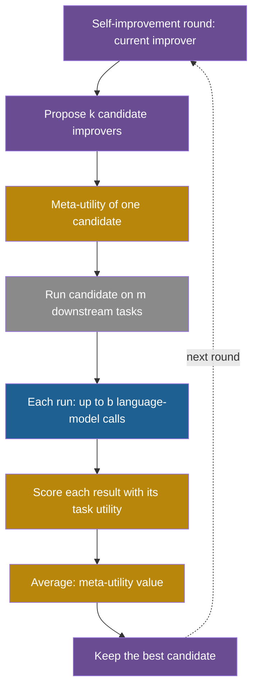

## Learning objectives

After this lesson you can:

- Tell an object-level utility from a meta-utility, and say what each one scores.
- Write STOP's meta-utility and compute it from a table of downstream results.
- Explain the self-improvement step $I_t = I_{t-1}(\hat{u}, I_{t-1}, L)$ and list what stays fixed.
- Write a bilevel optimization problem, and run two iterations of Model-Agnostic Meta-Learning (MAML) by hand in one dimension.
- Compute the cost of a nested loop, and explain why a meta-objective is noisier than an object-level score.
- Compute the clade metaproductivity estimate of the Huxley-Gödel Machine on a small tree.

## Prerequisites

- [L1: Functions, objectives and search spaces](/notes/ai/recursive-self-improvement/04-mathematics/l1-functions-objectives-and-search-spaces)
- [L3: Evaluation under noise](/notes/ai/recursive-self-improvement/04-mathematics/l3-evaluation-under-noise)
- [L4: The improver, meta-levels and the frozen core](/notes/ai/recursive-self-improvement/03-anatomy/l4-the-improver-and-meta-levels)

## 1. The question this idea answers

You judge a football player by goals and passes in a match. You cannot judge a coach that way. You must look at how much the players improve over a season. To compare two coaches fairly, you need several teams and a whole season each.

The same problem appears one level up in a self-improving system. The **improver** is the coach. Its output is not a solution but a change to a solution. To score an improver, you must run it on some tasks, let it improve their solutions, and then score those solutions. One measurement of an improver costs a whole improvement run.

Recursive self-improvement (RSI) in the strong sense asks the improver to improve itself. Then you need a number that says "this improver is better than that one". This lesson builds that number, shows what it costs, and shows why it is harder to measure than an ordinary score.

## 2. Mental model, and where it stops working

> [!analogy] A school for teachers
> A school trains teachers. It judges a training method by the exam results of the teachers' students a year later. The exam is the object-level score. The average student result per method is the meta-score. A better training method makes better teachers, who make better students.
>
> - **Where it stops working (1):** in STOP, the Self-Taught Optimizer of section 4.1, the training method trains itself. The analogy has no part where a method teaches its own teachers.
> - **Where it stops working (2):** a school watches many classes. STOP scores each improver on a handful of downstream runs, so the meta-score is very noisy.

## 3. Terms

| Term | Plain meaning |
|---|---|
| object level, meta level | The level where an agent solves tasks, and the level where an improver changes the agent or its solutions. |
| solution | A string, such as a program, that solves one downstream task. Written $s$. |
| utility | A function $u$ that scores a solution. In STOP it lies between 0 and 1. |
| downstream task | A pair $(u, s)$: a utility and a starting solution that an improver should improve. |
| improver | A program $I$ that takes a utility, a solution and a language model, and returns a better solution. |
| expected utility of an improver | The average utility of the improver's outputs over the distribution of downstream tasks. |
| meta-utility | The estimate of that average from a sample of downstream tasks. Written $\hat{u}$. |
| seed improver | The first, hand-written improver that STOP starts from. |
| self-improvement step | One iteration in which the current improver improves its own code. |
| bilevel optimization | An outer optimization whose objective depends on the result of an inner optimization, for example training on one task. |
| meta-knowledge $\omega$ | What the outer problem chooses: an initialization, a learning rate, an improver. |
| support set, query set | The data of one task used for the inner update, and the held-out data used to score it. |
| MAML | Model-Agnostic Meta-Learning: learn a starting point of the weights from which a few gradient updates adapt well to a new task. |
| first-order MAML | A cheaper MAML that drops the second derivatives in the outer gradient. |
| metaproductivity | An agent's potential to produce useful further self-improvements. |
| clade | An agent and all its descendants in the archive. |
| clade metaproductivity (CMP) | The expected quality of the best final agent that comes from a clade. |

## 4. Method and math

### 4.1 Object level and meta level in STOP

STOP, the Self-Taught Optimizer, gives exact definitions (Zelikman et al., 2023, [arXiv:2310.02304](https://arxiv.org/abs/2310.02304), Section 3). Each one is **Theory**: a definition, not a result.

1. A **language model** $L: \Sigma^{*} \to \Sigma^{*}$ is a random black box over strings of an alphabet $\Sigma$. Here $\Sigma^{*}$ is the set of all strings made from $\Sigma$.
2. A **utility** $u$ scores a solution string. It also has a text description, which can be its source code. Appendix A.1 bounds $u$ to $[0, 1]$.
3. A **task** is a pair $\tau = (u, s)$ of a utility and an initial solution.
4. An **improver** returns a new solution:

$$
s' = I(u, s, L)
$$

**Symbols.** $s$ is the input solution, $s'$ is the improved solution, $u$ is the task's utility, and $L$ is the language model. Ideally $u(s') \gg u(s)$.

**In plain English.** An improver reads a solution and its scoring rule, calls the language model, and returns something that should score higher.

**Worked example.** STOP's seed improver asks the model for up to 6 candidate solutions at temperature 0.7. It scores each with the utility and returns the best one. On the 3-SAT transfer task, the initial solution scored 0%, and the seed improver's outputs scored 21.2% on average (Table 1).

**Assumptions.** The utility can be computed cheaply and can be described in text.

**When it is useful.** It separates the levels: a solution scored by $u$, and an improver $I$ that changes solutions.

**What it does not prove.** The definition does not say that an improver exists that helps on all tasks.

### 4.2 The meta-utility: scoring an improver

> [!key] Term: meta-utility
> - **Name:** meta-utility, written $\hat{u}(I)$.
> - **Meaning:** the average quality of the solutions that an improver produces on a sample of downstream tasks.
> - **Problem it solves:** it gives one number for "how good is this improver", so improvers can be compared and searched.
> - **Example:** an improver lifts four tasks to 0.40, 0.70, 0.55 and 0.35, so its meta-utility is 0.50.
> - **Link to RSI:** an improver that improves itself needs this number to judge its own rewrites.
> - **Limits:** each sample costs a whole improver run, so meta-utilities rest on few, noisy samples.

**The idea.** Score an improver by the quality of the solutions it produces, averaged over downstream tasks.

$$
\bar{u}(I) = \mathbb{E}_{(u, s) \sim \mathcal{D}}\big[\,u(I(u, s, L))\,\big], \qquad \hat{u}(I) = \frac{1}{\lvert D \rvert} \sum_{(u, s) \in D} u(I(u, s, L))
$$

**Symbols.**

- $\mathcal{D}$ is the distribution of downstream tasks.
- $\bar{u}(I)$ is the expected utility of improver $I$. It is unknown.
- $D$ is a set of $n$ tasks sampled from $\mathcal{D}$, and $\lvert D \rvert = n$.
- $\hat{u}(I)$ is the **meta-utility** (STOP Eq. 2), the estimate of $\bar{u}(I)$ from $D$.
- Inside the sum, each task's own utility $u$ scores the solution that the improver returned.

**In plain English.** Run the improver on each training task. Score each improved solution with that task's own scoring rule. Take the average.

**Notation warning.** STOP's main text writes the meta-utility as $\hat{u}$. Its Algorithm 1 and Appendix A.3 write $\tilde{u}$. It is the same quantity.

**Worked example 1.** Two improvers, A and B, run on the same four downstream tasks. The initial solutions have utilities 0.30, 0.50, 0.40 and 0.20.

| Task | Initial $u(s)$ | After A | After B |
|---|---|---|---|
| 1 | 0.30 | 0.40 | 0.60 |
| 2 | 0.50 | 0.70 | 0.50 |
| 3 | 0.40 | 0.55 | 0.65 |
| 4 | 0.20 | 0.35 | 0.45 |

1. $\hat{u}(A) = (0.40 + 0.70 + 0.55 + 0.35)/4 = 0.50$.
2. $\hat{u}(B) = (0.60 + 0.50 + 0.65 + 0.45)/4 = 0.55$.
3. The initial mean is 0.35. So A adds 0.15 and B adds 0.20 on average.
4. B has the higher meta-utility, although A is better on task 2.

**Worked example 2: STOP's transfer table.** **Measured:** the GPT-4 improver after 4 rounds, against the seed, on five tasks (Zelikman et al., 2023, Table 1):

| Task | Initial $u(s)$ | Seed $\hat{u}(I_0)$ | Improved $\hat{u}(I_T)$ |
|---|---|---|---|
| String Grid Distance | 43.9% | 44.3% | 56.7% |
| Modified Quadratic Assignment | 20.4% | 20.6% | 22.1% |
| 3-SAT | 0% | 21.2% | 75.1% |
| Max-Cut | 0% | 58.7% | 74.2% |
| Parity without noise | 50.0% | 59.3% | 81.7% |

Our arithmetic, not reported in the paper: the plain averages are 40.8% for the seed and 62.0% for the improved improver. The gains per task range from 1.5 to 53.9 points.

**Assumptions.** $D$ is a fair sample of $\mathcal{D}$, $L$ stays the same during the run, and each utility lies in $[0, 1]$.

**When it is useful.** It turns "a better improver" into a number, so that any search method of L2 can run at the meta level.

**What it does not prove.** A high $\hat{u}$ on the training tasks does not prove a high $\bar{u}$. **Measured:** in STOP's training setup, $D$ was 5 identical copies of one task, learning parity with noise (Section 5.1, Appendix K). So the average was over the randomness of the improver on one task, not over different tasks. Transfer to other tasks had to be tested separately, as in the table above.

### 4.3 The self-improvement step

**The idea.** Give the improver its own source code as the "solution", and give it the meta-utility as the "utility". Its output is a new improver.

$$
I_t = I_{t-1}\big(\hat{u},\; I_{t-1},\; L\big), \qquad t = 1, \dots, T
$$

**Symbols.**

- $I_{t-1}$ is the current improver, and $I_t$ is the next one.
- The first argument $\hat{u}$ is the utility. Here it is the meta-utility.
- The second argument $I_{t-1}$ is the solution to improve. Here it is the improver's own code.
- $T$ is the number of rounds, fixed in advance from the budget.

**In plain English.** The improver improves the program that does the improving, and the meta-utility judges the result.

**Worked example: one round of the public code.**

1. The seed improver reads its own source and the meta-utility's description.
2. It asks the language model for 6 rewritten improvers in one call.
3. It scores each rewrite with the meta-utility. Each such score runs the rewrite on 5 downstream copies of the parity task.
4. It returns the rewrite with the highest meta-utility.
5. The outer loop checks the new improver once more. It accepts it if no error occurs and the checked meta-utility is not 0. There is no comparison with the previous improver, so a round can lower the meta-utility.

**Measured results.**

1. With GPT-4, the seed's meta-utility was 61%. Mean downstream performance improved over 1 to 3 rounds in 5 runs (Section 5.1).
2. With GPT-3.5 and Mixtral, "performance degrades". Only 12% of 25 GPT-3.5 runs gained at least 3%, although the GPT-3.5 seed started higher, at 65% (Section 5.3).
3. GPT-4 wrote search strategies into the improver, such as beam search and simulated annealing. No frequency counts are given (Section 6.1).

**What stays fixed.** The language model, $\hat{u}$, the downstream utilities and the outer loop. The authors write: "Since the language models themselves are not altered, this is not full recursive self-improvement."

**A bound and what it does not prove.** STOP's Lemma 1 is **Theory**. Draw $n$ tasks independently, and consider all improvers that are programs of at most $l$ characters. Then, with probability at least $1 - \delta$, every such improver satisfies $\lvert \hat{u}(I) - \bar{u}(I) \rvert \le \varepsilon$, where:

$$
\varepsilon = \sqrt{\frac{1}{n}\Big(l \ln \lvert \Sigma \rvert + \ln \frac{1}{\delta}\Big)}
$$

- $n$ is the number of training tasks.
- $l$ is the maximum program length, and $\lvert \Sigma \rvert$ is the alphabet size.
- $\delta$ is the allowed failure probability.

In plain English, with enough tasks, every short improver's meta-utility is close to its true value. Our arithmetic: take about 1,000 characters (the seed is 22 lines), a 128-character alphabet and $\delta = 0.05$. Then $l \ln \lvert \Sigma \rvert \approx 4{,}852$ and $\ln 20 \approx 3.0$.

1. With $n = 5$: $\varepsilon = \sqrt{4{,}855/5} \approx 31$. A utility lies in $[0, 1]$, so this bound says nothing.
2. For $\varepsilon = 0.1$, you need $n \approx 4{,}855 / 0.01 \approx 485{,}500$ tasks.

The bound assumes independent tasks, and STOP's training tasks were copies of one task. So the bound is a statement about what enough data would give, not a guarantee for the experiment.

### 4.4 The cost of a nested loop

**The idea.** One meta-utility evaluation is a whole run of the improver on several tasks. One self-improvement round evaluates several candidate improvers. The costs multiply.

$$
C_{\text{round}} \approx k \cdot m \cdot b
$$

**Symbols.**

- $C_{\text{round}}$ is the number of language-model calls in one self-improvement round.
- $k$ is the number of candidate improvers that the round scores.
- $m$ is the number of downstream runs per meta-utility evaluation.
- $b$ is the number of language-model calls per downstream run.

**In plain English.** One round costs the number of candidates, times the tasks per candidate, times the calls per task.

**Worked example: STOP's public configuration.** Our arithmetic uses the public code's settings. They allow up to 6 samples per call, 4 calls per improver run and 5 meta-utility tests.

1. One downstream run of a candidate improver: at most $b = 4$ calls, so at most 24 samples.
2. One meta-utility evaluation: $m = 5$ runs, so at most 20 calls and 120 samples.
3. The seed improver scores $k = 6$ candidates: at most $6 \times 5 \times 4 = 120$ calls.
4. Add the 1 call that proposes the candidates and the 20 calls of the final check: at most 141 calls, or 846 samples, per round.

The real count depends on how each candidate spends its budget. The paper gives the cost as $O((\text{budget}_u + \text{budget}_L) \cdot \text{budget}_{\hat{u}})$ and notes that it "grows substantially faster than the cost of the optimized improver" (Sections 4 and 7).

**A third level.** **Our interpretation:** a meta-meta loop that scores 6 candidate meta-improvers needs at least one full round for each, about $6 \times 141 = 846$ calls. Each added level multiplies the cost again.

**Real costs, as reported.** SICA, a self-improving coding agent, spent about USD 7,000 on 15 iterations in API fees. The Huxley-Gödel Machine (HGM) paper reports about USD 5,000 for all three methods it compared. One run of the Darwin Gödel Machine (DGM) on SWE-bench took about 2 weeks. Its reported cost of about USD 22,000 comes from the first arXiv version's appendix. Treat this figure with care.

**Assumptions.** Calls dominate the cost. Real systems also pay for tests, containers and time.

**When it is useful.** Compute $k \cdot m \cdot b$ before a meta-level experiment, to know how many rounds the budget allows.

**What it does not prove.** A high cost does not mean a high gain. The cost only buys samples, and meta-level samples are noisy (section 4.7).



### 4.5 Bilevel optimization from scratch

STOP is one case of a general pattern. A student chooses a study method (outer choice), studies with it (inner process), and takes an exam on new questions (outer objective).

**The idea.** An outer variable changes how an inner optimization runs. The outer objective scores the result of that inner optimization on held-out data. The meta-learning survey of Hospedales et al. writes it as two lines (Hospedales et al., 2022, [arXiv:2004.05439](https://arxiv.org/abs/2004.05439), Section 2.1, Eqs. 5–6).

$$
\theta^{*(i)}(\omega) = \operatorname{argmin}_{\theta}\; \mathcal{L}^{\text{task}}\big(\theta, \omega, D^{\text{train}(i)}\big)
$$

$$
\omega^{*} = \operatorname{argmin}_{\omega}\; \sum_{i=1}^{M} \mathcal{L}^{\text{meta}}\big(\theta^{*(i)}(\omega), \omega, D^{\text{val}(i)}\big)
$$

**Symbols.**

- $\omega$ is the meta-knowledge: "how to learn", for example a starting point or a learning rate.
- $\theta$ is the weights of the base model.
- $D^{\text{train}(i)}$ and $D^{\text{val}(i)}$ are the training split (support set) and the validation split (query set) of task $i$.
- $\theta^{*(i)}(\omega)$ is the result of the inner optimization on task $i$ when it uses $\omega$.
- $\mathcal{L}^{\text{task}}$ is the inner loss, and $\mathcal{L}^{\text{meta}}$ is the outer loss.
- $M$ is the number of training tasks.

**In plain English.** For each task, learn with $\omega$. Then choose the $\omega$ whose learned results do best on held-out data. The inner level depends on $\omega$ but cannot change it.

**Worked example: learning a learning rate.** One task has loss $(w - c)^2$ with $c = 4$. The inner process is one gradient update from $w = 0$ with learning rate $\omega$. The outer loss is the same squared error after the update.

1. Inner result: $w^{*}(\omega) = 0 - \omega \times 2(0 - 4) = 8\omega$.
2. Outer loss: $(8\omega - 4)^2 = 16(2\omega - 1)^2$.
3. $\omega = 0.25$: $w^{*} = 2$, loss 4. $\omega = 0.5$: $w^{*} = 4$, loss 0. $\omega = 0.75$: $w^{*} = 6$, loss 4.
4. The best learning rate is $\omega^{*} = 0.5$. The first plot of section 5 shows the curve.

**Mapping STOP to this form.** $\omega$ is the improver's code. The inner process is the improver's run on a downstream task. The outer objective is the meta-utility. The difference is that STOP solves the outer problem with the improver itself.

**Assumptions.** The inner process can be run many times. Each run is cheap enough to repeat for each candidate $\omega$.

**When it is useful.** Use it whenever someone says "learn to learn" or "improve the improver". Ask what $\omega$ is, what the inner process is, and what held-out data scores it.

**What it does not prove.** A good $\omega$ for the training tasks may fail on new tasks. The outer problem can overfit its tasks, exactly like the inner problem.

### 4.6 MAML: a bilevel method with gradients

MAML learns a starting point $\theta$ for the weights (Finn, Abbeel and Levine, 2017, [arXiv:1703.03400](https://arxiv.org/abs/1703.03400), Section 2.2 and Eq. 1). From it, "one or a few ordinary gradient steps" on a new task already work well. In the notation above, $\omega$ is the initial weights.

$$
\theta'_i = \theta - \alpha\, \nabla_{\theta} \mathcal{L}_{\mathcal{T}_i}(f_{\theta}) \qquad \text{(inner update)}
$$

$$
\theta \leftarrow \theta - \beta\, \nabla_{\theta} \sum_{\mathcal{T}_i \sim p(\mathcal{T})} \mathcal{L}_{\mathcal{T}_i}(f_{\theta'_i}) \qquad \text{(outer update)}
$$

**Symbols.**

- $\theta$ is the shared starting weights, the thing that MAML learns.
- $\mathcal{T}_i$ is one task drawn from the task distribution $p(\mathcal{T})$.
- $f_{\theta}$ is the model with weights $\theta$, and $\mathcal{L}_{\mathcal{T}_i}$ is the loss on task $\mathcal{T}_i$.
- $\alpha$ is the inner learning rate, and $\beta$ is the outer (meta) learning rate.
- $\theta'_i$ is the weights after adapting to task $i$.

**In plain English.** Adapt to each task with one gradient update. Measure the loss after adaptation. Then move the starting point so that these post-adaptation losses fall. The outer gradient is taken with respect to $\theta$, not $\theta'_i$. The paper stresses: "Note that the meta-optimization is performed over the model parameters θ."

**Worked example in one dimension.** Two tasks have losses $L_1(\theta) = (\theta - 1)^2$ and $L_2(\theta) = (\theta - 5)^2$. Take $\alpha = 0.25$, $\beta = 0.5$ and start at $\theta = 0$.

Iteration 1:

1. Inner update for task 1: $\theta'_1 = 0 - 0.25 \times 2(0 - 1) = 0.5$.
2. Inner update for task 2: $\theta'_2 = 0 - 0.25 \times 2(0 - 5) = 2.5$.
3. Post-adaptation losses: $(0.5 - 1)^2 = 0.25$ and $(2.5 - 5)^2 = 6.25$. Sum: 6.5.
4. Chain rule: $\theta'_i = \theta - 2\alpha(\theta - c_i)$, so $d\theta'_i / d\theta = 1 - 2\alpha = 0.5$.
5. Outer gradient: $\sum_i 2(\theta'_i - c_i)(1 - 2\alpha) = 2(-0.5)(0.5) + 2(-2.5)(0.5) = -0.5 - 2.5 = -3$.
6. Outer update: $\theta = 0 - 0.5 \times (-3) = 1.5$.

Iteration 2: $\theta'_1 = 1.25$ and $\theta'_2 = 3.25$, with losses 0.0625 and 3.0625 (sum 3.125). The outer gradient is $2(0.25)(0.5) + 2(-1.75)(0.5) = -1.5$, so $\theta = 1.5 + 0.75 = 2.25$.

The next iterates are 2.625 and 2.8125. They approach $\theta = 3$, where the post-adaptation sum is 2.0 against 8 before adaptation. We checked the gradient with a numerical derivative.

**The second derivative.** Step 4 is where MAML needs a derivative through the inner update. With a real network, this factor contains the Hessian, the matrix of second derivatives, which is expensive. **First-order MAML** drops it. In this example, it would use $-6$ instead of $-3$ as the first outer gradient.

MiniImagenet 5-way 1-shot is an image task in which the model must tell 5 new classes apart after 1 example of each. **Measured:** on MiniImagenet 5-way 1-shot, first-order MAML scored 48.07% against 48.70% for MAML. On 5-way 5-shot, it scored 63.15% against 63.11% (Finn et al., 2017, Table 1).

**Assumptions.** A distribution of related tasks exists. Losses are differentiable. The inner rule and the outer update are plain gradient descent, fixed by humans.

**When it is useful.** It learns a starting point that adapts fast, with any model trained by gradient descent.

**What it does not prove.** MAML improves the starting point of learning, not the learning rule. The inner rule and the outer improver stay fixed, so it changes one meta-level only. See [L8: Meta-learning and improving the improver](/notes/ai/recursive-self-improvement/05-approaches/l8-meta-learning-and-improving-the-improver).

### 4.7 Why meta-objectives are noisier

Three things make a meta-utility noisier than an object-level score at the same cost.

1. **Fewer samples per budget.** Each meta-sample costs a whole improver run. Our arithmetic: 1,000 language-model samples score up to 1,000 outputs, but give only about 41 improver runs of 24 samples. With equal spread per sample, the standard error is $\sqrt{1000/41.7} \approx 4.9$ times larger.
2. **Each sample contains a selection.** An improver returns the best of its own candidates. Its output already carries a winner's curse, as in L3.
3. **Small task sets.** STOP averaged over 5 runs per meta-utility evaluation. If one run's utility has a standard deviation of 0.15, the standard error of the average is $0.15/\sqrt{5} \approx 0.067$. That is about 7 points on a 0-to-1 scale.

**Measured:** the HGM paper tested how well an agent's own benchmark score predicts the success of its descendants. The Pearson correlations of DGM's and SICA's guidance signals were only 0.274 to 0.444 (Wang et al., 2025, [arXiv:2510.21614](https://arxiv.org/abs/2510.21614), Table 1). A score that guides the meta level must predict future improvement, and these scores predicted it weakly.

### 4.8 Clade metaproductivity in the Huxley-Gödel Machine

The DGM and SICA choose which agent to expand by its own benchmark score. The HGM paper calls the weak link between that score and future improvement the "Metaproductivity-Performance Mismatch". It scores an agent by its whole **clade** instead.

**The idea.** Judge an agent by the best agent that its family line is expected to produce, not by its own score.

$$
\text{CMP}_{\pi}(T, a) = \mathbb{E}_{T_B \sim p_{\pi}(\cdot \mid T, a)}\Big[\, U\Big(\operatorname{argmax}_{a' \in C(T_B, a)} \text{Score}_{\pi}(a')\Big) \Big]
$$

**Symbols.**

- $a$ is an agent in the archive tree $T$.
- $\pi$ is the search policy, and $B$ is the budget.
- $T_B$ is the final archive when $\pi$ runs to the end of the budget, and $p_{\pi}(\cdot \mid T, a)$ is its distribution when $a$ is chosen.
- $C(T_B, a)$ is the clade of $a$ in the final archive.
- $\text{Score}_{\pi}$ picks the final agent, and $U$ is its utility: the average of pass or fail results on downstream tasks.

**In plain English.** If we expand this agent now, how good, on average, is the best agent that will come from its line?

**Theory:** HGM's Theorem 1 says that, under its Assumption 1, access to a true CMP oracle suffices to imitate the Gödel Machine. An oracle is an imagined perfect source of the true value. The assumption includes that proofs cost no budget and that each self-modification costs exactly one budget unit.

**The estimator.** The true CMP is unknown. HGM estimates it from the evaluation counts in the clade:

$$
\widehat{\text{CMP}}(a) = \frac{n^{C}_{\text{success}}(a)}{n^{C}_{\text{success}}(a) + n^{C}_{\text{failure}}(a)}, \qquad n^{C}_{\text{success}}(a) = \sum_{a' \in C(a)} n_{\text{success}}(a')
$$

- $n_{\text{success}}(a')$ and $n_{\text{failure}}(a')$ are the passed and failed task evaluations of agent $a'$.
- $n^{C}$ sums these counts over the whole clade $C(a)$. The failure sum is built the same way.

In plain English, pool every evaluation of the agent and its descendants, and take the pass rate. Agents that were evaluated more often count more.

**Worked example.** An archive tree has a root R with children A and B. A has children A1 and A2. B has one child B1. Each agent was evaluated on 10 tasks.

| Agent | Own passes of 10 | Own score | Clade | Clade passes, fails | $\widehat{\text{CMP}}$ |
|---|---|---|---|---|---|
| R | 4 | 0.40 | all six | 28, 32 | 0.467 |
| A | 7 | 0.70 | A, A1, A2 | 12, 18 | 0.400 |
| B | 3 | 0.30 | B, B1 | 12, 8 | 0.600 |
| A1 | 2 | 0.20 | A1 | 2, 8 | 0.200 |
| A2 | 3 | 0.30 | A2 | 3, 7 | 0.300 |
| B1 | 9 | 0.90 | B1 | 9, 1 | 0.900 |

1. Clade of A: passes $7 + 2 + 3 = 12$, fails $3 + 8 + 7 = 18$. $\widehat{\text{CMP}}(A) = 12/30 = 0.40$.
2. Clade of B: passes $3 + 9 = 12$, fails $7 + 1 = 8$. $\widehat{\text{CMP}}(B) = 12/20 = 0.60$.
3. By own score, A (0.70) ranks above B (0.30). By clade, B (0.60) ranks above A (0.40).

A's children were worse than A, and B's child was much better than B. A rule based on own score keeps expanding A. A rule based on clade turns to B.

**How HGM uses it.** At each step, HGM either expands one agent or evaluates one agent on one task. It expands when the archive size $\lvert T \rvert$ is at most $N^{0.6}$, where $N$ is the number of evaluations so far. With $N = 100$, $100^{0.6} \approx 15.8$, so it expands while the archive has 15 agents or fewer. It picks the parent by Thompson sampling from $\text{Beta}(\tau(1 + n^{C}_{\text{success}}), \tau(1 + n^{C}_{\text{failure}}))$. The exact form of the scheduler $\tau$ was not verified.

In plain words, a Beta distribution describes an unknown pass rate between 0 and 1, centered near the clade's measured pass rate. Thompson sampling draws one random value per agent from its distribution and picks the agent with the largest draw. A clade with few evaluations has a wide distribution, so it still gets chosen sometimes.

**Measured:**

1. The correlation of HGM's estimate with the empirical CMP was 0.778 (weighted) on SWE-Verified-60 and 0.873 (unweighted) on Polyglot. In the same two columns, the DGM's signal gave 0.285 (weighted) and 0.357 (unweighted) (Table 1). Part 5 L5 quotes the weighted values for both benchmarks, so its numbers differ: 0.285 and 0.383 for the DGM.
2. After 800 evaluations on SWE-Verified-60, HGM reached 56.7%, against 53.3% for the DGM and 50.0% for SICA. It used 517 CPU-hours against 1,231 for the DGM (Table 2).
3. There was one run per method, and one task is 1.67 points. By L3, these gaps are within the noise of a single run.

**Assumptions.** Clade members share what makes them good, so their pooled pass rate predicts future descendants.

**When it is useful.** By the measured correlations, it guides parent selection better than an agent's own score.

**What it does not prove.** The HGM selection rule itself is fixed, so the system does not improve its own selection policy. A higher correlation also does not guarantee better final agents in every run.

### 4.9 What stays fixed: the meta-objective itself

Every system in this lesson changes something, and every one keeps its meta-objective fixed.

| System | What changes | What scores the change | Fixed |
|---|---|---|---|
| STOP | The improver's code | Meta-utility $\hat{u}$ | Language model, $\hat{u}$, downstream utilities, outer loop |
| MAML | The starting weights $\theta$ | Post-adaptation loss on query sets | Inner rule, outer gradient descent, task distribution |
| DGM | The agent's code | Staged benchmark score | Parent selection, archive rule, evaluation, model weights |
| HGM | The agent's code | Pooled clade pass rate | The HGM policy, model weights |

To improve the meta-objective, you would need a fixed meta-meta-objective. This regress is the topic of [L4: The improver, meta-levels and the frozen core](/notes/ai/recursive-self-improvement/03-anatomy/l4-the-improver-and-meta-levels). Part 8 studies what goes wrong when a system can reach and edit its own objective ([L6: The special risks of changing the improver](/notes/ai/recursive-self-improvement/08-failure-modes-and-safety/l6-changing-the-improver-safely)).

> [!example] Exercise 1: compute and compare two meta-utilities
> Two improvers, C and D, run on the same five downstream tasks. The utilities of their outputs are:
>
> - C: 0.62, 0.48, 0.71, 0.55, 0.39
> - D: 0.70, 0.30, 0.80, 0.60, 0.45
>
> Compute $\hat{u}(C)$ and $\hat{u}(D)$. Then compute the paired differences $D - C$, their mean, and the standard error of the mean with the sample standard deviation. Is D clearly better?

```check
{
  "question": "Give the answers to Exercise 1.",
  "hint": "The differences are 0.08, −0.18, 0.09, 0.05 and 0.06. The sample standard deviation divides by $n - 1 = 4$.",
  "answer": "$\\hat{u}(C) = 2.75/5 = 0.55$ and $\\hat{u}(D) = 2.85/5 = 0.57$.\n\nThe differences are 0.08, −0.18, 0.09, 0.05 and 0.06. Their mean is 0.02. The sample standard deviation is about 0.113, so the standard error is $0.113/\\sqrt{5} \\approx 0.050$.\n\nThe mean difference of 0.02 is only 0.4 standard errors. D is not clearly better. One task, task 2, goes strongly the other way. Five downstream tasks are far too few to rank two improvers that differ by 2 points."
}
```

## 5. Graphs

The outer loss of the learning-rate example in section 4.5. The inner process is one gradient update. The best learning rate is 0.5.

```plot
{
  "title": "Outer loss 16(2w - 1)^2 against the learning rate w chosen at the outer level, in gold. The minimum is at 0.5.",
  "xAxis": {"domain": [0, 1], "label": "learning rate (outer variable)"},
  "yAxis": {"domain": [0, 17], "label": "loss after one inner update"},
  "disableZoom": true,
  "data": [
    {"fn": "16*(2*x - 1)^2", "color": "#B8860B"}
  ]
}
```

The MAML example of section 4.6. The ink curve is the loss sum before adaptation. The blue curve is the loss sum after one inner update. The purple points are the MAML iterates 0, 1.5, 2.25 and 2.625 on the blue curve.

```plot
{
  "title": "MAML in one dimension: loss sum before adaptation (ink), after one inner update (blue), and the outer iterates (purple)",
  "xAxis": {"domain": [-1, 7], "label": "starting weight theta"},
  "yAxis": {"domain": [0, 30], "label": "sum of losses on two tasks"},
  "disableZoom": true,
  "data": [
    {"fn": "(x - 1)^2 + (x - 5)^2", "color": "#100D12"},
    {"fn": "0.25*((x - 1)^2 + (x - 5)^2)", "color": "#1E6091"},
    {"points": [[0, 6.5], [1.5, 3.125], [2.25, 2.28125], [2.625, 2.0703]], "fnType": "points", "graphType": "polyline", "color": "#6A4C93", "skipTip": true},
    {"points": [[0, 6.5], [1.5, 3.125], [2.25, 2.28125], [2.625, 2.0703]], "fnType": "points", "graphType": "scatter", "color": "#6A4C93", "skipTip": true}
  ]
}
```

## 6. Video and animation

- [Stanford CS330 Lecture 3: Optimization-Based Meta-Learning](https://www.youtube.com/watch?v=v7otSgpTc0Q) (Stanford Online, Chelsea Finn). The inventor of MAML explains the inner and outer updates. It supports sections 4.5 and 4.6.
- [Adam Kalai: Recursive Self-improving Code Generation](https://www.youtube.com/watch?v=RovcBFlfXpQ) (DIMACS CCICADA). A STOP co-author presents the seed improver, the meta-utility and the safety concerns. It supports sections 4.1 to 4.3.
- [The AI Scientific Revolution will be Driven by Open-Ended and AI-Generating Algorithms](https://www.youtube.com/watch?v=P-qzI6ZJQBw) (Vector Institute, Jeff Clune). It connects the DGM and Hyperagents, where more of the meta level becomes editable. It supports section 4.9.

## 7. Code

The MAML example and the clade estimator in plain Python.

```python
def maml_1d(theta, targets, alpha=0.25, beta=0.5, steps=3):
    for _ in range(steps):
        adapted = [theta - alpha * 2 * (theta - c) for c in targets]
        grad = sum(2 * (a - c) * (1 - 2 * alpha) for a, c in zip(adapted, targets))
        theta = theta - beta * grad
    return theta

print(maml_1d(0.0, [1.0, 5.0]))   # 2.625

def cmp_hat(agent, children, counts):
    stack, s, f = [agent], 0, 0
    while stack:
        a = stack.pop()
        s, f = s + counts[a][0], f + counts[a][1]
        stack += children.get(a, [])
    return s / (s + f)

children = {"R": ["A", "B"], "A": ["A1", "A2"], "B": ["B1"]}
counts = {"R": (4, 6), "A": (7, 3), "B": (3, 7), "A1": (2, 8), "A2": (3, 7), "B1": (9, 1)}
print(cmp_hat("A", children, counts), cmp_hat("B", children, counts))   # 0.4 0.6
```

## 8. Common mistakes

1. **"The meta-utility scores the improver's own output."** It scores the solutions that the improver produces on downstream tasks, with each task's own utility.
2. **"STOP improves the language model."** The model's weights never change. The authors say this is not full RSI.
3. **"A meta-level search costs about the same as an object-level one."** The costs multiply. STOP's public setup needs up to 141 calls per round.
4. **"MAML learns how to learn in general."** It learns a starting point. The inner rule and the outer update stay plain gradient descent.
5. **"An agent with a high score is a good parent."** In the HGM example, the 0.70 agent had the weaker clade. Measured correlations were only 0.274 to 0.444.
6. **"A generalization bound guarantees STOP's results."** With 5 tasks, Lemma 1 gives $\varepsilon \approx 31$ for a utility between 0 and 1. That guarantees nothing.
7. **"Improving the improver removes all fixed parts."** Each system in section 4.9 keeps its meta-objective fixed.

## 9. One-minute explanation

To improve an improver, you must score it, and the score of an improver is the average quality of what it produces on downstream tasks. STOP calls this the meta-utility and lets its improver improve its own code under it, while the language model and the meta-utility stay fixed. This is a bilevel problem: an outer choice changes an inner process, and held-out results judge the outer choice. MAML is the gradient version, which learns a starting point that adapts in one update. Meta-level scores cost a whole improvement run each, so their costs multiply and their samples are few and noisy. The Huxley-Gödel Machine shows that an agent's own score predicts its descendants only weakly, and scores the whole family line instead.

## 10. Check questions

```check
{
  "question": "In STOP's self-improvement step $I_t = I_{t-1}(\\hat{u}, I_{t-1}, L)$, name the role of each of the three arguments. Which of them can change from round to round?",
  "hint": "Compare with $s' = I(u, s, L)$.",
  "answer": "The first argument is the utility. Here it is the meta-utility $\\hat{u}$, which scores candidate improvers by their downstream results. The second argument is the solution to improve. Here it is the improver's own code $I_{t-1}$. The third argument is the language model $L$.\n\nOnly the second argument changes between rounds: the improver's code. The meta-utility and the language model stay fixed for the whole run."
}
```

```check
{
  "question": "A team wants to meta-optimize an improver. Each candidate improver is scored on 8 downstream tasks, each run uses up to 5 model calls, and each round scores 10 candidates. How many calls does one round need at most? With a budget of 20,000 calls, how many rounds can they run?",
  "hint": "Use $k \\cdot m \\cdot b$.",
  "answer": "One round: $10 \\times 8 \\times 5 = 400$ calls, plus the few calls that propose the candidates. With 20,000 calls, the team can run at most $20{,}000 / 400 = 50$ rounds. A final check of each accepted improver, as in STOP, adds 40 calls per round, which lowers this to about 45 rounds."
}
```

```check
{
  "question": "In the MAML example of section 4.6, change the inner learning rate to $\\alpha = 0.4$ and keep $\\theta = 0$. Compute $\\theta'_1$, $\\theta'_2$ and the outer gradient. What happens to the factor $1 - 2\\alpha$, and why does it matter?",
  "hint": "$\\theta'_i = \\theta - 2\\alpha(\\theta - c_i)$ with $c_1 = 1$ and $c_2 = 5$.",
  "answer": "$\\theta'_1 = 0 - 0.8 \\times (0 - 1) = 0.8$ and $\\theta'_2 = 0 - 0.8 \\times (0 - 5) = 4.0$. The factor is $1 - 2\\alpha = 0.2$. The outer gradient is $2(0.8 - 1)(0.2) + 2(4.0 - 5)(0.2) = -0.08 - 0.4 = -0.48$.\n\nWith a large inner rate, one inner update already moves most of the way to each task's best weight. So the starting point matters less, and the outer gradient is small. First-order MAML drops the factor and would use $-2.4$."
}
```

```check
{
  "question": "In the HGM example, agent B1 has 9 passes of 10 tasks. Suppose that B1 gets 10 more evaluations with 3 passes. Recompute $\\widehat{\\text{CMP}}(B)$ and $\\widehat{\\text{CMP}}(B1)$. What does this show about the estimator?",
  "hint": "Add the new counts to B1's own counts and to every clade that contains B1.",
  "answer": "B1 now has 12 passes and 8 fails, so $\\widehat{\\text{CMP}}(B1) = 12/20 = 0.60$. B's clade has $3 + 12 = 15$ passes and $7 + 8 = 15$ fails, so $\\widehat{\\text{CMP}}(B) = 15/30 = 0.50$, down from 0.60.\n\nThe estimator rests on few evaluations. B1's first 10 results were lucky, and more data pulled the clade estimate down. This is the winner's curse of L3 at the meta level."
}
```

## 11. Summary and links

- An improver is scored by the quality of what it produces. STOP's meta-utility averages each downstream task's own utility over a sample of tasks.
- In STOP's self-improvement step, the improver improves its own code under the meta-utility. The language model and the meta-utility stay fixed.
- Bilevel optimization chooses an outer variable by the results of an inner optimization on held-out data. MAML does this with gradients for a starting point.
- Meta-level costs multiply, about $k \cdot m \cdot b$ calls per round, and meta-level samples are few and noisy.
- An agent's own score predicts its descendants weakly. HGM's clade metaproductivity pools the evaluations of a whole family line.

This is the last lesson of Part 4. Part 5 applies these tools to the major families of methods, starting with self-critique and refinement.

- Previous: [L4: Improvement dynamics: rates, diminishing returns and plateaus](/notes/ai/recursive-self-improvement/04-mathematics/l4-improvement-dynamics)
- Next: [L1: Self-critique and iterative refinement](/notes/ai/recursive-self-improvement/05-approaches/l1-self-critique-and-refinement)
- Related: [2023: STOP, the Self-Taught Optimizer](/notes/ai/recursive-self-improvement/06-research-systems/p05-stop-self-taught-optimizer)
- Related: [2025: The Huxley-Gödel Machine](/notes/ai/recursive-self-improvement/06-research-systems/p11-huxley-godel-machine)
- Related: [P8: Improving the improver](/notes/ai/recursive-self-improvement/09-build-it/p8-improving-the-improver)

## References

- Eric Zelikman, Eliana Lorch, Lester Mackey, Adam Tauman Kalai. "Self-Taught Optimizer (STOP): Recursively Self-Improving Code Generation". 2023. arXiv:2310.02304. https://arxiv.org/abs/2310.02304. Code: https://github.com/microsoft/stop
- Chelsea Finn, Pieter Abbeel, Sergey Levine. "Model-Agnostic Meta-Learning for Fast Adaptation of Deep Networks". ICML 2017, PMLR 70. arXiv:1703.03400. https://arxiv.org/abs/1703.03400
- Timothy Hospedales, Antreas Antoniou, Paul Micaelli, Amos Storkey. "Meta-Learning in Neural Networks: A Survey". IEEE Transactions on Pattern Analysis and Machine Intelligence 44(9): 5149–5169, 2022 (online 2021). arXiv:2004.05439. https://arxiv.org/abs/2004.05439
- Wenyi Wang, Piotr Piękos, Li Nanbo, et al. "Huxley-Gödel Machine: Human-Level Coding Agent Development by an Approximation of the Optimal Self-Improving Machine". 2025. ICLR 2026. arXiv:2510.21614. https://arxiv.org/abs/2510.21614. Code: https://github.com/metauto-ai/HGM
- Jenny Zhang, Shengran Hu, Cong Lu, Robert Lange, Jeff Clune. "Darwin Gödel Machine: Open-Ended Evolution of Self-Improving Agents". 2025. ICLR 2026. arXiv:2505.22954. https://arxiv.org/abs/2505.22954
- Maxime Robeyns, Martin Szummer, Laurence Aitchison. "A Self-Improving Coding Agent". 2025. arXiv:2504.15228. https://arxiv.org/abs/2504.15228
