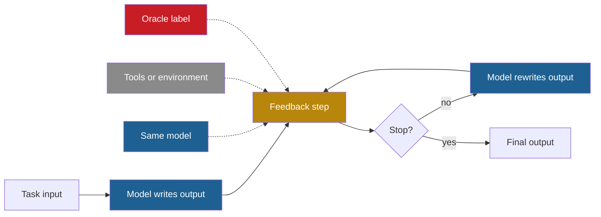

## Learning objectives

After this lesson you can:

- Explain, step by step, how self-consistency, Self-Refine, Reflexion and CRITIC work.
- State for each method what changes, what stays fixed, who gives the feedback, who stops the loop and what persists.
- Separate intrinsic self-correction from correction with external feedback, and a realistic setting from an oracle setting.
- Test a self-correction claim against an equal-compute baseline, with numbers.
- Place each method on the ladder of Part 2, and explain why none of them improves the improver.

## Prerequisites

- [L3: Feedback loops](/notes/ai/recursive-self-improvement/01-foundations/l3-feedback-loops)
- [L7: What "improvement" means, and how to measure it](/notes/ai/recursive-self-improvement/01-foundations/l7-measuring-improvement)
- [L2: The ladder: from repeating a task to improving the improver](/notes/ai/recursive-self-improvement/02-core-idea/l2-the-ladder-of-self-improvement)
- [L3: The system boundary, the "self" and persistence](/notes/ai/recursive-self-improvement/02-core-idea/l3-system-boundary-and-persistence)

## 1. The question this idea answers

A student finishes a math test with ten minutes left, and she reads her answers again. Some re-reading helps: she finds a copy error, 74 written instead of 47. Some re-reading does not help. If she believes a wrong rule, she reads the wrong step and agrees with it. If the teacher marks the wrong answers, she can fix many more, but those marks do not exist during the real test.

A large language model (LLM) can do the same three things. It can answer, read its own answer, and rewrite it. This lesson asks one question: **when does a model's criticism of its own output make the output better, and where must the criticism come from?**

The answer matters for recursive self-improvement (RSI). Every improvement loop needs a signal that says "this version is better". If a model cannot judge one of its own answers, it cannot judge its own next version either.

## 2. Mental model, and where it stops working

> [!analogy] Three ways to check an essay
> A writer can proofread her essay, run a spell checker that knows facts she may not know, or compare it with an answer key. Self-Refine is the proofreader. CRITIC is the proofreader with tools. Many reported self-correction gains come from the answer key.
>
> **Where it stops working:** a writer remembers today's lesson tomorrow, but most methods here forget everything when the task ends. Also, real use has no answer key, so a method that needs one shows an upper bound, not a usable gain.

## 3. Terms

| Term | Plain meaning |
|---|---|
| self-critique | A model writes feedback on its own output. |
| self-correction | A model changes its own output after it reads feedback, while it answers. |
| intrinsic self-correction | Self-correction with no outside help. The model alone finds the error and decides when to stop. |
| external feedback | Feedback from a source outside the model, for example a test result, a search result or an interpreter error. |
| oracle label | The true answer, used inside the loop. Real users do not have it. |
| oracle setting | An experiment in which the loop uses oracle labels, for example to stop as soon as the answer is correct. |
| chain of thought (CoT) | Written reasoning steps that a model produces before its final answer. |
| self-consistency | Sample many reasoning paths and take the answer that appears most often. |
| episodic memory | Notes that an agent keeps across attempts at the same task. |
| equal-compute baseline | A comparison method that uses the same number of model calls as the method under test. |
| test-time compute | The computation that a model spends while it answers, not while it trains. |
| verifier | A component that estimates if an answer is correct. |
| process reward model (PRM) | A trained verifier that scores each step of a reasoning chain. |
| false positive (of a test) | A wrong program that passes the test. |
| pass@1 | The share of problems solved with one submitted answer. |

## 4. Method and math

### 4.1 Five questions for every method

Each method here repeats a short loop: produce an output, get feedback, maybe produce a new output. The methods differ in five places, so ask five questions of each:

1. **What changes?** The answer, a plan, or a stored note.
2. **What stays fixed?** The model weights, the prompts, the tools.
3. **Who gives the feedback?** The same model, a tool, the environment, or a person with the true answer.
4. **Who decides when to stop?** The model, a fixed limit, or an oracle.
5. **What persists after the task?** Nothing, or a note that the next attempt reads.

The fourth question is easy to miss. A loop that stops as soon as an answer becomes correct uses the true answer, even if no step shows it to the model.



The dotted lines are the three possible sources of feedback. The red source, the oracle label, is not available in real use. So a result that depends on it is an upper bound.

### 4.2 The contrast case: self-consistency

Self-consistency has no feedback at all. It is the null model of this lesson: more compute, no critique, no memory (Wang et al., 2022, [arXiv:2203.11171](https://arxiv.org/abs/2203.11171)). It has three steps:

1. Prompt the model with chain-of-thought examples.
2. Sample many reasoning paths at a temperature above zero. The paper used 40 samples per run.
3. Ignore the reasoning, and take the final answer that appears most often.

Example (illustration): 5 samples on one word problem give 18, 18, 20, 18 and 26. The majority answer is 18. No sample was criticized or rewritten.

**Measured:** on GSM8K, a set of grade-school math word problems, PaLM-540B rose from 56.5% to 74.4%. The baseline was one greedy chain of thought (Wang et al., 2022, Table 2). The method "incurs more computation cost". But "a small number of paths (e.g., 5 or 10)" gives most of the gain.

Nothing persists, and the next question starts from zero. On the ladder of Part 2, this is Level 0: resample and select. It matters for one reason. Any method that uses several calls must beat self-consistency with the same number of calls. Otherwise the gain may come from the extra calls, not from the critique.

### 4.3 Self-Refine: one model, three roles

Self-Refine uses "a single LLM as the generator, refiner, and feedback provider" (Madaan et al., 2023, [arXiv:2303.17651](https://arxiv.org/abs/2303.17651), abstract). It needs no training and no extra data. One model gets three few-shot prompts: one to write, one to give feedback, and one to rewrite. With $x$ the input and $y_0$ the first output, Algorithm 1 is:

1. Write a first output $y_0$ from the input $x$.
2. Ask the same model for feedback on the current output. The prompt asks for feedback that is "actionable and specific".
3. If the feedback contains a stop signal, or the limit of "up to a maximum of 4 iterations" is reached, stop.
4. Otherwise, rewrite from the input, every earlier output and every earlier feedback. Go back to step 2.

In the public math code, the loop stops when the feedback contains the phrase "it is correct". So the model's own words decide when to stop.

> [!example] One Self-Refine iteration (illustration)
> 1. Task: write one sentence that uses the words *dog*, *frisbee*, *catch* and *park*.
> 2. Output: "The dog ran to catch the frisbee." Feedback: "The word park is missing. Add a place."
> 3. Output: "In the park, the dog ran to catch the frisbee." Feedback: "All four words are present. Stop."
> 4. This task suits self-feedback, because the model can check the required words by reading.

**Measured** results (Madaan et al., 2023, Table 1, base score, then the score with Self-Refine):

| Task and score | GPT-3.5 | ChatGPT | GPT-4 |
|---|---|---|---|
| Dialogue response (preference share) | 36.4 → 63.6 | 40.1 → 59.9 | 25.4 → 74.6 |
| Code optimization (% programs optimized) | 14.8 → 23.0 | 23.9 → 27.5 | 27.3 → 36.0 |
| Constrained generation (concept coverage %) | 28.0 → 37.0 | 44.0 → 67.0 | 15.0 → 45.0 |
| Math reasoning, GSM8K (% solved) | 64.1 → 64.1 | 74.8 → 75.0 | 92.9 → 93.1 |

Read this table with three cautions:

1. Preference numbers are win shares, not accuracies, and ties count for neither side. GPT-4 often served as the evaluator: "we use GPT-4 as a proxy for human preference" (Section 3.2).
2. The cost is not matched. Self-Refine makes several calls, and the base column makes one.
3. The math row barely moves: 0 to +0.2 points. The model could not find its own reasoning errors.

**Claimed:** the abstract reports "~20% absolute on average in task performance". This average mixes very different scores.

**Measured:** most of the gain comes in the first rewrite. Averaged over three models, constrained generation went 29.0 → 40.3 → 46.7 → 49.7 (Figure 4, plotted in section 5).

**Measured:** feedback quality decides the result. On sentiment reversal with ChatGPT, specific feedback gave 43.2, generic feedback 31.2, and no feedback 0 (Table 2). In the failure analysis, 33% of failures came from feedback that located the error wrongly. 61% came from feedback that suggested a wrong fix. Only 6% came from a bad rewrite of good feedback.

**Measured:** with an oracle, math gains grow. If the loop rewrites only "if the current answer is incorrect", GPT-3.5 rises from 64.06 to 68.9 (Appendix H.1). That rule needs the true answer.

**Measured:** the method needs a strong model. Vicuna-13B "struggles significantly with the refinement process".

Later papers weaken the headline:

- **Measured:** Huang et al. (2023, Table 8) gave the first step a stronger prompt on CommonGen-Hard, the constrained generation task. One call reached 81.8, and self-correction on top lowered it to 75.1 with 7 calls.
- Kamoi et al. (2024, Table 4) say that Self-Refine used "unfairly weak or wrong instructions or few-shot demonstrations for initial response generation".
- **Measured:** Xu et al. (2024) found that all six LLMs tested favor their own outputs, and that self-refinement amplifies this "self-bias".

Nothing persists, and every input starts fresh. On the ladder, Self-Refine is the standard example of Level 1: reflect on an output inside one task.

### 4.4 Reflexion: notes for the next attempt

Reflexion adds memory across attempts (Shinn et al., 2023, [arXiv:2303.11366](https://arxiv.org/abs/2303.11366)). The agent learns "not by updating weights, but instead through linguistic feedback" (abstract). It has three model roles and one memory:

1. The **Actor** produces text and actions.
2. The **Evaluator** scores the attempt with an exact-match check, a hand-written rule or an LLM.
3. The **Self-Reflection** model reads the attempt and its score, and writes a short note about what went wrong.
4. The **memory** keeps the latest notes, capped at a number "usually set to 1-3".

The loop runs trial after trial on the **same task** until the Evaluator passes the attempt or a trial limit is reached. Each trial reads the stored notes. The source of the score differs by domain, and this decides how you read the results:

| Domain | Evaluator between trials | Realistic? |
|---|---|---|
| ALFWorld (text household tasks) | A hand-written rule (the same action for more than 3 cycles, or more than 30 actions), plus the environment's success signal | Yes, if the environment reports success |
| HotpotQA (questions that need several facts) | Exact match against the true answer | No, this is an oracle label |
| Programming | Tests that the agent writes itself, up to 6 per problem | Yes, but test quality limits it |

> [!example] A Reflexion programming trace (illustration)
> 1. Task: write `is_leap(year)`. The agent writes 3 tests, for example `is_leap(1900) == False`.
> 2. Trial 1 checks only `year % 4 == 0`, so the test for 1900 fails.
> 3. The note says: "Years divisible by 100 are leap years only if divisible by 400."
> 4. Trial 2 reads the note and adds the rule. All 3 tests pass, so the loop stops.
> 5. Hidden tests, which the agent never saw, decide if the problem counts as solved. A wrong self-written test would end the loop too early.

HumanEval and MBPP are sets of short Python programming problems with hidden tests. **Measured** pass@1 with GPT-4 (Shinn et al., 2023, Table 1):

| Benchmark | GPT-4 baseline in the paper | Reflexion |
|---|---|---|
| HumanEval, Python | 80.1 | 91.0 |
| HumanEval, Rust | 60.0 | 68.0 |
| MBPP, Python | 80.1 | 77.1 |
| LeetcodeHard, Python | 7.5 | 15.0 |

The paper does not cite the source of the 80.1 baseline, and its text also says 82%. So do not teach "GPT-4 scores 80%" as an outside fact. MBPP Python got **worse**. The authors link the drop to the self-written tests. They passed 16% of wrong programs on MBPP Python, against 1% on HumanEval Python (Table 2).

**Measured:** both parts matter. On the 50 hardest HumanEval Rust problems, the base agent scored 0.60. Reflexion without self-written tests scored 0.52, without self-reflection 0.60, and with both 0.68 (Table 3).

**Measured:** on 100 HotpotQA questions, a ReAct agent with gpt-4 rose from 0.39 to 0.51 (Table 5). A ReAct agent alternates reasoning steps and actions. But the evaluator between trials used the true answer. Huang et al. (2023) and Kamoi et al. (2024) count this as an oracle setting.

**Measured:** the weaker model starchat-beta did not gain: 0.26 → 0.26 on HumanEval Python (Table 4). On WebShop, an online shopping environment, the authors stopped after 4 trials with no clear gain.

What persists: 1 to 3 notes, for the same task only, and no weights. So "reinforcement learning" is a metaphor here. Part 2 places Reflexion at Level 2, because its notes persist across attempts. **Our interpretation:** its memory belongs to one task, so it sits on the boundary between Level 1 and Level 2. [L2](/notes/ai/recursive-self-improvement/05-approaches/l2-memory-and-learning-from-experience) shows ExpeL, which keeps lessons across tasks.

### 4.5 CRITIC: critique that rests on tools

CRITIC keeps the critique step but grounds it in tool outputs (Gou et al., 2023, [arXiv:2305.11738](https://arxiv.org/abs/2305.11738)). The authors call this "verify-then-correct".

| Task | Tool | What the tool returns |
|---|---|---|
| Free-form question answering | Web search | Up to 400 characters from the top result, at most 7 calls |
| Math by program | Python interpreter | Error messages and the value of the variable `answer` |
| Toxicity reduction | Perspective API | A toxicity score and six attribute scores |

The algorithm:

1. Write a first output.
2. Call the tools and write a critique from their results.
3. Stop if the critique says the output is correct, or at the task limit of 3 or 4 iterations.
4. Otherwise, write a corrected output from the input, the old output and the critique. Go back to step 2.

Two variants help the analysis. "CRITIC w/o Tool" lets the model write its own evidence. "CRITIC*" is an oracle that corrects only the answers known to be wrong.

**Measured:** AmbigNQ is a set of open questions with unclear wording. With ChatGPT, exact match was 51.8 for chain of thought and 52.6 for self-consistency. It was 62.0 for CRITIC, 55.2 without the tool, and 69.6 for the oracle CRITIC* (Gou et al., 2023).

**Measured:** on toxicity with ChatGPT, lower is better. Average maximum toxicity was 0.325 without correction and 0.173 with CRITIC. Without the tool it was 0.339, slightly worse than no correction (Table 3).

The results are not all positive:

1. **Measured:** with Text-Davinci-003 on SVAMP, a math word-problem set, CRITIC fell from 84.0 to 80.7, even with the interpreter (Table 2).
2. **Measured:** rejection sampling, a plain sampling baseline, beat CRITIC with ChatGPT. It scored 82.0 against 75.1 on TriviaQA, a trivia question set, and 42.0 against 40.3 on HotpotQA.

The paper's own summary is careful: "exclusive reliance on self-correction without external feedback may yield modest improvements". Nothing persists. On the ladder, CRITIC is Level 1, like Self-Refine. The difference is the feedback source: a tool, not the model's opinion.

### 4.6 The critiques: when self-correction fails

Huang et al. (2023) asked if self-correction gains are real without outside help ([arXiv:2310.01798](https://arxiv.org/abs/2310.01798)). They defined **intrinsic self-correction**. The model corrects its answer "based solely on its inherent capabilities, without the crutch of external feedback", and it decides by itself when to stop. The prompts asked the model to answer, then to find problems in its answer, then to improve it.

**Measured** results without an oracle (Tables 3 and 4, model calls in brackets). CommonSenseQA is a set of multiple-choice common-sense questions.

| Model and benchmark | Standard answer (1) | After 1 iteration (3) | After 2 iterations (5) |
|---|---|---|---|
| GPT-3.5, CommonSenseQA | 75.8 | 38.1 | 41.8 |
| GPT-4, GSM8K | 95.5 | 91.5 | 89.0 |
| GPT-4, HotpotQA | 49.0 | 49.0 | 43.0 |
| Llama-2, GSM8K | 62.0 | 43.5 | 36.5 |

**Measured** with an oracle that stops when the answer is correct (Table 2): GPT-3.5 on CommonSenseQA rose from 75.8 to 89.7. The model and the prompts were the same. Only the stop signal differed.

> [!key] The oracle-label issue
> 1. **Name and meaning:** a loop uses the true answer to decide when to stop or what to fix.
> 2. **Problem it explains:** large reported gains that disappear in real use. Huang et al.: "If we are already in possession of the ground truth, there seems to be little reason to deploy LLMs for problem-solving."
> 3. **Example:** GPT-3.5 on CommonSenseQA scores 89.7 with the oracle stop and 38.1 without it.
> 4. **Link to RSI:** a loop is only as good as its accept-or-reject signal. The true answer is not available in real use, and the model's own opinion can push the loop the wrong way.
> 5. **Limits:** an oracle result is still a useful upper bound. It shows what a perfect error detector would buy.

Huang et al. give three recommendations:

1. Use valid external feedback, such as code execution, tools or trained verifiers.
2. Compare against baselines with equal inference cost, such as self-consistency.
3. Put equal effort into the first prompt and into the self-correction prompt.

The word "yet" in their title marks the conclusion as a statement about 2023 models, not a proof of impossibility.

Kamoi et al. (2024) surveyed the field and gave three conclusions ([arXiv:2406.01297](https://arxiv.org/abs/2406.01297), abstract):

1. "no prior work demonstrates successful self-correction with feedback from prompted LLMs, except for studies in tasks that are exceptionally suited for self-correction".
2. "self-correction works well in tasks that can use reliable external feedback".
3. "large-scale fine-tuning enables self-correction".

They locate the problem exactly: "the bottleneck is in the feedback generation." Finding an error is easier than avoiding it only for "certain tasks whose verification is exceptionally easy". They also list common evaluation flaws: oracle information, weak first prompts, and no baseline with equal compute.

Other papers support this picture:

| Paper | Finding |
|---|---|
| Stechly et al., ICLR 2025 | On puzzles such as Game of 24, GPT-4 shows "performance collapse with self-critique" and "significant performance gains with sound external verification". |
| Tyen et al., Findings of ACL 2024 | Models find their own reasoning errors badly, but correct them when told the error location. |
| Kumar et al. (SCoRe), ICLR 2025 | Reinforcement learning, which learns from a reward by trial and error, improves self-correction by 15.6% on MATH. It trains on the model's own corrections and changes the weights. |

The last row is the counter-example. Self-correction can be learned, but through weight updates, which [L7](/notes/ai/recursive-self-improvement/05-approaches/l7-training-based-self-improvement) covers.

### 4.7 The equal-compute test

A gain counts only if it beats a fair baseline with the same budget. Huang et al. (Table 7) compared two ways to spend extra calls on GSM8K with gpt-3.5-turbo-0301. Standard prompting with one response scored 76.7. In multi-agent debate, several model instances criticize each other's answers.

| Responses per question | Self-consistency | Multi-agent debate |
|---|---|---|
| 3 | 82.5 | not tested |
| 6 | 85.3 | 83.2 |
| 9 | 88.2 | 83.0 |

At 6 and 9 responses, plain voting beat critique between models.

> [!example] Worked example: is a self-correction gain real?
> Suppose that a paper reports: "Self-correction with 5 calls raises GSM8K accuracy from 76 to 80 with GPT-3.5."
> 1. Count the calls: 5 per question.
> 2. Find the equal-compute baseline. Self-consistency gave 82.5 with 3 samples and 85.3 with 6 samples.
> 3. Compare: 80 is below both, so the critique buys less than plain voting.
> 4. Check the stop rule. A loop that stops when the answer is correct uses an oracle.
> 5. Caution: Table 7 used the 0301 snapshot of GPT-3.5, and Tables 3 and 4 used 0613. A fair test uses one snapshot and one question set.

### 4.8 Test-time compute with trained verifiers

Snell et al. (2024) asked how to spend extra compute at answer time ([arXiv:2408.03314](https://arxiv.org/abs/2408.03314)). They used PaLM 2-S* on MATH, a set of competition math problems, and studied two mechanisms:

1. **Search against a verifier.** A separately trained process reward model (PRM) scores reasoning steps. Search methods such as best-of-N, which samples N answers and keeps the best-scored one, use these scores.
2. **Sequential revisions.** A model fine-tuned to revise its own earlier answers rewrites them.

The authors trained the reviser because, as Huang et al. found, "prompting off-the-shelf models is not effective" for revisions. Even so, naive use turned "around 38% of correct answers" back into incorrect ones.

**Measured:** a strategy chosen per question difficulty was "more than 4x" as efficient as a best-of-N baseline. With matched floating-point operations, it could "outperform a 14x larger model" on problems that the small model sometimes solved. On the hardest problems, gains were small. The text gives curves, not exact accuracies.

Nothing persists at test time, because the verifier and reviser were trained earlier. **Speculation:** the authors suggest distilling test-time outputs into the base model. That step would turn a test-time gain into a persistent weight change, which is Level 4 of the ladder.

### 4.9 The main finding

Put the evidence side by side, and one pattern appears: **methods that work have a source of truth outside the model's own opinion**.

Tests and execution helped Reflexion on HumanEval. Search and a toxicity tool helped CRITIC. Self-Refine helped where reading the output is enough to check it. Trained verifiers helped Snell et al.

Without such a source, results fall. GPT-4 on GSM8K fell from 95.5 to 89.0, and Llama-2 from 62.0 to 36.5. CRITIC without its tool made toxicity worse. Reflexion's unreliable self-tests lowered MBPP Python from 80.1 to 77.1.

The root cause is the feedback step, not the rewrite step. Self-Refine traced about 94% of its failures to feedback. Tyen et al. showed that models fix errors once they know where the errors are.

**Our interpretation:** this is the central law of RSI in miniature. An improvement loop is only as good as its evaluator. If the evaluator is the system itself, the loop can confirm its own errors ([Part 8 L4](/notes/ai/recursive-self-improvement/08-failure-modes-and-safety/l4-self-evaluation-failures)).

### 4.10 Comparison table

| Method | What changes | What stays fixed | Feedback, and who gives it | Who stops the loop | What persists | Ladder level |
|---|---|---|---|---|---|---|
| Self-consistency | Nothing. Samples are counted. | Model, prompt | None, a majority vote | A fixed sample count | Nothing | 0 |
| Self-Refine | The output text | Model, three prompts | The same model | The model's stop signal, or 4 iterations | Nothing | 1 |
| CRITIC | The output text | Model, prompts, tools | Tools, read by the model | The model's critique, or a task limit | Nothing | 1, grounded in tools |
| Reflexion | The next attempt, through notes | Model, prompts | Environment, exact match or self-written tests, turned into notes | An evaluator pass, or a trial limit | 1 to 3 notes for the same task | Between 1 and 2 |
| Snell et al. | The output, by search or revision | Base model, PRM, reviser, all trained earlier | A trained verifier | The compute budget | Nothing at test time | 0 to 1, with trained parts |
| SCoRe (contrast) | The weights | The training algorithm | A correctness reward during training | The training schedule | The weights | 4 |

No method in this table improves its own feedback step. The critique prompts, the tools and the stop rules are all fixed by the designers. So none of them reaches Level 5 of the ladder.

## 5. Graphs

```plot
{
  "title": "Self-Refine, average over three models, by rewrite number: constrained generation (gold), sentiment reversal (purple), code optimization (blue)",
  "xAxis": { "label": "rewrite number (0 = first output)", "domain": [-0.2, 3.2] },
  "yAxis": { "label": "score", "domain": [15, 55] },
  "disableZoom": true,
  "data": [
    { "points": [[0, 29.0], [1, 40.3], [2, 46.7], [3, 49.7]], "fnType": "points", "graphType": "polyline", "color": "#B8860B", "skipTip": true },
    { "points": [[0, 29.0], [1, 40.3], [2, 46.7], [3, 49.7]], "fnType": "points", "graphType": "scatter", "color": "#B8860B", "skipTip": true },
    { "points": [[0, 33.9], [1, 34.9], [2, 36.1], [3, 36.8]], "fnType": "points", "graphType": "polyline", "color": "#6A4C93", "skipTip": true },
    { "points": [[0, 33.9], [1, 34.9], [2, 36.1], [3, 36.8]], "fnType": "points", "graphType": "scatter", "color": "#6A4C93", "skipTip": true },
    { "points": [[0, 22.0], [1, 27.0], [2, 27.9], [3, 28.8]], "fnType": "points", "graphType": "polyline", "color": "#1E6091", "skipTip": true },
    { "points": [[0, 22.0], [1, 27.0], [2, 27.9], [3, 28.8]], "fnType": "points", "graphType": "scatter", "color": "#1E6091", "skipTip": true }
  ]
}
```

The values come from Madaan et al. (2023, Figure 4). Each line rises fastest at the first rewrite and then flattens. The model can check these outputs by reading.

```plot
{
  "title": "Intrinsic self-correction, by iteration: GPT-4 on GSM8K (blue), GPT-3.5 on CommonSenseQA (gold), Llama-2 on GSM8K (red)",
  "xAxis": { "label": "self-correction iterations (0 = standard answer)", "domain": [-0.2, 2.2] },
  "yAxis": { "label": "accuracy %", "domain": [30, 100] },
  "disableZoom": true,
  "data": [
    { "points": [[0, 95.5], [1, 91.5], [2, 89.0]], "fnType": "points", "graphType": "polyline", "color": "#1E6091", "skipTip": true },
    { "points": [[0, 95.5], [1, 91.5], [2, 89.0]], "fnType": "points", "graphType": "scatter", "color": "#1E6091", "skipTip": true },
    { "points": [[0, 75.8], [1, 38.1], [2, 41.8]], "fnType": "points", "graphType": "polyline", "color": "#B8860B", "skipTip": true },
    { "points": [[0, 75.8], [1, 38.1], [2, 41.8]], "fnType": "points", "graphType": "scatter", "color": "#B8860B", "skipTip": true },
    { "points": [[0, 62.0], [1, 43.5], [2, 36.5]], "fnType": "points", "graphType": "polyline", "color": "#C81D25", "skipTip": true },
    { "points": [[0, 62.0], [1, 43.5], [2, 36.5]], "fnType": "points", "graphType": "scatter", "color": "#C81D25", "skipTip": true }
  ]
}
```

The values come from Huang et al. (2023, Tables 3 and 4). These are reasoning tasks, and every line falls. The direction of the change depends on how easy it is to check the output.

## 6. Video and animation

- [CMU LLM Inference (8): Self-Refine and Self-Correction Methods](https://www.youtube.com/watch?v=uaxf9yssDy4) (Graham Neubig). A lecture on Self-Refine, self-debugging, Reflexion and the limits of self-correction. It supports sections 4.3 to 4.6.
- [Inference-Time Techniques for LLM Reasoning](https://www.youtube.com/watch?v=g0Dwtf3BH-0) (Xinyun Chen, Berkeley). Part 3 covers Reflexion, Self-Refine, Self-Debug and "LLMs cannot self-correct reasoning yet". It supports sections 4.6 and 4.7.
- [Reflection Agents](https://www.youtube.com/watch?v=v5ymBTXNqtk) (LangChain). A hands-on build of reflection and Reflexion (from 04:59). It shows how to build the loop, not when it helps.

No animation is planned for this lesson.

## 7. Common mistakes

1. **"Self-Refine shows that models can fix their own reasoning."** Its math gains were 0 to +0.2 points. Its gains came on outputs that the model can check by reading.
2. **"Reflexion's HotpotQA gains show self-improvement in real use."** Between trials, it used exact match against the true answer. That is an oracle setting.
3. **"A critique loop beats one call, so the critique works."** Compare it with self-consistency at the same number of calls. Plain voting often wins.
4. **"Tools always make correction safe."** CRITIC with an interpreter still lost 3.3 points on SVAMP with Text-Davinci-003.
5. **"Reflexion learns, so the agent improves for future tasks."** Its notes stay with one task, and the weights never change.

## 8. One-minute explanation

Self-critique methods let a model write an output, give feedback on it, and rewrite it. Self-Refine helps on outputs that are easy to check by reading, but not on math reasoning. Reflexion keeps notes across attempts at one task, and works when a real success signal exists. CRITIC grounds the critique in tools such as search and an interpreter. Without outside feedback, models often make reasoning answers worse, and many reported gains used the true answer to stop the loop. A correction loop needs a source of truth outside the model, and it must beat self-consistency, which simply samples and votes, at equal cost.

## 9. Check questions

```check
{
  "question": "Classify the feedback in each setup as intrinsic, external or oracle. (a) The model reads its own math answer and decides if it is wrong. (b) An interpreter runs the model's program and returns an error message. (c) The loop stops when the answer equals the answer key. (d) Reflexion on HotpotQA.",
  "hint": "Ask where the information about correctness comes from, and whether a real user would have it.",
  "answer": "(a) Intrinsic: only the model's own opinion. (b) External: the interpreter is a tool outside the model, and a real user has it. (c) Oracle: the answer key is the true answer, which real use does not have. (d) Oracle: between trials, Reflexion used exact match against the true answer to decide success."
}
```

```check
{
  "question": "A method makes 1 first answer, then 2 iterations of critique plus revision. How many model calls does it use per question? Which self-consistency results from Huang et al.'s Table 7 bracket the fair baseline?",
  "hint": "Each iteration has two calls: one critique and one revision.",
  "answer": "1 + 2 × 2 = 5 calls. Self-consistency scored 82.5 with 3 responses and 85.3 with 6. So a fair baseline at 5 calls lies between about 82.5 and 85.3, on the same model snapshot and questions. Huang et al.'s own intrinsic self-correction with 5 calls fell below the standard answer, so it fails this test."
}
```

```check
{
  "question": "Reflexion improved HumanEval Python from 80.1 to 91.0 but lowered MBPP Python from 80.1 to 77.1. Which fixed part of the method limits it here, and why can the model not repair that part by itself?",
  "hint": "Look at the false-positive rates of the tests on each benchmark.",
  "answer": "The limit is the evaluator: the tests that the same model writes. On MBPP Python, 16% of wrong programs passed them, against 1% on HumanEval Python. A wrong program that passes ends the loop with a wrong answer. The same model with the same blind spots writes both the code and the tests. The test-writing prompt is fixed, and nothing checks the tests before the hidden tests run."
}
```

```check
{
  "question": "Self-Refine's failures were 33% wrong error location, 61% wrong suggested fix and 6% bad rewrite of good feedback. You can improve only one part of the loop. Which part do you choose, and what change helps most?",
  "answer": "Improve the feedback step, because about 94% of failures start there. Give that step information that the model does not have by itself: test results, interpreter output, search evidence or a trained verifier. Tyen et al. show that models fix errors once they know the location, so better error location alone could recover many failures."
}
```

```check
{
  "question": "Place Reflexion on the ladder of Part 2. Then name one change that would move it clearly to Level 2, and one change that Level 5 would need.",
  "answer": "Reflexion sits between Level 1 and Level 2. Its notes persist across trials, but only for one task, and the weights never change. For a clear Level 2, keep lessons across different tasks, as ExpeL does with a rule list. For Level 5, the procedure that writes the notes must itself improve, and the improved procedure must write the next notes. No method in this lesson does that."
}
```

## 10. Summary and links

- Self-consistency samples and votes with no critique. Every multi-call method must beat it at equal cost.
- Self-Refine helps on outputs that the model can check by reading, and fails on reasoning. About 94% of its failures start in the feedback.
- Reflexion carries 1 to 3 notes across attempts at one task. Its best results use the environment, tests or an oracle as the evaluator.
- CRITIC shows that tool evidence drives the gains. Without the tool, most of the gain disappears.
- Without outside feedback, intrinsic self-correction often lowers accuracy on reasoning, and many reported gains rest on oracle labels.
- None of these methods changes its own feedback procedure, so none improves the improver.

The next lesson keeps the model fixed but lets lessons persist across tasks as skills, rules, workflows and playbooks. The same question returns there: who writes the memory, and who checks it?

- Previous: [L5: Optimizing the improver: meta-objectives and nested loops](/notes/ai/recursive-self-improvement/04-mathematics/l5-optimizing-the-improver)
- Next: [L2: Memory and learning from experience](/notes/ai/recursive-self-improvement/05-approaches/l2-memory-and-learning-from-experience)
- Paper page: [2023: Self-Refine and Reflexion](/notes/ai/recursive-self-improvement/06-research-systems/p02-self-refine-and-reflexion)
- Failure mode: [L4: Self-evaluation failures](/notes/ai/recursive-self-improvement/08-failure-modes-and-safety/l4-self-evaluation-failures)
- Statistics of comparisons: [L3: Evaluation under noise](/notes/ai/recursive-self-improvement/04-mathematics/l3-evaluation-under-noise)

## References

- Aman Madaan, Niket Tandon, Prakhar Gupta, et al. "Self-Refine: Iterative Refinement with Self-Feedback". NeurIPS 2023. arXiv:2303.17651. https://arxiv.org/abs/2303.17651. Code: https://github.com/madaan/self-refine
- Noah Shinn, Federico Cassano, Edward Berman, Ashwin Gopinath, Karthik Narasimhan, Shunyu Yao. "Reflexion: Language Agents with Verbal Reinforcement Learning". NeurIPS 2023 (the proceedings page lists five authors). arXiv:2303.11366. https://arxiv.org/abs/2303.11366. Code: https://github.com/noahshinn024/reflexion
- Zhibin Gou, Zhihong Shao, Yeyun Gong, et al. "CRITIC: Large Language Models Can Self-Correct with Tool-Interactive Critiquing". ICLR 2024. arXiv:2305.11738. https://arxiv.org/abs/2305.11738
- Xuezhi Wang, Jason Wei, Dale Schuurmans, et al. "Self-Consistency Improves Chain of Thought Reasoning in Language Models". ICLR 2023. arXiv:2203.11171. https://arxiv.org/abs/2203.11171
- Jie Huang, Xinyun Chen, Swaroop Mishra, et al. "Large Language Models Cannot Self-Correct Reasoning Yet". ICLR 2024. arXiv:2310.01798. https://arxiv.org/abs/2310.01798
- Ryo Kamoi, Yusen Zhang, Nan Zhang, Jiawei Han, Rui Zhang. "When Can LLMs Actually Correct Their Own Mistakes? A Critical Survey of Self-Correction of LLMs". Transactions of the Association for Computational Linguistics, vol. 12, 2024, pp. 1417–1440. arXiv:2406.01297. https://aclanthology.org/2024.tacl-1.78
- Charlie Snell, Jaehoon Lee, Kelvin Xu, Aviral Kumar. "Scaling LLM Test-Time Compute Optimally can be More Effective than Scaling Model Parameters". 2024. arXiv:2408.03314. https://arxiv.org/abs/2408.03314. Published at ICLR 2025 as "Scaling LLM Test-Time Compute Optimally Can be More Effective than Scaling Parameters for Reasoning".
- Stechly, Valmeekam, Kambhampati. "On the Self-Verification Limitations of Large Language Models on Reasoning and Planning Tasks". ICLR 2025. arXiv:2402.08115. https://arxiv.org/abs/2402.08115
- Tyen, Mansoor, Cărbune, Chen, Mak. "LLMs cannot find reasoning errors, but can correct them given the error location". Findings of ACL 2024. arXiv:2311.08516. https://arxiv.org/abs/2311.08516
- Xu, Zhu, Zhao, Pan, Li, Wang. "Pride and Prejudice: LLM Amplifies Self-Bias in Self-Refinement". ACL 2024. arXiv:2402.11436. https://arxiv.org/abs/2402.11436
- Kumar, Zhuang, Agarwal, et al. "Training Language Models to Self-Correct via Reinforcement Learning". ICLR 2025. arXiv:2409.12917. https://arxiv.org/abs/2409.12917
