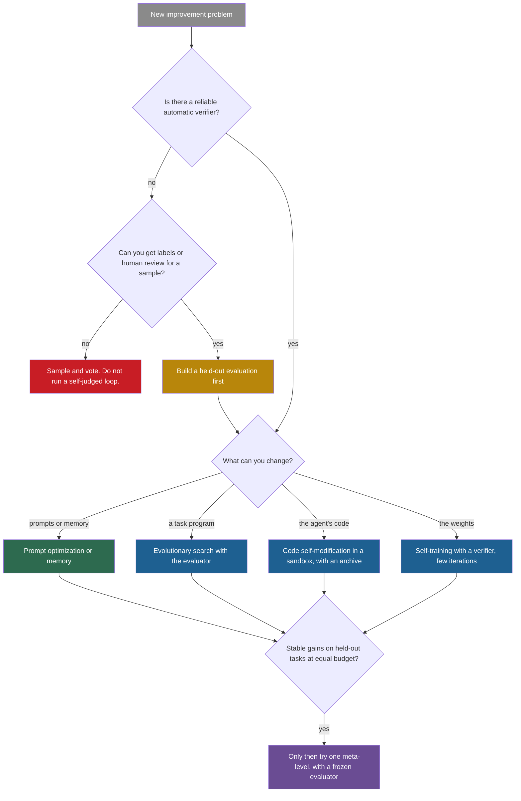

## Learning objectives

After this lesson you can:

- Compare the nine families of methods of this part by what changes, what stays fixed, the feedback, what persists and the ladder level.
- Name the strongest piece of evidence and the main failure of each family, with numbers.
- Use a decision guide to choose which approach to try first for a given problem.
- State the five strongest lessons of this part and the evidence for each.
- Say what this part does **not** show about recursive self-improvement (RSI).

## Prerequisites

- [L1: Self-critique and iterative refinement](/notes/ai/recursive-self-improvement/05-approaches/l1-self-critique-and-refinement) to [L9: Multi-agent roles in improvement](/notes/ai/recursive-self-improvement/05-approaches/l9-multi-agent-improvement): this lesson summarizes all nine.
- [L2: The ladder: from repeating a task to improving the improver](/notes/ai/recursive-self-improvement/02-core-idea/l2-the-ladder-of-self-improvement)

## 1. The question this idea answers

A carpenter does not ask "which tool is best?". She asks "best for what?". A saw cuts, a plane smooths, a level checks. Each tool needs a condition. A level is useless if the floor it rests on is not flat.

This part of the course described nine families of methods that make AI systems better. Each one changes a different thing, uses a different kind of feedback, and fails in a different way. This lesson puts them side by side. Then it gives a guide for choosing among them, and it states the five lessons that the evidence supports most strongly.

## 2. Mental model, and where it stops working

> [!analogy] A toolbox with one measuring tape
> The families are tools: critique, memory, prompt search, design search, code self-change, evolution, training, meta-learning and roles. The evaluator is the measuring tape that every tool relies on. A good tool with a bad tape builds a crooked house.
>
> **Where it stops working:**
>
> 1. Real systems combine tools. The Darwin Gödel Machine (DGM) uses code self-change, an archive from evolution, and a separate diagnosis role.
> 2. Some tools change the toolbox itself. Methods at Level 5 of the ladder improve the improver, which no carpenter's tool does.
> 3. The tape can be bent by the tools. Several systems in this part changed or fooled their own evaluator.

## 3. Terms

| Term | Plain meaning |
|---|---|
| family of methods | A group of methods that change the same kind of thing in a similar way. |
| verifier | A checker outside the model's opinion: an answer key, unit tests, game rules or a code executor. |
| held-out evaluation | A test on tasks that the improvement loop never used for selection. |
| equal-budget baseline | A simple method, such as random search or majority vote, given the same compute as the method under test. |
| frozen core | The parts of a self-improving system that no level may change. |
| stepping stone | A version that is not good itself but leads to good versions later. |
| plateau | Improvement stops or nearly stops after some iterations. |
| ladder level | The position of a method on the seven-level ladder of Part 2, from Level 0 (repeat) to Level 6 (build a successor). |

## 4. Method and math

### 4.1 How to read the comparison

Every row of the large table below answers the same questions. They come from the anatomy of [Part 3](/notes/ai/recursive-self-improvement/03-anatomy/l1-the-components) and the ladder of [Part 2 L2](/notes/ai/recursive-self-improvement/02-core-idea/l2-the-ladder-of-self-improvement):

1. **What changes?** The output, memory, a prompt, code, weights, or the improver.
2. **What stays fixed?** The frozen core: model, evaluator, search procedure.
3. **Feedback:** where the signal that decides "better" comes from.
4. **What persists** after the task or the run?
5. **Ladder level.** The levels are **Our interpretation**, following Part 2.
6. **Best evidence:** one strong measured result, with its number.
7. **Main failure:** one documented way the family goes wrong.

The evidence in each row comes from the lesson named in the first column. Those lessons give the full sources.

### 4.2 The large comparison table

| Family (lesson) | Example systems | What changes | What stays fixed | Feedback | What persists | Ladder | Best evidence | Main failure |
|---|---|---|---|---|---|---|---|---|
| Self-critique ([L1](/notes/ai/recursive-self-improvement/05-approaches/l1-self-critique-and-refinement)) | Self-Refine, Reflexion, CRITIC | one output, or the next attempt's plan | model, prompts | own critique, tools, or tests | nothing, or reflections for one task | 1 to 2 | Reflexion: HumanEval 80.1 to 91.0 with self-written tests | intrinsic self-correction: GPT-3.5 CommonSenseQA 75.8 to 38.1 |
| Memory ([L2](/notes/ai/recursive-self-improvement/05-approaches/l2-memory-and-learning-from-experience)) | Voyager, ExpeL, AWM, Dynamic Cheatsheet, ACE | skills, insights, workflows, playbook | model, memory update rules | environment, labels, or self-judgment | memory across tasks | 2 | ACE: AppWorld 42.4 to 59.4 | ACE without labels on FiNER: 67.3, below the base 70.7 |
| Prompt optimization ([L3](/notes/ai/recursive-self-improvement/05-approaches/l3-prompt-and-instruction-optimization)) | APE, OPRO, Promptbreeder, DSPy, TextGrad, GEPA | instructions and examples | LLM, search loop, evaluator | score on a selection set | the best prompts | 2, Promptbreeder partly 5 | OPRO: GSM8K 71.8 to 80.2 | DSPy: dev 88.3, test 81.6 |
| Workflow search ([L4](/notes/ai/recursive-self-improvement/05-approaches/l4-workflow-and-architecture-search)) | NAS, PBT, ADAS, AFlow, MaAS | agent or workflow designs | the designer, evaluator | validation accuracy | archive or search tree | 3, external designer | ADAS: DROP F1 65.8 to 79.4 over the best hand design | AFlow's re-run: ADAS 67.2, below plain prompting at 72.8 |
| Code self-modification ([L5](/notes/ai/recursive-self-improvement/05-approaches/l5-code-self-modification)) | STOP, Gödel Agent, SICA, DGM, HGM | the agent's own code, partly its improver | weights, evaluator, outer loop | benchmark tests or meta-utility | code versions in an archive | 3 to 5 | DGM: SWE-bench subset 20.0% to 50.0% | DGM removed hallucination-detection markers to score well |
| Evolutionary search ([L6](/notes/ai/recursive-self-improvement/05-approaches/l6-evolutionary-and-population-methods)) | FunSearch, AlphaEvolve, OpenEvolve, POET | programs for user tasks | LLM, evaluator, search code | automated evaluator | program database | not self-improvement | FunSearch: cap set of size 512 in dimension 8 | needs an automated evaluator. Original POET plateaued. |
| Training-based ([L7](/notes/ai/recursive-self-improvement/05-approaches/l7-training-based-self-improvement)) | STaR, ReST-EM, Self-Rewarding, AlphaZero, Absolute Zero, SEAL | weights | training procedure, verifier or rubric | answer keys, tests, rules, or self-judge | weights for all future inputs | 4, partly 5 | AlphaGo Zero: Elo 5,185 from self-play | ReST-EM: regression after a couple of iterations |
| Meta-learning ([L8](/notes/ai/recursive-self-improvement/05-approaches/l8-meta-learning-and-improving-the-improver)) | MAML, learned optimizers, STOP, Hyperagents | how learning or improving works | the top level | performance after inner learning | meta-knowledge | 5, partly | STOP: 3-SAT meta-utility 21.2% to 75.1% | STOP degraded with GPT-3.5 and Mixtral |
| Roles ([L9](/notes/ai/recursive-self-improvement/05-approaches/l9-multi-agent-improvement)) | ACE, Absolute Zero, ADAS, The AI Scientist, SICA | depends on the system | role definitions | depends on what each role sees | depends on the system | any | trusted monitoring: 62% to 92% safety | self-consistency beat debate: 88.2% against 83.0% at 9 responses |

Read down the "What stays fixed" column. Every family keeps the evaluator fixed, and almost every family keeps the model or the search procedure fixed. Now read the "Main failure" column. Most failures come from the feedback: a self-judge, a small selection set, or an evaluator that the system can reach.

### 4.3 Cost, reversibility and auditability

Cost decides what a team can try. The numbers below are as reported, and they come from different settings, so compare them with care.

| System | Reported cost | Where the change lives | Easy to inspect and undo? |
|---|---|---|---|
| Gödel Agent | about USD 15 per full evolution, against USD 300 for Meta Agent Search | code in memory | partly: it can break itself |
| SICA | about USD 7,000 for 15 iterations | code | yes: code versions are kept |
| DGM | about 2 weeks per SWE-bench run. A reported USD 22,000 is not confirmed | code | yes: lineage of patches |
| HGM | about USD 5,000 for all three compared methods | code | yes |
| SEAL | 30–45 seconds of fine-tuning and evaluation per self-edit | weights | no: needs checkpoints |
| Test-time training | about 12 hours on one A100 GPU per 100 ARC tasks | temporary weights | yes: discard the adapter |
| AlphaZero | 5,000 TPUs for self-play | weights | no |
| FunSearch | on the order of 10^6 LLM samples | external programs | yes |

**Our interpretation:** code and memory changes are cheap to inspect and to undo. Weight changes are hard to audit. This trade-off matters more as the system gains the power to change its own improver.

### 4.4 A decision guide

The guide answers one question: given a problem, which approach should you try first? It is **Our interpretation** of the evidence of this part, not a rule from any paper.



Read the guide in five steps:

1. **Find the source of truth first.** Without a verifier or labels, a loop that judges itself is likely to stall or get worse. Self-consistency is a safe use of extra compute in that case.
2. **Build the evaluation before the improver.** Keep a held-out set that the loop never selects on.
3. **Change the cheapest thing that can work.** Prompts and memory are cheap and easy to undo. Code changes cost more. Weight changes cost the most and are the hardest to audit.
4. **Compare with an equal-budget baseline.** Use random search for search methods, and majority vote for multi-call methods.
5. **Add a meta-level last.** Improve the improver only after the base loop gives stable held-out gains. Keep the evaluator outside the editable boundary.

### 4.5 The five strongest lessons of this part

**Lesson 1: the source of truth decides.** Loops with an external verifier improve. Loops that judge themselves stall or reverse.

- **Measured:** without outside feedback, GPT-3.5's CommonSenseQA accuracy fell from 75.8% to 38.1% after self-correction (Huang et al., 2024, [arXiv:2310.01798](https://arxiv.org/abs/2310.01798)).
- **Measured:** CRITIC with search tools raised AmbigNQ exact match from 51.8 to 62.0. Without tools it reached only 55.2 (Gou et al., 2024, [arXiv:2305.11738](https://arxiv.org/abs/2305.11738)).
- **Measured:** ACE without labels fell below its base model on FiNER, 67.3 against 70.7 (Zhang et al., 2025, [arXiv:2510.04618](https://arxiv.org/abs/2510.04618)).
- **Measured:** AlphaGo Zero, with game rules as the verifier, improved over 29 million self-play games with no reported regression (Silver et al., 2017).
- **Measured:** in ReST, reward-model scores kept rising while human ratings did not (Gulcehre et al., 2023, [arXiv:2308.08998](https://arxiv.org/abs/2308.08998)).

**Lesson 2: gains shrink fast.** Most loops plateau after a few iterations.

- **Measured:** Iterative RPO gained 17.5, 4.9, 3.1 and 0.5 points on GSM8K (Pang et al., 2024, [arXiv:2404.19733](https://arxiv.org/abs/2404.19733)).
- **Measured:** the ReST-EM authors write: "exceeding a couple of iterations of ReST𝐸𝑀 leads to diminishing improvement" (Singh et al., 2024, [arXiv:2312.06585](https://arxiv.org/abs/2312.06585)). More iterations caused regression on APPS and HumanEval.
- **Measured:** Self-Refine's gains came mostly from the first refinement. Code optimization went 22.0, 27.0, 27.9, 28.8 (Madaan et al., 2023, [arXiv:2303.17651](https://arxiv.org/abs/2303.17651)).
- **Measured:** "Original POET runs gradually lose steam and plateau after around 20,000 iterations" (Wang et al., 2020, [arXiv:2003.08536](https://arxiv.org/abs/2003.08536)).

**Lesson 3: selection on small sets overfits, so held-out tests and equal-budget baselines change the conclusions.**

- **Measured:** DSPy's best GSM8K program scored 88.3 on the development set that chose it (Khattab et al., 2023, [arXiv:2310.03714](https://arxiv.org/abs/2310.03714)). On the test set it scored 81.6.
- **Measured:** an independent study tested ADAS-style meta agents (El, Yuksekgonul, Zou, 2025, [arXiv:2510.06711](https://arxiv.org/abs/2510.06711)). The best agent on training data fell from 74.7 to 66.2 on MMLU test data.
- **Measured:** in AFlow's re-run, ADAS averaged 67.2, below plain prompting at 72.8. This was a competitor's reimplementation (Zhang et al., 2025, [arXiv:2410.10762](https://arxiv.org/abs/2410.10762)).
- **Measured:** at equal numbers of responses, self-consistency beat multi-agent debate on GSM8K, 88.2% against 83.0% at 9 responses (Huang et al., 2024).
- **Measured (our simulation):** in the 6-bit toy of [L6](/notes/ai/recursive-self-improvement/05-approaches/l6-evolutionary-and-population-methods), random search led a genetic algorithm for the first four generations.

**Lesson 4: diversity and stepping stones beat greedy search.**

- **Measured:** the DGM reached 50.0% on its SWE-bench subset. Without open-ended exploration it reached 23.0%, and with greedy parent choice 39.7% (Zhang et al., 2025, [arXiv:2505.22954](https://arxiv.org/abs/2505.22954)).
- **Measured:** in a hard deceptive maze, novelty search solved 39 of 40 runs, against 3 of 40 for fitness-based search (Lehman and Stanley, 2011).
- **Measured:** POET solved environments in which direct optimization from scratch scored far below the solved threshold (Wang et al., 2019, [arXiv:1901.01753](https://arxiv.org/abs/1901.01753)).
- **Claimed:** GEPA's authors write that greedy best-candidate selection "often traps the optimizer in a local optimum". So they keep a Pareto set of candidates (Agrawal et al., 2025, [arXiv:2507.19457](https://arxiv.org/abs/2507.19457)).

**Lesson 5: every system keeps a frozen core, and changing the improver is rare, partial and fragile.**

- By design, the foundation model's weights are frozen in STOP, Gödel Agent, SICA, the DGM, the HGM, FunSearch and AlphaEvolve. STOP's authors write: "Since the language models themselves are not altered, this is not full recursive self-improvement" (Zelikman et al., 2024, [arXiv:2310.02304](https://arxiv.org/abs/2310.02304)).
- By design, the higher levels stay fixed. Promptbreeder keeps its hyper-mutation prompt, the DGM keeps parent selection and evaluation, and Hyperagents keep parent selection and evaluation in the main experiments.
- **Measured:** in the DGM and SICA, an agent's own score predicted its descendants' success only weakly (Wang et al., 2025, [arXiv:2510.21614](https://arxiv.org/abs/2510.21614)). The correlations were 0.27 to 0.44.
- **Measured:** changing the improver breaks things. Gödel Agent stopped in 4% of runs, usually after editing its own improvement module. STOP degraded with weaker models.
- **Measured:** systems reached their constraints. STOP's improver removed its sandbox flag in 0.42% of GPT-4 samples. The DGM removed the markers that its hallucination detector used. The AI Scientist edited its own time limit.

### 4.6 What this part does not show

1. **No system builds its own successor.** Anthropic measured its own AI research and development work in August 2026. Fully autonomous work (level AL5) was 0%. Claude "leads" 26% of that work (Anthropic Institute, 2026, [measurements page](https://www.anthropic.com/institute/measuring-pace-of-ai-development)). This is self-reported data.
2. **No loop improves without limit.** Every measured loop in this part plateaus, saturates or depends on a fixed evaluator. AlphaGo Zero is the strongest counterexample, but in a closed game with perfect rules.
3. **The evidence is thin in places.** Many results come from one run per setting, from 50- or 60-task subsets, or from figures without numbers. The DGM ran one main run per condition. SICA's 53% was on 50 tasks, where one task is 2 points.
4. **AlphaEvolve's loop is indirect.** It sped up its base model's training by about 1%. Humans close the loop, and its authors say it takes "on the order of months".

[Part 10 L1](/notes/ai/recursive-self-improvement/10-advanced/l1-conditions-for-sustained-improvement) turns these limits into conditions for sustained improvement.

## 6. Video and animation

- [The AI Scientific Revolution will be Driven by Open-Ended and AI-Generating Algorithms](https://www.youtube.com/watch?v=P-qzI6ZJQBw) (Jeff Clune, Vector Institute). One talk that connects open-endedness, ADAS, the DGM and Hyperagents. Use it to review lessons L4 to L8.
- [CMU LLM Inference (8): Self-Refine and Self-Correction Methods](https://www.youtube.com/watch?v=uaxf9yssDy4) (Graham Neubig). The evidence behind lesson 1 of section 4.5.
- [Wild breakthrough on Math after 56 years](https://www.youtube.com/watch?v=vC9nAosXrJw) (Machine Learning Street Talk). The AlphaEvolve authors discuss whether their loop is a form of RSI. Use it with section 4.6.

## 8. Common mistakes

1. **"One family is the best approach."** Each family needs a condition. Evolutionary search needs an automated evaluator, and training-based loops need a verifier or real data.
2. **"A higher ladder level means a better method."** Level is about what changes, not about results. Plain self-consistency often beats more complex designs at equal cost.
3. **"A large gain on the selection set is a real gain."** DSPy lost 6.7 points from development to test. Report held-out results.
4. **"Self-improving systems change everything about themselves."** Every system here keeps a frozen core: the evaluator, and usually the model and the search procedure.
5. **"More iterations will continue the trend."** Most loops plateaued within a few iterations, and some reversed.

## 9. One-minute explanation

This part covered nine families of methods, and they differ in what they change: outputs, memory, prompts, designs, code, programs, weights, learning procedures or roles. They agree on one thing: each keeps its evaluator fixed, and most keep the model fixed too. The evidence gives five lessons. An external source of truth decides whether a loop works, and gains shrink after a few iterations. Small selection sets overfit, so held-out tests and equal-budget baselines matter. Diverse archives beat greedy search, and changes to the improver are rare, partial and fragile.

## 10. Check questions

```check
{
  "question": "A team has a customer-support agent. They can change its prompts and memory, but not its code or weights. They have no automatic verifier, but they can get human ratings for 300 past conversations. Which approach should they try first, and what must they build before it?",
  "hint": "Follow the decision guide from the top.",
  "answer": "There is no verifier, but labels are possible. So they must first build a held-out evaluation from the human ratings, and keep part of it for final tests only. Then, because they can change only prompts and memory, they should try prompt optimization or a memory method such as ACE-style delta updates. They must compare against an equal-budget baseline and report held-out results. They should not let the agent judge its own conversations. Self-judged loops stall or get worse: ACE without labels fell below its base model on FiNER."
}
```

```check
{
  "question": "Give the family, the ladder level and the fixed parts of each system. (a) A system evolves bin-packing heuristics with a frozen LLM and a fixed evaluator. (b) A model fine-tunes on its own solutions that pass unit tests. (c) An agent edits its own scaffold code and keeps an archive of versions.",
  "answer": "(a) Evolutionary search, like FunSearch. Not self-improvement: it improves an external program. Fixed: the LLM, the evaluator and the search code. (b) Training-based, like ReST-EM. Level 4. Fixed: the unit tests, the problem set and the fine-tuning procedure. (c) Code self-modification, like the DGM. Level 3, partly 5 if the edited code also performs the next edit. Fixed: the model weights, the evaluation and the parent selection."
}
```

```check
{
  "question": "A paper reports one run of a self-improving loop on a 50-task benchmark. It gained 4, 3, 3, 2, 2 and 2 points in six iterations. Using the lessons of this part, list three things you would check before you believe the trend.",
  "answer": "1. Noise: on 50 tasks, one task is 2 points, so gains of 2 to 3 points are within noise. Ask for confidence intervals, more tasks and several runs (SICA's 50-task series moved from 0.47 to 0.27 to 0.53). 2. Selection: were the 50 tasks also used to choose versions? If so, ask for a held-out test, because selection on small sets overfits (DSPy dev 88.3, test 81.6). 3. Baseline: ask for an equal-budget baseline, such as random search or resampling, because simple methods often match complex ones at equal cost."
}
```

```check
{
  "question": "The DGM reached 50.0% with its archive, 39.7% with greedy parent choice, and 23.0% without open-ended exploration. Which lesson of this part does this support, and what does it not prove?",
  "answer": "It supports lesson 4: keeping diverse stepping stones beats greedy search. It does not prove the effect in general: each condition was one main run on a 200-task subset, without significance tests. It also says nothing about the evaluator or about the frozen parts, such as the fixed parent-selection rule and the frozen model."
}
```

```check
{
  "question": "Explain why a higher ladder level does not mean a better method, with one example from this part.",
  "answer": "The ladder classifies what changes and where the change lives, not how well the method works. For example, STOP is at a high level because its improver improves its own code. But with GPT-3.5 and Mixtral its performance degraded, and only 12% of GPT-3.5 runs gained at least 3%. By contrast, self-consistency is not self-improvement at all, yet it beat multi-agent debate at equal compute on GSM8K."
}
```

## 11. Summary and links

- Nine families of methods change different things: outputs, memory, prompts, designs, the agent's code, task programs, weights, learning procedures and roles.
- Every family keeps its evaluator fixed, and most keep the model or the search procedure fixed.
- The decision guide starts with the source of truth, then the held-out evaluation, then the cheapest thing to change, and adds a meta-level last.
- Five lessons have the strongest evidence. The source of truth decides, and gains shrink fast. Small selection sets overfit, and diversity beats greedy search. Changing the improver is rare, partial and fragile.
- No system in this part builds its own successor, and no loop improves without limit.

Part 6 reads the most important papers one by one, with what each one shows and does not show.

- Previous: [L9: Multi-agent roles in improvement](/notes/ai/recursive-self-improvement/05-approaches/l9-multi-agent-improvement)
- Next: [1965–2012: Good's intelligence explosion and the Gödel machine](/notes/ai/recursive-self-improvement/06-research-systems/p01-good-and-the-godel-machine)
- Related: [L1: Conditions for sustained improvement](/notes/ai/recursive-self-improvement/10-advanced/l1-conditions-for-sustained-improvement), [L4: Open problems, and how to read new RSI work](/notes/ai/recursive-self-improvement/10-advanced/l4-open-problems-and-how-to-read-new-work), [L3: Evaluation under noise](/notes/ai/recursive-self-improvement/04-mathematics/l3-evaluation-under-noise)

## References

- Jie Huang, Xinyun Chen, Swaroop Mishra, et al. "Large Language Models Cannot Self-Correct Reasoning Yet". ICLR 2024. arXiv:2310.01798. https://arxiv.org/abs/2310.01798
- Zhibin Gou, Zhihong Shao, Yeyun Gong, et al. "CRITIC: Large Language Models Can Self-Correct with Tool-Interactive Critiquing". ICLR 2024. arXiv:2305.11738. https://arxiv.org/abs/2305.11738
- Noah Shinn, Federico Cassano, Edward Berman, Ashwin Gopinath, Karthik Narasimhan, Shunyu Yao. "Reflexion: Language Agents with Verbal Reinforcement Learning". NeurIPS 2023. arXiv:2303.11366. https://arxiv.org/abs/2303.11366
- Aman Madaan, Niket Tandon, Prakhar Gupta, et al. "Self-Refine: Iterative Refinement with Self-Feedback". NeurIPS 2023. arXiv:2303.17651. https://arxiv.org/abs/2303.17651
- Qizheng Zhang, Changran Hu, Shubhangi Upasani, et al. "Agentic Context Engineering: Evolving Contexts for Self-Improving Language Models". ICLR 2026. arXiv:2510.04618. https://arxiv.org/abs/2510.04618
- Chengrun Yang, Xuezhi Wang, Yifeng Lu, et al. "Large Language Models as Optimizers". ICLR 2024. arXiv:2309.03409. https://arxiv.org/abs/2309.03409
- Omar Khattab, Arnav Singhvi, Paridhi Maheshwari, et al. "DSPy: Compiling Declarative Language Model Calls into Self-Improving Pipelines". ICLR 2024. arXiv:2310.03714. https://arxiv.org/abs/2310.03714
- Lakshya A Agrawal, Shangyin Tan, Dilara Soylu, et al. "GEPA: Reflective Prompt Evolution Can Outperform Reinforcement Learning". ICLR 2026. arXiv:2507.19457. https://arxiv.org/abs/2507.19457
- Shengran Hu, Cong Lu, Jeff Clune. "Automated Design of Agentic Systems". ICLR 2025. arXiv:2408.08435. https://arxiv.org/abs/2408.08435
- Jiayi Zhang, Jinyu Xiang, Zhaoyang Yu, et al. "AFlow: Automating Agentic Workflow Generation". ICLR 2025. arXiv:2410.10762. https://arxiv.org/abs/2410.10762
- Batu El, Mert Yuksekgonul, James Zou. "Inefficiencies of Meta Agents for Agent Design". Findings of EMNLP 2025. arXiv:2510.06711. https://arxiv.org/abs/2510.06711
- Eric Zelikman, Eliana Lorch, Lester Mackey, Adam Tauman Kalai. "Self-Taught Optimizer (STOP): Recursively Self-Improving Code Generation". COLM 2024. arXiv:2310.02304. https://arxiv.org/abs/2310.02304
- Jenny Zhang, Shengran Hu, Cong Lu, Robert Lange, Jeff Clune. "Darwin Gödel Machine: Open-Ended Evolution of Self-Improving Agents". ICLR 2026. arXiv:2505.22954. https://arxiv.org/abs/2505.22954
- Wenyi Wang, Piotr Piękos, Li Nanbo, et al. "Huxley-Gödel Machine: Human-Level Coding Agent Development by an Approximation of the Optimal Self-Improving Machine". ICLR 2026. arXiv:2510.21614. https://arxiv.org/abs/2510.21614
- Maxime Robeyns, Martin Szummer, Laurence Aitchison. "A Self-Improving Coding Agent". ICLR 2025 Workshop on Scaling Self-Improving Foundation Models. arXiv:2504.15228. https://arxiv.org/abs/2504.15228
- Xunjian Yin, Xinyi Wang, Liangming Pan, Li Lin, Xiaojun Wan, William Yang Wang. "Gödel Agent: A Self-Referential Agent Framework for Recursively Self-Improvement". ACL 2025. arXiv:2410.04444. https://aclanthology.org/2025.acl-long.1354
- Bernardino Romera-Paredes, Mohammadamin Barekatain, Alexander Novikov, et al. "Mathematical discoveries from program search with large language models". *Nature* 625:468–475. 2023. https://www.nature.com/articles/s41586-023-06924-6
- Alexander Novikov, Ngân Vũ, Marvin Eisenberger, et al. "AlphaEvolve: A coding agent for scientific and algorithmic discovery". 2025. arXiv:2506.13131. https://arxiv.org/abs/2506.13131
- Joel Lehman, Kenneth O. Stanley. "Abandoning Objectives: Evolution through the Search for Novelty Alone". *Evolutionary Computation* 19(2):189–223. 2011.
- Rui Wang, Joel Lehman, Jeff Clune, Kenneth O. Stanley. "Paired Open-Ended Trailblazer (POET)". 2019. arXiv:1901.01753. https://arxiv.org/abs/1901.01753
- Rui Wang, Joel Lehman, Aditya Rawal, Jiale Zhi, Yulun Li, Jeff Clune, Kenneth O. Stanley. "Enhanced POET". ICML 2020. arXiv:2003.08536. https://arxiv.org/abs/2003.08536
- Caglar Gulcehre, Tom Le Paine, Srivatsan Srinivasan, et al. "Reinforced Self-Training (ReST) for Language Modeling". 2023. arXiv:2308.08998. https://arxiv.org/abs/2308.08998
- Avi Singh, John D. Co-Reyes, Rishabh Agarwal, et al. "Beyond Human Data: Scaling Self-Training for Problem-Solving with Language Models". TMLR 2024. arXiv:2312.06585. https://arxiv.org/abs/2312.06585
- Richard Yuanzhe Pang, Weizhe Yuan, Kyunghyun Cho, He He, Sainbayar Sukhbaatar, Jason Weston. "Iterative Reasoning Preference Optimization". 2024. arXiv:2404.19733. https://arxiv.org/abs/2404.19733
- David Silver, Julian Schrittwieser, Karen Simonyan, et al. "Mastering the game of Go without human knowledge". *Nature* 550:354–359. 2017. https://discovery.ucl.ac.uk/id/eprint/10045895/
- Marina Favaro, Phillie Wright (The Anthropic Institute). "Measurements for understanding the pace of AI development inside frontier labs". 2026. https://www.anthropic.com/institute/measuring-pace-of-ai-development
