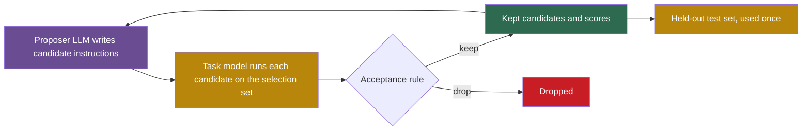

## Learning objectives

After this lesson you can:

- Describe each method by its search space, proposer, evaluator, selection set and acceptance rule.
- Trace one iteration of OPRO and one tournament of Promptbreeder with concrete values.
- Compute GEPA's Pareto-based selection probabilities for a small score table.
- Detect selection on test data and dev-to-test drops in a reported result.
- Explain why Promptbreeder is partly self-referential, where its self-reference stops, and where each method sits on the ladder.

## Prerequisites

- [L4: Optimization and search](/notes/ai/recursive-self-improvement/01-foundations/l4-optimization-and-search)
- [L6: How machine learning systems are trained and evaluated](/notes/ai/recursive-self-improvement/01-foundations/l6-how-ml-systems-are-trained-and-evaluated)
- [L3: Evaluation under noise](/notes/ai/recursive-self-improvement/04-mathematics/l3-evaluation-under-noise)
- [L2: Memory and learning from experience](/notes/ai/recursive-self-improvement/05-approaches/l2-memory-and-learning-from-experience)

## 1. The question this idea answers

A teacher writes the instructions for a homework sheet. She tries ten versions on last year's class and keeps the version with the best results. That is a search over instructions, scored on a group of students.

Now suppose that she also changes **how** she rewrites instructions. She tries "make it shorter" and "add an example", and she keeps the rewriting habits that produced better versions. She now improves her own improvement method.

A large language model (LLM) depends strongly on the instruction in its prompt. So people built programs that search for better instructions. This lesson asks: **how do these programs search, what do they really measure, and does any of them improve its own way of searching?**

## 2. Mental model, and where it stops working

> [!analogy] A recipe card and a taster
> A cook rewrites a recipe card many times. A taster scores each dish, and the cook keeps the card with the best score.
>
> **Where it stops working:** the taster tastes the same few dishes again and again. After many tries, the card fits this taster's habits, not all eaters. Also, the cook never changes how she rewrites cards, except in Promptbreeder.

## 3. Terms

| Term | Plain meaning |
|---|---|
| prompt | The text that a language model reads before it produces output. |
| instruction | The part of a prompt that tells the model what to do. |
| task model | The model that runs the prompt on the task. Its score is the objective. |
| proposer model | The model that writes new candidate instructions. |
| search space | The set of all things that a method is allowed to try. |
| selection set | The examples used to choose between candidates. It can be part of the training set or a validation set. |
| meta-prompt | A prompt that asks a model to write a better prompt. |
| few-shot demonstration | A solved example placed in the prompt. |
| task-prompt | In Promptbreeder, the instruction put before each question. |
| mutation-prompt | In Promptbreeder, the instruction that tells the LLM how to change a task-prompt. |
| hyper-mutation prompt | In Promptbreeder, the fixed instruction that changes mutation-prompts. |
| population | In evolutionary methods, the current set of candidates. |
| binary tournament | Pick two candidates at random, and let the better one reproduce. |
| bootstrapping (DSPy) | Running the program on training inputs and keeping the traces of successful runs as demonstrations. |
| textual gradient | Feedback in plain language that says how a piece of text should change to improve the objective. |
| rollout | One full run of the system on one input. |
| Pareto front | The candidates that no other candidate beats on every example. |
| generalization gap | The difference between the score on the selection set and the score on a held-out test set. |

## 4. Method and math

### 4.1 Prompt optimization as search

Every method in this lesson is a black-box search ([L4: Optimization and search](/notes/ai/recursive-self-improvement/01-foundations/l4-optimization-and-search)). It has five parts:

1. A **search space**: instructions, demonstrations, or both.
2. A **proposer**: usually an LLM that writes candidates.
3. An **evaluator**: the score of the task model with the candidate, on a set of examples.
4. A **selection set**: the examples used for that score.
5. An **acceptance rule**: which candidates survive.



One fact holds for every method in this lesson. The evaluation function is fixed and written by people, and the method never updates the weights of the proposer LLM. This comes from a reading of all the methods below. Keep it in mind when a paper calls a method "self-improving".

### 4.2 APE: propose many, keep the best

APE, the Automatic Prompt Engineer, treats the instruction as a program and searches for it (Zhou et al., 2022, [arXiv:2211.01910](https://arxiv.org/abs/2211.01910)). The algorithm has three steps:

1. An LLM reads a few input-output demonstrations and proposes candidate instructions. The default is 50 candidates.
2. The task model runs each candidate on a random subset of the demonstrations. The score is the share of correct outputs, or the log probability of the right answers.
3. Keep the best candidates. Optionally, ask an LLM for variants of them and repeat.

The authors found that "iterative generation provides marginal improvement". So the default APE is one pass of propose and select.

**Measured:** APE found a new zero-shot reasoning prompt. It reads: "Let's work this out in a step by step way to be sure we have the right answer." With InstructGPT, it raised GSM8K accuracy from 40.7 to 43.0 compared with "Let's think step by step." GSM8K is a set of grade-school math word problems.

The headline changed across versions. The arXiv abstract says APE matched or beat human instructions on "19/24 tasks". The conference abstract says "21/24", and the v2 body says 24 of 24. Teach the v2 numbers and say that the claim changed.

**Measured:** instructions found with InstructGPT performed worse on GPT-3. So an instruction can fit one task model and fail on another.

### 4.3 OPRO: the scored list in the prompt

OPRO puts the record of earlier attempts into the prompt (Yang et al., 2023, [arXiv:2309.03409](https://arxiv.org/abs/2309.03409)). The meta-prompt holds three things:

1. A description of the problem and a request. One example reads: "Generate an instruction that is different from all the instructions <INS> above, and has a higher score than all the instructions <INS> above."
2. The best 20 instructions so far with their scores, sorted from worst to best.
3. About 3 training examples that show where the instruction goes.

> [!example] One OPRO iteration (illustration with made-up scores)
> 1. The meta-prompt lists three scored instructions: "Solve it." 0.58, "Show your work." 0.66, "Think step by step." 0.71.
> 2. The proposer LLM samples 8 new instructions at temperature 1.0.
> 3. The task model runs each one at temperature 0 on the training subset, and the scores are recorded.
> 4. All 8 join the list, and the next meta-prompt shows the best 20.
> 5. The default run has 200 steps, so it scores 8 × 200 = 1,600 instructions. Only the best is finally run on the test set.

On GSM8K, OPRO optimized on 3.5% of the 7,473 training problems, about 261 problems. It reported test accuracy on the 1,319 test problems.

**Measured:** with PaLM 2-L as the task model, OPRO found "Take a deep breath and work on this problem step-by-step." It scored 80.2% on the test set. "Let's think step by step." scored 71.8%, and an empty instruction scored 34.0%. The instruction also transferred to other math sets: 95.3% against 85.7% on MultiArith.

**Measured:** OPRO is not a general solver. On a 50-city traveling salesman problem, gpt-4 left an 11.0% gap to the optimum, and a simple heuristic left 9.8%.

**Measured:** OPRO overfits its selection set. BIG-Bench Hard (BBH) is a set of hard reasoning tasks. On two BBH tasks, "training accuracies are often 5%-20% higher than our test accuracies". The authors add that validation curves move with training curves, so selection still helps (a **Claimed** reading). The paper also reports "optimization instability and large variance".

Later work found limits. Zhang et al. (2024) wrote that OPRO "shows limited effectiveness in small-scale LLMs". Ma et al. (2024) wrote that LLM optimizers "struggle to identify the true causes of errors during reflection".

### 4.4 Promptbreeder: evolving the instructions that change instructions

Promptbreeder asks a further question: can the way of changing prompts also improve (Fernando et al., 2023, [arXiv:2309.16797](https://arxiv.org/abs/2309.16797))? It evolves two kinds of text:

1. **Task-prompts**, the instructions put before each question.
2. **Mutation-prompts**, the instructions that tell the LLM how to change a task-prompt.

The paper calls this "a general-purpose self-referential self-improvement mechanism". Mutation-prompts are changed by an LLM "conditioned on a hyper-mutation prompt". The hyper-mutation prompt itself is fixed.

The setup starts from 39 "thinking styles" and 56 initial mutation-prompts. A unit is usually 2 task-prompts and 1 mutation-prompt. The population has 50 units. Fitness is accuracy on a random batch of 100 training questions. The loop is a binary tournament:

1. Pick two units at random, and score both.
2. Copy the winner.
3. Apply one mutation operator to the copy.
4. Overwrite the loser with the copy.
5. Repeat, typically for 20 to 30 generations.

The operators fall into five classes:

1. Direct mutation writes a new task-prompt.
2. Estimation-of-distribution mutation shows the LLM a list of current prompts.
3. Hyper-mutation changes the mutation-prompt itself.
4. Lamarckian mutation writes an instruction from a correct worked answer.
5. Crossover and context shuffling mix units.

The paper says "nine operators" but names ten mechanisms, so teach the five classes, not an exact count.

> [!example] One tournament with hyper-mutation (illustration)
> 1. Unit A scores 0.62 on its batch of 100 questions. Unit B scores 0.55.
> 2. A wins and is copied. The sampled operator is first-order hyper-mutation.
> 3. The LLM receives "Please summarize and improve the following instruction:" plus A's mutation-prompt, "Make the instruction more specific." It writes a new mutation-prompt.
> 4. The new mutation-prompt then rewrites A's task-prompt. The child, with both new texts, replaces B.
> 5. Note the noise. At 0.6 on 100 questions, the standard error is about 0.05, so a 0.07 gap is only about 1.4 standard errors. Part of every tournament is luck.

**Measured** zero-shot results with PaLM 2-L (Table 1, values from an automated reading of the table): on GSM8K, Promptbreeder scored 83.9. OPRO scored 80.2, APE 77.9 and Plan-and-Solve-Plus 60.5. Many other rows in that table use a different, weaker model, text-davinci-003. Only the Plan-and-Solve, APE and OPRO rows are same-model comparisons.

**Claimed:** "Removing any self-referential operator is harmful under nearly all circumstances". The ablation numbers are in an appendix and are not verified here. The paper gives no link to code.

Where the self-reference stops:

1. The hyper-mutation prompt is fixed, so self-reference covers one level only.
2. The paper says "the topology of prompting remains fixed". Only prompt content changes, not the prompting algorithm.
3. Appendix F says it is "not self-referential (in a way that thought is)", because it does not invent new ways to evaluate candidates.

So Promptbreeder is the clearest small example of an improver that improves part of itself. It is also the clearest example of where such self-reference stops in practice. [Part 6](/notes/ai/recursive-self-improvement/06-research-systems/p04-promptbreeder) studies it in depth.

### 4.5 EvoPrompt: selection on a piece of the test set

EvoPrompt uses an LLM as the crossover and mutation operator inside classic evolutionary algorithms (Guo et al., 2023, [arXiv:2309.08532](https://arxiv.org/abs/2309.08532)). It has two versions:

1. **Genetic algorithm:** pick parents in proportion to their scores, let the LLM cross and mutate them, and keep the best N.
2. **Differential evolution:** the LLM finds the parts in which two prompts differ, changes those parts, and combines them with the current best prompt.

It ran with a population of 10 for 10 iterations. **Measured:** the abstract reports gains of "up to 25%" on BIG-Bench Hard. Section 4.4 gives an average gain of 3.5%.

The split needs attention. For BIG-Bench Hard, the paper says: "We sample a subset from the test set as the development set". It does not say that these examples were removed from the reported test numbers. **Our interpretation:** the method selected prompts on part of the test set, so the BIG-Bench Hard gains may be optimistic.

### 4.6 DSPy and MIPRO: programs that collect their own examples

DSPy changes the unit of work (Khattab et al., 2023, [arXiv:2310.03714](https://arxiv.org/abs/2310.03714)). People write the pipeline as a program of modules, such as `ChainOfThought`. Each module has a typed signature, such as `question -> answer`. An optimizer, which the paper calls a "teleprompter", fills in the instructions and demonstrations of every module.

Its basic optimizer, BootstrapFewShot, works like this:

```text
for each training input x:
    run the program on x (maybe at high temperature)
    if metric(x, output) passes:
        save the input and output of EVERY module as a demonstration
use the saved traces as few-shot demonstrations in each module
```

The program generates its **own** examples from its own successful runs. That is why the arXiv title says "self-improving". Other optimizers try several demonstration sets and pick the best on a validation set, or fine-tune the weights.

**Measured** GSM8K accuracy with GPT-3.5 (Table 1, values from an automated reading of the table):

| Program and optimizer | Dev set | Test set |
|---|---|---|
| Plain program, no demonstrations | 24.0 | 25.2 |
| Chain of thought, bootstrapped | 80.3 | 72.9 |
| Chain of thought, bootstrapped, ensemble of programs with a majority vote | 88.3 | 81.6 |
| Reflection, bootstrapped | 83.0 | 76.0 |

The paper reports most comparisons on the dev set "to avoid overfitting on test". But its own code passes the dev set to the optimizer as the validation set. So the dev scores are also selection scores, and they are optimistic. The dev-to-test drops of 5 to 9 points fit that picture.

MIPRO optimizes instructions and demonstrations together for multi-stage programs (Opsahl-Ong et al., 2024, [arXiv:2406.11695](https://arxiv.org/abs/2406.11695)). It proposes instructions with summaries of the data and the program. A Bayesian surrogate model then picks which combination to try next. **Measured:** it beat baselines on "five of seven" programs, "by as high as 13% accuracy". But a simple random search over bootstrapped demonstrations beat it on two tasks. The authors also note that proposers overfit instructions to the examples in the meta-prompt.

### 4.7 TextGrad: feedback written like a gradient

TextGrad copies the structure of backpropagation, but with text (Yuksekgonul et al., 2024, [arXiv:2406.07496](https://arxiv.org/abs/2406.07496)). The journal version appeared in Nature in 2025. The method has three steps:

1. **Forward pass:** run the system, a graph of LLM calls and tools, and compute a loss. The loss can be a score or a written evaluation.
2. **Backward pass:** an LLM writes a "textual gradient" for each variable, such as a prompt. It is plain-language feedback on how the variable should change.
3. **Update:** "Textual Gradient Descent" is an LLM call that rewrites the variable with that feedback.

In prompt optimization, a candidate prompt is accepted only if the validation score improves, and the test score is reported separately. That is good practice.

**Measured:** test-time optimization raised GPT-4o's zero-shot accuracy on GPQA, a set of hard science questions, from 51% to 55%. On GSM8K prompt optimization, TextGrad tied DSPy at 81.1. The abstract also claims "20% relative performance gain" on LeetCode-Hard. The table gives 0.31 for Reflexion and 0.36 for TextGrad, which is about 16% relative. Check the paper before you quote either number.

### 4.8 GEPA: reflective changes and a Pareto archive

GEPA combines two ideas (Agrawal et al., 2025, [arXiv:2507.19457](https://arxiv.org/abs/2507.19457)):

1. **Reflective mutation.** A reflection LLM reads the current prompt of one module, the execution traces, the scores and written feedback. Then it writes an improved prompt.
2. **Pareto-based selection.** GEPA keeps every candidate that is best on at least one validation example. The authors write that greedy best-candidate selection "often traps the optimizer in a local optimum".

The loop takes a candidate, changes one module's prompt from a minibatch of 3 training examples, and checks the child on that minibatch. If the child beats its parent there, the child joins the archive and is scored on the full validation set.

Worked example: four candidates are scored on four validation examples (1 = correct, 0 = wrong).

| Candidate | e1 | e2 | e3 | e4 | Average |
|---|---|---|---|---|---|
| A | 1 | 0 | 1 | 0 | 0.50 |
| B | 1 | 1 | 0 | 0 | 0.50 |
| C | 0 | 0 | 0 | 1 | 0.25 |
| D | 1 | 0 | 0 | 0 | 0.25 |

> [!example] Pareto-based selection on this table
> 1. Best on each example: e1 by A, B and D. e2 by B. e3 by A. e4 by C.
> 2. Every candidate is best somewhere. But D is dominated: A is at least as good everywhere and better on e3. So D is removed.
> 3. Count the examples on which each survivor is best: A 2, B 2, C 1. The total is 5.
> 4. Sampling probabilities: A 2/5 = 0.4, B 0.4, C 0.2.
> 5. A greedy rule would never pick C, because its average is low. But only C solves e4, so its prompt may hold a useful idea.

**Measured** with Qwen3 8B on held-out test sets (v2, Table 1, values from an automated reading of the table):

| Benchmark | Baseline | GRPO | MIPROv2 | GEPA | GEPA+Merge |
|---|---|---|---|---|---|
| HotpotQA | 42.33 | 43.33 | 55.33 | 62.33 | 64.33 |
| IFBench | 36.90 | 35.88 | 36.22 | 38.61 | 28.23 |
| AIME-2025 | 27.33 | 38.00 | 20.00 | 32.00 | 32.00 |
| Aggregate of six tasks | 45.23 | 48.91 | 47.84 | 54.85 | 52.40 |

GRPO is reinforcement learning that updates the weights, here with 24,000 rollouts. GEPA used 1,839 to 6,871 rollouts per benchmark. GEPA won in aggregate, but not everywhere. GRPO won on AIME-2025, and GEPA+Merge fell far below the baseline on IFBench.

The headline changed across versions. Version 1 said GEPA beats GRPO "by 10% on average and by up to 20%" on four tasks. Version 2 says "by 6% on average and by up to 20%" on six tasks. The conference page says "6 percentage points on average and by up to 19pp". Teach the v2 and conference numbers, in percentage points. Also note that [ACE](/notes/ai/recursive-self-improvement/05-approaches/l2-memory-and-learning-from-experience) names GEPA as an example of brevity bias: short prompts can drop useful detail.

### 4.9 Overfitting to the selection set

All these methods choose the best of many candidates on a limited set of examples. So the winner's score on that set is partly luck. [Part 4 L3](/notes/ai/recursive-self-improvement/04-mathematics/l3-evaluation-under-noise) gives the statistics.

> [!key] Overfitting to the selection set
> 1. **Name and meaning:** the chosen candidate scores higher on the examples that chose it than on new examples.
> 2. **Problem it explains:** reported gains that shrink on a held-out test set.
> 3. **Example:** DSPy's best GSM8K program scored 88.3 on the dev set that selected it and 81.6 on the test set.
> 4. **Link to RSI:** every accepted change in an improvement loop is a selection. Over many iterations, the loop can climb the selection set instead of real skill.
> 5. **Limits:** a drop on a new test set can also come from harder test examples, not only from selection.

The evidence from this lesson:

1. **Measured:** OPRO's training accuracy was often 5 to 20 points above its test accuracy on two BIG-Bench Hard tasks.
2. **Measured:** DSPy dropped from dev to test: 88.3 → 81.6 on GSM8K, and 48.7 → 39.6 on HotpotQA with a multi-hop program.
3. **Our interpretation:** EvoPrompt selected on a subset of the test set for BIG-Bench Hard.
4. **Measured:** APE's instructions transferred badly to another model, and its headline changed across versions.
5. **Measured:** GEPA's prompts optimized with Qwen3 8B scored 62.03 on GPT-4.1 mini, against 65.22 for prompts optimized on GPT-4.1 mini itself.

> [!example] Worked example: how noisy is OPRO's selection set?
> 1. OPRO scores 1,600 instructions on about 261 training problems.
> 2. Near 80% accuracy, the standard error is $\sqrt{0.8 \times 0.2 / 261} \approx 0.025$, or 2.5 points.
> 3. A 95% interval is about ±4.9 points around each measured score.
> 4. Part 4 L3 shows that the best of 20 equal candidates looks about 1.87 standard errors too good, here about 4.6 points. With 1,600 candidates, the optimism can be larger.
> 5. So the instruction that wins on the selection set must be re-tested on the test set before anyone trusts its score.

Good practice exists in this lesson too. TextGrad accepts a prompt change only if the validation score improves, and it reports the test score separately. Every search should also be compared against random search with the same budget (Bergstra and Bengio, 2012).

### 4.10 Is the optimizer optimized? The ladder and a comparison

On the ladder of Part 2, the changed object is an instruction or a set of demonstrations. It persists, and the task model uses it for every later task. So these methods sit at Level 2: an update of a strategy across tasks. The improver, though, is outside the agent and fixed. Only Promptbreeder changes part of its own improver, the mutation-prompts, which touches Level 5 for one meta-level.

| Method | Search space | Proposer | Evaluator | Selection set | Optimizer optimized? | Ladder level |
|---|---|---|---|---|---|---|
| APE | Instruction text | LLM, forward or reverse generation | Accuracy or log probability of the task model | Subsets of demonstrations | No | 2 |
| OPRO | Instruction text | LLM that reads the scored list | Training-subset accuracy | 3.5% of GSM8K training set, 20% of each BBH task | No | 2 |
| Promptbreeder | Task-prompts, mutation-prompts, few-shot examples | LLM with five operator classes | Accuracy on 100 random training questions | Training batches | Partly: mutation-prompts evolve, the hyper-mutation prompt is fixed | 2, partly 5 |
| EvoPrompt | Prompt text | LLM inside a genetic algorithm or differential evolution | Dev-set score | Dev set, sampled from the test set for BBH | No | 2 |
| DSPy | Demonstrations, instructions, optionally weights | Bootstrapping from own successful runs, random search | User's scoring function | Dev set passed as the validation set | No | 2, or 4 with fine-tuning |
| MIPRO | Instructions and demonstrations per module | Grounded LLM proposer and a Bayesian surrogate | Score on minibatches, then full evaluation | Minibatches and an evaluation set | No, only proposal settings | 2 |
| TextGrad | Any text variable | LLM critique, then an LLM rewrite | Task loss | Validation set in prompt mode | No | 2 |
| GEPA | Module instructions | Reflection LLM that reads traces | Score plus written feedback | Validation set as the Pareto set | No | 2 |

## 5. Graphs

```plot
{
  "title": "DSPy on GSM8K with GPT-3.5, dev set (blue) and test set (red) for four program and optimizer settings",
  "xAxis": { "label": "setting: 1 plain bootstrap x2, 2 CoT bootstrap, 3 CoT ensemble, 4 reflection bootstrap", "domain": [0.7, 4.3] },
  "yAxis": { "label": "accuracy %", "domain": [55, 95] },
  "disableZoom": true,
  "data": [
    { "points": [[1, 64.7], [2, 80.3], [3, 88.3], [4, 83.0]], "fnType": "points", "graphType": "polyline", "color": "#1E6091", "skipTip": true },
    { "points": [[1, 64.7], [2, 80.3], [3, 88.3], [4, 83.0]], "fnType": "points", "graphType": "scatter", "color": "#1E6091", "skipTip": true },
    { "points": [[1, 61.7], [2, 72.9], [3, 81.6], [4, 76.0]], "fnType": "points", "graphType": "polyline", "color": "#C81D25", "skipTip": true },
    { "points": [[1, 61.7], [2, 72.9], [3, 81.6], [4, 76.0]], "fnType": "points", "graphType": "scatter", "color": "#C81D25", "skipTip": true }
  ]
}
```

The values come from Khattab et al. (2023, Table 1). The lines only connect the four settings, so their slopes carry no meaning. The red line is below the blue line everywhere, by 3.0 to 7.4 points. The ranking of the settings stays the same. So selection on the dev set inflated the scores, but it still chose sensible programs.

## 6. Video and animation

- [Compound AI Systems & the DSPy Framework](https://www.youtube.com/watch?v=JEMYuzrKLUw) (Omar Khattab, Berkeley). DSPy and its optimizers, with MIPRO as a reading. It supports section 4.6.
- [Promptbreeder: Self-Referential Self-Improvement Via Prompt Evolution](https://www.youtube.com/watch?v=tkX0EfNl4Fc) (Yannic Kilcher). A paper review that explains task-prompts and mutation-prompts. It supports section 4.4.
- [Beating RL With Reflection: GEPA and Optimize Anything](https://www.youtube.com/watch?v=OA-Mc60Rboo) (Lakshya A. Agrawal). The GEPA lead author on reflective mutation and the Pareto archive. It supports section 4.8.
- [Inference-Time Techniques for LLM Reasoning](https://www.youtube.com/watch?v=g0Dwtf3BH-0) (Xinyun Chen, Berkeley). Part 1 covers LLMs as prompt optimizers, including OPRO, which the speaker co-wrote. It supports section 4.3.

No animation is planned for this lesson.

## 7. Common mistakes

1. **"The optimizer improves itself."** In every method here, the evaluator is fixed and the proposer's weights never change. Only Promptbreeder changes part of its improver, and only for one level.
2. **"A dev-set score is a fair estimate."** If the dev set chose the winner, its score is optimistic. DSPy's GSM8K score fell from 88.3 to 81.6 on the test set.
3. **"The best prompt for one model is the best prompt."** APE's instructions transferred badly from InstructGPT to GPT-3. GEPA's prompts lost some of their gain across models.
4. **"GEPA beats reinforcement learning by 10%."** That was version 1. Version 2 says 6 percentage points on average, and GRPO still won on AIME-2025.
5. **"More candidates always help."** More candidates on the same small selection set make the winner's score more optimistic.

## 8. One-minute explanation

Prompt optimizers search over instructions with a fixed evaluator. APE proposes many instructions and keeps the best, and OPRO shows the LLM a scored list of earlier instructions and asks for better ones. Promptbreeder evolves task-prompts and also the mutation-prompts that change them, but a fixed hyper-mutation prompt ends the self-reference after one level. DSPy fills in demonstrations from the program's own successful runs. TextGrad turns written feedback into rewrites, and GEPA combines reflective rewrites with a Pareto archive. All of them select on a small set of examples, so their selection scores are optimistic, and the test score is the honest number.

## 9. Check questions

```check
{
  "question": "Three candidates are scored on five validation examples. P: 1,1,0,0,0. Q: 0,1,1,0,0. R: 0,0,0,1,1. Apply GEPA's Pareto-based selection. Which candidates survive, and with what probabilities is each sampled?",
  "hint": "Find the best score on each example, keep candidates that are best somewhere, remove dominated ones, then count.",
  "answer": "Best per example: e1 by P, e2 by P and Q, e3 by Q, e4 by R, e5 by R. All three are best somewhere. None is dominated: P beats Q on e1, Q beats P on e3, and R is the only one that solves e4 and e5. Counts: P 2 (e1, e2), Q 2 (e2, e3), R 2 (e4, e5), total 6. Each is sampled with probability 2/6 ≈ 0.33. The averages are 0.4 for all three. So a greedy rule sees a tie, and it hides the fact that R covers different examples."
}
```

```check
{
  "question": "An OPRO run has 150 steps with 8 instructions per step, scored on 400 training examples. How many instructions does it score? What is the standard error of one score near 70% accuracy?",
  "answer": "150 × 8 = 1,200 instructions. Standard error = sqrt(0.7 × 0.3 / 400) = sqrt(0.000525) ≈ 0.023, or about 2.3 points. A 95% interval is about ±4.5 points. With 1,200 candidates, the best score is likely several points too high, so the winner must be re-tested on the test set."
}
```

```check
{
  "question": "Which fixed parts limit how far Promptbreeder's self-reference can go? Name at least three.",
  "answer": "The hyper-mutation prompt, which changes mutation-prompts and is never changed itself. The list of operator types and the binary tournament algorithm. The fitness function, accuracy on training batches, which the system cannot change or invent anew. The topology of prompting, which stays fixed. The LLM's weights. Because of these, self-reference covers exactly one meta-level."
}
```

```check
{
  "question": "Classify each claim as selection on the test set, dev-to-test drop, or a clean held-out result. (a) EvoPrompt on BIG-Bench Hard. (b) DSPy GSM8K, chain of thought with ensemble, 88.3 dev and 81.6 test. (c) TextGrad prompt optimization with acceptance on validation and a separate test report.",
  "answer": "(a) Selection on the test set. The dev set was sampled from the test set, and the paper does not say that it was removed from the reported numbers. (b) A dev-to-test drop of 6.7 points: the dev set was passed as the validation set, so the dev score is a selection score. (c) A clean held-out result, as far as the method description shows: selection used the validation set, and the test set was reported separately."
}
```

```check
{
  "question": "DSPy's HotpotQA multi-hop program fell from 48.7 on dev to 39.6 on test. Give two possible causes, and describe one experiment that separates them.",
  "answer": "Cause 1: selection optimism. The dev set chose the program, so its dev score includes lucky noise. Cause 2: a distribution shift. The test set came from the official validation set, and the dev set came from a split of the training set. So the test questions may be harder. Experiment: draw a fresh set from the same source as the dev set and score the chosen program on it. If the fresh score is near 39.6, the shift explains the drop. If it is near the test score but the original dev score stays high, selection optimism explains it. Recht et al. found that such drops can come from harder examples, not only from reuse."
}
```

## 10. Summary and links

- Prompt optimization is black-box search over instructions or demonstrations, with a fixed evaluator and a frozen proposer.
- APE proposes and selects once, and OPRO iterates with a scored list in the meta-prompt.
- Promptbreeder evolves mutation-prompts too, so part of the improver improves. A fixed hyper-mutation prompt stops the self-reference at one level.
- DSPy generates its own demonstrations from successful runs, TextGrad writes feedback like a gradient, and GEPA keeps a Pareto archive.
- Every method selects on a small set, so selection scores are optimistic. Report the held-out test score and compare with random search at equal budget.
- By what changes, these methods sit at Level 2. Only Promptbreeder touches Level 5, for one meta-level.

The next lesson moves from instructions to whole agent designs written as code. A meta agent writes new agents, keeps an archive and selects on small validation sets. The same questions return: who designs the designer, and how much of the gain survives a fresh test?

- Previous: [L2: Memory and learning from experience](/notes/ai/recursive-self-improvement/05-approaches/l2-memory-and-learning-from-experience)
- Next: [L4: Workflow and architecture search](/notes/ai/recursive-self-improvement/05-approaches/l4-workflow-and-architecture-search)
- Paper page: [2023: Promptbreeder](/notes/ai/recursive-self-improvement/06-research-systems/p04-promptbreeder)
- Improving the improver: [L8: Meta-learning and improving the improver](/notes/ai/recursive-self-improvement/05-approaches/l8-meta-learning-and-improving-the-improver)
- Failure mode: [L3: Evaluation failures: leakage, overfitting, noise and regression](/notes/ai/recursive-self-improvement/08-failure-modes-and-safety/l3-evaluation-failures)

## References

- Yongchao Zhou, Andrei Ioan Muresanu, Ziwen Han, et al. "Large Language Models Are Human-Level Prompt Engineers". ICLR 2023. arXiv:2211.01910. https://arxiv.org/abs/2211.01910. Code: https://github.com/keirp/automatic_prompt_engineer
- Chengrun Yang, Xuezhi Wang, Yifeng Lu, et al. "Large Language Models as Optimizers". ICLR 2024. arXiv:2309.03409. https://arxiv.org/abs/2309.03409. Code: https://github.com/google-deepmind/opro
- Chrisantha Fernando, Dylan Banarse, Henryk Michalewski, Simon Osindero, Tim Rocktäschel. "Promptbreeder: Self-Referential Self-Improvement Via Prompt Evolution". ICML 2024, PMLR 235:13481–13544. arXiv:2309.16797. https://arxiv.org/abs/2309.16797
- Qingyan Guo, Rui Wang, Junliang Guo, et al. "EvoPrompt: Connecting LLMs with Evolutionary Algorithms Yields Powerful Prompt Optimizers". ICLR 2024. arXiv:2309.08532. https://arxiv.org/abs/2309.08532. Code: https://github.com/beeevita/EvoPrompt
- Omar Khattab, Arnav Singhvi, Paridhi Maheshwari, et al. "DSPy: Compiling Declarative Language Model Calls into Self-Improving Pipelines". 2023. arXiv:2310.03714. https://arxiv.org/abs/2310.03714. Published at ICLR 2024 as "DSPy: Compiling Declarative Language Model Calls into State-of-the-Art Pipelines". Code: https://github.com/stanfordnlp/dspy
- Krista Opsahl-Ong, Michael J Ryan, Josh Purtell, et al. "Optimizing Instructions and Demonstrations for Multi-Stage Language Model Programs". EMNLP 2024. arXiv:2406.11695. https://arxiv.org/abs/2406.11695
- Mert Yuksekgonul, Federico Bianchi, Joseph Boen, et al. "TextGrad: Automatic 'Differentiation' via Text". 2024. arXiv:2406.07496. https://arxiv.org/abs/2406.07496. Journal version: "Optimizing generative AI by backpropagating language model feedback". Nature 639(8055): 609–616, 2025. DOI 10.1038/s41586-025-08661-4. Code: https://github.com/zou-group/textgrad
- Lakshya A Agrawal, Shangyin Tan, Dilara Soylu, et al. "GEPA: Reflective Prompt Evolution Can Outperform Reinforcement Learning". ICLR 2026. arXiv:2507.19457. https://arxiv.org/abs/2507.19457. Code: https://github.com/gepa-ai/gepa
- Tuo Zhang, Jinyue Yuan, Salman Avestimehr. "Revisiting OPRO: The Limitations of Small-Scale LLMs as Optimizers". 2024. arXiv:2405.10276. https://arxiv.org/abs/2405.10276
- Ruotian Ma, Xiaolei Wang, Xin Zhou, et al. "Are Large Language Models Good Prompt Optimizers?". 2024. arXiv:2402.02101. https://arxiv.org/abs/2402.02101
- Qizheng Zhang, Changran Hu, Shubhangi Upasani, et al. "Agentic Context Engineering: Evolving Contexts for Self-Improving Language Models". ICLR 2026. arXiv:2510.04618. https://arxiv.org/abs/2510.04618
- Recht, Roelofs, Schmidt, Shankar. "Do ImageNet Classifiers Generalize to ImageNet?". ICML 2019, PMLR 97:5389–5400. arXiv:1902.10811. https://proceedings.mlr.press/v97/recht19a.html
- James Bergstra, Yoshua Bengio. "Random Search for Hyper-Parameter Optimization". Journal of Machine Learning Research 13: 281–305, 2012. https://www.jmlr.org/papers/v13/bergstra12a.html
