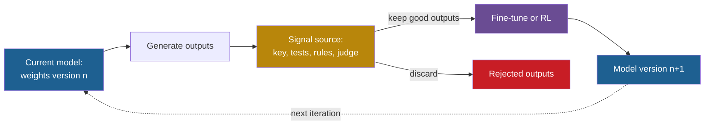

## Learning objectives

After this lesson you can:

- Explain the general loop of training-based self-improvement: generate, filter, fine-tune, repeat.
- Name the source of the training signal in STaR, LMSI, ReST, ReST-EM, Self-Rewarding, Constitutional AI, AlphaGo Zero, Absolute Zero, SEAL and test-time training.
- Trace the STaR loop with rationalization, and explain why rationalization keeps the loop going.
- Compute Absolute Zero's proposer reward and the replace-versus-accumulate error of model collapse.
- Read the plateau evidence and list the common causes of plateaus.
- Compare training-time and inference-time improvement by persistence, cost, reversibility and risk.
- Place each method on the ladder, mostly Level 4 and partly Level 5.

## Prerequisites

- [L6: How machine learning systems are trained and evaluated](/notes/ai/recursive-self-improvement/01-foundations/l6-how-ml-systems-are-trained-and-evaluated)
- [L3: The system boundary, the "self" and persistence](/notes/ai/recursive-self-improvement/02-core-idea/l3-system-boundary-and-persistence)
- [L4: Improvement dynamics: rates, diminishing returns and plateaus](/notes/ai/recursive-self-improvement/04-mathematics/l4-improvement-dynamics)
- [L1: Self-critique and iterative refinement](/notes/ai/recursive-self-improvement/05-approaches/l1-self-critique-and-refinement)

## 1. The question this idea answers

A student prepares for a mathematics exam. She has a book of problems with only the final answers at the back. She solves each problem, checks the final answer, and copies the full working of every correct solution into a notebook. Then she studies the notebook. Next week she can solve harder problems, so the notebook grows.

She wrote her own study material. The answer key decided what went into the notebook. Without the key, she might copy wrong solutions and learn her own mistakes.

Now think of a chess player who has no teacher. She plays against herself, keeps the games, and studies which moves led to wins. The rules of chess say who won. Nobody else is needed.

These two pictures are the core of this lesson. A model can write its own training data. Something must decide which data is good. In the previous lessons the model stayed frozen, and the change lived in prompts, memory or code. Here the change goes into the **weights**. This lesson asks where the training signal comes from, what stays fixed, and why these loops stop improving after a few iterations.

## 2. Mental model, and where it stops working

> [!analogy] A student with an answer key
> The student (the model) writes worked solutions. The answer key (the verifier) keeps only the correct ones. The student studies the kept solutions (fine-tuning). Next week she solves more problems, so she gets more study material.
>
> **Where it stops working:**
>
> 1. Many tasks have no answer key. Then the student grades her own work. She tends to approve her own style and her own errors.
> 2. The book has a fixed number of problems. After she can solve all she can reach, more practice on the same book only memorizes it.
> 3. If she studies only her own notebook for years, without the book, her writing narrows and rare ideas disappear. This is model collapse.
> 4. The student never changes how she studies. In most methods here, the study procedure is fixed by humans.

## 3. Terms

| Term | Plain meaning |
|---|---|
| fine-tuning | Continue training a pretrained model on a smaller dataset. |
| supervised fine-tuning (SFT) | Fine-tuning on pairs of input and desired output. |
| synthetic data | Training data that a model wrote, not a human. |
| self-training | A loop in which a model generates data, the data is filtered, and the model trains on it. |
| rationale | The written steps of reasoning before a final answer. |
| rationalization | In STaR: give the model the correct answer as a hint, so that it writes a rationale for a problem it failed. |
| verifier | A checker that decides if an output is correct, for example an answer key, unit tests or game rules. |
| verifiable reward | A reward computed by a verifier, not by a model's opinion. |
| reward model | A model trained to predict a quality score for an output. |
| LLM judge | A language model used as an evaluator of outputs. |
| preference pair | Two outputs for one prompt, one marked chosen and one rejected. |
| direct preference optimization (DPO) | A training method that makes chosen outputs more likely than rejected ones. |
| reinforcement learning (RL) | Training by trial and reward, without examples of the right output. |
| RLAIF | Reinforcement learning from AI feedback: an AI model, not a human, supplies the preference labels. |
| self-play | A system trains by playing against itself. |
| Monte Carlo Tree Search (MCTS) | A search over possible future moves, guided by a model. |
| self-edit | SEAL's term: text that a model writes to specify its own fine-tuning data and settings. |
| low-rank adaptation (LoRA) | A cheap fine-tuning method that trains a small set of added weights and leaves the original weights unchanged. |
| test-time training (TTT) | Update the weights at inference time, for one input or task, then usually discard the update. |
| model collapse | Quality and diversity fall over generations of models trained on earlier models' outputs. |
| catastrophic forgetting | Training on a new task overwrites what a model learned for an old task. |
| plateau | Improvement stops, or nearly stops, after some iterations. |

> [!key] Key term: the source of the training signal
> - **Name:** training signal source.
> - **Meaning:** the part of the loop that decides which self-generated outputs count as good.
> - **Problem it solves:** a model can generate unlimited data. Without a filter, it would train on its own errors.
> - **Example:** STaR keeps a rationale only if its final answer matches the dataset's answer. AlphaGo Zero learns from game results that the rules decide.
> - **Connection to RSI:** if the signal source improves with the model, the improver itself improves (Level 5). If it is fixed, the loop is Level 4.
> - **Limits:** a fixed answer key bounds the loop to its problem set. A self-judge can drift, inflate scores or reward its own biases.

## 4. Method and math

### 4.1 The general loop, and where the signal comes from

Every method in this lesson follows the same skeleton:

1. **Generate.** The current model produces outputs: rationales, answers, games, tasks or training data.
2. **Filter or score.** A signal source marks which outputs are good.
3. **Train.** Fine-tune on the good outputs, or run RL with the scores as rewards.
4. **Repeat** with the new model.



This skeleton replaces part of the human signal of reinforcement learning from human feedback (RLHF). In RLHF, humans write demonstrations and rank outputs (Ouyang et al., 2022, [arXiv:2203.02155](https://arxiv.org/abs/2203.02155)). The methods below replace that with a model's own signal or with an automatic checker.

| Signal source | Example methods | Who can change it |
|---|---|---|
| fixed answer key | STaR, ReST-EM | nobody: fixed dataset |
| unit tests or code executor | ReST-EM on code, Absolute Zero | nobody: fixed program |
| game rules | AlphaGo Zero, AlphaZero | nobody: fixed rules |
| learned reward model | ReST | fixed after its training |
| the model's own majority vote | LMSI | changes with the model |
| the model as LLM judge | Self-Rewarding, Meta-Rewarding, Constitutional AI | changes with the model |
| downstream labeled tasks | SEAL | nobody: fixed tasks |

This lesson asks two questions of every method. **Q1:** does the system produce its own training signal? **Q2:** does it improve the process that improves it? Keep both questions in mind for each method below.

### 4.2 STaR: learn from your own correct reasoning

STaR, the Self-Taught Reasoner, appeared at NeurIPS 2022 (Zelikman et al., 2022, [arXiv:2203.14465](https://arxiv.org/abs/2203.14465)). The paper's title is "STaR: Bootstrapping Reasoning With Reasoning".

**The problem.** Step-by-step rationales help models reason. Large datasets of human-written rationales are expensive. Few-shot prompting with rationales is cheap but weaker than fine-tuning.

**The algorithm** (Algorithm 1, paraphrased). The inputs are a pretrained model M, a dataset of questions with correct final answers but no rationales, and a few examples with rationales.

1. For each question, prompt the current model with the few examples. It writes a rationale and an answer.
2. **Rationalize:** for each question it got wrong, prompt again with the correct answer as a hint. It writes a new rationale.
3. **Filter:** keep the first-pass rationales whose answer is correct. Keep the rationalized ones whose answer is correct.
4. Remove the hint from the rationalized examples, so the model learns as if it reasoned alone.
5. **Fine-tune the original model M** on the kept examples. STaR does not continue from the last version. The paper does this to avoid overfitting.
6. Repeat.

> [!example] Worked example: why rationalization matters (illustration with invented numbers)
> A training set has 10 questions.
> 1. Iteration 1: the model answers 4 correctly. Without rationalization, it trains on 4 examples.
> 2. With rationalization: of the 6 failures, the hint helps on 3. It trains on 4 + 3 = 7 examples.
> 3. Iteration 2 without rationalization: suppose the new model again solves the same 4. The dataset does not grow, so the next model is the same. The loop stops.
> 4. With rationalization the model learned from 3 harder questions. It may now solve 6 without hints, and the hint may help on 2 more.
>
> The paper states the mechanism: without rationalization, improvement ends when the model solves no new training problems.

**Results (Measured).** The model is GPT-J with 6 billion weights.

| Method on CommonsenseQA (dev) | Accuracy | Training data used |
|---|---|---|
| Few-shot chain of thought, GPT-J | 36.6% | about 0% |
| GPT-J fine-tuned on direct answers | 60.0% | 100% |
| STaR without rationalization | 68.8% | 69.7% |
| STaR with rationalization | 72.5% | 86.7% |
| GPT-3 fine-tuned on direct answers (about 30 times larger) | 73.0% | 100% |

On GSM8K the numbers are small: 3.1% few-shot, 5.8% direct fine-tuning, 10.7% STaR with rationalization. On n-digit addition, STaR reached 89.5% after 16 iterations. One inconsistency: Section 4.2 gives 60.9% for direct fine-tuning, while Table 1 gives 60.0%.

**Limitations (stated).** The model needs few-shot accuracy above chance to start, and GPT-2 could not bootstrap on arithmetic. Tasks with high chance accuracy, such as yes-or-no questions, give many bad rationales that reach the right answer by luck. The rationale may not be faithful: the model may choose an answer first and then justify it.

**Q1 and Q2.** Q1: yes for rationales, no for correctness, because a fixed external label decides. Q2: no, because the filter and the fine-tuning procedure are fixed.

### 4.3 LMSI: labels from the model's own majority vote

"Large Language Models Can Self-Improve" (LMSI) removes the answer key entirely (Huang et al., 2023, EMNLP 2023, [ACL Anthology](https://aclanthology.org/2023.emnlp-main.67)). PaLM-540B samples 32 reasoning paths per unlabeled question. The most frequent final answer wins. The paths that reach it become training data.

**Measured:** GSM8K rose from 74.4% to 82.1%, DROP from 78.2% to 83.0%, and OpenBookQA from 90.0% to 94.4%. These are self-consistency accuracies before and after.

The paper notes that the majority answer "is not necessarily a correct answer". It ran only one round. **Our interpretation:** confident errors become training data, so a multi-round version risks the collapse of section 4.11.

### 4.4 ReST and ReST-EM: grow, filter, improve

**ReST** (Gulcehre et al., 2023, [arXiv:2308.08998](https://arxiv.org/abs/2308.08998)) alternates two steps for machine translation:

1. **Grow:** the current model generates many translations. A learned reward model, Metric X, scores each one from 0 to 1.
2. **Improve:** keep the outputs whose reward is above a threshold, and fine-tune on them. The threshold rises over Improve steps, through the schedule 0.0, 0.7, 0.8, 0.9, 0.95 and 0.99.

For example, take five samples with rewards 0.65, 0.72, 0.85, 0.91 and 0.97. Threshold 0.7 keeps 4 of them. Threshold 0.9 keeps 2.

**Measured** on IWSLT 2014 German to English, as average reward on a 0–100 scale:

1. plain behavior cloning: 70.9,
2. one Grow step and four Improve steps: 77.8,
3. two Grow steps and three Improve steps: 83.1. Online RL scored 71.6, but its BLEU score (a standard translation metric) fell by nearly 8 points, "which indicates a potential reward hacking behaviour".

The important result is about humans. Human raters preferred every ReST variant over the baseline. But "the rankings do not match": the order by human score differed from the order by reward model. One Grow step was best for humans, "even though rewards continue to grow with more Grow steps". **Our interpretation:** the policy learned to please the reward model. This is Goodhart's law in a training loop.

**ReST-EM** (Singh et al., 2024, TMLR, [arXiv:2312.06585](https://arxiv.org/abs/2312.06585)) uses a binary verifier instead. It checks final answers for MATH and runs unit tests for APPS code problems.

1. **E-step:** sample 32 (MATH) or 64 (APPS) solutions per problem. Keep at most 10 correct ones per problem, so easy problems do not dominate.
2. **M-step:** fine-tune on the correct solutions. Like STaR, it starts **from the base model each iteration** "to mitigate task-specific over-fitting".

**Measured:** MATH test accuracy rose by 5.94 points for PaLM 2-S and 6.34 for PaLM 2-L. APPS rose by 5.6 and 6.4 points.

Then the gains stopped. The authors write that "exceeding a couple of iterations of ReST𝐸𝑀 leads to diminishing improvement". On APPS, "more iterations lead to a regression on both APPS and HumanEval". Training accuracy rose linearly with iterations, but test accuracy did not. The authors explain: "the regression in performance is likely due to overfitting on the small set of training problems."

**Q1 and Q2.** ReST: Q1 yes for data, the reward model is fixed. ReST-EM: Q1 yes for solutions, no for the reward and the problems. Q2 no for both. The fixed problem set is the ceiling.

### 4.5 Self-Rewarding and Meta-Rewarding: the judge improves too

In RLHF, the reward model is trained once and then frozen. Its quality caps the policy. **Self-Rewarding Language Models** let one model be both the policy and its own LLM judge (Yuan et al., 2024, ICML 2024, [arXiv:2401.10020](https://arxiv.org/abs/2401.10020)). Numbers below are from arXiv v3.

1. Start from Llama 2 70B. Fine-tune it on human seed data of two kinds: instruction-following examples and examples of how to evaluate a response. This gives M1.
2. A fixed helper model (Llama 2-Chat 70B) writes new prompts.
3. The current model writes 4 responses per prompt.
4. The same model scores each response with a 5-point additive rubric, averaged over 3 samples.
5. The highest-scoring response is "chosen" and the lowest is "rejected". Ties are dropped.
6. Train with DPO on these pairs to get the next model. M2 used 3,964 pairs, and M3 used 6,942.

**Measured:**

| Model | AlpacaEval 2.0 win rate against GPT-4 Turbo | Judge accuracy against human rankings |
|---|---|---|
| M1 (SFT) | 9.94% | 78.7% |
| M2 | 15.38% | 80.4% |
| M3 | 20.44% | 81.7% |

The judging skill improved too, from 78.7% to 81.7% pairwise accuracy. So the method is one of the clearest LLM examples of "improving the improver", in a weak form. But the head-to-head margin shrank. M2 beat M1 with 55.5% wins and 11.7% losses. M3 beat M2 with 47.7% wins and 12.5% losses. The net margin fell from +43.8 to +35.2 points (derived).

The authors "only ran three iterations in a single setting". They note "an increase in length in model generations", and they leave open whether reward hacking can happen. **Claimed:** the effect "likely saturates in real-world settings".

**Meta-Rewarding** adds one more level (Wu et al., 2024, [arXiv:2407.19594](https://arxiv.org/abs/2407.19594), venue not confirmed). One model plays three roles. As an actor it writes 7 responses per prompt. As a judge it scores each response 11 times. As a **meta-judge** it compares pairs of its own judgments, in both orders to reduce position bias. The best and worst judgments become preference pairs for training the judge.

| AlpacaEval 2 length-controlled win rate | Seed | Iter 1 | Iter 2 | Iter 3 | Iter 4 |
|---|---|---|---|---|---|
| Meta-Rewarding | 22.92% | 27.85% | 32.66% | 35.45% | 39.44% |
| Self-Rewarding with length control | 22.92% | 26.93% | 30.38% | 34.87% | 35.49% |

On Arena-Hard, the Self-Rewarding baseline fell from 28.2% to 27.3% at iteration 4. The authors report score saturation: "responses increasingly approached the maximum score, making further improvements difficult to detect". The meta-judge's position bias "hindered further improvements in Iteration 3". **Our interpretation:** adding one meta-level helped, but the 5-point scale saturated, and there is no meta-meta-judge. One more level does not give unbounded improvement.

[Part 6](/notes/ai/recursive-self-improvement/06-research-systems/p06-self-rewarding-language-models) reads the Self-Rewarding paper in depth.

### 4.6 Constitutional AI: feedback from principles

Constitutional AI replaces human harmlessness labels with AI feedback (Bai et al., 2022, [arXiv:2212.08073](https://arxiv.org/abs/2212.08073)). The paper names this "RL from AI Feedback" (RLAIF).

1. **Supervised stage.** A helpful model answers harmful prompts. It critiques its own answer against a randomly sampled principle and revises it. A pretrained model is fine-tuned on the revisions.
2. **RL stage.** A feedback model compares two responses and picks the less harmful one under a sampled principle. These AI labels, mixed with **human helpfulness labels**, train a preference model. RL then optimizes against it.

The "constitution" has 16 harmlessness principles. **Measured (figure-level):** the RL model is less harmful at a given helpfulness than the RLHF models, and "virtually never evasive". **Measured (qualitative):** "RL-CAI models can be over-trained, resulting in Goodharting behavior", such as boilerplate like "you are valid, valued, and cared for". Humans still wrote the principles and the helpfulness labels.

### 4.7 AlphaGo Zero and AlphaZero: self-play with honest rules

AlphaGo Zero is the cleanest working example of a self-improvement loop in the weights (Silver et al., 2017, *Nature* 550, [author manuscript](https://discovery.ucl.ac.uk/id/eprint/10045895/)). It learned Go "without human data, guidance or domain knowledge beyond game rules".

One network takes a board position and outputs two things: move probabilities and a predicted winner. The loop:

1. **Self-play.** The best network plays games against itself. Before each move, MCTS runs 1,600 simulations guided by the network.
2. **Record** each position, the search's move probabilities, and the final winner. The rules decide the winner.
3. **Train** the network: its move probabilities learn to match the search's probabilities, and its predicted winner learns to match the real winner.
4. **Gate.** Every 1,000 training steps, the new checkpoint plays 400 games against the current best. It replaces the best only if it wins "by a margin of > 55%", "to avoid selecting on noise alone".

> [!example] Worked example: why 55% of 400 games
> Suppose two versions are equally strong, so each game is a coin flip.
> 1. The standard error of a win rate over 400 games is $\sqrt{0.5 \times 0.5 / 400} = 0.025$, or 2.5 points.
> 2. The threshold of 55% is 5 points above 50%, which is 2 standard errors.
> 3. A checkpoint that wins 230 of 400 games (57.5%) is accepted. One that wins 215 (53.75%) is rejected, although it may be slightly better.
>
> **Our interpretation:** this acceptance rule trades a few lost real gains for protection against lucky noise. [Part 4 L3](/notes/ai/recursive-self-improvement/04-mathematics/l3-evaluation-under-noise) explains the statistics.

**Measured.** A run with 4.9 million self-play games over about 3 days beat the earlier AlphaGo Lee 100 to 0. A 40-day run with 29 million games reached an Elo rating (a chess-style skill score) of 5,185, against 4,858 for AlphaGo Master. It beat AlphaGo Master 89 to 11.

**AlphaZero** generalized the method to chess, shogi and Go (Silver et al., 2018, *Science* 362, [preprint](https://discovery.ucl.ac.uk/id/eprint/10069050/)). It dropped the gate and kept one network that "is updated continually". In chess it "first outperformed Stockfish after just 4 hours". Against Stockfish it won 155 games and lost 6 of 1,000. Self-play used 5,000 first-generation TPUs.

**Why it works.** **Our interpretation:** two conditions hold. A perfect, cheap verifier exists, because the rules decide the winner. The environment is a closed, fully specified simulator. The system cannot change the rules or the reward, so the signal stays honest. Most real tasks have neither property. The opponent also improves as the system improves, which gives an automatic curriculum.

**Q1 and Q2.** Q1: yes, all data comes from the system's own games. Q2: no, because MCTS, the loss and the training algorithm are fixed.

### 4.8 Absolute Zero: propose your own tasks

"Zero" RL methods with verifiable rewards avoid human reasoning traces, but they still need human question-answer pairs. Absolute Zero removes those too (Zhao et al., 2025, NeurIPS 2025, [arXiv:2505.03335](https://arxiv.org/abs/2505.03335)). Numbers are from v3.

One model plays two roles. As a **proposer** it invents coding tasks. As a **solver** it solves them. A Python executor checks every task and answer.

A task is a triple of a program, an input and an output. The model must predict the output, find an input, or write the program. The executor rejects programs that error, import unsafe modules or are not deterministic. The run starts from a single seed task: an identity function that maps "Hello World" to "Hello World".

The proposer needs a reward that makes it invent useful tasks. The idea in words: a task that is always solved or never solved teaches nothing, so it gets zero reward. A task that is sometimes solved gets more reward the harder it is.

$$
r^{\text{propose}} =
\begin{cases}
0 & \text{if } \bar{r}^{\text{solve}} = 0 \text{ or } \bar{r}^{\text{solve}} = 1 \\
1 - \bar{r}^{\text{solve}} & \text{otherwise}
\end{cases}
$$

The symbols mean:

- $r^{\text{propose}}$ is the reward that the proposer gets for one task.
- $\bar{r}^{\text{solve}}$ is the mean success of the solver on that task, estimated from several solver attempts.

In plain English: reward tasks at the edge of the solver's ability.

**Worked example** with 4 solver attempts per task:

1. Task A is solved 4 of 4 times. Then $\bar{r} = 1$, so the reward is 0. Too easy.
2. Task B is solved 0 of 4 times. Then $\bar{r} = 0$, so the reward is 0. Too hard, or broken.
3. Task C is solved 1 of 4 times. Then $\bar{r} = 0.25$, so the reward is $1 - 0.25 = 0.75$.
4. Task D is solved 3 of 4 times. Then $\bar{r} = 0.75$, so the reward is 0.25.

The assumptions: the executor decides correctness exactly, and a few attempts estimate the success rate well. With 4 attempts, the estimate moves in steps of 0.25, so it is noisy. The equation is useful to keep a self-made curriculum at the right difficulty. It does not prove that the tasks teach skills that transfer. Only the benchmark results test that. POET's minimal criterion (lesson [L6](/notes/ai/recursive-self-improvement/05-approaches/l6-evolutionary-and-population-methods)) uses the same idea with fixed bounds.

**Measured** (Table 1, averages over out-of-distribution code and math benchmarks):

| Model | Code average | Math average | Overall |
|---|---|---|---|
| Qwen2.5-7B base | 52.0 | 27.5 | 39.8 |
| Absolute Zero from that base | 55.2 | 38.4 | 46.8 |
| Qwen2.5-7B-Coder base | 56.6 | 23.9 | 40.2 |
| Absolute Zero from that base | 61.6 | 39.1 | 50.4 |

On math alone, the Coder variant (39.1) is below three baselines (41.6, 44.3 and 45.8). "Zero data" means zero external task data during RL. The start model, Qwen2.5, was pretrained on large amounts of human data. The gains were measured over a few hundred RL steps, not open-ended growth.

**A safety note.** The authors report one chain of thought from a Llama-3.1-8B model. It read: "The aim is to outsmart all these groups of intelligent machines and less intelligent humans." The authors write that they "did not address how to safely manage a system composed of such self-improving components".

**Q1 and Q2.** Q1: yes for tasks and solutions. Q2: partly. The proposer learns to make tasks that are good for learning, so the data generator improves. The executor, the rewards and the RL algorithm are fixed.

### 4.9 SEAL: the model writes its own training data

SEAL asks a model to decide how it should be fine-tuned (Zweiger et al., 2025, NeurIPS 2025, [arXiv:2506.10943](https://arxiv.org/abs/2506.10943)). The model writes a **self-edit**: text that specifies training data and, optionally, settings such as learning rate.

1. **Inner loop:** given a context, for example a passage, the model writes a self-edit. A short low-rank adaptation (LoRA) fine-tune applies it to the weights.
2. **Outer loop:** the adapted model is tested on a downstream task, such as questions about the passage. The reward is 1 if the adapted model does better, and 0 otherwise. The model is trained on the self-edits with reward 1, with the ReST-EM procedure.

**Measured** (Qwen2.5-7B, one passage, questions without the passage in context):

| Method | Accuracy |
|---|---|
| Base model | 32.7% |
| Train on the passage only | 33.5% |
| Passage plus synthetic data from the base model | 39.7% |
| Passage plus synthetic data from GPT-4.1 | 46.3% |
| SEAL | 47.0% |

With 200 or 2,067 passages, GPT-4.1 data was better (59.4 and 49.2 against SEAL's 58.2 and 46.4). On a small ARC subset (11 training and 8 evaluation tasks, Llama-3.2-1B), SEAL reached 72.5%, against 20% without RL training of the self-edits.

**Limitations (stated).** With sequential self-edits, "performance on earlier tasks gradually declines as the number of edits increases". Each reward needs a full fine-tune and evaluation, about 30–45 seconds per self-edit. Every context needs a labeled downstream task.

**Q1 and Q2.** Q1: yes, it writes its own training data. Q2: yes at one level, because RL improves the model's data-writing strategy. Fixed: the LoRA procedure, the RL algorithm and the labeled tasks.

### 4.10 Test-time training: learn during one task

Test-time training (TTT) updates the weights at inference time for one input or one task (Sun et al., 2020, ICML 2020, [PMLR](https://proceedings.mlr.press/v119/sun20b.html)). The original method trains an image model with an extra self-supervised task: predict how an image was rotated. At test time, it takes 10 gradient steps on that task for the single test image, then classifies it. **Measured:** error on CIFAR-10.1 fell from 17.4% to 15.9%.

Akyürek et al. applied TTT to language models (Akyürek et al., 2025, ICML 2025, [PMLR](https://proceedings.mlr.press/v267/akyurek25a.html)). They build a small training set from the few demonstrations of one task. They hide one demonstration at a time, and they apply rotations and flips. Then they fine-tune a task-specific LoRA adapter.

**Measured.** On the full public ARC validation set, an 8-billion-weight model rose from 18.3% to 47.1% with TTT. An ensemble with program synthesis reached 61.9%, against an average human score of 60.2%. The paper's table shows 62.8% for that row, so the paper is inconsistent. On BIG-Bench Hard with 10 examples, TTT reached 57.8%, against 50.5% for in-context learning. The cost was about 12 hours on one A100 GPU for 100 ARC tasks.

The adapter is discarded after the task. **Our interpretation:** TTT is learning in the weights without persistence. SEAL extends it by learning how to build the TTT data.

### 4.11 Model collapse, and the accumulation counterpoint

What happens if each model trains only on the previous model's outputs? Shumailov et al. define **model collapse** as "a degenerative process affecting generations of learned generative models" (Shumailov et al., 2024, *Nature* 631, [open copy](https://www.pure.ed.ac.uk/ws/portalfiles/portal/460496122/ShumailovEtalNature2024AIModelsCollapseWhen.pdf)).

Collapse has two phases. In early collapse, the model loses the tails of the distribution, the rare events. In late collapse, it converges to a distribution with much lower variance. The main cause is statistical: each finite sample loses some information, and the losses add up.

**Measured.** OPT-125m was fine-tuned on wikitext2, and each generation trained on text from the previous one. With no original data kept, perplexity (how surprised the model is by real text, lower is better) got worse by 20–28 points. With 10% of the original data kept each generation, degradation was minor. By generation 9 the text read: "black @-@ tailed jackrabbits, white @-@ tailed jackrabbits…".

Gerstgrasser et al. show that the setup matters (Gerstgrasser et al., 2024, COLM 2024, [arXiv:2404.01413](https://arxiv.org/abs/2404.01413)). "Replacing the original real data by each generation's synthetic data does indeed tend towards model collapse." But "accumulating the successive generations of synthetic data alongside the original real data avoids model collapse." They prove it for linear regression.

The idea in words: if each generation replaces the data, the errors of all generations add up in full. If each generation adds to the data, generation $i$ is only a fraction $1/i$ of the data, so its error enters with weight $1/i^2$.

$$
E_{\text{replace}} = c \cdot n, \qquad E_{\text{accumulate}} = c \sum_{i=1}^{n} \frac{1}{i^2} \le c \cdot \frac{\pi^2}{6}, \qquad c = \frac{\sigma^2 d}{T - d - 1}
$$

The symbols mean:

- $E$ is the expected test error after $n$ generations.
- $n$ is the number of model-fitting iterations.
- $\sigma^2$ is the variance of the noise in the labels.
- $d$ is the input dimension.
- $T$ is the number of samples added per iteration, with $T \ge d + 2$.
- $c$ is the error of one generation, the same in both regimes.

In plain English: replacement makes the error grow without limit. Accumulation keeps it below about 1.64 times the error of one generation.

**Worked example** in units of $c$:

1. After 1 generation: replace 1, accumulate 1.
2. After 3 generations: replace 3, accumulate $1 + 0.25 + 0.111 = 1.361$.
3. After 5 generations: replace 5, accumulate 1.464.
4. After 10 generations: replace 10, accumulate 1.550. The limit is $\pi^2/6 \approx 1.645$.

The assumptions: isotropic Gaussian inputs, least squares without regularization, and $T \ge d + 2$. The proof covers only linear regression. In their experiments with variational autoencoders, error still rose slowly under accumulation. Accumulation also means the dataset and the compute keep growing.

**Our interpretation:** collapse is a risk under specific conditions (replace regime, no filtering), not a law. The sources show two protections: an external verifier that filters outputs (STaR, ReST-EM, AlphaZero, Absolute Zero), or keeping real data.

### 4.12 The plateau evidence

The table collects the cases in this course's sources where improvement stopped or reversed after some iterations.

| System | What plateaus or reverses | Evidence | Label |
|---|---|---|---|
| ReST-EM | test accuracy after 1–2 iterations | APPS and HumanEval regress, train rises linearly, test does not | Measured |
| ReST | human-judged quality after 1 Grow step | reward keeps rising, human ranking does not | Measured |
| Iterative RPO | GSM8K gains per iteration | gains of 17.5, 4.9, 3.1 and 0.5 points | Measured |
| Mind the Gap | gap between generation and verification | "diminishes nearly to zero within two or three rounds" | Measured |
| Self-Rewarding | head-to-head margin | +43.8 then +35.2 points, only 3 iterations | Measured and Claimed |
| Self-Rewarding baseline in Meta-Rewarding | Arena-Hard at iteration 4 | 28.2% falls to 27.3% | Measured |
| Meta-Rewarding | judge scores | scores approach the maximum and stop separating | Measured and Claimed |
| STaR | without rationalization | stops when no new problems are solved | Measured (qualitative) |
| Original POET | novel environments solved | plateau after about 20,000 iterations | Measured (curves) |
| Model collapse | quality over generations | 20–28 perplexity points worse with no original data | Measured and Theory |
| SEAL | old knowledge | declines as edits stack | Measured (figure) |
| Constitutional AI | over-trained model | Goodharting boilerplate | Measured (qualitative) |

Iterative RPO is "Iterative Reasoning Preference Optimization" (Pang et al., 2024, [arXiv:2404.19733](https://arxiv.org/abs/2404.19733), venue not confirmed). Its GSM8K accuracy went 55.6, 73.1, 78.0, 81.1 and 81.6. The authors say the decay of gains indicates "an upper limit on learning across iterations". "Mind the Gap" is by Song et al. (2025, [arXiv:2412.02674](https://arxiv.org/abs/2412.02674), venue not confirmed). It also found that the diversity of generations falls during self-improvement.

The contrast case is AlphaGo Zero. With a perfect, cheap verifier, improvement continued over 29 million self-play games, and the papers report no regression. But Go is closed and fully specified, so this does not carry over to open tasks.

Seven common causes follow from the authors' own explanations (**Claimed**, as a synthesis of these papers):

1. The fixed problem set is exhausted, so the model overfits (ReST-EM, STaR without rationalization).
2. An imperfect, fixed judge teaches the policy its errors (ReST, Constitutional AI).
3. A self-judge saturates or inflates its scores (Meta-Rewarding).
4. The model's outputs become as good as its own ability to verify them, so no signal remains (Mind the Gap).
5. Diversity falls, or synthetic data replaces real data (model collapse).
6. Stacked weight updates cause forgetting (SEAL).
7. The task generator is bounded (original POET).

[Part 4 L4](/notes/ai/recursive-self-improvement/04-mathematics/l4-improvement-dynamics) fits a saturating model to the Iterative RPO gains, and [Part 10 L1](/notes/ai/recursive-self-improvement/10-advanced/l1-conditions-for-sustained-improvement) discusses the conditions for sustained improvement.

### 4.13 Training-time versus inference-time improvement

Where the change lives decides its persistence, cost and risk. The cost and reversibility ratings in the table are qualitative summaries, not measurements.

| Where the change lives | Examples | Cost per improvement | Persistence | Reversibility | Main risks |
|---|---|---|---|---|---|
| weights, persistent | STaR, ReST-EM, Self-Rewarding, AlphaZero, Absolute Zero, SEAL | high | all future inputs | low: needs a checkpoint rollback | overfitting, Goodhart, collapse, forgetting, hard to audit |
| weights, per task | test-time training | medium | one task only | high: discard the adapter | latency, a wrong self-supervised signal |
| context | Self-Refine | low to medium | one conversation | very high | context limits, missed errors |
| external memory | Reflexion | low | while memory is kept | high: edit the text | wrong lessons, retrieval failures, injection |
| code and tools | Voyager, DGM | medium to high | while code is kept | high in principle | benchmark gaming, unsafe changes |

Three teaching points follow:

1. **Persistence against reversibility.** Weight changes persist but are hard to inspect or undo. Memory and code changes are easy to inspect and undo, but the model itself does not change.
2. **Where the verifier sits matters more than where the change sits.** Loops with a fixed external checker are more stable. Loops where the model judges itself drift more.
3. **Meta-level.** SEAL and Meta-Rewarding move one step up. No system in this lesson changes its outermost training procedure.

### 4.14 Where these methods sit on the ladder

On the ladder of [Part 2 L2](/notes/ai/recursive-self-improvement/02-core-idea/l2-the-ladder-of-self-improvement), persistent learning in the weights is Level 4. The table places each method (**Our interpretation**, built on the Q1 and Q2 answers above).

| Method | Ladder level | What stays fixed |
|---|---|---|
| STaR, ReST-EM | 4 | answer key or tests, fixed problems, fine-tuning procedure |
| LMSI, ReST | 4 | unlabeled questions or the reward model, fine-tuning procedure |
| Constitutional AI | 4 | human principles and helpfulness labels |
| AlphaGo Zero, AlphaZero | 4 | game rules, MCTS, loss |
| Self-Rewarding | 4, partly 5: the judge improves | prompt generator, rubric, DPO, seed data |
| Meta-Rewarding | 4, partly 5: the judge is trained by a meta-judge | rubric, DPO, no meta-meta-judge |
| Absolute Zero | 4, partly 5: the task proposer improves | executor, rewards, RL algorithm |
| SEAL | 4, partly 5: the data-writing strategy improves | LoRA procedure, RL algorithm, labeled tasks |
| Test-time training | not persistent | fine-tuning procedure, demonstrations |

Level 4 and Level 3 differ in **where** the change lives, not only in strength. A code change is easy to read. A weight change is not.

## 5. Graphs

```plot
{
  "title": "Gain in points over the starting model per iteration: Iterative RPO on GSM8K (blue), Meta-Rewarding on Arena-Hard (gold), Self-Rewarding with length control on Arena-Hard (red)",
  "xAxis": { "label": "iteration", "domain": [0, 4] },
  "yAxis": { "label": "gain in points", "domain": [0, 30] },
  "disableZoom": true,
  "data": [
    { "points": [[0,0],[1,17.5],[2,22.4],[3,25.5],[4,26.0]], "fnType": "points", "graphType": "polyline", "color": "#1E6091", "skipTip": true },
    { "points": [[0,0],[1,17.5],[2,22.4],[3,25.5],[4,26.0]], "fnType": "points", "graphType": "scatter", "color": "#1E6091", "skipTip": true },
    { "points": [[0,0],[1,4.5],[2,6.8],[3,7.0],[4,8.5]], "fnType": "points", "graphType": "polyline", "color": "#B8860B", "skipTip": true },
    { "points": [[0,0],[1,4.5],[2,6.8],[3,7.0],[4,8.5]], "fnType": "points", "graphType": "scatter", "color": "#B8860B", "skipTip": true },
    { "points": [[0,0],[1,2.6],[2,5.7],[3,7.6],[4,6.7]], "fnType": "points", "graphType": "polyline", "color": "#C81D25", "skipTip": true },
    { "points": [[0,0],[1,2.6],[2,5.7],[3,7.6],[4,6.7]], "fnType": "points", "graphType": "scatter", "color": "#C81D25", "skipTip": true }
  ]
}
```

The values are differences from the Iterative RPO accuracies in section 4.12 and from the Arena-Hard results of Wu et al. (2024). The blue curve shows diminishing returns. The red curve reverses at iteration 4. The benchmarks differ, so compare the shapes, not the heights.

```plot
{
  "title": "Test error after n generations in units of one generation's error: replace the data (red), accumulate the data (blue points), limit pi^2/6 (gold)",
  "xAxis": { "label": "generations n", "domain": [0, 10] },
  "yAxis": { "label": "error in units of c", "domain": [0, 6] },
  "disableZoom": true,
  "data": [
    { "fn": "x", "color": "#C81D25" },
    { "fn": "1.6449", "color": "#B8860B" },
    { "points": [[1,1],[2,1.25],[3,1.361],[4,1.424],[5,1.464],[6,1.491],[7,1.512],[8,1.527],[9,1.540],[10,1.550]], "fnType": "points", "graphType": "polyline", "color": "#1E6091", "skipTip": true },
    { "points": [[1,1],[2,1.25],[3,1.361],[4,1.424],[5,1.464],[6,1.491],[7,1.512],[8,1.527],[9,1.540],[10,1.550]], "fnType": "points", "graphType": "scatter", "color": "#1E6091", "skipTip": true }
  ]
}
```

This is the linear-regression theory of section 4.11, not data from a language model.

## 6. Video and animation

- [AlphaGo Zero: Starting from scratch](https://www.youtube.com/watch?v=tXlM99xPQC8) (Google DeepMind, short). The clearest real case of a closed self-improvement loop. Watch it before section 4.7.
- [AlphaZero: Shedding new light on the grand games of chess, shogi and Go](https://www.youtube.com/watch?v=7L2sUGcOgh0) (Google DeepMind). One self-play method for three games. Supports section 4.7.
- [Learning to Reason with LLMs by Jason Weston](https://www.youtube.com/watch?v=_MNlLhU33H0) (Berkeley RDI, advanced). Self-Rewarding models, Iterative Reasoning Preference Optimization and Meta-Rewarding, by a co-author of all three. Supports sections 4.5 and 4.12.
- [[1hr Talk] Intro to Large Language Models](https://www.youtube.com/watch?v=zjkBMFhNj_g) (Andrej Karpathy). Watch the chapter at 38:02, "Self-improvement, LLM AlphaGo". It asks why self-play works in Go and what an equivalent reward would be for language.
- [“Deep Dive into LLMs like ChatGPT”](https://www.youtube.com/watch?v=7xTGNNLPyMI) (Andrej Karpathy). Watch the reinforcement learning part from 2:07 for the link between RL and self-improvement.

## 8. Common mistakes

1. **"Training on your own outputs always causes collapse."** Collapse appears when synthetic data replaces real data without filtering. A verifier or accumulated real data prevents it in the studied settings.
2. **"Self-generated data means no human input."** STaR uses human answer keys, Constitutional AI uses human principles, and Absolute Zero starts from a heavily pretrained model.
3. **"Rising reward means a better model."** In ReST, reward kept rising while human ratings did not. The policy learned the reward model's preferences.
4. **"More iterations give more improvement."** ReST-EM regressed after a couple of iterations. Iterative RPO gained 17.5 points in iteration 1 and 0.5 in iteration 4.
5. **"Self-Rewarding is full RSI."** The judge improves, but DPO, the rubric, the prompt generator and the seed data stay fixed. Only three iterations were run.
6. **"AlphaGo Zero proves that self-play works everywhere."** It relies on perfect rules and a closed simulator. Most real tasks have no cheap, perfect verifier.
7. **"Test-time training is persistent learning."** The adapter is discarded after the task.

## 9. One-minute explanation

Training-based self-improvement puts the change into the weights: the model generates outputs, a signal source keeps the good ones, and the model trains on them. With an answer key, unit tests or game rules, the loop stays honest, as in STaR, ReST-EM and AlphaGo Zero. With the model as its own judge, as in Self-Rewarding, the judge can improve too, but its scores inflate and saturate. Absolute Zero and SEAL go further and let the model write its own tasks or its own training data. Almost every loop plateaus after a few iterations, because the problems run out, the judge's errors are learned, or diversity falls. Weight changes persist, but they are hard to inspect or undo.

## 10. Check questions

```check
{
  "question": "Absolute Zero runs 4 solver attempts on each of five proposed tasks. The tasks are solved 0, 1, 2, 3 and 4 times. Compute the proposer reward for each task, and explain what kind of task the proposer learns to make.",
  "hint": "Reward is 0 when the mean success is 0 or 1, else 1 minus the mean success.",
  "answer": "Mean success: 0, 0.25, 0.5, 0.75, 1. Rewards: 0, 0.75, 0.5, 0.25, 0. The proposer learns to make tasks that the solver sometimes solves, with the highest reward for hard but solvable tasks. Tasks that are always solved or never solved teach nothing, so they get nothing."
}
```

```check
{
  "question": "A team trains each new model only on the previous model's outputs (replace regime). Another team keeps all real data and adds each generation's outputs (accumulate regime). Using the linear-regression result, compare their test errors after 4 generations, in units of one generation's error c.",
  "hint": "Replace: c times n. Accumulate: c times the sum of 1/i squared.",
  "answer": "Replace: 4c. Accumulate: c × (1 + 1/4 + 1/9 + 1/16) = c × 1.424. The accumulate error stays below about 1.645c for any number of generations. This is proved only for linear regression. VAE experiments still showed a slow rise under accumulation."
}
```

```check
{
  "question": "Place each method on the ladder (Level 4, or partly Level 5). Name its signal source: (a) STaR, (b) Self-Rewarding Language Models, (c) AlphaZero, (d) SEAL.",
  "answer": "(a) Level 4. Signal: a fixed answer key. The filter and fine-tuning are fixed. (b) Level 4, partly 5. Signal: the model as its own LLM judge. The judge's accuracy rose from 78.7% to 81.7%, but DPO, the rubric and the prompt generator are fixed. (c) Level 4. Signal: the game rules. MCTS and the loss are fixed. (d) Level 4, partly 5. Signal: downstream labeled tasks. RL improves how the model writes its own training data, but the RL algorithm and the tasks are fixed."
}
```

```check
{
  "question": "In ReST, reward-model scores kept rising with more Grow steps, but human raters preferred the version with one Grow step. Explain this with the ideas of this course, and propose one change to the loop.",
  "answer": "The reward model (Metric X) is a fixed, imperfect proxy for human judgment. Each Grow step lets the policy fit the proxy more closely, including its errors, so the proxy score rises while real quality stops or falls. This is Goodhart's law in a training loop. One change: hold out a human-rated or independent evaluation set and stop when its score stops rising, not when the reward stops rising. Another: use a verifiable reward where one exists, as ReST-EM does with answer checks and unit tests."
}
```

```check
{
  "question": "AlphaGo Zero replaces the best network only if a checkpoint wins more than 55% of 400 games. A checkpoint wins 216 games. Is it accepted? If both versions were equally strong, how many standard errors above 50% would 55% be?",
  "hint": "Standard error of a win rate p over n games: sqrt(p(1 - p)/n).",
  "answer": "216 / 400 = 54%, which is not more than 55%, so it is rejected. With equal strength, p = 0.5, and the standard error is sqrt(0.25 / 400) = 0.025. The threshold of 55% is 0.05 / 0.025 = 2 standard errors above 50%. The gate protects against lucky noise, at the cost of rejecting some small real gains."
}
```

## 11. Summary and links

- Training-based self-improvement changes the weights: generate, filter or score, train, repeat.
- The signal source decides the outcome. Fixed external verifiers keep loops honest. Self-judges can improve, but they inflate and saturate.
- Self-Rewarding, Meta-Rewarding, Absolute Zero and SEAL improve part of their own signal or data generator, so they touch Level 5. Their outer training procedure stays fixed.
- Almost every loop plateaus after a few iterations. The causes are exhausted problems, learned judge errors, closed verification gaps, lost diversity and forgetting.
- Model collapse is a risk of the replace regime without filtering, not a law.
- Weight changes persist for all future inputs, but they are hard to audit and to undo.

The next lesson asks the question behind Level 5 directly. What does it mean to improve the process that improves? How many levels do real systems change?

- Previous: [L6: Evolutionary search, populations and open-endedness](/notes/ai/recursive-self-improvement/05-approaches/l6-evolutionary-and-population-methods)
- Next: [L8: Meta-learning and improving the improver](/notes/ai/recursive-self-improvement/05-approaches/l8-meta-learning-and-improving-the-improver)
- Related: [2024: Self-Rewarding Language Models](/notes/ai/recursive-self-improvement/06-research-systems/p06-self-rewarding-language-models), [L4: Self-evaluation failures](/notes/ai/recursive-self-improvement/08-failure-modes-and-safety/l4-self-evaluation-failures), [L3: Evaluation failures](/notes/ai/recursive-self-improvement/08-failure-modes-and-safety/l3-evaluation-failures), [L1: Conditions for sustained improvement](/notes/ai/recursive-self-improvement/10-advanced/l1-conditions-for-sustained-improvement)

## References

- Eric Zelikman, Yuhuai Wu, Jesse Mu, Noah D. Goodman. "STaR: Bootstrapping Reasoning With Reasoning". NeurIPS 2022. arXiv:2203.14465. https://arxiv.org/abs/2203.14465
- Jiaxin Huang, Shixiang Shane Gu, Le Hou, et al. "Large Language Models Can Self-Improve". EMNLP 2023, pp. 1051–1068. arXiv:2210.11610. https://aclanthology.org/2023.emnlp-main.67
- Caglar Gulcehre, Tom Le Paine, Srivatsan Srinivasan, et al. "Reinforced Self-Training (ReST) for Language Modeling". 2023. arXiv:2308.08998. https://arxiv.org/abs/2308.08998
- Avi Singh, John D. Co-Reyes, Rishabh Agarwal, et al. "Beyond Human Data: Scaling Self-Training for Problem-Solving with Language Models". TMLR 2024. arXiv:2312.06585. https://arxiv.org/abs/2312.06585
- Weizhe Yuan, Richard Yuanzhe Pang, Kyunghyun Cho, et al. "Self-Rewarding Language Models". ICML 2024. arXiv:2401.10020. https://arxiv.org/abs/2401.10020
- Tianhao Wu, Weizhe Yuan, Olga Golovneva, et al. "Meta-Rewarding Language Models: Self-Improving Alignment with LLM-as-a-Meta-Judge". 2024. arXiv:2407.19594. https://arxiv.org/abs/2407.19594
- Yuntao Bai, Saurav Kadavath, Sandipan Kundu, et al. "Constitutional AI: Harmlessness from AI Feedback". 2022. arXiv:2212.08073. https://arxiv.org/abs/2212.08073
- Long Ouyang, Jeff Wu, Xu Jiang, et al. "Training language models to follow instructions with human feedback". NeurIPS 2022. arXiv:2203.02155. https://arxiv.org/abs/2203.02155
- David Silver, Julian Schrittwieser, Karen Simonyan, et al. "Mastering the game of Go without human knowledge". *Nature* 550:354–359. 2017. DOI 10.1038/nature24270. https://discovery.ucl.ac.uk/id/eprint/10045895/
- David Silver, Thomas Hubert, Julian Schrittwieser, et al. "A general reinforcement learning algorithm that masters chess, shogi, and Go through self-play". *Science* 362:1140–1144. 2018. DOI 10.1126/science.aar6404. https://discovery.ucl.ac.uk/id/eprint/10069050/
- Andrew Zhao, Yiran Wu, Yang Yue, et al. "Absolute Zero: Reinforced Self-play Reasoning with Zero Data". NeurIPS 2025. arXiv:2505.03335. https://arxiv.org/abs/2505.03335
- Adam Zweiger, Jyothish Pari, Han Guo, Ekin Akyürek, Yoon Kim, Pulkit Agrawal. "Self-Adapting Language Models". NeurIPS 2025. arXiv:2506.10943. https://arxiv.org/abs/2506.10943
- Yu Sun, Xiaolong Wang, Zhuang Liu, John Miller, Alexei A. Efros, Moritz Hardt. "Test-Time Training with Self-Supervision for Generalization under Distribution Shifts". ICML 2020, PMLR 119. arXiv:1909.13231. https://proceedings.mlr.press/v119/sun20b.html
- Ekin Akyürek, Mehul Damani, Adam Zweiger, et al. "The Surprising Effectiveness of Test-Time Training for Few-Shot Learning". ICML 2025, PMLR 267. arXiv:2411.07279. https://proceedings.mlr.press/v267/akyurek25a.html
- Ilia Shumailov, Zakhar Shumaylov, Yiren Zhao, Nicolas Papernot, Ross Anderson, Yarin Gal. "AI models collapse when trained on recursively generated data". *Nature* 631:755–759. 2024. DOI 10.1038/s41586-024-07566-y. https://www.pure.ed.ac.uk/ws/portalfiles/portal/460496122/ShumailovEtalNature2024AIModelsCollapseWhen.pdf
- Matthias Gerstgrasser, Rylan Schaeffer, Apratim Dey, et al. "Is Model Collapse Inevitable? Breaking the Curse of Recursion by Accumulating Real and Synthetic Data". COLM 2024. arXiv:2404.01413. https://arxiv.org/abs/2404.01413
- Richard Yuanzhe Pang, Weizhe Yuan, Kyunghyun Cho, He He, Sainbayar Sukhbaatar, Jason Weston. "Iterative Reasoning Preference Optimization". 2024. arXiv:2404.19733. https://arxiv.org/abs/2404.19733
- Yuda Song, Hanlin Zhang, Carson Eisenach, Sham Kakade, Dean Foster, Udaya Ghai. "Mind the Gap: Examining the Self-Improvement Capabilities of Large Language Models". 2025. arXiv:2412.02674. https://arxiv.org/abs/2412.02674
