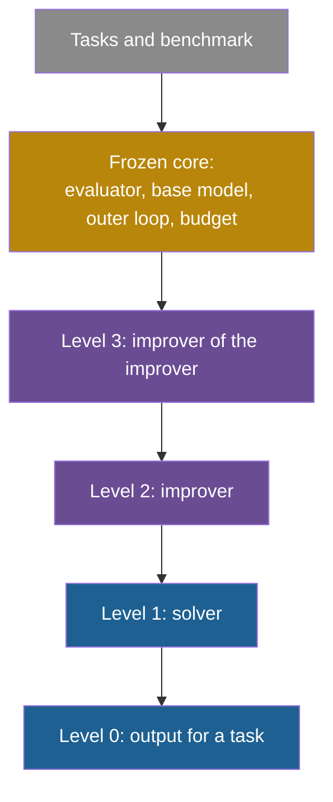

## Learning objectives

After this lesson you can:

- Define meta-learning with the base-level and meta-level split of Hospedales et al.
- Compute one inner step and one outer step of a small bilevel problem: a learned step size.
- Explain what Schmidhuber 1987, learned optimizers, MAML, RL² and Kirsch and Schmidhuber 2022 each make learnable, and what they keep fixed.
- Count the levels that each LLM-era system changes, from Promptbreeder to Hyperagents, and name the level that stays fixed.
- Explain the infinite regress problem and the three ways real systems stop it.
- Judge a claim that a system "improves its improver" from the evidence.

## Prerequisites

- [L4: The improver, meta-levels and the frozen core](/notes/ai/recursive-self-improvement/03-anatomy/l4-the-improver-and-meta-levels)
- [L5: Optimizing the improver: meta-objectives and nested loops](/notes/ai/recursive-self-improvement/04-mathematics/l5-optimizing-the-improver)
- [L2: The ladder: from repeating a task to improving the improver](/notes/ai/recursive-self-improvement/02-core-idea/l2-the-ladder-of-self-improvement)
- [L7: Training-based self-improvement and synthetic data](/notes/ai/recursive-self-improvement/05-approaches/l7-training-based-self-improvement)

## 1. The question this idea answers

A runner trains for a race. Each week she runs, measures her time, and adjusts her pace. This is **learning**: practice changes her performance.

Her coach watches many runners. He notices that short intervals help new runners more than long runs. He changes the training plan for every runner he coaches. This is **learning to learn**: experience over many runners changes how each runner learns.

Now ask who improves the coach. A coaching school could study many coaches and change how coaches are trained. And who improves the school? Each answer adds a level, and each level needs someone above it.

In AI, the runner is a model that learns a task. The coach is a meta-learning method that improves how the model learns. Recursive self-improvement (RSI) in the strong sense asks for something unusual: the coach improves himself, and the improved coach does the next improvement. This lesson asks how far real systems go up these levels, and what sits at the top that never changes.

## 2. Mental model, and where it stops working

> [!analogy] A tower of coaches
> Picture a tower. On the ground floor, a runner runs (the task). On floor 1, a coach changes the runner's plan (the improver). On floor 2, a head coach changes how coaches work (the improver of the improver). Every real tower has a roof that nobody changes: the rules of the race, the stopwatch, and the budget.
>
> **Where it stops working:**
>
> 1. In some systems, one program is both the runner and the coach. The floors merge, so "how many floors" becomes a question of what code can change, not of who is who.
> 2. Higher floors get less feedback. A runner gets a time every day. A head coach learns only after many runners finish a season. Signals at high levels are slow and noisy.
> 3. The roof is not always visible. A system can claim to change "everything", while a fixed evaluator or a fixed outer loop decides what survives.

## 3. Terms

| Term | Plain meaning |
|---|---|
| base learner | The procedure that learns one task, for example gradient descent on one dataset. |
| meta-learning | Learning to learn: improving a learning procedure over many learning episodes. |
| meta-knowledge | What the meta level learns about how to learn, for example a start point, a step size or an update rule. |
| inner loop | The base learning on one task. |
| outer loop | The meta learning across many tasks. It changes the meta-knowledge. |
| bilevel optimization | An optimization problem whose objective depends on the result of another optimization. |
| meta-objective | The quantity the outer loop tries to make small or large, measured after inner learning. |
| support set and query set | The training split and the validation split inside one task of a meta-learning dataset. |
| learned optimizer | A neural network that outputs the weight update, in place of a hand-written rule. |
| MAML | Model-Agnostic Meta-Learning: learn a start point from which a few gradient steps solve a new task. |
| N-way K-shot | A few-shot task with N new classes and K labeled examples per class. |
| RL² | A recurrent network trained by slow reinforcement learning (RL) so that its activations act as a fast learner. |
| meta-level | One level above a learner. Level 1 is the solver, level 2 improves the solver, level 3 improves that improver. |
| self-referential | A system that can read and change the part of itself that makes changes. |
| infinite regress | The chain "who improves the improver of the improver?" that never ends by itself. |
| fixed point | An input that a function maps to itself. Here: an improver that, run on itself, returns no better improver. |
| frozen core | The parts of a self-improving system that no level may change. |
| mutation-prompt | In Promptbreeder: an instruction that tells a language model how to change a task-prompt. |
| hyper-mutation prompt | In Promptbreeder: the fixed instruction that tells the language model how to change mutation-prompts. |
| meta-utility | In STOP: the average downstream score that an improver achieves. It scores improvers, not solutions. |

> [!key] Key term: meta-level
> - **Name:** meta-level.
> - **Meaning:** a layer of the system whose job is to change the layer below it.
> - **Problem it solves:** a fixed learning procedure cannot adapt to a family of tasks. A meta-level can tune it.
> - **Example:** MAML's outer loop changes the start weights. The inner loop, plain gradient descent, uses them.
> - **Connection to RSI:** strong RSI needs the improver to improve. That means a meta-level that changes, and whose changed version does the next improvement.
> - **Limits:** every system in this course keeps some top level fixed. Higher levels also get fewer and noisier feedback signals.

## 4. Method and math

### 4.1 Learning versus learning to learn

The survey by Hospedales et al. gives the standard definition (Hospedales et al., 2022, *IEEE TPAMI* 44(9), online 2021, [arXiv:2004.05439](https://arxiv.org/abs/2004.05439)). Meta-learning is "learning to learn, which refers to the process of improving a learning algorithm over multiple learning episodes."

The survey splits the system into two levels:

1. At the **base (inner) level**, a base learner solves one task, such as one image classification problem.
2. At the **meta (outer) level**, "an outer (or upper/meta) algorithm updates the inner learning algorithm". The goal is an outer objective, such as better generalization or faster learning.

The idea in words: the inner level learns weights for each task, using the current meta-knowledge. The outer level chooses the meta-knowledge that makes the inner results best on held-out data of each task.

$$
\theta^{*(i)}(\omega) = \arg\min_{\theta} \mathcal{L}^{\text{task}}\big(\theta, \omega, \mathcal{D}^{\text{train}(i)}\big), \qquad
\omega^{*} = \arg\min_{\omega} \sum_{i=1}^{M} \mathcal{L}^{\text{meta}}\big(\theta^{*(i)}(\omega), \omega, \mathcal{D}^{\text{val}(i)}\big)
$$

The symbols mean:

- $\omega$ is the meta-knowledge: "how to learn". It can be a start point, an optimizer or a loss.
- $\theta$ is the base model's weights.
- $i$ numbers the $M$ source tasks.
- $\mathcal{D}^{\text{train}(i)}$ and $\mathcal{D}^{\text{val}(i)}$ are the support set and the query set of task $i$.
- $\mathcal{L}^{\text{task}}$ is the inner loss, and $\mathcal{L}^{\text{meta}}$ is the outer loss.
- $\theta^{*(i)}(\omega)$ is the result of inner learning on task $i$ with meta-knowledge $\omega$.

In plain English: find the "how to learn" that gives the best learned models, judged on data the inner learner did not train on. Note that the inner level depends on $\omega$ but cannot change it.

> [!example] Worked example: learning a step size
> - **The task family.** Each task asks to minimize $f_a(\theta) = a\theta^2/2$. The tasks differ in the curvature $a$. The training tasks have $a = 1$ and $a = 3$. Every task starts at $\theta_0 = 1$.
>
> - **The inner loop.** One gradient step with step size $\eta$. The gradient is $a\theta$, so $\theta_1 = 1 - \eta a$. The task loss after the step is $a(1 - \eta a)^2/2$.
>
> - **The meta-knowledge.** Here $\omega$ is the step size $\eta$. The meta-objective is the mean loss after the inner step: $L(\eta) = \tfrac{1}{2}\big[(1-\eta)^2/2 + 3(1-3\eta)^2/2\big]$.
>
> 1. At $\eta = 0.1$: task 1 gives $0.9^2/2 = 0.405$. Task 3 gives $3 \times 0.7^2/2 = 0.735$. The mean is 0.570.
> 2. The derivative is $L'(\eta) = \tfrac{1}{2}\big[-(1-\eta) - 9(1-3\eta)\big] = (28\eta - 10)/2$. At $\eta = 0.1$ it is $-3.6$.
> 3. One outer gradient step with meta step size $\beta = 0.05$: $\eta = 0.1 + 0.05 \times 3.6 = 0.28$. Then $L(0.28) = 0.149$.
> 4. The best value solves $28\eta = 10$, so $\eta^* = 10/28 \approx 0.357$. There $L = 0.107$.
>
> - **Transfer.** A new task with $a = 2$ starts at loss 1.0. One inner step with $\eta^*$ gives $2(1 - 0.714)^2/2 = 0.082$. The learned step size helps a new task from the same family.
>
> - **Failure outside the family.** A task with $a = 10$ starts at loss 5.0. One step gives $10(1 - 3.57)^2/2 = 33.1$. The step overshoots, and the loss rises.

The assumptions: the tasks come from one family, and held-out data measures what we care about. The formulation is useful because it names the two loops and their data. It does not prove that the learned meta-knowledge transfers outside the task distribution. The $a = 10$ case shows the opposite.

Note two more points from the survey. First, our outer loop used a gradient. The survey counts hyperparameter tuning as meta-learning only with an end-to-end trained meta-objective, and it excludes random search and Bayesian optimization. So the same step size found by a grid search would not count under this definition. Second, our outer loop is itself a fixed rule: a gradient step with a fixed $\beta$. Nothing in the example improves the outer loop.

The survey also names three questions for any meta-learning method. **What** is learned (the meta-representation)? **How** is it learned (the meta-optimizer)? **Why**, toward which goal (the meta-objective)?

### 4.2 Schmidhuber 1987: do not stop at the first meta-level

Jürgen Schmidhuber's diploma thesis is an early, explicit statement of recursive learning to learn (Schmidhuber, 1987, [bibliography record](https://gpbib.cs.ucl.ac.uk/gp-html/schmidhuber_1987_srl.html)). Its subtitle is "On Learning how to Learn: The Meta-Meta-Meta...-Hook".

The argument has three steps:

1. Learning cannot be captured by a small fixed set of algorithms. A system needs many strategies.
2. So the system should treat every problem as two problems: solve it, and improve the strategies it uses to solve problems.
3. It should not stop there. The abstract says: "Of course we do not want to stop at the first meta-level!"

The thesis proposes to apply genetic programming at the meta level, to find better program-modifying programs. **Claimed:** the experiments did not show concrete self-reference, because the available compute was far too small. The work is meant as inspiration more than as a practical guide. It is a design, not a demonstrated system.

### 4.3 Learned optimizers

Andrychowicz et al. replace the hand-written update rule of gradient descent with a small recurrent network, an LSTM. The paper appeared at NIPS 2016 ([arXiv:1606.04474](https://arxiv.org/abs/1606.04474)). The paper's title is "Learning to learn by gradient descent by gradient descent".

1. Sample a problem from a family, for example a random quadratic or a small network on MNIST.
2. Run the problem's weights for T steps. At each step the LSTM reads the gradient and outputs the update.
3. Sum the problem's losses along the way. This sum is the LSTM's training loss.
4. Train the LSTM's own weights with Adam, by back-propagation through the unrolled steps.

**Measured (figure-level).** On random 10-dimensional quadratics and on small MNIST networks, the learned optimizer beat SGD, RMSprop, Adam and NAG. It transferred to wider and deeper MNIST networks. It **failed** when the activation function changed to ReLU. The authors write that the change "makes the dynamics of the learning procedure sufficiently different."

**What changes and what stays fixed.** The update rule is learned, one level above the task. The outer optimizer that trains the LSTM is Adam, fixed by humans. There is no recursion beyond one meta-level.

### 4.4 MAML: learn where to start

MAML learns a start point from which one or a few gradient steps already solve a new task (Finn et al., 2017, [arXiv:1703.03400](https://arxiv.org/abs/1703.03400)). [Part 4 L5](/notes/ai/recursive-self-improvement/04-mathematics/l5-optimizing-the-improver) works through its inner and outer updates with numbers. Here is the recap:

1. **Inner update:** for each sampled task, take a gradient step from the shared start weights with step size $\alpha$. This gives task-specific weights.
2. **Outer update:** measure each adapted model's loss on held-out examples of its task. Take a gradient step on the **shared start weights** with meta step size $\beta$.

The outer gradient passes through the inner step, so it needs second derivatives. First-order MAML drops them, and on MiniImagenet it performed nearly the same.

| Dataset and setting | MAML | First-order MAML |
|---|---|---|
| Omniglot, 5-way 1-shot | 98.7 ± 0.4% | – |
| Omniglot, 20-way 1-shot | 95.8 ± 0.3% | – |
| MiniImagenet, 5-way 1-shot | 48.70 ± 1.84% | 48.07 ± 1.75% |
| MiniImagenet, 5-way 5-shot | 63.11 ± 0.92% | 63.15 ± 0.91% |

**What changes:** the start weights. **What stays fixed:** the inner learning rule (gradient descent), the outer optimizer, and the task distribution. **Our interpretation:** MAML improves the starting point of learning, not the learning algorithm or the meta-optimizer. So it climbs only part of one meta-level.

### 4.5 RL²: a fast learner in the activations

RL² trains a recurrent network across many reinforcement learning problems (Duan et al., 2016, [arXiv:1611.02779](https://arxiv.org/abs/1611.02779)). It is an arXiv preprint, and its acceptance status is not confirmed.

1. At each step, the network reads the state, the previous action, the reward and an end-of-episode flag.
2. Its hidden state is **not reset** between episodes of the same problem, so it can remember what worked.
3. A standard "slow" RL algorithm, TRPO, trains the network's weights over many problems.

The result is a "fast" learner encoded in the activations. It adapts to a new problem without any weight change. **Measured:** on multi-armed bandits with 100 episodes and 50 arms, RL² scored 84.9. The Gittins index, which was given the true prior, scored 85.2. On small tabular problems it beat the baselines for short horizons but lost for long ones (1913.7 against 1973.9 at 100 episodes).

The authors name the limit: "the outer-loop reinforcement learning algorithm was shown to be an immediate bottleneck". **Our interpretation:** learning can live in activations, as it does in the context window of a language model. The slow learner on top still stays fixed.

### 4.6 Self-referential meta-learning (Kirsch and Schmidhuber, 2022)

Kirsch and Schmidhuber describe a neural network that modifies itself and improves its own self-modifications (Kirsch and Schmidhuber, 2022, [arXiv:2212.14392](https://arxiv.org/abs/2212.14392)). The title is "Eliminating Meta Optimization Through Self-Referential Meta Learning". The network learns to learn "without the need for explicit meta optimization" (abstract), through a procedure the authors call "fitness monotonic execution".

**Measured:** the method works on bandits and classic control problems, at small scale. This course's sources do not give its numbers. **Our interpretation:** it is the clearest attempt in our sources to fold the levels into one learner instead of stacking them. It has not been shown at the scale of language models.

### 4.7 What "levels" mean in LLM-era systems

For the rest of the lesson we count levels this way (**Our interpretation**). These meta-levels are not the seven rungs of the ladder in [Part 2 L2](/notes/ai/recursive-self-improvement/02-core-idea/l2-the-ladder-of-self-improvement). The ladder says where a change lives. The meta-levels say how many steps above the output it sits. So ladder Level 5, improve the improver, means a change to level 2 in the list below.

1. **Level 0, the output:** an answer, a program for a user, a translation.
2. **Level 1, the solver:** the thing that makes outputs, such as the model's weights, an agent's code or a task-prompt.
3. **Level 2, the improver:** the procedure that changes the solver, such as a mutation-prompt, a judge or an improver program.
4. **Level 3, the improver of the improver:** the procedure that changes level 2.

The top of every real system is a **frozen core**: the evaluator, the base model, the outer loop and the budget. [Part 3 L4](/notes/ai/recursive-self-improvement/03-anatomy/l4-the-improver-and-meta-levels) covers the frozen core in depth.



### 4.8 The LLM-era systems, one level at a time

#### Promptbreeder: mutation-prompts evolve, the hyper-mutation prompt does not

Promptbreeder evolves task-prompts and also the mutation-prompts that change them (Fernando et al., 2024, [arXiv:2309.16797](https://arxiv.org/abs/2309.16797)). The paper says: "The mutation operator for this meta-level algorithm is again an LLM, now conditioned on a hyper-mutation prompt H."

The hyper-mutation prompt H is fixed. So are the list of operator types and the tournament genetic algorithm. **Measured (as reported):** "Removing any self-referential operator is harmful under nearly all circumstances". The paper gives the numbers in Appendix L, which this course has not checked.

The authors also call Promptbreeder "not self-referential (in a way that thought is)", because it does not invent new ways to evaluate mutants. **Levels:** 1 and 2 change. Level 3 (H) is fixed. [Part 6](/notes/ai/recursive-self-improvement/06-research-systems/p04-promptbreeder) reads the paper in depth.

#### STOP: the improver improves its own code

STOP starts with a seed improver program (Zelikman et al., 2024, [arXiv:2310.02304](https://arxiv.org/abs/2310.02304)). The improver takes a solution and a utility, asks a language model for several changes, and returns the best one. Then STOP gives the improver **its own source code** as the solution to improve. The score is the meta-utility: the mean downstream score that an improver achieves on training tasks.

- **Measured (GPT-4):** after self-improvement, the improver transferred to new tasks. On 3-SAT, the meta-utility rose from 21.2% (seed improver) to 75.1%. On Max-Cut, it rose from 58.7% to 74.2%.
- **Measured (weaker models):** with GPT-3.5 and Mixtral, performance degraded. "Only 12% of GPT-3.5 runs yielded at least a 3% improvement." The GPT-3.5 seed improver started higher than GPT-4's (65% against 61%), so the drop is not a weaker start.
- The language model invented improver strategies such as beam search, genetic algorithms, simulated annealing and bandit search.
- The authors write: "Since the language models themselves are not altered, this is not full recursive self-improvement."

**Levels:** the improver is the solver of its own improvement task, so levels 2 and 3 fold into one program. Fixed: the language model, the meta-utility and the outer loop, which runs a number of rounds fixed in advance. [Part 6](/notes/ai/recursive-self-improvement/06-research-systems/p05-stop-self-taught-optimizer) reads STOP in depth.

#### Self-Rewarding and Meta-Rewarding: the judge improves

In Self-Rewarding Language Models, one model is both the policy and its own LLM judge (Yuan et al., 2024, [arXiv:2401.10020](https://arxiv.org/abs/2401.10020)). The judge's accuracy against human rankings rose from 78.7% to 81.7% over iterations. Meta-Rewarding adds a meta-judge that compares the model's own judgments and trains the judge (Wu et al., 2024, [arXiv:2407.19594](https://arxiv.org/abs/2407.19594)). There is no meta-meta-judge, and the 5-point scale saturated. Lesson [L7](/notes/ai/recursive-self-improvement/05-approaches/l7-training-based-self-improvement) gives the numbers.

**Levels:** Self-Rewarding changes levels 1 and 2. Meta-Rewarding adds a signal from a meta-judge aimed at level 2, but nothing trains the meta-judge on purpose. DPO and the rubric stay fixed.

#### SEAL and Absolute Zero: the data generator improves

In SEAL, RL improves how the model writes its own fine-tuning data (Zweiger et al., 2025, [arXiv:2506.10943](https://arxiv.org/abs/2506.10943)). In Absolute Zero, the proposer role learns to invent tasks at the edge of the solver's ability (Zhao et al., 2025, [arXiv:2505.03335](https://arxiv.org/abs/2505.03335)). **Levels:** 1 and 2 change. The RL algorithm, the reward definitions and the verifier are fixed.

#### ADAS: a fixed meta agent

In ADAS, a meta agent writes new agents as code and keeps an archive of them (Hu, Lu, Clune, 2025, [arXiv:2408.08435](https://arxiv.org/abs/2408.08435)). The meta agent never changes. **Speculation:** the authors name "a higher order of meta-learning" as future work. They want "to allow the learning of the meta agent and even the meta-meta agent, etc." **Levels:** only level 1 changes. This is automated design, not self-improvement.

#### The Darwin Gödel Machine: better coding, better self-editing

The DGM's agent edits its own code (Zhang et al., 2025, [arXiv:2505.22954](https://arxiv.org/abs/2505.22954)). Its central assumption: "self-improvement is fundamentally a coding task that modifies the coding agent's own code repository". So better coding should also mean better self-improvement. Two facts limit this claim:

1. In the released code, a fixed call to an o1 model writes the diagnosis of what to change next. The parent agent only implements it. So the ideation step is not editable.
2. The Huxley-Gödel Machine measured how well an agent's score predicts the success of its descendants (Wang et al., 2025, [arXiv:2510.21614](https://arxiv.org/abs/2510.21614), Table 1). The Pearson correlations for the DGM and SICA rules were between 0.27 and 0.44. So a better coder is only weakly a better ancestor.

**Levels:** level 1 changes, and level 2 changes in part, because the implementer is the same code. Parent selection, the archive rule, the evaluation and the diagnosis step stay fixed.

#### Gödel Agent: the learner is editable at runtime

In Gödel Agent's framework, the current learner rewrites both the policy and itself (Yin et al., 2025, [ACL Anthology](https://aclanthology.org/2025.acl-long.1354), Section 3). It uses the feedback and a high-level goal. It installs new code into the running program by monkey patching.

**Measured (100 MGSM trials):** 4% of runs ended in unexpected termination, usually after the agent changed its own improvement module. 14% ended worse than the start policy. **Our interpretation:** the evidence that the learner itself got better, as opposed to the policy, is mostly qualitative. Fixed: the goal, the utility and the language model.

#### Hyperagents: the meta agent becomes editable

A hyperagent puts the task agent and the self-modifying meta agent into one editable program (Zhang et al., 2026, [arXiv:2603.19461](https://arxiv.org/abs/2603.19461)). It removes the DGM's assumption that coding skill transfers to self-improvement in other domains.

**Measured (test medians over 5 runs):** on paper review, the score rose to 0.710. The initial agent and the original DGM both scored 0.0. On robotics reward design the score rose from 0.060 to 0.372. For meta-level transfer, hyperagents moved to math grading scored 0.630 on the paper's imp@50 measure, against 0.0 for the baseline.

Parent selection and evaluation stay fixed in the main experiments. Only preliminary results exist on editing parent selection. **Levels:** 1 and 2 change, and the outer loop is fixed.

#### AlphaEvolve: meta-prompts co-evolve

AlphaEvolve's prompt sampler uses meta-prompts that evolve together with the programs (lesson [L6](/notes/ai/recursive-self-improvement/05-approaches/l6-evolutionary-and-population-methods)). **Our interpretation:** this changes part of the proposer's instructions, a narrow slice of level 2. The controller and evaluators are fixed.

### 4.9 How many levels each system changes

The table summarizes sections 4.1 to 4.8. The level counts are **Our interpretation** with the levels of section 4.7. "Folded" means one program plays two levels.

| System | Level 1: solver | Level 2: improver | Level 3 | Fixed at the top | Evidence that the higher level helped |
|---|---|---|---|---|---|
| Fine-tuning with SGD | weights | no | no | SGD, data | not applicable |
| Learned optimizer | weights | update rule | no | Adam trains the rule | beats baselines, fails on ReLU |
| MAML | weights | start point only | no | gradient descent in both loops | few-shot accuracy table |
| RL² | activations | the fast learner | no | TRPO | close to Gittins on bandits |
| Promptbreeder | task-prompts | mutation-prompts | no | hyper-mutation prompt, GA, fitness | ablation says removal hurts |
| STOP | downstream solutions | improver code | folded with level 2 | language model, meta-utility, round count | transfer with GPT-4, decline with GPT-3.5 |
| Self-Rewarding | policy weights | the judge | no | DPO, rubric, prompt generator | judge accuracy 78.7% to 81.7% |
| Meta-Rewarding | actor | judge, trained by a meta-judge | no meta-meta-judge | rubric, DPO | gains, then score saturation |
| SEAL | weights | self-edit writing | no | RL procedure, labeled tasks | 47.0% against 46.3% for GPT-4.1 data |
| Absolute Zero | solver | task proposer | no | executor, rewards | gains over its base models |
| ADAS | agent designs | no | no | meta agent, evaluator | gains disputed (see L4) |
| DGM | agent code | implementer, in part | no | diagnosis, parent selection, evaluation | 20.0% to 50.0%, score predicts descendants weakly |
| Gödel Agent | policy | learner code, claimed | no | goal, utility, language model | mostly qualitative, 4% self-termination |
| Hyperagents | task agent | meta agent | no | parent selection, evaluation | meta-level transfer 0.630 against 0.0 |
| AlphaEvolve | user programs | meta-prompts, in part | no | controller, evaluators, LLMs | ablation curves only |

No system in this table changes level 3 by a separate mechanism. Every system keeps a fixed top. This matches the ladder of [Part 2 L2](/notes/ai/recursive-self-improvement/02-core-idea/l2-the-ladder-of-self-improvement): several systems reach Level 5 (improve the improver) in a partial form, and none reaches Level 6.

### 4.10 Infinite regress and fixed points

**The regress.** If level 2 improves level 1, who improves level 2? If level 3 does, who improves level 3? Schmidhuber's answer in 1987 was to keep going: "we do not want to stop at the first meta-level". But a tower of distinct levels never ends by itself. Real systems stop the regress in one of three ways.

1. **Freeze a top level.** This is what every practical system does. MAML fixes its outer optimizer. Promptbreeder fixes H. DGM fixes parent selection. The frozen top is the system's final judge of progress.
2. **Fold the levels into one self-referential program.** The improver is part of what it improves. The Gödel machine is the theoretical model: its proof searcher "may completely rewrite p, including the proof searcher" (Schmidhuber, 2003, [arXiv:cs/0309048](https://arxiv.org/abs/cs/0309048)). STOP, Gödel Agent and Hyperagents fold levels in practice. Even then something stays outside. In the Gödel machine, the utility function and the axioms are fixed. In STOP, the meta-utility and the language model are fixed.
3. **Learn without an explicit meta-optimizer.** Kirsch and Schmidhuber 2022 aim for this, at small scale.

**Theory:** the Gödel machine changes itself only after it proves that the change helps. It "must ignore those self-improvements whose effectiveness it cannot prove". The 2003–2009 papers report no implementation. [Part 8 L6](/notes/ai/recursive-self-improvement/08-failure-modes-and-safety/l6-changing-the-improver-safely) explains a further problem, the Löbian obstacle: a proof-based agent cannot trust a successor that uses the same proof system.

**Fixed points.** An improver $I$ is at a fixed point when running it on itself gives an improver that is no better. Then further self-application does nothing.

STOP does not detect fixed points. It simply runs a number of rounds that is fixed in advance from the budget. Its appendix gives a recursive "maximizer" formulation and notes that a fixed point "may equally well be a minimizer". No theorem is proved for it.

**Our interpretation:** self-application alone does not guarantee progress. Whether a fixed point is good depends on the frozen objective that scores it.

Wang's formal model of RSI makes the same structure explicit (Wang, 2018, [arXiv:1805.06610](https://arxiv.org/pdf/1805.06610)). A program generates a new program. If the new one is better by a score, it replaces the old one. The model assumes a homogeneous Markov chain, so the improvement step has the same form at every iteration. **Our interpretation:** the score is the fixed top of that model.

**Why higher levels are hard to improve.** Four kinds of evidence point the same way:

1. **Fewer, noisier signals.** One meta-level score needs many inner runs. [Part 4 L5](/notes/ai/recursive-self-improvement/04-mathematics/l5-optimizing-the-improver) computes the cost.
2. **Weak link between levels.** In the DGM and SICA, an agent's own score predicts its descendants' success only weakly. The correlations are 0.27 to 0.44.
3. **Fragility.** Gödel Agent stopped in 4% of runs after editing its improvement module. STOP degraded with weaker models.
4. **Saturation.** Meta-Rewarding's extra level helped, then the scale saturated. RL²'s outer loop was "an immediate bottleneck".

**Our interpretation:** adding a meta-level is a bet on two things. The level below must have room to improve, and the signal for the new level must be reliable. The evidence in this part supports small bets of one level, with a fixed top.

## 5. Graphs

```plot
{
  "title": "Loss after one inner gradient step as a function of the step size: task a = 1 (gold), task a = 3 (purple), meta-objective as their mean (blue)",
  "xAxis": { "label": "step size eta", "domain": [0, 0.7] },
  "yAxis": { "label": "loss after one step", "domain": [0, 1.6] },
  "disableZoom": true,
  "data": [
    { "fn": "(1-x)^2/2", "color": "#B8860B" },
    { "fn": "3*(1-3*x)^2/2", "color": "#6A4C93" },
    { "fn": "((1-x)^2/2 + 3*(1-3*x)^2/2)/2", "color": "#1E6091" }
  ]
}
```

The blue curve has its minimum at $\eta \approx 0.357$. The purple task wants $\eta = 1/3$ and the gold task wants $\eta = 1$. The meta-learned value is a compromise that suits the family, not each task. This is why it fails for a task far outside the family.

## 6. Video and animation

- [Stanford CS330 Lecture 3: Optimization-Based Meta-Learning](https://www.youtube.com/watch?v=v7otSgpTc0Q) (Chelsea Finn, advanced). MAML explained by its inventor. Supports sections 4.1 and 4.4.
- [Meta Reinforcement Learning by Chelsea Finn](https://www.youtube.com/watch?v=c0vSwglRY4w) (CIFAR summer school, advanced). Agents that learn how to learn new RL tasks. Supports section 4.5.
- [Juergen Schmidhuber: Godel Machines, Meta-Learning, and LSTMs](https://www.youtube.com/watch?v=3FIo6evmweo) (Lex Fridman Podcast #11). The history of meta-learning and self-rewriting programs from the author of the 1987 thesis. Supports sections 4.2 and 4.10.
- [Promptbreeder: Self-Referential Self-Improvement Via Prompt Evolution](https://www.youtube.com/watch?v=tkX0EfNl4Fc) (Yannic Kilcher). A paper review of mutation-prompts that evolve. Supports section 4.8.
- [Adam Kalai: Recursive Self-improving Code Generation](https://www.youtube.com/watch?v=RovcBFlfXpQ) (DIMACS). A STOP co-author explains the improver that improves itself, and the safety concerns. Supports section 4.8.

## 8. Common mistakes

1. **"Meta-learning is recursive self-improvement."** Classic meta-learning adds one learnable level and keeps a fixed outer optimizer. Strong RSI needs the improver to improve and to do the next improvement.
2. **"More meta-levels give more improvement."** Higher levels get fewer, noisier signals. Meta-Rewarding saturated, and RL²'s outer loop was a bottleneck.
3. **"A self-referential system has no fixed parts."** STOP keeps its language model and meta-utility. Hyperagents keep parent selection and evaluation. The Gödel machine keeps its utility and axioms.
4. **"Better at the task means better at improving."** In the DGM and SICA, an agent's score predicted its descendants' success only weakly. The correlations were 0.27 to 0.44.
5. **"A learned improver works everywhere."** The learned optimizer failed when the activation changed to ReLU. The learned step size of section 4.1 fails for $a = 10$.
6. **"ADAS improves itself."** Its meta agent is fixed. The authors list a higher-order version as future work.

## 9. One-minute explanation

Learning changes a model so that it does a task better. Learning to learn uses many tasks to change how the model learns, such as its start point, step size or update rule. Classic methods, from learned optimizers to MAML and RL², add one learnable level and keep the outer optimizer fixed. LLM-era systems go a little further: Promptbreeder evolves mutation-prompts, STOP improves its own improver, and Self-Rewarding improves its judge. Each still keeps a fixed top, such as a hyper-mutation prompt, a meta-utility or an evaluator. The regress ends only where a level is frozen, and higher levels get weaker signals and break more easily.

## 10. Check questions

```check
{
  "question": "In the step-size example, the training tasks have curvatures a = 1 and a = 3, start at θ = 1, and take one gradient step. Compute the meta-objective at η = 0.3 and at η = 0.4. Which is closer to the optimum, and why does the optimum differ from 1/3?",
  "hint": "L(η) = [(1 − η)²/2 + 3(1 − 3η)²/2] / 2.",
  "answer": "At η = 0.3: task 1 gives 0.49/2 = 0.245. Task 3 gives 3 × 0.01/2 = 0.015. The mean is 0.130. At η = 0.4: task 1 gives 0.36/2 = 0.18. Task 3 gives 3 × 0.04/2 = 0.06. The mean is 0.120. So η = 0.4 is slightly better, and the optimum is 10/28 ≈ 0.357. The value 1/3 is perfect for task 3 alone. Task 1 wants a larger step, so the mean moves the optimum above 1/3."
}
```

```check
{
  "question": "For each system, name the highest level that changes and the level or part that stays fixed: (a) MAML, (b) Promptbreeder, (c) STOP, (d) ADAS.",
  "answer": "(a) MAML changes the start weights, part of level 2. Fixed: gradient descent in the inner and outer loops, and the task distribution. (b) Promptbreeder changes mutation-prompts (level 2). Fixed: the hyper-mutation prompt H, the operator types, the genetic algorithm and the fitness. (c) STOP changes the improver's code, and the improver improves itself, so levels 2 and 3 fold into one program. Fixed: the language model, the meta-utility and the number of rounds. (d) ADAS changes only the agent designs (level 1). Fixed: the meta agent, its prompt and the evaluator."
}
```

```check
{
  "question": "A paper says that its agent \"rewrites its own improvement code\" and calls it \"fully recursively self-improving\". Write three questions to ask before you accept the claim. Use the evidence types of this lesson.",
  "answer": "1. What stays fixed? Name the evaluator, the base model, the outer loop and the acceptance rule, and check if any of them could change. 2. Is there evidence that the improvement code itself got better, separate from the solver? For example, does the changed improver produce larger gains on held-out tasks than the original improver, at the same budget? Gödel Agent's evidence for this was mostly qualitative. 3. How often do changes to the improver break the system or make it worse? Gödel Agent stopped in 4% of runs and ended worse in 14%. STOP degraded with weaker models."
}
```

```check
{
  "question": "Hospedales et al. exclude random search and Bayesian optimization of hyperparameters from meta-learning, but include gradient-based hyperparameter learning. A team finds a learning rate by a grid search over 20 values on a validation set. Is this meta-learning under that definition? Is it self-improvement? Explain.",
  "answer": "Under the survey's definition it is not meta-learning, because there is no end-to-end trained meta-objective: the grid search is a fixed external procedure. It is also not self-improvement, because the system does not change itself: a human-designed search picks a value once. It is ordinary hyperparameter optimization. The same value found by a gradient on the meta-objective would count as meta-learning, but still not as RSI, because the outer rule stays fixed."
}
```

```check
{
  "question": "The DGM assumes that better coding means better self-improvement. The Huxley-Gödel Machine found correlations between 0.27 and 0.44 between an agent's score and its descendants' success. What does a correlation of 0.4 allow you to say, and what does it not allow?",
  "answer": "A correlation of 0.4 means agents with higher scores tend to have somewhat more successful descendants, so the assumption is not wrong. It does not let you pick the best ancestor from its score with confidence. Much of the variation in descendant success is unrelated to the parent's own score. So a parent-selection rule based on the agent's own score will often expand weak lineages and skip strong ones. HGM's clade-based estimate reached correlations of 0.51 to 0.87 in the same study."
}
```

## 11. Summary and links

- Meta-learning improves a learning procedure over many tasks. The inner level depends on the meta-knowledge but cannot change it.
- Classic methods make one level learnable (an update rule, a start point, a fast learner) and keep the outer optimizer fixed.
- LLM-era systems change at most two levels, or fold two levels into one program. Every one keeps a fixed top.
- Infinite regress ends by freezing a level, folding levels into a self-referential program, or learning without an explicit meta-optimizer.
- Higher levels get fewer, noisier signals, break more easily and saturate. The evidence supports small, one-level steps with a fixed evaluator.

The next lesson looks across systems from another angle: how they split improvement into roles such as proposer, solver, critic and judge.

- Previous: [L7: Training-based self-improvement and synthetic data](/notes/ai/recursive-self-improvement/05-approaches/l7-training-based-self-improvement)
- Next: [L9: Multi-agent roles in improvement](/notes/ai/recursive-self-improvement/05-approaches/l9-multi-agent-improvement)
- Related: [L4: The improver, meta-levels and the frozen core](/notes/ai/recursive-self-improvement/03-anatomy/l4-the-improver-and-meta-levels), [L5: Optimizing the improver](/notes/ai/recursive-self-improvement/04-mathematics/l5-optimizing-the-improver), [2023: STOP](/notes/ai/recursive-self-improvement/06-research-systems/p05-stop-self-taught-optimizer), [2023: Promptbreeder](/notes/ai/recursive-self-improvement/06-research-systems/p04-promptbreeder), [L6: The special risks of changing the improver](/notes/ai/recursive-self-improvement/08-failure-modes-and-safety/l6-changing-the-improver-safely)

## References

- Timothy Hospedales, Antreas Antoniou, Paul Micaelli, Amos Storkey. "Meta-Learning in Neural Networks: A Survey". *IEEE Transactions on Pattern Analysis and Machine Intelligence* 44(9):5149–5169. 2022 (online 2021). DOI 10.1109/TPAMI.2021.3079209. arXiv:2004.05439. https://arxiv.org/abs/2004.05439
- Jürgen Schmidhuber. "Evolutionary Principles in Self-Referential Learning. On Learning how to Learn: The Meta-Meta-Meta...-Hook". Diploma thesis, Technische Universität München. 1987. https://gpbib.cs.ucl.ac.uk/gp-html/schmidhuber_1987_srl.html
- Marcin Andrychowicz, Misha Denil, Sergio Gómez Colmenarejo, et al. "Learning to learn by gradient descent by gradient descent". NIPS 2016. arXiv:1606.04474. https://arxiv.org/abs/1606.04474
- Chelsea Finn, Pieter Abbeel, Sergey Levine. "Model-Agnostic Meta-Learning for Fast Adaptation of Deep Networks". ICML 2017, PMLR 70. arXiv:1703.03400. https://arxiv.org/abs/1703.03400
- Yan Duan, John Schulman, Xi Chen, Peter L. Bartlett, Ilya Sutskever, Pieter Abbeel. "RL²: Fast Reinforcement Learning via Slow Reinforcement Learning". 2016. arXiv:1611.02779. https://arxiv.org/abs/1611.02779
- Kirsch, Jürgen Schmidhuber. "Eliminating Meta Optimization Through Self-Referential Meta Learning". 2022. arXiv:2212.14392. https://arxiv.org/abs/2212.14392 (the first author's given name is not in this course's sources)
- Chrisantha Fernando, Dylan Banarse, Henryk Michalewski, Simon Osindero, Tim Rocktäschel. "Promptbreeder: Self-Referential Self-Improvement Via Prompt Evolution". ICML 2024, PMLR 235. arXiv:2309.16797. https://arxiv.org/abs/2309.16797
- Eric Zelikman, Eliana Lorch, Lester Mackey, Adam Tauman Kalai. "Self-Taught Optimizer (STOP): Recursively Self-Improving Code Generation". COLM 2024. arXiv:2310.02304. https://arxiv.org/abs/2310.02304. Code: https://github.com/microsoft/stop
- Weizhe Yuan, Richard Yuanzhe Pang, Kyunghyun Cho, et al. "Self-Rewarding Language Models". ICML 2024. arXiv:2401.10020. https://arxiv.org/abs/2401.10020
- Tianhao Wu, Weizhe Yuan, Olga Golovneva, et al. "Meta-Rewarding Language Models: Self-Improving Alignment with LLM-as-a-Meta-Judge". 2024. arXiv:2407.19594. https://arxiv.org/abs/2407.19594
- Adam Zweiger, Jyothish Pari, Han Guo, Ekin Akyürek, Yoon Kim, Pulkit Agrawal. "Self-Adapting Language Models". NeurIPS 2025. arXiv:2506.10943. https://arxiv.org/abs/2506.10943
- Andrew Zhao, Yiran Wu, Yang Yue, et al. "Absolute Zero: Reinforced Self-play Reasoning with Zero Data". NeurIPS 2025. arXiv:2505.03335. https://arxiv.org/abs/2505.03335
- Shengran Hu, Cong Lu, Jeff Clune. "Automated Design of Agentic Systems". ICLR 2025. arXiv:2408.08435. https://arxiv.org/abs/2408.08435
- Jenny Zhang, Shengran Hu, Cong Lu, Robert Lange, Jeff Clune. "Darwin Gödel Machine: Open-Ended Evolution of Self-Improving Agents". ICLR 2026. arXiv:2505.22954. https://arxiv.org/abs/2505.22954. Code: https://github.com/jennyzzt/dgm
- Wenyi Wang, Piotr Piękos, Li Nanbo, et al. "Huxley-Gödel Machine: Human-Level Coding Agent Development by an Approximation of the Optimal Self-Improving Machine". ICLR 2026. arXiv:2510.21614. https://arxiv.org/abs/2510.21614
- Xunjian Yin, Xinyi Wang, Liangming Pan, Li Lin, Xiaojun Wan, William Yang Wang. "Gödel Agent: A Self-Referential Agent Framework for Recursively Self-Improvement". ACL 2025, pp. 27890–27913. arXiv:2410.04444. https://aclanthology.org/2025.acl-long.1354
- Jenny Zhang, Bingchen Zhao, Wannan Yang, et al. "Hyperagents". 2026. arXiv:2603.19461. https://arxiv.org/abs/2603.19461. Code: https://github.com/facebookresearch/Hyperagents
- Jürgen Schmidhuber. "Goedel Machines: Self-Referential Universal Problem Solvers Making Provably Optimal Self-Improvements". 2003 (v5 2006). arXiv:cs/0309048. https://arxiv.org/abs/cs/0309048
- Wang. "A Formulation of Recursive Self-Improvement and Its Possible Efficiency". 2018. arXiv:1805.06610. https://arxiv.org/pdf/1805.06610 (the author's given name is not in this course's sources)
